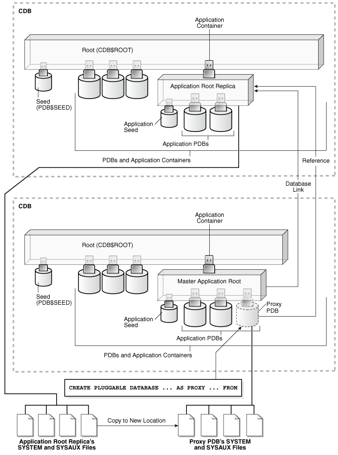
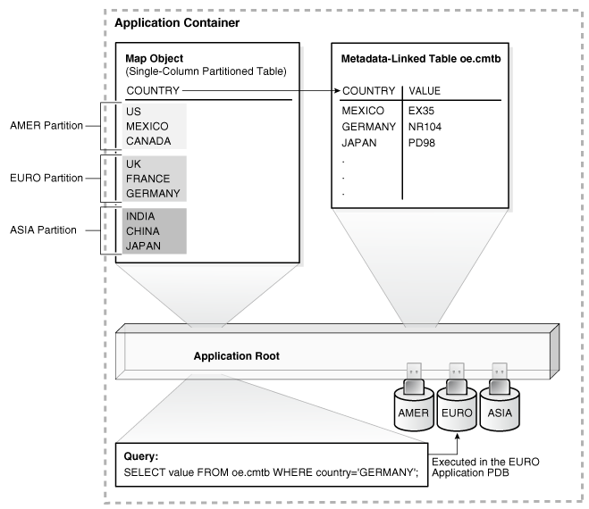

You can administer application containers, including application roots and application PDBs. You can also administer the applications installed in application containers.

Note:

You can complete the tasks in this chapter using SQL\*Plus or Oracle SQL Developer.

- About Administering Application Containers with SQL\*Plus  
	Some aspects of administering an application container are similar to administering the CDB root and the CDB as a whole, while other aspects of administering an application container are similar to administering a PDB.
- About Modifying an Application Root  
	The `ALTER` `DATABASE` statement can modify an application root. The `ALTER` `PLUGGABLE` `DATABASE` statement can modify the open mode of one or more application PDBs.
- Managing Applications in an Application Container  
	You install, upgrade, or patch an application in an application container. You can also uninstall an application from an application container. You perform these operations in the application root, and the application container propagates the application changes to the application PDBs when the application PDBs synchronize with the application in the application root.
- Managing Application Common Objects  
	Application common objects are shared, user-created database objects in an application container. Application common objects are created in an application root.
- Issuing DML Statements on Containers in an Application Container  
	A DML statement issued in an application root can modify one or more containers in the application container. In addition, you can specify one or more default container targets for DML statements.
- Partitioning by PDB with Container Maps  
	Container maps enable the partitioning of data at the application PDB level when the data is not physically partitioned at the table level.

**Parent topic:** [Managing a Multitenant Environment](managing-a-multitenant-environment.md)

### 44.1 About Administering Application Containers with SQL\*Plus

Some aspects of administering an application container are similar to administering the CDB root and the CDB as a whole, while other aspects of administering an application container are similar to administering a PDB.

Administering an application container is similar to administering a CDB because you can manage both the application root and the application PDBs that are plugged into the application root. However, administering an application container is also similar to managing a PDB because changes to the application container do not affect other application containers or PDBs in the CDB.

The following table describes administrative tasks for application containers that are similar to administrative tasks that manage a CDB or CDB root.

Table 44-1 Application Container Administrative Tasks Similar to Those of a CDB

| Administrative Task | Description | More Information |
| --- | --- | --- |
| Configuring application common users and commonly granted privileges | Application common users and privileges are similar to common users and commonly granted privileges in a CDB root, but in an application container, common users and commonly granted privileges only exist within the containers of the application container, including the application root, application PDBs that belong to the application root, and an optional application seed that belongs to the application root. | [Oracle Database Concepts](https://docs.oracle.com/pls/topic/lookup?ctx=en/database/oracle/oracle-database/12.2/admin&id=CNCPT89257) |
| Creating application containers | A common user whose current container is the CDB root can create application containers that are plugged into the CDB root. To do so, include the `AS APPLICATION CONTAINER` clause in the `CREATE PLUGGABLE DATABASE` statement | " [Creating Application Containers](creating-removing-application-containers-seeds-with-sql-plus.md) " |
| Creating application PDBs | A common user whose current container is the application root can create application PDBs that are plugged into the application root. | " [Creating and Removing PDBs with SQL\*Plus](creating-and-removing-pdbs-with-sql-plus.md) " |
| Switching to containers | A common user with the proper privileges can switch between containers in an application container, including the application root, application PDBs that belong to the application root, and an optional application seed that belongs to the application root. | " [Switching to a Container Using the ALTER SESSION Statement](administering-a-cdb-with-sql-plus.md) " |
| Issuing `ALTER SYSTEM SET` statements | The `ALTER SYSTEM SET` statement can dynamically set an initialization parameter in one or more containers in an application container. | " [Using the ALTER SYSTEM SET Statement in a CDB](administering-a-cdb-with-sql-plus.md) " |
| Issuing data definition language (DDL) statements | In an application container, some DDL statements can apply to all containers in the application container or to the current container only. | " Modifying Application Common Objects with DDL Statements " |

The following table describes administrative tasks for application containers that are similar to administrative tasks that manage a PDB.

Table 44-2 Application Container Administrative Tasks Similar to Those of a PDB

| Administrative Task | Description | More Information |
| --- | --- | --- |
| Connecting to the application root | The application root has its own service name, and users can connect to the application root in the same way that they connect to a PDB. Similarly, each application PDB has its own service name, and the application seed has its own service name. | " [Accessing a Container in a CDB with SQL\*Plus](administering-a-cdb-with-sql-plus.md) " |
| Issuing the `ALTER PLUGGABLE DATABASE` statement | An `ALTER PLUGGABLE DATABASE` statement can modify an application root, application PDB, and application seed in the same way it modifies a PDB. For example, an administrator can open or close an application root with an `ALTER PLUGGABLE DATABASE` statement. | " [Modifying a CDB](administering-a-cdb-with-sql-plus.md) "  " [Modifying a PDB](administering-pdbs-with-sql-plus.md) " |
| Issuing the SQL\*Plus `STARTUP` and `SHUTDOWN` commands | SQL\*Plus `STARTUP` and `SHUTDOWN` commands operate on an application root, application PDB, and application seed in the same way that they operate on a PDB. | " [Modifying the Open Mode of PDBs](administering-a-cdb-with-sql-plus.md) " |
| Issuing the `ALTER SYSTEM` statements | An `ALTER SYSTEM` statement operates on an application root, application PDB, and application seed in the same way that it operates on a PDB. | " [Using the ALTER SYSTEM SET Statement in a CDB](administering-a-cdb-with-sql-plus.md) "  " [Using the ALTER SYSTEM Statement to Modify a PDB](administering-pdbs-with-sql-plus.md) " |
| Managing tablespaces | Administrators can create, modify, and drop tablespaces for an application root and for application PDBs. Each container has its own tablespaces. | " [Managing Tablespaces in a CDB](administering-a-cdb-with-sql-plus.md) " |
| Managing data files and temp files | Administrators can create, modify, and drop data files and temp files for an application root and for application PDBs. Each container has its own files. | " [Managing Data Files and Temp Files](managing-data-files-and-temp-files.md) " |
| Managing schema objects | You can create, modify, and drop schema objects in a an application root and in each application PDB in the same way that you would in a PDB. You can also create triggers that fire for a specific application root or application PDB.  However, application containers support application common objects, which can be shared between the containers in an application container. Application common objects cannot be created in PDBs. | " Managing Application Common Objects " |

**Parent topic:** Administering Application Containers with SQL\*Plus

### 44.2 About Modifying an Application Root

The `ALTER` `DATABASE` statement can modify an application root. The `ALTER` `PLUGGABLE` `DATABASE` statement can modify the open mode of one or more application PDBs.

Table 44-3 lists which containers are modified by clauses in `ALTER` `DATABASE` and `ALTER` `PLUGGABLE` `DATABASE` statements issued in an application root. The table also lists statements that are not allowed in an application root.

Note:

Statements issued when the current container is the application root never affect the CDB root or PDBs that do not belong to the current application root.

Table 44-3 Statements That Modify Containers in an Application Root

| Modify Application Root Only | Modify One or More Application PDBs | Cannot Be Issued in an Application Root |
| --- | --- | --- |
| When connected as an application common user whose current container is the application root, `ALTER` `DATABASE` statements with the following clauses modify the application root only:  - [database\_file\_clauses](https://docs.oracle.com/pls/topic/lookup?ctx=en/database/oracle/oracle-database/12.2/admin&id=SQLRF52396) - [`DEFAULT` `EDITION` clause](https://docs.oracle.com/pls/topic/lookup?ctx=en/database/oracle/oracle-database/12.2/admin&id=SQLRF52540) - [`DEFAULT` `TABLESPACE` clause](https://docs.oracle.com/pls/topic/lookup?ctx=en/database/oracle/oracle-database/12.2/admin&id=SQLRF52543) - [`DEFAULT` `TEMPORARY` `TABLESPACE` clause](https://docs.oracle.com/pls/topic/lookup?ctx=en/database/oracle/oracle-database/12.2/admin&id=SQLRF52544)  `ALTER` `DATABASE` statements with the following clauses modify the application root and set default values for application PDBs:  - [flashback\_mode\_clause](https://docs.oracle.com/pls/topic/lookup?ctx=en/database/oracle/oracle-database/12.2/admin&id=SQLRF52421) - [`SET` `DEFAULT` { `BIGFILE` \| `SMALLFILE` } `TABLESPACE` clause](https://docs.oracle.com/pls/topic/lookup?ctx=en/database/oracle/oracle-database/12.2/admin&id=SQLRF52542) - [set\_time\_zone\_clause](https://docs.oracle.com/pls/topic/lookup?ctx=en/database/oracle/oracle-database/12.2/admin&id=SQLRF52421)  You can use these clauses to set non-default values for specific application PDBs. | When connected as an application common user whose current container is the application root, `ALTER` `PLUGGABLE` `DATABASE` statements with the following clause can modify the open mode of one or more application PDBs:  - [pdb\_change\_state](https://docs.oracle.com/pls/topic/lookup?ctx=en/database/oracle/oracle-database/12.2/admin&id=SQLRF55686)  When the current container is an application PDB, `ALTER` `PLUGGABLE` `DATABASE` statements with this clause can modify the open mode of the current application PDB. See " [Modifying a PDB with the ALTER PLUGGABLE DATABASE Statement](administering-pdbs-with-sql-plus.md) ".  When connected as an application common user whose current container is the application root, `ALTER` `PLUGGABLE` `DATABASE` statements with the following clause can preserve or discard the open mode an application PDB when the CDB restarts:  - [pdb\_save\_or\_discard\_state](https://docs.oracle.com/pls/topic/lookup?ctx=en/database/oracle/oracle-database/12.2/admin&id=SQLRF55686) | When connected as an application common user whose current container is the application root, `ALTER` `DATABASE` statements with the following clauses are not allowed:  - [startup\_clauses](https://docs.oracle.com/pls/topic/lookup?ctx=en/database/oracle/oracle-database/12.2/admin&id=SQLRF52389) - [recovery\_clauses](https://docs.oracle.com/pls/topic/lookup?ctx=en/database/oracle/oracle-database/12.2/admin&id=SQLRF52390) - [logfile\_clauses](https://docs.oracle.com/pls/topic/lookup?ctx=en/database/oracle/oracle-database/12.2/admin&id=SQLRF52402) - [controlfile\_clauses](https://docs.oracle.com/pls/topic/lookup?ctx=en/database/oracle/oracle-database/12.2/admin&id=SQLRF52410) - [standby\_database\_clauses](https://docs.oracle.com/pls/topic/lookup?ctx=en/database/oracle/oracle-database/12.2/admin&id=SQLRF52412) - [instance\_clauses](https://docs.oracle.com/pls/topic/lookup?ctx=en/database/oracle/oracle-database/12.2/admin&id=SQLRF52423) - [security\_clause](https://docs.oracle.com/pls/topic/lookup?ctx=en/database/oracle/oracle-database/12.2/admin&id=SQLRF52424) - [`RENAME` `GLOBAL_NAME` clause](https://docs.oracle.com/pls/topic/lookup?ctx=en/database/oracle/oracle-database/12.2/admin&id=SQLRF52547) - [`ENABLE` `BLOCK` `CHANGE` `TRACKING` clause](https://docs.oracle.com/pls/topic/lookup?ctx=en/database/oracle/oracle-database/12.2/admin&id=SQLRF52549) - [`DISABLE` `BLOCK` `CHANGE` `TRACKING` clause](https://docs.oracle.com/pls/topic/lookup?ctx=en/database/oracle/oracle-database/12.2/admin&id=SQLRF52550) |

See Also:

- [Oracle Database SQL Language Reference](https://docs.oracle.com/pls/topic/lookup?ctx=en/database/oracle/oracle-database/12.2/admin&id=SQLRF00802)
- " [About the Current Container](administering-a-cdb-with-sql-plus.md) "

**Parent topic:** Administering Application Containers with SQL\*Plus

### 44.3 Managing Applications in an Application Container

You install, upgrade, or patch an application in an application container. You can also uninstall an application from an application container. You perform these operations in the application root, and the application container propagates the application changes to the application PDBs when the application PDBs synchronize with the application in the application root.

**Parent topic:** Administering Application Containers with SQL\*Plus

#### 44.3.1 About Managing Applications in an Application Container

In an application container, an application is a named, versioned set of application metadata and common data. A typical application installs application common users and application common objects.

Within an application container, an application is the named, versioned set of application common objects stored in the application root. In this context, “application” means “application back-end.” Application common objects include user accounts, tables, packages, and so on. An application can be shared with the application PDBs that belong to the application root.

An application can be installed, upgraded, and patched in an application root. When an application is installed, upgraded, or patched, you must issue an `ALTER PLUGGABLE DATABASE ... BEGIN` statement to start the operation and an `ALTER PLUGGABLE DATABASE ... END` statement to end the operation. These statements can be issued in the same user session or in different user sessions.

When application changes are performed in this way, application PDBs can synchronize with the application in the application root to apply the changes. The application container also manages the versions of the application and the patches to the application:

- When you install an application, you must specify the application version number.
- When you upgrade an application, you must specify the old application version number and the new application version number.
- When you patch an application, you must specify the minimum application version number for the patch and the patch number.

As the application evolves, the application container maintains all of the versions and patch changes you apply. You can also configure the application container so that different application PDBs use different versions of the application. For example, if you provide an application to various customers, and each customers has its own application PDB, some customers might wait longer to upgrade the application. In this case, some application PDBs can use the latest version of the application, while other application PDBs can use an older version of the application.

The following is the typical process for creating and maintaining an application in an application container:

1. Create the application container.
2. Install the application in the application root.
	This step includes creating the application data model and configuring the application common users and application common objects.
3. Create the application PDBs in the application root.
4. Synchronize each application PDB that should install the application with the application in the application root.
5. Load the data for each application PDB.
6. Maintain the application by upgrading it and patching it in the application root.
7. Synchronize application PDBs that should apply changes from upgrades and patches.
8. Add new application PDBs whenever necessary.

Note:

SQL\*Loader is the only supported utility for bulk inserts into tables during application install, upgrade, and patch operations.

- Application Module Names  
	The application module name is set by the `DBMS_APPLICATION_INFO.SET_MODULE` procedure or the equivalent OCI attribute setting.

See Also:

- [Creating Application Containers](creating-removing-application-containers-seeds-with-sql-plus.md) [Oracle Database Security Guide](https://docs.oracle.com/pls/topic/lookup?ctx=en/database/oracle/oracle-database/12.2/admin&id=DBSEG-GUID-F4394DDB-CD5F-4B54-B2AC-3649DF03541F) for information about auditing install, upgrade, and patch operations for an application container
- [Oracle Database PL/SQL Packages and Types Reference](https://docs.oracle.com/pls/topic/lookup?ctx=en/database/oracle/oracle-database/12.2/admin&id=ARPLS65239) for more information about setting the application module name

**Parent topic:** Managing Applications in an Application Container

##### 44.3.1.1 Application Module Names

The application module name is set by the `DBMS_APPLICATION_INFO.SET_MODULE` procedure or the equivalent OCI attribute setting.

The module name is necessary during application maintenance because of other activity that might be occurring in the database. For example, statements issued by background processes should not be captured in the application capture tables. Also, other users might execute statements that are unrelated to the application. A module name check distinguishes what should be captured from what should not be captured. Only sessions whose module name matches the module name of the session where `APPLICATION BEGIN` was issued are considered for capture.

Some clauses, such as the `SHARING` clause, are valid only when issued between an `ALTER PLUGGABLE DATABASE ... BEGIN` statement and an `ALTER PLUGGABLE DATABASE ... END` statement. For these clauses, if the module name for a session does not match, then this session is not included in between the `BEGIN` and `END` statements, causing statements that include the clause to fail with `ORA-65021` or other errors.

The most common cause for a module name mismatch is the default module name. For example, SQL\*Plus sets a default module name when a connection is made to the database. A connection as a `SYSDBA` user results in one default module name (for example, `sqlplus@host1 (TNS V1-V3)`), whereas a connection as a non- `SYSDBA` user results in a different default module name (for example, `SQL*Plus`). When `SYSDBA` and non- `SYSDBA` users are both performing maintenance, you must explicitly set the module name in each session to the same value, and not rely the default settings in SQL\*Plus.

Example 44-1 Checking the Application Module Name

This example shows how the default module name changes depending on whether the connected user has `SYSDBA` privileges.

```
SQL> CONNECT / AS SYSDBA
Connected.

SQL> select module from v$session where audsid = SYS_CONTEXT('USERENV','sessionid'); 

MODULE
----------------------------------------------------------------
sqlplus@host1 (TNS V1-V3)

SQL> CONNECT dba1
Password: *************
Connected.

SQL> select module from v$session where audsid = SYS_CONTEXT('USERENV','sessionid'); 

MODULE
----------------------------------------------------------------
SQL*Plus
```

See Also:

[Oracle Database PL/SQL Packages and Types Reference](https://docs.oracle.com/pls/topic/lookup?ctx=en/database/oracle/oracle-database/12.2/admin&id=ARPLS65239) to learn how to set the application module name

**Parent topic:** About Managing Applications in an Application Container

#### 44.3.2 Installing Applications in an Application Container

You can install an application in an application container.

- About Installing Applications in an Application Container  
	You issue `ALTER PLUGGABLE DATABASE APPLICATION` statements to install an application in the application root.
- Installing an Application in an Application Container with Automated Propagation  
	To install an application in an application container, run the `ALTER PLUGGABLE DATABASE APPLICATION BEGIN INSTALL` statement to begin the installation and the `ALTER PLUGGABLE DATABASE APPLICATION END INSTALL` statement to end the installation. The application is installed in the application PDBs that synchronize with the application in the application root.

**Parent topic:** Managing Applications in an Application Container

##### 44.3.2.1 About Installing Applications in an Application Container

You issue `ALTER PLUGGABLE DATABASE APPLICATION` statements to install an application in the application root.

You install the application in the application root only, and application PDBs that synchronize with the application install the application automatically. With the automated method, the installation can be done with one or more of the following: scripts, SQL statements, and graphical user interface tools.

You must indicate the start of the installation with an `ALTER PLUGGABLE DATABASE APPLICATION BEGIN INSTALL` statement and the end of the install with an `ALTER PLUGGABLE DATABASE APPLICATION END INSTALL` statement. Each installation must be associated with an application name and version number, which are specified in the `ALTER PLUGGABLE DATABASE APPLICATION` statements.

##### 44.3.2.2 Installing an Application in an Application Container with Automated Propagation

To install an application in an application container, run the `ALTER PLUGGABLE DATABASE APPLICATION BEGIN INSTALL` statement to begin the installation and the `ALTER PLUGGABLE DATABASE APPLICATION END INSTALL` statement to end the installation. The application is installed in the application PDBs that synchronize with the application in the application root.

The following prerequisites must be met:
- The current user must have the `ALTER PLUGGABLE DATABASE` system privilege, and the privilege must be commonly granted in the application root.
- The application root must be in open read/write mode.

1. In SQL\*Plus, ensure that the current container is the application root.
2. Run the `ALTER PLUGGABLE DATABASE APPLICATION BEGIN INSTALL` statement in the following form:
	`ALTER PLUGGABLE DATABASE APPLICATION application_name BEGIN INSTALL 'application_version_number';`
	For example, run the following statement if the application\_name is `salesapp` and the application\_version\_number is 4.2:
	`ALTER PLUGGABLE DATABASE APPLICATION salesapp BEGIN INSTALL '4.2';`
3. Install the application using scripts, SQL statements, or graphical user interface tools.
4. Run the `ALTER PLUGGABLE DATABASE APPLICATION END INSTALL` statement in the following form:
	`ALTER PLUGGABLE DATABASE APPLICATION application_name END INSTALL 'application_version_number';`
	For example, run the following statement if the application\_name is `salesapp` and the application\_version\_number is 4.2:
	`ALTER PLUGGABLE DATABASE APPLICATION salesapp END INSTALL '4.2';`
	Note:
	Ensure that the application\_name and application\_version\_number match in the `ALTER PLUGGABLE DATABASE APPLICATION BEGIN INSTALL` statement and the `ALTER PLUGGABLE DATABASE APPLICATION END INSTALL` statement.
5. Synchronize all of the application PDBs that must install the application by issuing an `ALTER PLUGGABLE DATABASE APPLICATION` statement with the `SYNC` clause.

#### 44.3.3 Upgrading Applications in an Application Container

Major changes to an application constitute application upgrades. You can upgrade an application in an application container.

- About Upgrading Applications in an Application Container  
	You issue `ALTER PLUGGABLE DATABASE APPLICATION` statements to upgrade an application in the application root.
- Upgrading an Application in an Application Container  
	To upgrade an application in an application container, run the `ALTER PLUGGABLE DATABASE APPLICATION BEGIN UPGRADE` statement to begin the upgrade and the `ALTER PLUGGABLE DATABASE APPLICATION END UPGRADE` statement to end the upgrade. Application changes related to the upgrade are propagated to the application PDBs that synchronize with the application in the application root.

**Parent topic:** Managing Applications in an Application Container

##### 44.3.3.1 About Upgrading Applications in an Application Container

You issue `ALTER PLUGGABLE DATABASE APPLICATION` statements to upgrade an application in the application root.

You upgrade the application in the application root only, and application PDBs apply the changes in the upgrade when they synchronize with the application. Application PDBs synchronize with an application by running an `ALTER PLUGGABLE DATABASE` statement with the `SYNC` clause. The upgrade can be done with one or more of the following: scripts, SQL statements, and graphical user interface tools.

You must indicate the start of the upgrade with an `ALTER PLUGGABLE DATABASE APPLICATION BEGIN UPGRADE` statement and the end of the upgrade with an `ALTER PLUGGABLE DATABASE APPLICATION END UPGRADE` statement. Each upgrade must be associated with an application name, starting version number, and ending version number, which are specified in the `ALTER PLUGGABLE DATABASE APPLICATION` statements.

When an application is upgraded, Oracle Database automatically creates a clone of the application root. During the upgrade operation, application PDBs are pointed to the clone. Applications continue to run during the upgrade operation. Application PDBs can perform DML operations on metadata-linked and extended data-linked tables and views, and application PDBs can query metadata-linked objects, extended data-linked objects, and data-linked objects. After the upgrade operation is complete, the application root clone remains and continues to support any application PDB that uses the version of the application in the clone. Application PDBs that upgrade are pointed to the upgraded application root. Application PDBs that do not upgrade might continue to use the clone, and application PDBs that are plugged into the application root might also use the same application version as the clone.

Figure 44-1 illustrates the upgrade process.

Figure 44-1 Upgrading Applications in an Application Container


> This is a text description of admin122.eps.
>
> The figure shows the following steps:
>
> 1. Before upgrade.
> 	This step shows an application root labelled “Application Root v1.0.” The application root has three application PDBs plugged into it.
> 2. Begin upgrade.
> 	This step shows an application root labelled “Application Root v1.0.” The application root has three application PDBs plugged into it. There is an arrow pointing to another application root labelled “Application Root Clone v1.0.”
> 3. End upgrade.
> 	This step shows an application root labelled “Application Root v2.0.” There is another application root labelled “Application Root Clone v1.0.” The application root labelled “Application Root Clone v1.0.” has three application PDBs plugged into it.
> 4. After synchronization.
> 	This step shows an application root labelled “Application Root v2.0.” There is another application root labelled “Application Root Clone v1.0.” The application root labelled “Application Root v2.0.” has two synchronized application PDBs plugged into it. The application root labelled “Application Root Clone v1.0.” has one application PDB plugged into it.
>
> End of image description.


Note:

When the application root is in any open mode, the application root clone is in read-only mode. When the application root is closed, the application root clone is also closed.

##### 44.3.3.2 Upgrading an Application in an Application Container

To upgrade an application in an application container, run the `ALTER PLUGGABLE DATABASE APPLICATION BEGIN UPGRADE` statement to begin the upgrade and the `ALTER PLUGGABLE DATABASE APPLICATION END UPGRADE` statement to end the upgrade. Application changes related to the upgrade are propagated to the application PDBs that synchronize with the application in the application root.

The following prerequisites must be met:
- The CDB must be in local undo mode.
- The current user must have the `ALTER PLUGGABLE DATABASE` system privilege, and the privilege must be commonly granted in the application root.
- The application root must be in open read/write mode.

1. In SQL\*Plus, ensure that the current container is the application root.
2. Run the `ALTER PLUGGABLE DATABASE APPLICATION BEGIN UPGRADE` statement in the following form:
	`ALTER PLUGGABLE DATABASE APPLICATION application_name BEGIN UPGRADE 'application_start_version_number' TO 'application_end_version_number';`
	For example, run the following statement if the application\_name is `salesapp`, the application\_start\_version\_number is 4.2, and the application\_end\_version\_number is 4.3:
	`ALTER PLUGGABLE DATABASE APPLICATION salesapp BEGIN UPGRADE '4.2' TO '4.3';`
3. Upgrade the application using scripts, SQL statements, or graphical user interface tools.
4. Run the `ALTER PLUGGABLE DATABASE APPLICATION END UPGRADE` statement in the following form:
	`ALTER PLUGGABLE DATABASE APPLICATION application_name END UPGRADE TO 'application_end_version_number';`
	For example, run the following statement if the application\_name is `salesapp` and the application\_end\_version\_number is 4.3:
	`ALTER PLUGGABLE DATABASE APPLICATION salesapp END UPGRADE TO '4.3';`
	Note:
	Ensure that the application\_name and application\_end\_version\_number match in the `ALTER PLUGGABLE DATABASE APPLICATION BEGIN UPGRADE` statement and the `ALTER PLUGGABLE DATABASE APPLICATION END UPGRADE` statement.
5. Synchronize all of the application PDBs that must upgrade the application by issuing an `ALTER PLUGGABLE DATABASE APPLICATION` statement with the `SYNC` clause.

#### 44.3.4 Patching Applications in an Application Container

Minor changes to an application constitute application patches. Examples of minor changes can include bug fixes and security patches. You can patch an application in an application container.

- About Patching Applications in an Application Container  
	You issue `ALTER PLUGGABLE DATABASE APPLICATION` statements to patch an application in the application root.
- Patching an Application in an Application Container with Automated Propagation  
	To patch an application in an application container, run the `ALTER PLUGGABLE DATABASE APPLICATION BEGIN PATCH` statement to begin the patch operation and the `ALTER PLUGGABLE DATABASE APPLICATION END UPGRADE` statement to end the patch operation. Application changes for the patch are propagated to the application PDBs that synchronize with the application in the application root.

**Parent topic:** Managing Applications in an Application Container

##### 44.3.4.1 About Patching Applications in an Application Container

You issue `ALTER PLUGGABLE DATABASE APPLICATION` statements to patch an application in the application root.

You patch the application in the application root only, and the application PDBs that synchronize with the application apply the changes. The patch can be done with one or more of the following: scripts, SQL statements, and graphical user interface tools.

You must indicate the start of the patch operation with an `ALTER PLUGGABLE DATABASE APPLICATION BEGIN PATCH` statement and the end of the patch operation with an `ALTER PLUGGABLE DATABASE APPLICATION END PATCH` statement. Each patch must be associated with an application name, starting version number, and ending version number, which are specified in the `ALTER PLUGGABLE DATABASE APPLICATION` statements.

Note:

The patch process is restricted to a small set of operations. In general, destructive operations, such as dropping a table, are not allowed in a patch. If you attempt to patch an application, and the operation raises an “operation not supported in an application patch” error, then upgrade the application instead of patching it to make the necessary changes.

##### 44.3.4.2 Patching an Application in an Application Container with Automated Propagation

To patch an application in an application container, run the `ALTER PLUGGABLE DATABASE APPLICATION BEGIN PATCH` statement to begin the patch operation and the `ALTER PLUGGABLE DATABASE APPLICATION END UPGRADE` statement to end the patch operation. Application changes for the patch are propagated to the application PDBs that synchronize with the application in the application root.

The following prerequisites must be met:
- The current user must have the `ALTER PLUGGABLE DATABASE` system privilege, and the privilege must be commonly granted in the application root.
- The application root must be in open read/write mode.

1. In SQL\*Plus, ensure that the current container is the application root.
2. Run the `ALTER PLUGGABLE DATABASE APPLICATION BEGIN PATCH` statement in the following form:
	`ALTER PLUGGABLE DATABASE APPLICATION application_name BEGIN PATCH patch_number MINIMUM VERSION 'minimum_application_version_number';`
	For example, run the following statement if the application\_name is `salesapp`, the patch\_number is 987654, and the minimum\_application\_version\_number is 4.2:
	`ALTER PLUGGABLE DATABASE APPLICATION salesapp BEGIN PATCH 987654 MINIMUM VERSION '4.2';`
	The minimum\_application\_version\_number indicates the minimum application version at which an application installation must be before the patch can be applied to it.
3. Patch the application using scripts, SQL statements, and graphical user interface tools.
4. Run the `ALTER PLUGGABLE DATABASE APPLICATION END PATCH` statement in the following form:
	`ALTER PLUGGABLE DATABASE APPLICATION application_name END PATCH patch_number;`
	For example, run the following statement if the application\_name is `salesapp` and the patch\_number is 987654:
	`ALTER PLUGGABLE DATABASE APPLICATION salesapp END PATCH 987654;`
	Note:
	Ensure that the application\_name and patch\_number match in the `ALTER PLUGGABLE DATABASE APPLICATION BEGIN PATCH` statement and the `ALTER PLUGGABLE DATABASE APPLICATION END PATCH` statement.
5. Synchronize all of the application PDBs that must patch the application by issuing an `ALTER PLUGGABLE DATABASE APPLICATION` statement with the `SYNC` clause.

#### 44.3.5 Migrating an Existing Application to an Application Container

You can migrate an application that is installed in a PDB to an application container. The application can be migrated to the application root or to an application PDB. For example, you can migrate an application installed in a PDB plugged into an Oracle Database 12c Release 1 (12.1) CDB to an application container in an Oracle Database 12c Release 2 (12.2) CDB.

- About Migrating an Existing Application to an Application Container  
	You can migrate an application to an application root by creating an application root using an existing PDB.
- Creating an Application Root Using an Existing PDB  
	You can migrate an application that is installed in a PDB by copying the PDB to an application container.
- Creating an Application PDB Using an Existing PDB  
	After migrating an existing application to an application root, you can use an existing PDB that uses the application to create an application PDB.

**Parent topic:** Managing Applications in an Application Container

##### 44.3.5.1 About Migrating an Existing Application to an Application Container

You can migrate an application to an application root by creating an application root using an existing PDB.

If the application is installed in more than one PDB, then you can use one of the PDBs to create the application root. You can use one of the methods available for copying a PDB to an application root, such as cloning the PDB or plugging in the PDB as an application root.

When common users, roles, or profiles exist in the PDB used to create the application root, you must run procedures in the `DBMS_PDB` package to associate them with the application. When an application root created from a PDB is first opened, each local user, role, and profile is marked as common. The procedures in the `DBMS_PDB` package associate the user, role, or profile with the application. Therefore, all DDL operations on the user, role, or profile must subsequently be done within an application `BEGIN...END` block of this application.

When shared database objects exist in the application root, you must run procedures in the `DBMS_PDB` package to associate the database objects with the application as application common objects. Therefore, all DDL operations on the application common objects must subsequently be done within an application `BEGIN...END` block of this application.

After the application root is in place, you can create application PDBs in the new application container using the existing PDBs. The application PDBs that you create must contain the application’s database objects, including their data. Additional steps are necessary to synchronize the application version and patch number and to establish shared database objects in the application PDBs.

Scenario with One Hundred PDBs Running the Same Application

Assume that you currently have one hundred PDBs that are running the same application, and you want to migrate these PDBs to an application container. These PDBs have the application common objects and common users, roles, and profiles required by the application. To migrate the PDBs to an application container, follow these steps:

1. Choose one of the PDBs, and use the instructions in " Creating an Application Root Using an Existing PDB " to create the application root with this PDB.
	As part of this step, you associate the database objects, users, roles, and profiles with the application by running procedures in the `DBMS_PDB` package.
2. Use the instructions in " Creating an Application PDB Using an Existing PDB " to create one hundred application PDBs using the PDBs that are running the application.

##### 44.3.5.2 Creating an Application Root Using an Existing PDB

You can migrate an application that is installed in a PDB by copying the PDB to an application container.

An Oracle Database 12c Release 2 (12.2) CDB must exist.

1. In the Oracle Database 12c Release 2 (12.2) CDB, create the application root by cloning the existing PDB, relocating the existing PDB, or by unplugging and plugging in the existing PDB.
	The new application root must contain all of the database objects used by the application.
2. With the application root as the current container, start an application installation operation by issuing an `ALTER PLUGGABLE DATABASE ... BEGIN INSTALL` statement.
3. **Optional:** Query the `COMMON` column in the `DBA_USERS`, `DBA_ROLES`, and `DBA_PROFILES` views to determine which users, roles, and profiles are common.
4. Run the following procedures in the `DBMS_PDB` package to associate users, roles. and profiles with the application:
	- Run the `SET_USER_EXPLICIT` procedure to set application common users.
		- Run the `SET_ROLE_EXPLICIT` procedure to set application common roles.
		- Run the `SET_PROFILE_EXPLICIT` procedure to set application common profiles.
	If you do not have `EXECUTE` privilege on the `DBMS_PDB` package, then you can run these procedures in the `DBMS_PDB_ALTER_SHARING` package.
5. **Optional:** With the application root as the current container, query the `SHARING` column in the `DBA_OBJECTS` view to determine which database objects are shared.
6. Run the following procedures in the `DBMS_PDB` package to associate database objects with the application:
	- Run the `SET_DATA_LINKED` procedure to set data-linked application common objects.
		- Run the `SET_METADATA_LINKED` procedure to set metadata-linked application common objects.
		- Run the `SET_EXT_DATA_LINKED` procedure to set extended data-linked application common objects.
	If you do not have `EXECUTE` privilege on the `DBMS_PDB` package, then you can run these procedures in the `DBMS_PDB_ALTER_SHARING` package.
7. End the application installation operation by issuing an `ALTER PLUGGABLE DATABASE ... END INSTALL` statement.
8. **Optional:** Rerun the queries that you ran previously to ensure that the sharing properties of the database objects are correct and that the common properties of the users, roles, and profiles are correct.
9. **Optional:** If existing PDBs use the application, then create application PDBs using these existing PDBs.
	See " Creating an Application PDB Using an Existing PDB ".

##### 44.3.5.3 Creating an Application PDB Using an Existing PDB

After migrating an existing application to an application root, you can use an existing PDB that uses the application to create an application PDB.

An Oracle Database 12c Release 2 (12.2) CDB must exist, and the application root to which the application PDB will belong must exist.

The PDB must contain all of the application common objects used by the application.

The application must be installed in the application root.

1. In the application root, create the application PDB by cloning the existing PDB, relocating the existing PDB, or by unplugging and plugging in the existing PDB.
	Violations will be reported during PDB creation.
2. Connect to or switch to the new PDB as a user with the required privileges.
3. Run the pdb\_to\_apppdb.sql script in the ORACLE\_HOME/rdbms/admin directory.
	The script automatically synchronizes the application PDB with the application root.
4. **Optional:** Query the `COMMON` column in the `DBA_USERS`, `DBA_ROLES`, and `DBA_PROFILES` views to ensure that the common properties of the users, roles, and profiles are correct.
5. **Optional:** Query the `SHARING` column in the `DBA_OBJECTS` view to ensure that the sharing properties of the database objects are correct.

#### 44.3.6 Synchronizing Applications in an Application PDB

When an application is installed, upgraded, patched, or uninstalled in an application root, an application PDB that belongs to the application root is not changed until it is synchronized. Synchronizing an application updates the application in the application PDB to the latest version and patch in the application root.

In addition to user-created applications, application containers can also contain implicitly created applications. An application is created implicitly in an application root when an application common user operation is issued with a `CONTAINER=ALL` clause outside of `ALTER PLUGGABLE DATABASE BEGIN/END` statements. Application common user operations include operations such as creating a common user with a `CREATE USER` statement or altering a common user with an `ALTER USER` statement. There are several other application common user operations. An implicit application is named `APP$guid`, where guid is the GUID of the application root. An implicit application is created when the application root is opened for the first time.

You synchronize one application in an application PDB by issuing the following SQL statement when the application PDB is the current container:

`ALTER PLUGGABLE DATABASE APPLICATION application_name SYNC;`

Enter the name of the application for application\_name.

You synchronize all of the applications in an application PDB, including implicitly created applications, by issuing the following SQL statement when the application PDB is the current container:

`ALTER PLUGGABLE DATABASE APPLICATION ALL SYNC;`

You synchronize implicitly created applications in an application PDB by issuing one of the following SQL statement when the application PDB is the current container:

- `ALTER PLUGGABLE DATABASE APPLICATION APP$guid SYNC;`
	guid is the GUID of the application root.
- `ALTER PLUGGABLE DATABASE APPLICATION APP$CON SYNC;`
	`APP$CON` is a logical application name that Oracle Database automatically translates to the real name of the implicit application.

1. In SQL\*Plus, ensure that the current container is the application PDB.
	The current user must have `ALTER PLUGGABLE DATABASE` system privilege.
2. Run an `ALTER PLUGGABLE DATABASE APPLICATION` statement with the `SYNC` clause.

Example 44-2 Synchronizing a Specific Application in an Application PDB

This example synchronizes an application named `salesapp` with the latest application changes in the application root.

```
ALTER PLUGGABLE DATABASE APPLICATION salesapp SYNC;
```

Example 44-3 Synchronizing All of the Applications in an Application PDB

This example synchronizes all of the applications in an application PDB with the latest application changes in the application root.

```
ALTER PLUGGABLE DATABASE APPLICATION ALL SYNC;
```

Example 44-4 Synchronizing Implicitly-Created Applications in an Application PDB

This example synchronizes all of the implicitly-created applications in an application PDB with the latest application changes to the implicitly created applications in the application root.

```
ALTER PLUGGABLE DATABASE APPLICATION APP$CON SYNC;
```

**Parent topic:** Managing Applications in an Application Container

#### 44.3.7 Synchronizing an Application Root Replica with a Proxy PDB

When application containers in different CDBs have the same application, their application roots can be kept synchronized by creating a master application root, a replica application root, and a proxy PDB.

- About Synchronizing an Application Root Replica with a Proxy PDB  
	A proxy PDB can synchronize an application root and a replica based on the application root. When multiple application containers have the same application, you can use this technique to keep the application synchronized in all of the application containers. The application root and the application root replica can be in different CDBs.
- Creating a Proxy PDB That References an Application Root Replica  
	When multiple application containers must run the same application, the application in the application containers can be kept in using proxy PDBs.

**Parent topic:** Managing Applications in an Application Container

##### 44.3.7.1 About Synchronizing an Application Root Replica with a Proxy PDB

A proxy PDB can synchronize an application root and a replica based on the application root. When multiple application containers have the same application, you can use this technique to keep the application synchronized in all of the application containers. The application root and the application root replica can be in different CDBs.

A particular application might be installed in several application containers. You can make installing, upgrading, and patching the application more efficient by using proxy PDBs.

In this configuration, one application container has the master application root. The master application root is where the application is installed, upgraded, and patched. One or more application root replicas are copies of the master application root. Each application root replica will be referenced by a proxy PDB in the master application root.

Whenever a proxy PDB is synchronized with the application changes in the master application root, it propagates those changes to its referenced application root replica. After an application root replica is synchronized with the changes from the master application root, application PDBs that are plugged into the application root replica can synchronize with it to get the changes also.

Figure 44-2 shows a configuration that synchronizes an application root replica using a proxy PDB.

Figure 44-2 Synchronizing an Application Root Replica with a Proxy PDB



> This illustration shows two CDBs. Both CDBs have a `CDB$ROOT` container, a `PDB$SEED` container plugged into the root, several PDBs plugged into the root, and an application container plugged into the root. Each application container has an application root, an application seed, and several application PDBs. In the bottom container, the application root is called the “Master Application Root.” In the top container, the application root is called the “Application Root Replica,” and it is being referenced for a new view PDB in the application container in the bottom CDB. The illustration shows a database link going from the application root in the application container in the bottom CDB to application root replica in the top CDB. The illustration shows the application root replica’s `SYSTEM` and `SYSAUX` tablespace files copied to a new location. The illustration shows the view PDB using the copied files. A `CREATE` `PLUGGABLE` `DATABASE` `...` `AS VIEW``...` `FROM` statement creates the view PDB.


In addition, when an application root replica is configured and has its own application PDBs, a query that includes the `CONTAINERS` clause in the master application root can return data from the current application container and from the application container with the application root replica. The query can show results from the application root replica and from any open application PDBs plugged into it.

##### 44.3.7.2 Creating a Proxy PDB That References an Application Root Replica

When multiple application containers must run the same application, the application in the application containers can be kept in using proxy PDBs.

1. Use a `CREATE PLUGGABLE DATABASE` statement to create the application container with the master application root.
	You can install the application in the application container now or at a later time.
2. Use a `CREATE PLUGGABLE DATABASE` statement to create the application container with the application root replica in one of the following ways:
	- Create an empty application container using any supported method.
		- Clone the master application root.
	If the port of the listener used by the application root replica is not 1521, then a `PORT` clause is required during creation. If the host of the application root replica is different from the host of the master application root, then a `HOST` clause is required during creation.
	This application root replica will be referenced by the proxy PDB.
3. In the master application root, create a proxy PDB that references the application root replica you created in the previous step.
4. Open and synchronize the proxy PDB.
	When the proxy PDB is synchronized, it propagates the changes in the master application root to the application root replica.
5. **Optional:** In the master application root, modify the application by installing, upgrading, or patching it.
6. **Optional:** Synchronize the proxy PDB with the application changes in the master application root by running the `ALTER PLUGGABLE DATABASE APPLICATION` statement with the `SYNC` clause.
	When the proxy PDB is synchronized, it propagates the changes in the master application root to the application root replica.

Example 44-5 Synchronizing an Application Root Replica with a Proxy PDB

This example assumes that two CDBs exist. One CDB is named `hqdb` and the other is named `depdb`. The goal is to keep the same application synchronized in an application container in each CDB. To accomplish this goal, this example configures the following application containers:

- The `hqdb` CDB contains the application container with the master application root called `msappcon`.
	- An application called `sampleapp` is installed in the `msappcon` master application root.
		- The `msappcon` application root contains two application PDBs named `mspdb1` and `mspdb2`.
		- The `msappcon` application root also contains a proxy PDB named `prxy` that references the application root replica in the other CDB.
- The `depdb` CDB contains the application container with the application root replica called `depappcon`.
	- An application called `sampleapp` is propagated from the proxy PDB `prxy` in the `msappcon` master application root and installed in the `depappcon` master application root.
		- The `depappcon` application root contains two application PDBs named `deppdb1` and `deppdb2`.

This example shows how changes to the `sampleapp` application in the `msappcon` master application root are applied to the application PDBs in both CDBs when the application PDBs are synchronized.

1. Create the application container with the master application root in the `hqdb` CDB.
	1. In SQL\*Plus, ensure that the current container is the `hqdb` CDB root.
		2. Create the application container from the CDB seed with the following statement:
		```
		CREATE PLUGGABLE DATABASE msappcon 
		  AS APPLICATION CONTAINER
		  ADMIN USER msappconadm IDENTIFIED BY password  STORAGE (MAXSIZE 2G)
		  DEFAULT TABLESPACE appcontbs 
		    DATAFILE '/disk1/oracle/dbs/mssappcon/msappcon01.dbf' SIZE 250M AUTOEXTEND ON
		  FILE_NAME_CONVERT = ('/disk1/oracle/dbs/pdbseed/', '/disk1/oracle/dbs/msappcon/');
		```
		3. Open the new master application root in read/write mode:
		```
		ALTER PLUGGABLE DATABASE msappcon OPEN;
		```
2. Install an application in the master application root.
	1. Change container to the master application root:
		```
		ALTER SESSION SET CONTAINER=msappcon;
		```
		2. Begin the application installation:
		```
		ALTER PLUGGABLE DATABASE APPLICATION sampleapp BEGIN INSTALL '1.0';
		```
		3. Install the application.
		For example, you can create database objects:
		```
		CREATE TABLE apptb SHARING=METADATA
		   (id            NUMBER(6), 
		    widget_name   VARCHAR2(20));
		```
		4. End the application installation:
		```
		ALTER PLUGGABLE DATABASE APPLICATION sampleapp END INSTALL '1.0';
		```
3. Create and synchronize one or more application PDBs in the master application root.
	1. In SQL\*Plus, ensure that the current container is the master application root.
		2. Create application PDBs in the master application root.
		For example, create two application PDBs from the CDB seed:
		```
		CREATE PLUGGABLE DATABASE mspdb1 ADMIN USER mspdb1admin IDENTIFIED BY password
		  STORAGE (MAXSIZE 2G)
		  DEFAULT TABLESPACE mspdb1tbs 
		    DATAFILE '/disk1/oracle/dbs/mspdb1/mspdb101.dbf' SIZE 250M AUTOEXTEND ON
		  FILE_NAME_CONVERT = ('/disk1/oracle/dbs/pdbseed/', '/disk1/oracle/dbs/mspdb1/');
		CREATE PLUGGABLE DATABASE mspdb2 ADMIN USER mspdb2admin IDENTIFIED BY password
		  STORAGE (MAXSIZE 2G)
		  DEFAULT TABLESPACE mspdb2tbs 
		    DATAFILE '/disk1/oracle/dbs/mspdb2/mspdb201.dbf' SIZE 250M AUTOEXTEND ON
		  FILE_NAME_CONVERT = ('/disk1/oracle/dbs/pdbseed/', '/disk1/oracle/dbs/mspdb2/');
		```
		3. Open both application PDBs:
		```
		ALTER PLUGGABLE DATABASE mspdb1 OPEN;
		ALTER PLUGGABLE DATABASE mspdb2 OPEN;
		```
		4. Synchronize the application PDBs with the master application root:
		```
		ALTER SESSION SET CONTAINER=mspdb1;
		ALTER PLUGGABLE DATABASE APPLICATION sampleapp SYNC;
		ALTER SESSION SET CONTAINER=mspdb2;
		ALTER PLUGGABLE DATABASE APPLICATION sampleapp SYNC;
		```
4. Create the application container with the application root replica in the `depdb` CDB.
	1. In SQL\*Plus, ensure that the current container is the `depdb` CDB root.
		2. Create the application container from the CDB seed with the following statement:
		```
		CREATE PLUGGABLE DATABASE depappcon 
		  AS APPLICATION CONTAINER
		  ADMIN USER depappconadm IDENTIFIED BY password
		  STORAGE (MAXSIZE 2G)
		  DEFAULT TABLESPACE appcontbs 
		    DATAFILE '/disk2/oracle/dbs/depsappcon/depappcon01.dbf' SIZE 250M AUTOEXTEND ON
		  FILE_NAME_CONVERT = ('/disk2/oracle/dbs/pdbseed/', '/disk2/oracle/dbs/depappcon/');
		```
		Note:
		- If the port of the listener used by the application root replica is not 1521, then a `PORT` clause is required.
		- If the host of the application root replica is different from the host of the master application root, then a `HOST` clause is required.
		3. Open the new application root replica in read/write mode:
		```
		ALTER PLUGGABLE DATABASE depappcon OPEN;
		```
5. Create and synchronize the proxy PDB in the master application root.
	1. In SQL\*Plus, ensure that the current container is the master application root.
		2. Create a database link to the application root replica:
		```
		CREATE PUBLIC DATABASE LINK depappcon CONNECT TO depappconadm IDENTIFIED BY password USING 'depappcon';
		```
		3. Create the proxy PDB:
		```
		CREATE PLUGGABLE DATABASE prxy AS PROXY FROM depappcon@depappcon
		   FILE_NAME_CONVERT = ('/disk2/oracle/dbs/depsappcon/', '/disk1/oracle/dbs/prxy/');
		```
		4. Open the proxy PDB:
		```
		ALTER PLUGGABLE DATABASE prxy OPEN;
		```
		5. Synchronize the proxy PDB with the master application root:
		```
		ALTER SESSION SET CONTAINER=prxy;
		ALTER PLUGGABLE DATABASE APPLICATION sampleapp SYNC;
		```
6. Create and synchronize one or more application PDBs in the application root replica.
	1. Change container to the application root replica:
		```
		ALTER SESSION SET CONTAINER=depappcon;
		```
		2. Create application PDBs in the application root replica.
		For example, create two application PDBs from the CDB seed:
		```
		CREATE PLUGGABLE DATABASE deppdb1 ADMIN USER deppdb1admin IDENTIFIED BY password
		  STORAGE (MAXSIZE 2G)
		  DEFAULT TABLESPACE deppdb1tbs 
		    DATAFILE '/disk2/oracle/dbs/deppdb1/deppdb101.dbf' SIZE 250M AUTOEXTEND ON
		  FILE_NAME_CONVERT = ('/disk2/oracle/dbs/pdbseed/', '/disk2/oracle/dbs/deppdb1/');
		CREATE PLUGGABLE DATABASE deppdb2 ADMIN USER deppdb2admin IDENTIFIED BY password
		  STORAGE (MAXSIZE 2G)
		  DEFAULT TABLESPACE deppdb2tbs 
		    DATAFILE '/disk2/oracle/dbs/deppdb2/deppdb201.dbf' SIZE 250M AUTOEXTEND ON
		  FILE_NAME_CONVERT = ('/disk2/oracle/dbs/pdbseed/', '/disk2/oracle/dbs/deppdb2/');
		```
		3. Open both application PDBs:
		```
		ALTER PLUGGABLE DATABASE deppdb1 OPEN;
		ALTER PLUGGABLE DATABASE deppdb2 OPEN;
		```
		4. Synchronize the application PDBs with the master application root:
		```
		ALTER SESSION SET CONTAINER=deppdb1;
		ALTER PLUGGABLE DATABASE APPLICATION sampleapp SYNC;
		ALTER SESSION SET CONTAINER=deppdb2;
		ALTER PLUGGABLE DATABASE APPLICATION sampleapp SYNC;
		```
7. Check the structure of the `apptb` table in an application PDB in the application root replica.
	1. From the application root replica, switch containers to the `deppdb1` application PDB:
		```
		ALTER SESSION SET CONTAINER=deppdb1;
		```
		2. Describe the `apptb` table:
		```
		desc apptb
		```
		Your output is similar to the following:
		```
		Name                                      Null?    Type
		----------------------------------------- -------- ----------------------------
		ID                                                 NUMBER(6)
		WIDGET_NAME                                        VARCHAR2(20)
		```
8. In the master application root, upgrade the application.
	1. Change container to the master application root:
		```
		ALTER SESSION SET CONTAINER=msappcon;
		```
		2. Begin the application upgrade.
		```
		ALTER PLUGGABLE DATABASE APPLICATION sampleapp BEGIN UPGRADE '1.0' TO '1.1';
		```
		3. Modify the application.
		For example, add a row to the `apptb` table:
		```
		ALTER TABLE apptb ADD (widget_type VARCHAR2(30));
		```
		4. End the application upgrade:
		```
		ALTER PLUGGABLE DATABASE APPLICATION sampleapp END UPGRADE TO '1.1';
		```
9. Synchronize the proxy PDB with the master application root:
	```
	ALTER SESSION SET CONTAINER=prxy;
	ALTER PLUGGABLE DATABASE APPLICATION sampleapp SYNC;
	```
10. Synchronize the application PDBs in the application root replica and check for the application upgrade.
	1. Synchronize the application PDBs:
		```
		ALTER SESSION SET CONTAINER=deppdb1;
		ALTER PLUGGABLE DATABASE APPLICATION sampleapp SYNC;
		ALTER SESSION SET CONTAINER=deppdb2;
		ALTER PLUGGABLE DATABASE APPLICATION sampleapp SYNC;
		```
		2. From the application root replica, switch containers to the `deppdb1` application PDB:
		```
		ALTER SESSION SET CONTAINER=deppdb1;
		```
		3. Describe the `apptb` table:
		```
		desc apptb
		```
		Your output is similar to the following:
		```
		Name                                      Null?    Type
		----------------------------------------- -------- ----------------------------
		ID                                                 NUMBER(6)
		WIDGET_NAME                                        VARCHAR2(20)
		WIDGET_TYPE                                        VARCHAR2(30)
		```
		Notice that the change in the application upgrade is reflected in the output because the `widget_type` column has been added to the `apptb` table.

**Parent topic:** Synchronizing an Application Root Replica with a Proxy PDB

#### 44.3.8 Setting the Compatibility Version of an Application

The compatibility version of an application is the earliest version of the application possible for the application PDBs that belong to the application container.

The compatibility version is enforced when the compatibility version is set and when an application PDB is created. If there are application root clones that resulted from application upgrades, then all application root clones that correspond to versions earlier than the compatibility version are implicitly dropped.

You specify the compatibility version of an application by issuing one of the following SQL statements when the application root is the current container:

- `ALTER PLUGGABLE DATABASE APPLICATION application_name SET COMPATIBILITY VERSION 'application_version_number';`
	application\_name is the name of the application, and application\_version\_number is the earliest compatible version.
- `ALTER PLUGGABLE DATABASE APPLICATION application_name SET COMPATIBILITY VERSION CURRENT;`
	application\_name is the name of the application. The current version is the version of the application in the application root.

1. In SQL\*Plus, ensure that the current container is the application root.
2. Run an `ALTER PLUGGABLE DATABASE APPLICATION SET COMPATIBILITY VERSION` statement.

Example 44-6 Setting the Compatibility Version to a Specific Version Number

This example sets the compatibility version for an application named `salesapp` to version 4.2.

```
ALTER PLUGGABLE DATABASE APPLICATION salesapp SET COMPATIBILITY VERSION '4.2';
```

Example 44-7 Setting the Compatibility Version to the Current Application Version

This example sets the compatibility version for an application named `salesapp` to the current application version.

```
ALTER PLUGGABLE DATABASE APPLICATION salesapp SET COMPATIBILITY VERSION CURRENT;
```

See Also:

" About Upgrading Applications in an Application Container " for information about application root clones

**Parent topic:** Managing Applications in an Application Container

#### 44.3.9 Performing Bulk Inserts During Application Install, Upgrade, and Patch Operations

SQL\*Loader is the only supported utility for bulk inserts into tables during application install, upgrade, and patch operations. Only conventional path loads are supported for bulk inserts during application install, upgrade, and patch operations.

The correct SQL\*Loader module name must be specified between the `ALTER PLUGGABLE DATABASE APPLICATION BEGIN` and the `ALTER PLUGGABLE DATABASE APPLICATION END` statements. The module name is `SQL Loader Conventional Path Load`.

1. In SQL\*Plus, ensure that the current container is the application root.
2. Set the correct module by running the following procedure:
	`exec DBMS_APPLICATION_INFO.SET_MODULE('SQL Loader Conventional Path Load', ''); `
	This module must remain set for the entire application install, upgrade, or patch operation.
3. Run the `ALTER PLUGGABLE DATABASE APPLICATION BEGIN` statement for beginning an application installation, upgrade, or patch.
	For example, if you are performing the bulk insert as part of an application installation, then run the `ALTER PLUGGABLE DATABASE APPLICATION BEGIN INSTALL` statement in the following form:
	`ALTER PLUGGABLE DATABASE APPLICATION application_name BEGIN INSTALL 'application_version_number';`
4. Perform the conventional path load with SQL\*Loader.
5. Run the `ALTER PLUGGABLE DATABASE APPLICATION END` statement for ending an application installation, upgrade, or patch.
	For example, if you are performing the bulk insert as part of an application installation, then run the `ALTER PLUGGABLE DATABASE APPLICATION END INSTALL` statement in the following form:
	`ALTER PLUGGABLE DATABASE APPLICATION application_name END INSTALL 'application_version_number';`
	Note:
	Ensure that the `application_name` and `application_version_number` match in the `ALTER PLUGGABLE DATABASE APPLICATION BEGIN INSTALL` statement and the `ALTER PLUGGABLE DATABASE APPLICATION END INSTALL` statement.
6. Synchronize all of the application PDBs that must include these application changes by issuing an `ALTER PLUGGABLE DATABASE APPLICATION` statement with the `SYNC` clause.

Example 44-8 Performing a Conventional Path Load During an Application Installation

In this example, the conventional path load is performed in an application root.

1. In SQL\*Plus, switch to the application root.
	`ALTER SESSION SET CONTAINER=cdb1_approot1;`
2. Set the correct module.
	`exec DBMS_APPLICATION_INFO.SET_MODULE('SQL Loader Conventional Path Load', ''); `
3. Start the application installation.
	`ALTER PLUGGABLE DATABASE APPLICATION APP1 BEGIN INSTALL '1'; `
4. Use SQL\*Loader to perform the conventional path load.
	`host sqlldr u1/u1@cdb1_approot1 control=my_bulk_load.ctl rows=3 log=my_bulk_load.log `
5. End the application installation.
	`ALTER PLUGGABLE DATABASE APPLICATION APP1 END INSTALL '1';`

See Also:

[Oracle Database Utilities](https://docs.oracle.com/pls/topic/lookup?ctx=en/database/oracle/oracle-database/12.2/admin&id=SUTIL003) for information about SQL\*Loader

**Parent topic:** Managing Applications in an Application Container

#### 44.3.10 Uninstalling Applications from an Application Container

You can uninstall an application in an application container.

- About Uninstalling Applications from an Application Container  
	You issue `ALTER PLUGGABLE DATABASE APPLICATION` statements to uninstall an application from the application root.
- Uninstalling an Application from an Application Container  
	To unistall an application in from application container, run the `ALTER PLUGGABLE DATABASE APPLICATION BEGIN UNINSTALL` statement to begin the uninstallation and the `ALTER PLUGGABLE DATABASE APPLICATION END UNINSTALL` statement to end the uninstallation. The application uninstalled from the application PDBs that synchronize with the application in the application root.

**Parent topic:** Managing Applications in an Application Container

##### 44.3.10.1 About Uninstalling Applications from an Application Container

You issue `ALTER PLUGGABLE DATABASE APPLICATION` statements to uninstall an application from the application root.

You uninstall the application from the application root only, and application PDBs that synchronize with the application uninstall the application automatically. The uninstall operation can be done with one or more of the following: scripts, SQL statements, and graphical user interface tools.

You must indicate the start of the uninstallation with an `ALTER PLUGGABLE DATABASE APPLICATION BEGIN UNINSTALL` statement and the end of the uninstallation with an `ALTER PLUGGABLE DATABASE APPLICATION END UNINSTALL` statement. Each uninstallation must be associated with an application name and version number, which are specified in the `ALTER PLUGGABLE DATABASE APPLICATION` statements.

Uninstalling an application does not remove the application from the data dictionary. It marks the application as `UNINSTALLED` so that upgrade, patch, and uninstall of the application is disallowed.

Destructive changes to application objects are allowed during application uninstallation. Applications running in an application PDB continue to function during uninstallation and after the application is uninstalled from the application root. The application can continue to function in the application PDB because the `ALTER PLUGGABLE DATABASE APPLICATION BEGIN UNINSTALL` statement creates a clone of the application root called an application root clone. An application root clone serves as a metadata repository for old versions of application objects, so that application PDBs that have not been synchronized with latest version of the application can continue to function. Because the clone is created while the application PDB is open, local undo must be configured at the CDB level before an application can be uninstalled.

Note:

An application upgrade also creates an application root clone.

See Also:

- " About Upgrading Applications in an Application Container " for information about application root clones
- " [Running Oracle-Supplied SQL Scripts in a CDB](administering-a-cdb-with-sql-plus.md) "

**Parent topic:** Uninstalling Applications from an Application Container

##### 44.3.10.2 Uninstalling an Application from an Application Container

To unistall an application in from application container, run the `ALTER PLUGGABLE DATABASE APPLICATION BEGIN UNINSTALL` statement to begin the uninstallation and the `ALTER PLUGGABLE DATABASE APPLICATION END UNINSTALL` statement to end the uninstallation. The application uninstalled from the application PDBs that synchronize with the application in the application root.

The following prerequisites must be met:
- The CDB must be in local undo mode.
- The current user must have the `ALTER PLUGGABLE DATABASE` system privilege, and the privilege must be commonly granted in the application root.
- The application root must be in open read/write mode.

1. In SQL\*Plus, ensure that the current container is the application root.
2. Run the `ALTER PLUGGABLE DATABASE APPLICATION BEGIN UNINSTALL` statement in the following form:
	`ALTER PLUGGABLE DATABASE APPLICATION application_name BEGIN UNINSTALL;`
	For example, run the following statement if the application\_name is `salesapp`:
	`ALTER PLUGGABLE DATABASE APPLICATION salesapp BEGIN UNINSTALL;`
3. Uninstall the application using scripts, SQL statements, or graphical user interface tools.
4. Run the `ALTER PLUGGABLE DATABASE APPLICATION END UNINSTALL` statement in the following form:
	`ALTER PLUGGABLE DATABASE APPLICATION application_name END UNINSTALL;`
	For example, run the following statement if the application\_name is `salesapp`:
	`ALTER PLUGGABLE DATABASE APPLICATION salesapp END UNINSTALL;`
	Note:
	Ensure that the application\_name matches in the `ALTER PLUGGABLE DATABASE APPLICATION BEGIN UNINSTALL` statement and the `ALTER PLUGGABLE DATABASE APPLICATION END UNINSTALL` statement.
5. Synchronize all of the application PDBs that must uninstall the application by issuing an `ALTER PLUGGABLE DATABASE APPLICATION` statement with the `SYNC` clause.

### 44.4 Managing Application Common Objects

Application common objects are shared, user-created database objects in an application container. Application common objects are created in an application root.

- About Application Common Objects  
	Application common objects are created in an application root and are shared with the application PDBs that belong to the application root. There are three types of application common object: metadata-linked, data-linked, and extended data-linked.
- Restrictions for Application Common Objects  
	Some restrictions apply to application common objects.
- Creating Application Common Objects  
	You create an application common object in an application root either by ensuring that the `DEFAULT_SHARING` initialization parameter is set to the correct value or by including the `SHARING` clause in the `CREATE` SQL statement.
- Issuing DML Statements on Application Common Objects  
	The rules are different for issuing DML statements on metadata-linked, data-linked, and extended data-linked application common objects.
- Modifying Application Common Objects with DDL Statements  
	When you modify an application common object in an application root with certain DDL statements, you must modify the object between `ALTER PLUGGABLE DATABASE APPLICATION BEGIN` and `ALTER PLUGGABLE DATABASE APPLICATION END` statements, and application PDBs must synchronize with the application to apply the changes.

**Parent topic:** Administering Application Containers with SQL\*Plus

#### 44.4.1 About Application Common Objects

Application common objects are created in an application root and are shared with the application PDBs that belong to the application root. There are three types of application common object: metadata-linked, data-linked, and extended data-linked.

The following types of database objects can be application common objects:

- Analytic views
- Attribute dimensions
- Directories
- External procedure libraries
- Hierarchies
- Java classes, Java resources, Java sources
- Packages
- Object tables
- Object types
- Object views
- Sequences
- Stored functions
- Stored procedures
- Synonyms
- Tables (including temporary tables)
- Triggers
- Views

You can create these types of database objects as application common objects by issuing the `CREATE` statement when the current container is the application root and specifying the sharing attribute for it. You can specify the sharing attribute by including the `SHARING` clause in the `CREATE` statement or by setting the `DEFAULT_SHARING` initialization parameter in the application root. When you set the `DEFAULT_SHARING` initialization parameter, the setting is the default sharing attribute for all database objects of a supported type created in the application root. However, when a `SHARING` clause is included in a `CREATE` statement, its setting overrides the setting for the `DEFAULT_SHARING` initialization parameter.

You can specify one of the following for the sharing attribute:

- `METADATA`: A metadata link shares the database object’s metadata, but its data is unique to each container. These database objects are referred to as metadata-linked application common objects. This setting is the default.
- `DATA`: A data link shares the database object, and its data is the same for all containers in the application container. Its data is stored only in the application root. These database objects are referred to as data-linked application common objects.
- `EXTENDED DATA`: An extended data link shares the database object, and its data in the application root is the same for all containers in the application container. However, each application PDB in the application container can store data that is unique to the application PDB. For this type of database object, data is stored in the application root and, optionally, in each application PDB. These database objects are referred to as extended data-linked application common objects.
- `NONE`: The database object is not shared.

For most types of application common objects, the only valid settings for the `SHARING` clause are `METADATA` and `NONE`. The following types of application common objects allow additional settings for the `SHARING` clause:

- For tables (excluding object tables), the `SHARING` clause can be set to `METADATA`, `DATA`, `EXTENDED DATA`, or `NONE`. For object tables, only `METADATA` or `NONE` is valid.
- For views (excluding object views), the `SHARING` clause can be set to `METADATA`, `DATA`, `EXTENDED DATA`, or `NONE`. For object views, only `METADATA` or `NONE` is valid.
- For sequences, the `SHARING` clause can be set to `METADATA`, `DATA`, or `NONE`.
	With a metadata-linked sequence, each application PDB has its own sequence. When the metadata-linked sequence is incremented using the `NEXTVAL` pseudocolumn in one application PDB, it does not affect the value of the sequence in the other application PDBs in the application container.
	With a data-linked sequence, each application PDB shares the same sequence in the application root. When the metadata-linked sequence is incremented using the `NEXTVAL` pseudocolumn in one application PDB, all of the other application PDBs in the same application container also see the change.

Application common objects can be created or changed only as part of an application installation, upgrade, or patch. An application PDB applies changes to application common objects when it synchronizes with the application that made the changes. If an application PDB is closed when an application common object is created, dropped, or modified, then the appropriate changes are applied in the application PDB when it is opened and synchronized with the application.

The names of application common objects must not conflict with those of local database objects in any of the application PDBs that belong to the application root or Oracle-supplied common objects in the CDB root. If a newly opened application PDB contains a local database object whose name conflicts with that of an application common object, then the application PDB is opened in `RESTRICTED` mode. In this case, you must resolve the naming conflict before the application PDB can be opened in normal mode.

Metadata-Linked Application Common Objects

For metadata-linked application common objects, the metadata for the object is stored once in the application root. A metadata link in each application PDB that belongs to the application root enables the application PDBs to share the metadata for the object, including the object name and structure. The data for the object is unique to each container, including the application root and each application PDB that belongs to the application root.

Data definition language (DDL) operations on a metadata-linked application common object can be run in the application root only as part of an application installation, upgrade, or patch. However, the data can be modified in an application PDB using normal data manipulation language (DML) operations.

For example, consider a company with several regional offices. The company wants the structure of the information about employees to be consistent, but each office has different employees. If this company has a human resources application in an application container, it can create a separate application PDB for each regional office and use a metadata-linked table to store employee information. The data structure of the table, such as the columns, is the same in the application PDB for each regional office, but the employee data is different.

Another example might involve a company that builds and maintains a sales application that is used by several different businesses. Each business uses the same sales application, but the data for each business is different. For example, each business has different customers and therefore different customer data. To ensure that each client uses the same data structure for its application, the company might create an application container with metadata-linked application common objects. Each business that uses the sales application has its own application PDB, and the data structure is the same in each application PDB, but the data is different.

Data-Linked Application Common Objects

For data-linked application common objects, both the metadata and the data for the object is stored once in the application root. A data link in each application PDB that belongs to the application root enables the application PDBs to share the metadata and data of the object.

DDL operations on a data-linked application common object can be run in the application root only as part of an application installation, upgrade, or patch. In addition, the data can be modified using normal DML operations only in the application root. The data cannot be modified in application PDBs.

For example, consider a company with several regional offices. The company wants the information about the products they sell, such as the product names and descriptions, to be consistent at all of the regional offices. If this company has a sales application in an application container, then it can create a separate application PDB for each regional office and use a data-linked table to store product information. Each application PDB can query the product information, and the product information is consistent at each regional office.

Data-linked application common objects are also useful for data that is standard and does not change. For example, a table that stores the postal codes for a country might be a data-linked application common object in an application container. All of the application PDBs access the same postal code data in the application root.

Note:

If the data-linked application common object is part of a configuration that synchronizes an application root replica with a proxy PDB, then DML operations on a data-linked object in the application root can be done outside of an application action, but the DML operation is not automatically propagated to the application root replication through the proxy PDB. If you want the DML operation to be propagated to the application root replica, then the DML operation on a data-linked object in the application root must be done within an application installation, upgrade, or patch.

Extended Data-Linked Application Common Objects

For an extended data-linked object, each application PDB can create its own specific data while sharing the common data in the application root. Therefore, only the data stored in the application root is common for all application PDBs.

DDL operations on an extended data-linked application common object can be run in the application root only as part of an application installation, upgrade, or patch. However, the data can be modified in the application root or in an application PDB using normal DML operations.

For example, a sales application in an application container might support several application PDBs, and all of the application PDBs need the postal codes in the United States for shipping purposes. In this case the postal codes can be stored in the application root so that all of the application PDBs can access it. However, one application PDB also makes sales in Canada, and this application PDB requires the postal codes for the United States and Canada. This one application PDB can store the postal codes for Canada in an extended data-linked object in the application PDB instead of in the application root.

Note:

- Tables and views are the only types of database objects that can be extended data-linked objects.
- If the extended data-linked application common object is part of a configuration that synchronizes an application root replica with a proxy PDB, then DML operations on an extended data-linked object in the application root can be done outside of an application action, but the DML operation is not automatically propagated to the application root replication through the proxy PDB. If you want the DML operation to be propagated to the application root replica, then the DML operation on an extended data-linked object in the application root must be done within an application installation, upgrade, or patch.

#### 44.4.2 Restrictions for Application Common Objects

Some restrictions apply to application common objects.

Queries on application common objects can return data from a container that is not the current container. For example, when the current container is an application root, queries that include the `CONTAINERS` clause can return data from application PDBs for metadata-linked application common objects. Also, when the current container is an application PDB, queries on data-linked and extended data-linked application common objects return data that resides in the application root.

Columns of the following types return no data in queries that return data from a container other than the current container:

- The following user-defined types: object types, varrays, REFs, and nested tables
- The following Oracle-supplied types: `ANYTYPE`, `ANYDATASET`, URI types, `SDO_TOPO_GEOMETRY`, `SDO_GEORASTER`, and `Expression`

In addition, queries on object tables and object views return no data from containers other than the current container.

#### 44.4.3 Creating Application Common Objects

You create an application common object in an application root either by ensuring that the `DEFAULT_SHARING` initialization parameter is set to the correct value or by including the `SHARING` clause in the `CREATE` SQL statement.

You can create a metadata-linked object, an extended data-linked, or a data-linked object in an application root as part of an application installation, upgrade, or patch. An application PDB applies changes to application common objects when it synchronizes with the application in the application root.

1. In SQL\*Plus, ensure that the current container is the application root.
	The current user must have the privileges required to create the database object.
2. Run the `ALTER PLUGGABLE DATABASE APPLICATION BEGIN` statement for beginning an application installation, upgrade, or patch.
	For example, if you are creating the application common object as part of an application installation, then run the `ALTER PLUGGABLE DATABASE APPLICATION BEGIN INSTALL` statement in the following form:
	`ALTER PLUGGABLE DATABASE APPLICATION application_name BEGIN INSTALL 'application_version_number';`
3. Create the application common object and specify its sharing attribute in one of the following ways:
	- Ensure that the `DEFAULT_SHARING` initialization parameter is set to the desired sharing attribute in the application root, and issue the `CREATE` SQL statement to create the database object.
		- Issue the `CREATE` SQL statement, and include the `SHARING` clause set to `METADATA`, `DATA`, or `EXTENDED DATA`.
	When a `SHARING` clause is included in a SQL statement, it takes precedence over the value specified in the `DEFAULT_SHARING` initialization parameter. For example, if the `DEFAULT_SHARING` initialization parameter is set to `METADATA` in the application root, and a database object is created with `SHARING` set to `DATA`, then the database object is created as a data-linked database object.
	Note:
	Once a database object is created, its sharing attribute cannot be changed.
4. Run the `ALTER PLUGGABLE DATABASE APPLICATION END` statement for ending an application installation, upgrade, or patch.
	For example, if you are creating the application common object as part of an application installation, then run the `ALTER PLUGGABLE DATABASE APPLICATION END INSTALL` statement in the following form:
	`ALTER PLUGGABLE DATABASE APPLICATION application_name END INSTALL 'application_version_number';`
	Note:
	Ensure that the application\_name and application\_version\_number match in the `ALTER PLUGGABLE DATABASE APPLICATION BEGIN INSTALL` statement and the `ALTER PLUGGABLE DATABASE APPLICATION END INSTALL` statement.
5. Synchronize all of the application PDBs that must apply these changes by issuing an `ALTER PLUGGABLE DATABASE APPLICATION` statement with the `SYNC` clause with the application PDB as the current container.

Example 44-9 Setting the `DEFAULT_SHARING` Initialization Parameter

This example sets the `DEFAULT_SHARING` initialization parameter to `DATA` both in memory and in the SPFILE. When a database object that supports sharing is created in the application root, and no `SHARING` clause is included in the `CREATE` SQL statement, the database object uses the sharing attribute specified in the `DEFAULT_SHARING` initialization parameter.

```
ALTER SYSTEM SET DEFAULT_SHARING=DATA SCOPE=BOTH;
```

Example 44-10 Creating a Metadata-Linked Object

This example creates the `employees_md` metadata-linked table by including the `SHARING=METADATA` clause. The application\_name is `salesapp` and the application\_version\_number is 4.2, and the object is created during application installation.

```
ALTER PLUGGABLE DATABASE APPLICATION salesapp BEGIN INSTALL '4.2';
CREATE TABLE employees_md SHARING=METADATA
    (employee_id    NUMBER(6), 
     first_name     VARCHAR2(20),
     last_name      VARCHAR2(25) CONSTRAINT emp_last_name_nn_demo NOT NULL, 
     email          VARCHAR2(25) CONSTRAINT emp_email_nn_demo     NOT NULL, 
     phone_number   VARCHAR2(20), 
     hire_date      DATE  DEFAULT SYSDATE CONSTRAINT emp_hire_date_nn_demo  NOT NULL, 
     job_id         VARCHAR2(10) CONSTRAINT     emp_job_nn_demo  NOT NULL, 
     salary         NUMBER(8,2)  CONSTRAINT     emp_salary_nn_demo  NOT NULL, 
     commission_pct NUMBER(2,2), 
     manager_id     NUMBER(6), 
     department_id  NUMBER(4), 
     dn             VARCHAR2(300), 
          CONSTRAINT emp_salary_min_demo CHECK (salary > 0), 
          CONSTRAINT emp_email_uk_demo UNIQUE (email));
ALTER PLUGGABLE DATABASE APPLICATION salesapp END INSTALL '4.2';
```

Example 44-11 Creating a Data-Linked Object

This example creates the `product_descriptions_ob` data-linked table by including the `SHARING=DATA` clause. The application\_name is `salesapp` and the application\_version\_number is 4.2, and the object is created during application installation.

```
ALTER PLUGGABLE DATABASE APPLICATION salesapp BEGIN INSTALL '4.2';
CREATE TABLE product_descriptions_ob SHARING=DATA     
    (product_id             NUMBER(6), 
     language_id            VARCHAR2(3), 
     translated_name        NVARCHAR2(50)   CONSTRAINT translated_name_nn NOT NULL, 
     translated_description NVARCHAR2(2000) CONSTRAINT translated_desc_nn NOT NULL);
ALTER PLUGGABLE DATABASE APPLICATION salesapp END INSTALL '4.2';
```

Example 44-12 Creating an Extended Data-Linked Object

This example creates the `postalcodes` extended data-linked table by including the `EXTENDED` keyword and the `SHARING` clause. The application\_name is `salesapp` and the application\_version\_number is 4.2, and the object is created during application installation.

```
ALTER PLUGGABLE DATABASE APPLICATION salesapp BEGIN INSTALL '4.2';
CREATE TABLE postalcodes SHARING=EXTENDED DATA
    (code        VARCHAR2(7),
     country_id  NUMBER,
     place_name  VARCHAR2(20));
ALTER PLUGGABLE DATABASE APPLICATION salesapp END INSTALL '4.2';
```

Example 44-13 Creating an Object That Is Not Shared in an Application Root

This example creates the `departments_ns` table and specifies that it is not a shared common application object by including the `SHARING=NONE` clause. After creation, this database object can be accessed only in the application root.

```
CREATE TABLE departments_ns SHARING=NONE
    (department_id    NUMBER(4), 
     department_name  VARCHAR2(30) CONSTRAINT  dept_name_nn  NOT NULL, 
     manager_id       NUMBER(6), 
     location_id      NUMBER(4), 
     dn               VARCHAR2(300));
```

Note:

The `ALTER PLUGGABLE DATABASE APPLICATION BEGIN` and `END` statements are not required when you create an object that is not a shared common object. However, if you create an object that is not shared in between `ALTER PLUGGABLE DATABASE APPLICATION BEGIN` and `END` statements, then the object is created in application PDBs that synchronize with the application.

#### 44.4.4 Issuing DML Statements on Application Common Objects

The rules are different for issuing DML statements on metadata-linked, data-linked, and extended data-linked application common objects.

The following rules apply for issuing DML statements on application common objects:

- Metadata-linked application common objects: DML statements can be issued on metadata-linked application objects normally. For metadata-linked application common objects, the structure is the same in all containers in an application container, but the data is different. Users and applications can issue DML statements on these objects in the same way that they would for ordinary database objects, and the DML statements only affect the current container.
	For metadata-linked objects, the `CONTAINERS` clause is useful when the DML statement is run in the application root. This clause lets you query data in the specified table or view across all application PDBs in an application container. It also lets you perform DML changes on the data in the specified table or view across all application PDBs in an application container. To use the containers clause, you wrap a table in the clause in the SQL statement, as in the following example:
	```
	SELECT * FROM CONTAINERS(sales.customers);
	```
	In addition, you can specify that a table or view must always be wrapped in the `CONTAINERS` clause by issuing an `ALTER TABLE` or `ALTER VIEW` statement with the `ENABLE CONTAINERS_DEFAULT` clause in the application root, as in the following example:
	```
	ALTER TABLE sales.customers ENABLE CONTAINERS_DEFAULT;
	```
	After setting this attribute, queries and DML statements issued in the application root use the `CONTAINERS` clause by default for the database object. The `CONTAINERS_DEFAULT` column in the `DBA_TABLES` and `DBA_VIEWS` views shows whether the database object is enabled for the `CONTAINERS` clause by default.
- Data-linked application common objects: DML statements can be issued on data-linked application objects normally in the application root. DML changes in the application root affect the data available to all of the application PDBs in the application container. DML statement cannot be issued on data-linked application objects in application PDBs.
- Extended data-linked application common objects: DML statements can be issued on extended data-linked application objects normally in the application root and in application PDBs. DML changes in the application root affect the data available to all of the application PDBs in the application container. DML changes in an application PDB only affect the data that is unique to the application PDB.

Consider an application root that has data-linked or extended data-linked objects, and assume that this application root is the master application root for one or more application root replicas that are synchronized with proxy PDBs. In this configuration, DML changes are only synchronized with the application root replicas when the DML statements are issued during an application installation, upgrade, or patch. Specifically, DML changes must be issued in the application root between `ALTER PLUGGABLE DATABASE APPLICATION BEGIN` and `ALTER PLUGGABLE DATABASE APPLICATION END` statements. DML changes made outside of an application installation, upgrade, or patch only apply to the current application root and are not synchronized with application root replicas.

To issue DML statements on a data-linked or extended data-linked application common object:

1. Complete the appropriate steps:
	For an application common object that is not part of an application root replica configuration:
	1. Connect to the appropriate container in the application container as a user with the privileges required to issue DML statements on the database object.
		2. Issue DML statements normally.
	For a data-linked or extended data-linked object that is part of an application root replica configuration:
	1. In SQL\*Plus, ensure that the current container is the master application root in the application root replica in the configuration.
		The current user must have the privileges required to issue the DML statements on the database object.
		2. Run the `ALTER PLUGGABLE DATABASE APPLICATION BEGIN` statement for beginning an application installation, upgrade, or patch.
		For example, if you are modifying the application common object as part of an application upgrade, then run the `ALTER PLUGGABLE DATABASE APPLICATION BEGIN UPGRADE` statement in the following form:
		`ALTER PLUGGABLE DATABASE APPLICATION application_name BEGIN UPGRADE 'application_start_version_number' TO 'application_end_version_number';`
		For example, run the following statement if the application\_name is `salesapp`, the application\_start\_version\_number is 4.2, and the application\_end\_version\_number is 4.3:
		`ALTER PLUGGABLE DATABASE APPLICATION salesapp BEGIN UPGRADE '4.2' TO '4.3';`
		3. Issue the DML statements on the data-linked application common object.
		4. Run the `ALTER PLUGGABLE DATABASE APPLICATION END` statement for ending an application installation, upgrade, or patch.
		For example, if you are modifying the application common object as part of an application upgrade, then run the `ALTER PLUGGABLE DATABASE APPLICATION END UPGRADE` statement in the following form:
		`ALTER PLUGGABLE DATABASE APPLICATION application_name END UPGRADE TO 'application_end_version_number';`
		For example, run the following statement if the application\_name is `salesapp` and the application\_end\_version\_number is 4.3:
		`ALTER PLUGGABLE DATABASE APPLICATION salesapp END UPGRADE TO '4.3';`
		Note:
		Ensure that the application\_name and application\_end\_version\_number match in the `ALTER PLUGGABLE DATABASE APPLICATION BEGIN UPGRADE` statement and `ALTER PLUGGABLE DATABASE APPLICATION END UPGRADE` statements.
		5. Synchronize all of the application PDBs that must apply these changes by issuing an `ALTER PLUGGABLE DATABASE APPLICATION` statement with the `SYNC` clause when the application PDB is the current container.

#### 44.4.5 Modifying Application Common Objects with DDL Statements

When you modify an application common object in an application root with certain DDL statements, you must modify the object between `ALTER PLUGGABLE DATABASE APPLICATION BEGIN` and `ALTER PLUGGABLE DATABASE APPLICATION END` statements, and application PDBs must synchronize with the application to apply the changes.

You can alter a metadata-linked object or a data-linked object in an application root. You run an `ALTER`, `RENAME`, or `DROP` SQL statement on the database object to perform a DDL change.

1. In SQL\*Plus, ensure that the current container is the application root.
	The current user must have the privileges required to make the planned changes to the database object.
2. Run the `ALTER PLUGGABLE DATABASE APPLICATION BEGIN` statement for beginning an application installation, upgrade, or patch.
	For example, if you are modifying the application common object as part of an application upgrade, then run the `ALTER PLUGGABLE DATABASE APPLICATION BEGIN UPGRADE` statement in the following form:
	`ALTER PLUGGABLE DATABASE APPLICATION application_name BEGIN UPGRADE 'application_start_version_number' TO 'application_end_version_number';`
	For example, run the following statement if the application\_name is `salesapp`, the application\_start\_version\_number is 4.2, and the application\_end\_version\_number is 4.3:
	`ALTER PLUGGABLE DATABASE APPLICATION salesapp BEGIN UPGRADE '4.2' TO '4.3';`
3. Modify the application common object with the DDL statement.
	For example, an `ALTER TABLE` statement might add a column to a table.
4. Run the `ALTER PLUGGABLE DATABASE APPLICATION END` statement for ending an application installation, upgrade, or patch.
	For example, if you are modifying the application common object as part of an application upgrade, then run the `ALTER PLUGGABLE DATABASE APPLICATION END UPGRADE` statement in the following form:
	`ALTER PLUGGABLE DATABASE APPLICATION application_name END UPGRADE TO 'application_end_version_number';`
	For example, run the following statement if the application\_name is `salesapp` and the application\_end\_version\_number is 4.3:
	`ALTER PLUGGABLE DATABASE APPLICATION salesapp END UPGRADE TO '4.3';`
	Note:
	Ensure that the application\_name and application\_end\_version\_number match in the `ALTER PLUGGABLE DATABASE APPLICATION BEGIN UPGRADE` statement and the `ALTER PLUGGABLE DATABASE APPLICATION END UPGRADE` statement.
5. Synchronize all of the application PDBs that must apply these changes by issuing an `ALTER PLUGGABLE DATABASE APPLICATION` statement with the `SYNC` clause with the application PDB as the current container.

### 44.5 Issuing DML Statements on Containers in an Application Container

A DML statement issued in an application root can modify one or more containers in the application container. In addition, you can specify one or more default container targets for DML statements.

- About Issuing DML Statements on Containers in an Application Container  
	DML statements can affect database objects in more than one container in an application container.
- Specifying the Default Container for DML Statements in an Application Container  
	To specify the default container for DML statements in an application container, issue the `ALTER PLUGGABLE DATABASE` statement with the `CONTAINERS DEFAULT TARGET` clause.

**Parent topic:** Administering Application Containers with SQL\*Plus

#### 44.5.1 About Issuing DML Statements on Containers in an Application Container

DML statements can affect database objects in more than one container in an application container.

In an application root, a single DML statement that includes the `CONTAINERS` clause can modify a table or view in one or more containers in the application container. To use the `CONTAINERS` clause, specify the table or view being modified in the `CONTAINERS` clause and the containers in the `WHERE` clause. A target container can be specified in an `INSERT VALUES` statement by specifying a value for `CON_ID` in the `VALUES` clause. Also, a target container can be specified in an `UPDATE` or `DELETE` statement by specifying a `CON_ID` predicate in the `WHERE` clause.

For example, the following DML statement updates the `sales.customers` table in the containers with a `CON_ID` of `7` or `8`:
```
UPDATE CONTAINERS(sales.customers) ctab 
   SET ctab.city_name='MIAMI' 
   WHERE ctab.CON_ID IN(7,8) AND
   CUSTOMER_ID=3425;
```

The values specified for the `CON_ID` in the `WHERE` clause must be for containers in the current application container.

You can specify default target containers for DML operations. If a DML statement does not specify values for the `CON_ID` in the `WHERE` clause, then the target containers of the DML operation are those specified in the database property `CONTAINERS_DEFAULT_TARGET` in the application root. When issued in an application root, the following DML statement modifies the default target containers for the application container:

```
UPDATE CONTAINERS(sales.customers) ctab 
   SET ctab.city_name='MIAMI' 
   WHERE CUSTOMER_ID=3425;
```

By default, the default target containers in an application container include all of its application PDBs but not its application root or application seed. You can determine the default target containers for an application container by running the following query:
```
SELECT PROPERTY_VALUE FROM DATABASE_PROPERTIES WHERE PROPERTY_NAME='CONTAINERS_DEFAULT_TARGET';
```

In addition, you can enable the `CONTAINERS_DEFAULT` attribute for a table or view in an application root. When this attribute is enabled, the `CONTAINERS` clause is used for queries and DML statements on the database object by default, and the `CONTAINERS` clause does not need to be specified in the SQL statements. To enable the `CONTAINERS_DEFAULT` attribute for a table or view in an application root, run the an `ALTER TABLE` or `ALTER VIEW` statement with the `ENABLE CONTAINERS_DEFAULT` clause.

The following restrictions apply to the `CONTAINERS` clause:

- `INSERT` as `SELECT` statements where the target of the `INSERT` is in `CONTAINERS()` is not supported.
- A multi-table `INSERT` statement where the target of the `INSERT` is in `CONTAINERS()` is not supported.
- DML statements using the `CONTAINERS` clause require that the database listener is configured using TCP (instead of IPC) and that the `PORT` and `HOST` values are specified for each target PDB using the `PORT` and `HOST` clauses, respectively.

#### 44.5.2 Specifying the Default Container for DML Statements in an Application Container

To specify the default container for DML statements in an application container, issue the `ALTER PLUGGABLE DATABASE` statement with the `CONTAINERS DEFAULT TARGET` clause.

When a DML statement is issued in an application root without specifying containers in the `WHERE` clause, the DML statement affects the default container for the application container. The default container can be any container in the application container, including the application root or an application PDB. Only one default container is allowed.

1. In SQL\*Plus, ensure that the current container is the application root.
	The current user must have the commonly granted `ALTER PLUGGABLE DATABASE` privilege.
2. Run the `ALTER PLUGGABLE DATABASE` statement with the `CONTAINERS DEFAULT TARGET` clause.

Example 44-14 Specifying the Default Container for DML Statements in an Application Container

This example specifies that `APDB1` is the default container for DML statements in the application container.

```
ALTER PLUGGABLE DATABASE CONTAINERS DEFAULT TARGET = (APDB1);
```

Example 44-15 Clearing the Default Container

This example clears the default container setting. When it is not set, the default container is the application root.

```
ALTER PLUGGABLE DATABASE CONTAINERS DEFAULT TARGET = NONE;
```

**Parent topic:** Issuing DML Statements on Containers in an Application Container

### 44.6 Partitioning by PDB with Container Maps

Container maps enable the partitioning of data at the application PDB level when the data is not physically partitioned at the table level.

- About Partitioning by PDB with Container Maps  
	A container map is a database property that specifies a partitioned map table that is defined in an application root. A container map can be used to partition the data in metadata-linked objects in an application container. Container maps partition data in application PDBs based on a commonly-used column.
- Creating a Container Map  
	You create a container map by creating a map object and setting the `CONTAINER_MAP` database property to the map object.

**Parent topic:** Administering Application Containers with SQL\*Plus

#### 44.6.1 About Partitioning by PDB with Container Maps

A container map is a database property that specifies a partitioned map table that is defined in an application root. A container map can be used to partition the data in metadata-linked objects in an application container. Container maps partition data in application PDBs based on a commonly-used column.

A container map can define a logical partition key on a column for a common object. This mapping removes the requirements for defining a query with a `CON_ID` predicate and the need to use the `CONTAINERS` clause because the container is resolved internally based on the container map. Container maps are often useful when you are migrating from row based consolidation that uses a tenant ID with multiple tenants in a single PDB to a configuration that uses a different PDB for each tenant.

To use a container map in an application container, you use an `ALTER DATABASE` statement in the application root to specify a partitioned table for the `CONTAINER_MAP` database property. The partitioned table is called the map object. The map object specifies one of the following partitioning strategies for the data in a metadata-linked table based on a commonly-used column:

- Range partitioning
- List partitioning
- Hash partitioning

The names of the partitions in the map object match the names of the application PDBs in the application container. The column used in partitioning the map object must match a column in the metadata-linked object. The metadata-linked object is not physically partitioned at the table level, but it can be queried using the partitioning strategy that is enabled by the container map.

The following illustration shows, in an application root, a map object, a metadata-linked table, and a query on the metadata-linked table. The query is executed in the appropriate application PDB.

Figure 44-3 Container Map



> The image shows an application container with a map object, a metadata-linked table named oe.cmtb, an application root, a query, and three application PDBs named `AMER`, `EURO`, and `ASIA`. The map object, metadata-linked table, and query are all in the application root.
>
> The map object is a single-column partitioned table with a single `Country` column. The `AMER` partition has the following values in the `COUNTRY` column: `US`, `MEXICO`, and `CANADA`. The `EURO` partition has the following values in the `COUNTRY` column: `UK`, `FRANCE`, and `GERMANY`. The `ASIA` partition has the following values in the `COUNTRY` column: `INDIA`, `CHINA`, and `JAPAN`.
>
> The metadata-linked table `oe.cmtb` has two columns: `COUNTRY` and `VALUE`. The following three values are shown in the `COUNTRY` column in order: `MEXICO`, `GERMANY`, and `JAPAN`. The following three values are shown in the `VALUE` column in order: `EX35`, `NR104`, and `PD98`. Dots are shown going down in the table to indicate that the table contains more rows.
>
> The query is the following:
>
> ```
> SELECT value FROM oe.cmtb WHERE country='GERMANY';
> ```
>
> An arrow goes from the query to the `EURO` application PDB. The line has the following label: Executed in the `EURO` application PDB.
>
> End of image description.


The illustration shows an application container with three application PDBs named `AMER`, `EURO`, and `ASIA`. The application PDBs store data for the different regions (America, Europe, and Asia, respectively). A metadata-linked table named `oe.cmtb` stores information for an application, and this table has a `COUNTRY` column. For this partitioning strategy, partition by list is used to create a map object that creates a partition for each region, and the country value is used to determine the region. This example is described in detail in " Creating a Container Map ".

Consider another example that uses a range-partitioned table for the map object. The following SQL statement creates the map object in the application root:

```
CREATE TABLE app_con_admin.conmap (
   department_id NUMBER NOT NULL)
PARTITION BY RANGE (department_id) (
PARTITION apppdb1 VALUES LESS THAN (100),
PARTITION apppdb2 VALUES LESS THAN (200),
PARTITION apppdb3 VALUES LESS THAN (300));
```

This map object partitions data in the application PDBs `apppdb1`, `apppdb2`, and `apppdb3` based on the commonly-used column `department_id`. The following SQL statement sets the `CONTAINER_MAP` database property to the `app_con_admin.conmap` table in the application root:
```
ALTER PLUGGABLE DATABASE SET CONTAINER_MAP='app_con_admin.conmap';
```

Queries that use container maps produce results that are similar to queries that use the `CONTAINERS` clause. For example, the following queries return similar results:
```
SELECT employee_id 
   FROM CONTAINERS(hr.employees) 
   WHERE department_id = 10 AND CON_ID IN (44); 

SELECT employee_id 
   FROM hr.employees 
   WHERE department_id = 10;
```

The `CONTAINERS` clause is unnecessary when a container map is defined. As shown in the first query with the `CONTAINERS` clause, when the query only pertains to a single application PDB, the query must specify the container ID of this application PDB in the `WHERE` clause, and this requirement might cause application changes. The second query that uses the container map, replacing the `CONTAINERS` clause, does not specify the container, because the container map directs the query to the correct application PDB. In addition, queries that use container maps are generally more efficient than queries that use the `CONTAINERS` clause. The container map must be created by a common user with `ALTER DATABASE` system privilege. Queries run against an object that is enabled for container map, and query privileges are determined by privileges granted on the object.

Note:

- Container maps cannot be created in the CDB root.
- There is a limit of one container map for each application container.
- Data must be loaded into the PDBs’ tables in a manner that is consistent with the partitions defined in map object.
- When there are changes to the application PDBs in an application container, the map object is not synchronized automatically to account for these changes. For example, an application PDB that is referenced in a map object can be unplugged, renamed, or dropped. The map object must be updated manually to account for such changes.

#### 44.6.2 Creating a Container Map

You create a container map by creating a map object and setting the `CONTAINER_MAP` database property to the map object.

The map object is a partitioned table in which each partition name matches the name of an application PDB in an application container.

Before creating a container map, an application container with application PDBs must exist in the CDB.

The application container must have at least one application installed in it.

The tables that will be queried using the container map must have a common column.

1. In SQL\*Plus, ensure that the current container is the application root.
2. Create the map object.
3. Set the `CONTAINER_MAP` database property to the map object.
	`ALTER DATABASE SET CONTAINER_MAP =  'map_table_schema.map_table_name';`
	Replace map\_table\_schema with the owner of the table, and replace map\_table\_name with the name of the table.
4. Start an application installation, upgrade, or patch.
5. If the metadata-linked table that will be used by the container map does not exist, then create it.
6. Enable the container map for the table to be queried by issuing an `ALTER TABLE` statement with the `ENABLE CONTAINER_MAP` clause.
7. Ensure that the table to be queried is enabled for the `CONTAINERS` clause by issuing an `ALTER TABLE` statement with the `ENABLE CONTAINERS_DEFAULT` clause.
8. End the application installation, upgrade, or patch started previously.

Example 44-16 Creating and Using a Container Map

This example creates a simple application that uses a container map. Assume that an application container has three application PDBs named `AMER`, `EURO`, and `ASIA`. The application PDBs store data for the different regions (America, Europe, and Asia, respectively). A metadata-linked table stores information for an application and has a `COUNTRY` column. For this partitioning strategy, partition by list is used to create a map object that creates a partition for each region, and the country value is used to determine the region.

1. In SQL\*Plus, ensure that the current container is the application root.
2. Create the map object.
	```
	CREATE TABLE salesadm.conmap (
	    country VARCHAR2(30) NOT NULL)
	PARTITION BY LIST (country) (
	PARTITION AMER VALUES ('US','MEXICO','CANADA'),
	PARTITION EURO VALUES ('UK','FRANCE','GERMANY'),
	PARTITION ASIA VALUES ('INDIA','CHINA','JAPAN'));
	```
3. Set the `CONTAINER_MAP` database property to the map object.
	```
	ALTER PLUGGABLE DATABASE SET CONTAINER_MAP='salesadm.conmap';
	```
4. Begin an application installation.
	```
	ALTER PLUGGABLE DATABASE APPLICATION salesapp BEGIN INSTALL '1.0';
	```
5. Create a metadata-linked table that will be queried using the container map.
	```
	CREATE TABLE oe.cmtb SHARING=METADATA (
	   value   VARCHAR2(30),
	   country VARCHAR2(30));
	```
6. Enable the container map for the table to be queried.
	```
	ALTER TABLE oe.cmtb ENABLE CONTAINER_MAP;
	```
7. Ensure that the table to be queried is enabled for the `CONTAINERS` clause.
	```
	ALTER TABLE oe.cmtb ENABLE CONTAINERS_DEFAULT;
	```
8. End the application installation.
	```
	ALTER PLUGGABLE DATABASE APPLICATION salesapp END INSTALL '1.0';
	```
9. Switch session into each application PDB and synchronize it.
	```
	ALTER SESSION SET CONTAINER=amer;
	ALTER PLUGGABLE DATABASE APPLICATION salesapp SYNC;
	ALTER SESSION SET CONTAINER=euro;
	ALTER PLUGGABLE DATABASE APPLICATION salesapp SYNC;
	ALTER SESSION SET CONTAINER=asia;
	ALTER PLUGGABLE DATABASE APPLICATION salesapp SYNC;
	```
10. Insert values into the `oe.cmtb` table in each application PDB based on the partitioning strategy.
	```
	ALTER SESSION SET CONTAINER=amer;
	INSERT INTO oe.cmtb VALUES ('AMER VALUE','US');
	INSERT INTO oe.cmtb VALUES ('AMER VALUE','MEXICO');
	INSERT INTO oe.cmtb VALUES ('AMER VALUE','CANADA');
	COMMIT;
	ALTER SESSION SET CONTAINER=euro;
	INSERT INTO oe.cmtb VALUES ('EURO VALUE','UK');
	INSERT INTO oe.cmtb VALUES ('EURO VALUE','FRANCE');
	INSERT INTO oe.cmtb VALUES ('EURO VALUE','GERMANY');
	COMMIT;
	ALTER SESSION SET CONTAINER=asia;
	INSERT INTO oe.cmtb VALUES ('ASIA VALUE','INDIA');
	INSERT INTO oe.cmtb VALUES ('ASIA VALUE','CHINA');
	INSERT INTO oe.cmtb VALUES ('ASIA VALUE','JAPAN');
	COMMIT;
	```
11. Switch session into the application root and query the data using the container map.
	```
	ALTER SESSION SET CONTAINER=sales;
	SELECT value FROM oe.cmtb WHERE country='MEXICO';
	SELECT value FROM oe.cmtb WHERE country='GERMANY';
	SELECT value FROM oe.cmtb WHERE country='JAPAN';
	```
	The output for the first query should be `AMER VALUE`, the output for the second query should be `EURO VALUE`, and the output for the third query should be `ASIA VALUE`. These values illustrate that the container map is working correctly.

**Parent topic:** Partitioning by PDB with Container Maps