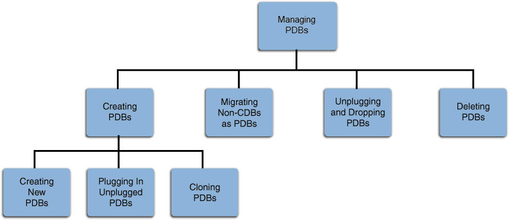

You can you can create, clone, unplug, and remove pluggable databases (PDBs) in a multitenant container database (CDB) using Oracle Enterprise Manager Cloud Control (Cloud Control).

See Also:

- " [About Creating and Removing PDBs](creating-and-removing-pdbs-with-sql-plus.md) "
- " [Preparing for PDBs](creating-and-removing-pdbs-with-sql-plus.md) "

**Parent topic:** [Managing a Multitenant Environment](managing-a-multitenant-environment.md)

### 39.1 Getting Started with Creating and Removing PDBs with Cloud Control

You follow specific steps when you create a new PDB, clone a PDB, migrate a non-CDB as a PDB, unplug a PDB, and delete a PDB.

The following table provides a documentation map to understand the sequence of actions you must perform to successfully complete these tasks using Cloud Control. Click the reference links provided against the steps to reach the relevant topics that provide more information.

Table 39-1 Getting Started with PDBs

| Step | Description | Reference Links |
| --- | --- | --- |
| Step 1 | Obtaining an Overview  Obtain a conceptual overview of PDBs. | To obtain a conceptual overview of PDBs, see " Overview ".  For detailed conceptual information, see " [Overview of Managing a Multitenant Environment](overview-of-managing-a-multitenant-environment.md) " and [Oracle Database Concepts](https://docs.oracle.com/pls/topic/lookup?ctx=en/database/oracle/oracle-database/12.2/admin&id=CNCPT89233) |
| Step 2 | Selecting the Use Case  Among the following use cases, select the one that best matches your requirement:  - Creating a new PDB - Plugging in an unplugged PDB - Cloning a PDB - Migrating a non-CDB as a PDB - Unplugging and dropping a PDB - Deleting PDBs |  |
| Step 3 | Meeting the Prerequisites  Meet the prerequisites for the selected use case. | - To meet the prerequisites for creating a new PDB, see " Prerequisites ". - To meet the prerequisites for plugging in an unplugged PDB, see " Prerequisites ". - To meet the prerequisites for cloning a PDB, see " Prerequisites ". - To meet the prerequisites for migrating a non-CDB to a PDB, see " Prerequisites ". - To meet the prerequisites for unplugging and dropping a PDB, see " Prerequisites ". - To meet the prerequisites for deleting PDBs, see " Prerequisites ". |
| Step 4 | Following the Procedure  Follow the procedure for the selected use case. | - To create a new PDB, see " Procedure ". - To plug in an unplugged PDB, see " Procedure ". - To clone a PDB, see " Procedure ". - To migrate a non-CDB to a PDB, see " Procedure ". - To unplug and drop a PDB, see " Procedure ". - To delete PDBs, see " Procedure ". |

**Parent topic:** Creating and Removing PDBs with Cloud Control

### 39.2 Overview of Creating and Removing PDBs with Cloud Control

An Oracle Database can contain a portable collection of schemas, schema objects, and nonschema objects, that appear to an Oracle Net client as a separate database. This self-contained collection is called a PDB. A CDB can include one or more PDBs.

Oracle Database 12c allows you to create many PDBs within a single CDB. Applications that connect to databases view PDBs and earlier versions of Oracle Database in the same manner.

Cloud Control enables administrators to manage the entire PDB lifecycle, including provisioning CDBs, provisioning PDBs (from the seed or from an unplugged PDB), cloning existing PDBs, migrating non-CDBs as PDBs, unplugging PDBs, and deleting PDBs.

Note:

To manage the PDB lifecycle using Cloud Control, you must have the 12.1.0.3 Enterprise Manager for Oracle Database plug-in, or a later version, deployed. To delete PDBs using Cloud Control, you must have the 12.1.0.5 Enterprise Manager for Oracle Database plug-in deployed.

For information on how to deploy a plug-in and upgrade an existing plug-in, see [Oracle Enterprise Manager Cloud Control Administrator's Guide.](https://docs.oracle.com/pls/topic/lookup?ctx=en/database/oracle/oracle-database/12.2/admin&id=EMADM109)

Figure 39-1 provides a graphical overview of how you can manage the PDB lifecycle in Cloud Control.

Figure 39-1 Managing PDBs

> This graphic provides an overview of managing the PDB lifecycle in Enterprise Manager Cloud Control. At the top of the graphic is a "Managing PDBs" box. Lines go from this box to the following boxes: "Creating PDBs," "Migrating Non-CDBs as PDBs," "Unplugging and Dropping PDBs" and "Deleting PDBs". Lines go from the "Creating PDBs" box to the following boxes: "Creating New PDBs," "Plugging In Unplugged PDBs," and "Cloning PDBs."

**Parent topic:** Creating and Removing PDBs with Cloud Control

### 39.3 Provisioning a PDB with Cloud Control

You can provision PDBs by creating a new PDB within a CDB, by cloning an existing PDB, or by migrating existing non-CDBs to a CDB as PDBs. You can also use unplugged PDBs for provisioning, by plugging them into a CDB.

Note:

As an alternative to using the methods described in this section, you can use Enterprise Manager Command Line Interface (EM CLI) to provision PDBs. For more information, see [Oracle® Enterprise Manager Lifecycle Management Administrator's Guide.](https://docs.oracle.com/pls/topic/lookup?ctx=en/database/oracle/oracle-database/12.2/admin&id=EMLCM93525)

- Creating a New PDB with Cloud Control  
	You can create a new PDB in a CDB.
- Plugging In an Unplugged PDB with Cloud Control  
	You can plug an unplugged PDB into a CDB.
- Cloning a PDB with Cloud Control  
	You can clone a PDB using either the Full Clone method, or the Snap Clone method.
- Migrating a Non-CDB to a PDB with Cloud Control  
	You can migrate a non-CDB to a PDB.

**Parent topic:** Creating and Removing PDBs with Cloud Control

#### 39.3.1 Creating a New PDB with Cloud Control

You can create a new PDB in a CDB.

- Prerequisites  
	Prerequisites must be met when creating a new PDB.
- Procedure  
	Follow these steps to create a new PDB in a CDB.

**Parent topic:** Provisioning a PDB with Cloud Control

##### 39.3.1.1 Prerequisites

Prerequisites must be met when creating a new PDB.

- Oracle Software Library (Software Library) must be set up in Cloud Control.
	For information on how to set up Software Library in Cloud Control, see [Oracle Enterprise Manager Lifecycle Management Administrator's Guide.](https://docs.oracle.com/pls/topic/lookup?ctx=en/database/oracle/oracle-database/12.2/admin&id=EMLCM11061)
- The CDB within which you want to create a PDB must exist, and must be a Cloud Control target.
- The CDB (within which you want to create a PDB) must be in read/write mode.
- The target host user must be the owner of the Oracle Home that the CDB (within which you want to create the PDB) belongs to.

**Parent topic:** Creating a New PDB with Cloud Control

##### 39.3.1.2 Procedure

Follow these steps to create a new PDB in a CDB.

1. From the Enterprise menu, select Provisioning and Patching, then select Database Provisioning. In the Database Provisioning page, in the Related Links section of the left menu pane, click Provision Pluggable Databases.
	Note:
	You can also access the Provision Pluggable Database Console from the Home page of the CDB. To do so, in the CDB's Home page, from the Oracle Database menu, select Provisioning, then select Provision Pluggable Database.
2. In the Provision Pluggable Database Console, in the Container Database section, select the CDB within which you want to create new PDBs.
	Note:
	Skip this step if you have accessed the Provision Pluggable Database Console from the CDB's Home page.
3. In the PDB Operations section, select Create New Pluggable Databases.
4. Click Launch.
	Note:
	You will be prompted to log in to the database if you have not already logged in to it through Enterprise Manager. Make sure you log in using `SYSDBA` user account credentials.
5. In the Creation Options page of the Create Pluggable Database Wizard, in the Pluggable Database Creation Options section, select Create a New PDB.
6. In the Container Database Host Credentials section, select or specify the target CDB Oracle Home owner host credentials. If you have already registered the credentials with Enterprise Manager, then you can select Preferred or Named. Otherwise, you can select New and enter the credentials.
7. Click Next.
8. In the Identification page, enter a unique name for the PDB you are creating.
	If you prefer to create more than one PDB in this procedure, then select Create Multiple Copies, and set the number of PDBs you want to create. Note that you can create a maximum of 252 PDBs.
	Note:
	If you choose to create multiple PDBs, then the unique name you enter here is used as a prefix for all PDBs, and the suffix is a numeric value that indicates the count of PDBs.
	For example, if you create five PDBs with the name `accountsPDB,` then the PDBs are created with the names `accountsPDB1, accountsPDB2, accountsPDB3, accountsPDB4,` and `accountsPDB5.`
9. In the PDB Administrator section, enter the credentials of the admin user account you need to create for administering the PDB.
	Note:
	If you choose to create multiple PDBs, then an admin user account is created for each PDB that you create, with the same set of the specified credentials.
10. Click Next.
11. In the Storage page, in the PDB Datafile Locations section, select the type of location where you want to store the datafiles.
	- If the target CDB (CDB in which you are creating the PDB) is enabled with Oracle Managed Files and if you want to use the same, then select Use Oracle Managed Files (OMF).
	- If you want to enter a custom location, then select Use Common Location for PDB Datafiles. Select the storage type and the location where the datafiles can be stored.
12. In the Temporary Working Directory section, enter a location where the temporary files generated during the PDB creation process can be stored.
13. In the Post-Creation Scripts section, select a custom SQL script you want to run as part of this procedure, once the PDB is created.
14. Click Next.
15. In the Schedule page, enter a unique deployment procedure instance name and a schedule for the deployment. The instance name you enter here helps you identify and track the progress of this procedure on the Procedure Activity page.
	If you want to run the procedure immediately, then retain the default selection, that is, Immediately. Otherwise, select Later and provide time zone, start date, and start time details.
	You can optionally set a grace period for this schedule. A grace period is a period of time that defines the maximum permissible delay when attempting to run a scheduled procedure. If the procedure does not start within the grace period you have set, then the procedure skips running. To set a grace period, select Grace Period, and set the permissible delay time.
16. Click Next.
17. In the Review page, review the details you have provided for the deployment procedure. If you are satisfied with the details, click Submit.
	If you want to modify the details, then click Back repeatedly to reach the page where you want to make the changes.
18. In the Procedure Activity page, view the status of the procedure. From the Procedure Actions menu, you can select Debug to set the logging level to Debug, and select Stop to stop the procedure execution.
	When you create a new PDB, the Enterprise Manager job system creates a Create Pluggable Database job. For information about viewing the details of this job, refer " Viewing Create PDB Job Details ".

**Parent topic:** Creating a New PDB with Cloud Control

#### 39.3.2 Plugging In an Unplugged PDB with Cloud Control

You can plug an unplugged PDB into a CDB.

- Prerequisites  
	Prerequisites must be met when plugging an unplugged PDB.
- Procedure  
	Follow these steps to plug an unplugged PDB into a CDB.

**Parent topic:** Provisioning a PDB with Cloud Control

##### 39.3.2.1 Prerequisites

Prerequisites must be met when plugging an unplugged PDB.

- Oracle Software Library (Software Library) must be set up in Cloud Control.
	For information on how to set up Software Library in Cloud Control, see [Oracle Enterprise Manager Lifecycle Management Administrator's Guide.](https://docs.oracle.com/pls/topic/lookup?ctx=en/database/oracle/oracle-database/12.2/admin&id=EMLCM11061)
- The target CDB (the CDB within which you want to plug in the unplugged PDB) must exist, and must be a Cloud Control target.
- The target CDB must be in read/write mode.
- The XML file that describes the unplugged PDB, and the other files associated with the unplugged PDB, such as the data files, must exist and must be readable.
- The target host user must be the owner of the Oracle Home that the CDB (into which you want to plug the unplugged PDB) belongs to.
- The platforms of the source CDB host (the host on which the CDB that previously contained the unplugged PDB is installed) and the target CDB host (the host on which the target CDB is installed) must have the same endianness.
- The database options installed on the source platform must be the same as, or a subset of, the database options installed on the target platform.
- If the character set of the CDB to which the PDB is being cloned is not AL32UTF8, then the CDB that contained the unplugged PDB and the target CDB must have compatible character sets and national character sets. To be compatible, the character sets and national character sets must meet all of the requirements specified in [Oracle Database Globalization Support Guide](https://docs.oracle.com/pls/topic/lookup?ctx=en/database/oracle/oracle-database/12.2/admin&id=NLSPG1035).
	If the character set of the CDB to which the PDB is being cloned is AL32UTF8, then this requirement does not apply.
- If you are creating an application PDB, then the application name and version of the unplugged PDB must match the application name and version of the application container that will contain the application PDB when it is plugged in.
- If you are creating an application PDB, then the application PDB must have the same character set and national character set as the application container.
	If the database character set of the CDB is AL32UTF8, then the character set and national character set of the application container can different from the CDB. However, all application PDBs in an application container must have same character set and national character set, matching that of the application container.

**Parent topic:** Plugging In an Unplugged PDB with Cloud Control

##### 39.3.2.2 Procedure

Follow these steps to plug an unplugged PDB into a CDB.

1. From the Enterprise menu, select Provisioning and Patching, then select Database Provisioning. In the Database Provisioning page, in the Related Links section of the left menu pane, click Provision Pluggable Databases.
	Note:
	You can also access the Provision Pluggable Database Console from the Home page of the CDB. To do so, in the CDB's Home page, from the Oracle Database menu, select Provisioning, then select Provision Pluggable Database.
2. In the Provision Pluggable Database Console, in the Container Database section, select the CDB to which you want to add the unplugged PDBs.
	Note:
	Skip this step if you have accessed the Provision Pluggable Database Console from the CDB's Home page.
3. In the PDB Operations section, select Create New Pluggable Databases.
4. Click Launch.
	Note:
	You will be prompted to log in to the database if you have not already logged in to it through Enterprise Manager. Make sure you log in using `SYSDBA` user account credentials.
5. In the Creation Options page of the Create Pluggable Database Wizard, in the Pluggable Database Creation Options section, select Plug an Unplugged PDB.
6. In the Container Database Host Credentials section, select or specify the target CDB Oracle Home owner host credentials. If you have already registered the credentials with Enterprise Manager, then you can select Preferred or Named. Otherwise, you can select New and enter the credentials.
7. Click Next.
8. In the Identification page, enter a unique name for the PDB you are plugging in.
	Select Create As Clone if you are plugging a PDB into a CDB that contains one or more PDBs that were created by plugging in the same PDB. Selecting this option ensures that Oracle Database generates unique PDB DBID, GUID, and other identifiers expected for the new PDB.
	If you prefer to create more than one PDB in this procedure, then select Create Multiple Copies, and set the number of PDBs you want to create. Note that you can create a maximum of 252 PDBs.
	Note:
	If you choose to create multiple PDBs, then the unique name you enter here is used as a prefix for all PDBs, and the suffix is a numeric value that indicates the count of PDBs.
	For example, if you create five PDBs with the name `accountsPDB,` then the PDBs are created with the names `accountsPDB1, accountsPDB2, accountsPDB3, accountsPDB4,` and `accountsPDB5.`
9. In the PDB Administrator section, do one of the following to administer the PDB:
	- If you prefer to use the admin user account that was created as part of the source PDB that you are plugging in, then deselect Create PDB Administrator.
	- If you want to create a brand new admin user account for the PDB you are plugging in, then select Create PDB Administrator, and enter the desired credentials.
	Note:
	If you choose to create multiple PDBs, then an admin user account is created for each PDB that you create, with the same set of the specified credentials.
	To lock and expire all the users in the newly created PDB, (except the newly created Admin), select Lock All Existing PDB Users.
10. In the PDB Template Location section, select the location where the source PDB's template is available, and then select the type of PDB template.
	- If the PDB template is available on your CDB host (CDB to which you are plugging in the unplugged PDB), then select Target Host File System.
		- If the PDB template is a single archive file—a TAR file with data files and metadata XML file included in it, then select Create Pluggable Database from Pluggable Database Archive, then select the PDB template.
			- If the PDB template is a PDB file set—a separate DFB file with all the data files and a separate metadata XML file, then select Create the PDB using PDB File Set, then select the DBF and XML files.
			- If you want to plug in a PDB using the PDB metadata XML file and the existing data files, then select Create PDB using Metadata file.
	- If the PDB template is available in Oracle Software Library (Software Library), then select Software Library, then select the component in the Software Library that contains the PDB template.
11. Click Next.
12. In the Storage page, do one of the following:
	- In the previous page, if you chose to create the PDB from a PDB archive (single TAR file) or using a PDB file set (DFB file and an XML file), then select the type of location where you want to store the target data files for the PDB you are plugging in.
		- If the target CDB (CDB to which you are plugging in the unplugged PDB) is enabled with Oracle Managed Files and if you want to use the same, then select Use Oracle Managed Files (OMF).
			- If you want to enter a common custom location, then select Use Common Location for PDB datafiles. Select the storage type and the location where the data files can be stored.
	- In the previous page, if you chose to create the PDB using a PDB template (XML file only), then do the following:
		In the PDB Datafile Locations section, validate the locations mapped for the data files. If they are incorrect, correct the paths. Alternatively, if you have a single location where the data files are all available, then enter the absolute path in the Set Common Source File Mapping Location field, and click Set.
		You can choose to store the target data files for the PDB you are plugging in, in the same location as the source data files. However, if you want the target data files to be stored in a different location, then select Copy Datafiles, and select the type of location:
		- If the target CDB (CDB to which you are plugging in the unplugged PDB) is enabled with Oracle Managed Files and if you want to use the same, then select Use Oracle Managed Files (OMF).
			- If you want to enter a common custom location, then select Use Common Location for Pluggable Database Files. Select the storage type and the location where the data files can be stored.
			- If you prefer to use different custom locations for different data files, then select Customized Location, and enter the custom location paths.
13. In the Temporary Working Directory section, enter a location where the temporary files generated during the PDB creation process can be stored.
14. In the Post-Creation Scripts section, select a custom SQL script you want to run as part of this procedure, once the PDB is plugged in.
	If the script is available in the Software Library, select Select from Software Library, then select the component that contains the custom script.
15. Click Next.
16. In the Schedule page, enter a unique deployment procedure instance name and a schedule for the deployment. The instance name you enter here helps you identify and track the progress of this procedure on the Procedure Activity page.
	If you want to run the procedure immediately, then retain the default selection, that is, Immediately. Otherwise, select Later and provide time zone, start date, and start time details.
	You can optionally set a grace period for this schedule. A grace period is a period of time that defines the maximum permissible delay when attempting to run a scheduled procedure. If the procedure does not start within the grace period you have set, then the procedure skips running. To set a grace period, select Grace Period, then set the permissible delay time.
17. Click Next.
18. In the Review page, review the details you have provided for the deployment procedure. If you are satisfied with the details, click Submit.
	If you want to modify the details, then click Back repeatedly to reach the page where you want to make the changes.
19. In the Procedure Activity page, view the status of the procedure. From the Procedure Actions menu, you can select Debug to set the logging level to Debug, and select Stop to stop the procedure execution.
	When you plug in an unplugged PDB, the Enterprise Manager job system creates a Create Pluggable Database job. For information about viewing the details of this job, refer " Viewing Create PDB Job Details ".

**Parent topic:** Plugging In an Unplugged PDB with Cloud Control

#### 39.3.3 Cloning a PDB with Cloud Control

You can clone a PDB using either the Full Clone method, or the Snap Clone method.

- Prerequisites  
	Prerequisites must be met when cloning a PDB.
- Procedure  
	Follow these steps to clone an existing PDB.

**Parent topic:** Provisioning a PDB with Cloud Control

##### 39.3.3.1 Prerequisites

Prerequisites must be met when cloning a PDB.

- Oracle Software Library (Software Library) must be set up in Cloud Control.
	For information on how to set up Software Library in Cloud Control, see [Oracle Enterprise Manager Lifecycle Management Administrator's Guide.](https://docs.oracle.com/pls/topic/lookup?ctx=en/database/oracle/oracle-database/12.2/admin&id=EMLCM11061)
- The source PDB (the PDB that you want to clone) must exist, and must be a Cloud Control target.
	Note:
	For information on how to create a new PDB, refer to " Creating a New PDB ".
- The source PDB must be open.
- The target CDB (the CDB into which you want to plug in the cloned PDB) must exist, and must be a Cloud Control target.
- The target CDB must be in read/write mode.
- The target host user must be the owner of the Oracle Home that the source CDB belongs to.

To clone a PDB using the Snap Clone method, you must meet the following additional prerequisites:

- The 12.1.0.5 Enterprise Manager for Oracle Database plug-in must be downloaded and deployed. Also, the 12.1.0.3 SMF plug-in or higher must be downloaded and deployed.
- The PDB that you want to clone must reside on a registered storage server. This storage server must be synchronized.
	For information on how to register a storage server and synchronize storage servers, see [Oracle Enterprise Manager Cloud Administration Guide.](https://docs.oracle.com/pls/topic/lookup?ctx=en/database/oracle/oracle-database/12.2/admin&id=EMCLO329)
- All the datafiles of the PDB that you want to clone must reside on the storage volumes of the storage server, and not on the local disk.
- Metric collections must be run on the source CDB (the CDB containing the PDB that you want to clone), the source CDB host, and the PDB that you want to clone.
- The Snap Clone feature must be enabled for the PDB that you want to clone.
	For information on how to enable the Snap Clone feature, see [Oracle Enterprise Manager Cloud Administration Guide.](https://docs.oracle.com/pls/topic/lookup?ctx=en/database/oracle/oracle-database/12.2/admin&id=EMCLO329)

**Parent topic:** Cloning a PDB with Cloud Control

##### 39.3.3.2 Procedure

Follow these steps to clone an existing PDB.

Note:

If you use the Full Clone method to clone a PDB, you can clone the PDB only to the source CDB (the CDB containing the PDB that you are cloning).

1. From the Enterprise menu, select Provisioning and Patching, then select Database Provisioning. In the Database Provisioning page, in the Related Links section of the left menu pane, click Provision Pluggable Databases.
	Note:
	You can also access the Provision Pluggable Database Console from the Home page of the CDB. To do so, in the CDB's Home page, from the Oracle Database menu, select Provisioning, then select Provision Pluggable Database.
2. In the Provision Pluggable Database Console, in the CDB section, select the source CDB, that is, the CDB containing the PDB that you want to clone.
	Note:
	Skip this step if you have accessed the Provision Pluggable Database Console from the CDB's Home page.
3. In the PDB Operations section, select Create New Pluggable Databases.
4. Click Launch.
	Note:
	You will be prompted to log in to the database if you have not already logged in to it through Enterprise Manager. Make sure you log in using `SYSDBA` user account credentials.
5. In the Creation Options page of the Create Pluggable Database Wizard, in the PDB Creation Options section, select Clone an Existing PDB.
	To clone a PDB using the traditional method of cloning the PDB datafiles, select Full Clone. Use this method if you want to clone a PDB for long term usage. This method is ideal for load testing, when you plan to make significant data updates to the PDB clone. However, this method takes a longer period of time, and a clone that is created using this method occupies a fairly large amount of space, as compared to the Snap Clone method.
	To clone a PDB using the Storage Management Framework (SMF) Snap Clone feature, select Snap Clone. Use this method if you want to clone a PDB for short term purposes. This method is ideal for functional testing, as the cloning process is quick, and a PDB clone that is created using this method occupies very little space. However, this method is not suitable if you plan to make significant data updates to the PDB clone.
	For Source PDB, select the PDB that you want to clone.
6. In the CDB Host Credentials section, select or specify the source CDB Oracle Home owner host credentials. If you have already registered the credentials with Enterprise Manager, you can select Preferred or Named. Otherwise, you can select New and enter the credentials.
7. Click Next.
8. In the Identification page, enter a unique name for the PDB you are cloning.
	If you prefer to create more than one PDB in this procedure, then select Create Multiple Copies, and set the number of PDBs you want to create. Note that you can create a maximum of 252 PDBs.
	Note:
	If you choose to create multiple PDBs, then the unique name you enter here is used as a prefix for all the cloned PDBs, and the suffix is a numeric value that indicates the count of PDBs.
	For example, if you create five PDBs with the name `accountsPDB,` then the PDBs are created with the names `accountsPDB1, accountsPDB2, accountsPDB3, accountsPDB4,` and `accountsPDB5.`
9. In the PDB Administrator section, do one of the following to administer the PDB:
	- If you prefer to use the admin user account that was created as part of the source PDB that you are cloning, then deselect Create PDB Administrator.
	- If you want to create a brand new admin user account for the PDB you are cloning, then select Create PDB Administrator, and enter the desired credentials.
	Note:
	If you choose to create multiple PDBs, then an admin user account is created for each PDB that you create, with the same set of the specified credentials.
10. In the Source CDB Login Credentials section, select or specify the login credentials of the source CDB. If you have already registered the credentials with Enterprise Manager, you can select Preferred or Named. Otherwise, you can select New and enter the credentials.
	The credentials are used to bring the source PDB to read-only mode before the cloning operation begins, and to restore it to the original state after the cloning operation ends.
	If you chose the Snap Clone method (on the Source page of the Create Pluggable Database Wizard) to clone the PDB, specify the host credentials for the source CDB.
	Note:
	If you are cloning the source PDB to the source CDB itself, then the Source CDB Login Credentials section is not displayed, that is, you do not need to provide the source CDB login credentials or the source CDB host credentials.
	If you are cloning the source PDB to a CDB different from the source CDB, and this CDB resides on the source CDB host, then you must provide the source CDB login credentials. You do not need to provide the source CDB host credentials.
	If you are cloning the source PDB to a CDB different from the source CDB, and this CDB resides on a host different from the source CDB host, then you must provide the source CDB login credentials and the source CDB host credentials.
11. Click Next.
12. In the Storage page, specify the storage information.
	If you chose the Full Clone method to clone the PDB, select the type of location where you want to store the PDB datafiles in the following manner:
	- If the source CDB is enabled with Oracle Managed Files and if you want to use the same, then select Use Oracle Managed Files (OMF).
	- If you want to enter a custom location, then select Use Common Location for PDB datafiles. Select the storage type and the location where the datafiles can be stored.
	If you chose the Snap Clone method to clone the PDB, do the following:
	- In the PDB Datafile Locations section, specify a value for Mount Point Prefix, that is, the mount location for the storage volumes. You can choose to specify the same prefix for all the volumes, or a different prefix for each volume. Also, specify a value for Writable Space, that is, the space that you want to allocate for writing the changes made to the PDB clone. You can choose to specify the same writable space value for all the volumes, or a different value for each volume.
	- In the Privileged Host Credentials section, select or specify the credentials of the root user. These credentials are used for mounting the cloned volumes on the destination host.
		If you have already registered the credentials with Enterprise Manager, you can select Preferred or Named. Otherwise, you can select New and enter the credentials.
13. In the Temporary Working Directory section, enter a location where the temporary files generated during the PDB creation process can be stored.
14. In the Post-Creation Scripts section, select a custom SQL script you want to run as part of this procedure, once the PDB is cloned.
15. Click Next.
16. In the Schedule page, enter a unique deployment procedure instance name and a schedule for the deployment. The instance name you enter here helps you identify and track the progress of this procedure on the Procedure Activity page.
	If you want to run the procedure immediately, then retain the default selection, that is, Immediately. Otherwise, select Later and provide time zone, start date, and start time details.
	You can optionally set a grace period for this schedule. A grace period is a period of time that defines the maximum permissible delay when attempting to run a scheduled procedure. If the procedure does not start within the grace period you have set, then the procedure skips running. To set a grace period, select Grace Period, and set the permissible delay time.
17. Click Next.
18. In the Review page, review the details you have provided for the deployment procedure. If you are satisfied with the details, click Submit.
	If you want to modify the details, then click Back repeatedly to reach the page where you want to make the changes.
19. In the Procedure Activity page, view the status of the procedure. From the Procedure Actions menu, you can select Debug to set the logging level to Debug, and select Stop to stop the procedure execution.
	When you clone a PDB, the Enterprise Manager job system creates a Create Pluggable Database job. For information about viewing the details of this job, refer " Viewing Create PDB Job Details ".

**Parent topic:** Cloning a PDB with Cloud Control

#### 39.3.4 Migrating a Non-CDB to a PDB with Cloud Control

You can migrate a non-CDB to a PDB.

- Prerequisites  
	Prerequisites must be met when migrating a non-CDB to a PDB.
- Procedure  
	Follow these steps to migrate a non-CDB to a PDB.

**Parent topic:** Provisioning a PDB with Cloud Control

##### 39.3.4.1 Prerequisites

Prerequisites must be met when migrating a non-CDB to a PDB.

- Oracle Software Library (Software Library) must be set up in Cloud Control.
	For information on how to set up Software Library in Cloud Control, see [Oracle Enterprise Manager Lifecycle Management Administrator's Guide.](https://docs.oracle.com/pls/topic/lookup?ctx=en/database/oracle/oracle-database/12.2/admin&id=EMLCM11061)
- The target CDB (the CDB to which you want to migrate a non-CDB to a PDB) must exist, and must be a Cloud Control target.
- The target CDB must be in read/write mode.
- The non-CDB that you want to migrate and the target CDB must be running in `ARCHIVELOG` mode.
- The database administrators of the database you want to migrate and the target CDB must have `SYSDBA` privileges.
- The target host user must be the owner of the Oracle Home that the target CDB belongs to.

**Parent topic:** Migrating a Non-CDB to a PDB with Cloud Control

##### 39.3.4.2 Procedure

Follow these steps to migrate a non-CDB to a PDB.

1. From the Enterprise menu, select Provisioning and Patching, then select Database Provisioning. In the Database Provisioning page, in the Related Links section of the left menu pane, click Provision Pluggable Databases.
	Note:
	You can also access the Provision Pluggable Database Console from the Home page of the CDB. To do so, in the CDB's Home page, from the Oracle Database menu, select Provisioning, then select Provision Pluggable Database.
2. In the Provision Pluggable Database Console, in the Container Database section, select the CDB to which you want to migrate a non-CDB to a PDB.
	Note:
	Skip this step if you have accessed the Provision Pluggable Database Console from the CDB's Home page.
3. In the PDB Operations section of the Provision Pluggable Database page, select the Migrate Existing Databases option and click Launch.
4. On the Database Login page, select the Credential Name from the drop-down list. Click Login.
5. On the Migrate Non-CDBs launch page, select a data migration method, that is, Export/Import or Plug as a PDB. If you select Plug as a PDB, ensure that the non-CDB that you want to migrate is open, and is in read-only mode.
	Enter the appropriate credentials for the Oracle Home Credential section.
	Click Next.
6. On the Database page, select a Non-CDB to be migrated. You can select more than one. Click Add. In the database pane, provide the appropriate credential, properties, export, import, and datafile location information. Click Next.
7. On the Schedule page, enter the appropriate job and scheduling details. Click Next.
8. On the Review page, review all details entered. If there are no changes required, click Submit.

**Parent topic:** Migrating a Non-CDB to a PDB with Cloud Control

### 39.4 Removing PDBs with Cloud Control

You can unplug and delete PDBs.

- Unplugging and Dropping a PDB with Cloud Control  
	You can unplug or drop a PDB.
- Deleting PDBs with Cloud Control  
	You can delete a PDB from a CDB.

**Parent topic:** Creating and Removing PDBs with Cloud Control

#### 39.4.1 Unplugging and Dropping a PDB with Cloud Control

You can unplug or drop a PDB.

Note:

As an alternative to using the method described in this section, you can use Enterprise Manager Command Line Interface (EM CLI) to unplug and drop PDBs. For more information, see [Oracle® Enterprise Manager Lifecycle Management Administrator's Guide.](https://docs.oracle.com/pls/topic/lookup?ctx=en/database/oracle/oracle-database/12.2/admin&id=EMLCM93528)

- Prerequisites  
	Prerequisites must be met when unplugging and dropping a PDB.
- Procedure  
	Follow these steps to create unplug a PDB from its CDB.

**Parent topic:** Removing PDBs with Cloud Control

##### 39.4.1.1 Prerequisites

Prerequisites must be met when unplugging and dropping a PDB.

- Oracle Software Library (Software Library) must be set up in Cloud Control.
	For information on how to set up Software Library in Cloud Control, see [Oracle Enterprise Manager Lifecycle Management Administrator's Guide.](https://docs.oracle.com/pls/topic/lookup?ctx=en/database/oracle/oracle-database/12.2/admin&id=EMLCM11061)
- The PDB that you want to unplug and drop must have been opened at least once.
- The target host user must be the owner of the Oracle Home that the CDB (containing the PDB that you want to unplug and drop) belongs to.

**Parent topic:** Unplugging and Dropping a PDB with Cloud Control

##### 39.4.1.2 Procedure

Follow these steps to create unplug a PDB from its CDB.

1. From the Enterprise menu, select Provisioning and Patching, then select Database Provisioning. In the Database Provisioning page, in the Related Links section of the left menu pane, click Provision Pluggable Databases.
	Note:
	You can also access the Provision Pluggable Database Console from the Home page of the CDB. To do so, in the CDB's Home page, from the Oracle Database menu, select Provisioning, then select Provision Pluggable Database.
2. In the Provision Pluggable Database Console, in the Container Database section, select the CDB from which you want to unplug the PDBs.
	Note:
	Skip this step if you have accessed the Provision Pluggable Database Console from the CDB's Home page.
3. In the PDB Operations section, select Unplug Pluggable Database.
4. Click Launch.
	Note:
	You will be prompted to log in to the database if you have not already logged in to it through Enterprise Manager. Make sure you log in using `SYSDBA` user account credentials.
5. In the Select PDB page of the Unplug Pluggable Database Wizard, in the Select Pluggable Database section, select the PDB you want to unplug. Note that the PDB once unplugged will be stopped and dropped.
6. In the Container Database Host Credentials section, select or specify the target CDB Oracle Home owner host credentials. If you have already registered the credentials with Enterprise Manager, you can select Preferred or Named. Otherwise, you can select New and enter the credentials.
7. In the Destination page, select the type of PDB template you want to generate for unplugging the PDB, and the location where you want to store it. The PDB template consists of all data files as well as the metadata XML file.
	- If you want to store the PDB template on your CDB host (CDB from which you are unplugging the PDB), then select Target Host File System.
		- If you want to generate a single archive file—a TAR file with the data files and the metadata XML file included in it, then select Generate PDB Archive. Select a location where the archive file can be created.
			Note:
			Oracle recommends that you select this option if the source and target CDBs are using file system for storage. This option is not supported for PDBs using ASM as storage.
			- If you want to generate an archive file set—a separate DFB file with all the data files and a separate metadata XML file, then select Generate PDB File Set. Select the locations where the DBF and XML files can be created.
			Note:
			Oracle recommends that you select this option if the source and target CDBs are using ASM for storage.
			- If you want to generate only a metadata XML file, leaving the data files in their current location, then select Generate PDB Metadata File. Select a location where the metadata XML file can be created.
	- If you want to store the PDB template in Oracle Software Library (Software Library), then select Software Library.
		- If you want to generate a single archive file—a TAR file with the data files and the metadata XML file included in it, then select Generate PDB Archive. If you want to generate an archive file set—a separate DFB file with all the data files and a separate metadata XML file, then select Generate PDB File Set. If you want to generate only a metadata XML file, leaving the data files in their current location, then select Generate PDB Metadata File.
			- Enter a unique PDB template name.
			The template is created in the default location that has the following format:
			`Database Configuration/` `db_release` `/` `platform` `/Database Templates`
			For example,
			`Database Configuration/12.1.0.0.2/unix/Database Templates`
			- Enter a temporary location where the archive can be created by Enterprise Manager before it is uploaded to the Software Library.
8. In the Schedule page, enter a unique deployment procedure instance name and a schedule for the deployment. The instance name you enter here helps you identify and track the progress of this procedure on the Procedure Activity page.
	If you want to run the procedure immediately, then retain the default selection, that is, Immediately. Otherwise, select Later and provide time zone, start date, and start time details.
	You can optionally set a grace period for this schedule. A grace period is a period of time that defines the maximum permissible delay when attempting to run a scheduled procedure. If the procedure does not start within the grace period you have set, then the procedure skips running. To set a grace period, select Grace Period, and set the permissible delay time.
9. Click Next.
10. In the Review page, review the details you have provided for the deployment procedure. If you are satisfied with the details, click Submit.
	If you want to modify the details, then click Back repeatedly to reach the page where you want to make the changes.
11. In the Procedure Activity page, view the status of the procedure. From the Procedure Actions menu, you can select Debug to set the logging level to Debug, and select Stop to stop the procedure execution.
	When you unplug and drop a PDB, the Enterprise Manager job system creates an Unplug Pluggable Database job. For information about viewing the details of this job, refer " Viewing Unplug PDB Job Details ".

**Parent topic:** Unplugging and Dropping a PDB with Cloud Control

#### 39.4.2 Deleting PDBs with Cloud Control

You can delete a PDB from a CDB.

- Prerequisites  
	Prerequisites must be met when permanently deleting a set of PDBs from a CDB.
- Procedure  
	Follow these steps to permanently delete a set of PDBs from a CDB.

**Parent topic:** Removing PDBs with Cloud Control

##### 39.4.2.1 Prerequisites

Prerequisites must be met when permanently deleting a set of PDBs from a CDB.

- The 12.1.0.5 Enterprise Manager for Oracle Database plug-in must be downloaded and deployed.
	For information on how to download and deploy a plug-in, see [Oracle Enterprise Manager Cloud Control Administrator's Guide.](https://docs.oracle.com/pls/topic/lookup?ctx=en/database/oracle/oracle-database/12.2/admin&id=EMADM109)
- Oracle Software Library (Software Library) must be set up in Cloud Control.
	For information on how to set up Software Library in Cloud Control, see [Oracle Enterprise Manager Lifecycle Management Administrator's Guide.](https://docs.oracle.com/pls/topic/lookup?ctx=en/database/oracle/oracle-database/12.2/admin&id=EMLCM11061)
- The PDBs that you want to delete must have been opened at least once.
- The target host user must be the owner of the Oracle home that the CDB (containing the PDBs that you want to delete) belongs to.

**Parent topic:** Deleting PDBs with Cloud Control

##### 39.4.2.2 Procedure

Follow these steps to permanently delete a set of PDBs from a CDB.

1. From the Enterprise menu, select Provisioning and Patching, then select Database Provisioning. In the Database Provisioning page, in the Related Links section of the left menu pane, click Provision Pluggable Databases.
	Note:
	You can also access the Provision Pluggable Database Console from the Home page of the CDB. To do so, in the CDB's Home page, from the Oracle Database menu, select Provisioning, then select Provision Pluggable Database.
2. In the Provision Pluggable Database Console, in the CDB section, select the CDB from which you want to delete the PDBs.
	Note:
	Skip this step if you have accessed the Provision Pluggable Database Console from the CDB's home page.
3. In the PDB Operations section, select Delete Pluggable Databases.
4. Click Launch.
	Note:
	You will be prompted to log in to the database if you have not already logged in to it through Enterprise Manager. Make sure you log in using `SYSDBA` user account credentials.
5. In the Select PDBs page of the Delete Pluggable Databases Wizard, click Add. Select the PDBs that you want to delete, then click Select.
	Note:
	If you choose to delete a PDB that was created using the Snap Clone method, the PDB mount points on the CDB host are cleaned up. The corresponding storage volumes on the storage server are also deleted. This action is irreversible.
6. In the CDB Host Credentials section, select or specify the target CDB Oracle Home owner host credentials. If you have already registered the credentials with Enterprise Manager, you can select Preferred or Named. Otherwise, you can select New and enter the credentials.
	If one (or more) of the PDBs that you selected for deletion is the Snap Clone of another PDB, you must also provide the privileged host credentials, that is, the credentials of the root user. If you have already registered the credentials with Enterprise Manager, you can select Preferred or Named. Otherwise, you can select New and enter the credentials.
7. In the Schedule page, enter a unique deployment procedure instance name and a schedule for the deployment. The instance name you enter here helps you identify and track the progress of this procedure on the Procedure Activity page.
	If you want to run the procedure immediately, then retain the default selection, that is, Immediately. Otherwise, select Later and provide time zone, start date, and start time details.
	You can optionally set a grace period for this schedule. A grace period is a period of time that defines the maximum permissible delay when attempting to run a scheduled procedure. If the procedure does not start within the grace period you have set, then the procedure skips running. To set a grace period, select Grace Period, and set the permissible delay time.
8. Click Next.
9. In the Review page, review the details you have provided for the deployment procedure. If you are satisfied with the details, click Submit.
	If you want to modify the details, then click Back repeatedly to reach the page where you want to make the changes.
10. In the Procedure Activity page, view the status of the procedure. From the Procedure Actions menu, you can select Debug to set the logging level to Debug, and select Stop to stop the procedure execution.
	When you delete a PDB, the Enterprise Manager job system creates a Delete Pluggable Database job. For information about viewing the details of this job, refer " Viewing Delete PDB Job Details ".

**Parent topic:** Deleting PDBs with Cloud Control

### 39.5 Viewing PDB Job Details with Cloud Control

You can view the details of the jobs that are created by the Enterprise Manager job system when you create a PDB, unplug a PDB, or delete a PDB.

- Viewing Create PDB Job Details with Cloud Control  
	Follow these steps to view the details of a create PDB job.
- Viewing Unplug PDB Job Details with Cloud Control  
	Follow these steps to view the details of an unplug PDB job.
- Viewing Delete PDB Job Details with Cloud Control  
	Follow these steps to view the details of a delete PDB job.

**Parent topic:** Creating and Removing PDBs with Cloud Control

#### 39.5.1 Viewing Create PDB Job Details with Cloud Control

Follow these steps to view the details of a create PDB job.

1. From the Enterprise menu, select Provisioning and Patching, then select Procedure Activity.
2. Click the deployment procedure that contains the required create PDB job.
3. Expand the deployment procedure steps. Select the PDB creation job.
4. Click Job Summary.
5. To view a summary of the job details, click Summary.
	In the Prepare Configuration Data step, the system prepares for PDB creation.
	In the Check Prerequisites step, the system checks the prerequisites for PDB creation.
	In the Verify and Prepare step, the system runs tasks prior to PDB creation.
	In the Perform Configuration step, the PDB creation is performed. For details of the performed tasks and their status, refer to the remote log files present on the host.
	In the Post Configuration step, Enterprise Manager is updated with the newly created PDB details, and the custom scripts are run.
6. To view a visual representation of the create PDB job progress, click Results.
	In the Configuration Progress section, you can view the completion percentage of the job, and a list of pending, currently running, and completed job steps. You can also view errors, warnings, and logs. The tail of the log for the currently running job step is displayed.

**Parent topic:** Viewing PDB Job Details with Cloud Control

#### 39.5.2 Viewing Unplug PDB Job Details with Cloud Control

Follow these steps to view the details of an unplug PDB job.

1. From the Enterprise menu, select Provisioning and Patching, then select Procedure Activity.
2. Click the deployment procedure that contains the required unplug PDB job.
3. Expand the deployment procedure steps. Select the unplug PDB job.
4. Click Job Summary.
5. To view a summary of the job details, click Summary.
	In the Prepare Configuration Data step, the system prepares for unplugging a PDB.
	In the Check Prerequisites step, the system checks the prerequisites for unplugging a PDB.
	In the Verify and Prepare step, the system runs tasks prior to unplugging the PDB.
	In the Perform Configuration step, the PDB unplugging is performed. For details of the performed tasks and their status, refer to the remote log files present on the host.
	In the Post Configuration step, Enterprise Manager is updated with the unplugged PDB details.
6. To view a visual representation of the unplug PDB job progress, click Results.
	In the Configuration Progress section, you can view the completion percentage of the job, and a list of pending, currently running, and completed job steps. You can also view errors, warnings, and logs. The tail of the log for the currently running job step is displayed.

**Parent topic:** Viewing PDB Job Details with Cloud Control

#### 39.5.3 Viewing Delete PDB Job Details with Cloud Control

Follow these steps to view the details of a delete PDB job.

1. From the Enterprise menu, select Provisioning and Patching, then select Procedure Activity.
2. Click the deployment procedure that contains the required delete PDB job.
3. Expand the deployment procedure steps. Select the delete PDB job.
4. Click Job Summary.
5. To view a summary of the job details, click Summary.
	In the Prepare Configuration Data step, the system prepares for deleting the PDBs.
	In the Verify and Prepare step, the system runs tasks prior to deleting the PDBs.
	In the Perform Configuration step, the PDB deletion is performed. For details of the performed tasks and their status, refer to the remote log files present on the host.
	In the Post Configuration step, Enterprise Manager is updated with the deleted PDB details.
6. To view a visual representation of the delete PDB job progress, click Results.
	In the Configuration Progress section, you can view the completion percentage of the job, and a list of pending, currently running, and completed job steps. You can also view errors, warnings, and logs. The tail of the log for the currently running job step is displayed.

**Parent topic:** Viewing PDB Job Details with Cloud Control