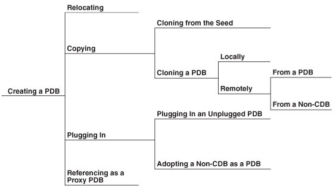
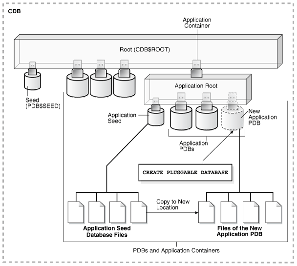
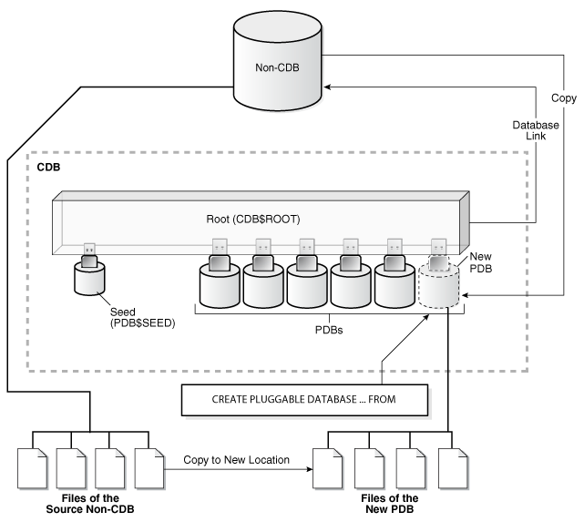
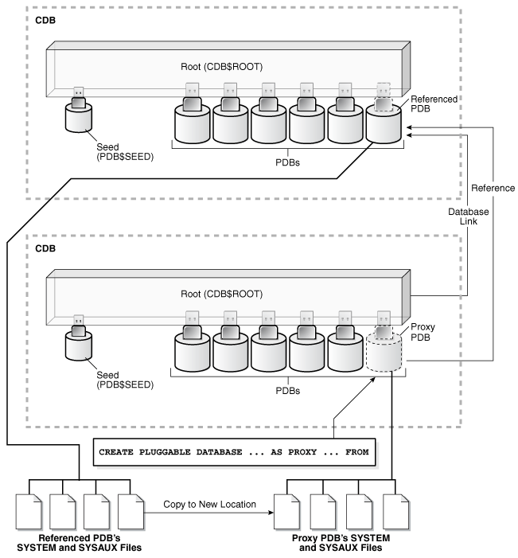
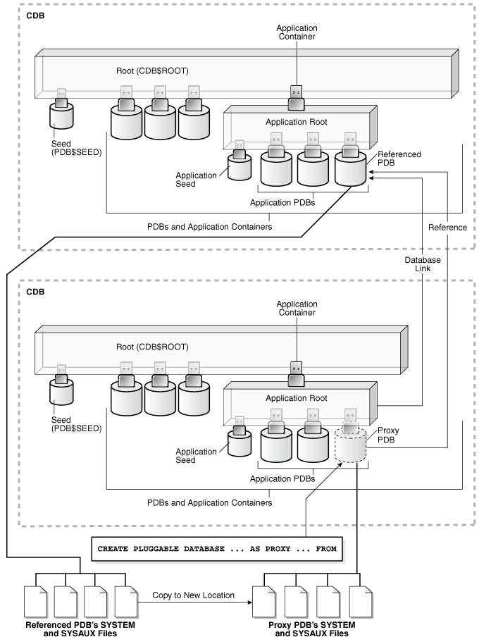
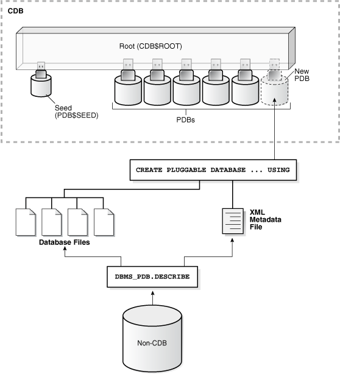

You can create PDBs in several different ways, including using the seed, cloning an existing PDB or non-CDB, and plugging in an unplugged PDB. You can also remove PDBs from a CDB.

Note:

You can complete the tasks in this chapter using SQL\*Plus or Oracle SQL Developer.

- About Creating and Removing PDBs  
	You can create a pluggable database (PDB) in a multitenant container database (CDB) by using the CDB seed or an application seed, cloning an existing PDB or non-CDB, plugging an unplugged PDB into a CDB, or using a non-CDB. You can remove a PDB from a CDB by unplugging the PDB or dropping the PDB. You can also create PDBs in application containers.
- Preparing for PDBs  
	Prerequisites must be met before creating a PDB.
- Creating a PDB Using the Seed  
	You can use the `CREATE` `PLUGGABLE` `DATABASE` statement to create a PDB in a CDB using the files of the CDB seed. You can also use this statement to create an application PDB in an application container using the files of an application seed or a CDB seed.
- Creating a PDB by Cloning an Existing PDB or Non-CDB  
	You can create a PDB by cloning a local PDB, a remote PDB, or a non-CDB.
- Creating a PDB by Relocating It  
	You can create a PDB by relocating it from one CDB to another.
- Creating a PDB by Plugging an Unplugged PDB into a CDB  
	You can create a PDB by plugging an unplugged PDB into a CDB.
- Creating a PDB as a Proxy PDB  
	You can create a PDB as a proxy PDB by referencing a PDB in a remote CDB.
- Creating a PDB Using a Non-CDB  
	You can create a PDB using a non-CDB in different ways.
- Unplugging a PDB from a CDB  
	You can unplug a PDB from a CDB.
- Dropping a PDB  
	The `DROP` `PLUGGABLE` `DATABASE` statement drops a PDB. You can drop a PDB when you want to move the PDB from one CDB to another or when you no longer need the PDB.

**Parent topic:** [Managing a Multitenant Environment](managing-a-multitenant-environment.md)

### 38.1 About Creating and Removing PDBs

You can create a pluggable database (PDB) in a multitenant container database (CDB) by using the CDB seed or an application seed, cloning an existing PDB or non-CDB, plugging an unplugged PDB into a CDB, or using a non-CDB. You can remove a PDB from a CDB by unplugging the PDB or dropping the PDB. You can also create PDBs in application containers.

Note:

- This chapter discusses using SQL statements to create and remove PDBs. An easier way to create and remove PDBs is with a graphical user interface, such as of Database Configuration Assistant (DBCA), Oracle Enterprise Manager Cloud Control (Cloud Control), or Oracle Enterprise Manager Database Express (EM Express).
- A CDB can contain up to 4,096 PDBs, including PDBs, application roots, application PDBs, application seeds, and proxy PDBs. This number does not include the CDB root and the CDB seed.

- Techniques for Creating a PDB  
	You can use various techniques to create a PDB.
- The CREATE PLUGGABLE DATABASE Statement  
	You use the `CREATE` `PLUGGABLE` `DATABASE` statement to create a PDB. To use this statement, you must understand the clauses for the statement and when to use each clause.
- Summary of Clauses for Creating a PDB  
	When you create a PDB with the `CREATE PLUGGABLE DATABASE` statement, various clauses are available to you based on different factors, such as the technique you are using to create the PDB. You can determine which clauses to use by answering a series of questions.

See Also:

- " [About a Multitenant Environment](overview-of-managing-a-multitenant-environment.md) "
- [Oracle Database 2 Day DBA](https://docs.oracle.com/pls/topic/lookup?ctx=en/database/oracle/oracle-database/12.2/admin&id=ADMQS023) and the DBCA online help for more information about DBCA

**Parent topic:** Creating and Removing PDBs with SQL\*Plus

#### 38.1.1 Techniques for Creating a PDB

You can use various techniques to create a PDB.

Creating a PDB is the process of associating the PDB with a CDB or an application container. You create a PDB when you want to use the PDB as part of the CDB or application container.

Table 38-1 describes the techniques that you can use to create a PDB.

Table 38-1 Techniques for Creating a PDB

| Technique | Description | More Information |
| --- | --- | --- |
| Create a PDB by using the seed | Create a PDB in a CDB using the files of the CDB seed or application seed. This technique copies the files associated with the seed to a new location and associates the copied files with the new PDB. | " Creating a PDB Using the Seed " |
| Create a PDB by cloning an existing PDB or non-CDB | Create a PDB by cloning a source PDB or non-CDB. A source can be a PDB in the local CDB, a PDB in a remote CDB, a PDB in a local or remote application container, or a non-CDB. This technique copies the files associated with the source to a new location and associates the copied files with the new PDB. | " Creating a PDB by Cloning an Existing PDB or Non-CDB " |
| Create a PDB by relocating it to a different CDB | Create a PDB by relocating it from one CDB to another. This technique moves the files associated with the PDB to a new location. | " Creating a PDB by Relocating It " |
| Create a PDB by plugging an unplugged PDB into a CDB | Create a PDB by using the XML metadata file that describes the PDB and the files associated with the PDB to plug it into the CDB. | " Creating a PDB by Plugging an Unplugged PDB into a CDB " |
| Creating a PDB as a proxy PDB | Create a PDB as a proxy PDB by referencing a different PDB with a database link. The referenced PDB can be in the same CDB as the proxy PDB, or it can be in a different CDB. | " Creating a PDB as a Proxy PDB " |
| Create a PDB by using a non-CDB | Create a PDB by adopting a non-CDB into a PDB. You can use the `DBMS_PDB` package to create an unplugged PDB from an Oracle Database 12c non-CDB. You can then plug the unplugged PDB into the CDB. | " About Creating a PDB Using a Non-CDB " |

All of the techniques described in Table 38-1 use the `CREATE` `PLUGGABLE` `DATABASE` statement to create a PDB. These techniques fall into four main categories: relocating, copying, plugging in, and referencing as a proxy PDB. Figure 38-1 depicts the options for creating a PDB:

Figure 38-1 Options for Creating a PDB



> This graphic depicts a flowchart. On the left is "Creating a PDB." Four options flow from "Creating a PDB:" “Relocating,” “Copying." "Plugging In," and “Referencing as a View PDB.”
>
> Two options flow from "Copying:" "Copying Files from the Seed" and "Cloning a PDB." Two options flow from "Cloning a PDB:" "Locally" and "Remotely."
>
> Two options flow from "Remotely:" "From a PDB" and "From a Non-CDB."
>
> Two options flow from "Plugging In:" "Plugging In an Unplugged PDB" and "Plugging in a Non-CDB as a PDB."


Creating an application container is the process of associating the application container with a CDB. You can use all of these techniques to create an application container by including the `AS APPLICATION CONTAINER` clause in the `CREATE` `PLUGGABLE` `DATABASE` statement.

When you create a PDB, it can be associated with a CDB or with an application container. When the current container is a CDB root and you create a PDB, the PDB is associated with the CDB root. When the current container is an application root in an application container, and you create a PDB, the PDB is associated with the application root. When cloning a PDB into an application container, relocating a PDB to an application container, or plugging in a PDB into an application container, the PDB’s application name and version must match the application container’s application name and version.

You can unplug a PDB when you want to plug it into a different CDB. You can unplug or drop a PDB when you no longer need it. An unplugged PDB is not usable until it is plugged into a CDB.

Note:

- Creating a PDB by cloning a non-CDB is available starting with Oracle Database 12c Release 1 (12.1.0.2).
- Creating a PDB by relocating it or as a proxy PDB is available starting with Oracle Database 12c Release 2 (12.2.0.1).

#### 38.1.2 The CREATE PLUGGABLE DATABASE Statement

You use the `CREATE` `PLUGGABLE` `DATABASE` statement to create a PDB. To use this statement, you must understand the clauses for the statement and when to use each clause.

All of the techniques described in Table 38-1 use this statement.

Note:

Starting with Oracle Database 12c Release 2 (12.2.0.1), you can also use the `CREATE PLUGGABLE DATABASE` statement to create application containers, application seeds, and application PDBs. The SQL statements that create PDBs and application PDBs are exactly the same. When a `CREATE PLUGGABLE DATABASE` statement is run in the CDB root, the PDB belongs to the CDB root. When a `CREATE PLUGGABLE DATABASE` statement is run in an application root, the application PDB belongs to the application root. You can create an application root by running a `CREATE PLUGGABLE DATABASE` statement with the `AS APPLICATION CONTAINER` clause when the CDB root is the current container.

- Storage Limits  
	The optional `STORAGE` clause of the `CREATE` `PLUGGABLE` `DATABASE` statement specifies storage limits for PDBs.
- File Location of the New PDB  
	In the `CREATE` `PLUGGABLE` `DATABASE` statement, you can specify the locations of files used by the new PDB.
- Restrictions on PDB File Locations  
	The `PATH_PREFIX` clause of the `CREATE PLUGGABLE DATABASE` statement ensures that all directory object paths associated with the PDB are restricted to the specified directory or its subdirectories. It also ensures that the following files associated with the PDB are restricted to specified directory: the Oracle XML repository for the PDB, files created with a `CREATE PFILE` statement, and the export directory for Oracle wallets.
- Source File Locations When Plugging In an Unplugged PDB  
	Use the `CREATE` `PLUGGABLE` `DATABASE` `...` `USING` statement to plug an unplugged PDB into a CDB.
- Renaming a Service  
	The `SERVICE_NAME_CONVERT` clause of the `CREATE` `PLUGGABLE` `DATABASE` statement renames the user-defined services of the new PDB based on the service names of the source PDB.
- Temp File Reuse  
	The `TEMPFILE REUSE` clause of the `CREATE` `PLUGGABLE` `DATABASE` statement specifies that an existing temp file in the target location is reused.
- Default Tablespace  
	The `DEFAULT TABLESPACE` clause of the `CREATE` `PLUGGABLE` `DATABASE` statement specifies the default tablespace for the new PDB.
- User Tablespaces  
	The `USER_TABLESPACES` clause of the `CREATE` `PLUGGABLE` `DATABASE` statement specifies which tablespaces are available in the new PDB.
- PDB Tablespace Logging  
	The logging\_clause of the `CREATE` `PLUGGABLE` `DATABASE` statement specifies the logging attribute of the PDB. The logging attribute controls whether certain DML operations are logged in the redo log file (`LOGGING`) or not (`NOLOGGING`).
- PDB Inclusion in Standby CDBs  
	The `STANDBYS` clause of the `CREATE` `PLUGGABLE` `DATABASE` statement specifies whether the new PDB is included in standby CDBs.
- Excluding Data When Cloning a PDB  
	The `NO DATA` clause of the `CREATE` `PLUGGABLE` `DATABASE` statement specifies that a PDB's data model definition is cloned but not the PDB's data.
- Parallelize PDB Creation  
	The `PARALLEL` clause of the `CREATE PLUGGABLE DATABASE` statement specifies whether to use parallel execution servers during PDB creation and, optionally, the degree of parallelism.
- PDB Refresh  
	The `REFRESH MODE` clause of the `CREATE` `PLUGGABLE` `DATABASE` statement specifies whether a PDB created as a clone can be refreshed periodically. Each PDB refresh propagates changes from the source PDB to the new PDB.
- Application Container and Application Seed  
	With the `CREATE PLUGGABLE DATABASE` statement, you can create an application container. You can also create an application seed in an application container.
- PDB Listener Host Name and Port Number  
	The host name and port number settings for a PDB are important only if proxy PDBs will reference the PDB. Use the `PORT` clause to specify the PDB’s port number. Use the `HOST` clause to specify the PDB’s host name.

See Also:

- " [Creating and Removing Application Containers and Seeds with SQL\*Plus](creating-removing-application-containers-seeds-with-sql-plus.md) "
- [Oracle Database SQL Language Reference](https://docs.oracle.com/pls/topic/lookup?ctx=en/database/oracle/oracle-database/12.2/admin&id=SQLRF55686) for more information about the `CREATE` `PLUGGABLE` `DATABASE` statement

**Parent topic:** About Creating and Removing PDBs

##### 38.1.2.1 Storage Limits

The optional `STORAGE` clause of the `CREATE` `PLUGGABLE` `DATABASE` statement specifies storage limits for PDBs.

The `STORAGE` clause specifies the following limits:

- The amount of storage that can be used by all tablespaces that belong to the PDB
	Use `MAXSIZE` and a size clause to specify a limit, or set `MAXSIZE` to `UNLIMITED` to indicate no limit.
- The amount of storage that can be used by unified audit OS spillover (.bin format) files in the PDB
	Use `MAX_AUDIT_SIZE` and a size clause to specify a limit, or set `MAX_AUDIT_SIZE` to `UNLIMITED` to indicate no limit.
- The amount of diagnostics (trace files and incident dumps) in the Automatic Diagnostic Repository (ADR) that can be used by the PDB
	Use `MAX_DIAG_SIZE` and a size clause to specify a limit, or set `MAX_DIAG_SIZE` to `UNLIMITED` to indicate no limit.

If `STORAGE` `UNLIMITED` is set, or if there is no `STORAGE` clause, then there are no storage limits for the PDB.

The following are examples that use the `STORAGE` clause.

Example 38-1 STORAGE Clause That Specifies a Storage Limit

This `STORAGE` clause specifies that the storage used by all tablespaces that belong to the PDB must not exceed 2 gigabytes.

```
STORAGE (MAXSIZE 2G)
```

Example 38-2 STORAGE Clause That Specifies Unlimited Storage

This `STORAGE` clause specifies unlimited storage for all tablespaces that belong to the PDB.

```
STORAGE (MAXSIZE UNLIMITED)
```

See Also:

[Oracle Database SQL Language Reference](https://docs.oracle.com/pls/topic/lookup?ctx=en/database/oracle/oracle-database/12.2/admin&id=SQLRF55694) for the syntax of the `STORAGE` clause

**Parent topic:** The CREATE PLUGGABLE DATABASE Statement

##### 38.1.2.2 File Location of the New PDB

In the `CREATE` `PLUGGABLE` `DATABASE` statement, you can specify the locations of files used by the new PDB.

The term "file name" means both the name and the location of a file. The `CREATE` `PLUGGABLE` `DATABASE` statement has the following clauses that indicate the file names of the new PDB being created:

- The `FILE_NAME_CONVERT` clause specifies the names of the PDB's files after the PDB is created.
	Use this clause when the files are not yet at their ultimate destination, and you want to copy or move them during PDB creation. You can use this clause in any `CREATE` `PLUGGABLE` `DATABASE` statement.
- Starting with Oracle Database 12c Release 1 (12.1.0.2), the `CREATE_FILE_DEST` clause specifies the default Oracle Managed Files file system directory or Oracle ASM disk group for the PDB's files.
	Use this clause to enable Oracle Managed Files for the new PDB, independent of any Oracle Managed Files default location specified in the root for the CDB. You can use this clause in any `CREATE` `PLUGGABLE` `DATABASE` statement.

When necessary, you can use both of these clauses in the same `CREATE` `PLUGGABLE` `DATABASE` statement. In addition, the following initialization parameters can control the location of the new PDB's files:

- The `DB_CREATE_FILE_DEST` initialization parameter set in the root
	This initialization parameter specifies the default location for Oracle Managed Files for the CDB. When this parameter is set in a PDB, it specifies the default location for Oracle Managed Files for the PDB.
- The `PDB_FILE_NAME_CONVERT` initialization parameter
	This initialization parameter maps names of existing files to new file names when processing a `CREATE PLUGGABLE DATABASE` statement.

The following table shows the precedence order when both clauses are used in the same `CREATE` `PLUGGABLE` `DATABASE` statement, and both initialization parameters are set. For each clause and initialization parameter, the table also shows whether the files created by the `CREATE PLUGGABLE DATABASE` statement will use Oracle Managed Files or not.

Table 38-2 Summary of File Location Clauses and Initialization Parameters

| Clause or Initialization Parameter | Precedence Order | Will the Files Created by CREATE PLUGGABLE DATABASE Use Oracle Managed Files? |
| --- | --- | --- |
| `FILE_NAME_CONVERT` clause | 1 | No |
| `CREATE_FILE_DEST` clause | 2 | Yes |
| `DB_CREATE_FILE_DEST` initialization parameter | 3 | Yes |
| `PDB_FILE_NAME_CONVERT` initialization parameter | 4 | No |

Regarding the use of Oracle Managed Files, the table only applies to files created by the `CREATE PLUGGABLE DATABASE` statement. Files created for the PDB after the PDB has been created might or might not use Oracle Managed Files.

In addition, if `FILE_NAME_CONVERT` and `CREATE_FILE_DEST` are both specified in the `CREATE PLUGGABLE DATABASE` statement, then the `FILE_NAME_CONVERT` setting is used for the files being placed during PDB creation, and the `CREATE_FILE_DEST` setting is used to set the `DB_CREATE_FILE_DEST` initialization parameter in the PDB. In this case, Oracle Managed Files controls the location of the files for the PDB after PDB creation.

Note:

The `PATH_PREFIX` clause does not affect files created by Oracle Managed Files.

- FILE\_NAME\_CONVERT Clause  
	If the PDB will not use Oracle Managed Files, then the `FILE_NAME_CONVERT` clause of the `CREATE` `PLUGGABLE` `DATABASE` statement specifies how to generate the names of files (such as data files) using the names of existing files.
- CREATE\_FILE\_DEST Clause  
	The `CREATE_FILE_DEST` clause of the `CREATE` `PLUGGABLE` `DATABASE` statement enables Oracle Managed Files for the PDB and specifies the default file system directory or Oracle ASM disk group for the PDB's files. The PDB’s data files and temp files are restricted to the specified directory and its subdirectories.

See Also:

- [Oracle Database Reference](https://docs.oracle.com/pls/topic/lookup?ctx=en/database/oracle/oracle-database/12.2/admin&id=REFRN10034) for more information about the `DB_CREATE_FILE_DEST` initialization parameter
- [Oracle Database Reference](https://docs.oracle.com/pls/topic/lookup?ctx=en/database/oracle/oracle-database/12.2/admin&id=REFRN10322) for more information about the `PDB_FILE_NAME_CONVERT` initialization parameter

**Parent topic:** The CREATE PLUGGABLE DATABASE Statement

###### 38.1.2.2.1 FILE\_NAME\_CONVERT Clause

If the PDB will not use Oracle Managed Files, then the `FILE_NAME_CONVERT` clause of the `CREATE` `PLUGGABLE` `DATABASE` statement specifies how to generate the names of files (such as data files) using the names of existing files.

You can use this clause to specify one of the following options:

- One or more file name patterns and replacement file name patterns, in the following form:
	```
	'string1' , 'string2' , 'string3' , 'string4' , ...
	```
	The string2 file name pattern replaces the string1 file name pattern, and the string4 file name pattern replaces the string3 file name pattern. You can use as many pairs of file name pattern and replacement file name pattern strings as required.
	If you specify an odd number of strings (the last string has no corresponding replacement string), then an error is returned. Do not specify more than one pattern/replace string that matches a single file name or directory.
- `NONE` when no files should be copied or moved during PDB creation. Omitting the `FILE_NAME_CONVERT` clause is the same as specifying `NONE`.

You can use the `FILE_NAME_CONVERT` clause in any `CREATE` `PLUGGABLE` `DATABASE` statement.

When the `FILE_NAME_CONVERT` clause is not specified in a `CREATE` `PLUGGABLE` `DATABASE` statement, either Oracle Managed Files or the `PDB_FILE_NAME_CONVERT` initialization parameter specifies how to generate the names of the files. If you use both Oracle Managed Files and the `PDB_FILE_NAME_CONVERT` initialization parameter, then Oracle Managed Files takes precedence. The `FILE_NAME_CONVERT` clause takes precedence when it is specified.

File name patterns specified in the `FILE_NAME_CONVERT` clause cannot match files or directories managed by Oracle Managed Files.

Example 38-3 FILE\_NAME\_CONVERT Clause

This `FILE_NAME_CONVERT` clause generates file names for the new PDB in the /oracle/pdb5 directory using file names in the /oracle/dbs directory.

```
FILE_NAME_CONVERT = ('/oracle/dbs/', '/oracle/pdb5/')
```

**Parent topic:** File Location of the New PDB

###### 38.1.2.2.2 CREATE\_FILE\_DEST Clause

The `CREATE_FILE_DEST` clause of the `CREATE` `PLUGGABLE` `DATABASE` statement enables Oracle Managed Files for the PDB and specifies the default file system directory or Oracle ASM disk group for the PDB's files. The PDB’s data files and temp files are restricted to the specified directory and its subdirectories.

If a file system directory is specified as the default location in this clause, then the directory must exist. Also, the user who runs the `CREATE` `PLUGGABLE` `DATABASE` statement must have the appropriate privileges to create files in the specified directory. Alternatively, you can specify the name of a directory object that exists in the CDB root (`CDB$ROOT`). The directory object points to the file system directory used by `CREATE_FILE_DEST`.

If there is a default Oracle Managed Files location for the CDB set in the CDB root, then the `CREATE_FILE_DEST` setting overrides the CDB root’s setting, and the specified `CREATE_FILE_DEST` setting is used for the PDB.

If `CREATE_FILE_DEST=NONE` is specified, then Oracle Managed Files is disabled for the PDB.

When the `CREATE_FILE_DEST` clause is set to a value other than `NONE`, the `DB_CREATE_FILE_DEST` initialization parameter is set implicitly in the PDB with `SCOPE=SPFILE`.

If the CDB root uses Oracle Managed Files, and this clause is not specified, then the PDB inherits the Oracle Managed Files default location from the CDB root.

Note:

This feature is available starting with Oracle Database 12c Release 1 (12.1.0.2).

Example 38-4 CREATE\_FILE\_DEST Clause

This `CREATE_FILE_DEST` clause specifies /oracle/pdb2/ as the default Oracle Managed Files file system directory for the new PDB.

```
CREATE_FILE_DEST = '/oracle/pdb2/'
```

See Also:

" [Using Oracle Managed Files](using-oracle-managed-files.md) "

**Parent topic:** File Location of the New PDB

##### 38.1.2.3 Restrictions on PDB File Locations

The `PATH_PREFIX` clause of the `CREATE PLUGGABLE DATABASE` statement ensures that all directory object paths associated with the PDB are restricted to the specified directory or its subdirectories. It also ensures that the following files associated with the PDB are restricted to specified directory: the Oracle XML repository for the PDB, files created with a `CREATE PFILE` statement, and the export directory for Oracle wallets.

Use this clause when you want to ensure that a PDB's files reside in a specific directory and its subdirectories.

You can use this clause to specify one of the following options:

- An absolute path that is used as a prefix for all file paths associated with the PDB.
- The name of a directory object that exists in the CDB root (`CDB$ROOT`). The directory object points to the absolute path to be used for `PATH_PREFIX`.
- `NONE` to indicate that there are no restrictions for the file paths. Omitting the `PATH_PREFIX` clause is the same as specifying `NONE`.

After a PDB is created, its `PATH_PREFIX` setting cannot be modified.

You can use the `PATH_PREFIX` clause in any `CREATE` `PLUGGABLE` `DATABASE` statement.

Example 38-5 PATH\_PREFIX Clause

This `PATH_PREFIX` clause ensures that all file paths associated with the PDB are restricted to the /disk1/oracle/dbs/salespdb/ directory.

```
PATH_PREFIX = '/disk1/oracle/dbs/salespdb/'
```

Be sure to specify the path name so that it is properly formed when file names are appended to it. For example, on UNIX systems, be sure to end the path name with a forward slash (/).

Note:

- After the `PATH_PREFIX` clause is specified for a PDB, existing directory objects might not work as expected, since the `PATH_PREFIX` string is always added as a prefix to all local directory objects in the PDB.
- The `PATH_PREFIX` clause does not affect files created by Oracle Managed Files.
- The `PATH_PREFIX` clause only applies to user-created directory objects. It does not apply to Oracle-supplied directory objects.
- The `PATH_PREFIX` clause does not apply to data files or temporary files. If you are using Oracle Managed Files, then use the `CREATE_FILE_DEST` clause to restrict the locations of data files and temporary files.

See Also:

- " [About a Multitenant Environment](overview-of-managing-a-multitenant-environment.md) "
- " [Viewing Information About the Containers in a CDB](viewing-information-about-cdbs-and-pdbs-with-sql-plus.md) "

**Parent topic:** The CREATE PLUGGABLE DATABASE Statement

##### 38.1.2.4 Source File Locations When Plugging In an Unplugged PDB

Use the `CREATE` `PLUGGABLE` `DATABASE` `...` `USING` statement to plug an unplugged PDB into a CDB.

You can plug in a PDB by specifying the XML metadata file or by specifying a compressed archive file with a.pdb extension. An archive file includes the XML metadata file and the PDB’s files (such as the data files and wallet file).

When you use a.pdb archive file when plugging in a PDB, this file is extracted when you plug in the PDB, and the PDB’s files are placed in the same directory as the.pdb archive file. Therefore, the clauses that specify the source file locations are not required when you use a.pdb archive file.

When you specify an XML metadata file when plugging in a PDB, this file describes the names and locations of an unplugged PDB's source files. The XML file might not describe the locations of these files accurately if you transported the unplugged files from one storage system to a different one. The files are in a new location, but the file paths in the XML file still indicate the old location.

The `CREATE` `PLUGGABLE` `DATABASE` statement has the following clauses that indicate the location of the source files for the new PDB being created:

- The `SOURCE_FILE_NAME_CONVERT` clause specifies how to locate files (such as data files) listed in an XML file describing a PDB if they reside in a location different from that specified in the XML file. The clause contains information about each file listed in the XML file.
- Starting with Oracle Database 12c Release 1 (12.1.0.2), the `SOURCE_FILE_DIRECTORY` clause specifies the source directory of the files that will be used to create the new PDB. The clause specifies a directory that contains all of the files listed in the XML file. Using this clause is convenient when you have a large number of data files and specifying a `SOURCE_FILE_NAME_CONVERT` pattern for each file is not feasible.

Use these clauses only when you are plugging in an unplugged PDB with a `CREATE` `PLUGGABLE` `DATABASE` `...` `USING` statement with an XML metadata file (not a.pdb archive file). These clauses are mutually exclusive. You cannot use both clauses in a single `CREATE` `PLUGGABLE` `DATABASE` statement.

- SOURCE\_FILE\_NAME\_CONVERT Clause  
	The `SOURCE_FILE_NAME_CONVERT` clause of the `CREATE` `PLUGGABLE` `DATABASE` `...` `USING` statement specifies how to locate files (such as data files) listed in an XML file describing a PDB if they reside in a location different from that specified in the XML file.
- SOURCE\_FILE\_DIRECTORY Clause  
	The `SOURCE_FILE_DIRECTORY` clause of the `CREATE` `PLUGGABLE` `DATABASE` statement specifies the source directory of the files that will be used to create the new PDB. The clause specifies a directory that contains all of the files listed in the XML file for the unplugged PDB.

**Parent topic:** The CREATE PLUGGABLE DATABASE Statement

###### 38.1.2.4.1 SOURCE\_FILE\_NAME\_CONVERT Clause

The `SOURCE_FILE_NAME_CONVERT` clause of the `CREATE` `PLUGGABLE` `DATABASE` `...` `USING` statement specifies how to locate files (such as data files) listed in an XML file describing a PDB if they reside in a location different from that specified in the XML file.

You can use this clause to specify one of the following options:

- One or more file name patterns and replacement file name patterns, in the following form:
	```
	'string1' , 'string2' , 'string3' , 'string4' , ...
	```
	The string2 file name pattern replaces the string1 file name pattern, and the string4 file name pattern replaces the string3 file name pattern. You can use as many pairs of file name pattern and replacement file name pattern strings as required.
	When you use this clause, ensure that the files you want to use for the PDB reside in the replacement file name patterns. Move or copy the files to these locations if necessary.
- `NONE` when no file names need to be located because the PDB's XML file describes the file names accurately. Omitting the `SOURCE_FILE_NAME_CONVERT` clause is the same as specifying `NONE`.

You can use the `SOURCE_FILE_NAME_CONVERT` clause only in a `CREATE` `PLUGGABLE` `DATABASE` statement with a `USING` clause that specifies an XML metadata file. Therefore, you can use this clause only when you are plugging in an unplugged PDB with an XML metadata file. You cannot use this clause when you are plugging in a PDB with a.pdb archive file.

Example 38-6 SOURCE\_FILE\_NAME\_CONVERT Clause

This `SOURCE_FILE_NAME_CONVERT` clause uses the files in the /disk2/oracle/pdb7 directory instead of the /disk1/oracle/pdb7 directory. In this case, the XML file describing a PDB specifies the /disk1/oracle/pdb7 directory, but the PDB should use the files in the /disk2/oracle/pdb7 directory.

```
SOURCE_FILE_NAME_CONVERT = ('/disk1/oracle/pdb7/', '/disk2/oracle/pdb7/')
```

See Also:

- Creating a PDB by Plugging an Unplugged PDB into a CDB
- [Oracle Database SQL Language Reference](https://docs.oracle.com/pls/topic/lookup?ctx=en/database/oracle/oracle-database/12.2/admin&id=SQLRF55794) for the syntax of the `SOURCE_FILE_NAME_CONVERT` clause

**Parent topic:** Source File Locations When Plugging In an Unplugged PDB

###### 38.1.2.4.2 SOURCE\_FILE\_DIRECTORY Clause

The `SOURCE_FILE_DIRECTORY` clause of the `CREATE` `PLUGGABLE` `DATABASE` statement specifies the source directory of the files that will be used to create the new PDB. The clause specifies a directory that contains all of the files listed in the XML file for the unplugged PDB.

When you plug in a PDB, if the source files are all present in a single directory, then you can specify the directory name in this clause. The directory is scanned to find the appropriate files based on the unplugged PDB’s XML file.

You can use this clause to specify one of the following options:

- The absolute path of the source file directory.
- `NONE` when no files should be copied or moved during PDB creation. Omitting the `SOURCE_FILE_DIRECTORY` clause is the same as specifying `NONE`.

You can use the `SOURCE_FILE_DIRECTORY` clause only in a `CREATE` `PLUGGABLE` `DATABASE` statement with a `USING` clause that specifies an XML metadata file. Therefore, you can use this clause only when you are plugging in an unplugged PDB with an XML metadata file. You cannot use this clause when you are plugging in a PDB with a.pdb archive file.

You can specify this clause for configurations that use Oracle Managed Files and for configurations that do not use Oracle Managed Files.

Example 38-7 SOURCE\_FILE\_DIRECTORY Clause

This `SOURCE_FILE_DIRECTORY` clause generates file names for the new PDB by using the source files in the /oracle/pdb5/ directory.

```
SOURCE_FILE_DIRECTORY = '/oracle/pdb5/'
```

See Also:

- Creating a PDB by Plugging an Unplugged PDB into a CDB
- [Oracle Database SQL Language Reference](https://docs.oracle.com/pls/topic/lookup?ctx=en/database/oracle/oracle-database/12.2/admin&id=SQLRF57048) for the syntax of the `SOURCE_FILE_DIRECTORY` clause

**Parent topic:** Source File Locations When Plugging In an Unplugged PDB

##### 38.1.2.5 Renaming a Service

The `SERVICE_NAME_CONVERT` clause of the `CREATE` `PLUGGABLE` `DATABASE` statement renames the user-defined services of the new PDB based on the service names of the source PDB.

When the service name of a new PDB conflicts with an existing service name in the CDB, plug-in violations can result. Use the `SERVICE_NAME_CONVERT` clause to rename services and avoid these violations.

You can use this clause to specify one of the following options:

- One or more service names and replacement service names, in the following form:
	```
	'string1' , 'string2' , 'string3' , 'string4' , ...
	```
	The string2 service name replaces the string1 service name, and the string4 service name replaces the string3 service name. You can use as many pairs of service names and replacement service names as required.
	If you specify an odd number of strings (the last string has no corresponding replacement string), then an error is returned.
- `NONE` when no service names need to be renamed. Omitting the `SERVICE_NAME_CONVERT` clause is the same as specifying `NONE`.

You can use the `SERVICE_NAME_CONVERT` clause in any `CREATE` `PLUGGABLE` `DATABASE` statement, except for a `CREATE PLUGGABLE DATABASE` statement that creates a PDB from the CDB seed. The CDB seed cannot have user-defined services. However, you can use this statement for a `CREATE` `PLUGGABLE` `DATABASE` statement that creates an application PDB from an application seed in an application container.

Note:

This clause does not apply to the default service for the PDB. The default service has the same name as the PDB.

Example 38-8 SERVICE\_NAME\_CONVERT Clause

This `SERVICE_NAME_CONVERT` clause uses renames the `salesrep` service to `salesperson`.

```
SERVICE_NAME_CONVERT = ('salesrep','salesperson')
```

Note:

[Oracle Database SQL Language Reference](https://docs.oracle.com/pls/topic/lookup?ctx=en/database/oracle/oracle-database/12.2/admin&id=SQLRF55686)

**Parent topic:** The CREATE PLUGGABLE DATABASE Statement

##### 38.1.2.6 Temp File Reuse

The `TEMPFILE REUSE` clause of the `CREATE` `PLUGGABLE` `DATABASE` statement specifies that an existing temp file in the target location is reused.

When you specify this clause, Oracle Database formats the temp file and reuses it. The previous contents of the file are lost. If this clause is specified, and there is no temp file in the target location, then Oracle Database creates a new temp file for the PDB.

If you do not specify this clause, then the `CREATE` `PLUGGABLE` `DATABASE` statement creates a new temp file for the PDB. If a file exists with the same name as the new temp file in the target location, then an error is returned, and the PDB is not created. Therefore, if you do not specify the `TEMPFILE REUSE` clause, then ensure that such a temp file does not exist in the target location.

Example 38-9 TEMPFILE REUSE Clause

```
TEMPFILE REUSE
```

**Parent topic:** The CREATE PLUGGABLE DATABASE Statement

##### 38.1.2.7 Default Tablespace

The `DEFAULT TABLESPACE` clause of the `CREATE` `PLUGGABLE` `DATABASE` statement specifies the default tablespace for the new PDB.

Oracle Database will assign the default tablespace to any non-SYSTEM users who do not have a different permanent tablespace specified.

When you create the PDB from the CDB seed or an application seed and specify the `DEFAULT TABLESPACE` clause, Oracle Database creates a smallfile tablespace and sets it as the default tablespace for the PDB. When you create the PDB using a method other than the using the CDB seed or application seed, such as cloning a PDB or plugging in an unplugged PDB, the default tablespace must be a tablespace that already exists in the source PDB.

Example 38-10 DEFAULT TABLESPACE Clause

```
DEFAULT TABLESPACE sales
```

**Parent topic:** The CREATE PLUGGABLE DATABASE Statement

##### 38.1.2.8 User Tablespaces

The `USER_TABLESPACES` clause of the `CREATE` `PLUGGABLE` `DATABASE` statement specifies which tablespaces are available in the new PDB.

You can use this clause to separate the data for multiple schemas into different PDBs. For example, when you move a non-CDB to a PDB, and the non-CDB had a number of schemas that each supported a different application, you can use this clause to separate the data belonging to each schema into a separate PDB, assuming that each schema used a separate tablespace in the non-CDB.

You can use this clause to specify one of the following options:

- List one or more tablespaces to include.
- Specify `ALL`, the default, to include all of the tablespaces.
- Specify `ALL` `EXCEPT` to include all of the tablespaces, except for the tablespaces listed.
- Specify `NONE` to exclude all of the tablespaces.
- If the creation mode of the user tablespaces must be different from the creation mode for the Oracle-supplied tablespaces (such as `SYSTEM` and `SYSAUX`), then specify one of the following in the `USER_TABLESPACES` clause:
	- `COPY`: The files of the tablespaces are copied to a new location.
		- `MOVE`: The files of the tablespaces are moved to a new location.
		- `NOCOPY`: The files of the tablespaces are not copied or moved.
		- `SNAPSHOT COPY`: The tablespaces are cloned with storage snapshots.
		- `NO DATA`: The data model definition of the tablespaces is cloned but not the tablespaces’ data.

When the compatibility level of the CDB is 12.2.0 or higher, the tablespaces that are excluded by this clause are created offline in the new PDB, and they have no data files associated with them. When the compatibility level of the CDB is lower than 12.2.0, the tablespaces that are excluded by this clause are offline in the new PDB, and all data files that belong to these tablespaces are unnamed and offline.

This clause does not apply to the `SYSTEM`, `SYSAUX`, or `TEMP` tablespaces. Do not include these tablespaces in a tablespace list for this clause.

The following are examples that use the `USER_TABLESPACES` clause.

Example 38-11 USER\_TABLESPACES Clause That Includes One Tablespace

Assume that the non-CDB or PDB from which a PDB is being created includes the following tablespaces: `tbs1`, `tbs2`, and `tbs3`. This `USER_TABLESPACES` clause includes the `tbs2` tablespace, but excludes the `tbs1` and `tbs3` tablespaces.

```
USER_TABLESPACES=('tbs2')
```

Example 38-12 USER\_TABLESPACES Clause That Includes a List of Tablespaces

Assume that the non-CDB or PDB from which a PDB is being created includes the following tablespaces: `tbs1`, `tbs2`, `tbs3`, `tbs4`, and `tbs5`. This `USER_TABLESPACES` clause includes the `tbs1`, `tbs4`, and `tbs5` tablespaces, but excludes the `tbs2` and `tbs3` tablespaces.

```
USER_TABLESPACES=('tbs1','tbs4','tbs5')
```

Example 38-13 USER\_TABLESPACES Clause That Includes All Tablespaces Except for Listed Ones

Assume that the non-CDB or PDB from which a PDB is being created includes the following tablespaces: `tbs1`, `tbs2`, `tbs3`, `tbs4`, and `tbs5`. This `USER_TABLESPACES` clause includes the `tbs2` and `tbs3` tablespaces, but excludes the `tbs1`, `tbs4`, and `tbs5` tablespaces.

```
USER_TABLESPACES=ALL EXCEPT('tbs1','tbs4','tbs5')
```

Example 38-14 USER\_TABLESPACES in a Different Creation Mode

This example shows a full `CREATE PLUGGABLE DATABASE` statement that plugs in a non-CDB and only includes the `tbs3` user tablespace from the non-CDB. The example copies the files for Oracle-supplied tablespaces (such as `SYSTEM` and `SYSAUX`) to a new location, but moves the files of the `tbs3` user tablespace.

```
CREATE PLUGGABLE DATABASE ncdb USING '/disk1/oracle/ncdb.xml'
  COPY
  FILE_NAME_CONVERT = ('/disk1/oracle/dbs/', '/disk2/oracle/ncdb/')
  USER_TABLESPACES=('tbs3') MOVE;
```

**Parent topic:** The CREATE PLUGGABLE DATABASE Statement

##### 38.1.2.9 PDB Tablespace Logging

The logging\_clause of the `CREATE` `PLUGGABLE` `DATABASE` statement specifies the logging attribute of the PDB. The logging attribute controls whether certain DML operations are logged in the redo log file (`LOGGING`) or not (`NOLOGGING`).

Note:

This feature is available starting with Oracle Database 12c Release 1 (12.1.0.2).

You can use this clause to specify one of the following attributes:

- `LOGGING`, the default, indicates that any future tablespaces created within the PDB will be created with the `LOGGING` attribute by default.
- `NOLOGGING` indicates that any future tablespaces created within the PDB will be created with the `NOLOGGING` attribute by default.

You can override the default logging attribute by specifying either `LOGGING` or `NOLOGGING` at the schema object level--for example, in a `CREATE TABLE` statement.

The specified attribute is used to establish the logging attribute of tablespaces created within the PDB if the logging\_clause is not specified in the `CREATE TABLESPACE` statement.

The `DBA_PDBS` view shows the current logging attribute for a PDB.

Example 38-15 Specifying the LOGGING Attribute for the PDB

```
LOGGING
```

Example 38-16 Specifying the NOLOGGING Attribute for the PDB

```
NOLOGGING
```

See Also:

- " [Controlling the Writing of Redo Records](managing-tablespaces.md) "
- [Oracle Database SQL Language Reference](https://docs.oracle.com/pls/topic/lookup?ctx=en/database/oracle/oracle-database/12.2/admin&id=SQLRF30009) for more information about the logging attribute

**Parent topic:** The CREATE PLUGGABLE DATABASE Statement

##### 38.1.2.10 PDB Inclusion in Standby CDBs

The `STANDBYS` clause of the `CREATE` `PLUGGABLE` `DATABASE` statement specifies whether the new PDB is included in standby CDBs.

Note:

This feature is available starting with Oracle Database 12c Release 1 (12.1.0.2).

You can specify one of the following values for the `STANDBYS` clause:

- `ALL` includes the new PDB in all of the standby CDBs.
- `ALL EXCEPT` includes the new PDB in all of the standby CDBs except the specified standby CDBs. If more than one standby CDB is excluded, use a comma-separated list of the excluded standby CDBs.
- A comma-separated list of the standby CDBs. The new PDB is included in the listed standby CDBs.
- `NONE` excludes the new PDB from all of the standby CDBs.

When a PDB is not included in any of the standby CDBs, the PDB's data files are offline and marked as unnamed on all of the standby CDBs. Any new standby CDBs that are instantiated after the PDB has been created must disable the PDB for recovery explicitly to exclude it from the standby CDB. It is possible to enable a PDB on a standby CDB after it was excluded on that standby CDB.

Example 38-17 STANDBYS Clause That Includes the New PDB on All Standby CDBs

```
STANDBYS=ALL
```

Example 38-18 STANDBYS Clause That Includes the New PDB on All Standby CDBs Except the Specified Standby CDBs

This example shows a `STANDBYS` clause that includes the new PDB in all standby CDBs except standby CDB `standby1` and standby CDB `standby2`.

```
STANDBYS=ALL EXCEPT('standby1','standby2')
```

Example 38-19 STANDBYS Clause That Lists Standby CDBs

This example shows a `STANDBYS` clause that includes the new PDB in a list of standby CDBs. The list includes the standby CDBs `standby1`, `standby2`, and `standby3`.

```
STANDBYS=('standby1','standby2','standby3')
```

Example 38-20 STANDBYS Clause That Excludes the New PDB from All Standby CDBs

```
STANDBYS=NONE
```

See Also:

[Oracle Data Guard Concepts and Administration](https://docs.oracle.com/pls/topic/lookup?ctx=en/database/oracle/oracle-database/12.2/admin&id=SBYDB5260) for more information about configuring PDBs on standby CDBs

**Parent topic:** The CREATE PLUGGABLE DATABASE Statement

##### 38.1.2.11 Excluding Data When Cloning a PDB

The `NO DATA` clause of the `CREATE` `PLUGGABLE` `DATABASE` statement specifies that a PDB's data model definition is cloned but not the PDB's data.

Note:

This feature is available starting with Oracle Database 12c Release 1 (12.1.0.2).

The dictionary data in the source PDB is cloned, but all user-created table and index data from the source PDB is discarded. This clause is useful for quickly creating clones of a PDB with only the object definitions and no data. Use this clause only when you are cloning a PDB with a `CREATE PLUGGABLE DATABASE ... FROM` statement.

This clause does not apply to the `SYSTEM` and `SYSAUX` tablespaces. If user-created database objects in the source PDB are stored in one of these tablespaces, the database objects will contain data in the cloned PDB.

When the `NO DATA` clause is included in the `CREATE` `PLUGGABLE` `DATABASE` statement, the source PDB cannot contain the following types of tables:

- Advanced Queue (AQ) tables
- Clustered tables
- Table clusters

Example 38-21 NO DATA Clause

```
NO DATA
```

See Also:

[Oracle Database SQL Language Reference](https://docs.oracle.com/pls/topic/lookup?ctx=en/database/oracle/oracle-database/12.2/admin&id=SQLRF57032)

**Parent topic:** The CREATE PLUGGABLE DATABASE Statement

##### 38.1.2.12 Parallelize PDB Creation

The `PARALLEL` clause of the `CREATE PLUGGABLE DATABASE` statement specifies whether to use parallel execution servers during PDB creation and, optionally, the degree of parallelism.

You can use this clause to make the creation of PDBs faster by using more than one parallel execution server to copy the new PDB’s data files to a new location. When the compatibility level of the CDB is 12.2.0 or higher, the CDB chooses the degree of parallelism to use for PDB creation by default. Alternatively, you can specify the desired degree of parallelism in the clause, but the CDB can ignore the suggestion, depending on the current database load and the number of available parallel execution servers.

When a value of 0 or 1 is specified, the CDB does not parallelize the creation of the PDB. Specifying 0 or 1 can result in longer PDB creation time.

Use this clause only when you are creating a PDB from the CDB seed or an application seed, or when you are cloning a PDB.

Example 38-22 The CDB Chooses the Degree of Parallelism for PDB Creation

Either omit the `PARALLEL` clause or specify the following in the `CREATE PLUGGABLE DATABASE` statement:

```
PARALLEL
```

Example 38-23 Specify the Degree of Parallelism for PDB Creation

This example specifies that the PDB is created with a degree of parallelism of four:

```
PARALLEL 4
```

Example 38-24 Specify That the CDB Does Not Parallelize PDB Creation

This example specifies that the PDB is created without parallel processing:

```
PARALLEL 1
```

**Parent topic:** The CREATE PLUGGABLE DATABASE Statement

##### 38.1.2.13 PDB Refresh

The `REFRESH MODE` clause of the `CREATE` `PLUGGABLE` `DATABASE` statement specifies whether a PDB created as a clone can be refreshed periodically. Each PDB refresh propagates changes from the source PDB to the new PDB.

This clause is supported only in a `CREATE` `PLUGGABLE` `DATABASE` `...` `FROM` statement. You can use this clause to specify one of the following options:

- Specify `REFRESH MODE NONE`, the default, to create a PDB that is not refreshable.
- Specify `REFRESH MODE MANUAL` to create a refreshable PDB that must be refreshed manually.
- Specify `REFRESH MODE EVERY number_of_minutes MINUTES` to create a refreshable PDB that is refreshed automatically after the specified number of minutes has passed. A refreshable PDB that uses automatic refresh can also be refreshed manually.

A refreshable PDB can be opened only in open read-only mode. Also, a refreshable PDB must be closed when a refresh is performed. If it is not closed when automatic refresh is attempted, then the refresh is deferred until the next scheduled refresh. If it is not closed when a user attempts to perform manual refresh, then an error is reported.

The refreshable PDB must be kept in read-only mode to prevent out-of-sync changes on the refreshable PDB which do not occur on the source PDB. The refreshable PDB is intended to serve as a clone master and as such must accurately reflect the source PDB at the refreshed point in time.

This clause is also supported in an `ALTER PLUGGABLE DATABASE` statement that modifies the refresh mode of a refreshable PDB. The `ALTER PLUGGABLE DATABASE` statement can switch from manual refresh to automatic refresh, or from automatic refresh to manual refresh. It can also change the number of minutes between automatic refreshes.

Note:

- A refreshable PDB and its source must be in different CDBs. Therefore, a refreshable PDB must be created at a CDB that is remote from the source CDB, and a database link must be specified during the creation.
- A PDB that is not refreshable cannot be changed into a refreshable PDB. However, a PDB that is refreshable can be changed into a PDB that is not refreshable by running an `ALTER PLUGGABLE DATABASE` statement with `REFRESH MODE NONE` for the PDB.
- When you create a refreshable PDB, you can set the `REMOTE_RECOVERY_FILE_DEST` initialization parameter in the PDB. This initialization parameter specifies a directory from which to read archive log files during refresh operations if the source PDB is not available over its database link.
- If new data files are created in the source PDB, then the `PDB_FILE_NAME_CONVERT` initialization parameter must be set in the CDB to convert the data file paths from the source PDB to the clone PDB.

Example 38-25 A REFRESH MODE Clause That Specifies Automatic Refresh

This refresh mode clause specifies that a refreshable PDB is refreshed automatically every two hours (120 minutes):

```
REFRESH MODE EVERY 120 MINUTES
```

##### 38.1.2.14 Application Container and Application Seed

With the `CREATE PLUGGABLE DATABASE` statement, you can create an application container. You can also create an application seed in an application container.

- AS APPLICATION CONTAINER Clause  
	To create an application container, specify the `AS APPLICATION CONTAINER` clause of the `CREATE` `PLUGGABLE` `DATABASE` statement.
- AS SEED Clause  
	To create an application seed in an application container, specify the `AS SEED` clause of the `CREATE` `PLUGGABLE` `DATABASE` statement.

**Parent topic:** The CREATE PLUGGABLE DATABASE Statement

###### 38.1.2.14.1 AS APPLICATION CONTAINER Clause

To create an application container, specify the `AS APPLICATION CONTAINER` clause of the `CREATE` `PLUGGABLE` `DATABASE` statement.

This clause creates an application container (not a PDB). When you include this clause in a `CREATE` `PLUGGABLE` `DATABASE` statement, you can use all of the techniques and clauses that are used for creating a PDB.

When you include this clause, the current container must be a CDB root. It cannot be an application root.

Example 38-26 AS APPLICATION CONTAINER Clause

```
AS APPLICATION CONTAINER
```

###### 38.1.2.14.2 AS SEED Clause

To create an application seed in an application container, specify the `AS SEED` clause of the `CREATE` `PLUGGABLE` `DATABASE` statement.

This clause creates an application seed in an application container. When you include this clause in a `CREATE` `PLUGGABLE` `DATABASE` statement, you can use all of the techniques and clauses that are used for creating a PDB.

When you include this clause, the current container must be an application root. It cannot be the CDB root.

An application container can have no application seed or one application seed. It cannot have more than one application seed.

After an application seed is created, you can use it to create application PDBs in the application container. The application seed provides a quick way to create application PDBs that meet the requirements of the application container.

Example 38-27 AS SEED Clause

```
AS SEED
```

##### 38.1.2.15 PDB Listener Host Name and Port Number

The host name and port number settings for a PDB are important only if proxy PDBs will reference the PDB. Use the `PORT` clause to specify the PDB’s port number. Use the `HOST` clause to specify the PDB’s host name.

- HOST Clause  
	The `HOST` clause of the `CREATE` `PLUGGABLE` `DATABASE` statement specifies the host name of the listener for the PDB being created.
- PORT Clause  
	The `PORT` clause of the `CREATE` `PLUGGABLE` `DATABASE` statement specifies the port number of the listener for the PDB being created.

**Parent topic:** The CREATE PLUGGABLE DATABASE Statement

###### 38.1.2.15.1 HOST Clause

The `HOST` clause of the `CREATE` `PLUGGABLE` `DATABASE` statement specifies the host name of the listener for the PDB being created.

By default, the host name of the listener is the same as the host name of the PDB being created. Specify the `HOST` clause when both of the following conditions are true:

- The host name of the listener is different from the host name of the PDB being created.
- You plan to create proxy PDBs that reference the PDB being created.

A proxy PDB uses a database link to establish communication with its referenced PDB. After communication is established, the proxy PDB communicates directly with the referenced PDB without using a database link. The host name of the listener must be correct for the proxy PDB to function properly.

Example 38-28 HOST Clause

```
HOST='myhost.example.com'
```

###### 38.1.2.15.2 PORT Clause

The `PORT` clause of the `CREATE` `PLUGGABLE` `DATABASE` statement specifies the port number of the listener for the PDB being created.

By default, the port number of the listener for the PDB being created is 1521. Specify the `PORT` clause when both of the following conditions are true:

- The port number of the listener is not 1521.
- You plan to create proxy PDBs that reference the PDB being created.

A proxy PDB uses a database link to establish communication with its referenced PDB. After communication is established, the proxy PDB communicates directly with the referenced PDB without using a database link. The port number of the listener must be correct for the proxy PDB to function properly.

Example 38-29 PORT Clause

```
PORT=1599
```

#### 38.1.3 Summary of Clauses for Creating a PDB

When you create a PDB with the `CREATE PLUGGABLE DATABASE` statement, various clauses are available to you based on different factors, such as the technique you are using to create the PDB. You can determine which clauses to use by answering a series of questions.

The following table describes which `CREATE` `PLUGGABLE` `DATABASE` clauses you must specify based on different factors.

Table 38-3 Clauses for Creating a PDB

| Clause | Can Be Used Only When | Question | Yes | No |
| --- | --- | --- | --- | --- |
| `AS APPLICATION CONTAINER` | Creating an application container in a CDB | Do you want to create an application container instead of a PDB? | Specify the `AS APPLICATION CONTAINER` clause. | Omit the `AS APPLICATION CONTAINER` clause. |
| `AS` `CLONE` | Plugging in an unplugged PDB | Are you plugging a PDB into a CDB that contains one or more PDBs that were created by plugging in the same PDB? | Specify the `AS` `CLONE` clause to ensure that Oracle Database generates unique PDB DBID, GUID, and other identifiers expected for the new PDB. The PDB is plugged in as a clone of the unplugged PDB to ensure that all of its identifiers are unique. | Omit the `AS` `CLONE` clause. |
| `AS SEED` | Creating an application seed in an application container | Do you want to create an application seed in an application container? | Specify the `AS SEED` clause. | Omit the `AS SEED` clause. |
| `CREATE_FILE_DEST` | Creating a PDB from the CDB seed or an application seed  Cloning a PDB  Relocating a PDB  Plugging in an unplugged PDB | Do you want to use a `CREATE_FILE_DEST` clause to specify the Oracle Managed Files default location for the PDB's files?  When creating a PDB from the CDB seed or an application seed, the source files are the files associated with the seed. | Include a `CREATE_FILE_DEST` clause that specifies the default file system directory or Oracle ASM disk group for the PDB's files. | Omit the `CREATE_FILE_DEST` clause.  Use one of these techniques to specify the target locations of the files:  - `FILE_NAME_CONVERT` clause - Enable Oracle Managed Files for the CDB for it to determine the target locations. - Specify the target locations in the `PDB_FILE_NAME_CONVERT` initialization parameter.  See " File Location of the New PDB ". |
| `DEFAULT TABLESPACE` | Creating a PDB from the CDB seed or an application seed  Cloning a PDB  Relocating a PDB  Plugging in an unplugged PDB | Do you want to specify a default permanent tablespace for the PDB? | Specify a `DEFAULT` `TABLESPACE` clause with the appropriate limits.  Oracle Database will assign to this tablespace any non- `SYSTEM` users for whom you do not specify a different permanent tablespace.  When creating a PDB from the CDB seed or an application seed, Oracle Database creates a smallfile tablespace and sets it as the default tablespace. When using a technique other than creation from the CDB seed or an application seed, the specified tablespace must exist in the source PDB. | Omit the `DEFAULT` `TABLESPACE` clause.  If you do not specify this clause, then the `SYSTEM` tablespace is the default permanent tablespace for non- `SYSTEM` users. Using the `SYSTEM` tablespace for non- `SYSTEM` users is not recommended. |
| `FILE_NAME_CONVERT` | Creating a PDB from the CDB seed or an application seed  Cloning a PDB  Relocating a PDB  Creating a proxy PDB (Only applies to data files in the `SYSTEM` and `SYSAUX` tablespaces.)  Plugging in an unplugged PDB | Do you want to use a `FILE_NAME_CONVERT` clause to specify the target locations of the files?  When creating a PDB from the CDB seed or an application seed, the source files are the files associated with the seed. | Include a `FILE_NAME_CONVERT` clause that specifies the target locations of the files based on the names of the source files. | Omit the `FILE_NAME_CONVERT` clause.  Use one of these techniques to specify the target locations of the files:  - `CREATE_FILE_DEST` clause - Enable Oracle Managed Files for the CDB for it to determine the target locations. - Specify the target locations in the `PDB_FILE_NAME_CONVERT` initialization parameter.  See " File Location of the New PDB ". |
| `HOST` | Creating a PDB from the CDB seed or an application seed  Cloning a PDB  Relocating a PDB  Plugging in an unplugged PDB | Is the PDB a reference PDB with a dependent proxy PDB, and is the host name of its listener changing? | Include a `HOST` clause and specify the host name of the listener for the PDB being created. For example, you might have a listener network for the physical host name and default port and also have configured a second listener bound to a virtual host name and virtual IP address with a non-default port number. | Omit the `HOST` clause. |
| logging\_clause | Creating a PDB from the CDB seed or an application seed  Cloning a PDB  Plugging in an unplugged PDB | Do you want to specify the logging attribute of the tablespaces in the new PDB?  This feature is available starting with Oracle Database 12c Release 1 (12.1.0.2). | Include the logging\_clause. | Omit the logging\_clause. |
| `NOCOPY`, `COPY`, `MOVE`  See " File Location of the New PDB ". | Plugging in an unplugged PDB | Do you want to copy or move the files to a new location? | Specify `COPY` to copy the files to a new location. `COPY` is the default. Specify `MOVE` to move the files to a new location. Use one of these techniques to specify the target location:  - Include a `FILE_NAME_CONVERT` clause that specifies the target locations based on the names of the source files. - Include a `CREATE_FILE_DEST` clause that specifies the Oracle Managed Files default location for the PDB's files. - Enable Oracle Managed Files for it to determine the target locations. - Specify the target locations in the `PDB_FILE_NAME_CONVERT` initialization parameter. | Specify `NOCOPY`. |
| `NO DATA` | Cloning a PDB | Do you want to specify that the data model definition of the source PDB is cloned but not the data of the source PDB?  This feature is available starting with Oracle Database 12c Release 1 (12.1.0.2). | Include the `NO DATA` clause. | Omit the `NO DATA` clause. |
| `PARALLEL` | Creating a PDB from the CDB seed or an application seed  Cloning a PDB | Do you want to use multiple parallel execution servers to parallelize PDB creation? | To let the CDB choose the degree of parallelism, include or omit the `PARALLEL` clause.  To specify the degree of parallelism, specify the `PARALLEL` clause with an integer. For example, specify `PARALLEL 4` to indicate a degree of parallelism of 4. | Specify `PARALLEL 0` or `PARALLEL 1`. |
| `PATH_PREFIX` | Creating a PDB from the CDB seed or an application seed  Cloning a PDB  Relocating a PDB  Plugging in an unplugged PDB | Do you want to use a `PATH_PREFIX` clause to restrict file paths for the PDB for the following: directory objects, the Oracle XML repository for the PDB, files created with a `CREATE PFILE` statement, and the export directory for Oracle wallets?  The `PATH_PREFIX` clause does not affect files created by Oracle Managed Files. | Include a `PATH_PREFIX` clause that specifies an absolute path. | Set the `PATH_PREFIX` clause to `NONE` or omit it. |
| `PORT` | Creating a PDB from the CDB seed or an application seed  Cloning a PDB  Relocating a PDB  Plugging in an unplugged PDB | Is the PDB a reference PDB with a dependent proxy PDB, and is the port number of its listener changing to a value other than 1521? | Include a `PORT` clause and specify the port number of the listener for the PDB being created. For example, you might have a listener network for the physical host name and default port and also have configured a second listener bound to a virtual host name and virtual IP address with a non-default port number. | Omit the `PORT` clause. |
| `REFRESH MODE` | Cloning a PDB | Do you want to be able to refresh the PDB to propagate changes from the source PDB to the clone PDB?  A refreshable PDB must be opened in open read-only mode. | Include a `REFRESH MODE MANUAL` or `REFRESH MODE EVERY minutes` clause. | Omit the `REFRESH MODE` clause or include a `REFRESH MODE NONE` clause. |
| `ROLES` | Creating a PDB from the CDB seed or an application seed  Creating a proxy PDB | Do you want to grant predefined Oracle roles to the `PDB_DBA` role locally in the PDB?  The new administrator for the PDB is granted the `PDB_DBA` common role locally in the PDB. By default, the `CREATE` `PLUGGABLE` `DATABASE` statement does not grant the administrator or the role any privileges. | Include the `ROLES` clause and specify the predefined Oracle roles to grant to the `PDB_DBA` role. The specified roles are granted to the `PDB_DBA` role locally in the PDB. The user who runs the `CREATE` `PLUGGABLE` `DATABASE` statement does not need to be granted the specified roles. See [Oracle Database Security Guide](https://docs.oracle.com/pls/topic/lookup?ctx=en/database/oracle/oracle-database/12.2/admin&id=DBSEG4414) for information about predefined Oracle roles. | Omit the `ROLES` clause. |
| `SERVICE_NAME_CONVERT` | Creating a PDB from the application seed, but not a CDB seed  Cloning a PDB  Relocating a PDB  Creating a proxy PDB (Only applies to data files in the `SYSTEM` and `SYSAUX` tablespaces.)  Plugging in an unplugged PDB | Do you want to use a `SERVICE_NAME_CONVERT` clause to rename the user-defined services of the new PDB based on the service names of the source PDB? | Include a `SERVICE_NAME_CONVERT` clause that specifies the new name of a service and the service name it is replacing. Specify multiple service names and replacement service names if necessary. | Omit the `SERVICE_NAME_CONVERT` clause. |
| `SNAPSHOT COPY` | Cloning a PDB | Do you want to clone a PDB using a storage snapshot? | Specify a `SNAPSHOT COPY` clause to indicate that cloning is to be performed using storage snapshots.  Creating a PDB clone with storage snapshots makes creating a clone nearly instantaneous because it does not require copying the source PDB's data files. `SNAPSHOT` `COPY` is supported only if the underlying file system supports storage snapshots. | Omit the `SNAPSHOT COPY` clause. |
| `SOURCE_FILE_DIRECTORY` | Plugging in an unplugged PDB using an XML file directly.  This clause does not apply to plugging in an unplugged PDB with a.pdb archive file. | Are all of the source files in a single directory with new file names that would require multiple `SOURCE_FILE_NAME_CONVERT` entries? | Specify the `SOURCE_FILE_DIRECTORY` with the full absolute path to the source files. | Omit the `SOURCE_FILE_DIRECTORY` clause. |
| `SOURCE_FILE_NAME_CONVERT` | Plugging in an unplugged PDB using an XML file directly.  This clause does not apply to plugging in an unplugged PDB with a.pdb archive file. | Do the contents of the XML file accurately describe the locations of the source files? | Omit the `SOURCE_FILE_NAME_CONVERT` clause. | Use the `SOURCE_FILE_NAME_CONVERT` clause to specify the source file locations. |
| `STANDBYS` | Creating a PDB from the CDB seed or an application seed  Cloning a PDB  Relocating a PDB  Plugging in an unplugged PDB | Do you want to include the new PDB in one or more standby CDBs? | Specify `ALL`, `ALL EXCEPT`, or a list of standby CDBs. | Omit the `STANDBYS` clause or specify `NONE`. |
| `STORAGE` | Creating a PDB from the CDB seed or an application seed  Cloning a PDB  Relocating a PDB  Plugging in an unplugged PDB | Do you want to limit the amount of storage that the PDB can use? | Specify a `STORAGE` clause with the appropriate limits. | Omit the `STORAGE` clause, or specify unlimited storage using the `STORAGE` clause. |
| `TEMPFILE REUSE` | Creating a PDB from the CDB seed or an application seed  Cloning a PDB  Relocating a PDB  Plugging in an unplugged PDB | Do you want to reuse the temp file if a temp file exists in the target location? | Include the `TEMPFILE REUSE` clause. | Omit the `TEMPFILE REUSE` clause.  Ensure that there is no file with the same name as the new temp file in the target location. |
| `USER_TABLESPACES` | Cloning a non-CDB  Plugging in an unplugged PDB | Do you want to specify which tablespaces are included in the new PDB and which tablespaces are excluded from the new PDB?  This feature is available starting with Oracle Database 12c Release 1 (12.1.0.2). | Include the `USER_TABLESPACES` clause and specify the tablespaces that are included in the new PDB. | Omit the `USER_TABLESPACES` clause. |

**Parent topic:** About Creating and Removing PDBs

### 38.2 Preparing for PDBs

Prerequisites must be met before creating a PDB.

Ensure that the following prerequisites are met before creating a PDB:

- The CDB must exist.
	See " [Creating and Configuring a CDB](creating-and-configuring-a-cdb.md) ".
- The CDB must be in read/write mode.
- The current user must be a common user whose current container is the CDB root or an application container.
- The current user must have the `CREATE` `PLUGGABLE` `DATABASE` system privilege.
- You must decide on a unique container name for each container. Each container name must be unique in a single CDB, and each container name must be unique within the scope of all the CDBs whose instances are reached through a specific listener.
	The PDB name is used to distinguish a PDB from other PDBs in the CDB. PDB names follow the same rules as service names, which includes being case-insensitive. See [Oracle Database Net Services Reference](https://docs.oracle.com/pls/topic/lookup?ctx=en/database/oracle/oracle-database/12.2/admin&id=NETRF175) for information about the rules for service names.
- If you are creating a PDB in an Oracle Data Guard configuration with a physical standby database, then additional tasks must be completed before creating a PDB. See [Oracle Data Guard Concepts and Administration](https://docs.oracle.com/pls/topic/lookup?ctx=en/database/oracle/oracle-database/12.2/admin&id=SBYDB5260) for more information.
- If you are creating a PDB that includes data that was encrypted with Transparent Data Encryption, then follow the instructions in [Oracle Database Advanced Security Guide](https://docs.oracle.com/pls/topic/lookup?ctx=en/database/oracle/oracle-database/12.2/admin&id=ASOAG10441).
- If you are creating a Database Vault-enabled PDB, then follow the instructions in [Oracle Database Vault Administrator's Guide](https://docs.oracle.com/pls/topic/lookup?ctx=en/database/oracle/oracle-database/12.2/admin&id=DVADM71354).

See Also:

" [About the Current Container](administering-a-cdb-with-sql-plus.md) "

**Parent topic:** Creating and Removing PDBs with SQL\*Plus

### 38.3 Creating a PDB Using the Seed

You can use the `CREATE` `PLUGGABLE` `DATABASE` statement to create a PDB in a CDB using the files of the CDB seed. You can also use this statement to create an application PDB in an application container using the files of an application seed or a CDB seed.

- About Creating a PDB from the Seed  
	You can use the `CREATE` `PLUGGABLE` `DATABASE` statement to create a new PDB by using the files of the CDB seed or an application PDB from the files of an application seed or the CDB seed.
- Creating a PDB from the Seed  
	Using the `CREATE` `PLUGGABLE` `DATABASE` statement, you can create a PDB from the CDB seed, and you can create an application PDB from an application seed or the CDB seed.

See Also:

[Oracle Database SQL Language Reference](https://docs.oracle.com/pls/topic/lookup?ctx=en/database/oracle/oracle-database/12.2/admin&id=SQLRF55686) for more information about the `CREATE` `PLUGGABLE` `DATABASE` statement

**Parent topic:** Creating and Removing PDBs with SQL\*Plus

#### 38.3.1 About Creating a PDB from the Seed

You can use the `CREATE` `PLUGGABLE` `DATABASE` statement to create a new PDB by using the files of the CDB seed or an application PDB from the files of an application seed or the CDB seed.

The statement copies these files to a new location and associates them with the new PDB. Figure 38-2 illustrates how this technique creates a new PDB in a CDB with the CDB root as the current container.

Figure 38-2 Create a PDB in the CDB Root Using the CDB Seed Files


> This illustration shows a CDB with a `CDB$ROOT` container, a `PDB$SEED` container plugged into the root, and several PDBs plugged into the root. One PDB is a new PDB. The illustration shows the `PDB$SEED` files associated with the `PDB$SEED` container. The illustration shows the seed's files copied to a new location. The copied files are the files of the new PDB. The illustration shows the copied files associated with the new PDB. A `CREATE` `PLUGGABLE` `DATABASE` statement uses these copied files to create the new PDB.


Figure 38-3 illustrates how this technique creates a new application PDB in an application container with the application root as the current container.

Figure 38-3 Create a PDB in an Application Root Using the Application Seed Files



> This illustration shows a CDB with the following components:
>
> - The CDB has a `CDB$ROOT` container.
> - A `PDB$SEED` container is plugged into the root container.
> - Several PDBs are plugged into the root container.
> - An application container is plugged into the root container.
> - The application container has an application root container.
> - The application container has an application seed plugged into it.
> - The application container has two application PDBs plugged into its application root container.
>
> The illustration shows the application seed files associated with the application seed container. The illustration shows the application seed's files copied to a new location. The copied files are the files of the new application PDB. The illustration shows the copied files associated with the new application PDB. A `CREATE` `PLUGGABLE` `DATABASE` statement uses these copied files to create the new application PDB.


See Also:

" The CREATE PLUGGABLE DATABASE Statement "

When an application container includes an application seed, and a the `CREATE` `PLUGGABLE` `DATABASE` statement is run in the application root to create an application PDB from the seed, the application PDB is created using the application seed. However, when an application container does not include an application seed, and a the `CREATE` `PLUGGABLE` `DATABASE` statement is run in the application root to create an application PDB from the seed, the application PDB is created using the CDB seed (`PDB$SEED` ).

When you create a new PDB or application PDB from the seed, you must specify an administrator for the PDB or application PDB in the `CREATE` `PLUGGABLE` `DATABASE` statement. The statement creates the administrator as a local user in the PDB and grants the `PDB_DBA` role locally to the administrator.

When you create a PDB using the CDB seed or an application seed, you must address the questions that apply to creating a PDB from the seed in Table 38-3. The table describes which `CREATE` `PLUGGABLE` `DATABASE` clauses you must specify based on different factors.

See Also:

" [Creating an Application PDB](creating-removing-application-containers-seeds-with-sql-plus.md) "

**Parent topic:** Creating a PDB Using the Seed

#### 38.3.2 Creating a PDB from the Seed

Using the `CREATE` `PLUGGABLE` `DATABASE` statement, you can create a PDB from the CDB seed, and you can create an application PDB from an application seed or the CDB seed.

Before creating a PDB from the CDB seed (`PDB$SEED`) or an application PDB from an application seed or the CDB seed, complete the prerequisites described in " Preparing for PDBs ".

To create a PDB from the seed:

1. In SQL\*Plus, ensure that the current container is the CDB root or an application root.
	When the current container is the CDB root, the PDB is created in the CDB using the files of the CDB seed.
	When the current container is an application root, the application PDB is created in the application container using the files of the application seed. If there is no application seed in the application container, then the application PDB is created in the application container using the files of the CDB seed.
	See " [About the Current Container](administering-a-cdb-with-sql-plus.md) " and " [Accessing a Container in a CDB with SQL\*Plus](administering-a-cdb-with-sql-plus.md) ".
2. Run the `CREATE` `PLUGGABLE` `DATABASE` statement, and specify a local administrator for the PDB. Specify other clauses when they are required.
	See " Examples of Creating a PDB from the Seed ".
	After you create the PDB, it is in mounted mode, and its status is `NEW`. You can view the open mode of a PDB by querying the `OPEN_MODE` column in the `V$PDBS` view. You can view the status of a PDB by querying the `STATUS` column of the `CDB_PDBS` or `DBA_PDBS` view.
	A new default service is created for the PDB. The service has the same name as the PDB and can be used to access the PDB. Oracle Net Services must be configured properly for clients to access this service. See " [Accessing a Container in a CDB with SQL\*Plus](administering-a-cdb-with-sql-plus.md) ".
3. Open the new PDB in read/write mode.
	You must open the new PDB in read/write mode for Oracle Database to complete the integration of the new PDB into the CDB. An error is returned if you attempt to open the PDB in read-only mode. After the PDB is opened in read/write mode, its status is `NORMAL`.
	See " [Modifying the Open Mode of PDBs](administering-a-cdb-with-sql-plus.md) " for more information.
4. Back up the PDB.
	A PDB cannot be recovered unless it is backed up.
	[Oracle Database Backup and Recovery User's Guide](https://docs.oracle.com/pls/topic/lookup?ctx=en/database/oracle/oracle-database/12.2/admin&id=BRADV428) for information about backing up a PDB.

A local user with the name of the specified local administrator is created and granted the `PDB_DBA` common role locally in the PDB. If this user was not granted administrator privileges during PDB creation, then use the `SYS` and `SYSTEM` common users to administer to the PDB.

Note:

If an error is returned during PDB creation, then the PDB being created might be in an `UNUSABLE` state. You can check a PDB's state by querying the `CDB_PDBS` or `DBA_PDBS` view, and you can learn more about PDB creation errors by checking the alert log. An unusable PDB can only be dropped, and it must be dropped before a PDB with the same name as the unusable PDB can be created.

Examples of Creating a PDB from the Seed

The following examples create a new PDB named `salespdb` and a `salesadm` local administrator given different factors.

In addition to creating the `salespdb` PDB, this statement grants the `PDB_DBA` role to the PDB administrator `salesadm` and grants the specified predefined Oracle roles to the `PDB_DBA` role locally in the PDB.

In each example, the root to which the new PDB belongs depends on the current container when the `CREATE` `PLUGGABLE` `DATABASE` statement is run:

- When the current container is the CDB root, the new PDB is created in the CDB root.
- When the current container is an application root in an application container, the new PDB is created as an application PDB in the application root.

Example 38-30 Creating a PDB Using No Clauses

This example assumes the following factors:

- Storage limits are not required for the PDB. Therefore, the `STORAGE` clause is not required.
- The PDB does not require a default tablespace.
- The `PATH_PREFIX` clause is not required.
- The `FILE_NAME_CONVERT` clause and the `CREATE_FILE_DEST` clause are not required.
	Either Oracle Managed Files is enabled for the CDB, or the `PDB_FILE_NAME_CONVERT` initialization parameter is set. The files associated with the CDB seed or application seed will be copied to a new location based on the Oracle Managed Files configuration or the initialization parameter setting.
- There is no file with the same name as the new temp file that will be created in the target location. Therefore, the `TEMPFILE REUSE` clause is not required.
- No predefined Oracle roles need to be granted to the `PDB_DBA` role.

Given the preceding factors, the following statement creates the PDB:

```
CREATE PLUGGABLE DATABASE salespdb ADMIN USER salesadm IDENTIFIED BY password;
```

See Also:

- [Using Oracle Managed Files](using-oracle-managed-files.md)
- [Oracle Database Reference](https://docs.oracle.com/pls/topic/lookup?ctx=en/database/oracle/oracle-database/12.2/admin&id=REFRN10322) for information about the `PDB_FILE_NAME_CONVERT` initialization parameter
- [Oracle Database Security Guide](https://docs.oracle.com/pls/topic/lookup?ctx=en/database/oracle/oracle-database/12.2/admin&id=DBSEG33223) for guidelines about choosing passwords

Example 38-31 Creating a PDB and Granting Predefined Oracle Roles to the PDB Administrator

This example assumes the following factors:

- Storage limits are not required for the PDB. Therefore, the `STORAGE` clause is not required.
- The PDB does not require a default tablespace.
- The `PATH_PREFIX` clause is not required.
- The `FILE_NAME_CONVERT` clause and the `CREATE_FILE_DEST` clause are not required.
	Either Oracle Managed Files is enabled, or the `PDB_FILE_NAME_CONVERT` initialization parameter is set. The files associated with the CDB seed or application seed will be copied to a new location based on the Oracle Managed Files configuration or the initialization parameter setting.
- There is no file with the same name as the new temp file that will be created in the target location. Therefore, the `TEMPFILE REUSE` clause is not required.
- The `PDB_DBA` role should be granted the following predefined Oracle role locally: `DBA`.

Given the preceding factors, the following statement creates the PDB:

```
CREATE PLUGGABLE DATABASE salespdb ADMIN USER salesadm IDENTIFIED BY password
  ROLES=(DBA);
```

See Also:

- [Using Oracle Managed Files](using-oracle-managed-files.md)
- [Oracle Database Reference](https://docs.oracle.com/pls/topic/lookup?ctx=en/database/oracle/oracle-database/12.2/admin&id=REFRN10322) for information about the `PDB_FILE_NAME_CONVERT` initialization parameter
- [Oracle Database Security Guide](https://docs.oracle.com/pls/topic/lookup?ctx=en/database/oracle/oracle-database/12.2/admin&id=DBSEG33223) for guidelines about choosing passwords

Example 38-32 Creating a PDB Using the STORAGE, DEFAULT TABLESPACE, PATH\_PREFIX, and FILE\_NAME\_CONVERT Clauses

This example assumes the following factors:

- Storage limits must be enforced for the PDB. Therefore, the `STORAGE` clause is required. Specifically, all tablespaces that belong to the PDB must not exceed 2 gigabytes.
- A default permanent tablespace is required for any non-administrative users for which you do not specify a different permanent tablespace. Specifically, this example creates a default permanent tablespace named `sales` with the following characteristics:
	- The single data file for the tablespace is `sales01.dbf`, and the statement creates it in the /disk1/oracle/dbs/salespdb directory.
		- The `SIZE` clause specifies that the initial size of the tablespace is 250 megabytes.
		- The `AUTOEXTEND` clause enables automatic extension for the file.
- The path prefix must be added to the PDB's directory object paths. Therefore, the `PATH_PREFIX` clause is required. In this example, the path prefix /disk1/oracle/dbs/salespdb/ is added to the PDB’s directory object paths.
- The `CREATE_FILE_DEST` clause will not be used, Oracle Managed Files is not enabled, and the `PDB_FILE_NAME_CONVERT` initialization parameter is not set. Therefore, the `FILE_NAME_CONVERT` clause is required. Specify the location of the data files for the CDB seed or application seed on your system. In this example, Oracle Database copies the files from /disk1/oracle/dbs/pdbseed to /disk1/oracle/dbs/salespdb.
	To view the location of the data files for the CDB seed or application seed, run the query in [Example 45-7](viewing-information-about-cdbs-and-pdbs-with-sql-plus.md).
- There is no file with the same name as the new temp file that will be created in the target location. Therefore, the `TEMPFILE REUSE` clause is not required.
- No predefined Oracle roles need to be granted to the `PDB_DBA` role.

Given the preceding factors, the following statement creates the PDB:

```
CREATE PLUGGABLE DATABASE salespdb ADMIN USER salesadm IDENTIFIED BY password
  STORAGE (MAXSIZE 2G)
  DEFAULT TABLESPACE sales 
    DATAFILE '/disk1/oracle/dbs/salespdb/sales01.dbf' SIZE 250M AUTOEXTEND ON
  PATH_PREFIX = '/disk1/oracle/dbs/salespdb/'
  FILE_NAME_CONVERT = ('/disk1/oracle/dbs/pdbseed/', '/disk1/oracle/dbs/salespdb/');
```

See Also:

- [Oracle Database SQL Language Reference](https://docs.oracle.com/pls/topic/lookup?ctx=en/database/oracle/oracle-database/12.2/admin&id=SQLRF53869) for more information about the `DEFAULT` `TABLESPACE` clause
- [Oracle Database Security Guide](https://docs.oracle.com/pls/topic/lookup?ctx=en/database/oracle/oracle-database/12.2/admin&id=DBSEG33223) for guidelines about choosing passwords

**Parent topic:** Creating a PDB Using the Seed

### 38.4 Creating a PDB by Cloning an Existing PDB or Non-CDB

You can create a PDB by cloning a local PDB, a remote PDB, or a non-CDB.

Note:

Creating a PDB by cloning a non-CDB is available starting with Oracle Database 12c Release 1 (12.1.0.2).

- About Cloning a PDB  
	You can use the `CREATE` `PLUGGABLE` `DATABASE` statement to clone a PDB from a source PDB or from a non-CDB.
- Cloning a Local PDB  
	This section describes cloning a local PDB. After cloning a local PDB, the source and target PDBs are in the same CDB.
- Cloning a Remote PDB or Non-CDB  
	You can create a PDB by cloning a remote source. The remote source can be a remote PDB or non-CDB. After the cloning operation is complete, the source and the target PDB are in different locations.
- After Cloning a PDB  
	Certain rules regarding users and tablespaces apply after cloning a PDB.

**Parent topic:** Creating and Removing PDBs with SQL\*Plus

#### 38.4.1 About Cloning a PDB

You can use the `CREATE` `PLUGGABLE` `DATABASE` statement to clone a PDB from a source PDB or from a non-CDB.

This technique clones a source PDB or non-CDB as a new PDB and automatically plugs the clone into the CDB. To use this technique, you must include a `FROM` clause that specifies the source.

The source is the existing PDB or non-CDB that is copied. The target PDB is the clone of the source. The source can be a PDB in the local CDB, a PDB in a remote CDB, or a non-CDB. The `CREATE` `PLUGGABLE` `DATABASE` statement copies the files associated with the source to a new location and associates the files with the target PDB. When the CDB is in `ARCHIVELOG` mode and local undo mode, the source PDB can be opened in read/write mode and fully functional during the operation. Therefore, hot PDB cloning is supported.

One use of cloning is for testing. Cloning enables you to create one or more clones of a PDB or non-CDB and safely test them in isolation. For example, you might test a new or modified application on a cloned PDB before using the application with a production PDB.

Figure 38-4 illustrates how this technique creates a new PDB when the source is a local PDB.

Figure 38-4 Clone a Local PDB


> This illustration shows a CDB with a `CDB$ROOT` container, a `PDB$SEED` container plugged into the root, and several PDBs plugged into the root. One PDB is a new PDB. The illustration shows the files of the source PDB. The illustration shows the source PDB files copied to a new location. The copied files are the files of the new PDB. The illustration shows the copied files associated with the new PDB. A `CREATE` `PLUGGABLE` `DATABASE` `...` `FROM` statement uses these copied files to create the new PDB.


When the source is a PDB is in a remote CDB, you must use a database link to clone the PDB. The database link must be created in the CDB that will contain the cloned PDB. When you issue the `CREATE PLUGGABLE DATABASE` statement from the root of the CDB that will contain the new PDB, you must specify a database link to the remote CDB that contains the PDB being cloned in the `FROM` clause. The database link connects either to the root of the remote CDB or to the remote source PDB from the CDB that will contain the new PDB.

Figure 38-5 illustrates how this technique creates a new PDB when the source PDB is remote.

Figure 38-5 Creating a PDB by Cloning a Remote PDB


> This illustration shows two CDBs. Both CDBs have a `CDB$ROOT` container, a `PDB$SEED` container plugged into the root, and several PDBs plugged into the root. The bottom CDB has one new PDB. The illustration shows a database link going from the bottom CDB to the source PDBs in the top CDB. The illustration shows the files of the source PDB. The illustration shows the source PDB files copied to a new location. The copied files are the files of the new PDB. The illustration shows the copied files associated with the new PDB. A `CREATE` `PLUGGABLE` `DATABASE` `...` `FROM` statement uses these copied files to create the new PDB.


When the source is a non-CDB, you must specify a database link to the non-CDB in the `FROM` clause. Figure 38-6 illustrates how this technique creates a new PDB when the source is a remote non-CDB.

Figure 38-6 Creating a PDB by Cloning a Non-CDB



> This illustration shows a non-CDB and a CDB. The CDB has a `CDB$ROOT` container, a `PDB$SEED` container plugged into the root, and several PDBs plugged into the root. The CDB has one new PDB. The illustration shows a database link going from the CDB to the non-CDB. The illustration shows the files of the non-CDB. The illustration shows the non-CDB files copied to a new location. The copied files are the files of the new PDB. The illustration shows the copied files associated with the new PDB. A `CREATE` `PLUGGABLE` `DATABASE` `...` `FROM` statement uses these copied files to create the new PDB.


In all cloning scenarios (local, remote, and from a non-CDB), when an application root is the current container when you run the `CREATE PLUGGABLE DATABASE` statement, the cloned PDB is created in the application container. In this case, the source PDB’s application name and version must match the application name and version of the application container. Figure 38-7 illustrates how this technique creates a new application PDB in an application container by cloning a local source application PDB. The source PDB can also be a PDB plugged into the local CDB root, a PDB plugged into a remote CDB root, or an application PDB plugged into a remote application root.

Figure 38-7 Clone a PDB in an Application Container


> This illustration shows a CDB with a `CDB$ROOT` container, a `PDB$SEED` container plugged into the root, several PDBs plugged into the CDB root, and one application container with an application root plugged into the CDB root. In the application container, one application PDB is a new application PDB. The illustration shows the files of the source application PDB. The illustration shows the source application PDB files copied to a new location. The copied files are the files of the new application PDB. The illustration shows the copied files associated with the new application PDB. A `CREATE` `PLUGGABLE` `DATABASE` `...` `FROM` statement uses these copied files to create the new application PDB.


See Also:

" The CREATE PLUGGABLE DATABASE Statement "

Note:

You cannot use the `FROM` clause in the `CREATE` `PLUGGABLE` `DATABASE` statement to create a PDB from the CDB seed (`PDB$SEED`) or from an application seed. See " Creating a PDB Using the Seed " for information about creating a PDB from the seed.

When you clone a PDB, you must address the questions that apply to cloning a PDB in Table 38-3. The table describes which `CREATE` `PLUGGABLE` `DATABASE` clauses you must specify based on different factors.

Note:

If you want to create the PDB by cloning another PDB or from a non-CDB, and if the source database has encrypted data or a keystore set, then you must provide the keystore password by including the keystore identified by `keystore_password` clause in the `CREATE PLUGGABLE DATABASE ... FROM` SQL statement. You must provide this password even if the source database is using an auto-login software keystore. You can determine whether the source database has encrypted data or a keystore by querying the `DBA_ENCRYPTED_COLUMNS` data dictionary view.

See Also:

- " [Creating an Application PDB](creating-removing-application-containers-seeds-with-sql-plus.md) "
- " [Determining the Current Container ID or Name](viewing-information-about-cdbs-and-pdbs-with-sql-plus.md) "
- [Oracle Database Advanced Security Guide](https://docs.oracle.com/pls/topic/lookup?ctx=en/database/oracle/oracle-database/12.2/admin&id=ASOAG-GUID-67812205-D0C9-4F5F-BA64-DAE282F3B516) for more information about cloning a source with encrypted data or a keystore set

Refreshable Clone PDB

You can clone a source PDB and configure the clone to be refreshable. To do so, include the `REFRESH MODE` clause of the `CREATE PLUGGABLE DATABASE` statement. When the clone PDB is refreshed, it is updated with any changes made to its source PDB. You can configure the clone PDB to refresh automatically at set intervals, or you can refresh it manually with the `ALTER PLUGGABLE DATABASE REFRESH` statement. The refreshable clone PDB and the source PDB must be in different CDBs.

A refreshable clone PDB must be in either read-only mode or closed. It cannot be in read/write mode. However, you can change a refreshable clone PDB into an ordinary PDB by including the `REFRESH MODE NONE` clause in an `ALTER PLUGGABLE DATABASE` statement and then opening the PDB in read/write mode. An ordinary PDB cannot be changed into a refreshable clone PDB, and after a refreshable clone PDB is converted to an ordinary PDB, it cannot be changed back into a refreshable clone PDB.

See Also:

- " PDB Refresh "
- " Cloning a Remote PDB or Non-CDB "
- " [Refreshing a PDB](administering-pdbs-with-sql-plus.md) "

The SNAPSHOT COPY Clause

When you use the `SNAPSHOT` `COPY` clause, all of the data files of the source PDB must be stored in the same storage type.

When you use the `SNAPSHOT` `COPY` clause to create a clone of a source PDB and the `CLONEDB` initialization parameter is set to `FALSE`, the underlying file system for the source PDB's files must support storage snapshots. Such file systems include Oracle Automatic Storage Management Cluster File System (Oracle ACFS) and Direct NFS Client storage. Exadata supports snapshot copy functionality on ASM configured with sparse ASM grid disks.

When you use the `SNAPSHOT` `COPY` clause to create a clone of a source PDB and the `CLONEDB` initialization parameter is set to `TRUE`, the underlying file system for the source PDB's files can be any local file system, network file system (NFS), or clustered file system that has Direct NFS enabled and supports sparse files. However, when the `CLONEDB` initialization parameter is set to `TRUE`, the source PDB must remain in open read-only mode as long as any clones exist.

Direct NFS Client enables an Oracle database to access network attached storage (NAS) devices directly, rather than using the operating system kernel NFS client. If the PDB's files are stored on Direct NFS Client storage, then the following additional requirements must be met:

- The source PDB's files must be located on an NFS volume.
- Storage credentials must be stored in a Transparent Data Encryption keystore.
- The storage user must have the privileges required to create and destroy snapshots on the volume that hosts the source PDB's files.
- Credentials must be stored in the keystore using an `ADMINISTER` `KEY` `MANAGEMENT` `ADD` `SECRET` SQL statement.
	The following example configures an Oracle Database secret in a software keystore:
	```
	ADMINISTER KEY MANAGEMENT  
	  ADD SECRET 'secret' FOR CLIENT 'client_name' 
	  USING TAG 'storage_user' 
	  IDENTIFIED BY  keystore_password  WITH BACKUP;
	```
	Run this statement to add a separate entry for each storage server in the configuration. In the previous example, the following values must be specified:
	- `secret` is the storage password.
		- `client_name` is the storage server. On a Linux or UNIX platform, it is the name entered in /etc/hosts or the IP address of the storage server.
		- `tag` is the username passed to the storage server.
		- `keystore_password` is the password for the keystore.
	See [Oracle Database Advanced Security Guide](https://docs.oracle.com/pls/topic/lookup?ctx=en/database/oracle/oracle-database/12.2/admin&id=ASOAG10475) for more information about managing keystores and secrets.

PDB clones created using the `SNAPSHOT` `COPY` clause cannot be unplugged. They can only be dropped. Attempting to unplug a clone created using the `SNAPSHOT` `COPY` clause results in an error.

Storage clones are named and tagged using the destination PDB's GUID. You can query the `CLONETAG` column of `DBA_PDB_HISTORY` view to view clone tags for storage clones.

Note:

Snapshot copy behavior and efficiency are vendor specific and may vary between vendors.

See Also:

- [Oracle Automatic Storage Management Administrator's Guide](https://docs.oracle.com/pls/topic/lookup?ctx=en/database/oracle/oracle-database/12.2/admin&id=OSTMG31000) for more information about Oracle ACFS
- [Oracle Grid Infrastructure Installation Guide](https://docs.oracle.com/pls/topic/lookup?ctx=en/database/oracle/oracle-database/12.2/admin&id=CWGEN) for your operating system for information about Direct NFS Client
- [Oracle Database Advanced Security Guide](https://docs.oracle.com/pls/topic/lookup?ctx=en/database/oracle/oracle-database/12.2/admin&id=ASOAG600) for more information about Transparent Data Encryption
- [My Oracle Support Note 1597027.1](https://docs.oracle.com/pls/topic/lookup?ctx=en/database/oracle/oracle-database/12.2/admin&id=support_article_1597027_1) for more information about supported platforms for snapshot cloning of PDBs.
- [Oracle Exadata Storage Server Software User's Guide](https://docs.oracle.com/pls/topic/lookup?ctx=en/database/oracle/oracle-database/12.2/admin&id=SAGUG) for information about Exadata support for PDB clones created using the `SNAPSHOT COPY` clause

**Parent topic:** Creating a PDB by Cloning an Existing PDB or Non-CDB

#### 38.4.2 Cloning a Local PDB

This section describes cloning a local PDB. After cloning a local PDB, the source and target PDBs are in the same CDB.

The following prerequisites must be met:

- Complete the prerequisites described in " Preparing for PDBs ".
- The current user must have the `CREATE` `PLUGGABLE` `DATABASE` system privilege in both the root and the source PDB.
- The source PDB cannot be closed.
- If the CDB is not in local undo mode, then the source PDB must be in open read-only mode. This requirement does not apply if the CDB is in local undo mode.
	See " [About the CDB Undo Mode](administering-a-cdb-with-sql-plus.md) ".
- If the CDB is not in `ARCHIVELOG` mode, then the source PDB must be in open read-only mode. This requirement does not apply if the CDB is in `ARCHIVELOG` mode.
- If you are creating an application PDB, then the application PDB must have the same character set and national character set as the application container.
	If the database character set of the CDB is AL32UTF8, then the character set and national character set of the application container can be different from the CDB. However, all application PDBs in an application container must have same character set and national character set, matching that of the application container.

Note:

You cannot use the `REFRESH MODE` clause to create a refreshable clone PDB that is a clone of a local PDB. A refreshable clone PDB must be created in a remote CDB.

To clone a local PDB:

1. In SQL\*Plus, ensure that the current container is the CDB root or an application root.
	When the current container is the CDB root, the PDB is created in the CDB. When the current container is an application root, the application PDB is created in the application container.
	See " [About the Current Container](administering-a-cdb-with-sql-plus.md) " and " [Accessing a Container in a CDB with SQL\*Plus](administering-a-cdb-with-sql-plus.md) ".
2. Run the `CREATE` `PLUGGABLE` `DATABASE` statement, and specify the source PDB in the `FROM` clause. Specify other clauses when they are required.
	See " Examples of Cloning a Local PDB ".
	After you create the PDB, it is in mounted mode, and its status is `NEW`. You can view the open mode of a PDB by querying the `OPEN_MODE` column in the `V$PDBS` view. You can view the status of a PDB by querying the `STATUS` column of the `CDB_PDBS` or `DBA_PDBS` view.
	A new default service is created for the PDB. The service has the same name as the PDB and can be used to access the PDB. Oracle Net Services must be configured properly for clients to access this service. See " [Accessing a Container in a CDB with SQL\*Plus](administering-a-cdb-with-sql-plus.md) ".
3. Open the new PDB in read/write mode.
	You must open the new PDB in read/write mode for Oracle Database to complete the integration of the new PDB into the CDB. An error is returned if you attempt to open the PDB in read-only mode. After the PDB is opened in read/write mode, its status is `NORMAL`.
	See " [Modifying the Open Mode of PDBs](administering-a-cdb-with-sql-plus.md) " for more information.
4. Back up the PDB.
	A PDB cannot be recovered unless it is backed up.
	[Oracle Database Backup and Recovery User's Guide](https://docs.oracle.com/pls/topic/lookup?ctx=en/database/oracle/oracle-database/12.2/admin&id=BRADV428) for information about backing up a PDB.

Note:

If an error is returned during PDB creation, then the PDB being created might be in an `UNUSABLE` state. You can check a PDB's state by querying the `CDB_PDBS` or `DBA_PDBS` view, and you can learn more about PDB creation errors by checking the alert log. An unusable PDB can only be dropped, and it must be dropped before a PDB with the same name as the unusable PDB can be created.

Examples of Cloning a Local PDB

The following examples clone a local source PDB named `pdb1` to a target PDB named `pdb2` given different factors.

In each example, the root to which the new PDB belongs depends on the current container when the `CREATE` `PLUGGABLE` `DATABASE` statement is run:

- When the current container is the CDB root, the new PDB is created in the CDB root.
- When the current container is an application root in an application container, the new PDB is created as an application PDB in the application root.

Example 38-33 Cloning a Local PDB Using No Clauses

This example assumes the following factors:

- The `PATH_PREFIX` clause is not required.
- The `FILE_NAME_CONVERT` clause and the `CREATE_FILE_DEST` clause are not required.
	Either Oracle Managed Files is enabled, or the `PDB_FILE_NAME_CONVERT` initialization parameter is set. Therefore, the `FILE_NAME_CONVERT` clause is not required. The files will be copied to a new location based on the Oracle Managed Files configuration or the initialization parameter setting.
- Storage limits are not required for the PDB. Therefore, the `STORAGE` clause is not required.
- There is no file with the same name as the new temp file that will be created in the target location. Therefore, the `TEMPFILE REUSE` clause is not required.

Given the preceding factors, the following statement clones the `pdb2` PDB from the `pdb1` PDB:

```
CREATE PLUGGABLE DATABASE pdb2 FROM pdb1;
```

See Also:

- [Using Oracle Managed Files](using-oracle-managed-files.md)
- [Oracle Database Reference](https://docs.oracle.com/pls/topic/lookup?ctx=en/database/oracle/oracle-database/12.2/admin&id=REFRN10322) for information about the `PDB_FILE_NAME_CONVERT` initialization parameter

Example 38-34 Cloning a Local PDB With the PATH\_PREFIX, FILE\_NAME\_CONVERT, and SERVICE\_NAME\_CONVERT Clauses

This example assumes the following factors:

- The path prefix must be added to the PDB's directory object paths. Therefore, the `PATH_PREFIX` clause is required. In this example, the path prefix /disk2/oracle/pdb2/ is added to the PDB’s directory object paths.
- The `FILE_NAME_CONVERT` clause is required to specify the target locations of the copied files. In this example, the files are copied from /disk1/oracle/pdb1 to /disk2/oracle/pdb2.
	The `CREATE_FILE_DEST` clause is not used, and neither Oracle Managed Files nor the `PDB_FILE_NAME_CONVERT` initialization parameter is used to specify the target locations of the copied files.
	To view the location of the data files for a PDB, run the query in [Example 45-7](viewing-information-about-cdbs-and-pdbs-with-sql-plus.md).
- Storage limits are not required for the PDB. Therefore, the `STORAGE` clause is not required.
- There is no file with the same name as the new temp file that will be created in the target location. Therefore, the `TEMPFILE REUSE` clause is not required.
- The PDB that is being cloned (`pdb1`) has two user-defined services: `salesrep_ca` and `orders_ca` for the sales representatives and order entry personnel in California. The new services will be for the sales representatives and order entry personnel in Oregon, and the service names will be renamed to `salesrep_or` and `orders_or`, respectively, in the cloned PDB (`pdb2`).
- Future tablespaces created within the PDB will be created with the `NOLOGGING` attribute by default. This feature is available starting with Oracle Database 12c Release 1 (12.1.0.2).

Given the preceding factors, the following statement clones the `pdb2` PDB from the `pdb1` PDB:

```
CREATE PLUGGABLE DATABASE pdb2 FROM pdb1 
  PATH_PREFIX = '/disk2/oracle/pdb2/'
  FILE_NAME_CONVERT = ('/disk1/oracle/pdb1/', '/disk2/oracle/pdb2/')
  SERVICE_NAME_CONVERT = ('salesrep_ca','salesrep_or','orders_ca','orders_or')
  NOLOGGING;
```

Example 38-35 Cloning a Local PDB Using the FILE\_NAME\_CONVERT, STORAGE, and SERVICE\_NAME\_CONVERT Clauses

This example assumes the following factors:

- The `PATH_PREFIX` clause is not required.
- The `FILE_NAME_CONVERT` clause is required to specify the target locations of the copied files. In this example, the files are copied from /disk1/oracle/pdb1 to /disk2/oracle/pdb2.
	The `CREATE_FILE_DEST` clause is not used, and neither Oracle Managed Files nor the `PDB_FILE_NAME_CONVERT` initialization parameter is used to specify the target locations of the copied files.
	To view the location of the data files for a PDB, run the query in [Example 45-7](viewing-information-about-cdbs-and-pdbs-with-sql-plus.md).
- Storage limits must be enforced for the PDB. Therefore, the `STORAGE` clause is required. Specifically, all tablespaces that belong to the PDB must not exceed 2 gigabytes.
- The PDB that is being cloned (`pdb1`) has two user-defined services: `salesrep_ca` and `orders_ca` for the sales representatives and order entry personnel in California. The new services will be for the sales representatives and order entry personnel in Oregon, and the service names will be renamed to `salesrep_or` and `orders_or`, respectively, in the cloned PDB (`pdb2`).
- There is no file with the same name as the new temp file that will be created in the target location. Therefore, the `TEMPFILE REUSE` clause is not required.

Given the preceding factors, the following statement clones the `pdb2` PDB from the `pdb1` PDB:

```
CREATE PLUGGABLE DATABASE pdb2 FROM pdb1 
  FILE_NAME_CONVERT = ('/disk1/oracle/pdb1/', '/disk2/oracle/pdb2/')
  STORAGE (MAXSIZE 2G)
  SERVICE_NAME_CONVERT = ('salesrep_ca','salesrep_or','orders_ca','orders_or');
```

Example 38-36 Cloning a Local PDB Without Cloning Its Data

This example assumes the following factors:

- The `NO DATA` clause is required because the goal is to clone the data model definition of the source PDB without cloning its data.
- The `PATH_PREFIX` clause is not required.
- The `FILE_NAME_CONVERT` clause and the `CREATE_FILE_DEST` clause are not required.
	Either Oracle Managed Files is enabled, or the `PDB_FILE_NAME_CONVERT` initialization parameter is set. Therefore, the `FILE_NAME_CONVERT` clause is not required. The files will be copied to a new location based on the Oracle Managed Files configuration or the initialization parameter setting.
- Storage limits are not required for the PDB. Therefore, the `STORAGE` clause is not required.
- There is no file with the same name as the new temp file that will be created in the target location. Therefore, the `TEMPFILE REUSE` clause is not required.

Assume that the source PDB `pdb1` has a large amount of data. The following steps illustrate how the clone does not contain the source PDB's data when the operation is complete:

1. With the source PDB `pdb1` as the current container, query a table with a large amount of data:
	```
	SELECT COUNT(*) FROM tpch.lineitem;
	  COUNT(*)
	----------
	   6001215
	```
	The table has over six million rows.
2. Clone the source PDB with the `NO DATA` clause:
	```
	CREATE PLUGGABLE DATABASE pdb2 FROM pdb1 NO DATA;
	```
3. Open the cloned PDB:
	```
	ALTER PLUGGABLE DATABASE pdb2 OPEN;
	```
4. With the cloned PDB `pdb2` as the current container, query the table that has a large amount of data in the source PDB:
	```
	SELECT COUNT(*) FROM tpch.lineitem;
	  COUNT(*)
	----------
	         0
	```
	The table in the cloned PDB has no rows.

**Parent topic:** Creating a PDB by Cloning an Existing PDB or Non-CDB

#### 38.4.3 Cloning a Remote PDB or Non-CDB

You can create a PDB by cloning a remote source. The remote source can be a remote PDB or non-CDB. After the cloning operation is complete, the source and the target PDB are in different locations.

The following prerequisites must be met:

- Complete the prerequisites described in " Preparing for PDBs ".
- The current user must have the `CREATE PLUGGABLE DATABASE` system privilege in the root of the CDB that will contain the target PDB.
- The source PDB cannot be closed.
- When cloning a PDB, if the remote CDB is not in local undo mode, then the source PDB must be in open read-only mode. This requirement does not apply if the remote CDB that contains the source PDB is in local undo mode.
	See " [About the CDB Undo Mode](administering-a-cdb-with-sql-plus.md) ".
- If the remote CDB or non-CDB is not in `ARCHIVELOG` mode, then the source PDB or non-CDB must be in open read-only mode. This requirement does not apply if the remote CDB that contains the source PDB or the non-CDB is in `ARCHIVELOG` mode.
- The following prerequisites apply for the database link:
	- A database link must enable a connection from the CDB to which the PDB is being cloned to the source PDB’s CDB. The database link can connect to either the root of the CDB, to an application PDB if the source is an application PDB, or to the PDB.
		- The user that the database link connects with must have the `CREATE PLUGGABLE DATABASE` system privilege.
		- If the database link connects to the root in the source PDB’s CDB, then the user that the database link connects with must be a common user.
- The source and target platforms must meet these requirements:
	- They must have the same endianness.
		- The database options installed on the source platform must be the same as, or a subset of, the database options installed on the target platform.
- If the character set of the CDB to which the PDB is being cloned is not AL32UTF8, then the source and target must have compatible character sets and national character sets. To be compatible, the character sets and national character sets must meet all of the requirements specified in [Oracle Database Globalization Support Guide](https://docs.oracle.com/pls/topic/lookup?ctx=en/database/oracle/oracle-database/12.2/admin&id=NLSPG1035).
	If the character set of the CDB to which the PDB is being cloned is AL32UTF8, then this requirement does not apply.
- If you create a PDB by cloning a non-CDB, then you must meet the following requirements:
	- The CDB and the non-CDB must be running Oracle Database 12c Release 1 (12.1.0.2) or later.
		- The data block size of the cloned PDB must match the CDB in which the clone PDB will reside.
- If you are creating an application PDB, then the application name and version of the source PDB must match the application name and version of the application container that will contain the target application PDB.
- If you are creating an application PDB, then the application PDB must have the same character set and national character set as the application container.
	If the database character set of the CDB is AL32UTF8, then the character set and national character set of the application container can different from the CDB. However, all application PDBs in an application container must have same character set and national character set, matching that of the application container.
- If you are creating a refreshable PDB, then the source PDB must be in `ARCHIVELOG` mode and local undo mode.

To clone a remote PDB or non-CDB:

1. In SQL\*Plus, ensure that the current container is the root of the CDB that will contain the new PDB or the application root of the application container that will contain the new PDB.
	See " [About the Current Container](administering-a-cdb-with-sql-plus.md) " and " [About Accessing a Container in a CDB with SQL\*Plus](administering-a-cdb-with-sql-plus.md) ".
2. Run the `CREATE` `PLUGGABLE` `DATABASE` statement, and specify the source PDB or the source non-CDB in the `FROM` clause. Specify other clauses when they are required.
	See " Example 38-37 ".
	After you create the PDB, it is in mounted mode, and its status is `NEW`. You can view the open mode of a PDB by querying the `OPEN_MODE` column in the `V$PDBS` view. You can view the status of a PDB by querying the `STATUS` column of the `CDB_PDBS` or `DBA_PDBS` view.
	A new default service is created for the PDB. The service has the same name as the PDB and can be used to access the PDB. Oracle Net Services must be configured properly for clients to access this service. See " [About Accessing a Container in a CDB with SQL\*Plus](administering-a-cdb-with-sql-plus.md) ".
3. If you created the PDB from a non-CDB, then run the ORACLE\_HOME/rdbms/admin/noncdb\_to\_pdb.sql script. This script must be run before the PDB can be opened for the first time.
	If the PDB was not a non-CDB, then running the noncdb\_to\_pdb.sql script is not required.
	To run the noncdb\_to\_pdb.sql script, complete the following steps:
	1. Access the PDB.
		The current user must have `SYSDBA` administrative privilege, and the privilege must be either commonly granted or locally granted in the PDB. The user must exercise the privilege using `AS` `SYSDBA` at connect time.
		See " [About Accessing a Container in a CDB with SQL\*Plus](administering-a-cdb-with-sql-plus.md) ".
		2. Run the noncdb\_to\_pdb.sql script:
		```
		@$ORACLE_HOME/rdbms/admin/noncdb_to_pdb.sql
		```
	The script opens the PDB, performs changes, and closes the PDB when the changes are complete.
4. Open the new PDB in read/write mode.
	You must open the new PDB in read/write mode for Oracle Database to complete the integration of the new PDB into the CDB. An error is returned if you attempt to open the PDB in read-only mode. After the PDB is opened in read/write mode, its status is `NORMAL`.
	See " [Modifying the Open Mode of PDBs](administering-a-cdb-with-sql-plus.md) " for more information.
5. Back up the PDB.
	A PDB cannot be recovered unless it is backed up.
	[Oracle Database Backup and Recovery User's Guide](https://docs.oracle.com/pls/topic/lookup?ctx=en/database/oracle/oracle-database/12.2/admin&id=BRADV428) for information about backing up a PDB.

Note:

If an error is returned during PDB creation, then the PDB being created might be in an `UNUSABLE` state. You can check a PDB's state by querying the `CDB_PDBS` or `DBA_PDBS` view, and you can learn more about PDB creation errors by checking the alert log. An unusable PDB can only be dropped, and it must be dropped before a PDB with the same name as the unusable PDB can be created.

Examples of Cloning a Remote PDB or Non-CDB

The following examples clone a remote PDB or non-CDB given different factors.

In each example, the root to which the new PDB belongs depends on the current container when the `CREATE` `PLUGGABLE` `DATABASE` statement is run:

- When the current container is the CDB root, the new PDB is created in the CDB root.
- When the current container is an application root in an application container, the new PDB is created as an application PDB in the application root.

Example 38-37 Creating a PDB by Cloning It From a Remote PDB Using No Clauses

This example clones a remote source PDB named `pdb1` to a target PDB named `pdb2` given different factors. This example assumes the following factors:

- The database link name to the remote PDB is `pdb1_link`.
- The `PATH_PREFIX` clause is not required.
- The `FILE_NAME_CONVERT` clause and the `CREATE_FILE_DEST` clause are not required.
	Either Oracle Managed Files is enabled, or the `PDB_FILE_NAME_CONVERT` initialization parameter is set. The files will be copied to a new location based on the Oracle Managed Files configuration or the initialization parameter setting.
- Storage limits are not required for the PDB. Therefore, the `STORAGE` clause is not required.
- There is no file with the same name as the new temp file that will be created in the target location. Therefore, the `TEMPFILE REUSE` clause is not required.

Given the preceding factors, the following statement clones the `pdb2` PDB from the `pdb1` remote PDB:

```
CREATE PLUGGABLE DATABASE pdb2 FROM pdb1@pdb1_link;
```

Example 38-38 Creating a PDB by Cloning a Remote Non-CDB

This example creates a new PDB by cloning a remote source non-CDB named `mydb` to a target PDB named `pdb2` given different factors. This example assumes the following factors:

- The database link name to the remote non-CDB is `mydb_link`.
- The `PATH_PREFIX` clause is not required.
- The `FILE_NAME_CONVERT` clause and the `CREATE_FILE_DEST` clause are not required.
	Either Oracle Managed Files is enabled, or the `PDB_FILE_NAME_CONVERT` initialization parameter is set. The files will be copied to a new location based on the Oracle Managed Files configuration or the initialization parameter setting.
- Storage limits are not required for the PDB. Therefore, the `STORAGE` clause is not required.
- There is no file with the same name as the new temp file that will be created in the target location. Therefore, the `TEMPFILE REUSE` clause is not required.

Given the preceding factors, the following statement creates the `pdb2` PDB from the remote non-CDB named `mydb`:

```
CREATE PLUGGABLE DATABASE pdb2 FROM mydb@mydb_link;
```

When the source is a non-CDB, you can substitute `NON$CDB` for the name of the non-CDB. For example, the following statement is equivalent to the previous example:

```
CREATE PLUGGABLE DATABASE pdb2 FROM NON$CDB@mydb_link;
```

See Also:

- [Using Oracle Managed Files](using-oracle-managed-files.md)
- [Oracle Database Reference](https://docs.oracle.com/pls/topic/lookup?ctx=en/database/oracle/oracle-database/12.2/admin&id=REFRN10322) for information about the `PDB_FILE_NAME_CONVERT` initialization parameter

Example 38-39 Creating a Refreshable Clone

This example clones a remote source PDB named `pdb1` to a target PDB named `pdb2` given different factors. The clone is a refreshable copy of the source PDB, which means that it can be refreshed to update it with any changes made to the source PDB. This example assumes the following factors:

- The database link name to the remote PDB is `pdb1_link`.
- The `PATH_PREFIX` clause is not required.
- The `FILE_NAME_CONVERT` clause and the `CREATE_FILE_DEST` clause are not required.
	Either Oracle Managed Files is enabled, or the `PDB_FILE_NAME_CONVERT` initialization parameter is set. The files will be copied to a new location based on the Oracle Managed Files configuration or the initialization parameter setting.
- Storage limits are not required for the PDB. Therefore, the `STORAGE` clause is not required.
- There is no file with the same name as the new temp file that will be created in the target location. Therefore, the `TEMPFILE REUSE` clause is not required.
- The refreshable clone will be refreshed automatically every 60 minutes.

Remember that, to create a refreshable PDB, the source PDB must be in `ARCHIVELOG` mode and local undo mode.

Given the preceding factors, the following statement clones the `pdb2` PDB from the `pdb1` remote PDB:

```
CREATE PLUGGABLE DATABASE pdb2 FROM pdb1@pdb1_link REFRESH MODE EVERY 60 MINUTES;
```

#### 38.4.4 After Cloning a PDB

Certain rules regarding users and tablespaces apply after cloning a PDB.

The following applies after cloning a PDB:

- Users in the PDB who used the default temporary tablespace of the source non-CDB or PDB use the default temporary tablespace of the cloned PDB. Users who used non-default temporary tablespaces in the non-CDB or PDB continue to use the same local temporary tablespaces in the cloned PDB. See " [About Managing Tablespaces in a CDB](administering-a-cdb-with-sql-plus.md) ".
- When cloning a remote PDB, user-created common users that existed in the source CDB but not in the target CDB do not have any privileges granted commonly. However, if the target CDB has a common user with the same name as a common user in the PDB, the latter is linked to the former and has the privileges granted to this common user in the target CDB.
	If the cloned or plugged-in PDB has a common user account that does not exist in the target CDB, and if this user does not own objects in the PDB, then Oracle Database drops the user during the synchronization step; otherwise, the user account is locked in the target PDB. You have the following options regarding locked accounts:
	- Close the PDB, connect to the root, and create a common user account with the same name. When the PDB is opened in read/write mode, differences in roles and privileges granted commonly to the user account are resolved, and you can unlock the account. Privileges and roles granted locally to the user account remain unchanged during this process.
		- Create a new local user account in the PDB and use Data Pump to export/import the locked user's data into the new local user's schema.
		- Leave the user account locked.
		- Drop the user account.

See Also:

- " [Managing Services Associated with PDBs](administering-pdbs-with-sql-plus.md) "
- " [Example 45-9](viewing-information-about-cdbs-and-pdbs-with-sql-plus.md) "
- [Oracle Database Concepts](https://docs.oracle.com/pls/topic/lookup?ctx=en/database/oracle/oracle-database/12.2/admin&id=CNCPT89257) for information about common users and local users
- [Oracle Database Security Guide](https://docs.oracle.com/pls/topic/lookup?ctx=en/database/oracle/oracle-database/12.2/admin&id=DBSEG832) for information about creating a local user
- [Oracle Database Utilities](https://docs.oracle.com/pls/topic/lookup?ctx=en/database/oracle/oracle-database/12.2/admin&id=SUTIL4334) for information about using Oracle Data Pump with a CDB

**Parent topic:** Creating a PDB by Cloning an Existing PDB or Non-CDB

### 38.5 Creating a PDB by Relocating It

You can create a PDB by relocating it from one CDB to another.

- About Relocating a PDB  
	You can use the `CREATE` `PLUGGABLE` `DATABASE` statement to relocate a PDB from one CDB to another.
- Relocating a PDB  
	You can create a PDB by relocating it. After the operation is complete, the PDB is removed from its current CDB and is added to a different CDB.

**Parent topic:** Creating and Removing PDBs with SQL\*Plus

#### 38.5.1 About Relocating a PDB

You can use the `CREATE` `PLUGGABLE` `DATABASE` statement to relocate a PDB from one CDB to another.

This technique moves a PDB from one CDB to another. To use this technique, you run the `CREATE` `PLUGGABLE` `DATABASE` statement and include the `FROM` clause and the `RELOCATE` clause.

You must include a `FROM` clause that specifies the current location of the PDB. You must also include the `RELOCATE` clause to specify that the PDB is being moved instead of cloned. After the operation is complete, the PDB is added to the CDB to which the PDB is relocated. The `CREATE` `PLUGGABLE` `DATABASE` statement also moves the files associated with the PDB to a new location. Using this technique is the fastest way to relocate a PDB with minimal down time.

In addition, the PDB being relocated can be opened in read/write mode and fully functional during the relocation process. This technique automatically quiesces the PDB in its old location while transporting and applying redo data to the PDB in its new location. Finally, when the PDB is ready, this technique brings it online in its new location. While the PDB is being relocated, current DML and DDL operations will pause while they are redirected to the PDB’s new location. Queries continue to run with no pause.

You must use a database link to relocate the PDB. The database link must be created in the CDB that will contain the relocated PDB. When you issue the `CREATE PLUGGABLE DATABASE` statement from the root of the CDB that will contain the relocated PDB, you must specify a database link to the remote CDB that contains the PDB being relocated in the `FROM` clause. The database link must connect to the root of the remote CDB from the CDB that will contain the new PDB.

Figure 38-8 illustrates how this technique relocates a PDB.

Figure 38-8 Relocate a PDB


> This illustration shows two CDBs. Both CDBs have a `CDB$ROOT` container, a `PDB$SEED` container plugged into the root, and several PDBs plugged into the root. The top CDB has one PDB that is being relocated. The bottom CDB has one new PDB that was relocated from the top CDB. The illustration shows a database link going from the CDB root in the bottom CDB to the CDB root in the top CDB. The illustration shows the files of the PDB being relocated. The illustration shows the PDB’s files moved to a new location. The illustration shows the moved files associated with the new PDB. A `CREATE` `PLUGGABLE` `DATABASE` `...` `FROM``...` `RELOCATE` statement uses these moved files to create the new PDB.


See Also:

" The CREATE PLUGGABLE DATABASE Statement "

You can relocate a PDB into an application container as an application PDB, and you can relocate an application PDB from one application root to another. You can also relocate an empty application root from one CDB to another, but the application root must not have any hosted application PDBs. Figure 38-9 illustrates how this technique creates a new application PDB in an application container.

Figure 38-9 Relocate a PDB Into an Application Container


> This illustration shows two CDBs. Both CDBs have a `CDB$ROOT` container, a `PDB$SEED` container plugged into the root, and several PDBs plugged into the root. The top CDB also has one application container with an application root, an application seed, and several application PDBs plugged into it. The top CDB has one new application PDB that is being relocated into the application container. The new application PDB was relocated from the bottom CDB. The illustration shows a database link going from the application root in the bottom CDB to the application root in the top CDB. The illustration shows the files of the PDB being relocated moved to a new location. The illustration shows the moved files associated with the new application PDB. A `CREATE` `PLUGGABLE` `DATABASE` `...` `FROM``...` `RELOCATE` statement uses these moved files to create the new application PDB.


When you relocate a PDB, you must address the questions that apply to relocating a PDB in Table 38-3. The table describes which `CREATE PLUGGABLE DATABASE` clauses you must specify based on different factors.

When a PDB is relocated, you have two options regarding connections to the PDB: `AVAILABILITY MAX` and `AVAILABILITY NORMAL`. You optionally can use the `AVAILABILITY MAX` clause to redirect connections from the old location of the PDB to the new location. When the `AVAILABILITY MAX` clause is specified, the relocate operation configures the listener to relocate connections to the new location.

You have the following options for redirecting connections from the PDB’s old location to the PDB’s new location:

- If your system is using Oracle Internet Directory (Oracle’s LDAP directory service), then connection information can be updated in a central location rather than in multiple client configuration files.
- If you use the same listener for the PDB in its old and new locations, then new connections are automatically routed to the PDB’s new location when relocation is complete.
- If the PDBs use different listeners, and you employ cross-registration of their respective listeners through configuration of the `local_listener` and `remote_listener` parameters, then relocation is seamless because the availability and location of the PDB’s services are automatically registered with the listeners.

Note:

In an Oracle Clusterware environment, when relocating a PDB between different CDBs (not CDB instances of the same database), the non-default service resource must be recreated using SRVCTL.

When the source and target CDBs for the relocate operation do not share a common listener network, use the `AVAILABILITY MAX` clause to automatically configure the original listener to forward connections to the new listener that is handling the relocated PDB’s connections. This configuration is intended to be transient while the Oracle Internet Directory (OID) is updated or the client connections are modified. A “tombstone” PDB remains in the source CDB to protect the PDB’s namespace and preserve the listener forwarding configuration until the OID server or the client connections are updated. After that is completed, the source PDB can be dropped with a `DROP PLUGGABLE DATABASE` statement.

If the source CDB and target CDB for the relocation operation share a common listener network, forwarding client connections is not necessary as it is handled implicitly by the common listener network. In this case, use the `AVAILABILITY NORMAL` clause for the relocate operation. After the PDB is relocated to the target CDB and opened, the PDB on the source CDB is dropped.

If a local listener redirects to a Single Client Access Name (SCAN) listener in an Oracle RAC configuration, then this listener may need to further redirect the client connection request to another cluster node. Multiple redirects are not supported by Oracle Net listeners by default. Because any SCAN listener can route the connection request to any node, set the `ALLOW_MULTIPLE_REDIRECTS_listener_name` parameter to the `listener_name` of every SCAN listener, and set it in every `listener.ora` file in the cluster. For example, if the SCAN listeners are named `listener_scan1`, `listener_scan2`, and `listener_scan3`, then the `listener.ora` file on every destination host should have the following settings:

```
ALLOW_MULTIPLE_REDIRECTS_LISTENER_SCAN1=YES
ALLOW_MULTIPLE_REDIRECTS_LISTENER_SCAN2=YES
ALLOW_MULTIPLE_REDIRECTS_LISTENER_SCAN3=YES
```

Caution:

Do not set the `ALLOW_MULTIPLE_REDIRECTS_listener_name` parameter for node listeners because it may allow infinite redirection loops in certain network configurations.

See Also:

- " [Creating an Application PDB](creating-removing-application-containers-seeds-with-sql-plus.md) "
- [Oracle Database Net Services Administrator's Guide](https://docs.oracle.com/pls/topic/lookup?ctx=en/database/oracle/oracle-database/12.2/admin&id=NETAG-GUID-63F36312-FDA8-4B20-B8E1-4949AD55707A) for more information about listener redirects

**Parent topic:** Creating a PDB by Relocating It

#### 38.5.2 Relocating a PDB

You can create a PDB by relocating it. After the operation is complete, the PDB is removed from its current CDB and is added to a different CDB.

The following prerequisites must be met:

- Complete the prerequisites described in " Preparing for PDBs ".
- The current user must have the `CREATE` `PLUGGABLE` `DATABASE` system privilege in the root of the CDB to which the PDB is being relocated.
- The CDB that contains the PDB before relocation must be in local undo mode.
	See " [About the CDB Undo Mode](administering-a-cdb-with-sql-plus.md) ".
- If the CDB to which the PDB is being relocated is not in `ARCHIVELOG` mode, then the PDB must be in open read-only mode during the operation. This requirement does not apply if the CDB to which the PDB is being relocated is in `ARCHIVELOG` mode.
- The following prerequisites apply to the database link:
	- A database link must enable a connection from the CDB to which the PDB is being relocated to the PDB’s current CDB. The database link must connect to the root of the CDB. If the PDB is an application PDB, then the database link must connect to its application root.
		- The user that the database link connects with in the PDB’s current CDB must have either the `CREATE PLUGGABLE DATABASE` system privilege or the `SYSOPER` administrative privilege.
		- If the database link connects to the CDB root in the PDB’s current CDB, then the user that the database link connects with must be a common user.
- The platforms of the PDB’s current CDB and the CDB to which it is being relocated must meet these requirements:
	- They must have the same endianness.
		- The database options installed on the source platform must be the same as, or a subset of, the database options installed on the target platform.
- If the character set of the CDB to which the PDB is being relocated is not AL32UTF8, then the PDB’s current CDB and the CDB to which it is being relocated must have compatible character sets and national character sets. To be compatible, the character sets and national character sets must meet all of the requirements specified in [Oracle Database Globalization Support Guide](https://docs.oracle.com/pls/topic/lookup?ctx=en/database/oracle/oracle-database/12.2/admin&id=NLSPG1035).
	If the character set of the CDB to which the PDB is being relocated is AL32UTF8, then this requirement does not apply.
- If you are creating an application PDB, then the application name and version of the PDB being relocated must match the application name and version of the application container that will contain the application PDB after it is relocated.

To relocate a PDB:

1. In SQL\*Plus, ensure that the current container is the root of the CDB that will contain the new PDB or the application root of the application container that will contain the new PDB.
	See " [About the Current Container](administering-a-cdb-with-sql-plus.md) " and " [Accessing a Container in a CDB with SQL\*Plus](administering-a-cdb-with-sql-plus.md) ".
2. Run the `CREATE` `PLUGGABLE` `DATABASE` statement. Specify the PDB in the `FROM` clause, and include the `RELOCATE` clause. Specify the `AVAILABILITY MAX` clause to redirect connections from the old location of the PDB to the new location. Specify other clauses when they are required.
	After you relocate the PDB, it is in mounted mode, and its status is `RELOCATING`. You can view the open mode of a PDB by querying the `OPEN_MODE` column in the `V$PDBS` view. You can view the status of a PDB by querying the `STATUS` column of the `CDB_PDBS` or `DBA_PDBS` view.
	A new default service is created for the PDB. The service has the same name as the PDB and can be used to access the PDB. Oracle Net Services must be configured properly for clients to access this service. See " [Accessing a Container in a CDB with SQL\*Plus](administering-a-cdb-with-sql-plus.md) ".
3. Open the new PDB in read/write mode.
	You must open the new PDB in read/write mode for Oracle Database to complete the integration of the new PDB into the CDB. An error is returned if you attempt to open the PDB in read-only mode. After the PDB is opened in read/write mode, its status is `NORMAL`.
	See " [Modifying the Open Mode of PDBs](administering-a-cdb-with-sql-plus.md) " for more information.
4. Back up the PDB.
	A PDB cannot be recovered unless it is backed up.
	[Oracle Database Backup and Recovery User's Guide](https://docs.oracle.com/pls/topic/lookup?ctx=en/database/oracle/oracle-database/12.2/admin&id=BRADV428) for information about backing up a PDB.

Note:

If an error is returned during PDB relocation, then the PDB being created might be in an `UNUSABLE` state. You can check a PDB's state by querying the `CDB_PDBS` or `DBA_PDBS` view, and you can learn more about PDB creation errors by checking the alert log. An unusable PDB can only be dropped, and it must be dropped before a PDB with the same name as the unusable PDB can be created.

Example 38-40 Relocating a PDB From a Remote CDB

In this example, the root to which the new PDB belongs depends on the current container when the `CREATE` `PLUGGABLE` `DATABASE` statement is run:

- When the current container is the CDB root, the new PDB is created in the CDB root.
- When the current container is an application root in an application container, the new PDB is created as an application PDB in the application root.

This example relocates a PDB named `pdb1` from a remote CDB given different factors. This example assumes the following factors:

- The current user has the `CREATE` `PLUGGABLE` `DATABASE` system privilege in the root of the CDB to which the PDB is being relocated.
- The database link name to the PDB’s current CDB is `mycdb`. This database link was created with the following SQL statement:
	`CREATE PUBLIC DATABASE LINK mycdb CONNECT TO c##myadmin IDENTIFIED BY password USING 'MYCDB';`
	The common user `c##myadmin` has `SYSOPER` administrative privilege and `CREATE PLUGGABLE DATABASE` system privilege in the CDB that currently contains the PDB.
- The `PATH_PREFIX` clause is not required.
- The `FILE_NAME_CONVERT` clause and the `CREATE_FILE_DEST` clause are not required.
	Either Oracle Managed Files is enabled, or the `PDB_FILE_NAME_CONVERT` initialization parameter is set. The files will be moved to a new location based on the Oracle Managed Files configuration or the initialization parameter setting.
- Storage limits are not required for the PDB. Therefore, the `STORAGE` clause is not required.
- There is no file with the same name as the new temp file that will be created in the target location. Therefore, the `TEMPFILE REUSE` clause is not required.
- Connections should be relocated automatically from the source PDB to the relocated PDB. Therefore, the `AVAILABILITY MAX` clause is included.

Given the preceding factors, the following statement relocates the `pdb1` PDB from a remote CDB to the current CDB:

```
CREATE PLUGGABLE DATABASE pdb1 FROM pdb1@mycdb RELOCATE AVAILABILITY MAX;
```

**Parent topic:** Creating a PDB by Relocating It

### 38.6 Creating a PDB by Plugging an Unplugged PDB into a CDB

You can create a PDB by plugging an unplugged PDB into a CDB.

- About Plugging In an Unplugged PDB  
	This technique plugs in an unplugged PDB. This technique uses the XML metadata file that describes the PDB and the files associated with the PDB to plug it into the CDB. These files can be separate, or they can be included in a single, compressed.pdb archive file.
- Plugging In an Unplugged PDB  
	You must meet prerequisites before plugging in an unplugged PDB.
- After Plugging in an Unplugged PDB  
	Certain rules regarding users and tablespaces apply after plugging in an unplugged PDB.

**Parent topic:** Creating and Removing PDBs with SQL\*Plus

#### 38.6.1 About Plugging In an Unplugged PDB

This technique plugs in an unplugged PDB. This technique uses the XML metadata file that describes the PDB and the files associated with the PDB to plug it into the CDB. These files can be separate, or they can be included in a single, compressed.pdb archive file.

You can plug in a PDB by specifying the XML metadata file or by specifying a compressed archive file with a.pdb extension. An archive file includes the XML metadata file and the PDB’s files (such as the data files and wallet file). The `USING` clause of the `CREATE` `PLUGGABLE` `DATABASE` statement specifies the XML metadata file or the.pdb archive file. When a.pdb archive file is not used and the XML metadata file is specified in the `USING` clause, the XML metadata file includes the full paths to the locations of the PDB's files. When the.pdb archive file is specified in the `USING` clause and the XML file is included in the.pdb archive file, the XML metadata file contains the file names only.

Figure 38-10 illustrates how this technique creates a new PDB.

Figure 38-10 Plugging an Unplugged PDB Into a CDB Root


> This illustration shows a CDB with a `CDB$ROOT` container, a `PDB$SEED` container plugged into the root, and several PDBs plugged into the root. One PDB is a new PDB. The illustration shows two options for creating the new PDB:
>
> - A `CREATE` `PLUGGABLE` `DATABASE` `...` `USING` statement uses the unplugged PDB’s XML metadata file along with the unplugged PDB’s database files to create the new PDB.
> - A `CREATE` `PLUGGABLE` `DATABASE` `...` `USING` statement uses a.PDB archive file to create the new PDB. The.PDB archive file contains the unplugged PDB’s database files and the unplugged PDB’s XML metadata file that are used to create the new PDB.


Figure 38-11 illustrates how this technique creates a new application PDB in an application container.

Figure 38-11 Plugging an Unplugged PDB Into an Application Root


> This illustration shows a CDB with a `CDB$ROOT` container, a `PDB$SEED` container plugged into the CDB root, an application container plugged into the CDB root, and several PDBs plugged into the CDB root. The application container has an application root, an application seed plugged into the application root, and several application PDBs plugged into the application root. One PDB is a new application PDB that is plugged into the application root. The illustration shows two options for creating the new PDB:
>
> - A `CREATE` `PLUGGABLE` `DATABASE` `...` `USING` statement uses the unplugged PDB’s XML metadata file along with the unplugged PDB’s database files to create the new application PDB.
> - A `CREATE` `PLUGGABLE` `DATABASE` `...` `USING` statement uses a.PDB archive file to create the new application PDB. The.PDB archive file contains the unplugged PDB’s database files and the unplugged PDB’s XML metadata file that are used to create the new PDB.


See Also:

" The CREATE PLUGGABLE DATABASE Statement "

An unplugged PDB consists of an XML file that describes the PDB and the PDB's files (such as the data files and wallet file). You can use the `CREATE` `PLUGGABLE` `DATABASE` statement to plug in an unplugged PDB. To do so, you must include a `USING` clause that specifies the XML file that describes the PDB or a.pdb archive file.

The source CDB is the CDB from which the PDB was unplugged. The target CDB is the CDB into which you are plugging the PDB. The source CDB and target CDB can be the same CDB or different CDBs.

Note:

Automatic downgrade of a PDB is not supported. Therefore, you cannot plug in a PDB if the source CDB is a higher Oracle Database release than the target CDB.

When you plug in an unplugged PDB, you must address the questions that apply to plugging in an unplugged PDB in Table 38-3. The table describes which `CREATE` `PLUGGABLE` `DATABASE` clauses you must specify based on different factors.

See Also:

" [Creating an Application PDB](creating-removing-application-containers-seeds-with-sql-plus.md) "

**Parent topic:** Creating a PDB by Plugging an Unplugged PDB into a CDB

#### 38.6.2 Plugging In an Unplugged PDB

You must meet prerequisites before plugging in an unplugged PDB.

To plug in an unplugged PDB, the following prerequisites must be met:

- Complete the prerequisites described in " Preparing for PDBs ".
- Either the XML file that describes the PDB or the.pdb archive file must exist in a location that is accessible to the CDB.
	The `USING` clause must specify the XML file or the.pdb archive file.
	If the PDB's XML file is unusable or cannot be located, then you can use the `DBMS_PDB.RECOVER` procedure to generate an XML file using the PDB's data files. See [Oracle Database PL/SQL Packages and Types Reference](https://docs.oracle.com/pls/topic/lookup?ctx=en/database/oracle/oracle-database/12.2/admin&id=ARPLS73527) for more information about this procedure.
- If an XML file is specified in the `USING` clause (not a.pdb file), then the files associated with the PDB (such as the data files and wallet file) must exist in a location that is accessible to the CDB.
- The source and target CDB platforms must meet the following requirements:
	- They must have the same endianness.
		- The database options installed on the source platform must be the same as, or a subset of, the database options installed on the target platform.
- If the character set of the CDB into which the PDB is being plugged is not AL32UTF8, then the CDB that contained the unplugged PDB and the target CDB must have compatible character sets and national character sets. To be compatible, the character sets and national character sets must meet all of the requirements specified in [Oracle Database Globalization Support Guide](https://docs.oracle.com/pls/topic/lookup?ctx=en/database/oracle/oracle-database/12.2/admin&id=NLSPG1035).
	If the character set of the CDB into which the PDB is being plugged is AL32UTF8, then this requirement does not apply.
- If you are creating an application PDB, then the application name and version of the unplugged PDB must match the application name and version of the application container into which the application PDB is being plugged.
- If you are creating an application PDB, then the application PDB must have the same character set and national character set as the application container.
	If the database character set of the CDB is AL32UTF8, then the character set and national character set of the application container can be different from the CDB. However, all application PDBs in an application container must have same character set and national character set, matching that of the application container.

You can use the `DBMS_PDB.CHECK_PLUG_COMPATIBILITY` function to determine whether these requirements are met. Step [^1] in the following procedure describes using this function.

To plug in a PDB:

1. In SQL\*Plus, ensure that the current container is the root of the CDB into which you want to plug the PDB or an application root.
	When the current container is the CDB root, the PDB is created in the CDB. When the current container is an application root, the application PDB is created in the application container.
	See " [About the Current Container](administering-a-cdb-with-sql-plus.md) " and " [Accessing a Container in a CDB with SQL\*Plus](administering-a-cdb-with-sql-plus.md) ".
2. (Optional) Run the `DBMS_PDB.CHECK_PLUG_COMPATIBILITY` function to determine whether the unplugged PDB is compatible with the CDB.
	1. If the PDB is not yet unplugged, then run the `DBMS_PDB.DESCRIBE` procedure to produce an XML file that describes the PDB.
		If the PDB is already unplugged, then proceed to Step 2.b.
		For example, to generate an XML file named `salespdb.xml` in the /disk1/oracle directory, run the following procedure:
		```
		BEGIN
		  DBMS_PDB.DESCRIBE(
		    pdb_descr_file => '/disk1/oracle/salespdb.xml',
		    pdb_name       => 'SALESPDB');
		END;
		/
		```
		If the PDB is in a remote CDB, then you can include `@` `database_link_name` in the `pdb_name` parameter, where `database_link_name` is the name of a valid database link to the remote CDB or to the PDB. For example, if the database link name to the remote CDB is `rcdb`, then set the `pdb_name` value to `SALESPDB@rcdb`.
		2. Run the `DBMS_PDB.CHECK_PLUG_COMPATIBILITY` function.
		When you run the function, set the following parameters:
		\- `pdb_descr_file` - Set this parameter to the full path to the XML file.
		\- `pdb_name` - Specify the name of the new PDB. If this parameter is omitted, then the PDB name in the XML file is used.
		For example, to determine whether a PDB described by the /disk1/usr/salespdb.xml file is compatible with the current CDB, run the following PL/SQL block:
		```
		SET SERVEROUTPUT ON
		DECLARE
		  compatible CONSTANT VARCHAR2(3) := 
		    CASE DBMS_PDB.CHECK_PLUG_COMPATIBILITY(
		           pdb_descr_file => '/disk1/usr/salespdb.xml',
		           pdb_name       => 'SALESPDB')
		    WHEN TRUE THEN 'YES'
		    ELSE 'NO'
		END;
		BEGIN
		  DBMS_OUTPUT.PUT_LINE(compatible);
		END;
		/
		```
		If the output is `YES`, then the PDB is compatible, and you can continue with the next step.
		If the output is `NO`, then the PDB is not compatible, and you can check the `PDB_PLUG_IN_VIOLATIONS` view to see why it is not compatible.
	Note:
	You can specify a.pdb archive file in the `pdb_descr_file` parameter.
3. If the PDB is not unplugged, then unplug it.
	See " Unplugging a PDB from a CDB ".
4. Run the `CREATE` `PLUGGABLE` `DATABASE` statement, and specify the XML file or the.pdb archive file in the `USING` clause. Specify other clauses when they are required.
	See " Examples of Plugging In an Unplugged PDB ".
	After you create the PDB, it is in mounted mode, and its status is `NEW`. You can view the open mode of a PDB by querying the `OPEN_MODE` column in the `V$PDBS` view. You can view the status of a PDB by querying the `STATUS` column of the `CDB_PDBS` or `DBA_PDBS` view.
	A new default service is created for the PDB. The service has the same name as the PDB and can be used to access the PDB. Oracle Net Services must be configured properly for clients to access this service. See " [Accessing a Container in a CDB with SQL\*Plus](administering-a-cdb-with-sql-plus.md) ".
5. Open the new PDB in read/write mode.
	You must open the new PDB in read/write mode for Oracle Database to complete the integration of the new PDB into the CDB. An error is returned if you attempt to open the PDB in read-only mode. After the PDB is opened in read/write mode, its status is `NORMAL`.
	See " [Modifying the Open Mode of PDBs](administering-a-cdb-with-sql-plus.md) " for more information.
6. Back up the PDB.
	A PDB cannot be recovered unless it is backed up.
	[Oracle Database Backup and Recovery User's Guide](https://docs.oracle.com/pls/topic/lookup?ctx=en/database/oracle/oracle-database/12.2/admin&id=BRADV428) for information about backing up a PDB.

Note:

If an error is returned during PDB creation, then the PDB being created might be in an `UNUSABLE` state. You can check a PDB's state by querying the `CDB_PDBS` or `DBA_PDBS` view, and you can learn more about PDB creation errors by checking the alert log. An unusable PDB can only be dropped, and it must be dropped before a PDB with the same name as the unusable PDB can be created.

Examples of Plugging In an Unplugged PDB

The following examples plug in an unplugged PDB named `salespdb` using the /disk1/usr/salespdb.xml file or the /disk1/usr/sales.pdb file given different factors.

In each example, the root to which the new PDB belongs depends on the current container when the `CREATE` `PLUGGABLE` `DATABASE` statement is run:

- When the current container is the CDB root, the new PDB is created in the CDB.
- When the current container is an application root, the new application PDB is created in the application root’s application container.

Example 38-41 Plugging In an Unplugged PDB Using the NOCOPY Clause

This example assumes the following factors:

- The new PDB is not based on the same unplugged PDB that was used to create an existing PDB in the CDB. Therefore, the `AS` `CLONE` clause is not required.
- The `PATH_PREFIX` clause is not required.
- The XML file accurately describes the current locations of the files. Therefore, the `SOURCE_FILE_NAME_CONVERT` clause or `SOURCE_FILE_DIRECTORY` clause is not required.
- The files are in the correct location. Therefore, `NOCOPY` is included.
- Storage limits are not required for the PDB. Therefore, the `STORAGE` clause is not required.
- A file with the same name as the temp file specified in the XML file exists in the target location. Therefore, the `TEMPFILE REUSE` clause is required.

Given the preceding factors, the following statement plugs in the PDB:

```
CREATE PLUGGABLE DATABASE salespdb USING '/disk1/usr/salespdb.xml' 
  NOCOPY 
  TEMPFILE REUSE;
```

Example 38-42 Plugging In an Unplugged PDB Using the AS CLONE and NOCOPY Clauses

This example assumes the following factors:

- The new PDB is based on the same unplugged PDB that was used to create an existing PDB in the CDB. Therefore, the `AS` `CLONE` clause is required. The `AS` `CLONE` clause ensures that the new PDB has unique identifiers.
- The `PATH_PREFIX` clause is not required.
- The XML file accurately describes the current locations of the files. Therefore, the `SOURCE_FILE_NAME_CONVERT` clause or `SOURCE_FILE_DIRECTORY` clause is not required.
- The files are in the correct location. Therefore, `NOCOPY` is included.
- Storage limits are not required for the PDB. Therefore, the `STORAGE` clause is not required.
- A file with the same name as the temp file specified in the XML file exists in the target location. Therefore, the `TEMPFILE REUSE` clause is required.

Given the preceding factors, the following statement plugs in the PDB:

```
CREATE PLUGGABLE DATABASE salespdb AS CLONE USING '/disk1/usr/salespdb.xml' 
  NOCOPY
  TEMPFILE REUSE;
```

Example 38-43 Plugging In an Unplugged PDB Using the SOURCE\_FILE\_NAME\_CONVERT, NOCOPY, and STORAGE Clauses

This example assumes the following factors:

- The new PDB is not based on the same unplugged PDB that was used to create an existing PDB in the CDB. Therefore, the `AS` `CLONE` clause is not required.
- The `PATH_PREFIX` clause is not required.
- The XML file does not accurately describe the current locations of the files. Therefore, the `SOURCE_FILE_NAME_CONVERT` clause or `SOURCE_FILE_DIRECTORY` clause is required. In this example, the XML file indicates that the files are in /disk1/oracle/sales, but the files are in /disk2/oracle/sales, and the `SOURCE_FILE_NAME_CONVERT` clause is used.
- The files are in the correct location. Therefore, `NOCOPY` is included.
- Storage limits must be enforced for the PDB. Therefore, the `STORAGE` clause is required. Specifically, all tablespaces that belong to the PDB must not exceed 2 gigabytes.
- A file with the same name as the temp file specified in the XML file exists in the target location. Therefore, the `TEMPFILE REUSE` clause is required.

Given the preceding factors, the following statement plugs in the PDB:

```
CREATE PLUGGABLE DATABASE salespdb USING '/disk1/usr/salespdb.xml' 
  SOURCE_FILE_NAME_CONVERT = ('/disk1/oracle/sales/', '/disk2/oracle/sales/')
  NOCOPY
  STORAGE (MAXSIZE 2G)
  TEMPFILE REUSE;
```

Example 38-44 Plugging In an Unplugged PDB With the COPY, PATH\_PREFIX, and FILE\_NAME\_CONVERT Clauses

This example assumes the following factors:

- The new PDB is not based on the same unplugged PDB that was used to create an existing PDB in the CDB. Therefore, the `AS` `CLONE` clause is not required.
- The path prefix must be added to the PDB's directory object paths. Therefore, the `PATH_PREFIX` clause is required. In this example, the path prefix /disk2/oracle/sales/ is added to the PDB’s directory object paths.
- The XML file accurately describes the current locations of the files. Therefore, the `SOURCE_FILE_NAME_CONVERT` clause or `SOURCE_FILE_DIRECTORY` clause is not required.
- The files are not in the correct location. Therefore, `COPY` or `MOVE` must be included. In this example, the files are copied.
	The `CREATE_FILE_DEST` clause is not used, Oracle Managed Files is not enabled, and the `PDB_FILE_NAME_CONVERT` initialization parameter is not set. Therefore, the `FILE_NAME_CONVERT` clause is required. In this example, the files are copied from /disk1/oracle/sales to /disk2/oracle/sales.
- Storage limits are not required for the PDB. Therefore, the `STORAGE` clause is not required.
- There is no file with the same name as the new temp file that will be created in the target location. Therefore, the `TEMPFILE REUSE` clause is not required.

Given the preceding factors, the following statement plugs in the PDB:

```
CREATE PLUGGABLE DATABASE salespdb USING '/disk1/usr/salespdb.xml' 
  COPY
  PATH_PREFIX = '/disk2/oracle/sales/'
  FILE_NAME_CONVERT = ('/disk1/oracle/sales/', '/disk2/oracle/sales/');
```

Example 38-45 Plugging In an Unplugged PDB Using the SOURCE\_FILE\_NAME\_CONVERT, MOVE, FILE\_NAME\_CONVERT, and STORAGE Clauses

This example assumes the following factors:

- The new PDB is not based on the same unplugged PDB that was used to create an existing PDB in the CDB. Therefore, the `AS` `CLONE` clause is not required.
- The `PATH_PREFIX` clause is not required.
- The XML file does not accurately describe the current locations of the files. Therefore, the `SOURCE_FILE_NAME_CONVERT` clause or `SOURCE_FILE_DIRECTORY` clause is required. In this example, the XML file indicates that the files are in /disk1/oracle/sales, but the files are in /disk2/oracle/sales, and the `SOURCE_FILE_NAME_CONVERT` clause is used.
- The files are not in the correct final location for the PDB. Therefore, `COPY` or `MOVE` must be included. In this example, `MOVE` is specified to move the files.
	The `CREATE_FILE_DEST` clause is not used, Oracle Managed Files is not enabled, and the `PDB_FILE_NAME_CONVERT` initialization parameter is not set. Therefore, the `FILE_NAME_CONVERT` clause is required. In this example, the files are moved from /disk2/oracle/sales to /disk3/oracle/sales.
- Storage limits must be enforced for the PDB. Therefore, the `STORAGE` clause is required. Specifically, all tablespaces that belong to the PDB must not exceed 2 gigabytes.
- There is no file with the same name as the new temp file that will be created in the target location. Therefore, the `TEMPFILE REUSE` clause is not required.

Given the preceding factors, the following statement plugs in the PDB:

```
CREATE PLUGGABLE DATABASE salespdb USING '/disk1/usr/salespdb.xml' 
  SOURCE_FILE_NAME_CONVERT = ('/disk1/oracle/sales/', '/disk2/oracle/sales/')
  MOVE
  FILE_NAME_CONVERT = ('/disk2/oracle/sales/', '/disk3/oracle/sales/')
  STORAGE (MAXSIZE 2G);
```

Example 38-46 Plugging In an Unplugged PDB Using the SOURCE\_FILE\_DIRECTORY, MOVE, FILE\_NAME\_CONVERT, and STORAGE Clauses

This example assumes the following factors:

- The new PDB is not based on the same unplugged PDB that was used to create an existing PDB in the CDB. Therefore, the `AS` `CLONE` clause is not required.
- The `PATH_PREFIX` clause is not required.
- The XML file does not accurately describe the current locations of the files. Therefore, the `SOURCE_FILE_NAME_CONVERT` clause or `SOURCE_FILE_DIRECTORY` clause is required. In this example, the XML file indicates that the files are in /disk1/oracle/sales, but the files are in /disk2/oracle/sales, and the `SOURCE_FILE_DIRECTORY` clause is used.
- The files are not in the correct final location for the PDB. Therefore, `COPY` or `MOVE` must be included. In this example, `MOVE` is specified to move the files.
	The `CREATE_FILE_DEST` clause is not used, Oracle Managed Files is not enabled, and the `PDB_FILE_NAME_CONVERT` initialization parameter is not set. Therefore, the `FILE_NAME_CONVERT` clause is required. In this example, the files are moved from /disk2/oracle/sales to /disk3/oracle/sales.
- Storage limits must be enforced for the PDB. Therefore, the `STORAGE` clause is required. Specifically, all tablespaces that belong to the PDB must not exceed 2 gigabytes.
- There is no file with the same name as the new temp file that will be created in the target location. Therefore, the `TEMPFILE REUSE` clause is not required.

Given the preceding factors, the following statement plugs in the PDB:

```
CREATE PLUGGABLE DATABASE salespdb USING '/disk1/usr/salespdb.xml' 
  SOURCE_FILE_DIRECTORY = '/disk2/oracle/sales/'  
  MOVE
  FILE_NAME_CONVERT = ('/disk2/oracle/sales/', '/disk3/oracle/sales/')
  STORAGE (MAXSIZE 2G);
```

Example 38-47 Plugging In an Unplugged PDB Using an Archive File

This example assumes the following factors:

- The unplugged PDB is in a.pdb archive file named sales.pdb. The archive file includes the XML metadata file and the PDB’s files (such as the data files and wallet file) in compressed form, and these files are extracted to the current directory of the.pdb archive file when the `CREATE PLUGGABLE DATABASE` statement is run.
- The new PDB is not based on the same unplugged PDB that was used to create an existing PDB in the CDB. Therefore, the `AS` `CLONE` clause is not required.
- The `PATH_PREFIX` clause is not required.
- Storage limits must be enforced for the PDB. Therefore, the `STORAGE` clause is required. Specifically, all tablespaces that belong to the PDB must not exceed 2 gigabytes.
- There is no file with the same name as the new temp file that will be created in the target location. Therefore, the `TEMPFILE REUSE` clause is not required.

Given the preceding factors, the following statement plugs in the PDB using an archive file:

```
CREATE PLUGGABLE DATABASE salespdb USING '/disk1/usr/sales.pdb' 
  STORAGE (MAXSIZE 2G);
```

See Also:

- [Using Oracle Managed Files](using-oracle-managed-files.md)
- [Oracle Database Reference](https://docs.oracle.com/pls/topic/lookup?ctx=en/database/oracle/oracle-database/12.2/admin&id=REFRN10322) for information about the `PDB_FILE_NAME_CONVERT` initialization parameter

**Parent topic:** Creating a PDB by Plugging an Unplugged PDB into a CDB

#### 38.6.3 After Plugging in an Unplugged PDB

Certain rules regarding users and tablespaces apply after plugging in an unplugged PDB.

The following applies after plugging in an unplugged PDB:

- Users in the PDB who used the default temporary tablespace of the source PDB use the default temporary tablespace of the target PDB. Users who used non-default temporary tablespaces in the source PDB continue to use the same local temporary tablespaces in the target PDB. See " [About Managing Tablespaces in a CDB](administering-a-cdb-with-sql-plus.md) ".
- User-created common users that existed in the source CDB but not in the target CDB do not have any privileges granted commonly. However, if the target CDB has a common user with the same name as a common user in the PDB, the latter is linked to the former and has the privileges granted to this common user in the target CDB.
	If the cloned or plugged-in PDB has a common user account that does not exist in the target CDB, and if this user does not own objects in the PDB, then Oracle Database drops the user during the synchronization step; otherwise, the user account is locked in the target PDB. You have the following options regarding locked accounts:
	- Close the PDB, connect to the root, and create a common user account with the same name. When the PDB is opened in read/write mode, differences in roles and privileges granted commonly to the user account are resolved, and you can unlock the account. Privileges and roles granted locally to the user account remain unchanged during this process.
		- Create a new local user account in the PDB and use Data Pump to export/import the locked user's data into the new local user's schema.
		- Leave the user account locked.
		- Drop the user account.

See Also:

- " [Managing Services Associated with PDBs](administering-pdbs-with-sql-plus.md) "
- [Example 45-9](viewing-information-about-cdbs-and-pdbs-with-sql-plus.md)
- [Oracle Database Concepts](https://docs.oracle.com/pls/topic/lookup?ctx=en/database/oracle/oracle-database/12.2/admin&id=CNCPT89257) for information about common users and local users
- [Oracle Database Security Guide](https://docs.oracle.com/pls/topic/lookup?ctx=en/database/oracle/oracle-database/12.2/admin&id=DBSEG002) for information about creating common users and local users in a CDB
- [Oracle Database Utilities](https://docs.oracle.com/pls/topic/lookup?ctx=en/database/oracle/oracle-database/12.2/admin&id=SUTIL4334) for information about using Oracle Data Pump with a CDB

**Parent topic:** Creating a PDB by Plugging an Unplugged PDB into a CDB

### 38.7 Creating a PDB as a Proxy PDB

You can create a PDB as a proxy PDB by referencing a PDB in a remote CDB.

- About Creating a Proxy PDB  
	A proxy PDB provides access to another PDB in a remote CDB. You can use the `CREATE` `PLUGGABLE` `DATABASE` statement to create a proxy PDB by referencing the other PDB.
- Creating a Proxy PDB  
	You can create a proxy PDB by referencing a PDB in a different CDB.

**Parent topic:** Creating and Removing PDBs with SQL\*Plus

#### 38.7.1 About Creating a Proxy PDB

A proxy PDB provides access to another PDB in a remote CDB. You can use the `CREATE` `PLUGGABLE` `DATABASE` statement to create a proxy PDB by referencing the other PDB.

This technique creates a proxy PDB by referencing a PDB in a different CDB, which is referred to as the referenced PDB. You can use a proxy PDB when you want a local context for a remote PDB. In addition, when application containers in different CDBs have the same application, their application roots can be kept synchronized with a proxy PDB.

To use this technique, you run the `CREATE` `PLUGGABLE` `DATABASE` statement in the CDB that will contain the proxy PDB. You must include the `AS PROXY` clause to specify that you are creating a proxy PDB. You must also include a `FROM` clause that specifies the PDB that the proxy PDB is referencing.

You must specify a database link to the current location of the referenced PDB in the `FROM` clause of the `CREATE` `PLUGGABLE` `DATABASE` statement. The database link must be created in the root of the CDB that will contain the proxy PDB, and the database link connects either to the root of remote CDB or to the remote referenced PDB.

Figure 38-12 illustrates how this technique creates a proxy PDB that references a PDB in a remote CDB.

Figure 38-12 Create a Remote Proxy PDB



> This illustration shows two CDBs. Both CDBs have a `CDB$ROOT` container, a `PDB$SEED` container plugged into the root, and several PDBs plugged into the root. The top CDB has one PDB that is being referenced for a new proxy PDB in the bottom CDB. The illustration shows a database link going from the bottom CDB to the PDB being referenced in the top CDB. The illustration shows the referenced PDB’s `SYSTEM` and `SYSAUX` tablespace files copied to a new location. The illustration shows the proxy PDB using the copied files. A `CREATE` `PLUGGABLE` `DATABASE` `...` `AS PROXY ``...` `FROM` statement creates the proxy PDB.


You can create a proxy PDB in an application container. To do so, the referenced PDB must be an application root or an application PDB in an application container in a different CDB. The database link must be created in the root of the application container that will contain the proxy PDB, and the database link connects either to the root of remote application container or to the remote referenced application PDB.

Figure 38-13 illustrates how this technique creates a proxy PDB in an application container based on a remote referenced PDB in an application container.

Figure 38-13 Create a Remote Proxy PDB in an Application Container



> This illustration shows two CDBs. Both CDBs have a `CDB$ROOT` container, a `PDB$SEED` container plugged into the root, several PDBs plugged into the root, and an application container plugged into the root. Each application container has an application root, an application seed, and several application PDBs. The top CDB has one application PDB in its application container that is being referenced for a new view PDB in the application container in the bottom CDB. The illustration shows a database link going from the application root in the application container in the bottom CDB to the application PDB being referenced in the application container in the top CDB. The illustration shows the referenced application PDB’s `SYSTEM` and `SYSAUX` tablespace files copied to a new location. The illustration shows the view PDB using the copied files. A `CREATE` `PLUGGABLE` `DATABASE` `...` `AS VIEW``...` `FROM` statement creates the view PDB.


When you create a proxy PDB, you must address the questions that apply to creating a proxy PDB in Table 38-3. The table describes which `CREATE` `PLUGGABLE` `DATABASE` clauses you must specify based on different factors.

See Also:

- " The CREATE PLUGGABLE DATABASE Statement "
- " [Synchronizing an Application Root Replica with a Proxy PDB](administering-application-containers-with-sql-plus.md) "

SQL Statements and Proxy PDBs

Excluding `ALTER PLUGGABLE DATABASE` and `ALTER DATABASE` statements, when the proxy PDB is the current container, all SQL statements submitted for execution in the proxy PDB are sent to the referenced PDB and executed in the referenced PDB. The results of the remote execution are returned to the proxy PDB. For example, data definition language (DDL) statements, data manipulation language (DML) statements, and queries executed in the proxy PDB are sent to the referenced PDB for execution, and the results are returned to the proxy PDB.

When the proxy PDB is the current container and `ALTER PLUGGABLE DATABASE` and `ALTER DATABASE` statements are executed, these statements only affect the proxy PDB. They are not sent to the referenced PDB for execution. Similarly, when the current container is the root to which the proxy PDB belongs, `ALTER PLUGGABLE DATABASE` statements only affect the proxy PDB. For example, an `ALTER PLUGGABLE DATABASE` statement executed in a CDB root, application root, or proxy PDB can open or close a proxy PDB, but this statement does not open or close the referenced PDB.

Proxy PDBs and Database Links

As described previously, a database link is always required when you create a proxy PDB. However, after the proxy PDB is created, the database link specified during creation is no longer used by the proxy PDB. Instead, the proxy PDB communicates directly with the referenced PDB.

This direct communication requires the port number and host name of the listener of the CDB that contains the referenced PDB. During proxy PDB creation, the proxy PDB uses the following values by default:

- Listener port number: 1521
	If the referenced PDB’s listener does not use the default port number, then you must use the `PORT` clause to specify the listener’s port number. You can specify the port number when you create the proxy PDB, or you can alter the proxy PDB to change the port number.
- Listener host name: The host name of the CDB that contains the referenced PDB
	If the referenced PDB’s listener does not use the default host name, then you must use the `HOST` clause to specify the listener’s host name. You can specify the host name when you create the proxy PDB, or you can alter the proxy PDB to change the host name.

Proxy PDBs and Authentication

Only password authentication is supported for sessions in a proxy PDB.

#### 38.7.2 Creating a Proxy PDB

You can create a proxy PDB by referencing a PDB in a different CDB.

The following prerequisites must be met:

- Complete the prerequisites described in " Preparing for PDBs ".
- The current user must have the `CREATE` `PLUGGABLE` `DATABASE` system privilege in the root of the CDB in which the proxy PDB is being created.
- The CDB that contains the referenced PDB must be in local undo mode.
	See " [About the CDB Undo Mode](administering-a-cdb-with-sql-plus.md) ".
- The CDB that contains the referenced PDB must be in `ARCHIVELOG` mode.
- The referenced PDB must be in open read/write mode when the proxy PDB is created. The open mode of the referenced PDB can be changed after the proxy PDB is created.
- A database link must enable a connection from the root of the CDB in which the proxy PDB is being created to the location of the referenced PDB. The database link can connect to either the root of the remote CDB or to the remote PDB.
- If the database link connects to the root in a remote CDB that contains the referenced PDB, then the user that the database link connects with must be a common user.
- If the database link connects to the referenced PDB, then the user that the database link connects with in the referenced PDB must have the `CREATE` `PLUGGABLE` `DATABASE` system privilege.
- If you are creating a proxy PDB in an application container, then the following prerequisites apply:
	- The referenced PDB must be an application root or an application PDB in an application container.
	- The application name and version of the proxy PDB’s application container must match the application name and version of the referenced PDB.
	- When the proxy PDB is being created in an application container, a database link must enable a connection from the root of the application container in which the proxy PDB is being created to the location of the referenced PDB. The database link can connect to either the root of the remote application container or to the remote application PDB.
	- If the database link connects to the root in a remote application container that contains the referenced PDB, then the user that the database link connects with must be an application common user.
	- If the database link connects to the referenced application PDB, then the user that the database link connects with in the referenced application PDB must have the `CREATE` `PLUGGABLE` `DATABASE` system privilege.
	Note:
	You can create a proxy PDB in a CDB root that is based on a referenced PDB in an application container.

To create a proxy PDB:

1. In SQL\*Plus, ensure that the current container is the CDB root or application root in which the proxy PDB is being created.
	When the current container is the CDB root, the proxy PDB is created in the CDB. When the current container is an application root, the proxy PDB is created in the application container.
	See " [About the Current Container](administering-a-cdb-with-sql-plus.md) " and " [Accessing a Container in a CDB with SQL\*Plus](administering-a-cdb-with-sql-plus.md) ".
2. Run the `CREATE` `PLUGGABLE` `DATABASE` statement. Specify the `AS PROXY` clause, and specify the referenced PDB with the database link name in the `FROM` clause. Specify other clauses when they are required.
	After you create the proxy PDB, it is in mounted mode, and its status is `NEW`. You can view the open mode of a PDB by querying the `OPEN_MODE` column in the `V$PDBS` view. You can view the status of a PDB by querying the `STATUS` column of the `CDB_PDBS` or `DBA_PDBS` view.
	A new default service is created for the PDB. The service has the same name as the PDB and can be used to access the PDB. Oracle Net Services must be configured properly for clients to access this service. See " [Accessing a Container in a CDB with SQL\*Plus](administering-a-cdb-with-sql-plus.md) ".
3. Open the new PDB in read/write mode.
	You must open the new PDB in read/write mode for Oracle Database to complete the integration of the new PDB into the CDB. An error is returned if you attempt to open the PDB in read-only mode. After the PDB is opened in read/write mode, its status is `NORMAL`.
	See " [Modifying the Open Mode of PDBs](administering-a-cdb-with-sql-plus.md) " for more information.
4. Back up the PDB.
	A PDB cannot be recovered unless it is backed up.
	[Oracle Database Backup and Recovery User's Guide](https://docs.oracle.com/pls/topic/lookup?ctx=en/database/oracle/oracle-database/12.2/admin&id=BRADV428) for information about backing up a PDB.

Note:

If an error is returned during creation of the proxy PDB, then the PDB being created might be in an `UNUSABLE` state. You can check a PDB's state by querying the `CDB_PDBS` or `DBA_PDBS` view, and you can learn more about PDB creation errors by checking the alert log. An unusable PDB can only be dropped, and it must be dropped before a PDB with the same name as the unusable PDB can be created.

Example 38-48 Creating a Remote Proxy PDB

In this example, the root to which the new PDB belongs depends on the current container when the `CREATE` `PLUGGABLE` `DATABASE` statement is run:

- When the current container is the CDB root, the new PDB is created in the CDB root.
- When the current container is an application root in an application container, the new PDB is created as an application PDB in the application root.

This example creates a remote proxy PDB named `pdb1` given different factors. This example assumes the following factors:

- The database link name to the referenced PDB’s CDB is `pdb1_link`.
- The `FILE_NAME_CONVERT` clause and the `CREATE_FILE_DEST` clause are not required.
	Either Oracle Managed Files is enabled, or the `PDB_FILE_NAME_CONVERT` initialization parameter is set. The `SYSTEM` and `SYSAUX` files will be copied to a new location based on the Oracle Managed Files configuration or the initialization parameter setting.

Given the preceding factors, the following statement creates the `pdb1` proxy PDB:

```
CREATE PLUGGABLE DATABASE pdb1 AS PROXY FROM pdb1@pdb1_link;
```

**Parent topic:** Creating a PDB as a Proxy PDB

### 38.8 Creating a PDB Using a Non-CDB

You can create a PDB using a non-CDB in different ways.

- About Creating a PDB Using a Non-CDB  
	You can move a non-CDB into a PDB.
- Using the DBMS\_PDB Package on a Non-CDB  
	You can use the `DBMS_PDB` package on a non-CDB to enable you to plug the non-CDB into a CDB.

**Parent topic:** Creating and Removing PDBs with SQL\*Plus

#### 38.8.1 About Creating a PDB Using a Non-CDB

You can move a non-CDB into a PDB.

You can accomplish this task in the following ways:

- Creating a PDB by cloning a non-CDB
	Starting with Oracle Database 12c Release 1 (12.1.0.2), you can create a PDB by cloning a non-CDB. This method is the simplest way to create a PDB using a non-CDB, but it requires copying the files of the non-CDB to a new location.
	See " Creating a PDB by Cloning an Existing PDB or Non-CDB " for instructions.
	Both the CDB and the non-CDB must be running Oracle Database 12c Release 1 (12.1.0.2) or later. If your current non-CDB uses an Oracle Database release before Oracle Database 12c Release 1 (12.1.0.2), then you must upgrade the non-CDB to Oracle Database 12c Release 1 (12.1.0.2) to use this technique. See [Oracle Database Upgrade Guide](https://docs.oracle.com/pls/topic/lookup?ctx=en/database/oracle/oracle-database/12.2/admin&id=UPGRD) for information about upgrading.
- Use the `DBMS_PDB` package to generate an XML metadata file.
	The XML metadata file describes the database files of the non-CDB so that you can plug it into a CDB.
	This method requires more steps than creating a PDB by cloning a non-CDB, but it enables you to create a PDB using a non-CDB without moving the non-CDB files in some situations.
	" Using the DBMS\_PDB Package on a Non-CDB " describes using this technique.
	To use this technique, the non-CDB must be an Oracle Database 12c non-CDB. If your current non-CDB uses an Oracle Database release before Oracle Database 12c, then you must upgrade the non-CDB to Oracle Database 12c to use this technique. See [Oracle Database Upgrade Guide](https://docs.oracle.com/pls/topic/lookup?ctx=en/database/oracle/oracle-database/12.2/admin&id=UPGRD) for information about upgrading.
- Use Oracle Data Pump export/import.
	You export the data from the non-CDB and import it into a PDB.
	When you import, specify the connect identifier for the PDB after the user name. For example, if the connect identifier for the PDB is `hrpdb`, then enter the following when you run the Oracle Data Pump Import utility:
	```
	impdp user_name@hrpdb ...
	```
	If the Oracle Database release of the non-CDB is Oracle Database 11g Release 2 (11.2.0.3) or later, then you can use full transportable export/import to move the data. When transporting a non-CDB from an Oracle Database 11g Release 2 (11.2.0.3) or later Oracle Database 11g database to Oracle Database 12c, the `VERSION` Data Pump export parameter must be set to `12.0.0.0.0` or higher.
	If the Oracle Database release of the non-CDB is before Oracle Database 11g Release 2 (11.2.0.3), then you can use transportable tablespaces to move the data, or you can perform a full database export/import.
	See [Transporting Data](transporting-data.md).
- Use GoldenGate replication.
	You replicate the data from the non-CDB to a PDB. When the PDB catches up with the non-CDB, you fail over to the PDB.
	See the Oracle GoldenGate documentation.

**Parent topic:** Creating a PDB Using a Non-CDB

#### 38.8.2 Using the DBMS\_PDB Package on a Non-CDB

You can use the `DBMS_PDB` package on a non-CDB to enable you to plug the non-CDB into a CDB.

- About Using the DBMS\_PDB Package on a Non-CDB  
	This technique creates a PDB from a non-CDB using the `DBMS_PDB.DESCRIBE` procedure.
- Using the DBMS\_PDB Package to Create an Unplugged PDB  
	You can move a non-CDB into a PDB by using the `DBMS_PDB.DESCRIBE` procedure.

**Parent topic:** Creating a PDB Using a Non-CDB

##### 38.8.2.1 About Using the DBMS\_PDB Package on a Non-CDB

This technique creates a PDB from a non-CDB using the `DBMS_PDB.DESCRIBE` procedure.

You run the `DBMS_PDB.DESCRIBE` procedure on the non-CDB to generate the XML file that describes the database files of the non-CDB. After the XML file is generated, you can plug in the non-CDB in the same way that you can plug in an unplugged PDB. Specifically, you specify the `USING` clause in the `CREATE` `PLUGGABLE` `DATABASE` statement. When the non-CDB is plugged in to a CDB, it is a PDB.

Figure 38-14 Plug In a Non-CDB Using the DBMS\_PDB.DESCRIBE Procedure



> This illustration shows a CDB with a `CDB$ROOT` container, a `PDB$SEED` container plugged into the root, and several PDBs plugged into the root. One PDB is a new PDB. The illustration shows the non-CDB being moved into the new PDB using the `DBMS_PDB.DESCRIBE` procedure. The illustration shows this procedure extracting an XML metadata file that contains information about the non-CDB's database files. A `CREATE` `PLUGGABLE` `DATABASE` `...` `USING` statement uses these XML metadata file and the database files to create the new PDB.


You can use the same technique to create a new application PDB in an application container.

Note:

To use this technique, the non-CDB must be an Oracle Database 12c non-CDB.

See Also:

" Creating a PDB by Plugging an Unplugged PDB into a CDB "

**Parent topic:** Using the DBMS\_PDB Package on a Non-CDB

##### 38.8.2.2 Using the DBMS\_PDB Package to Create an Unplugged PDB

You can move a non-CDB into a PDB by using the `DBMS_PDB.DESCRIBE` procedure.

To move a non-CDB into a PDB using the `DBMS_PDB` package:

1. Create the CDB if it does not exist.
	See [Creating and Configuring a CDB](creating-and-configuring-a-cdb.md).
2. Ensure that the non-CDB is in a transactionally-consistent state and place it in read-only mode.
	See " [Opening a Database in Read-Only Mode](starting-up-and-shutting-down.md) ".
3. Connect to the non-CDB, and run the `DBMS_PDB.DESCRIBE` procedure to construct an XML file that describes the non-CDB.
	The current user must have `SYSDBA` administrative privilege. The user must exercise the privilege using `AS` `SYSDBA` at connect time.
	For example, to generate an XML file named `ncdb.xml` in the /disk1/oracle directory, run the following procedure:
	```
	BEGIN
	  DBMS_PDB.DESCRIBE(
	    pdb_descr_file => '/disk1/oracle/ncdb.xml');
	END;
	/
	```
	After the procedure completes successfully, you can use the XML file and the non-CDB's database files to plug the non-CDB into a CDB.
4. Run the `DBMS_PDB.CHECK_PLUG_COMPATIBILITY` function to determine whether the non-CDB is compatible with the CDB.
	When you run the function, set the following parameters:
	\- `pdb_descr_file` - Set this parameter to the full path to the XML file.
	\- `pdb_name` - Specify the name of the new PDB. If this parameter is omitted, then the PDB name in the XML file is used.
	For example, to determine whether a non-CDB described by the /disk1/oracle/ncdb.xml file is compatible with the current CDB, run the following PL/SQL block:
	```
	SET SERVEROUTPUT ON
	DECLARE
	  compatible CONSTANT VARCHAR2(3) := 
	    CASE DBMS_PDB.CHECK_PLUG_COMPATIBILITY(
	           pdb_descr_file => '/disk1/oracle/ncdb.xml',
	           pdb_name       => 'NCDB')
	    WHEN TRUE THEN 'YES'
	    ELSE 'NO'
	END;
	BEGIN
	  DBMS_OUTPUT.PUT_LINE(compatible);
	END;
	/
	```
	If the output is `YES`, then the non-CDB is compatible, and you can continue with the next step.
	If the output is `NO`, then the non-CDB is not compatible, and you can check the `PDB_PLUG_IN_VIOLATIONS` view to see why it is not compatible. All violations must be corrected before you continue. For example, any version or patch mismatches should be resolved by running an upgrade or the datapatch utility. After correcting the violations, run `DBMS_PDB.CHECK_PLUG_COMPATIBILITY` again to ensure that the non-CDB is compatible with the CDB.
5. Shut down the non-CDB.
	See " [Shutting Down a Database](starting-up-and-shutting-down.md) ".
6. Plug in the non-CDB.
	Follow the instructions in " Creating a PDB by Plugging an Unplugged PDB into a CDB " to plug in the non-CDB.
	For example, the following SQL statement plugs in a non-CDB, copies its files to a new location, and includes only the `tbs3` user tablespace from the non-CDB:
	```
	CREATE PLUGGABLE DATABASE ncdb USING '/disk1/oracle/ncdb.xml'
	  COPY
	  FILE_NAME_CONVERT = ('/disk1/oracle/dbs/', '/disk2/oracle/ncdb/')
	  USER_TABLESPACES=('tbs3');
	```
	If there are no violations, then do not open the new PDB. You will open it in step [^2].
	The `USER_TABLESPACES` clause enables you to separate data that was used for multiple tenants in a non-CDB into different PDBs. You can use multiple `CREATE` `PLUGGABLE` `DATABASE` statements with this clause to create other PDBs that include the data from other tablespaces that existed in the non-CDB.
7. Run the ORACLE\_HOME/rdbms/admin/noncdb\_to\_pdb.sql script. This script must be run before the PDB can be opened for the first time. See " Creating a PDB Using a Non-CDB ".
	If the PDB was not a non-CDB, then running the noncdb\_to\_pdb.sql script is not required.
	To run the noncdb\_to\_pdb.sql script, complete the following steps:
	1. Access the PDB.
		The current user must have `SYSDBA` administrative privilege, and the privilege must be either commonly granted or locally granted in the PDB. The user must exercise the privilege using `AS` `SYSDBA` at connect time.
		See " [Accessing a Container in a CDB with SQL\*Plus](administering-a-cdb-with-sql-plus.md) ".
		2. Run the noncdb\_to\_pdb.sql script:
		```
		@$ORACLE_HOME/rdbms/admin/noncdb_to_pdb.sql
		```
	The script opens the PDB, performs changes, and closes the PDB when the changes are complete.
8. Open the new PDB in read/write mode.
	You must open the new PDB in read/write mode for Oracle Database to complete the integration of the new PDB into the CDB. An error is returned if you attempt to open the PDB in read-only mode. After the PDB is opened in read/write mode, its status is `NORMAL`.
	See " [Modifying the Open Mode of PDBs](administering-a-cdb-with-sql-plus.md) " for more information.
9. Back up the PDB.
	A PDB cannot be recovered unless it is backed up.
	[Oracle Database Backup and Recovery User's Guide](https://docs.oracle.com/pls/topic/lookup?ctx=en/database/oracle/oracle-database/12.2/admin&id=BRADV428) for information about backing up a PDB.

Note:

If an error is returned during PDB creation, then the PDB being created might be in an `UNUSABLE` state. You can check a PDB's state by querying the `CDB_PDBS` or `DBA_PDBS` view, and you can learn more about PDB creation errors by checking the alert log. An unusable PDB can only be dropped, and it must be dropped before a PDB with the same name as the unusable PDB can be created.

See Also:

- " After Plugging in an Unplugged PDB "
- " User Tablespaces "

**Parent topic:** Using the DBMS\_PDB Package on a Non-CDB

### 38.9 Unplugging a PDB from a CDB

You can unplug a PDB from a CDB.

- About Unplugging a PDB  
	Unplugging a PDB disassociates the PDB from a CDB. You unplug a PDB when you want to move the PDB to a different CDB, when you want to archive the PDB for later use, or when you no longer want the PDB to be available.
- Unplugging a PDB  
	You must meet prerequisites when unplugging a PDB.

**Parent topic:** Creating and Removing PDBs with SQL\*Plus

#### 38.9.1 About Unplugging a PDB

Unplugging a PDB disassociates the PDB from a CDB. You unplug a PDB when you want to move the PDB to a different CDB, when you want to archive the PDB for later use, or when you no longer want the PDB to be available.

To unplug a PDB, connect to its CDB root or application root and use the `ALTER` `PLUGGABLE` `DATABASE` statement to specify an XML file or a.pdb file. When you specify an XML file (.xml extension), it will contain metadata about the PDB after it is unplugged. The SQL statement creates the XML file, and it contains the required information to enable a `CREATE` `PLUGGABLE` `DATABASE` statement on a target CDB to plug in the PDB. When you specify a.pdb file, it contains a compressed archive of the XML file that describes the PDB and the files used by the PDB (such as the data files and wallet file). A.pdb file enables you to copy a single, compressed file (instead of multiple files) to a new location to plug the PDB into a CDB.

Figure 38-15 Unplug a PDB


> This illustration shows a CDB with a `CDB$ROOT` container, a `PDB$SEED` container plugged into the root, and several PDBs plugged into the root. One PDB is being unplugged from the CDB. The illustration shows two ways to unplug the PDB:
>
> - One way shows the database files and the XML metadata file of the unplugged PDB. An `ALTER` `PLUGGABLE` `DATABASE` `...` `UNPLUG` `INTO` statement unplugs the PDB.
> - Another way shows the database files and the XML metadata file of the unplugged PDB in a single.PDB file. An `ALTER` `PLUGGABLE` `DATABASE` `...` `UNPLUG` `INTO` statement unplugs the PDB.


The following illustration shows how this technique unplugs an application PDB from an application container.


> This illustration shows a CDB with a `CDB$ROOT` container, a `PDB$SEED` container plugged into the root, and several PDBs plugged into the root. There is an application container plugged into the CDB root. The application container has an application seed and several application PDBs plugged into it. One application PDB is being unplugged from the application container. The illustration shows two ways to unplug the application PDB:
>
> - One way shows the database files and the XML metadata file of the unplugged application PDB. An `ALTER` `PLUGGABLE` `DATABASE` `...` `UNPLUG` `INTO` statement unplugs the application PDB.
> - Another way shows the database files and the XML metadata file of the unplugged application PDB in a single.PDB file. An `ALTER` `PLUGGABLE` `DATABASE` `...` `UNPLUG` `INTO` statement unplugs the application PDB.


The PDB must be closed before it can be unplugged. When you unplug a PDB, the unplugged PDB is in mounted mode. The unplug operation makes some changes in the PDB's data files to record, for example, that the PDB was successfully unplugged. Because it is still part of the CDB, the unplugged PDB is included in an RMAN backup of the entire CDB. Such a backup provides a convenient way to archive the unplugged PDB in case it is needed in the future.

To completely remove the PDB from the CDB, you can drop the PDB. The only operation supported on an unplugged PDB is dropping the PDB. The PDB must be dropped from the CDB before it can be plugged back into the same CDB. A PDB is usable only when it is plugged into a CDB.

Note:

You can unplug an application container only if no application PDBs belong to it.

See Also:

- " Dropping a PDB "
- " [Modifying the Open Mode of PDBs](administering-a-cdb-with-sql-plus.md) " for information about closing a PDB
- " [Using the ALTER SYSTEM Statement to Modify a PDB](administering-pdbs-with-sql-plus.md) " for information about initialization parameters and unplugged PDBs
- [Oracle Database Security Guide](https://docs.oracle.com/pls/topic/lookup?ctx=en/database/oracle/oracle-database/12.2/admin&id=DBSEG573) for information about common users and local users

**Parent topic:** Unplugging a PDB from a CDB

#### 38.9.2 Unplugging a PDB

You must meet prerequisites when unplugging a PDB.

The following prerequisites must be met:

- The current user must have `SYSDBA` or `SYSOPER` administrative privilege, and the privilege must be either commonly granted or locally granted in the PDB. The user must exercise the privilege using `AS` `SYSDBA` or `AS` `SYSOPER` at connect time.
- The PDB must have been opened at least once.

Note:

If you are unplugging a PDB that includes data that was encrypted with Transparent Data Encryption, then follow the instructions in [Oracle Database Advanced Security Guide](https://docs.oracle.com/pls/topic/lookup?ctx=en/database/oracle/oracle-database/12.2/admin&id=ASOAG10441).

To unplug a PDB:

1. In SQL\*Plus, ensure that the current container is the root of the PDB.
	If the PDB is plugged into the CDB root, then the current container must be the CDB root. If the PDB is plugged into an application root, then the current container must be the application root.
	If you are unplugging an application container, then the current container must be the CDB root, and the application container must not have any application PDBs plugged into it.
	See " [About the Current Container](administering-a-cdb-with-sql-plus.md) " and " [Accessing a Container in a CDB with SQL\*Plus](administering-a-cdb-with-sql-plus.md) ".
2. Close the PDB.
	In an Oracle Real Application Clusters (Oracle RAC) environment, the PDB must be closed on all instances.
3. Run the `ALTER` `PLUGGABLE` `DATABASE` statement with the `UNPLUG` `INTO` clause, and specify the PDB to unplug and the name and location of the PDB's XML metadata file or.pdb file.

Example 38-49 Unplugging PDB salespdb Into an XML Metadata File

This `ALTER` `PLUGGABLE` `DATABASE` statement unplugs the PDB `salespdb` and creates the salespdb.xml metadata file in the /oracle/data/ directory:

```
ALTER PLUGGABLE DATABASE salespdb UNPLUG INTO '/oracle/data/salespdb.xml';
```

Example 38-50 Unplugging PDB salespdb Into an Archive File

This `ALTER` `PLUGGABLE` `DATABASE` statement unplugs the PDB `salespdb` and creates the sales.pdb archive file in the /oracle/data/ directory. The sales.pdb archive file is a compressed file that includes the XML metadata file and the PDB’s files (such as the data files and wallet file).

```
ALTER PLUGGABLE DATABASE salespdb UNPLUG INTO '/oracle/data/sales.pdb';
```

**Parent topic:** Unplugging a PDB from a CDB

### 38.10 Dropping a PDB

The `DROP` `PLUGGABLE` `DATABASE` statement drops a PDB. You can drop a PDB when you want to move the PDB from one CDB to another or when you no longer need the PDB.

When you drop a PDB, the control file of the CDB is modified to eliminate all references to the dropped PDB. Archived redo log files and backups associated with the PDB are not removed, but you can use Oracle Recovery Manager (RMAN) to remove them.

When dropping a PDB, you can either keep or delete the PDB's data files by using one of the following clauses:

- `KEEP` `DATAFILES`, the default, retains the data files.
	The PDB's temp file is removed even when `KEEP` `DATAFILES` is specified because the temp file is no longer needed.
	When `KEEP` `DATAFILES` is specified, the PDB must be unplugged.
- `INCLUDING` `DATAFILES` removes the data files from disk.
	If a PDB was created with the `SNAPSHOT` `COPY` clause, then you must specify `INCLUDING` `DATAFILES` when you drop the PDB.

The following prerequisites must be met:

- The PDB must be in mounted mode, or it must be unplugged.
	See " [Modifying the Open Mode of PDBs](administering-a-cdb-with-sql-plus.md) ".
	See " Unplugging a PDB from a CDB ".
- The current user must have `SYSDBA` or `SYSOPER` administrative privilege, and the privilege must be either commonly granted or locally granted in the PDB. The user must exercise the privilege using `AS` `SYSDBA` or `AS` `SYSOPER` at connect time.

Note:

This operation is destructive.

To drop a PDB:

1. In SQL\*Plus, ensure that the current container is the CDB root, or, for an application PDB, the application root that contains the application PDB.
	If the PDB is plugged into the CDB root, then the current container must be the CDB root. If the PDB is plugged into an application root, then the current container must be that application root or the CDB root.
	If you are dropping an application container, then the current container must be the CDB root, and the application container must not have any application PDBs plugged into it.
	See " [About the Current Container](administering-a-cdb-with-sql-plus.md) " and " [Accessing a Container in a CDB with SQL\*Plus](administering-a-cdb-with-sql-plus.md) ".
2. Run the `DROP` `PLUGGABLE` `DATABASE` statement and specify the PDB to drop.

Example 38-51 Dropping PDB salespdb While Keeping Its Data Files

```
DROP PLUGGABLE DATABASE salespdb
  KEEP DATAFILES;
```

Example 38-52 Dropping PDB salespdb and Its Data Files

```
DROP PLUGGABLE DATABASE salespdb
  INCLUDING DATAFILES;
```

**Parent topic:** Creating and Removing PDBs with SQL\*Plus

[^1]: (Optional) Run the `DBMS_PDB.CHECK_PLUG_COMPATIBILITY` function to determine whether the unplugged PDB is compatible with the CDB. 

1. If the PDB is not yet unplugged, then run the `DBMS_PDB.DESCRIBE` procedure to produce an XML file that describes the PDB.
	If the PDB is already unplugged, then proceed to Step 2.b.
	For example, to generate an XML file named `salespdb.xml` in the /disk1/oracle directory, run the following procedure:
	```
	BEGIN
	  DBMS_PDB.DESCRIBE(
	    pdb_descr_file => '/disk1/oracle/salespdb.xml',
	    pdb_name       => 'SALESPDB');
	END;
	/
	```
	If the PDB is in a remote CDB, then you can include `@` `database_link_name` in the `pdb_name` parameter, where `database_link_name` is the name of a valid database link to the remote CDB or to the PDB. For example, if the database link name to the remote CDB is `rcdb`, then set the `pdb_name` value to `SALESPDB@rcdb`.
2. Run the `DBMS_PDB.CHECK_PLUG_COMPATIBILITY` function.
	When you run the function, set the following parameters:
	\- `pdb_descr_file` - Set this parameter to the full path to the XML file.
	\- `pdb_name` - Specify the name of the new PDB. If this parameter is omitted, then the PDB name in the XML file is used.
	For example, to determine whether a PDB described by the /disk1/usr/salespdb.xml file is compatible with the current CDB, run the following PL/SQL block:
	```
	SET SERVEROUTPUT ON
	DECLARE
	  compatible CONSTANT VARCHAR2(3) := 
	    CASE DBMS_PDB.CHECK_PLUG_COMPATIBILITY(
	           pdb_descr_file => '/disk1/usr/salespdb.xml',
	           pdb_name       => 'SALESPDB')
	    WHEN TRUE THEN 'YES'
	    ELSE 'NO'
	END;
	BEGIN
	  DBMS_OUTPUT.PUT_LINE(compatible);
	END;
	/
	```
	If the output is `YES`, then the PDB is compatible, and you can continue with the next step.
	If the output is `NO`, then the PDB is not compatible, and you can check the `PDB_PLUG_IN_VIOLATIONS` view to see why it is not compatible.

Note:

You can specify a.pdb archive file in the `pdb_descr_file` parameter.

[^undefined]: If the PDB is not unplugged, then unplug it.

See " Unplugging a PDB from a CDB ".

[^undefined]: Run the `CREATE` `PLUGGABLE` `DATABASE` statement, and specify the XML file or the.pdb archive file in the `USING` clause. Specify other clauses when they are required.

See " Examples of Plugging In an Unplugged PDB ".

After you create the PDB, it is in mounted mode, and its status is `NEW`. You can view the open mode of a PDB by querying the `OPEN_MODE` column in the `V$PDBS` view. You can view the status of a PDB by querying the `STATUS` column of the `CDB_PDBS` or `DBA_PDBS` view.

A new default service is created for the PDB. The service has the same name as the PDB and can be used to access the PDB. Oracle Net Services must be configured properly for clients to access this service. See " [Accessing a Container in a CDB with SQL\*Plus](administering-a-cdb-with-sql-plus.md) ".

[^undefined]: Open the new PDB in read/write mode.

You must open the new PDB in read/write mode for Oracle Database to complete the integration of the new PDB into the CDB. An error is returned if you attempt to open the PDB in read-only mode. After the PDB is opened in read/write mode, its status is `NORMAL`.

See " [Modifying the Open Mode of PDBs](administering-a-cdb-with-sql-plus.md) " for more information.

[^undefined]: Back up the PDB.

A PDB cannot be recovered unless it is backed up.

[Oracle Database Backup and Recovery User's Guide](https://docs.oracle.com/pls/topic/lookup?ctx=en/database/oracle/oracle-database/12.2/admin&id=BRADV428) for information about backing up a PDB.

[^2]: Open the new PDB in read/write mode.

You must open the new PDB in read/write mode for Oracle Database to complete the integration of the new PDB into the CDB. An error is returned if you attempt to open the PDB in read-only mode. After the PDB is opened in read/write mode, its status is `NORMAL`.

See " [Modifying the Open Mode of PDBs](administering-a-cdb-with-sql-plus.md) " for more information.

[^undefined]: Back up the PDB.

A PDB cannot be recovered unless it is backed up.

[Oracle Database Backup and Recovery User's Guide](https://docs.oracle.com/pls/topic/lookup?ctx=en/database/oracle/oracle-database/12.2/admin&id=BRADV428) for information about backing up a PDB.