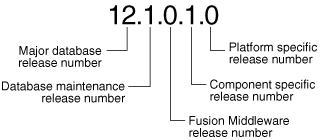

To get started with database administration, you must understand basic database concepts, such as the types of database users, database security, and privileges. You must also be able to complete basic tasks, such as submitting commands and SQL to the database and creating a password file.

- Types of Oracle Database Users  
	The types of users and their roles and responsibilities depend on the database site. A small site can have one database administrator who administers the database for application developers and users. A very large site can find it necessary to divide the duties of a database administrator among several people and among several areas of specialization.
- Tasks of a Database Administrator  
	You must complete several specific tasks to design, implement, and maintain an Oracle Database.
- SQL Statements  
	The primary means of communicating with Oracle Database is by submitting SQL statements.
- Identifying Your Oracle Database Software Release  
	As many as five numbers may be required to fully identify a release.
- About Database Administrator Security and Privileges  
	To perform the administrative tasks of an Oracle Database DBA, you need specific privileges within the database and possibly in the operating system of the server on which the database runs. Ensure that access to a database administrator's account is tightly controlled.
- Database Administrator Authentication  
	As a DBA, you often perform special operations such as shutting down or starting up a database. Because only a DBA should perform these operations, the database administrator user names require a secure authentication scheme.
- Creating and Maintaining a Database Password File  
	You can create a database password file using the password file creation utility, `ORAPWD`. For some operating systems, you can create this file as part of your standard installation.
- Data Utilities  
	Oracle utilities are available to help you maintain the data in your Oracle Database.

**Parent topic:** [Basic Database Administration](basic-database-administration.md)

### 1.1 Types of Oracle Database Users

The types of users and their roles and responsibilities depend on the database site. A small site can have one database administrator who administers the database for application developers and users. A very large site can find it necessary to divide the duties of a database administrator among several people and among several areas of specialization.

**Parent topic:** Getting Started with Database Administration

#### 1.1.1 Database Administrators

Each database requires at least one database administrator (DBA). An Oracle Database system can be large and can have many users. Therefore, database administration is sometimes not a one-person job, but a job for a group of DBAs who share responsibility.

A database administrator's responsibilities can include the following tasks:

- Installing and upgrading the Oracle Database server and application tools
- Allocating system storage and planning future storage requirements for the database system
- Creating primary database storage structures (tablespaces) after application developers have designed an application
- Creating primary objects (tables, views, indexes) once application developers have designed an application
- Modifying the database structure, as necessary, from information given by application developers
- Enrolling users and maintaining system security
- Ensuring compliance with Oracle license agreements
- Controlling and monitoring user access to the database
- Monitoring and optimizing the performance of the database
- Planning for backup and recovery of database information
- Maintaining archived data on tape
- Backing up and restoring the database
- Contacting Oracle for technical support

**Parent topic:** Types of Oracle Database Users

#### 1.1.2 Security Officers

In some cases, a site assigns one or more security officers to a database. A security officer enrolls users, controls and monitors user access to the database, and maintains system security.

As a DBA, you might not be responsible for these duties if your site has a separate security officer.

See [Oracle Database Security Guide](https://docs.oracle.com/pls/topic/lookup?ctx=en/database/oracle/oracle-database/12.2/admin&id=DBSEG003) for information about the duties of security officers.

**Parent topic:** Types of Oracle Database Users

#### 1.1.3 Network Administrators

Some sites have one or more network administrators. A network administrator, for example, administers Oracle networking products, such as Oracle Net Services.

See [Oracle Database Net Services Administrator's Guide](https://docs.oracle.com/pls/topic/lookup?ctx=en/database/oracle/oracle-database/12.2/admin&id=NETAG005) for information about the duties of network administrators.

See Also:

[Distributed Database Management](distributed-database-management.md), for information on network administration in a distributed environment

**Parent topic:** Types of Oracle Database Users

#### 1.1.4 Application Developers

Application developers design and implement database applications.

Their responsibilities include the following tasks:

- Designing and developing the database application
- Designing the database structure for an application
- Estimating storage requirements for an application
- Specifying modifications of the database structure for an application
- Relaying this information to a database administrator
- Tuning the application during development
- Establishing security measures for an application during development

Application developers can perform some of these tasks in collaboration with DBAs. See [Oracle Database Development Guide](https://docs.oracle.com/pls/topic/lookup?ctx=en/database/oracle/oracle-database/12.2/admin&id=ADFNS-GUID-EBCEA9FE-4F25-40DF-B5FD-682C3692E92F) for information about application development tasks.

**Parent topic:** Types of Oracle Database Users

#### 1.1.5 Application Administrators

An Oracle Database site can assign one or more application administrators to administer a particular application. Each application can have its own administrator.

**Parent topic:** Types of Oracle Database Users

#### 1.1.6 Database Users

Database users interact with the database through applications or utilities.

A typical user's responsibilities include the following tasks:

- Entering, modifying, and deleting data, where permitted
- Generating reports from the data

**Parent topic:** Types of Oracle Database Users

### 1.2 Tasks of a Database Administrator

You must complete several specific tasks to design, implement, and maintain an Oracle Database.

Note:

When upgrading to a new release, back up your existing production environment, both software and database, before installation. For information on preserving your existing production database, see [Oracle Database Upgrade Guide](https://docs.oracle.com/pls/topic/lookup?ctx=en/database/oracle/oracle-database/12.2/admin&id=UPGRD12382).

- Task 1: Evaluate the Database Server Hardware  
	Evaluate how Oracle Database and its applications can best use the available computer resources.
- Task 2: Install the Oracle Database Software  
	As the database administrator, you install the Oracle Database server software and any front-end tools and database applications that access the database.
- Task 3: Plan the Database  
	As the database administrator, you must plan the logical storage structure of the database, the overall database design, and a backup strategy for the database.
- Task 4: Create and Open the Database  
	After you complete the database design, you can create the database and open it for normal use.
- Task 5: Back Up the Database  
	After you create the database structure, perform the backup strategy you planned for the database.
- Task 6: Enroll System Users  
	After you back up the database structure, you can enroll the users of the database in accordance with your Oracle license agreement, and grant appropriate privileges and roles to these users.
- Task 7: Implement the Database Design  
	After you create and start the database, and enroll the system users, you can implement the planned logical structure database by creating all necessary tablespaces. When you have finished creating tablespaces, you can create the database objects.
- Task 8: Back Up the Fully Functional Database  
	When the database is fully implemented, again back up the database. In addition to regularly scheduled backups, you should always back up your database immediately after implementing changes to the database structure.
- Task 9: Tune Database Performance  
	Optimizing the performance of the database is one of your ongoing responsibilities as a DBA. Oracle Database provides a database resource management feature that helps you to control the allocation of resources among various user groups.
- Task 10: Download and Install Patches  
	After installation and on a regular basis, download and install patches.
- Task 11: Roll Out to Additional Hosts  
	After you have an Oracle Database installation properly configured, tuned, patched, and tested, you may want to roll that exact installation out to other hosts.

**Parent topic:** Getting Started with Database Administration

#### 1.2.1 Task 1: Evaluate the Database Server Hardware

Evaluate how Oracle Database and its applications can best use the available computer resources.

This evaluation should reveal the following information:

- How many disk drives are available to the Oracle products
- How many, if any, dedicated tape drives are available to Oracle products
- How much memory is available to the instances of Oracle Database you will run (see your system configuration documentation)

**Parent topic:** Tasks of a Database Administrator

#### 1.2.2 Task 2: Install the Oracle Database Software

As the database administrator, you install the Oracle Database server software and any front-end tools and database applications that access the database.

In some distributed processing installations, the database is controlled by a central computer (database server) and the database tools and applications are executed on remote computers (clients). In this case, you must also install the Oracle Net components necessary to connect the remote systems to the computer that executes Oracle Database.

For more information on what software to install, see " Identifying Your Oracle Database Software Release ".

See Also:

For specific requirements and instructions for installation, see the following documentation:

- The Oracle documentation specific to your operating system
- The installation guides for your front-end tools and Oracle Net drivers

**Parent topic:** Tasks of a Database Administrator

#### 1.2.3 Task 3: Plan the Database

As the database administrator, you must plan the logical storage structure of the database, the overall database design, and a backup strategy for the database.

It is important to plan how the logical storage structure of the database will affect system performance and various database management operations. For example, before creating any tablespaces for your database, you should know how many data files will comprise the tablespace, what type of information will be stored in each tablespace, and on which disk drives the data files will be physically stored. When planning the overall logical storage of the database structure, take into account the effects that this structure will have when the database is actually created and running. Consider how the logical storage structure of the database will affect:

- The performance of the computer running Oracle Database
- The performance of the database during data access operations
- The efficiency of backup and recovery procedures for the database

Plan the relational design of the database objects and the storage characteristics for each of these objects. By planning the relationship between each object and its physical storage before creating it, you can directly affect the performance of the database as a unit. Be sure to plan for the growth of the database.

In distributed database environments, this planning stage is extremely important. The physical location of frequently accessed data dramatically affects application performance.

During the planning stage, develop a backup strategy for the database. You can alter the logical storage structure or design of the database to improve backup efficiency.

It is beyond the scope of this book to discuss relational and distributed database design. If you are not familiar with such design issues, see accepted industry-standard documentation.

[Oracle Database Structure and Storage](oracle-database-structure-and-storage.md), and [Schema Objects](schema-objects.md), provide specific information on creating logical storage structures, objects, and integrity constraints for your database.

**Parent topic:** Tasks of a Database Administrator

#### 1.2.4 Task 4: Create and Open the Database

After you complete the database design, you can create the database and open it for normal use.

You can create a database at installation time, using the Database Configuration Assistant, or you can supply your own scripts for creating a database.

See [Creating and Configuring an Oracle Database](creating-and-configuring-an-oracle-database.md), for information on creating a database and [Starting Up and Shutting Down](starting-up-and-shutting-down.md) for guidance in starting up the database.

**Parent topic:** Tasks of a Database Administrator

#### 1.2.5 Task 5: Back Up the Database

After you create the database structure, perform the backup strategy you planned for the database.

Create any additional redo log files, take the first full database backup (online or offline), and schedule future database backups at regular intervals.

See Also:

[Oracle Database Backup and Recovery User's Guide](https://docs.oracle.com/pls/topic/lookup?ctx=en/database/oracle/oracle-database/12.2/admin&id=BRADV-GUID-008E0F84-E623-4467-8706-A99B34002DD6)

**Parent topic:** Tasks of a Database Administrator

#### 1.2.6 Task 6: Enroll System Users

After you back up the database structure, you can enroll the users of the database in accordance with your Oracle license agreement, and grant appropriate privileges and roles to these users.

See [Managing Users and Securing the Database](managing-users-and-securing-the-database.md) for guidance in this task.

**Parent topic:** Tasks of a Database Administrator

#### 1.2.7 Task 7: Implement the Database Design

After you create and start the database, and enroll the system users, you can implement the planned logical structure database by creating all necessary tablespaces. When you have finished creating tablespaces, you can create the database objects.

[Oracle Database Structure and Storage](oracle-database-structure-and-storage.md) and [Schema Objects](schema-objects.md) provide information on creating logical storage structures and objects for your database.

**Parent topic:** Tasks of a Database Administrator

#### 1.2.8 Task 8: Back Up the Fully Functional Database

When the database is fully implemented, again back up the database. In addition to regularly scheduled backups, you should always back up your database immediately after implementing changes to the database structure.

**Parent topic:** Tasks of a Database Administrator

#### 1.2.9 Task 9: Tune Database Performance

Optimizing the performance of the database is one of your ongoing responsibilities as a DBA. Oracle Database provides a database resource management feature that helps you to control the allocation of resources among various user groups.

The database resource manager is described in [Managing Resources with Oracle Database Resource Manager](managing-resources-with-oracle-database-resource-manager.md).

See Also:

[Oracle Database Performance Tuning Guide](https://docs.oracle.com/pls/topic/lookup?ctx=en/database/oracle/oracle-database/12.2/admin&id=TGDBA025) for information about tuning your database and applications

**Parent topic:** Tasks of a Database Administrator

#### 1.2.10 Task 10: Download and Install Patches

After installation and on a regular basis, download and install patches.

Patches are available as single interim patches and as patchsets (or patch releases). Interim patches address individual software bugs and may or may not be needed at your installation. Patch releases are collections of bug fixes that are applicable for all customers. Patch releases have release numbers. For example, if you installed Oracle Database 12c Release 1 (12.1.0.1), then the first patch release will have a release number of 12.1.0.2.

See Also:

[Oracle Database Installation Guide](https://docs.oracle.com/pls/topic/lookup?ctx=en/database/oracle/oracle-database/12.2/admin&id=GINST) for your platform for instructions on downloading and installing patches.

**Parent topic:** Tasks of a Database Administrator

#### 1.2.11 Task 11: Roll Out to Additional Hosts

After you have an Oracle Database installation properly configured, tuned, patched, and tested, you may want to roll that exact installation out to other hosts.

Reasons to do this include the following:

- You have multiple production database systems.
- You want to create development and test systems that are identical to your production system.

Instead of installing, tuning, and patching on each additional host, you can clone your tested Oracle Database installation to other hosts, saving time and avoiding inconsistencies. There are two types of cloning available to you:

- Cloning an Oracle home—Just the configured and patched binaries from the Oracle home directory and subdirectories are copied to the destination host and "fixed" to match the new environment. You can then start an instance with this cloned home and create a database.
	You can use Oracle Enterprise Manager Cloud Control to clone an Oracle home to one or more destination hosts. You can manually clone an Oracle home using a set of provided scripts and Oracle Universal Installer.
- Cloning a database—The tuned database, including database files, initialization parameters, and so on, are cloned to an existing Oracle home (possibly a cloned home).
	You can use Cloud Control to clone an Oracle database instance to an existing Oracle home.

See Also:

- [Oracle Universal Installer and OPatch User's Guide for Windows and UNIX](https://docs.oracle.com/pls/topic/lookup?ctx=en/database/oracle/oracle-database/12.2/admin&id=OUICG238) for information about cloning Oracle software
- The Cloud Control online help for instructions for cloning a database
- " [Cloning a Database with CloneDB](creating-and-configuring-an-oracle-database.md) "
- " [Creating a PDB by Cloning an Existing PDB or Non-CDB](creating-and-removing-pdbs-with-sql-plus.md) "

**Parent topic:** Tasks of a Database Administrator

### 1.3 SQL Statements

The primary means of communicating with Oracle Database is by submitting SQL statements.

- Submitting Commands and SQL to the Database  
	There are several ways to submit SQL statements and commands to Oracle Database.
- About SQL\*Plus  
	SQL\*Plus is the primary command-line interface to your Oracle database. You use SQL\*Plus to start up and shut down the database, set database initialization parameters, create and manage users, create and alter database objects (such as tables and indexes), insert and update data, run SQL queries, and more.
- Connecting to the Database with SQL\*Plus  
	When you connect with SQL\*Plus, you are connecting to the Oracle instance.

**Parent topic:** Getting Started with Database Administration

#### 1.3.1 Submitting Commands and SQL to the Database

There are several ways to submit SQL statements and commands to Oracle Database.

- Directly, using the command-line interface of SQL\*Plus
- Indirectly, using a graphical user interface, such as Oracle Enterprise Manager Database Express (EM Express) or Oracle Enterprise Manager Cloud Control (Cloud Control)
	With these tools, you use an intuitive graphical interface to administer the database, and the tool submits SQL statements and commands behind the scenes.
	See [Oracle Database 2 Day DBA](https://docs.oracle.com/pls/topic/lookup?ctx=en/database/oracle/oracle-database/12.2/admin&id=ADMQS) and the online help for the tool for more information.
- Directly, using SQL Developer
	Developers use SQL Developer to create and test database schemas and applications, although you can also use it for database administration tasks.
	See [Oracle SQL Developer User's Guide](https://docs.oracle.com/pls/topic/lookup?ctx=en/database/oracle/oracle-database/12.2/admin&id=RPTUG10000) for more information.

Oracle Database also supports a superset of SQL, which includes commands for starting up and shutting down the database, modifying database configuration, and so on.

**Parent topic:** SQL Statements

#### 1.3.2 About SQL\*Plus

SQL\*Plus is the primary command-line interface to your Oracle database. You use SQL\*Plus to start up and shut down the database, set database initialization parameters, create and manage users, create and alter database objects (such as tables and indexes), insert and update data, run SQL queries, and more.

Before you can submit SQL statements and commands, you must connect to the database. With SQL\*Plus, you can connect locally or remotely. Connecting locally means connecting to an Oracle database running on the same computer on which you are running SQL\*Plus. Connecting remotely means connecting over a network to an Oracle database that is running on a remote computer. Such a database is referred to as a remote database. The SQL\*Plus executable on the local computer is provided by a full Oracle Database installation, an Oracle Client installation, or an Instant Client installation.

See Also:

[SQL\*Plus User's Guide and Reference](https://docs.oracle.com/pls/topic/lookup?ctx=en/database/oracle/oracle-database/12.2/admin&id=SQPUG)

**Parent topic:** SQL Statements

#### 1.3.3 Connecting to the Database with SQL\*Plus

When you connect with SQL\*Plus, you are connecting to the Oracle instance.

- About Connecting to the Database with SQL\*Plus  
	Oracle Database includes the following components: the Oracle Database instance, which is a collection of processes and memory, and a set of disk files that contain user data and system data.
- Step 1: Open a Command Window  
	Take the necessary action on your platform to open a window into which you can enter operating system commands.
- Step 2: Set Operating System Environment Variables  
	Depending on your platform, you may have to set environment variables before starting SQL\*Plus, or at least verify that they are set properly.
- Step 3: Start SQL\*Plus  
	Start SQL\*Plus.
- Step 4: Submit the SQL\*Plus CONNECT Command  
	Submit the SQL\*Plus `CONNECT` command to initially connect to the Oracle database instance or at any time to reconnect as a different user.

**Parent topic:** SQL Statements

##### 1.3.3.1 About Connecting to the Database with SQL\*Plus

Oracle Database includes the following components: the Oracle Database instance, which is a collection of processes and memory, and a set of disk files that contain user data and system data.

Each instance has an instance ID, also known as a system ID (SID). Because there can be multiple Oracle instances on a host computer, each with its own set of data files, you must identify the instance to which you want to connect. For a local connection, you identify the instance by setting operating system environment variables. For a remote connection, you identify the instance by specifying a network address and a database service name. For both local and remote connections, you must set environment variables to help the operating system find the SQL\*Plus executable and to provide the executable with a path to its support files and scripts.

See Also:

[Oracle Database Concepts](https://docs.oracle.com/pls/topic/lookup?ctx=en/database/oracle/oracle-database/12.2/admin&id=CNCPT601) for background information about the Oracle instance

**Parent topic:** Connecting to the Database with SQL\*Plus

##### 1.3.3.2 Step 1: Open a Command Window

Take the necessary action on your platform to open a window into which you can enter operating system commands.

- Open a command window.

**Parent topic:** Connecting to the Database with SQL\*Plus

##### 1.3.3.3 Step 2: Set Operating System Environment Variables

Depending on your platform, you may have to set environment variables before starting SQL\*Plus, or at least verify that they are set properly.

For example, on most platforms, `ORACLE_SID` and `ORACLE_HOME` must be set. In addition, it is advisable to set the `PATH` environment variable to include the ORACLE\_HOME/bin directory. Some platforms may require additional environment variables:

- On the UNIX and Linux platforms, set environment variables by entering operating system commands.
- On the Windows platform, Oracle Universal Installer (OUI) automatically assigns values to `ORACLE_HOME` and `ORACLE_SID` in the Windows registry.

If you did not create a database upon installation, OUI does not set `ORACLE_SID` in the registry; after you create your database at a later time, you must set the `ORACLE_SID` environment variable from a command window.

UNIX and Linux installations come with two scripts, `oraenv` and `coraenv`, that you can use to easily set environment variables. For more information, see Administrator's Reference for UNIX Systems.

For all platforms, when switching between instances with different Oracle homes, you must change the `ORACLE_HOME` environment variable. If multiple instances share the same Oracle home, you must change only `ORACLE_SID` when switching instances.

See the [Oracle Database Installation Guide](https://docs.oracle.com/pls/topic/lookup?ctx=en/database/oracle/oracle-database/12.2/admin&id=GINST) or administration guide for your operating system for details on environment variables and for information on switching instances.

Example 1-1 Setting Environment Variables in UNIX (C Shell)

```
setenv ORACLE_SID orcl
setenv ORACLE_HOME /u01/app/oracle/product/12.1.0/db_1
setenv LD_LIBRARY_PATH $ORACLE_HOME/lib:/usr/lib:/usr/dt/lib:/usr/openwin/lib:/usr/ccs/lib
```

Example 1-2 Setting Environment Variables in Windows

```
SET ORACLE_SID=orawin2
```

Example 1-2 assumes that `ORACLE_HOME` and `ORACLE_SID` are set in the registry but that you want to override the registry value of `ORACLE_SID` to connect to a different instance.

On Windows, environment variable values that you set in a command prompt window override the values in the registry.

**Parent topic:** Connecting to the Database with SQL\*Plus

##### 1.3.3.4 Step 3: Start SQL\*Plus

Start SQL\*Plus.

1. Do one of the following:
	- Ensure that the `PATH` environment variable contains ORACLE\_HOME/bin.
	- Change directory to ORACLE\_HOME/bin.
2. Enter the following command (case-sensitive on UNIX and Linux):
	```
	sqlplus /nolog
	```

**Parent topic:** Connecting to the Database with SQL\*Plus

##### 1.3.3.5 Step 4: Submit the SQL\*Plus CONNECT Command

Submit the SQL\*Plus `CONNECT` command to initially connect to the Oracle database instance or at any time to reconnect as a different user.

- In SQL\*Plus, submit the `CONNECT` command.

Example 1-3 Connecting to a Local Database User

This simple example connects to a local database as user `SYSTEM`. SQL\*Plus prompts for the `SYSTEM` user password.

```
connect system
```

Example 1-4 Connecting to a Local Database User with SYSDBA Privilege

This example connects to a local database as user `SYS` with the `SYSDBA` privilege. SQL\*Plus prompts for the `SYS` user password.

```
connect sys as sysdba
```

When connecting as user `SYS`, you must connect `AS SYSDBA`.

Example 1-5 Connecting to a Local Database User with SYSBACKUP Privilege

This example connects to a local database as user `SYSBACKUP` with the `SYSBACKUP` privilege. SQL\*Plus prompts for the `SYSBACKUP` user password.

```
connect sysbackup as sysbackup
```

When connecting as user `SYSBACKUP`, you must connect `AS SYSBACKUP`.

Example 1-6 Connecting Locally with SYSDBA Privilege with Operating System Authentication

This example connects locally with the `SYSDBA` privilege with operating system authentication.

```
connect / as sysdba
```

Example 1-7 Connecting with Easy Connect Syntax

This example uses easy connect syntax to connect as user `salesadmin` to a remote database running on the host `dbhost.example.com`. The Oracle Net listener (the listener) is listening on the default port (1521). The database service is `sales.example.com`. SQL\*Plus prompts for the `salesadmin` user password.

```
connect salesadmin@"dbhost.example.com/sales.example.com"
```

Example 1-8 Connecting with Easy Connect Syntax with the Service Handler Type Indicated

This example is identical to Example 1-7, except that the service handler type is indicated.

```
connect salesadmin@"dbhost.example.com/sales.example.com:dedicated"
```

Example 1-9 Connecting with Easy Connect Syntax with a Nondefault Listener Port

This example is identical to Example 1-7, except that the listener is listening on the nondefault port number 1522.

```
connect salesadmin@"dbhost.example.com:1522/sales.example.com"
```

Example 1-10 Connecting with Easy Connect Syntax with the Host IP Address

This example is identical to Example 1-7, except that the host IP address is substituted for the host name.

```
connect salesadmin@"192.0.2.5/sales.example.com"
```

Example 1-11 Connecting with an IPv6 Address

This example connects using an IPv6 address. Note the enclosing square brackets.

```
connect salesadmin@"[2001:0DB8:0:0::200C:417A]/sales.example.com"
```

Example 1-12 Connecting by Specifying an Instance

This example specifies the instance to which to connect and omits the database service name. Note that when you specify only the instance, you cannot specify the service handler type.

```
connect salesadmin@"dbhost.example.com//orcl"
```

Example 1-13 Connecting with a Net Service Name

This example connects remotely as user `salesadmin` to the database service designated by the net service name `sales1`. SQL\*Plus prompts for the `salesadmin` user password.

```
connect salesadmin@sales1
```

Example 1-14 Connecting with External Authentication

This example connects remotely with external authentication to the database service designated by the net service name `sales1`.

```
connect /@sales1
```

Example 1-15 Connecting with SYSDBA Privilege and External Authentication

This example connects remotely with the `SYSDBA` privilege and with external authentication to the database service designated by the net service name `sales1`.

```
connect /@sales1 as sysdba
```

Example 1-16 Connecting as a User with a Service Name

This example connects remotely as user `salesadmin` to the database service designated by the net service name `sales1`. The database session starts in the `rev21` edition. SQL\*Plus prompts for the `salesadmin` user password.

```
connect salesadmin@sales1 edition=rev21
```

Note:

If you come across any issues while connecting to the database as a user with the `SYSDBA` privileges, then refer to My Oracle Support Notes 69642.1, 233223.1, 18089.1, and 747456.1.

- Syntax of the SQL\*Plus CONNECT Command  
	Use the SQL\*Plus `CONNECT` command to initially connect to the Oracle instance or to reconnect to the Oracle instance.

**Parent topic:** Connecting to the Database with SQL\*Plus

###### 1.3.3.5.1 Syntax of the SQL\*Plus CONNECT Command

Use the SQL\*Plus `CONNECT` command to initially connect to the Oracle instance or to reconnect to the Oracle instance.

Syntax

```
CONN[ECT] [logon] [AS {SYSOPER | SYSDBA | SYSBACKUP | SYSDG | SYSKM | SYSRAC}]
```

The syntax of `logon` is as follows:

```
{username | /}[@connect_identifier] [edition={edition_name | DATABASE_DEFAULT}]
```

When you provide the `username`, SQL\*Plus prompts for a password. The password is not echoed as you type it.

The following table describes the syntax components of the `CONNECT` command.

| Syntax Component | Description |
| --- | --- |
| `/` | Calls for external authentication of the connection request. A database password is not used in this type of authentication. The most common form of external authentication is operating system authentication, where the database user is authenticated by having logged in to the host operating system with a certain host user account. External authentication can also be performed with an Oracle wallet or by a network service. See [Oracle Database Security Guide](https://docs.oracle.com/pls/topic/lookup?ctx=en/database/oracle/oracle-database/12.2/admin&id=DBSEG30038) for more information. See also " Using Operating System Authentication ". |
| `AS {SYSOPER \| SYSDBA \| SYSBACKUP \| SYSDG \| SYSKM \| SYSRAC}` | Indicates that the database user is connecting with an administrative privilege. Only certain predefined administrative users or users who have been added to the password file may connect with these privileges. See " Administrative Privileges " for more information. |
| `username` | A valid database user name. The database authenticates the connection request by matching `username` against the data dictionary and prompting for a user password. |
| `connect_identifier` (1) | An Oracle Net connect identifier, for a remote connection. The exact syntax depends on the Oracle Net configuration. If omitted, SQL\*Plus attempts connection to a local instance.  A common connect identifier is a net service name. This is an alias for an Oracle Net connect descriptor (network address and database service name). The alias is typically resolved in the `tnsnames.ora` file on the local computer, but can be resolved in other ways.  See [Oracle Database Net Services Administrator's Guide](https://docs.oracle.com/pls/topic/lookup?ctx=en/database/oracle/oracle-database/12.2/admin&id=NETAG008) for more information on connect identifiers. |
| `connect_identifier` (2) | As an alternative, a connect identifier can use easy connect syntax. Easy connect provides out-of-the-box TCP/IP connectivity for remote databases without having to configure Oracle Net Services on the client (local) computer.  Easy connect syntax for the connect identifier is as follows (the enclosing double-quotes must be included):  ``` "host[:port][/service_name][:server][/instance_name]" ```  where:  - `host` is the host name or IP address of the computer hosting the remote database. 	Both IP version 4 (IPv4) and IP version 6 (IPv6) addresses are supported. IPv6 addresses must be enclosed in square brackets. See [Oracle Database Net Services Administrator's Guide](https://docs.oracle.com/pls/topic/lookup?ctx=en/database/oracle/oracle-database/12.2/admin&id=NETAG999) for information about IPv6 addressing. - `port` is the TCP port on which the Oracle Net listener on `host` listens for database connections. If omitted, 1521 is assumed. - `service_name` is the database service name to which to connect. It can be omitted if the Net Services listener configuration on the remote host designates a default service. If no default service is configured, then `service_name` must be supplied. Each database typically offers a standard service with a name equal to the global database name, which is made up of the `DB_NAME` and `DB_DOMAIN` initialization parameters as follows: 	``` 	DB_NAME.DB_DOMAIN 	``` 	If `DB_DOMAIN` is null, then the standard service name is just the `DB_NAME`. For example, if `DB_NAME` is `orcl` and `DB_DOMAIN` is `us.example.com`, then the standard service name is `orcl.us.example.com`. 	See " [Managing Application Workloads with Database Services](creating-and-configuring-an-oracle-database.md) " for more information. - `server` is the type of service handler. Acceptable values are `dedicated`, `shared`, and `pooled`. If omitted, then the default type of server is chosen by the listener: shared server if configured, otherwise dedicated server. - `instance_name` is the instance to which to connect. You can specify both service name and instance name, which you would typically do only for Oracle Real Application Clusters (Oracle RAC) environments. For Oracle RAC or single instance environments, if you specify only instance name, then you connect to the default database service. If there is no default service configured in the `listener.ora` file, then an error is generated. You can obtain the instance name from the `INSTANCE_NAME` initialization parameter.  See [Oracle Database Net Services Administrator's Guide](https://docs.oracle.com/pls/topic/lookup?ctx=en/database/oracle/oracle-database/12.2/admin&id=NETAG255) for more information on easy connect. |
| `edition` ={ `edition_name` \| `DATABASE_DEFAULT` } | Specifies the edition in which the new database session starts. If you specify an edition, then it must exist, and you must have the `USE` privilege on it. If this clause is not specified, then the database default edition is used for the session.  See [Oracle Database Development Guide](https://docs.oracle.com/pls/topic/lookup?ctx=en/database/oracle/oracle-database/12.2/admin&id=ADFNS020) for information on editions and edition-based redefinition. |

See Also:

- " Using Operating System Authentication "
- " [Managing Application Workloads with Database Services](creating-and-configuring-an-oracle-database.md) " for information about database services
- [SQL\*Plus User's Guide and Reference](https://docs.oracle.com/pls/topic/lookup?ctx=en/database/oracle/oracle-database/12.2/admin&id=SQPUG036) for more information on the `CONNECT` command
- [Oracle Database Net Services Administrator's Guide](https://docs.oracle.com/pls/topic/lookup?ctx=en/database/oracle/oracle-database/12.2/admin&id=NETAG008) for more information on net service names
- [Oracle Database Net Services Reference](https://docs.oracle.com/pls/topic/lookup?ctx=en/database/oracle/oracle-database/12.2/admin&id=NETRF309) for information on how to define the default service in `listener.ora`

**Parent topic:** Step 4: Submit the SQL\*Plus CONNECT Command

### 1.4 Identifying Your Oracle Database Software Release

As many as five numbers may be required to fully identify a release.

Because Oracle Database continues to evolve and can require maintenance, Oracle periodically produces new releases. Not all customers initially subscribe to a new release or require specific maintenance for their existing release. As a result, multiple releases of the product exist simultaneously.

- Release Number Format  
	Oracle Database release numbers conform to a specific format.
- Checking Your Current Release Number  
	To identify the release of Oracle Database that is currently installed and to see the release levels of other database components you are using, query the data dictionary view `PRODUCT_COMPONENT_VERSION`.

**Parent topic:** Getting Started with Database Administration

#### 1.4.1 Release Number Format

Oracle Database release numbers conform to a specific format.

To understand the release nomenclature used by Oracle, examine the following example of an Oracle Database release labeled "12.1.0.1.0".

Figure 1-1 Example of an Oracle Database Release Number



> The figure displays a release number and notes the significance of each numeral. The release number is 12.1.0.1.0.
>
> The significance of each number (reading from left to right) is as follows:
>
> - 12 is the major database release number
> - 1 is the database maintenance release number
> - 0 is the Oracle Fusion Middleware release number
> - 1 is the component-specific release number
> - 0 is the platform-specific release number
>
> End of image description.


- Major Database Release Number  
	The first numeral is the most general identifier. It represents a major new version of the software that contains significant new functionality.
- Database Maintenance Release Number  
	The second numeral represents a maintenance release level. Some new features may also be included.
- Fusion Middleware Release Number  
	The third numeral reflects the release level of Oracle Fusion Middleware.
- Component-Specific Release Number  
	The fourth numeral identifies a release level specific to a component. Different components can have different numbers in this position depending upon, for example, component patch sets or interim releases.
- Platform-Specific Release Number  
	The fifth numeral identifies a platform-specific release. Usually this is a patch set. When different platforms require the equivalent patch set, this numeral will be the same across the affected platforms.

**Parent topic:** Identifying Your Oracle Database Software Release

##### 1.4.1.1 Major Database Release Number

The first numeral is the most general identifier. It represents a major new version of the software that contains significant new functionality.

**Parent topic:** Release Number Format

##### 1.4.1.2 Database Maintenance Release Number

The second numeral represents a maintenance release level. Some new features may also be included.

**Parent topic:** Release Number Format

##### 1.4.1.3 Fusion Middleware Release Number

The third numeral reflects the release level of Oracle Fusion Middleware.

**Parent topic:** Release Number Format

##### 1.4.1.4 Component-Specific Release Number

The fourth numeral identifies a release level specific to a component. Different components can have different numbers in this position depending upon, for example, component patch sets or interim releases.

**Parent topic:** Release Number Format

##### 1.4.1.5 Platform-Specific Release Number

The fifth numeral identifies a platform-specific release. Usually this is a patch set. When different platforms require the equivalent patch set, this numeral will be the same across the affected platforms.

**Parent topic:** Release Number Format

#### 1.4.2 Checking Your Current Release Number

To identify the release of Oracle Database that is currently installed and to see the release levels of other database components you are using, query the data dictionary view `PRODUCT_COMPONENT_VERSION`.

A sample query follows. (You can also query the `V$VERSION` view to see component-level information.) Other product release levels may increment independent of the database server.

```
COL PRODUCT FORMAT A40
COL VERSION FORMAT A15
COL STATUS FORMAT A15 
SELECT * FROM PRODUCT_COMPONENT_VERSION;

PRODUCT                                  VERSION     STATUS
---------------------------------------- ----------- -----------
NLSRTL                                   12.1.0.0.1  Production
Oracle Database 12c Enterprise Edition   12.1.0.0.1  Production
PL/SQL                                   12.1.0.0.1  Production
...
```

It is important to convey to Oracle the results of this query when you report problems with the software.

**Parent topic:** Identifying Your Oracle Database Software Release

### 1.5 About Database Administrator Security and Privileges

To perform the administrative tasks of an Oracle Database DBA, you need specific privileges within the database and possibly in the operating system of the server on which the database runs. Ensure that access to a database administrator's account is tightly controlled.

- The Database Administrator's Operating System Account  
	To perform many of the administrative duties for a database, you must be able to execute operating system commands.
- Administrative User Accounts  
	Oracle Database provides several administrative user accounts that are associated with administrative privileges.

**Parent topic:** Getting Started with Database Administration

#### 1.5.1 The Database Administrator's Operating System Account

To perform many of the administrative duties for a database, you must be able to execute operating system commands.

Depending on the operating system on which Oracle Database is running, you might need an operating system account or ID to gain access to the operating system. If so, your operating system account might require operating system privileges or access rights that other database users do not require (for example, to perform Oracle Database software installation). Although you do not need the Oracle Database files to be stored in your account, you should have access to them.

See Also:

Your operating system-specific Oracle documentation. The method of creating the account of the database administrator is specific to the operating system.

**Parent topic:** About Database Administrator Security and Privileges

#### 1.5.2 Administrative User Accounts

Oracle Database provides several administrative user accounts that are associated with administrative privileges.

- About Administrative User Accounts  
	Administrative user accounts have special privileges required to administer areas of the database, such as the ` CREATE ANY TABLE` or `ALTER SESSION` privilege, or `EXECUTE` privileges on packages owned by the `SYS` schema.
- SYS  
	When you create an Oracle database, the user `SYS` is automatically created with all the privileges.
- SYSTEM  
	When you create an Oracle database, the user `SYSTEM` is also automatically created and granted the `DBA` role.
- SYSBACKUP, SYSDG, SYSKM, and SYSRAC  
	When you create an Oracle database, the following users are automatically created to facilitate separation of duties for database administrators: `SYSBACKUP`, `SYSDG`, `SYSKM`, and `SYSRAC`.
- The DBA Role  
	A predefined `DBA` role is automatically created with every Oracle Database installation. This role contains most database system privileges. Therefore, the DBA role should be granted only to actual database administrators.

**Parent topic:** About Database Administrator Security and Privileges

##### 1.5.2.1 About Administrative User Accounts

Administrative user accounts have special privileges required to administer areas of the database, such as the ` CREATE ANY TABLE` or `ALTER SESSION` privilege, or `EXECUTE` privileges on packages owned by the `SYS` schema.

The following administrative user accounts are automatically created when Oracle Database is installed:

- `SYS`
- `SYSTEM`
- `SYSBACKUP`
- `SYSDG`
- `SYSKM`
- `SYSRAC`

Note:

Both Oracle Universal Installer (OUI) and Database Configuration Assistant (DBCA) now prompt for `SYS` and `SYSTEM` passwords and do not accept the default passwords "change\_on\_install" or "manager", respectively.

If you create the database manually, then Oracle strongly recommends that you specify passwords for `SYS` and `SYSTEM` at database creation time, rather than using these default passwords. See " [Protecting Your Database: Specifying Passwords for Users SYS and SYSTEM](creating-and-configuring-an-oracle-database.md) " for more information.

Create at least one additional administrative user and grant to that user an appropriate administrative role to use when performing daily administrative tasks. Do not use `SYS` and `SYSTEM` for these purposes.

Note:

In this release of Oracle Database and in subsequent releases, several enhancements are being made to ensure the security of default database user accounts. You can find a security checklist for this release in [Oracle Database Security Guide](https://docs.oracle.com/pls/topic/lookup?ctx=en/database/oracle/oracle-database/12.2/admin&id=DBSEG009). Oracle recommends that you read this checklist and configure your database accordingly.

**Parent topic:** Administrative User Accounts

##### 1.5.2.2 SYS

When you create an Oracle database, the user `SYS` is automatically created with all the privileges.

All of the base tables and views for the database data dictionary are stored in the schema `SYS`. These base tables and views are critical for the operation of Oracle Database. To maintain the integrity of the data dictionary, tables in the `SYS` schema are manipulated only by the database. They should never be modified by any user or database administrator, and no one should create any tables in the schema of user `SYS`. (However, you can change the storage parameters of the data dictionary settings if necessary.)

Ensure that most database users are never able to connect to Oracle Database using the `SYS` account.

**Parent topic:** Administrative User Accounts

##### 1.5.2.3 SYSTEM

When you create an Oracle database, the user `SYSTEM` is also automatically created and granted the `DBA` role.

The `SYSTEM` user name is used to create additional tables and views that display administrative information, and internal tables and views used by various Oracle Database options and tools. Never use the `SYSTEM` schema to store tables of interest to non-administrative users.

**Parent topic:** Administrative User Accounts

##### 1.5.2.4 SYSBACKUP, SYSDG, SYSKM, and SYSRAC

When you create an Oracle database, the following users are automatically created to facilitate separation of duties for database administrators: `SYSBACKUP`, `SYSDG`, `SYSKM`, and `SYSRAC`.

These users separate duties in the following ways:

- `SYSBACKUP` facilitates Oracle Recovery Manager (RMAN) backup and recovery operations either from RMAN or SQL\*Plus.
- `SYSDG` facilitates Data Guard operations. The user can perform operations either with Data Guard Broker or with the `DGMGRL` command-line interface.
- `SYSKM` facilitates Transparent Data Encryption keystore operations.
- `SYSRAC` facilitates Oracle Real Application Clusters (Oracle RAC) operations by connecting to the database by the Clusterware agent on behalf of Oracle RAC utilities such as SRVCTL.
	The `SYSRAC` administrative privilege cannot be granted to database users and is not supported in a password file. The `SYSRAC` administrative privilege is used only by the Oracle agent of Oracle Clusterware to connect to the database using operating system authentication.

Each of these accounts provides a designated user for the new administrative privilege with the same name. Specifically, the `SYSBACKUP` account provides a designated user for the `SYSBACKUP` administrative privilege. The `SYSDG` account provides a designated user for the `SYSDG` administrative privilege. The `SYSKM` account provides a designated user for the `SYSKM` administrative privilege.

Create a user and grant to that user an appropriate administrative privilege to use when performing daily administrative tasks. Doing so enables you to manage each user account separately, and each user account can have a distinct password. Do not use the `SYSBACKUP`, `SYSDG`, or `SYSKM` user account for these purposes. These accounts are locked by default and should remain locked.

To use one of these administrative privileges, a user must exercise the privilege when connecting by specifying `AS` `SYSBACKUP`, `AS` `SYSDG`, or `AS` `SYSKM`. If the authentication succeeds, then the user is connected with a session in which the administrative privilege is enabled. In this case, the session user is the corresponding administrative user account. For example, if user `bradmin` connects with the `AS` `SYSBACKUP` administrative privilege, then the session user is `SYSBACKUP`.

Note:

The `SYSBACKUP`, `SYSDG`, `SYSKM`, and `SYSRAC` user accounts cannot be dropped.

See Also:

- " Administrative Privileges "
- [Oracle Database Security Guide](https://docs.oracle.com/pls/topic/lookup?ctx=en/database/oracle/oracle-database/12.2/admin&id=DBSEG577)

**Parent topic:** Administrative User Accounts

##### 1.5.2.5 The DBA Role

A predefined `DBA` role is automatically created with every Oracle Database installation. This role contains most database system privileges. Therefore, the DBA role should be granted only to actual database administrators.

Note:

The DBA role does not include the `SYSDBA`, `SYSOPER`, `SYSBACKUP`, `SYSDG`, or `SYSKM` system privileges. These are special administrative privileges that allow an administrator to perform basic database administration tasks, such as creating the database and instance startup and shutdown. These administrative privileges are discussed in " Administrative Privileges ".

**Parent topic:** Administrative User Accounts

### 1.6 Database Administrator Authentication

As a DBA, you often perform special operations such as shutting down or starting up a database. Because only a DBA should perform these operations, the database administrator user names require a secure authentication scheme.

- Administrative Privileges  
	Administrative privileges that are required for an administrator to perform basic database operations are granted through special system privileges.
- Operations Authorized by Administrative Privileges  
	Each administrative privilege authorizes a specific set of operations.
- Authentication Methods for Database Administrators  
	Database administrators can be authenticated with account passwords, operating system (OS) authentication, password files, or strong authentication with a directory-based authentication service, such as Oracle Internet Directory.
- Using Operating System Authentication  
	Membership in special operating system groups enables a DBA to authenticate to the database through the operating system rather than with a database user name and password. This is known as operating system authentication.
- Using Password File Authentication  
	You can use password file authentication for an Oracle database instance and for an Oracle Automatic Storage Management (Oracle ASM) instance. The password file for an Oracle database is called a database password file, and the password file for Oracle ASM is called an Oracle ASM password file.

**Parent topic:** Getting Started with Database Administration

#### 1.6.1 Administrative Privileges

Administrative privileges that are required for an administrator to perform basic database operations are granted through special system privileges.

These privileges are:

- `SYSDBA`
- `SYSOPER`
- `SYSBACKUP`
- `SYSDG`
- `SYSKM`
- `SYSRAC`

Excluding the `SYSRAC` privilege, grant these privileges to users depending upon the level of authorization they require. The `SYSRAC` privilege cannot be granted to users because it is used only by the Oracle agent of Oracle Clusterware to connect to the database using operating system authentication.

Starting with Oracle Database 12c Release 1 (12.1), the `SYSBACKUP`, `SYSDG`, and `SYSKM` administrative privileges are available. Starting with Oracle Database 12c Release 2 (12.2), the `SYSRAC` administrative privilege is available. Each new administrative privilege grants the minimum required privileges to complete tasks in each area of administration. The new administrative privileges enable you to avoid granting `SYSDBA` administrative privilege for many common tasks.

Note:

These administrative privileges allow access to a database instance even when the database is not open. Control of these privileges is totally outside of the database itself. Methods for authenticating database administrators with these privileges include operating system (OS) authentication, password files, and strong authentication with a directory-based authentication service.

These privileges can also be thought of as types of connections that enable you to perform certain database operations for which privileges cannot be granted in any other fashion. For example, if you have the `SYSDBA` privilege, then you can connect to the database by specifying the `AS SYSDBA` clause in the `CONNECT` command and perform `STARTUP` and `SHUTDOWN` operations. See " Authentication Methods for Database Administrators ".

**Parent topic:** Database Administrator Authentication

#### 1.6.2 Operations Authorized by Administrative Privileges

Each administrative privilege authorizes a specific set of operations.

The following table lists the operations that are authorized by each administrative privilege:

| Administrative Privilege | Operations Authorized |
| --- | --- |
| `SYSDBA ` | - Perform `STARTUP` and `SHUTDOWN` operations - `ALTER DATABASE`: open, mount, back up, or change character set - `CREATE DATABASE` - `DROP DATABASE` - `CREATE SPFILE` - `ALTER DATABASE ARCHIVELOG` - `ALTER DATABASE RECOVER` - Includes the `RESTRICTED SESSION` privilege  This administrative privilege allows most operations, including the ability to view user data. It is the most powerful administrative privilege. |
| `SYSOPER ` | - Perform `STARTUP` and `SHUTDOWN` operations - `CREATE SPFILE ` - `ALTER DATABASE`: open, mount, or back up - `ALTER DATABASE ARCHIVELOG ` - `ALTER DATABASE RECOVER` (Complete recovery only. Any form of incomplete recovery, such as `UNTIL TIME\|CHANGE\|CANCEL\|CONTROLFILE` requires connecting as `SYSDBA`.) - Includes the `RESTRICTED SESSION` privilege  This privilege allows a user to perform basic operational tasks, but without the ability to view user data. |
| `SYSBACKUP` | This privilege allows a user to perform backup and recovery operations either from Oracle Recovery Manager (RMAN) or SQL\*Plus.  See [Oracle Database Security Guide](https://docs.oracle.com/pls/topic/lookup?ctx=en/database/oracle/oracle-database/12.2/admin&id=DBSEG785) for the full list of operations allowed by this administrative privilege. |
| `SYSDG` | This privilege allows a user to perform Data Guard operations. You can use this privilege with either Data Guard Broker or the `DGMGRL` command-line interface.  See [Oracle Database Security Guide](https://docs.oracle.com/pls/topic/lookup?ctx=en/database/oracle/oracle-database/12.2/admin&id=DBSEG786) for the full list of operations allowed by this administrative privilege. |
| `SYSKM` | This privilege allows a user to perform Transparent Data Encryption keystore operations.  See [Oracle Database Security Guide](https://docs.oracle.com/pls/topic/lookup?ctx=en/database/oracle/oracle-database/12.2/admin&id=DBSEG787) for the full list of operations allowed by this administrative privilege. |
| `SYSRAC` | This privilege allows the Oracle agent of Oracle Clusterware to perform Oracle Real Application Clusters (Oracle RAC) operations.  See [Oracle Database Security Guide](https://docs.oracle.com/pls/topic/lookup?ctx=en/database/oracle/oracle-database/12.2/admin&id=DBSEG-GUID-69D0614C-D24E-4EC1-958A-79D7CCA3FA3A) for the full list of operations allowed by this administrative privilege. |

The manner in which you are authorized to use these privileges depends upon the method of authentication that you use.

When you connect with an administrative privilege, you connect with a current schema that is not generally associated with your username. For `SYSDBA`, the current schema is `SYS`. For `SYSOPER`, the current schema is `PUBLIC`. For `SYSBACKUP`, `SYSDG`, and `SYSRAC`, the current schema is `SYS` for name resolution purposes. However, the current schema for `SYSKM` is `SYSKM`.

Also, when you connect with an administrative privilege, you connect with a specific session user. When you connect as `SYSDBA`, the session user is `SYS`. For `SYSOPER`, the session user is `PUBLIC`. For `SYSBACKUP`, `SYSDG`, `SYSKM`, and `SYSRAC`, the session user is `SYSBACKUP`, `SYSDG`, `SYSKM`, and `SYSRAC`, respectively.

See Also:

- " Administrative User Accounts "
- " Using Operating System Authentication "
- " Using Password File Authentication "
- [Oracle Database SQL Language Reference](https://docs.oracle.com/pls/topic/lookup?ctx=en/database/oracle/oracle-database/12.2/admin&id=SQLRF06117) for more information about the current schema and the session user
- [Oracle Database Security Guide](https://docs.oracle.com/pls/topic/lookup?ctx=en/database/oracle/oracle-database/12.2/admin&id=DBSEG577)

Example 1-17 Current Schema When Connecting AS SYSDBA

This example illustrates that a user is assigned another schema (`SYS`) when connecting with the `SYSDBA` administrative privilege. Assume that the sample user `mydba` has been granted the `SYSDBA` administrative privilege and has issued the following command and statement:

```
CONNECT mydba
CREATE TABLE admin_test(name VARCHAR2(20));
```

Later, user `mydba` issues this command and statement:

```
CONNECT mydba AS SYSDBA
SELECT * FROM admin_test;
```

User `mydba` now receives the following error:

```
ORA-00942: table or view does not exist
```

Having connected as `SYSDBA`, user `mydba` now references the `SYS` schema, but the table was created in the `mydba` schema.

Example 1-18 Current Schema and Session User When Connecting AS SYSBACKUP

This example illustrates that a user is assigned another schema (`SYS`) and another session user (`SYSBACKUP`) when connecting with the `SYSBACKUP` administrative privilege. Assume that the sample user `mydba` has been granted the `SYSBACKUP` administrative privilege and has issued the following command and statements:

```
CONNECT mydba AS SYSBACKUP

SELECT SYS_CONTEXT('USERENV', 'CURRENT_SCHEMA') FROM DUAL;

SYS_CONTEXT('USERENV','CURRENT_SCHEMA')
--------------------------------------------------------------------------------
SYS

SELECT SYS_CONTEXT('USERENV', 'SESSION_USER') FROM DUAL;

SYS_CONTEXT('USERENV','SESSION_USER')
--------------------------------------------------------------------------------
SYSBACKUP
```

**Parent topic:** Database Administrator Authentication

#### 1.6.3 Authentication Methods for Database Administrators

Database administrators can be authenticated with account passwords, operating system (OS) authentication, password files, or strong authentication with a directory-based authentication service, such as Oracle Internet Directory.

- About Authentication Methods for Database Administrators  
	There are several ways to authenticate database administrators.
- Nonsecure Remote Connections  
	To connect to Oracle Database as a privileged user over a nonsecure connection, you must be authenticated by a password file.
- Local Connections and Secure Remote Connections  
	You can connect to Oracle Database as a privileged user over a local connection or a secure remote connection.

**Parent topic:** Database Administrator Authentication

##### 1.6.3.1 About Authentication Methods for Database Administrators

There are several ways to authenticate database administrators.

Oracle database can authenticate database administrators through the data dictionary, (using an account password) like other users. Keep in mind that database passwords are case-sensitive. See [Oracle Database Security Guide](https://docs.oracle.com/pls/topic/lookup?ctx=en/database/oracle/oracle-database/12.2/admin&id=DBSEG3225) for more information about case-sensitive database passwords.

In addition to normal data dictionary authentication, the following methods are available for authenticating database administrators with the `SYSDBA`, `SYSOPER`, `SYSBACKUP`, `SYSDG`, or `SYSKM` privilege:

- Operating system (OS) authentication
- Password file including Kerberos and SSL authentication services
- Strong authentication with a directory-based authentication service, such as Oracle Internet Directory

Note:

The `SYSRAC` privilege only allows OS authentication by the Oracle agent of Oracle Clusterware. Password files and strong authentication cannot be used with the `SYSRAC` privilege.

These methods are required to authenticate a database administrator when the database is not started or otherwise unavailable. (They can also be used when the database is available.)

The remainder of this section focuses on operating system authentication and password file authentication. See [Oracle Database Security Guide](https://docs.oracle.com/pls/topic/lookup?ctx=en/database/oracle/oracle-database/12.2/admin&id=DBSEG33331) for information about authenticating database administrators with directory-based authentication services.

Note:

Operating system authentication takes precedence over password file authentication. If you meet the requirements for operating system authentication, then even if you use a password file, you will be authenticated by operating system authentication.

Your choice is influenced by whether you intend to administer your database locally on the same system where the database resides, or whether you intend to administer many different databases from a single remote client. The following figure illustrates the choices you have for database administrator authentication schemes.

Figure 1-2 Database Administrator Authentication Methods


> This is a text description of admin001.gif. This illustration is a flow diagram showing the choices available for database authentication schemes, depending on whether you are administering the database from a remote client or locally from the same system where the database resides. If you are administering the database locally, or from a remote client with a secure connection, then you have the following choices:
>
> - Operating system authentication
> - Password file authentication
>
> If you are administering the database from a remote client, and you do not have a secure connection, then your only choice is to use password file authentication.
>
> End of image description.


If you are performing remote database administration, then consult your Oracle Net documentation to determine whether you are using a secure connection. Most popular connection protocols, such as TCP/IP and DECnet, are not secure.

See Also:

- [Oracle Database Security Guide](https://docs.oracle.com/pls/topic/lookup?ctx=en/database/oracle/oracle-database/12.2/admin&id=DBSEG33331) for information about authenticating database administrators with directory-based authentication services.
- [Oracle Database Net Services Administrator's Guide](https://docs.oracle.com/pls/topic/lookup?ctx=en/database/oracle/oracle-database/12.2/admin&id=NETAG002)

**Parent topic:** Authentication Methods for Database Administrators

##### 1.6.3.2 Nonsecure Remote Connections

To connect to Oracle Database as a privileged user over a nonsecure connection, you must be authenticated by a password file.

When using password file authentication, the database uses a password file to keep track of database user names that have been granted the `SYSDBA`, `SYSOPER`, `SYSBACKUP`, `SYSDG`, or `SYSKM` administrative privilege. This form of authentication is discussed in " Using Password File Authentication ".

**Parent topic:** Authentication Methods for Database Administrators

##### 1.6.3.3 Local Connections and Secure Remote Connections

You can connect to Oracle Database as a privileged user over a local connection or a secure remote connection.

You can connect in two ways:

- If the database has a password file and you have been granted a system privilege, then you can connect and be authenticated by a password file.
- If the server is not using a password file, or if you have not been granted a system privilege and are therefore not in the password file, then you can use operating system authentication. On most operating systems, authentication for database administrators involves placing the operating system username of the database administrator in a special group.
	For example, users in the OSDBA group are granted the `SYSDBA` administrative privilege. Similarly, the OSOPER group is used to grant `SYSOPER` administrative privilege to users, the OSBACKUPDBA group is used to grant `SYSBACKUP` administrative privilege to users, the OSDGDBA group is used to grant `SYSDG` administrative privilege to users, the OSKMDBA group is used to grant `SYSKM` administrative privilege to users, and the OSRACDBA group is used to grant `SYSRAC` administrative privilege to users.

**Parent topic:** Authentication Methods for Database Administrators

#### 1.6.4 Using Operating System Authentication

Membership in special operating system groups enables a DBA to authenticate to the database through the operating system rather than with a database user name and password. This is known as operating system authentication.

- Operating System Groups  
	Operating system groups are created and assigned specific names as part of the database installation process.
- Preparing to Use Operating System Authentication  
	DBAs can authenticate to the database through the operating system rather than with a database user name and password.
- Connecting Using Operating System Authentication  
	A user can connect to the database using operating system authentication.

**Parent topic:** Database Administrator Authentication

##### 1.6.4.1 Operating System Groups

Operating system groups are created and assigned specific names as part of the database installation process.

The default names of the operating system groups vary depending upon your operating system, and are listed in the following table:

| Operating System Group | UNIX or Linux User Group | Windows User Group |
| --- | --- | --- |
| OSDBA | `dba ` | `ORA_DBA` (for all Oracle homes)  `ORA_` `HOMENAME` `_DBA` (for each specific Oracle home) |
| OSOPER | `oper ` | `ORA_OPER` (for all Oracle homes)  `ORA_` `HOMENAME` `_OPER` (for each specific Oracle home) |
| OSBACKUPDBA | `backupdba ` | `ORA_` `HOMENAME` `_SYSBACKUP` |
| OSDGDBA | `dgdba ` | `ORA_` `HOMENAME` `_SYSDG` |
| OSKMDBA | `kmdba ` | `ORA_` `HOMENAME` `_SYSKM` |
| OSRACDBA | `racdba ` | `ORA_` `HOMENAME` `_SYSRAC` |

For the Windows user group names, replace HOMENAME with the Oracle home name.

Oracle Universal Installer uses these default names, but, on UNIX or Linux, you can override them. On UNIX or Linux, one reason to override them is if you have multiple instances running on the same host computer in different Oracle homes. If each instance has a different person as the principal DBA, then you can improve the security of each instance by creating different groups for each instance.

For example, for two instances on the same UNIX or Linux host in different Oracle homes, the OSDBA group for the first instance might be named `dba1`, and OSDBA for the second instance might be named `dba2`. The first DBA would be a member of `dba1` only, and the second DBA would be a member of `dba2` only. Thus, when using operating system authentication, each DBA would be able to connect only to his assigned instance.

On Windows, default user group names cannot be changed. The HOMENAME placeholder enables you to have different user group names when you have multiple instances running on the same host Windows computer.

Membership in a group affects your connection to the database in the following ways:

- If you are a member of the OSDBA group, and you specify `AS SYSDBA` when you connect to the database, then you connect to the database with the `SYSDBA` administrative privilege.
- If you are a member of the OSOPER group, and you specify `AS SYSOPER` when you connect to the database, then you connect to the database with the `SYSOPER` administrative privilege.
- If you are a member of the OSBACKUPDBA group, and you specify `AS SYSBACKUP` when you connect to the database, then you connect to the database with the `SYSBACKUP` administrative privilege.
- If you are a member of the OSDGDBA group, and you specify `AS SYSDG` when you connect to the database, then you connect to the database with the `SYSDG` administrative privilege.
- If you are a member of the OSKMDBA group, and you specify `AS SYSKM` when you connect to the database, then you connect to the database with the `SYSKM` administrative privilege.
- If you are a member of the OSRACDBA group, and you specify `AS SYSRAC` when you connect to the database, then you connect to the database with the `SYSRAC` administrative privilege.
- If you are not a member of one of these operating system groups, and you attempt to connect as `SYSDBA`, `SYSOPER`, `SYSBACKUP`, `SYSDG`, `SYSKM`, or `SYSRAC`, then the `CONNECT` command fails.

See Also:

Your operating system specific Oracle documentation for information about creating the OSDBA and OSOPER groups

**Parent topic:** Using Operating System Authentication

##### 1.6.4.2 Preparing to Use Operating System Authentication

DBAs can authenticate to the database through the operating system rather than with a database user name and password.

To enable operating system authentication of an administrative user:

1. Create an operating system account for the user.
2. Add the account to the appropriate operating-system defined groups.

**Parent topic:** Using Operating System Authentication

##### 1.6.4.3 Connecting Using Operating System Authentication

A user can connect to the database using operating system authentication.

You can use operating system authentication by performing one of the following actions.

- A user can be authenticated, enabled as an administrative user, and connected to a local database by typing one of the following SQL\*Plus commands:
	```
	CONNECT / AS SYSDBA
	CONNECT / AS SYSOPER
	CONNECT / AS SYSBACKUP
	CONNECT / AS SYSDG
	CONNECT / AS SYSKM
	```
- For the Windows platform only, remote operating system authentication over a secure connection is supported. You must specify the net service name for the remote database:
	```
	CONNECT /@net_service_name AS SYSDBA
	CONNECT /@net_service_name AS SYSOPER
	CONNECT /@net_service_name AS SYSBACKUP
	CONNECT /@net_service_name AS SYSDG
	CONNECT /@net_service_name AS SYSKM
	```
	Both the client computer and database host computer must be on a Windows domain.

Note:

The `SYSRAC` administrative privilege is used only by the Oracle agent of Oracle Clusterware to connect to the database using operating system authentication.

See Also:

- " Connecting to the Database with SQL\*Plus "
- [SQL\*Plus User's Guide and Reference](https://docs.oracle.com/pls/topic/lookup?ctx=en/database/oracle/oracle-database/12.2/admin&id=SQPUG036) for the syntax of the `CONNECT` command

**Parent topic:** Using Operating System Authentication

#### 1.6.5 Using Password File Authentication

You can use password file authentication for an Oracle database instance and for an Oracle Automatic Storage Management (Oracle ASM) instance. The password file for an Oracle database is called a database password file, and the password file for Oracle ASM is called an Oracle ASM password file.

- Preparing to Use Password File Authentication  
	To prepare for password file authentication, you must create the password file, set the `REMOTE_LOGIN_PASSWORDFILE` initialization parameter, and grant privileges.
- Connecting Using Password File Authentication  
	Using password file authentication, administrative users can be connected and authenticated to a local or remote database by using the SQL\*Plus `CONNECT` command. By default, passwords are case-sensitive.

See Also:

[Oracle Automatic Storage Management Administrator's Guide](https://docs.oracle.com/pls/topic/lookup?ctx=en/database/oracle/oracle-database/12.2/admin&id=OSTMG02600) for information about creating an Oracle ASM password file.

**Parent topic:** Database Administrator Authentication

##### 1.6.5.1 Preparing to Use Password File Authentication

To prepare for password file authentication, you must create the password file, set the `REMOTE_LOGIN_PASSWORDFILE` initialization parameter, and grant privileges.

To enable authentication of an administrative user using password file authentication, you must do the following:

1. If it is not already created, then create the password file using the `ORAPWD` utility:
	```
	orapwd FILE=filename FORMAT=12.2
	```
	See " Creating and Maintaining a Database Password File " for details.
	Note:
	- When you invoke the Database Configuration Assistant (DBCA) as part of the Oracle Database installation process, DBCA creates a password file.
	- The administrative privileges `SYSBACKUP`, `SYSDG`, and `SYSKM` are not supported in the password file when the file is created with the `FORMAT=LEGACY` argument.
	- `12.2` is the default for the `FORMAT` command-line argument.
	- The administrative privilege `SYSRAC` is not supported in the password file.
	- The administrative privileges can be granted to external users only when the file is created with the `FORMAT=12.2` argument. `FORMAT=12.2` also enables SSL and Kerberos authentication for administrative users.
	- When you create a database password file that is stored in an Oracle ASM disk group, it can be shared among the multiple Oracle RAC database instances. The password file is not duplicated on each Oracle RAC database instance.
2. Set the `REMOTE_LOGIN_PASSWORDFILE` initialization parameter to `exclusive`. (This is the default).
	Note:
	`REMOTE_LOGIN_PASSWORDFILE` is a static initialization parameter and therefore cannot be changed without restarting the database.
3. Connect to the database as user `SYS` (or as another user with the administrative privileges).
4. If the user does not already exist in the database, then create the user and assign a password.
	Keep in mind that database passwords are case-sensitive. See [Oracle Database Security Guide](https://docs.oracle.com/pls/topic/lookup?ctx=en/database/oracle/oracle-database/12.2/admin&id=DBSEG3225) for more information about case-sensitive database passwords.
5. Grant the `SYSDBA`, `SYSOPER`, `SYSBACKUP`, `SYSDG`, or `SYSKM` administrative privilege to the user. For example:
	```
	GRANT SYSDBA to mydba;
	```
	This statement adds the user to the password file, thereby enabling connection `AS` `SYSDBA`, `AS` `SYSOPER`, `AS` `SYSBACKUP`, `AS` `SYSDG`, or `AS` `SYSKM`.
	See Also:
	" Creating and Maintaining a Database Password File " for instructions for creating and maintaining a password file

**Parent topic:** Using Password File Authentication

##### 1.6.5.2 Connecting Using Password File Authentication

Using password file authentication, administrative users can be connected and authenticated to a local or remote database by using the SQL\*Plus `CONNECT` command. By default, passwords are case-sensitive.

To connect using password file authentication:

- In SQL\*Plus, execute the `CONNECT` command with a valid username and password and the `AS` `SYSDBA`, `AS` `SYSOPER`, `AS` `SYSBACKUP`, `AS` `SYSDG`, or `AS` `SYSKM` clause.

For example, if user `mydba` has been granted the `SYSDBA` privilege, then `mydba` can connect as follows:

```
CONNECT mydba AS SYSDBA
```

However, if user `mydba` has not been granted the `SYSOPER` privilege, then the following command fails:

```
CONNECT mydba AS SYSOPER
```

Note:

Operating system authentication takes precedence over password file authentication. Specifically, if you are a member of the appropriate operating system group, such as OSDBA or OSOPER, and you connect with the appropriate clause (for example, `AS` `SYSDBA`), then you will be connected with associated administrative privileges regardless of the username/password that you specify.

If you are not in the one of the operating system groups, and you are not in the password file, then attempting to connect with the clause fails.

See Also:

- " About Connecting to the Database with SQL\*Plus "
- " Creating a Database Password File with ORAPWD "
- [SQL\*Plus User's Guide and Reference](https://docs.oracle.com/pls/topic/lookup?ctx=en/database/oracle/oracle-database/12.2/admin&id=SQPUG036) for syntax of the `CONNECT` command
- [Oracle Database Security Guide](https://docs.oracle.com/pls/topic/lookup?ctx=en/database/oracle/oracle-database/12.2/admin&id=DBSEG003)

**Parent topic:** Using Password File Authentication

### 1.7 Creating and Maintaining a Database Password File

You can create a database password file using the password file creation utility, `ORAPWD`. For some operating systems, you can create this file as part of your standard installation.

- ORAPWD Syntax and Command Line Argument Descriptions  
	The `ORAPWD` command creates and maintains a password file.
- Creating a Database Password File with ORAPWD  
	You can create a database password file with `ORAPWD`.
- Sharing and Disabling the Database Password File  
	You use the initialization parameter `REMOTE_LOGIN_PASSWORDFILE` to control whether a database password file is shared among multiple Oracle Database instances. You can also use this parameter to disable password file authentication.
- Keeping Administrator Passwords Synchronized with the Data Dictionary  
	If you change the `REMOTE_LOGIN_PASSWORDFILE` initialization parameter from `none` to `exclusive` or `shared`, then you must ensure that the passwords stored in the data dictionary and the passwords stored in the password file for the non-SYS administrative users, such as `SYSDBA`, `SYSOPER`, `SYSBACKUP`, `SYSDG`, and `SYSKM` users are the same.
- Adding Users to a Database Password File  
	When you grant `SYSDBA`, `SYSOPER`, `SYSBACKUP`, `SYSDG`, or `SYSKM` administrative privilege to a user, that user's name and privilege information are added to the database password file.
- Granting and Revoking Administrative Privileges  
	Use the `GRANT` statement to grant administrative privileges. Use the `REVOKE` statement to revoke administrative privileges.
- Viewing Database Password File Members  
	The `V$PWFILE_USERS` view contains information about users that have been granted administrative privileges.
- Removing a Database Password File  
	You can remove a database password file if it is no longer needed.

See Also:

- " Using Password File Authentication "
- " Authentication Methods for Database Administrators "
- [Oracle Automatic Storage Management Administrator's Guide](https://docs.oracle.com/pls/topic/lookup?ctx=en/database/oracle/oracle-database/12.2/admin&id=OSTMG94102) for information about creating and maintaining an Oracle ASM password file

**Parent topic:** Getting Started with Database Administration

#### 1.7.1 ORAPWD Syntax and Command Line Argument Descriptions

The `ORAPWD` command creates and maintains a password file.

The syntax of the `ORAPWD` command is as follows:

```
orapwd FILE=filename [FORCE={y|n}] [ASM={y|n}] [DBUNIQUENAME=dbname] 
[FORMAT={12.2|12}] [SYS={Y|password|external('sys-external-name')}] 
[SYSBACKUP={password|external('sysbackup-external-name')}] 
[SYSDG={password|external('sysdg-external-name')}}] 
[SYSKM={password|external('syskm-external-name')}}] 
[DELETE={y|n}] [INPUT_FILE=input-fname]
```
```
orapwd DESCRIBE FILE=filename
```

Command arguments are summarized in the following table.

| Argument | Description |
| --- | --- |
| `FILE` | If the `DESCRIBE` argument is not included, then specify the name to assign to the new password file. You must supply a complete path. If you supply only a file name, the file is written to the current directory.  If the `DESCRIBE` argument is included, then specify the name of an existing password file. |
| `FORCE` | (Optional) If `y`, permits overwriting an existing password file. |
| `ASM` | (Optional) If `y`, create an Oracle ASM password file in an Oracle ASM disk group.  If `n`, the default, create a password file in the operating system file system. When the `DBUNIQUENAME` argument is specified, the password file is a database password file. When the `DBUNIQUENAME` argument is not specified, the password file can be a database password file or an Oracle ASM password file. |
| `DBUNIQUENAME` | Unique database name used to identify database password files residing in an ASM disk group only. This argument is required when the database password file is stored on an Oracle ASM disk group. This argument is ignored when an Oracle ASM password file is created by setting the `ASM` argument to `y`. |
| `FORMAT` | (Optional) Specify one of the following values:  - `12.2`, the default, creates the password file in 12.2. format. This format supports granting administrative privileges to external users and enables SSL and Kerberos authentication for administrative users. - `12` creates the password file in Oracle Database 12c format. This format supports the `SYSBACKUP`, `SYSDG`, and `SYSKM` administrative privileges. |
| `SYS` | (Optional) This argument can be set to either `Y`, `password`, or `external('` `sys-external-name` `')`.  If `SYS=Y` and `INPUT_FILE` is specified to migrate password file entries, then you will be prompted to enter the new password for the `SYS` administrative user.  If `password`, then you will be prompted to enter the password for the `SYS` administrative user.  If `external('` `sys-external-name` `')`, then replace `sys-external-name` with the external name for SSL or Kerberos authentication for the `SYS` administrative user. |
| `SYSBACKUP` | (Optional) This argument can be set to either `password`, `external('` `sysbackup-external-name` `')`, `y`, or `n`.  If `password`, then you will be prompted to enter the password for the `SYSBACKUP` administrative user.  If `external('` `sysbackup-external-name` `')`, then replace `sysbackup-external-name` with the external name for SSL or Kerberos authentication for the `SYSBACKUP` administrative user. |
| `SYSDG` | (Optional) This argument can be set to either `password`, `external('` `sysdg-external-name` `')`, `y`, or `n`.  If `password`, then you will be prompted to enter the password for the `SYSDG` administrative user.  If `external('` `sysdg-external-name` `')`, then replace `sysdg-external-name` with the external name for SSL or Kerberos authentication for the `SYSDG` administrative user. |
| `SYSKM` | (Optional) This argument can be set to either `password`, `external('` `syskm-external-name` `')`, `y`, or `n`.  If `password`, then you will be prompted to enter the password for the `SYSKM` administrative user.  If `external('` `syskm-external-name` `')`, then replace `syskm-external-name` with the external name for SSL or Kerberos authentication for the `SYSKM` administrative user.  If `y`, creates a `SYSKM` entry in the password file. You are prompted for the password. The password is stored in the created password file.  If `n`, no `SYSKM` entry is created in the password file.  Note: The `y` and `n` values in the `SYSKM` argument are deprecated in Oracle Database 12c Release 2 (12.2.0.1) and may be desupported in a future release. |
| `DELETE` | (Optional) If `y`, delete the specified password file.  If `n`, the default, create the specified password file. |
| `INPUT_FILE` | (Optional) Name of the input password file. `ORAPWD` migrates the entries in the input file to a new password file.  This argument can be used to convert a password file from one format to another, for example from 12 format to 12.2 format.  This argument also can be used to reset the password for the `SYS` administrative user.  `ORAPWD` cannot migrate an input password that is stored in an Oracle ASM disk group. |
| `DESCRIBE` | Describes the properties of the specified password file, including the `FORMAT` value (`12.2` or `12`). |

There are no spaces permitted around the equal-to (=) character.

The following sections provide more information about some of the `ORAPWD` command line arguments.

FILE

This argument sets the name of the password file being created. This argument is mandatory.

If you specify a location on an Oracle ASM disk group, then the database password file is shared automatically among the nodes in the cluster. When you use an Oracle ASM disk group to store the password file, and you are not using Oracle Managed Files, you must specify the name of the password file, including its full path. The full path is not required if you are using Oracle Managed Files.

If you do not specify a location on an Oracle ASM disk group, then the file name required for the password file is operating system specific. Some operating systems require the password file to adhere to a specific format and be located in a specific directory. Other operating systems allow the use of environment variables to specify the name and location of the password file.

The following table lists the required name and location for the password file on the UNIX, Linux, and Windows platforms. For other platforms, consult your platform-specific documentation.

| Platform | Required Name | Required Location |
| --- | --- | --- |
| UNIX and Linux | `orapw` `ORACLE_SID` | ORACLE\_HOME `/dbs` |
| Windows | `PWD` `ORACLE_SID``.ora` | ORACLE\_HOME `\database` |

For example, for a database instance with the SID `orcldw`, the password file must be named `orapworcldw` on Linux and `PWDorcldw.ora` on Windows.

In an Oracle Real Application Clusters (Oracle RAC) environment on a platform that requires an environment variable to be set to the path of the password file, the environment variable for each instance must point to the same password file.

For a policy-managed Oracle RAC database or an Oracle RAC One Node database with `ORACLE_SID` of the form `db_unique_name_n`, where `n` is a number, the password file is searched for first using `ORACLE_HOME/dbs/orapw` `sid_prefix` or `ORACLE_HOME\database\PWD` `sid_prefix``.ora`. The `sid_prefix` (the first 8 characters of the database name) is used to locate the password file.

Note:

It is critically important to the security of your system that you protect your password file and the environment variables that identify the location of the password file. Any user with access to these could potentially compromise the security of the connection.

See Also:

[Using Oracle Managed Files](using-oracle-managed-files.md)

FORCE

This argument, if set to `y`, enables you to overwrite an existing password file. An error is returned if a password file of the same name already exists and this argument is omitted or set to `n`.

ASM

If this argument is set to `y`, then `ORAPWD` creates an Oracle ASM password file. The `FILE` argument must specify a location in the Oracle ASM disk group.

If this argument is set to `n`, the default, then `ORAPWD` creates a password file. The `FILE` argument can specify a location in the Oracle ASM disk group or in the operating system file system. When the `DBUNIQUENAME` argument is specified, the password file is a database password file. When the `DBUNIQUENAME` argument is not specified, the password file can be a database password file or an Oracle ASM password file.

See Also:

[Oracle Automatic Storage Management Administrator's Guide](https://docs.oracle.com/pls/topic/lookup?ctx=en/database/oracle/oracle-database/12.2/admin&id=OSTMG02600) for information about creating and maintaining an Oracle ASM password file

DBUNIQUENAME

This argument sets the unique database name for a database password file being created on an Oracle ASM disk group. It identifies which database resource to update with the database password file location.

This argument is not required when a database password file is created on an operating system file system.

This argument is ignored when an Oracle ASM password file is created by setting the `ASM` argument to `y`.

FORMAT

If this argument is set to 12.2, the default, then `ORAPWD` creates a database password file in 12.2 format. 12.2 format is required for the password file to support granting administrative privileges to external users and SSL and Kerberos authentication for administrative users. Password profiles assigned to the users are also enforced on the administrative users.

If this argument is set to `12`, then `ORAPWD` creates a database password file in Oracle Database 12c format. Oracle Database 12c format is required for the password file to support `SYSBACKUP`, `SYSDG`, and `SYSKM` administrative privileges.

If this argument is set to `legacy`, then `ORAPWD` creates a database password file that is in the format before Oracle Database 12c. The password file supports `SYSDBA` and `SYSOPER` administrative privileges, but it does not support `SYSBACKUP`, `SYSDG`, and `SYSKM` administrative privileges.

SYS

If `SYS=Y` and `INPUT_FILE` is specified to migrate password file entries, then you will be prompted to enter the new password for the `SYS` administrative user.

If `password`, then you will be prompted to enter the password for the `SYS` administrative user.

If `external('` `sys-external-name` `')`, then replace `sys-external-name` with the external name for SSL or Kerberos authentication for the `SYS` administrative user.

SYSBACKUP

If `password`, then you will be prompted to enter the password for the `SYSBACKUP` administrative user.

If `external('` `sysbackup-external-name` `')`, then replace `sysbackup-external-name` with the external name for SSL or Kerberos authentication for the `SYSDG` administrative user.

SYSDG

If `password`, then you will be prompted to enter the password for the `SYSDG` administrative user.

If `external('` `sysdg-external-name` `')`, then replace `sysdg-external-name` with the external name for SSL or Kerberos authentication for the `SYSDG` administrative user.

SYSKM

If `password`, then you will be prompted to enter the password for the `SYSKM` administrative user.

If `external('` `syskm-external-name` `')`, then replace `syskm-external-name` with the external name for SSL or Kerberos authentication for the `SYSKM` administrative user.

DELETE

If this argument is set to `y`, then `ORAPWD` deletes the specified password file. When `y` is specified, `FILE`, `ASM`, or `DBUNIQUENAME` must be specified. When `FILE` is specified, the file must be located on an ASM disk group.

If this argument is set to `n`, the default, then `ORAPWD` creates the password file.

INPUT\_FILE

This argument specifies the name of the input password file. `ORAPWD` migrates the entries in the input file to a new password file. This argument can convert a password file from one format to another, for example from 12 format to 12.2 format.

This argument also can be used to reset the password for the `SYS` administrative user.

When the `INPUT_FILE` argument is specified, `ORAPWD` does not create any new entries. Therefore, `ORAPWD` ignores the following arguments:

- `PASSWORD`
- `SYSBACKUP`
- `SYSDG`
- `SYSKM`

When an input file is specified and the new password file replaces the input file, `FORCE` must be set to `y`.

Note:

When the `FORMAT` argument is not specified, by default the new password file is created in 12.2 format from the input file.

See Also:

" Administrative Privileges " and " Adding Users to a Database Password File "

**Parent topic:** Creating and Maintaining a Database Password File

#### 1.7.2 Creating a Database Password File with ORAPWD

You can create a database password file with `ORAPWD`.

To create a database password file:

- Run the `ORAPWD` command.

Example 1-19 Creating a Database Password File Located in an Oracle ASM Disk Group

The following command creates a database password file in 12.2 format named `orapworcl` that is located in an Oracle ASM disk group. The `DBUNIQUENAME` argument is required because the database password file is located in an Oracle ASM disk group.

```
orapwd FILE='+DATA/orcl/orapworcl' DBUNIQUENAME='orcl' FORMAT=12.2
```

Example 1-20 Creating a Database Password File with a SYSBACKUP Entry

The following example is the similar to Example 1-19 except that it creates a `SYSBACKUP` entry in the database password file. The password file is in 12.2 format by default.

```
orapwd FILE='+DATA/orcl/orapworcl' DBUNIQUENAME='orcl' SYSBACKUP=password FORMAT=12.2
```

Example 1-21 Creating a Database Password File with External Authentication for SYS and SYSKM

The following example is the similar to Example 1-19 except that it specifies an external name for the `SYS` and `SYSKM` administrative users.

```
orapwd FILE='+DATA/orcl/orapworcl' DBUNIQUENAME='orcl' FORMAT=12.2 
sys=external('KerberosUserSYS@example.com')
syskm=external('KerberosUserSYSKM@example.com')
```

Example 1-22 Creating a Database Password File Located in a File System

The following command creates a database password file in 12.2 format named `orapworcl` that is located in the default location in an operating system file system.

```
orapwd FILE='/u01/oracle/dbs/orapworcl' FORMAT=12.2
```

Example 1-23 Migrating a Legacy Database Password File to Oracle Database 12c Format

The following command migrates a database password file in legacy format 12.2 format. The password file is named `orapworcl`, and it is located in an operating system file system. The new database password file replaces the existing database password file. Therefore, `FORCE` must be set to `y`.

```
orapwd FILE='/u01/oracle/dbs/orapworcl' FORMAT=12.2 INPUT_FILE='/u01/oracle/dbs/orapworcl' FORCE=y
```

Example 1-24 Resetting the Password for the SYS Administrative User

The following command resets the password for the `SYS` administrative user. The new database password file replaces the existing database password file. Therefore, `FORCE` must be set to `y`.

```
orapwd FILE='/u01/oracle/dbs/orapworcl' SYS=Y INPUT_FILE='/u01/oracle/dbs/orapworcl' FORCE=y
```

You are prompted to enter the new password for the `SYS` administrative user.

Example 1-25 Describing a Password File

The following command describes the `orapworcl` password file.

```
orapwd DESCRIBE FILE='orapworcl' 
Password file Description : format=12.2
```

**Parent topic:** Creating and Maintaining a Database Password File

#### 1.7.3 Sharing and Disabling the Database Password File

You use the initialization parameter `REMOTE_LOGIN_PASSWORDFILE` to control whether a database password file is shared among multiple Oracle Database instances. You can also use this parameter to disable password file authentication.

To share a password file or disable password file authentication:

- Set the `REMOTE_LOGIN_PASSWORDFILE` initialization parameter.

You can set the `REMOTE_LOGIN_PASSWORDFILE` initialization parameter to one of the following values:

- `none`: Setting this parameter to `none` causes Oracle Database to behave as if the password file does not exist. That is, no privileged connections are allowed over nonsecure connections.
- `exclusive`: (The default) An `exclusive` password file can be used with only one database. Only an `exclusive` file can be modified. Using an `exclusive` password file enables you to add, modify, and delete users. It also enables you to change the password for `SYS`, `SYSBACKUP`, `SYSDG`, or `SYSKM` with the `ALTER USER` command.
	When an `exclusive` password file is stored on an Oracle ASM disk group, it can be used by a single-instance database or multiple instances of an Oracle Real Application Clusters (Oracle RAC) database.
	When an `exclusive` password file is stored on an operating system, it can be used with only one instance of one database.
- `shared`: A `shared` password file can be used by multiple databases running on the same server, or multiple instances of an Oracle RAC database, even when it is stored on an operating system. A `shared` password file is read-only and cannot be modified. Therefore, you cannot add users to a `shared` password file. Any attempt to do so or to change the password of `SYS` or other users with the administrative privileges generates an error. All users needing administrative privileges must be added to the password file when `REMOTE_LOGIN_PASSWORDFILE` is set to `exclusive`. After all users are added, you can change `REMOTE_LOGIN_PASSWORDFILE` to `shared`, and then share the file.
	This option is useful if you are administering multiple databases with a single password file.
	You cannot specify `shared` for an Oracle ASM password file.

If `REMOTE_LOGIN_PASSWORDFILE` is set to `exclusive` or `shared` and the password file is missing, this is equivalent to setting `REMOTE_LOGIN_PASSWORDFILE` to `none`.

**Parent topic:** Creating and Maintaining a Database Password File

#### 1.7.4 Keeping Administrator Passwords Synchronized with the Data Dictionary

If you change the `REMOTE_LOGIN_PASSWORDFILE` initialization parameter from `none` to `exclusive` or `shared`, then you must ensure that the passwords stored in the data dictionary and the passwords stored in the password file for the non-SYS administrative users, such as `SYSDBA`, `SYSOPER`, `SYSBACKUP`, `SYSDG`, and `SYSKM` users are the same.

Note:

Starting with Oracle Database 12c Release 2 (12.2), authentication for the `SYS` user happens using only the password file and not using the data dictionary.

To synchronize the passwords for non- `SYS` administrative users, such as `SYSDBA`, `SYSOPER`, `SYSBACKUP`, `SYSDG`, and `SYSKM` users, you must first revoke and then regrant the privileges to these users as follows:

1. Find all users who have been granted the `SYSDBA` privilege.
	```
	SELECT USERNAME FROM V$PWFILE_USERS WHERE USERNAME != 'SYS' AND SYSDBA='TRUE';
	```
2. Revoke and then re-grant the `SYSDBA` privilege to these users.
	```
	REVOKE SYSDBA FROM non-SYS-user;
	GRANT SYSDBA TO non-SYS-user;
	```
3. Find all users who have been granted the `SYSOPER` privilege.
	```
	SELECT USERNAME FROM V$PWFILE_USERS WHERE USERNAME != 'SYS' AND SYSOPER='TRUE';
	```
4. Revoke and regrant the `SYSOPER` privilege to these users.
	```
	REVOKE SYSOPER FROM non-SYS-user;
	GRANT SYSOPER TO non-SYS-user;
	```
5. Find all users who have been granted the `SYSBACKUP` privilege.
	```
	SELECT USERNAME FROM V$PWFILE_USERS WHERE USERNAME != 'SYS' AND SYSBACKUP ='TRUE';
	```
6. Revoke and regrant the `SYSBACKUP` privilege to these users.
	```
	REVOKE SYSBACKUP FROM non-SYS-user;
	GRANT SYSBACKUP TO non-SYS-user;
	```
7. Find all users who have been granted the `SYSDG` privilege.
	```
	SELECT USERNAME FROM V$PWFILE_USERS WHERE USERNAME != 'SYS' AND SYSDG='TRUE';
	```
8. Revoke and regrant the `SYSDG` privilege to these users.
	```
	REVOKE SYSDG FROM non-SYS-user;
	GRANT SYSDG TO non-SYS-user;
	```
9. Find all users who have been granted the `SYSKM` privilege.
	```
	SELECT USERNAME FROM V$PWFILE_USERS WHERE USERNAME != 'SYS' AND SYSKM='TRUE';
	```
10. Revoke and regrant the `SYSKM` privilege to these users.
	```
	REVOKE SYSKM FROM non-SYS-user;
	GRANT SYSKM TO non-SYS-user;
	```

**Parent topic:** Creating and Maintaining a Database Password File

#### 1.7.5 Adding Users to a Database Password File

When you grant `SYSDBA`, `SYSOPER`, `SYSBACKUP`, `SYSDG`, or `SYSKM` administrative privilege to a user, that user's name and privilege information are added to the database password file.

A user's name remains in the password file only as long as that user has at least one of these privileges. If you revoke all of these privileges, then Oracle Database removes the user from the password file.

Note:

The password file must be created with the `FORMAT=12.2` or `FORMAT=12` argument to support `SYSBACKUP`, `SYSDG`, or `SYSKM` administrative privilege.

Creating a Password File and Adding New Users to It

Use the following procedure to create a password file and add new users to it:

1. Follow the instructions for creating a password file as explained in " Creating a Database Password File with ORAPWD ".
2. Set the `REMOTE_LOGIN_PASSWORDFILE` initialization parameter to `exclusive`. (This is the default.)
	Oracle Database issues an error if you attempt to grant these privileges and the initialization parameter `REMOTE_LOGIN_PASSWORDFILE` is not set correctly.
	Note:
	`REMOTE_LOGIN_PASSWORDFILE` is a static initialization parameter and therefore cannot be changed without restarting the database.
3. Connect with `SYSDBA` privileges as shown in the following example, and enter the `SYS` password when prompted:
	```
	CONNECT SYS AS SYSDBA
	```
4. Start up the instance and create the database if necessary, or mount and open an existing database.
5. Create users as necessary. Grant `SYSDBA`, `SYSOPER`, `SYSBACKUP`, `SYSDG`, or `SYSKM` administrative privilege to yourself and other users as appropriate. See " Granting and Revoking Administrative Privileges ".

**Parent topic:** Creating and Maintaining a Database Password File

#### 1.7.6 Granting and Revoking Administrative Privileges

Use the `GRANT` statement to grant administrative privileges. Use the `REVOKE` statement to revoke administrative privileges.

To grant the `SYSDBA`, `SYSOPER`, `SYSBACKUP`, `SYSDG`, or `SYSKM` administrative privilege to a user:

- Run the `GRANT` statement.

For example:

```
GRANT SYSDBA TO mydba;
```

To revoke the administrative privilege from a user:

- Run the `REVOKE` statement.

For example:

```
REVOKE SYSDBA FROM mydba;
```

The `WITH ADMIN OPTION` is ignored if it is specified in the `GRANT` statement that grants an administrative privilege, and the following rules apply:

- A user currently connected as `SYSDBA` can grant any administrative privilege to another user and revoke any administrative privilege from another user.
- A user currently connected as `SYSOPER` cannot grant any administrative privilege to another user and cannot revoke any administrative privilege from another user.
- A user currently connected as `SYSBACKUP` can grant or revoke another user's `SYSBACKUP` administrative privilege.
- A user currently connected as `SYSDG` can grant or revoke another user's `SYSDG` administrative privilege.
- A user currently connected as `SYSKM` can grant or revoke another user's `SYSKM` administrative privilege.

Administrative privileges cannot be granted to roles, because roles are available only after database startup. Do not confuse the database administrative privileges with operating system roles.

See Also:

[Oracle Database Security Guide](https://docs.oracle.com/pls/topic/lookup?ctx=en/database/oracle/oracle-database/12.2/admin&id=DBSEG004) for more information on administrative privileges

**Parent topic:** Creating and Maintaining a Database Password File

#### 1.7.7 Viewing Database Password File Members

The `V$PWFILE_USERS` view contains information about users that have been granted administrative privileges.

To determine which users have been granted administrative privileges:

- Query the `V$PWFILE_USERS` view.

See Also:

[Oracle Database Reference](https://docs.oracle.com/pls/topic/lookup?ctx=en/database/oracle/oracle-database/12.2/admin&id=REFRN-GUID-C8D29599-13BD-493A-BE23-0F16BDDA7725) for information about the `V$PWFILE_USERS` view

**Parent topic:** Creating and Maintaining a Database Password File

#### 1.7.8 Removing a Database Password File

You can remove a database password file if it is no longer needed.

If you determine that you no longer require a database password file to authenticate users, then to remove it:

- Delete the database password file, and optionally reset the `REMOTE_LOGIN_PASSWORDFILE` initialization parameter to `none`.

After you remove this file, only those users who can be authenticated by the operating system can perform `SYSDBA`, `SYSOPER`, `SYSBACKUP`, `SYSDG`, or `SYSKM` database administration operations.

**Parent topic:** Creating and Maintaining a Database Password File

### 1.8 Data Utilities

Oracle utilities are available to help you maintain the data in your Oracle Database.

SQL\*Loader

SQL\*Loader is used both by database administrators and by other users of Oracle Database. It loads data from standard operating system files (such as, files in text or C data format) into database tables.

Export and Import Utilities

The Data Pump utility enables you to archive data and to move data between one Oracle Database and another. Also available are the original Import (IMP) and Export (EXP) utilities for importing and exporting data from and to earlier releases.

See Also:

- [Oracle Database Utilities](https://docs.oracle.com/pls/topic/lookup?ctx=en/database/oracle/oracle-database/12.2/admin&id=SUTIL003) for detailed information about SQL\*Loader
- [Oracle Database Utilities](https://docs.oracle.com/pls/topic/lookup?ctx=en/database/oracle/oracle-database/12.2/admin&id=SUTIL100) for detailed information about Data Pump

**Parent topic:** Getting Started with Database Administration