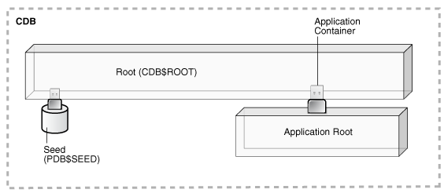

**Parent topic:** [Managing a Multitenant Environment](managing-a-multitenant-environment.md)

### 36.1 About a Multitenant Environment

You can use the Oracle Multitenant option to configure and manage a multitenant environment. The multitenant architecture enables an Oracle database to function as a multitenant container database (CDB) that includes zero, one, or many customer-created pluggable databases (PDBs). A PDB is a portable collection of schemas, schema objects, and nonschema objects that appears to an Oracle Net client as a non-CDB. All Oracle databases before Oracle Database 12c were non-CDBs.

- Components of a CDB  
	A CDB includes the root, the CDB seed, and PDBs.
- Common Users and Local Users  
	A CDB supports common users. A common user is a user that has the same identity in the root and in every existing and future PDB.
- Separation of Duties in CDB and PDB Administration  
	Some database administrators manage an entire CDB, while others manage individual PDBs.
- Application Containers  
	An application container is an optional component of a CDB that consists of an application root and all of the application PDBs associated with it. An application container stores data for one or more applications and shares application metadata and common data.

See Also:

[Oracle Database Concepts](https://docs.oracle.com/pls/topic/lookup?ctx=en/database/oracle/oracle-database/12.2/admin&id=CNCPT89234)

**Parent topic:** Overview of Managing a Multitenant Environment

#### 36.1.1 Components of a CDB

A CDB includes the root, the CDB seed, and PDBs.

A CDB includes the following components:

- Root
	The root, named `CDB$ROOT`, stores Oracle-supplied metadata and common users. An example of metadata is the source code for Oracle-supplied PL/SQL packages. A common user is a database user known in every container. A CDB has exactly one root.
- CDB seed
	The CDB seed, named `PDB$SEED`, is a template that you can use to create new PDBs. You cannot add objects to or modify objects in the CDB seed. A CDB has exactly one CDB seed.
- PDBs
	A PDB appears to users and applications as if it were a non-CDB. For example, a PDB can contain the data and code required to support a specific application. A PDB is fully backward compatible with Oracle Database releases before Oracle Database 12c.

Each of these components is called a container. Therefore, the root is a container, the CDB seed is a container, and each PDB is a container. Each container has a unique container ID and name within a CDB. Figure 36-1 shows a CDB with several PDBs.

Figure 36-1 CDB with PDBs

> This illustration shows a CDB with a `CDB$ROOT` container, a `PDB$SEED` container plugged into the root container, and several PDBs plugged into the root container.

You can easily plug a PDB into a CDB and unplug a PDB from a CDB. When you plug in a PDB, you associate the PDB with a CDB. When you unplug a PDB, you disassociate the PDB from a CDB. An unplugged PDB consists of an XML file that describes the PDB and the PDB's files (such as the data files and wallet file).

You can unplug a PDB from one CDB and plug it into a different CDB without altering your schemas or applications. A PDB can be plugged into only one CDB at a time.

Each PDB has a globally unique identifier (GUID). The PDB GUID is primarily used to generate names for directories that store the PDB's files, including both Oracle Managed Files directories and non-Oracle Managed Files directories.

**Parent topic:** About a Multitenant Environment

#### 36.1.2 Common Users and Local Users

A CDB supports common users. A common user is a user that has the same identity in the root and in every existing and future PDB.

A common user can log in to the root and any container in which it has been granted `CREATE SESSION` privilege. The operations that a common user can perform depend on the privileges granted to the common user. Some administrative tasks, such as creating a PDB or unplugging a PDB, must be performed by a common user. A CDB also supports local users. A local user is a user that exists in exactly one PDB.

See Also:

[Oracle Database Security Guide](https://docs.oracle.com/pls/topic/lookup?ctx=en/database/oracle/oracle-database/12.2/admin&id=DBSEG99777) for more information about common users and local users

**Parent topic:** About a Multitenant Environment

#### 36.1.3 Separation of Duties in CDB and PDB Administration

Some database administrators manage an entire CDB, while others manage individual PDBs.

The database administrators who manage an entire CDB connect to the CDB as common users, and they manage attributes of the entire CDB and the root, as well as some attributes of PDBs. For example, these database administrators can create, unplug, plug in, and drop PDBs. They can also specify the temporary tablespace and the default tablespace for the root, and they can change the open mode of one or more PDBs.

Database administrators can also connect to a specific PDB as a local PDB administrator and then perform a subset of management tasks on the PDB that a database administrator performs on a non-CDB. The subset of tasks are those required for the PDB to support an application. For example, these can include management of tablespaces and schemas in a PDB, specification of storage parameters for that PDB, changing the open mode of the current PDB, and setting PDB-level initialization parameters.

**Parent topic:** About a Multitenant Environment

#### 36.1.4 Application Containers

An application container is an optional component of a CDB that consists of an application root and all of the application PDBs associated with it. An application container stores data for one or more applications and shares application metadata and common data.

An application container is a special type of PDB that has an application root that is separate from the root in its CDB, and it can have one or more PDBs. When a PDB belongs to an application root, it is referred to as an application PDB.

An application root is a container to which application PDBs can belong. An application root belongs to its CDB root and shares descriptions of Oracle-supplied common objects in the CDB root. In addition, an application root enables you to create application common objects that are shared only by the application root and the application PDBs that belong to the application root. Application common objects are not visible to the CDB root, other application roots, or PDBs that do not belong to the application root. An application root cannot belong to another application root, and a PDB can belong to either no application roots or to only one application root.

You can create an application seed for an application container. The application seed is optional, but, if it exists, you can use it to create application PDBs quickly that match the requirements of the application container. An application seed enables instant provisioning of application PDBs that are created from it.

Figure 36-2 Application Containers in a CDB

> This illustration shows a CDB with the following components:
>
> - The CDB has a `CDB$ROOT` container.
> - A `PDB$SEED` container is plugged into the root container.
> - Several PDBs are plugged into the root container.
> - Two application containers plugged into the root container.
> - Each application container has an application root container.
> - One application container has two application PDBs plugged into its application root container.
> - One application container has three application PDBs plugged into its application root container.
> - The application container with two application PDBs also has an application seed plugged into its application root container.

You can specify one or more application names for each application container, and each application name has an application version. For an application PDB that is not currently part of the application container, the names and versions of its applications determine whether it can be cloned to, plugged in to, or relocated to the application root. If an application container does not have an application name or application version specified, then only PDBs that also do not have them specified can be plugged into the application container.

You can install an application in the application root. The installation can be script-driven or GUI driven, or a combination of the two. To use this method to install an application, run the `ALTER PLUGGABLE DATABASE APPLICATION BEGIN INSTALL` SQL statement before installing the application and the `ALTER PLUGGABLE DATABASE APPLICATION END INSTALL` SQL statement after installing the application. After the application is installed in the application root, you can install the application in application PDBs by synchronizing them.

Each application container can have its own application common users, application roles, and application profiles, which can be created only when the current container is the application root. Application common users can connect or switch only to the application root in which they were created and to application PDBs that belong to the application root.

Note:

- Applications cannot be installed in a CDB root or in a PDB plugged into a CDB root.
- In this document, “the root” is a reference to the CDB root (`CDB$ROOT`). Any reference to an application root uses the term “application root.”

### 36.2 Purpose of a Multitenant Environment

A multitenant environment enables the central management of multiple PDBs in a single installation and enables you to accomplish several goals.

By using a multitenant environment, you can accomplish the following goals:

- Cost reduction
	By consolidating hardware and database infrastructure to a single set of background processes, and efficiently sharing computational and memory resources, you reduce costs for hardware and maintenance.
- Easier and more rapid movement of data and code
	By design, you can plug a PDB into a CDB, unplug the PDB from the CDB, and then plug this PDB into a different CDB. Therefore, you can easily move an application's database back end from one server to another.
- Easier management and monitoring of the physical database
	The CDB administrator can manage the environment as an aggregate by executing a single operation, such as patching or performing an RMAN backup, for all hosted tenants and the CDB root.
- Separation of data and code
	Although consolidated into a single physical CDB, PDBs mimic the behavior of traditional non-CDBs. For example, a PDB administrator can flush the shared pool or buffer cache in the context of a PDB without affecting other PDBs in the CDB.
- Ease of performance tuning
	It is easier to collect performance metrics for a CDB than for multiple non-CDBs. It is easier to size one SGA than several SGAs.
- Support for Oracle Database Resource Manager
	In any shared resource environment, administrators must manage system resources to provide a predictable environment for users and address unexpected or transient resource contention. To address these issues and to provide resource usage monitoring, you can use Oracle Database Resource Manager (see [Using Oracle Resource Manager for PDBs with SQL\*Plus](using-oracle-resource-manager-for-pdbs-with-sql-plus.md)).
- Fewer patches and upgrades
	It is easier to apply a patch to one CDB than to multiple non-CDBs and to upgrade one CDB than to upgrade several non-CDBs.

A multitenant environment is especially useful when you have many non-CDBs deployed on different hardware in multiple Oracle Database installations. These non-CDBs might use only a fraction of the hardware resources dedicated to them, and each one might not require a full-time database administrator to manage it.

By combining these non-CDBs into a CDB, you can make better use of your hardware resources and database administrator resources. In addition, you can move a PDB from one CDB to another without requiring changes to the applications that depend on the PDB.

**Parent topic:** Overview of Managing a Multitenant Environment

### 36.3 Prerequisites for a Multitenant Environment

Prerequisites must be met for a multitenant environment.

The following prerequisites must be met before you can create and use a multitenant environment:

- Install Oracle Database 12c.
	The installation includes setting various environment variables unique to your operating system and establishing the directory structure for software and database files.
	See [Oracle Database Installation Guide](https://docs.oracle.com/pls/topic/lookup?ctx=en/database/oracle/oracle-database/12.2/admin&id=GINST) specific to your operating system.
- Set the database compatibility level to at least `12.0.0`.
	See [Oracle Database Upgrade Guide](https://docs.oracle.com/pls/topic/lookup?ctx=en/database/oracle/oracle-database/12.2/admin&id=UPGRD005) for information about the database compatibility level.

**Parent topic:** Overview of Managing a Multitenant Environment

### 36.4 Tasks and Tools for a Multitenant Environment

There are common tasks you perform for a multitenant environment, and you use tools to complete the tasks.

- Tasks for a Multitenant Environment  
	A multitenant environment enables you to achieve several goals. You can complete general tasks to configure and use a multitenant environment.
- Tools for a Multitenant Environment  
	You can use various tools to configure and administer a multitenant environment.

**Parent topic:** Overview of Managing a Multitenant Environment

#### 36.4.1 Tasks for a Multitenant Environment

A multitenant environment enables you to achieve several goals. You can complete general tasks to configure and use a multitenant environment.

These goals are described in " Purpose of a Multitenant Environment ". To do so, you must complete the following general tasks:

Task 1 Plan for the Multitenant Environment

Creating and configuring any database requires careful planning. A CDB requires special considerations. For example, consider the following factors when you plan for a CDB:

- The number of PDBs that will be plugged into each CDB
- The resources required to support the planned CDB
- Container management policies executed as an aggregate on the entire CDB or executed locally on individual PDBs
- Container database topology, which could consist of application containers with application PDBs or a CDB with PDBs, or a combination of both

See " [Planning for CDB Creation](creating-and-configuring-a-cdb.md) " for detailed information about planning for a CDB.

Task 2 Create One or More CDBs

When you have completed the necessary planning, you can create one or more CDBs using either the Database Configuration Assistant (DBCA) or the `CREATE` `DATABASE` SQL statement. In either case, you must specify the configuration details for each CDB.

See " [Using DBCA to Create a CDB](creating-and-configuring-a-cdb.md) " and " [Using the CREATE DATABASE Statement to Create a CDB](creating-and-configuring-a-cdb.md) " for detailed information about creating a CDB.

After a CDB is created, it consists of the root and the CDB seed, as shown in Figure 36-3. The CDB root contains only Oracle maintained objects and data structures, and the CDB seed is a generic seed database for cloning purposes.

Figure 36-3 A Newly Created CDB

> This illustration shows a CDB with a `CDB$ROOT` container and a `PDB$SEED` container plugged into the root container.

Task 3 Optionally, Create Application Containers

An application container is an optional component of a CDB that consists of an application root and all of the application PDBs associated with it. An application container stores data for one or more applications.

Figure 36-4 shows a CDB with one empty application container.

Figure 36-4 An Application Container

> This illustration shows a CDB with a `CDB$ROOT` container and a `PDB$SEED` container plugged into the root container. There is also one application container plugged into the CDB root, and the application container has an application root.

See " Application Containers ".

Task 4 Create, Plug In, and Unplug PDBs

PDBs contain user data. After creating a CDB, you can create PDBs, plug unplugged PDBs into it, and unplug PDBs from it whenever necessary. You can unplug a PDB from a CDB and plug this PDB into a different CDB. You might move a PDB from one CDB to another if, for example, you want to move the workload for the PDB from one server to another.

See " [Creating and Removing PDBs with SQL\*Plus](creating-and-removing-pdbs-with-sql-plus.md) " and " [Creating and Removing PDBs with Cloud Control](creating-and-removing-pdbs-with-cloud-control.md) " for information about creating PDBs, plugging in PDBs, and unplugging PDBs.

Figure 36-5 shows a CDB with several PDBs.

Figure 36-5 A CDB with PDBs

> This illustration shows a CDB with a `CDB$ROOT` container, a `PDB$SEED` container plugged into the root container, and several PDBs plugged into the root container.

Figure 36-6 shows a CDB with PDBs, application containers, and application PDBs.

Figure 36-6 A CDB with PDBs, Application Containers, and Application PDBs

> This illustration shows a CDB with the following components:
>
> - The CDB has a `CDB$ROOT` container.
> - A `PDB$SEED` container is plugged into the root container.
> - Several PDBs are plugged into the root container.
> - Two application containers plugged into the root container.
> - Each application container has an application root container.
> - One application container has two application PDBs plugged into its application root container.
> - One application container has three application PDBs plugged into its application root container.
> - The application container with two application PDBs also has an application seed plugged into its application root container.

Task 5 Administer and Monitor the CDB and Application Containers

Administering and monitoring a CDB involves managing the entire CDB, the root, and some attributes of PDBs. Some management tasks are the same for CDBs and non-CDBs, and some are different.

Administering and monitoring an application container is similar to administering and monitoring a CDB, but your actions only affect the application root and the application PDBs that are part of the application container.

See " [After Creating a CDB](creating-and-configuring-a-cdb.md) " for descriptions of tasks that are similar and tasks that are different. Also, see " [Administering a CDB with SQL\*Plus](administering-a-cdb-with-sql-plus.md) ", " [Administering CDBs and PDBs with Cloud Control](administering-cdbs-and-pdbs-with-cloud-control.md) ", and " [Viewing Information About CDBs and PDBs with SQL\*Plus](viewing-information-about-cdbs-and-pdbs-with-sql-plus.md) ".

You can use Oracle Resource Manager to allocate and manage resources among PDBs hosted in a CDB, and you can use it to allocate and manage resource use among user processes within a PDB. See " [Using Oracle Resource Manager for PDBs with SQL\*Plus](using-oracle-resource-manager-for-pdbs-with-sql-plus.md) ".

You can also use Oracle Scheduler to schedule jobs in a CDB and in individual PDBs. See " [Using Oracle Scheduler with a CDB](using-oracle-scheduler-with-a-cdb.md) ".

Task 6 Administer and Monitor PDBs and Application PDBs

Administering and monitoring a PDB or an application PDB is similar to administering and monitoring a non-CDB, but there are some differences. See " [Administering CDBs and PDBs with Cloud Control](administering-cdbs-and-pdbs-with-cloud-control.md) ", " [Administering PDBs with SQL\*Plus](administering-pdbs-with-sql-plus.md) ", and " [Viewing Information About CDBs and PDBs with SQL\*Plus](viewing-information-about-cdbs-and-pdbs-with-sql-plus.md) ".

**Parent topic:** Tasks and Tools for a Multitenant Environment

#### 36.4.2 Tools for a Multitenant Environment

You can use various tools to configure and administer a multitenant environment.

Use the following tools to complete tasks for a multitenant environment:

- SQL\*Plus
	SQL\*Plus is a command-line tool that enables you to create, manage, and monitor CDBs and PDBs. You use SQL statements and Oracle-supplied PL/SQL packages to complete these tasks in SQL\*Plus.
	See [SQL\*Plus User's Guide and Reference](https://docs.oracle.com/pls/topic/lookup?ctx=en/database/oracle/oracle-database/12.2/admin&id=SQPUG).
- DBCA
	Oracle Database Configuration Assistant (DBCA) is a utility with a graphical user interface that enables you to configure a CDB, create PDBs, plug in PDBs, and unplug PDBs.
	See [Oracle Database 2 Day DBA](https://docs.oracle.com/pls/topic/lookup?ctx=en/database/oracle/oracle-database/12.2/admin&id=ADMQS023), [Oracle Database Installation Guide](https://docs.oracle.com/pls/topic/lookup?ctx=en/database/oracle/oracle-database/12.2/admin&id=GINST), and the DBCA online help for more information about DBCA.
- Oracle Enterprise Manager Cloud Control
	Cloud Control is a system management tool with a graphical user interface that enables you to manage and monitor a CDB and its PDBs.
	See the Cloud Control online help for more information about Cloud Control.
- Oracle SQL Developer
	Oracle SQL Developer is a client application with a graphical user interface that enables you to configure a CDB, create PDBs, plug and unplug PDBs, modify the state of a PDB, clone a PDB to the Oracle Cloud, hot clone/refresh a PDB, relocate a PDB between application roots, and more.
	Additionally, Oracle SQL Developer has graphical interfaces for resource management, storage, security, configuration, and reporting of performance metrics on containers and pluggable databases in a CDB.
	See [Oracle SQL Developer User's Guide](https://docs.oracle.com/pls/topic/lookup?ctx=en/database/oracle/oracle-database/12.2/admin&id=RPTUG).
- The Server Control (SRVCTL) utility
	The SRVCTL utility can create and manage services for PDBs.
	See " [Managing Services Associated with PDBs](administering-pdbs-with-sql-plus.md) ".
- EM Express
	Note:
	PDB management with EM Express is available starting with Oracle Database 12c Release 1 (12.1.0.2).
	EM Express is a management and monitoring tool with a graphical user interface which ships with Oracle Database. It can be configured for the CDB, individual hosted PDBs, or both. This tool is intended for PDB administrative use, in the context of the PDB, to manage and monitor application development as an application DBA.
	See [Oracle Database 2 Day DBA](https://docs.oracle.com/pls/topic/lookup?ctx=en/database/oracle/oracle-database/12.2/admin&id=ADMQS12495) for more information.
- Oracle Multitenant Self-Service Provisioning application
	Note:
	This feature is available starting with Oracle Database 12c Release 1 (12.1.0.2).
	This application enables the self-service provisioning of PDBs. CDB administrators control access to this self-service application and manage quotas on PDBs.
	For more information about the application or to download the software, use any browser to access the OTN page for the application:
	[`http://www.oracle.com/goto/multitenant`](http://www.oracle.com/goto/multitenant)
	To access the application, click the Downloads tab, and select Oracle Pluggable Database Self-Service Provisioning application in the Downloads for Oracle Multitenent section.

**Parent topic:** Tasks and Tools for a Multitenant Environment