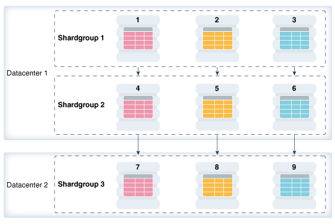
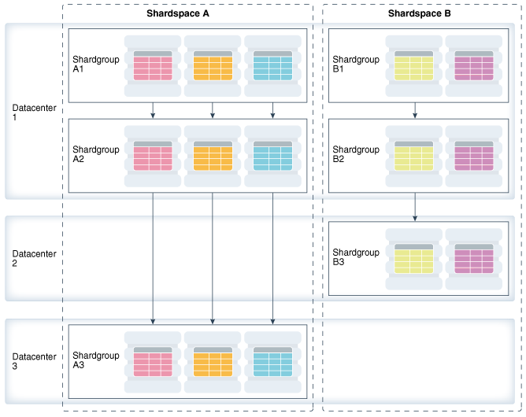

Oracle Sharding is integrated with Oracle Database replication technologies for high availability and disaster recovery at the shard level.

The following topics describe how to use Oracle’s replication technologies to make your sharded databases highly available:

- About Sharding and Replication  
	Oracle Sharding is tightly integrated with Oracle Data Guard.
- Using Oracle Data Guard with an SDB  
	Oracle Data Guard replication maintains one or more synchronized copies (standbys) of a shard (the primary) for high availability and data protection. Standbys may be deployed locally or remotely, and when using Oracle Active Data Guard can also be open for read-only access.

**Parent topic:** [Sharded Database Management](shard_part.md)

### 55.1 About Sharding and Replication

Oracle Sharding is tightly integrated with Oracle Data Guard.

Replication provides high availability, disaster recovery, and additional scalability for reads.

Replication topology in a sharded database (SDB) is declaratively specified using GDSCTL command syntax. Oracle Sharding automatically deploys the specified replication topology and enables data replication.

The availability of an SDB is not affected by an outage or slowdown of one or more shards. Replication is used to provide individual shard-level high availability (Oracle Active Data Guard). Replication is automatically configured and deployed when the SDB is created. Optionally, you can use Oracle RAC for shard-level high availability, complemented by replication, to maintain shard-level data availability in the event of a cluster outage. Oracle Sharding automatically fails over database connections from a shard to its replica in the event of an unplanned outage.

**Parent topic:** Shard-Level High Availability

### 55.2 Using Oracle Data Guard with an SDB

Oracle Data Guard replication maintains one or more synchronized copies (standbys) of a shard (the primary) for high availability and data protection. Standbys may be deployed locally or remotely, and when using Oracle Active Data Guard can also be open for read-only access.

Oracle Data Guard can be used as the replication technology for SDBs using the system-managed or composite method of sharding.

Using Oracle Data Guard with a System-Managed SDB

In system-managed and composite sharding, the logical unit of replication is a group of shards called a shardgroup. In system-managed sharding, a shardgroup contains all of the data stored in the SDB. The data is sharded by consistent hash across shards that make up the shardgroup. Shards that belong to a shardgroup are usually located in the same data center. An entire shardgroup can be fully replicated to one or more shardgroups in the same or different data centers.

The following figure illustrates how Data Guard replication is used with system-managed sharding. In the example in the figure there is a primary shardgroup, Shardgroup 1, and two standby shardgroups, Shardgroup 2 and Shardgroup 3. Shardgroup 1 consists of Data Guard primary databases (shards 1-3). Shardgroup 2 consists of local standby databases (shards 4-6) which are located in the same datacenter and configured for synchronous replication. And Shardgroup 3 consists of remote standbys (shards 7-9) located in a different datacenter and configured for asynchronous replication. Oracle Active Data Guard is enabled in this configuration, so each standby is open read-only.

Figure 55-1 System-Managed Sharding with Data Guard Replication



> This image illustrates how Data Guard replication is used with system-managed sharding. In the example in the figure there is a primary shardgroup, Shardgroup 1, and two standby shardgroups, Shardgroup 2 and Shardgroup 3. Shardgroup 1 consists of Data Guard primary databases (shards 1-3). Shardgroup 2 consists of local standby databases (shards 4-6) which are located in the same datacenter, Datacenter 1, and configured for synchronous replication. Shardgroup 3 consists of remote standbys (shards 7-9) located in a different datacenter, Datacenter 2, and configured for asynchronous replication. Oracle Active Data Guard is enabled in this configuration, so each standby is open read-only


The concept of shardgroup as a logical unit of replication hides from the user the implementation details of replication. With Data Guard, replication is done at the shard (database) level. The SDB in the figure above consists of three sets of replicated shards: {1, 4, 7}, {2, 5, 8} and {3, 6, 9}. Each set of replicated shards is managed as a Data Guard Broker configuration with fast-start failover (FSFO) enabled.

To deploy replication, specify the properties of the shardgroups (region, role, and so on) and add shards to them. Oracle Sharding automatically configures Data Guard and starts an FSFO observer for each set of replicated shards. It also provides load balancing of the read-only workload, role based global services and replication lag, and locality based routing.

Run the following GDSCTL commands to deploy the example configuration shown in the figure above.

```
CREATE SHARDCATALOG –database host00:1521:shardcat –region dc1, dc2

ADD GSM -gsm gsm1 -listener 1571 –catalog host00:1521:shardcat –region dc1
ADD GSM -gsm gsm2 -listener 1571 –catalog host00:1521:shardcat –region dc2

ADD SHARDGROUP -shardgroup shardgroup1 -region dc1 -deploy_as primary 
ADD SHARDGROUP -shardgroup shardgroup2 -region dc1 -deploy_as active_standby 
ADD SHARDGROUP -shardgroup shardgroup3 -region dc2 -deploy_as active_standby 

CREATE SHARD -shardgroup shardgroup1 -destination host01 -credential oracle_cred 
CREATE SHARD -shardgroup shardgroup1 -destination host02 -credential oracle_cred 
CREATE SHARD -shardgroup shardgroup1 -destination host03 -credential oracle_cred 
...
CREATE SHARD -shardgroup shardgroup3  -destination host09 -credential oracle_cred

DEPLOY
```

Using Oracle Data Guard with a Composite SDB

In composite sharding an SDB consists of multiple shardspaces. However, each shardspace, instead of replicated shards, contains replicated shardgroups.

Figure 55-2 Composite Sharding with Data Guard Replication



> This image shows the replication of two distinct shardspaces, A and B.
>
> Shardspace A contains a set of shardgroups consisting of three shards. Shardgroup A1 contains the primary shards, shardgroup A2 contains the local standby shards and shardgroup A3 contains the remote site standby shards.
>
> Shardspace B contains a set of shardgroups consisting of two shards. Shardgroup B1 contains the primary shards, shardgroup B2 contains the local standby shards, and shardgroup B3 contains the remote site standby shards.


Run the following GDSCTL commands to deploy the example configuration shown in the previous figure.

```
CREATE SHARDCATALOG -sharding composite –database host00:1521:cat –region dc1, 
dc2, dc3

ADD GSM -gsm gsm1 -listener 1571 –catalog host00:1521:cat –region dc1
ADD GSM -gsm gsm2 -listener 1571 –catalog host00:1521:cat –region dc2
ADD GSM -gsm gsm3 -listener 1571 –catalog host00:1521:cat –region dc3

ADD SHARDSPACE -shardspace shardspace_a 
ADD SHARDSPACE -shardspace shardspace_b

ADD SHARDGROUP -shardgroup shardgroup_a1 –shardspace shardspace_a -region dc1 
-deploy_as primary 
ADD SHARDGROUP -shardgroup shardgroup_a2 –shardspace shardspace_a -region dc1     
-deploy_as active_standby
ADD SHARDGROUP -shardgroup shardgroup_a3 –shardspace shardspace_a -region dc3     
-deploy_as active_standby 
ADD SHARDGROUP -shardgroup shardgroup_b1 –shardspace shardspace_b -region dc1 
-deploy_as primary 
ADD SHARDGROUP -shardgroup shardgroup_b2 –shardspace shardspace_b -region dc1     
-deploy_as active_standby 
ADD SHARDGROUP -shardgroup shardgroup_b3 –shardspace shardspace_b -region dc2     
-deploy_as active_standby 

CREATE SHARD -shardgroup shardgroup_a1 -destination host01 –credential orcl_cred  
...

CREATE SHARD -shardgroup shardgroup_b3 -destination host09 -credential orcl_cred 

DEPLOY
```

**Parent topic:** Shard-Level High Availability