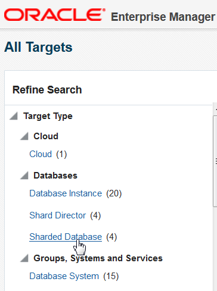
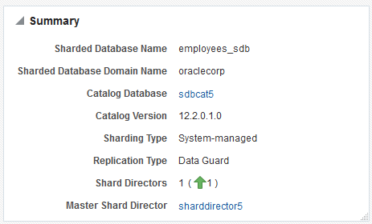
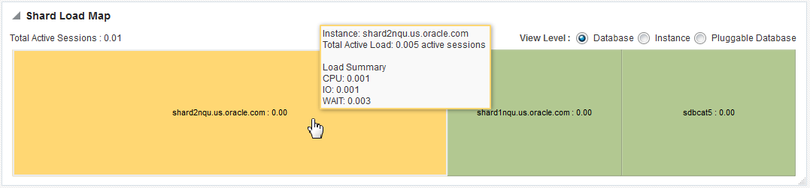
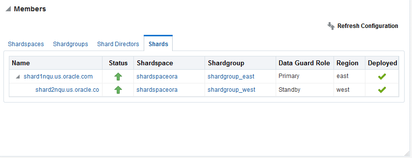
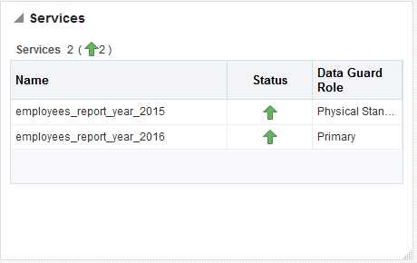
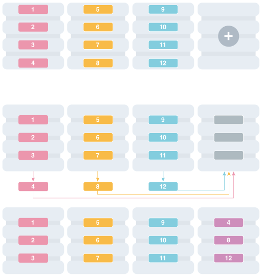

Oracle Sharding provides tools and some automation for lifecycle management of a sharded database.

The following topics describe sharded database lifecycle management in detail:

**Parent topic:** [Sharded Database Management](shard_part.md)

### 57.1 Monitoring a Sharded Database

Sharded databases can be monitored using Enterprise Manager Cloud Control or GDSCTL.

See the following topics to use Enterprise Manager Cloud Control or GDSCTL to monitor sharded databases.

- Monitoring a Sharded Database with GDSCTL  
	There are numerous `GDSCTL CONFIG` commands that you can use to obtain the health status of individual shards, shardgroups, shardspaces, and shard directors.
- Monitoring a Sharded Database with Enterprise Manager Cloud Control  
	Oracle Enterprise Manager Cloud Control lets you discover, monitor, and manage the components of a sharded database.

**Parent topic:** Sharded Database Lifecycle Management

#### 57.1.1 Monitoring a Sharded Database with GDSCTL

There are numerous `GDSCTL CONFIG` commands that you can use to obtain the health status of individual shards, shardgroups, shardspaces, and shard directors.

Monitoring a shard is just like monitoring a normal database, and standard Oracle best practices should be used to monitor the individual health of a single shard. However, it is also important to monitor the overall health of the entire sharded environment. The GDSCTL commands can also be scripted and through the use of a scheduler and can be done at regular intervals to help ensure that everything is running smoothly.

See Also:

[Oracle Database Global Data Services Concepts and Administration Guide](https://docs.oracle.com/pls/topic/lookup?ctx=en/database/oracle/oracle-database/12.2/admin&id=GSMUG-GUID-1BA69DEA-66A1-45EB-BA86-E24957C10CF3) for information about using the `GDSCTL CONFIG` commands

**Parent topic:** Monitoring a Sharded Database

#### 57.1.2 Monitoring a Sharded Database with Enterprise Manager Cloud Control

Oracle Enterprise Manager Cloud Control lets you discover, monitor, and manage the components of a sharded database.

Sharded database targets are found in the All Targets page.

Figure 57-1 Sharded Databases in the All Targets Refine Search pane



> The screenshot shows the Refine Search pane of the All Targets page, located on the left side of the Enterprise Manager Cloud Control. The mouse is pointing to the Sharded Databases category, which is listed under the Databases target type.


The target home page for a sharded database shows you a summary of the sharded database components and their statuses.

To monitor sharded database components you must first discover them. See Discovering Sharded Database Components for more information.

Summary

The Summary pane, in the top left of the page, shows the following information:

- Sharded database name
- Sharded database domain name
- Shard catalog name. You can click the name to view more information about the shard catalog.
- Shard catalog database version
- Sharding method used to shard the database
- Replication technology used for high availability
- Number and status of the shard directors
- Master shard director name. You can click the name to view more information about the master shard director.

Figure 57-2 Sharded Database Summary pane



> The screenshot of the sharded database Summary pane displays a list of attributes and their values. The attributes are:
>
> - Sharded Database Name
> - Sharded Database Domain Name
> - Catalog Database
> - Catalog Version
> - Sharding Type
> - Replication Type
> - Shard Directors
> - Master Shard Director


Shard Load Map

The Shard Load Map, in the upper right of the page, shows a pictorial graph illustrating how transactions are distributed among the shards.

Figure 57-3 Sharded Database Shard Load Map



> The screenshot of the Shard Load Map shows the View Level radio buttons described in the text after the image, and the cells of the graph as described in the text after the image. The largest cell, on the left side of the graph, is yellow, there are two other smaller cells which are green. The mouse pointer hovers over the yellow cell to display the statistics described in the text following the image.


You can select different View Levels above the graph.

- Database
	The database view aggregates database instances in Oracle RAC cluster databases into a single cell labeled with the Oracle RAC cluster database target name. This enables you to easily compare the total database load in Oracle RAC environments.
- Instance
	The instance view displays all database instances separately, but Oracle RAC instances are grouped together as sub-cells of the Oracle RAC database target. This view is essentially a two-level tree map, where the database level is the primary division, and the instance within the database is the secondary division. This allows load comparison of instances within Oracle RAC databases; for instance, to easily spot load imbalances across instances.
- Pluggable Database
	Although the PDB option is shown, PDB is not supported for Oracle Sharding in the current release.

Notice that the cells of the graph are not identical in size. Each cell corresponds to a shard target, either an instance or a cluster database. The cell size (its area) is proportional to the target database's load measured in average active sessions, so that targets with a higher load have larger cell sizes. Cells are ordered by size from left to right and top to bottom. Therefore, the target with the highest load always appears as the upper leftmost cell in the graph.

You can hover your mouse pointer over a particular cell of the graph to view the total active load (I/O to CPU ration), CPU, I/O, and wait times. Segments of the graph are colored to indicate the dominant load:

- Green indicates that CPU time dominates the load
- Blue indicates that I/O dominates the load
- Yellow indicates that WAIT dominates the load

Members

The Members pane, in the lower left of the page, shows some relevant information about each of the components.

Figure 57-4 Sharded Database Members pane



> The screenshot of the Members pane shows the four tabs described in the text following the image. The Shards tab is selected and shows one primary and one standby shard.


The pane is divided into tabs for each component: Shardspaces, Shardgroups, Shard Directors, and Shards. Click on a tab to view the information about each type of component

- Shardspaces
	The Shardspaces tab displays the shardspace names, status, number of chunks, and Data Guard protection mode. The shardspace names can be clicked to reveal more details about the selected shardspace.
- Shardgroups
	The Shardgroups tab displays the shardgroup names, status, the shardspace to which it belongs, the number of chunks, Data Guard role, and the region to which it belongs. You can click the shardgroup and shardspace names to reveal more details about the selected component.
- Shard Directors
	The Shard Directors tab displays the shard director names, status, region, host, and Oracle home. You can click the shard director names can be clicked to reveal more details about the selected shard director.
- Shards
	The Shards tab displays the shard names, deploy status, status, the shardspaces and shardgroups to which they belong, Data Guard roles, and the regions to which they belong. In the Names column, you can expand the Primary shards to display the information about its corresponding Standby shard. You can hover the mouse over the Deployed column icon and the deployment status details are displayed. You can click on the shard, shardspace, and shardgroup names to reveal more details about the selected component.

Services

The Services pane, in the lower right of the page, shows the names, status, and Data Guard role of the sharded database services. Above the list is shown the total number of services and an icon showing how many services are in a particular status. You can hover your mouse pointer over the icon to read a description of the status icon.

Figure 57-5 Sharded Database Services pane



> The screenshot of the Services pane shows the sections described in the text following the image. There are two services in the list and both are Up.


Incidents

The Incidents pane displays messages and warnings about the various components in the sharded database environment. More information about how to use this pane is in the Cloud Control online help.

Sharded Database Menu

The Sharded Database menu, located in the top left corner, provides you with access to administrate the sharded database components.

Target Navigation

The Target Navigation pane gives you easy access to more details about any of the components in the sharded database.


> This is the target navigation icon in the upper right corner of the sharded database home page.


Clicking the navigation tree icon on the upper left corner of the page opens the Target Navigation pane. This pane shows all of the discovered components in the sharded database in tree form.

Expanding a shardspace reveals the shardgroups in them. Expanding a shardgroup reveals the shards in that shardgroup.

Any of the component names can be clicked to view more details about them.

- Discovering Sharded Database Components  
	In Enterprise Manager Cloud Control, you can discover the shard catalog and shard databases, then add the shard directors, sharded databases, shardspaces, and shardgroups using guided discovery.

**Parent topic:** Monitoring a Sharded Database

##### 57.1.2.1 Discovering Sharded Database Components

In Enterprise Manager Cloud Control, you can discover the shard catalog and shard databases, then add the shard directors, sharded databases, shardspaces, and shardgroups using guided discovery.

As a prerequisite, you must use Cloud Control to discover the shard director hosts and the.shard catalog database. Because the catalog database and each of the shards is a database itself, you can use standard database discovery procedures.

Monitoring the shards is only possible when the individual shards are discovered using database discovery. Discovering the shards is optional to discovering a sharded database, because you can have a sharded database configuration without the shards.

1. In Enterprise Manager Cloud Control, select Setup, choose Add Target, then choose Add Target Manually.
2. In the Add Targets Manually page, click Add Using Guided Process in the Add Non-Host Target Using Guided Process panel.
3. In the Add Using Guided Process dialog, locate and select Sharded Database, and click Add.
4. In the Add Sharded Database: Catalog Database page, click the browse icon next to Catalog Database to locate the SDB catalog database.
5. In the Select Targets dialog, click the target name corresponding to the catalog database and click Select.
	The Catalog Database and Monitoring Credentials fields are filled in if they exist. The monitoring credential is used to query the catalog database to get the configuration information. The monitoring user is granted GDS\_CATALOG\_SELECT role and has read only privileges on the catalog repository tables.
	Click Next to proceed to the next step.
	In the Add Sharded Database: Components page you are shown information about the sharded database that is managed by the catalog database, including the sharded database name, its domain name, the sharding method employed on the sharded database, and a list of discovered shard directors.
6. To set monitoring credentials on a shard director, click the plus sign icon on the right side of the list entry.
	A dialog opens allowing you to set the credentials.
	Click OK to close the dialog, and click Next to proceed to the next step.
7. In the Add Sharded Database: Review page, verify that all of the shard directors, shardspaces, and shardgroups were discovered.
8. Click Submit to finalize the steps.
	An Enterprise Manager Deployment Procedure is submitted and you are returned to the Add Targets Manually page.
	At the top of the page you will see information about the script that was submitted to add all of the discovered components to Cloud Control.
9. Click the link to view the provisioning status of the sharded database components.
	In another browser window you can go to the Cloud Control All Targets page to observe the status of the sharded database.

When the target discovery procedure is finished, sharded database targets are added in Cloud Control. You can open the sharded database in Cloud Control to monitor and manage the components.

**Parent topic:** Monitoring a Sharded Database with Enterprise Manager Cloud Control

### 57.2 Backing Up and Recovering a Sharded Database

Because shards are hosted on individual Oracle databases, you can use Oracle Maximum Availability best practices to back up and restore shards individually.

If you are using Data Guard and Oracle Active Data Guard for SDB high availability, be sure to take observers offline and disable Fast Start Failover before taking a primary or standby database offline.

Contact Oracle Support for specific steps to recover a shard in the event of a disaster.

See Also:

[Oracle Maximum Availability Architecture](http://www.oracle.com/technetwork/database/features/availability/maa-096107.html) for MAA best practices white papers

**Parent topic:** Sharded Database Lifecycle Management

### 57.3 Patching a Sharded Database

Applying an Oracle patch to a sharded database environment can be done on a single shard or all shards; however, the method you use depends on the replication option used for the environment and the type of patch being applied.

Most patches can be applied to a single shard at a time; however, some patches should be applied across all shards. Use Oracle’s best practices for applying patches to single shards just as you would a non-sharded database, keeping in mind the replication method that is being used with the SDB. Oracle `opatchauto` can be used to apply patches to multiple shards at a time, and can be done in a rolling manner. Data Guard configurations are applied one after another, and in some cases (depending on the patch) you can use Standby First patching. If a patch addresses an issue with multi-shard queries, replication, or the sharding infrastructure, it should be applied to all of the shards in the SDB.

**Parent topic:** Sharded Database Lifecycle Management

### 57.4 Modifying a Sharded Database Schema

When making changes to duplicated tables or sharded tables in a sharded database, these changes should be done from the shard catalog database.

Before executing any DDL operations on a sharded database, enable sharded DDL with

```
ALTER SESSION ENABLE SHARD DDL;
```

This statement ensures that the DDL changes will be propagated to each shard in the sharded database.

The DDL changes that are propagated are commands that are defined as “schema related,” which include operations such as `ALTER TABLE` and `CREATE TRIGGER`. There are other operations that are propagated to each shard, such as the `CREATE, ALTER, DROP` user commands for simplified user management, and `TABLESPACE` operations to simplify the creation of tablespaces on multiple shards.

`GRANT` and `REVOKE` operations can be done from the shard catalog and are propagated to each shard, providing you have enabled shard DDL for the session. If more granular control is needed you can issue the command directly on each shard.

Operations such as DBMS package calls or similar operations are not propagated. For example, operations gathering statistics on the shard catalog are not propagated to each shard.

If you perform an operation that requires a lock on a table, such as adding a not null column, it is important to remember that each shard needs to obtain the lock on the table in order to perform the DDL operation. Oracle’s best practices for applying DDL in a single instance apply to sharded environments.

Multi-shard queries, which are executed on the shard catalog, issue remote queries across database connections on each shard. In this case it is important to ensure that the user has the appropriate privileges on each of the shards, whether or not the query will return data from that shard.

See Also:

[Oracle Database SQL Language Reference](https://docs.oracle.com/pls/topic/lookup?ctx=en/database/oracle/oracle-database/12.2/admin&id=SQLRF-GUID-B7052D25-F224-459A-A17B-FA5A37BFD237) for information about operations used with duplicated tables and sharded tables

**Parent topic:** Sharded Database Lifecycle Management

### 57.5 Shard Management

You can manage shards in your Oracle Sharding deployment with Oracle Enterprise Manager Cloud Control and GDSCTL.

The following topics describe shard management concepts and tasks:

- About Adding Shards  
	New shards can be added to an existing sharded database environment to scale out and to improve fault tolerance.
- Resharding and Hot Spot Elimination  
	The process of redistributing data between shards, triggered by a change in the number of shards, is called resharding. Automatic resharding is a feature of the system-managed sharding method that provides elastic scalability of an SDB.
- Removing a Shard From the Pool  
	It may become necessary to remove a shard from the sharded database environment, either temporarily or permanently, without losing any data that resides on that shard.
- Adding Standby Shards  
	You can add Data Guard standby shards to an Oracle Sharding environment; however there are some limitations.
- Managing Shards with Oracle Enterprise Manager Cloud Control  
	You can manage database shards using Oracle Enterprise Manager Cloud Control
- Managing Shards with GDSCTL  
	You can manage shards in your Oracle Sharding deployment using the GDSCTL command-line utility.

**Parent topic:** Sharded Database Lifecycle Management

#### 57.5.1 About Adding Shards

New shards can be added to an existing sharded database environment to scale out and to improve fault tolerance.

For fault tolerance, it is beneficial to have many smaller shards than a few very large ones. As an application matures and the amount of data increases, you can add an entire shard or multiple shards to the SDB to increase capacity.

When you add a shard to a sharded database, if the environment is sharded by consistent hash, then chunks from existing shards are automatically moved to the new shard to rebalance the sharded environment.

Oracle Enterprise Manager Cloud Control can be used to help identify chunks that would be good candidates to move, or split and move to the new shard.

When you add a shard to the environment, verify that the standby server is ready, and after the new shard is in place take backups of any shards that have been involved in a `move chunk` operation.

**Parent topic:** Shard Management

#### 57.5.2 Resharding and Hot Spot Elimination

The process of redistributing data between shards, triggered by a change in the number of shards, is called resharding. Automatic resharding is a feature of the system-managed sharding method that provides elastic scalability of an SDB.

Sometimes data in an SDB needs to be migrated from one shard to another. Data migration across shards is required in the following cases:

- When one or multiple shards are added to or removed from an SDB
- When there is skew in the data or workload distribution across shards

The unit of data migration between shards is the chunk. Migrating data in chunks guaranties that related data from different sharded tables are moved together.

When a shard is added to or removed from an SDB, multiple chunks are migrated to maintain a balanced distribution of chunks and workload across shards.

Depending on the sharding method, resharding happens automatically (system-managed) or is directed by the user (composite). The following figure shows the stages of automatic resharding when a shard is added to an SDB with three shards.

Figure 57-6 Resharding an SDB



> This image shows the high-level workflow for adding a shard and redistributing chunks. There are three rows of shards shown.
>
> In the first row, there are three existing shards, each with 4 chunks, and one new shard with no chunks in it.
>
> In the second row, one chunk from each of the existing shards is shown selected and arrows point to the new shard, indicating that they will be moved there.
>
> In the third row, each of the four shards has three chunks in it.


A particular chunk can also be moved from one shard to another, when data or workload skew occurs, without any change in the number of shards. In this case, chunk migration can be initiated by the database administrator to eliminate the hot spot.

RMAN Incremental Backup, Transportable Tablespace, and Oracle Notification Service technologies are used to minimize impact of chunk migration on application availability. A chunk is kept online during chunk migration. There is a short period of time (a few seconds) when data stored in the chunk is available for read-only access only.

FAN-enabled clients receive a notification when a chunk is about to become read-only in the source shard, and again when the chunk is fully available in the destination shard on completion of chunk migration. When clients receive the `chunk read-only` event, they can either repeat connection attempts until the chunk migration is completed, or access the read-only chunk in the source chunk. In the latter case, an attempt to write to the chunk will result in a run-time error.

See Also:

Adding Shards to a System-Managed SDB

[Sharding Methods](sharding-methods.md)

**Parent topic:** Shard Management

#### 57.5.3 Removing a Shard From the Pool

It may become necessary to remove a shard from the sharded database environment, either temporarily or permanently, without losing any data that resides on that shard.

For example, removing a shard might become necessary if a sharded environment is scaled down after a busy holiday, or to replace a server or infrastructure within the data center. Prior to decommissioning the shard, you must move all of the chunks from the shard to other shards that will remain online. As you move them, try to maintain a balance of data and activity across all of the shards.

If the shard is only temporarily removed, keep track of the chunks moved to each shard so that they can be easily identified and moved back once the maintenance is complete.

See Also:

About Moving Chunks

[Oracle Database Global Data Services Concepts and Administration Guide](https://docs.oracle.com/pls/topic/lookup?ctx=en/database/oracle/oracle-database/12.2/admin&id=GSMUG-GUID-417F8D04-908C-4A35-A24E-7722742A09DB) for information about using the `GDSCTL REMOVE SHARD` command

**Parent topic:** Shard Management

#### 57.5.4 Adding Standby Shards

You can add Data Guard standby shards to an Oracle Sharding environment; however there are some limitations.

When using Data Guard as the replication method for a sharded database, Oracle Sharding supports only the addition of a primary or physical standby shard; other types of Data Guard standby databases are not supported when adding a new standby to the sharded database. However, a shard that is already part of the sharded database can be converted from a physical standby to a snapshot standby. When converting a physical standby to a snapshot standby, the following steps should be followed:

1. Stop all global services on the shard using the GDSCTL command `STOP SERVICE`.
2. Disable all global services on the shard using the GDSCTL command `DISABLE SERVICE`.
3. Convert the shard to a snapshot standby using the procedure described in the Data Guard documentation.
	At this point, the shard remains part of the sharded database, but will not accept connections which use the sharding key.

If the database is converted back to a physical standby, the global services can be enabled and started again, and the shard becomes an active member of the sharded database.

See Also:

[Oracle Data Guard Concepts and Administration](https://docs.oracle.com/pls/topic/lookup?ctx=en/database/oracle/oracle-database/12.2/admin&id=SBYDB-GUID-CE30E2D6-5B53-4389-8B02-FC0F341C8C1A)

**Parent topic:** Shard Management

#### 57.5.5 Managing Shards with Oracle Enterprise Manager Cloud Control

You can manage database shards using Oracle Enterprise Manager Cloud Control

To manage shards using Cloud Control, they must first be discovered. Because each database shard is a database itself, you can use standard Cloud Control database discovery procedures.

The following topics describe shard management using Oracle Enterprise Manager Cloud Control:

- Validating a Shard  
	Validate a shard prior to adding it to your Oracle Sharding deployment.
- Adding Primary Shards  
	Use Oracle Enterprise Manager Cloud Control to add a primary shards to your Oracle Sharding deployment.
- Adding Standby Shards  
	Use Oracle Enterprise Manager Cloud Control to add a standby shards to your Oracle Sharding deployment.
- Deploying Shards  
	Use Oracle Enterprise Manager Cloud Control to deploy shards that have been added to your Oracle Sharding environment.

**Parent topic:** Shard Management

##### 57.5.5.1 Validating a Shard

Validate a shard prior to adding it to your Oracle Sharding deployment.

You can use Oracle Enterprise Manager Cloud Control to validate shards before adding them to your Oracle Sharding deployment. You can also validate a shard after deployment to confirm that the settings are still valid later in the shard lifecycle. For example, after a software upgrade you can validate existing shards to confirm correctness of their parameters and configuration.

To validate shards with Cloud Control, they should be existing targets that are being monitored by Cloud Control.

1. From a shardgroup management page, open the Shardgroup menu, located in the top left corner of the shardgroup target page, and choose Manage Shards.
2. If prompted, enter the shard catalog credentials, select the shard director to manage under Shard Director Credentials, select the shard director host credentials, and log in.
3. Select a shard from the list and click Validate.
4. Click OK to confirm you want to validate the shard.
5. Click the link in the Information box at the top of the page to view the provisioning status of the shard.

When the shard validation script runs successfully check for errors reported in the output.

**Parent topic:** Managing Shards with Oracle Enterprise Manager Cloud Control

##### 57.5.5.2 Adding Primary Shards

Use Oracle Enterprise Manager Cloud Control to add a primary shards to your Oracle Sharding deployment.

Primary shards should be existing targets that are being monitored by Cloud Control.

It is highly recommended that you validate a shard before adding it to your Oracle Sharding environment. You can either use Cloud Control to validate the shard (see Validating a Shard), or run the DBMS\_GSM\_FIX.validateShard procedure against the shard using SQL\*Plus (see Validating a Shard).

1. Open the Sharded Database menu, located in the top left corner of the Sharded Database target page, and choose Add Primary Shards.
2. If prompted, enter the shard catalog credentials, select the shard director to manage under Shard Director Credentials, select the shard director host credentials, and log in.
3. Select Deploy All Shards in the sharded database to deploy all shards added to the sharded database configuration.
	The deployment operation validates the configuration of the shards and performs final configuration steps. Shards can be used only after they are deployed.
4. Click Add.
5. In the Database field of the Shard Details dialog, select a shard and click Select.
6. In a composite Oracle Sharding environment you can select the shardspace to which to add the shard.
7. Click OK.
8. Enter the GSMUSER credentials if necessary, then click Next.
9. Indicate when the ADD SHARD operation should occur, then click Next.
	- Immediately: the shard is provisioned upon confirmation
	- Later: schedule the timing of the shard addition using the calendar tool in the adjacent field
10. Review the configuration of the shard to be added and click Submit.
11. Click the link in the Information box at the top of the page to view the provisioning status of the shard.

If you did not select Deploy All Shards in the sharded database in the procedure above, deploy the shard in your Oracle Sharding deployment using the Deploying Shards task.

**Parent topic:** Managing Shards with Oracle Enterprise Manager Cloud Control

##### 57.5.5.3 Adding Standby Shards

Use Oracle Enterprise Manager Cloud Control to add a standby shards to your Oracle Sharding deployment.

Standby shards should be existing targets that are being monitored by Cloud Control.

It is highly recommended that you validate a shard before adding it to your Oracle Sharding environment. You can either use Cloud Control to validate the shard (see Validating a Shard), or run the DBMS\_GSM\_FIX.validateShard procedure against the shard using SQL\*Plus (see Validating a Shard).

1. Open the Sharded Database menu, located in the top left corner of the Sharded Database target page, and choose Add Standby Shards.
2. If prompted, enter the shard catalog credentials, select the shard director to manage under Shard Director Credentials, select the shard director host credentials, and log in.
3. Select Deploy All Shards in the sharded database to deploy all shards added to the sharded database configuration.
	The deployment operation validates the configuration of the shards and performs final configuration steps. Shards can be used only after they are deployed.
4. Choose a primary shard for which the new shard will act as a standby in the Primary Shards list.
5. Click Add.
6. In the Database field of the Shard Details dialog, select the standby shard.
7. Select the shardgroup to which to add the shard.
	Only shardgroups that do not already contain a standby for the selected primary are shown.
8. Click OK.
9. Enter the GSMUSER credentials if necessary, then click Next.
10. Indicate when the ADD SHARD operation should occur, then click Next.
	- Immediately: the shard is provisioned upon confirmation
	- Later: schedule the timing of the shard addition using the calendar tool in the adjacent field
11. Review the configuration of the shard to be added and click Submit.
12. Click the link in the Information box at the top of the page to view the provisioning status of the shard.

If you did not select Deploy All Shards in the sharded database in the procedure above, deploy the shard in your Oracle Sharding deployment using the Deploying Shards task.

**Parent topic:** Managing Shards with Oracle Enterprise Manager Cloud Control

##### 57.5.5.4 Deploying Shards

Use Oracle Enterprise Manager Cloud Control to deploy shards that have been added to your Oracle Sharding environment.

1. Open the Sharded Database menu, located in the top left corner of the Sharded Database target page, and choose Deploy Shards.
2. If prompted, enter the shard catalog credentials, select the shard director to manage under Shard Director Credentials, select the shard director host credentials, and log in.
3. Select the Perform Rebalance check box to redistribute data between shards automatically after the shard is deployed.
	If you want to move chunks to the shard manually, uncheck this box.
4. Click Submit.
5. Click the link in the Information box at the top of the page to view the provisioning status of the shard.

**Parent topic:** Managing Shards with Oracle Enterprise Manager Cloud Control

#### 57.5.6 Managing Shards with GDSCTL

You can manage shards in your Oracle Sharding deployment using the GDSCTL command-line utility.

The following topics describe shard management using GDSCTL:

- Validating a Shard  
	Before adding a newly created shard to a sharding configuration, you must validate that the shard has been configured correctly for the sharding environment.
- Adding Shards to a System-Managed SDB  
	Adding shards to a system-managed SDB elastically scales the SDB. In a system-managed SDB chunks are automatically rebalanced after the new shards are added.

**Parent topic:** Shard Management

##### 57.5.6.1 Validating a Shard

Before adding a newly created shard to a sharding configuration, you must validate that the shard has been configured correctly for the sharding environment.

Before you run `ADD SHARD`, run the `validateShard` procedure against the database that will be added as a shard. The `validateShard` procedure verifies that the target database has the initialization parameters and characteristics needed to act successfully as a shard.

The `validateShard` procedure analyzes the target database and reports any issues that need to be addressed prior to running `GDSCTL ADD SHARD` on that database. The `validateShard` procedure does not make any changes to the database or its parameters; it only reports information and possible issues.

The `validateShard` procedure can also be run after the deployment of a shard to confirm that the settings are still valid later in the shard lifecycle. For example, after a software upgrade or after shard deployment, `validateShard` can be run on existing shards to confirm correctness of their parameters and configuration.

Run `validateShard` as follows:

```
sqlplus / as sysdba
SQL> set serveroutput on
SQL> execute dbms_gsm_fix.validateShard
```

The following is an example of the output.

```
INFO: Data Guard shard validation requested.
INFO: Database role is PRIMARY.
INFO: Database name is DEN27B.
INFO: Database unique name is den27b.
INFO: Database ID is 718463507.
INFO: Database open mode is READ WRITE.
INFO: Database in archivelog mode.
INFO: Flashback is on.
INFO: Force logging is on.
INFO: Database platform is Linux x86 64-bit.
INFO: Database character set is WE8DEC. This value must match the character set of the catalog database.
INFO: 'compatible' initialization parameter validated successfully.
INFO: Database is not a multitenant container database.
INFO: Database is using a server parameter file (spfile).
INFO: db_create_file_dest set to: '<ORACLE_BASE>/oracle/dbs2'
INFO: db_recovery_file_dest set to: '<ORACLE_BASE>/oracle/dbs2'
INFO: db_files=1000. Must be greater than the number of chunks and/or tablespaces to be created in the shard.
INFO: dg_broker_start set to TRUE.
INFO: remote_login_passwordfile set to EXCLUSIVE.
INFO: db_file_name_convert set to: '/dbs/dt, /dbs/bt, dbs2/DEN27D/, dbs2/DEN27B/'
INFO: GSMUSER account validated successfully.
INFO: DATA_PUMP_DIR is '<ORACLE_BASE>//oracle/dbs2'.
```

Any lines tagged with `INFO` are informational in nature and confirm correct settings. Lines tagged with `WARNING` may or may not be issues depending on your configuration. For example, issues related to Data Guard parameters are reported, but if your configuration will only include primary databases, then any Data Guard issues can be ignored. Finally, any output with the `ERROR` tag must be corrected for the shard to deploy and operate correctly in a sharding configuration.

**Parent topic:** Managing Shards with GDSCTL

##### 57.5.6.2 Adding Shards to a System-Managed SDB

Adding shards to a system-managed SDB elastically scales the SDB. In a system-managed SDB chunks are automatically rebalanced after the new shards are added.

To prepare a new shard host, do all of the setup procedures as you did for the initial sharded database environment including:

- [Installing Oracle Database Software](sharding-deployment.md)
- Registering remote scheduler agents as described in [Setting Up the Oracle Sharding Management and Routing Tier](sharding-deployment.md)

1. Connect to a shard director host, and verify the environment variables.
	```
	$ ssh os_user@shard_director_home
	$ env |grep ORA
	ORACLE_BASE=/u01/app/oracle
	ORACLE_HOME=/u01/app/oracle/product/12.2.0/gsmhome_1
	```
2. Set the global service manager for the current session, and specify the credentials to administer it.
	```
	$ gdsctl
	GDSCTL> set gsm -gsm sharddirector1
	GDSCTL> connect mysdbadmin/mysdbadmin_password
	```
3. ```
	GDSCTL> config shard
	Name          Shard Group         Status    State       Region    Availability 
	----          -----------         ------    -----       ------    ------------ 
	sh1           primary_shardgroup  Ok        Deployed    region1   ONLINE       
	sh2           standby_shardgroup  Ok        Deployed    region2   READ_ONLY    
	sh3           primary_shardgroup  Ok        Deployed    region1   ONLINE       
	sh4           standby_shardgroup  Ok        Deployed    region2   READ_ONLY
	```
4. Specify the shard group, destination, and the credentials for each new shard.
	In the examples the new shard hosts are called shard5 and shard6, and they are using the default templates for NETCA and DBCA.
	```
	GDSCTL> add invitednode shard5
	GDSCTL> create shard -shardgroup primary_shardgroup -destination shard5 -credential
	os_credential -sys_password
	GDSCTL> add invitednode shard6
	GDSCTL> create shard -shardgroup standby_shardgroup -destination shard6 -credential os_credential -sys_password
	```
	While creating the shards, you can also set the SYS password in the `create shard` using `-sys_password` as shown in the above example. This sets the SYS password after the shards are created during `DEPLOY`.
	Note:
	See this [note](sharding-deployment.md) for information about automatic VNCR registration.
5. Run the `DEPLOY` command to create the shards and the replicas.
	```
	GDSCTL> deploy
	```
6. Verify that the new shards are deployed.
	```
	GDSCTL> config shard
	Name                Shard Group         Status    State       Region    Availability 
	----                -----------         ------    -----       ------    ------------ 
	sh1                 primary_shardgroup  Ok        Deployed    region1   ONLINE
	sh2                 standby_shardgroup  Ok        Deployed    region2   READ_ONLY
	sh3                 primary_shardgroup  Ok        Deployed    region1   ONLINE
	sh4                 standby_shardgroup  Ok        Deployed    region2   READ_ONLY
	sh5                 primary_shardgroup  Ok        Deployed    region1   ONLINE
	sh6                 standby_shardgroup  Ok        Deployed    region2   READ_ONLY
	```
7. Check the chunk configuration every minute or two to see the progress of automatic rebalancing of chunks.
	```
	$ gdsctl config chunks -show_Reshard
	Chunks
	------------------------
	Database                      From      To        
	--------                      ----      --        
	sh1                           1         4 
	sh2                           1         4 
	sh3                           7         10
	sh4                           7         10
	sh5                           5         6 
	sh5                           11        12
	sh6                           5         6 
	sh6                           11        12
	Ongoing chunk movement
	------------------------
	Chunk     Source          Target             status
	-----     ------          ------             ------
	```
8. Observe that the shards (databases) are automatically registered.
	```
	$ gdsctl databases
	Database: "sh1" Registered: Y State: Ok ONS: N. Role: PRIMARY Instances: 1 Region: region1
	   Service: "oltp_ro_srvc" Globally started: Y Started: N
	            Scan: N Enabled: Y Preferred: Y
	   Service: "oltp_rw_srvc" Globally started: Y Started: Y
	            Scan: N Enabled: Y Preferred: Y
	   Registered instances:
	     cust_sdb%1
	Database: "sh2" Registered: Y State: Ok ONS: N. Role: PH_STNDBY Instances: 1 Region: region2
	   Service: "oltp_ro_srvc" Globally started: Y Started: Y
	            Scan: N Enabled: Y Preferred: Y
	   Service: "oltp_rw_srvc" Globally started: Y Started: N
	            Scan: N Enabled: Y Preferred: Y
	   Registered instances:
	     cust_sdb%11
	Database: "sh3" Registered: Y State: Ok ONS: N. Role: PRIMARY Instances: 1 Region: region1
	   Service: "oltp_ro_srvc" Globally started: Y Started: N
	            Scan: N Enabled: Y Preferred: Y
	   Service: "oltp_rw_srvc" Globally started: Y Started: Y
	            Scan: N Enabled: Y Preferred: Y
	   Registered instances:
	     cust_sdb%21
	Database: "sh4" Registered: Y State: Ok ONS: N. Role: PH_STNDBY Instances: 1 Region: region2
	   Service: "oltp_ro_srvc" Globally started: Y Started: Y
	            Scan: N Enabled: Y Preferred: Y
	   Service: "oltp_rw_srvc" Globally started: Y Started: N
	            Scan: N Enabled: Y Preferred: Y
	   Registered instances:
	     cust_sdb%31
	Database: "sh5" Registered: Y State: Ok ONS: N. Role: PRIMARY Instances: 1 Region: region1
	   Service: "oltp_ro_srvc" Globally started: Y Started: N
	            Scan: N Enabled: Y Preferred: Y
	   Service: "oltp_rw_srvc" Globally started: Y Started: Y
	            Scan: N Enabled: Y Preferred: Y
	   Registered instances:
	     cust_sdb%41
	Database: "sh6" Registered: Y State: Ok ONS: N. Role: PH_STNDBY Instances: 1 Region: region2
	   Service: "oltp_ro_srvc" Globally started: Y Started: Y
	            Scan: N Enabled: Y Preferred: Y
	   Service: "oltp_rw_srvc" Globally started: Y Started: N
	            Scan: N Enabled: Y Preferred: Y
	   Registered instances:
	     cust_sdb%51
	```
9. Observe that the services are automatically brought up on the new shards.
	```
	$ gdsctl services
	Service "oltp_ro_srvc.cust_sdb.oradbcloud" has 3 instance(s). Affinity: ANYWHERE
	   Instance "cust_sdb%11", name: "sh2", db: "sh2", region: "region2", status: ready.
	   Instance "cust_sdb%31", name: "sh4", db: "sh4", region: "region2", status: ready.
	   Instance "cust_sdb%51", name: "sh6", db: "sh6", region: "region2", status: ready.
	Service "oltp_rw_srvc.cust_sdb.oradbcloud" has 3 instance(s). Affinity: ANYWHERE
	   Instance "cust_sdb%1", name: "sh1", db: "sh1", region: "region1", status: ready.
	   Instance "cust_sdb%21", name: "sh3", db: "sh3", region: "region1", status: ready.
	   Instance "cust_sdb%41", name: "sh5", db: "sh5", region: "region1", status: ready.
	```

See Also:

[Oracle Database Global Data Services Concepts and Administration Guide](https://docs.oracle.com/pls/topic/lookup?ctx=en/database/oracle/oracle-database/12.2/admin&id=GSMUG-GUID-C338515C-C72E-4DD8-8CB8-4737AB04046A) for information about GDSCTL command usage

**Parent topic:** Managing Shards with GDSCTL

### 57.6 Chunk Management

You can manage chunks in your Oracle Sharding deployment with Oracle Enterprise Manager Cloud Control and GDSCTL.

The following topics describe chunk management concepts and tasks:

- About Moving Chunks  
	Sometimes it becomes necessary to move a chunk from one shard to another. To maintain scalability of the sharded environment, it is important to attempt to maintain an equal distribution of the load and activity across all shards.
- Moving Chunks  
	You can move chunks from one shard to another in your Oracle Sharding deployment using Oracle Enterprise Manager Cloud Control.
- About Splitting Chunks  
	Splitting a chunk in a sharded database is required when chunks become too big, or only part of a chunk must be migrated to another shard.
- Splitting Chunks  
	You can split chunks in your Oracle Sharding deployment using Oracle Enterprise Manager Cloud Control.

**Parent topic:** Sharded Database Lifecycle Management

#### 57.6.1 About Moving Chunks

Sometimes it becomes necessary to move a chunk from one shard to another. To maintain scalability of the sharded environment, it is important to attempt to maintain an equal distribution of the load and activity across all shards.

As the environment matures in a composite SDB, some shards may become more active and have more data than other shards. In order to keep a balance within the environment you must move chunks from more active servers to less active servers. There are other reasons for moving chunks:

- When a shard becomes more active than other shards, you can move a chunk to a less active shard to help redistribute the load evenly across the environment.
- When using range, list, or composite sharding, and you are adding a shard to a shardgroup.
- When using range, list, or composite sharding, and you a removing a shard from a shardgroup.
- After splitting a chunk it is often advisable to move one of the resulting chunks to a new shard.

When moving shards to maintain scalability, the ideal targets of the chunks are shards that are less active, or have a smaller portion of data. Oracle Enterprise Manager and AWR reports can help you identify the distribution of activity across the shards, and help identify shards that are good candidates for chunk movement.

Note:

Any time a chunk is moved from one shard to another, you should make a full backup of the databases involved in the operation (both the source of the chunk move, and the target of the chunk move.)

See Also:

[Oracle Database Global Data Services Concepts and Administration Guide](https://docs.oracle.com/pls/topic/lookup?ctx=en/database/oracle/oracle-database/12.2/admin&id=GSMUG-GUID-79AC416D-E338-446A-AFB1-74137C63F974) for information about using the `GDSCTL MOVE CHUNK` command

**Parent topic:** Chunk Management

#### 57.6.2 Moving Chunks

You can move chunks from one shard to another in your Oracle Sharding deployment using Oracle Enterprise Manager Cloud Control.

1. From a shardspace management page, open the Shardspace menu, located in the top left corner of the Sharded Database target page, and choose Manage Shardgroups.
2. Select a shardgroup in the list and click Move Chunks.
3. In the Move Chunks dialog, select the source and destination shards between which to move the chunks.
4. Select the chunks that you want to move by choosing one of the options.
	- Enter ID List: enter a comma separates list of chunk ID numbers
	- Select IDs From Table: click the chunk IDs in the table
5. Indicate when the chunk move should occur.
	- Immediately: the chunk move is provisioned upon confirmation
	- Later: schedule the timing of the chunk move using the calendar tool in the adjacent field
6. Click OK.
7. Click the link in the Information box at the top of the page to view the provisioning status of the chunk move.

**Parent topic:** Chunk Management

#### 57.6.3 About Splitting Chunks

Splitting a chunk in a sharded database is required when chunks become too big, or only part of a chunk must be migrated to another shard.

Oracle Sharding supports the online split of a chunk. Theoretically it is possible to have a single chunk for each shard and split it every time data migration is required. However, even though a chunk split does not affect data availability, the split is a time-consuming and CPU-intensive operation because it scans all of the rows of the partition being split, and then inserts them one by one into the new partitions. For composite sharding, it is time consuming and may require downtime to redefine new values for the shard key or super shard key.

Therefore, it is recommended that you pre-create multiple chunks on each shard and split them either when the number of chunks is not big enough for balanced redistribution of data during re-sharding, or a particular chunk has become a hot spot.

Even with system-managed sharding, a single chunk may grow larger than other chunks or may become more active. In this case, splitting that chunk and allowing automatic resharding to move one of the resulting chunks to another shard maintains a more equal balanced distribution of data and activity across the environment.

See Also:

[Oracle Database Global Data Services Concepts and Administration Guide](https://docs.oracle.com/pls/topic/lookup?ctx=en/database/oracle/oracle-database/12.2/admin&id=GSMUG-GUID-3FAB0646-22CD-444C-92EF-72B955C4C69E) for information about using the `GDSCTL SPLIT CHUNK` command

**Parent topic:** Chunk Management

#### 57.6.4 Splitting Chunks

You can split chunks in your Oracle Sharding deployment using Oracle Enterprise Manager Cloud Control.

1. Open the Sharded Database menu, located in the top left corner of the Sharded Database target page, and choose Shardspaces.
2. If prompted, enter the shard catalog credentials, select the shard director to manage under Shard Director Credentials, select the shard director host credentials, and log in.
3. Select a shardspace in the list and click Split Chunks.
4. Select the chunks that you want to split by choosing one of the options.
	- Enter ID List: enter a comma separate list of chunk ID numbers
	- Select IDs From Table: click the chunk IDs in the table
5. Indicate when the chunk split should occur.
	- Immediately: the chunk split is provisioned upon confirmation
	- Later: schedule the timing of the chunk split using the calendar tool in the adjacent field
6. Click OK.
7. Click the link in the Information box at the top of the page to view the provisioning status of the chunk split.

When the chunk is split successfully the number of chunks is updated in the Shardspaces list. You might need to refresh the page to see the updates.

**Parent topic:** Chunk Management

### 57.7 Shard Director Management

You can add, edit, and remove shard directors in your Oracle Sharding deployment with Oracle Enterprise Manager Cloud Control.

The following topics describe shard director management tasks:

- Creating a Shard Director  
	Use Oracle Enterprise Manager Cloud Control to create and add a shard director to your Oracle Sharding deployment.
- Editing a Shard Director Configuration  
	Use Oracle Enterprise Manager Cloud Control to edit a shard director configuration in your Oracle Sharding deployment.
- Removing a Shard Director  
	Use Oracle Enterprise Manager Cloud Control to remove shard directors from your Oracle Sharding deployment.

**Parent topic:** Sharded Database Lifecycle Management

#### 57.7.1 Creating a Shard Director

Use Oracle Enterprise Manager Cloud Control to create and add a shard director to your Oracle Sharding deployment.

1. Open the Sharded Database menu, located in the top left corner of the Sharded Database target page, and choose Shard Directors.
2. If prompted, enter the shard catalog credentials, select the shard director to manage under Shard Director Credentials, select the shard director host credentials, and log in.
3. Click Create, or select a shard director from the list and click Create Like.
	Choosing Create opens the Add Shard Director dialog with default configuration values in the fields.
	Choosing Create Like opens the Add Shard Director dialog with configuration values from the selected shard director in the fields. You must select a shard director from the list to enable the Create Like option.
4. Enter the required information in the Add Shard Director dialog, and click OK.
	Note:
	If you do not want the shard director to start running immediately upon creation, you must uncheck the Start Shard Director After Creation checkbox.
5. Click OK on the confirmation dialog.
6. Click the link in the Information box at the top of the page to view the provisioning status of the shard director.

When the shard director is created successfully it appears in the Shard Directors list. You might need to refresh the page to see the updates.

**Parent topic:** Shard Director Management

#### 57.7.2 Editing a Shard Director Configuration

Use Oracle Enterprise Manager Cloud Control to edit a shard director configuration in your Oracle Sharding deployment.

You can change the region, ports, local endpoint, and host credentials for a shard director in Cloud Control. You cannot edit the shard director name, host, or Oracle home.

1. Open the Sharded Database menu, located in the top left corner of the Sharded Database target page, and choose Shard Directors.
2. If prompted, enter the shard catalog credentials, select the shard director to manage under Shard Director Credentials, select the shard director host credentials, and log in.
3. Select a shard director from the list and click Edit.
	Note that you cannot edit the shard director name, host, or Oracle home.
4. Edit the fields, enter the GSMCATUSER password, and click OK.
5. Click the link in the Information box at the top of the page to view the provisioning status of the shard director configuration changes.

**Parent topic:** Shard Director Management

#### 57.7.3 Removing a Shard Director

Use Oracle Enterprise Manager Cloud Control to remove shard directors from your Oracle Sharding deployment.

If the shard director you want to remove is the administrative shard director, as indicated by a check mark in that column of the Shard Directors list, you must choose another shard director to be the administrative shard director before removing it.

1. Open the Sharded Database menu, located in the top left corner of the Sharded Database target page, and choose Shard Directors.
2. If prompted, enter the shard catalog credentials, select the shard director to manage under Shard Director Credentials, select the shard director host credentials, and log in.
3. Select a shard director from the list and click Delete.
4. Click the link in the Information box at the top of the page to view the provisioning status of the shard director removal.

When the shard director is removed successfully it no longer appears in the Shard Directors list. You might need to refresh the page to see the changes.

**Parent topic:** Shard Director Management

### 57.8 Region Management

You can add, edit, and remove regions in your Oracle Sharding deployment with Oracle Enterprise Manager Cloud Control.

The following topics describe region management tasks:

- Creating a Region  
	Create sharded database regions in your Oracle Sharding deployment using Oracle Enterprise Manager Cloud Control.
- Editing a Region Configuration  
	Edit sharded database region configurations in your Oracle Sharding deployment using Oracle Enterprise Manager Cloud Control.
- Removing a Region  
	Remove sharded database regions in your Oracle Sharding deployment using Oracle Enterprise Manager Cloud Control.

**Parent topic:** Sharded Database Lifecycle Management

#### 57.8.1 Creating a Region

Create sharded database regions in your Oracle Sharding deployment using Oracle Enterprise Manager Cloud Control.

1. Open the Sharded Database menu, located in the top left corner of the Sharded Database target page, and choose Regions.
2. If prompted, enter the shard catalog credentials, select the shard director to manage under Shard Director Credentials, select the shard director host credentials, and log in.
3. Click Create.
4. Enter a unique name for the region in the Create Region dialog.
5. Optionally, select a buddy region from among the existing regions.
6. Click OK.
7. Click the link in the Information box at the top of the page to view the provisioning status of the region.

When the region is created successfully it appears in the Regions list. You might need to refresh the page to see the updates.

**Parent topic:** Region Management

#### 57.8.2 Editing a Region Configuration

Edit sharded database region configurations in your Oracle Sharding deployment using Oracle Enterprise Manager Cloud Control.

You can change the buddy region for a sharded database region in Cloud Control. You cannot edit the region name.

1. Open the Sharded Database menu, located in the top left corner of the Sharded Database target page, and choose Regions.
2. If prompted, enter the shard catalog credentials, select the shard director under Shard Director Credentials, select the shard director host credentials, and log in.
3. Select a region from the list and click Edit.
4. Select or remove a buddy region, and click OK.
5. Click the link in the Information box at the top of the page to view the provisioning status of the region configuration changes.

When the region configuration is successfully updated the changes appear in the Regions list. You might need to refresh the page to see the updates.

**Parent topic:** Region Management

#### 57.8.3 Removing a Region

Remove sharded database regions in your Oracle Sharding deployment using Oracle Enterprise Manager Cloud Control.

1. Open the Sharded Database menu, located in the top left corner of the Sharded Database target page, and choose Regions.
2. If prompted, enter the shard catalog credentials, select the shard director under Shard Director Credentials, select the shard director host credentials, and log in.
3. Select a region from the list and click Delete.
4. Click the link in the Information box at the top of the page to view the provisioning status of the region removal.

When the region configuration is successfully removed the changes appear in the Regions list. You might need to refresh the page to see the updates.

**Parent topic:** Region Management

### 57.9 Shardspace Management

You can add, edit, and remove shardspaces in your Oracle Sharding deployment with Oracle Enterprise Manager Cloud Control.

The following topics describe shardspace management tasks:

- Creating a Shardspace  
	Create shardspaces in your composite Oracle Sharding deployment using Oracle Enterprise Manager Cloud Control.

**Parent topic:** Sharded Database Lifecycle Management

#### 57.9.1 Creating a Shardspace

Create shardspaces in your composite Oracle Sharding deployment using Oracle Enterprise Manager Cloud Control.

Only databases that are sharded using the composite method can have more than one shardspace. A system-managed sharded database can have only one shardspace.

1. Open the Sharded Database menu, located in the top left corner of the Sharded Database target page, and choose Shardspaces.
2. If prompted, enter the shard catalog credentials, select the shard director to manage under Shard Director Credentials, select the shard director host credentials, and log in.
3. Click Create.
	Note:
	This option is disabled in the Shardspaces page for a system-managed sharded database.
4. Enter the values in the fields in the Add Shardspace dialog, and click OK.
	- Name: enter a unique name for the shardspace (required)
	- Chunks: Enter the number of chunks that should be created in the shardspace (default 120)
	- Protection Mode: select the Data Guard protection mode (default Maximum Performance)
5. Click the link in the Information box at the top of the page to view the provisioning status of the shardspace.

When the shardspace is created successfully it appears in the Shardspaces list. You might need to refresh the page to see the updates.

**Parent topic:** Shardspace Management

### 57.10 Shardgroup Management

You can add, edit, and remove shardgroups in your Oracle Sharding deployment with Oracle Enterprise Manager Cloud Control.

The following topics describe shardgroup management tasks:

- Creating a Shardgroup  
	Create shardgroups in your Oracle Sharding deployment using Oracle Enterprise Manager Cloud Control.

**Parent topic:** Sharded Database Lifecycle Management

#### 57.10.1 Creating a Shardgroup

Create shardgroups in your Oracle Sharding deployment using Oracle Enterprise Manager Cloud Control.

1. Select a shardspace to which to add the shardgroup.
2. Open the Shardspace menu, located in the top left corner of the shardspace target page, and choose Manage Shardgroups.
3. Click Create.
4. Enter values in the Create Shardgroup dialog, and click OK.
5. Click the link in the Information box at the top of the page to view the provisioning status of the shardgroup.
	For example, with the values entered in the screenshots above, the following command is run:
	```
	GDSCTL Command: ADD SHARDGROUP -SHARDGROUP 'north' -SHARDSPACE 'shardspaceora' -REGION 'north' -DEPLOY_AS 'STANDBY'
	```

When the shardgroup is created successfully it appears in the Manage Shardgroups list. You might need to refresh the page to see the updates.

**Parent topic:** Shardgroup Management

### 57.11 Services Management

You can manage services in your Oracle Sharding deployment with Oracle Enterprise Manager Cloud Control.

To manage Oracle Sharding services, open the Sharded Database menu, located in the top left corner of the Sharded Database target page, and choose Services. On the Services page, using the controls at the top of the list of services, you can start, stop, enable, disable, create, edit, and delete services.

Selecting a service opens a service details list which displays the hosts and shards on which the service is running, and the status, state, and Data Guard role of each of those instances. Selecting a shard in this list allows you to enable, disable, start, and stop the service on the individual shards.

The following topics describe services management tasks:

- Creating a Service  
	Create services in your Oracle Sharding deployment using Oracle Enterprise Manager Cloud Control.

**Parent topic:** Sharded Database Lifecycle Management

#### 57.11.1 Creating a Service

Create services in your Oracle Sharding deployment using Oracle Enterprise Manager Cloud Control.

1. Open the Sharded Database menu, located in the top left corner of the Sharded Database target page, and choose Services.
2. If prompted, enter the shard catalog credentials, select the shard director to manage under Shard Director Credentials, select the shard director host credentials, and log in.
3. Click Create, or select a service from the list and click Create Like.
	Choosing Create opens the Create Service dialog with default configuration values in the fields.
	Choosing Create Like opens the Create Like Service dialog with configuration values from the selected service in the fields. You must select a service from the list to enable the Create Like option.
4. Enter the required information in the dialog, and click OK.
	Note:
	If you do not want the service to start running immediately upon creation, you must uncheck the Start service on all shards after creation checkbox.
5. Click the link in the Information box at the top of the page to view the provisioning status of the service.

When the service is created successfully it appears in the Services list. You might need to refresh the page to see the updates.

**Parent topic:** Services Management