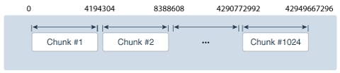
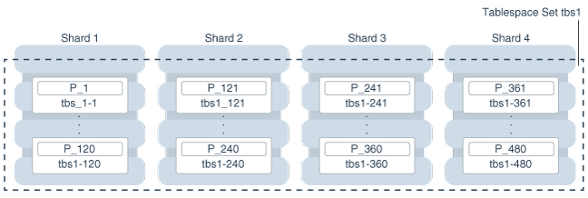
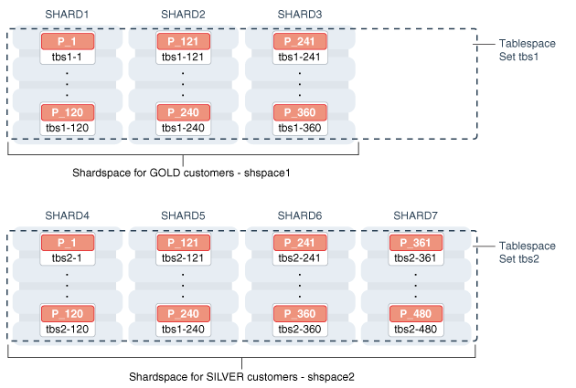
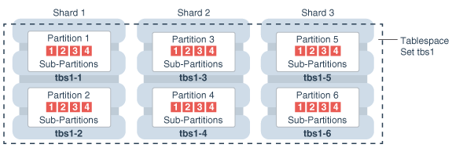

This chapter discusses the sharding methods supported by Oracle Sharding, how to choose a method, and how to use subpartitioning.

The following topics describe the sharding methods supported by Oracle Sharding:

**Parent topic:** [Sharded Database Management](shard_part.md)

### 52.1 System-Managed Sharding

System-managed sharding is a sharding method which does not require the user to specify mapping of data to shards. Data is automatically distributed across shards using partitioning by consistent hash. The partitioning algorithm evenly and randomly distributes data across shards.

The distribution used in system-managed sharding is intended to eliminate hot spots and provide uniform performance across shards. Oracle Sharding automatically maintains the balanced distribution of chunks when shards are added to or removed from an SDB.

Consistent hash is a partitioning strategy commonly used in scalable distributed systems. It is different from traditional hash partitioning. With traditional hashing, the bucket number is calculated as `HF(key) % N` where HF is a hash function and N is the number of buckets. This approach works fine if N is constant, but requires reshuffling of all data when N changes.

More advanced algorithms, such as linear hashing, do not require rehashing of the entire table to add a hash bucket, but they impose restrictions on the number of buckets, such as the number of buckets can only be a power of 2, and on the order in which the buckets can be split.

The implementation of consistent hashing used in Oracle Sharding avoids these limitations by dividing the possible range of values of the hash function (for example. from 0 to 2 <sup>32</sup>) into a set of N adjacent intervals, and assigning each interval to a chunk, as shown in the figure below. In this example, the SDB contains 1024 chunks, and each chunk gets assigned a range of 2 <sup>22</sup> hash values. Therefore partitioning by consistent hash is essentially partitioning by the range of hash values.

Figure 52-1 Ranges of Hash Values Assigned to Chunks



> This illustration shows ranges of hash values assigned to chunks using the implementation described in the paragraph preceding the illustration. Three chunks (#1, #2, and #1024) are arranged from left to right.
>
> - Chunk #1 is assigned values from 0 to 4194304
> - Chunk #2 is assigned values from 4194305 to 8388608
> - Chunk # 1024 is assigned values from 4290772992 to 4294967296


Assuming that all of the shards have the same computing power, an equal number of chunks is assigned to each shard in the SDB. For example, if 1024 chunks are created in an SDB that contains 16 shards, each shard will contain 64 chunks.

In the event of resharding, when shards are added to or removed from an SDB, some of the chunks are relocated among the shards to maintain an even distribution of chunks across the shards. The contents of the chunks does not change during this process; no rehashing takes place.

When a chunk is split, its range of hash values is divided into two ranges, but nothing needs to be done for the rest of the chunks. Any chunk can be independently split at any time.

All of the components of an SDB that are involved in directing connection requests to shards maintain a routing table that contains a list of chunks hosted by each shard and ranges of hash values associated with each chunk. To determine where to route a particular database request, the routing algorithm applies the hash function to the provided value of the sharding key, and maps the calculated hash value to the appropriate chunk, and then to a shard that contains the chunk.

The number of chunks in an SDB with system-managed sharding can be specified in the `CREATE SHARDCATALOG` command. If not specified, the default value, 120 chunks per shard, is used. Once an SDB is deployed, the number of chunks can only be changed by splitting chunks.

Before creating a sharded table partitioned by consistent hash, a set of tablespaces (one tablespace per chunk) has to be created to store the table partitions. The tablespaces are automatically created by executing the SQL statement, `CREATE TABLESPACE SET`.

All of the tablespaces in a tablespace set have the same physical attributes and can only contain Oracle Managed Files (OMF). In its simplest form, the `CREATE TABLESPACE SET` statement has only one parameter, the name of the tablespace set, for example:

```
CREATE TABLESPACE SET ts1;
```

In this case each tablespace in the set contains a single OMF file with default attributes. To customize tablespace attributes, the `USING TEMPLATE` clause (shown in the example below) is added to the statement. The `USING TEMPLATE` clause specifies attributes that apply to each tablespace in the set.

```
CREATE TABLESPACE SET ts1
USING TEMPLATE
( 
 DATAFILE SIZE 10M
 EXTENT MANAGEMENT LOCAL UNIFORM SIZE 256K
 SEGMENT SPACE MANAGEMENT AUTO
 ONLINE
)
;
```

After a tablespace set has been created, a table partitioned by consistent hash can be created with partitions stored in the tablespaces that belong to the set. The `CREATE TABLE` statement might look as follows:

```
CREATE SHARDED TABLE customers 
( cust_id     NUMBER NOT NULL
, name        VARCHAR2(50)
, address     VARCHAR2(250) 
, location_id VARCHAR2(20)
, class       VARCHAR2(3)
, signup      DATE
, CONSTRAINT cust_pk PRIMARY KEY(cust_id)
)
PARTITION BY CONSISTENT HASH (cust_id)
PARTITIONS AUTO
TABLESPACE SET ts1
;
```

`PARTITIONS AUTO` in this statement means that the number of partitions is automatically set to the number of tablespaces in the tablespace set `ts1` (which is equal to the number of chunks) and each partition will be stored in a separate tablespace.

Each tablespace in a tablespace set belongs to a distinct chunk. In the other words, a chunk can contain only one tablespace from a given tablespace set. However, the same tablespace set can be used for multiple tables that belong to the same table family. In this case, each tablespace in the set will store multiple partitions, one from each table.

Alternatively, each table in a table family can be stored in a separate tablespace set. In this case, a chunk contains multiple tablespaces, one from each tablespace set with each tablespace storing a single partition.

The following figure illustrates the relationship between partitions, tablespaces, and shards for a use case with a single sharded table. In this case, each chunk contains a single tablespace, and each tablespace stores a single partition.

Figure 52-2 System-Managed Sharding



> This illustration shows four shards (numbered 1 through 4 from left to right) surrounded by a dooted line with a callout reading “Tablespace Set tbs1”. Each of the shards contains a range of chunks, each of which contains a tablespace, which in turn contains a partition, for example:
>
> Shard 1 contains the range of chunks 1 through 120, each of which contain tablespace tbs\_1–1 through tbs\_1–120 respectively, tbs\_1–1 contains partition P\_1, and tablespace tbs\_1–120 contains partition P\_120.
>
> Shards 2, 3, and 4 each contain a range of 120 chunks, each containing a tablespace and partition with the numbering scheme: chunk n (tbs\_1–n (P\_n)).


Note:

The sharding method is specified in the `GDSCTL CREATE SHARDCATALOG` command and cannot be changed later.

**Parent topic:** Sharding Methods

### 52.2 Composite Sharding

The composite sharding method allows you to create multiple shardspaces for different subsets of data in a table partitioned by consistent hash. A shardspace is set of shards that store data that corresponds to a range or list of key values.

System-managed sharding uses partitioning by consistent hash to distribute rows across shards in a shardgroup. However, system-managed sharding does not give you any control over the assignment of data to shards.

When sharding by consistent hash on a primary key, there is often a requirement to differentiate subsets of data within an SDB in order to store them in different geographic locations, allocate to them different hardware resources, or configure high availability and disaster recovery differently. Usually this differentiation is done based on the value of another (non-primary) column, for example, customer location or a class of service.

With composite sharding, data is first partitioned by list or range across multiple shardspaces, and then further partitioned by consistent hash across multiple shards in each shardspace.

The two levels of sharding make it possible to automatically maintain balanced distribution of chunks across shards in each shardspace, and, at the same time, partition data across shardspaces.

For example, suppose you want to allocate three shards hosted on faster servers to “gold” customers and four shards hosted on slower machines to “silver” customers. Within each set of shards, customers have to be distributed using partitioning by consistent hash on customer ID.

Figure 52-3 Composite Sharding



> This illustration shows two tablespace sets: tbs1 at the top and tbs2 at the bottom.
>
> Tablespace set tbs1 is labeled “Shardspace for GOLD customers - shspace1” and it contains three shards, each of which contains a range of tablespaces and their respective partitions.
>
> Tablespace set tbs2 is labeled “Shardspace for SILVER customers - shspace2” and it contains four shards, each of which contains a range of tablespaces and their respective partitions.


Two shardspaces need to be created for such a configuration, using the following GDSCTL commands:

```
ADD SHARDSPACE –SHARDSPACE shspace1;
ADD SHARDSPACE –SHARDSPACE shspace2;

ADD SHARD –CONNECT shard1 –SHARDSPACE shspace1;
ADD SHARD –CONNECT shard2 –SHARDSPACE shspace1;
ADD SHARD –CONNECT shard3 –SHARDSPACE shspace1;

ADD SHARD –CONNECT shard4 –SHARDSPACE shspace2;
ADD SHARD –CONNECT shard5 –SHARDSPACE shspace2;
ADD SHARD –CONNECT shard6 –SHARDSPACE shspace2;
ADD SHARD –CONNECT shard7 –SHARDSPACE shspace2;
```

With composite sharding, as with the other sharding methods, tablespaces are used to specify the mapping of partitions to shards. To place subsets of data in a sharded table into different shardspaces, a separate tablespace set must be created in each shardspace as shown in the following example.

```
CREATE TABLESPACE SET tbs1 IN SHARDSPACE shspace1;
CREATE TABLESPACE SET tbs2 IN SHARDSPACE shspace2;
```

To store user-defined subsets of data in different tablespaces, Oracle Sharding provides syntax to group partitions into sets and associate each set of partitions with a tablespace set. Support for partition sets can be considered a logical equivalent of a higher level of partitioning which is implemented on top of partitioning by consistent hash.

The statement in the following example partitions a sharded table into two partition sets: gold and silver, based on class of service. Each partition set is stored in a separate tablespace. Then data in each partition set is further partitioned by consistent hash on customer ID.

```
CREATE SHARDED TABLE customers
( cust_id NUMBER NOT NULL
, name VARCHAR2(50)
, address VARCHAR2(250) 
, location_id VARCHAR2(20) 
, class VARCHAR2(3) 
, signup_date DATE 
, CONSTRAINT cust_pk PRIMARY KEY(class, cust_id) 
)
PARTITIONSET BY LIST (class) 
  PARTITION BY CONSISTENT HASH (cust_id)
  PARTITIONS AUTO
(PARTITIONSET gold VALUES (‘gld’) TABLESPACE SET tbs1,
 PARTITIONSET silver VALUES (‘slv’) TABLESPACE SET tbs2)
;
```

Note:

In Oracle Database 12c Release 2 only a single partition set from a table can be stored in a shardspace.

The sharding method is specified in the `GDSCTL CREATE SHARDCATALOG` command and cannot be changed later.

**Parent topic:** Sharding Methods

### 52.3 Using Subpartitions with Sharding

Because Oracle Sharding is based on table partitioning, all of the subpartitioning methods provided by Oracle Database are also supported for sharding.

Subpartitioning splits each partition into smaller parts and may be beneficial for efficient parallel execution within a shard, especially in the case of sharding by range or list when the number of partitions per shard may be small.

From a manageability perspective, subpartitioning makes it possible to support the tiered storage approach by putting subpartitions into separate tablespaces and moving them between storage tiers. Migration of subpartitions between storage tiers can be done without sacrificing the scalability and availability benefits of sharding and the ability to perform partition pruning and partition-wise joins on a primary key.

The following example shows system-managed sharding by consistent hash combined with subpartitioning by range.

```
CREATE SHARDED TABLE customers 
( cust_id     NUMBER NOT NULL
, name        VARCHAR2(50)
, address     VARCHAR2(250)
, location_id VARCHAR2(20)
, class       VARCHAR2(3)
, signup_date DATE
, CONSTRAINT cust_pk PRIMARY KEY(cust_id, signup_date)
)
TABLESPACE SET ts1
PARTITION BY CONSISTENT HASH (cust_id)
SUBPARTITION BY RANGE (signup_date)
SUBPARTITION TEMPLATE 
( SUBPARTITION per1 VALUES LESS THAN (TO_DATE('01/01/2000','DD/MM/YYYY')),
  SUBPARTITION per2 VALUES LESS THAN (TO_DATE('01/01/2010','DD/MM/YYYY')),
  SUBPARTITION per3 VALUES LESS THAN (TO_DATE('01/01/2020','DD/MM/YYYY')),
  SUBPARTITION future VALUES LESS THAN (MAXVALUE))
)
PARTITIONS AUTO
;
```

The following figure offers a graphical view of the table created by this statement.

Figure 52-4 Subpartitions Stored in the Tablespace of the Parent Partition



> This illustration shows a graphical view of the table created by the statement in the preceding code example. This is an example of system-managed sharding by consistent hash with subpartitioning by range.
>
> The illustration consists of three shards contained in a tablespace set tbs1.
>
> Shard 1 contains tablespaces tbs1–1 and tbs1–2, each of which contain a partition, Partition 1 and Partition 2, respectively. Subpartitions of Partition 1 are shown in boxes 1, 2, 3, and 4 inside of the Partition 1 space, and subpartitions of Partitions 2 are shown in boxes 1, 2, 3, and 4 inside of the Partition 2 space.
>
> Shards 2 and 3 follow a similar layout with four subpartitions shown contained within the parent partition in each tablespace.


In this example each subpartition is stored in the parent partition’s tablespace. Because subpartitioning is done by date, it makes more sense to store subpartitions in separate tablespaces to provide the ability to archive older data or move it to a read-only storage. The appropriate syntax is shown here.

```
CREATE SHARDED TABLE customers 
( cust_id     NUMBER NOT NULL
, name        VARCHAR2(50)
, address     VARCHAR2(250) 
, location_id VARCHAR2(20)
, class       VARCHAR2(3)
, signup_date DATE NOT NULL
 , CONSTRAINT cust_pk PRIMARY KEY(cust_id, signup_date)
)
PARTITION BY CONSISTENT HASH (cust_id)
SUBPARTITION BY RANGE(signup_date)
SUBPARTITION TEMPLATE 
( SUBPARTITION per1 VALUES LESS THAN (TO_DATE('01/01/2000','DD/MM/YYYY'))
       TABLESPACE SET ts1,
  SUBPARTITION per2 VALUES LESS THAN (TO_DATE('01/01/2010','DD/MM/YYYY'))
       TABLESPACE SET ts2,
  SUBPARTITION per3 VALUES LESS THAN (TO_DATE('01/01/2020','DD/MM/YYYY'))
       TABLESPACE SET ts3,
  SUBPARTITION future VALUES LESS THAN (MAXVALUE)) 
       TABLESPACE SET ts4
)
PARTITIONS AUTO
;
```

Note that in the case of a database that is not sharded, when tablespaces are specified in the subpartition template it means that subpartition N from every partition is stored in the same tablespace. This is different in case of sharding when subpartitions that belong to the different partitions must be stored in separate tablespaces so that they can be moved in the event of resharding.

Subpartitioning can be used with composite sharding, too. In this case data in a table is organized in three levels: partition sets, partitions, and subpartitions. Examples of the three levels of data organization are shown below.

```
CREATE SHARDED TABLE customers 
( cust_id     NUMBER NOT NULL
, name        VARCHAR2(50)
, address     VARCHAR2(250) 
, location_id VARCHAR2(20)
, class       VARCHAR2(3) NOT NULL
, signup_date DATE NOT NULL
, CONSTRAINT cust_pk PRIMARY KEY(class, cust_id, signup_date)
)
PARTITIONSET BY LIST (class)
PARTITION BY CONSISTENT HASH (cust_id)
SUBPARTITION BY RANGE (signup_date)
SUBPARTITION TEMPLATE /* applies to both SHARDSPACEs */
( SUBPARTITION per1 VALUES LESS THAN (TO_DATE('01/01/2000','DD/MM/YYYY'))
, SUBPARTITION per2 VALUES LESS THAN (TO_DATE('01/01/2010','DD/MM/YYYY'))
, SUBPARTITION per3 VALUES LESS THAN (TO_DATE('01/01/2020','DD/MM/YYYY'))
, SUBPARTITION future VALUES LESS THAN (MAXVALUE))
)
PARTITIONS AUTO
(
  PARTITIONSET gold   VALUES (‘gld’) TABLESPACE SET tbs1
, PARTITIONSET silver VALUES (‘slv’) TABLESPACE SET tbs2
)
;
```

In this example, subpartitions are stored in the tablespace of the parent partition, and the subpartition template is the same for each `PARTITIONSET`. To store subpartitions in separate tablespaces the following syntax can be used.

```
CREATE SHARDED TABLE customers 
( cust_id     NUMBER NOT NULL
, name        VARCHAR2(50)
, address     VARCHAR2(250) 
, location_id VARCHAR2(20)
, class       VARCHAR2(3) NOT NULL
, signup_date DATE NOT NULL
, CONSTRAINT cust_pk PRIMARY KEY(class, cust_id, signup_date)
)
PARTITIONSET BY LIST (class)
PARTITION BY CONSISTENT HASH (cust_id)
SUBPARTITION BY RANGE (signup_date)
PARTITIONS AUTO
 (
  PARTITIONSET gold   VALUES (‘gld’)
   SUBPARTITION TEMPLATE
   ( SUBPARTITION per1 VALUES LESS THAN (TO_DATE('01/01/2000','DD/MM/YYYY'))
      TABLESPACE SET tbs1
   , SUBPARTITION per2 VALUES LESS THAN (TO_DATE('01/01/2010','DD/MM/YYYY')) 
      TABLESPACE SET tbs2
   , SUBPARTITION per3 VALUES LESS THAN (TO_DATE('01/01/2020','DD/MM/YYYY')) 
      TABLESPACE SET tbs3
   , SUBPARTITION future VALUES LESS THAN (MAXVALUE)) 
      TABLESPACE SET tbs4 
   )
, PARTITIONSET silver VALUES (‘slv’) TABLESPACE SET ts1
   SUBPARTITION TEMPLATE
   ( SUBPARTITION per1 VALUES LESS THAN (TO_DATE('01/01/2000','DD/MM/YYYY'))
      TABLESPACE SET tbs5
   , SUBPARTITION per2 VALUES LESS THAN (TO_DATE('01/01/2010','DD/MM/YYYY')) 
      TABLESPACE SET tbs6
   , SUBPARTITION per3 VALUES LESS THAN (TO_DATE('01/01/2020','DD/MM/YYYY')) 
      TABLESPACE SET tbs7
   , SUBPARTITION future VALUES LESS THAN (MAXVALUE)) 
      TABLESPACE SET tbs8 
   )
)
;
```

**Parent topic:** Sharding Methods