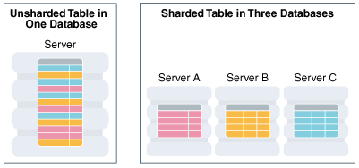
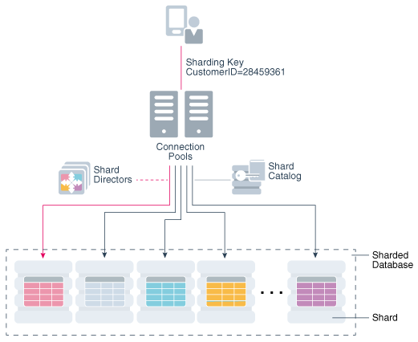

Become familiar with the concepts related to managing a sharded database with Oracle Sharding.

Oracle Sharding terminology, concepts, and benefits are described in the following topics:

**Parent topic:** [Sharded Database Management](shard_part.md)

### 49.1 About Sharding

Sharding is a data tier architecture in which data is horizontally partitioned across independent databases.

Each database is hosted on dedicated server with its own local resources - CPU, memory, flash, or disk. Each database in such configuration is called a shard. All of the shards together make up a single logical database, which is referred to as a sharded database (SDB).

Horizontal partitioning involves splitting a database table across shards so that each shard contains the table with the same columns but a different subset of rows. A table split up in this manner is also known as a sharded table.

The following figure shows a table horizontally partitioned across three shards.

Figure 49-1 Horizontal Partitioning of a Table Across Shards

> On the left is a large cylinder labeled “Server.” This cylinder contains a table with different colored rows. Underneath, the caption says “Unsharded table in 1 one database.” This graphic shows three cylinders: Server A, Server B, and Server C. Each cylinder contains a different colored table. The caption says “Shared table in 3 databases.”

Sharding is based on shared-nothing hardware infrastructure and it eliminates single points of failure because shards do not share physical resources such as CPU, memory, or storage devices. Shards are also loosely coupled in terms of software; they do not run clusterware.

Shards are typically hosted on dedicated servers. These servers can be commodity hardware or engineered systems. The shards can run on single instance or Oracle RAC databases. They can be placed on-premises, in a cloud, or in a hybrid on-premises and cloud configuration.

From the perspective of a database administrator, an SDB consists of multiple databases that can be managed either collectively or individually. However, from the perspective of the application, an SDB looks like a single database: the number of shards and distribution of data across those shards are completely transparent to database applications.

Sharding is intended for custom OLTP applications that are suitable for a sharded database architecture. Applications that use sharding must have a well-defined data model and data distribution strategy (consistent hash, range, list, or composite) that primarily accesses data using a sharding key. Examples of a sharding key include `customer_id`, `account_no`, or `country_id`.

**Parent topic:** Overview of Oracle Sharding

### 49.2 Benefits of Sharding

Sharding provides linear scalability and complete fault isolation for the most demanding OLTP applications.

Key benefits of sharding include:

- Linear Scalability. Sharding eliminates performance bottlenecks and makes it possible to linearly scale performance and capacity by adding shards.
- Fault Containment. Sharding is a shared nothing hardware infrastructure that eliminates single points of failure, such as shared disk, SAN, and clusterware, and provides strong fault isolation—the failure or slow-down of one shard does not affect the performance or availability of other shards.
- Geographical Distribution of Data. Sharding makes it possible to store particular data close to its consumers and satisfy regulatory requirements when data must be located in a particular jurisdiction.
- Rolling Upgrades. Applying configuration changes on one shard at a time does not affect other shards, and allows administrators to first test the changes on a small subset of data.
- Simplicity of Cloud Deployment. Sharding is well suited to deployment in the cloud. Shards may be sized as required to accommodate whatever cloud infrastructure is available and still achieve required service levels. Oracle Sharding supports on-premises, cloud, and hybrid deployment models.

Unlike NoSQL data stores that implement sharding, Oracle Sharding provides the benefits of sharding without sacrificing the capabilities of an enterprise RDBMS. For example, Oracle Sharding supports:

- Relational schemas
- Database partitioning
- ACID properties and read consistency
- SQL and other programmatic interfaces
- Complex data types
- Online schema changes
- Multi-core scalability
- Advanced security
- Compression
- High Availability features
- Enterprise-scale backup and recovery

**Parent topic:** Overview of Oracle Sharding

### 49.3 Components of the Oracle Sharding Architecture

Oracle Sharding is a scalability and availability feature for suitable OLTP applications. It enables distribution and replication of data across a pool of Oracle databases that share no hardware or software.

Applications perceive the pool of databases as a single logical database. Applications can elastically scale data, transactions, and users to any level, on any platform, by adding databases (shards) to the pool. Oracle Database 12c Release 2 (12.2.0.1) supports scaling up to 1000 shards.

The following figure illustrates the major architectural components of Oracle Sharding:

- Sharded database (SDB) – a single logical Oracle Database that is horizontally partitioned across a pool of physical Oracle Databases (shards) that share no hardware or software
- Shards - independent physical Oracle databases that host a subset of the sharded database
- Global service - database services that provide access to data in an SDB
- Shard catalog – an Oracle Database that supports automated shard deployment, centralized management of a sharded database, and multi-shard queries
- Shard directors – network listeners that enable high performance connection routing based on a sharding key
- Connection pools - at runtime, act as shard directors by routing database requests across pooled connections
- Management interfaces - GDSCTL (command-line utility) and Oracle Enterprise Manager (GUI)

Figure 49-2 Oracle Sharding Architecture

> The graphic shows a unidirectional flow from the customer’s client application at the top to the database shards at the bottom. The client application icon is represented with a mobile device with a person next to it. An arrow points from the client application to two server icons below it that are labeled Connection Pools. To the right of arrow between the client and the connection pools are the words "Sharding Key CustomerID=28459361."
>
> Underneath the connection pools icon are five arrows, of which the leftmost arrow is red and the remaining 4 arrows are black, pointing down to five cylinders in a row, one of which is labeled "Shard." A dashed line surrounds the shard cylinders and the line is labeled "Sharded Database" indicating that the cylinders within the dashed line are the shards in a sharded database.
>
> To the left of the arrows pointing to the shards is an icon with 3 layers labeled “Shard Directors” and there is a dashed red line with no arrow between the shard directors icon and the arrows pointing to the shards.
>
> To the right of the arrows pointing to the shards is an icon with a cylinder and a square labeled “Shard Catalog” and there is a solid grey line with no arrow between the shard catalog icon and the arrows pointing to the shards.

Sharded Database and Shards

Shards are independent Oracle databases that are hosted on database servers which have their own local resources: CPU, memory, and disk. No shared storage is required across the shards.

A sharded database is a collection of shards. Shards can all be placed in one region or can be placed in different regions. A region in the context of Oracle Sharding represents a data center or multiple data centers that are in close network proximity.

Shards are replicated for High Availability (HA) and Disaster Recovery (DR) with Oracle replication technologies such as Data Guard. For HA, the standby shards can be placed in the same region where the primary shards are placed. For DR, the standby shards are located in another region.

Global Service

A global service is an extension to the notion of the traditional database service. All of the properties of traditional database services are supported for global services. For sharded databases additional properties are set for global services — for example, database role, replication lag tolerance, region affinity between clients and shards, and so on. For a read-write transactional workload, a single global service is created to access data from any primary shard in an SDB. For highly available shards using Active Data Guard, a separate read-only global service can be created.

Shard Catalog

The shard catalog is a special-purpose Oracle Database that is a persistent store for SDB configuration data and plays a key role in centralized management of a sharded database. All configuration changes, such as adding and removing shards and global services, are initiated on the shard catalog. All DDLs in an SDB are executed by connecting to the shard catalog.

The shard catalog also contains the master copy of all duplicated tables in an SDB. The shard catalog uses materialized views to automatically replicate changes to duplicated tables in all shards. The shard catalog database also acts as a query coordinator used to process multi-shard queries and queries that do not specify a sharding key.

Using Oracle Data Guard for shard catalog high availability is a recommended best practice. The availability of the shard catalog has no impact on the availability of the SDB. An outage of the shard catalog only affects the ability to perform maintenance operations or multi-shard queries during the brief period required to complete an automatic failover to a standby shard catalog. OLTP transactions continue to be routed and executed by the SDB and are unaffected by a catalog outage.

Shard Director

Oracle Database 12c introduced the global service manager to route connections based on database role, load, replication lag, and locality. In support of Oracle Sharding, global service managers support routing of connections based on data location. A global service manager, in the context of Oracle Sharding, is known as a shard director.

A shard director is a specific implementation of a global service manager that acts as a regional listener for clients that connect to an SDB. The director maintains a current topology map of the SDB. Based on the sharding key passed during a connection request, the director routes the connections to the appropriate shard.

For a typical SDB, a set of shard directors are installed on dedicated low-end commodity servers in each region. To achieve high availability, deploy multiple shard directors. In Oracle Database 12c Release 2, you can deploy up to 5 shard directors in a given region.

The following are the key capabilities of shard directors:

- Maintain runtime data about SDB configuration and availability of shards
- Measure network latency between its own and other regions
- Act as a regional listener for clients to connect to an SDB
- Manage global services
- Perform connection load balancing

Connection Pools

Oracle Database supports connection-pooling in data access drivers such as OCI, JDBC, and ODP.NET. In Oracle 12c Release 2, these drivers can recognize sharding keys specified as part of a connection request. Similarly, the Oracle Universal Connection Pool (UCP) for JDBC clients can recognize sharding keys specified in a connection URL. Oracle UCP also enables non-Oracle application clients such as Apache Tomcat and WebSphere to work with Oracle Sharding.

Oracle clients use UCP cache routing information to directly route a database request to the appropriate shard, based on the sharding keys provided by the application. Such data-dependent routing of database requests eliminates an extra network hop, decreasing the transactional latency for high volume OLTP applications.

Routing information is cached during an initial connection to a shard, which is established using a shard director. Subsequent database requests for sharding keys within the cached range are routed directly to the shard, bypassing the shard director.

Like UCP, a shard director can process a sharding key specified in a connect string and cache routing information. However, UCP routes database requests using an already established connection, while a shard director routes connection requests to a shard. The routing cache automatically refreshes when a shard becomes unavailable or changes occur to the sharding topology. For high-performance, data-dependent routing, Oracle recommends using a connection pool when accessing data in the SDB.

Management Interfaces for an SDB

You can deploy, manage, and monitor Oracle Sharded databases with two interfaces: Oracle Enterprise Manager Cloud Control and GDSCTL.

Cloud Control enables life cycle management of a sharded database with a graphical user interface. You can manage and monitor an SDB for availability and performance, and you can do tasks such as add and deploy shards, services, shard directors, and other sharding components.

GDSCTL is a command-line interface that provides a simple declarative way of specifying the configuration of an SDB and automating its deployment. Only a few GDSCTL commands are required to create an SDB, for example:

- `CREATE SHARDCATALOG`
- `ADD GSM` and `START GSM` (create and start shard directors)
- `CREATE SHARD` (for each shard)
- `DEPLOY`

The GDSCTL `DEPLOY` command automatically creates the shards and their respective listeners. In addition, this command automatically deploys the replication configuration used for shard-level high availability specified by the administrator.

See Also:

- [Oracle Database Global Data Services Concepts and Administration Guide](https://docs.oracle.com/pls/topic/lookup?ctx=en/database/oracle/oracle-database/12.2/admin&id=GSMUG-GUID-3285C437-78F8-4339-AAAB-33DBB7A9D400) for information about global service managers, global services, and the GDSCTL commands used with Oracle Sharding
- Oracle Sharding best practices white papers in the Oracle Database section of the [Oracle MAA web page](http://www.oracle.com/goto/maa)

**Parent topic:** Overview of Oracle Sharding

### 49.4 Application Suitability for Sharding

Oracle Sharding is for OLTP applications that are suitable for a sharded database.

Existing applications that were never intended to be sharded will require some level of redesign to achieve the benefits of a sharded architecture. In some cases it may be as simple as providing the sharding key, in other cases it may be impossible to horizontally partition data and workload as required by a sharded database.

Many customer-facing web applications, such as e-commerce, mobile, and social media are well suited to sharding. Such applications have a well defined data model and data distribution strategy (hash, range, list, or composite) and primarily access data using a sharding key. Examples of sharding keys include customer ID, account number, and country\_id. Applications will also usually require partial de-normalization of data to perform well with sharding.

OLTP transactions that access data associated with a single value of the sharding key are the primary use-case for a sharded database. For example, lookup and update of a customer’s records, subscriber documents, financial transactions, e-commerce transactions, and the like. Because all of the rows that have the same value of the sharding key are guaranteed to be on the same shard, such transactions are always single-shard and executed with the highest performance and provide the highest level of consistency. Multi-shard operations are supported, but with a reduced level of performance and consistency. Such transactions include simple aggregations, reporting, and the like, and play a minor role in a sharded application relative to workloads dominated by single-shard OLTP transactions.

See Also:

[Design Considerations for Sharded Database Applications](sharding-application-development.md)

**Parent topic:** Overview of Oracle Sharding