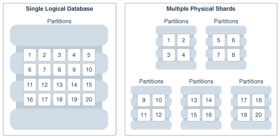
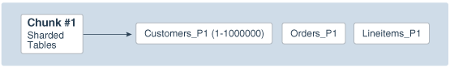
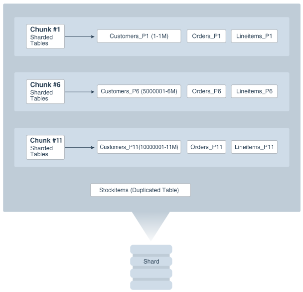

Learn about the physical organization of a sharded database.

The following topics describe the physical organization of a sharded database:

- Sharding as Distributed Partitioning  
	Sharding is a database scaling technique based on horizontal partitioning of data across multiple independent physical databases. Each physical database in such a configuration is called a shard.
- Partitions, Tablespaces, and Chunks  
	Distribution of partitions across shards is achieved by creating partitions in tablespaces that reside on different shards.

**Parent topic:** [Sharded Database Management](shard_part.md)

### 51.1 Sharding as Distributed Partitioning

Sharding is a database scaling technique based on horizontal partitioning of data across multiple independent physical databases. Each physical database in such a configuration is called a shard.

Even though a sharded database (SDB) looks like a single database to applications and application developers, from the perspective of a database administrator, it is a set of discrete Oracle databases, each of which is called a shard. A sharded table is partitioned across all shards of the SDB. Table partitions on each shard are not different from partitions that could be used in an Oracle database that is not sharded.

The following figure shows the difference between partitioning on a single logical database and partitions distributed across multiple shards.

Figure 51-1 Sharding as Distributed Partitioning

> This illustration shows the contrast between a single logical database containing 20 partitions on the left side, and on the right side of the illustration the same 20 partitions distributed among five physical databases, or shards, such that four partitions reside in each shard.

Oracle Sharding automatically distributes the partitions across shards when you execute the `CREATE SHARDED TABLE` statement, and the distribution of partitions is transparent to applications. The figure above shows the logical view of a sharded table and its physical implementation.

**Parent topic:** Physical Organization of a Sharded Database

### 51.2 Partitions, Tablespaces, and Chunks

Distribution of partitions across shards is achieved by creating partitions in tablespaces that reside on different shards.

Each partition of a sharded table is stored in a separate tablespace, making the tablespace the unit of data distribution in an SDB.

As described in [Sharded Table Family](sharding-schema-design.md), to minimize the number of multi-shard joins, corresponding partitions of all tables in a table family are always stored in the same shard. This is guaranteed when tables in a table family are created in the same set of distributed tablespaces as shown in the syntax examples where tablespace set `ts1` is used for all tables.

However, it is possible to create different tables from a table family in different tablespace sets, for example the Customers table in tablespace set `ts1` and Orders in tablespace set `ts2`. In this case, it must be guaranteed that the tablespace that stores partition 1 of Customers always resides in the same shard as the tablespace that stores partition 1 of Orders. To support this functionality, a set of corresponding partitions from all of the tables in a table family, called a chunk, is formed. A chunk contains a single partition from each table of a table family.

A chunk that contains corresponding partitions from the tables of Cutomers-Orders-LineItems schema is shown in the following figure.

Figure 51-2 Chunk as a Set of Partitions

> This illustration shows the anatomy of a chunk. On the left there is text reading “Chunk #1 Sharded Tables” with an arrow from the text that points to three boxes on the right, each of which contains a partition (P1) of a table (Customers, Orders, and Lineitems).

Each shard contains multiple chunks as shown in the following figure.

Figure 51-3 Contents of a Shard

> This illustration shows the contents of a shard, including the chunk and duplicated table objects. A box is shown at the top of the illustration, with the following objects inside, from top to bottom:
>
> - Chunk #1 of the sharded tables containing the P1 partition of tables Customers, Orders, and Lineitems
> - Chunk #6 of the sharded tables containing the P6 partition of tables Customers, Orders, and Lineitems
> - Chunk #11 of the sharded tables containing the P11 partition of tables Customers, Orders, and Lineitems
> - A duplicated table called Stockitems
>
> The box described above points to a shard object below it.

In addition to sharded tables, a shard can also contain one or more duplicated tables. Duplicated tables cannot be stored in tablespaces that are used for sharded tables.

**Parent topic:** Physical Organization of a Sharded Database