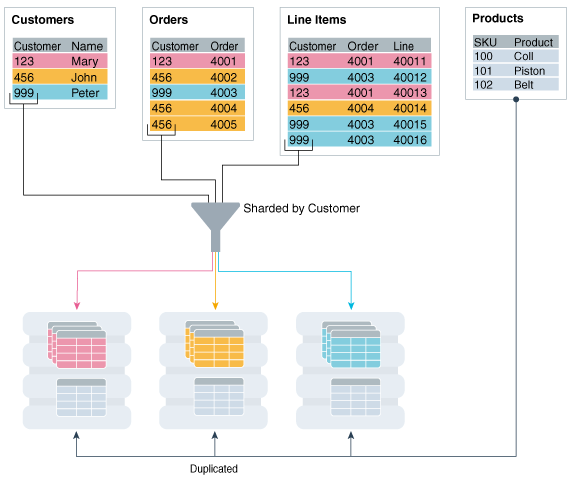

To obtain the benefits of sharding, the schema of a sharded database (SDB) should be designed in a way that maximizes the number of database requests executed on a single shard.

The following topics describe the objects used for this purpose:

**Parent topic:** [Sharded Database Management](shard_part.md)

### 50.1 Sharded Table

A sharded table is a table that is partitioned into smaller and more manageable pieces among multiple databases, called shards.

Oracle Sharding is implemented based on the Oracle Database partitioning feature. Oracle Sharding is essentially distributed partitioning because it extends partitioning by supporting the distribution of table partitions across shards.

Partitions are distributed across shards at the tablespace level, based on a sharding key. Examples of keys include customer ID, account number, and country ID. The following data types are supported for the sharding key:

- NUMBER
- INTEGER
- SMALLINT
- RAW
- (N)VARCHAR
- (N)CHAR
- DATE
- TIMESTAMP

Each partition of a sharded table resides in a separate tablespace, and each tablespace is associated with a specific shard. Depending on the sharding method, the association can be established automatically or defined by the administrator.

Even though the partitions of a sharded table reside in multiple shards, to the application the table looks and behaves exactly the same as a partitioned table in a single database. SQL statements issued by an application never have to refer to shards or depend on the number of shards and their configuration.

To specify how rows should be partitioned across shards, use the familiar SQL syntax for table partitioning. For example, the following SQL statement creates a sharded table, horizontally partitioning the table across shards based on sharding key `cust_id`:

```
CREATE SHARDED TABLE customers 
( cust_id     NUMBER NOT NULL
, name        VARCHAR2(50)
, address     VARCHAR2(250)
, region      VARCHAR2(20)
, class       VARCHAR2(3)
, signup      DATE
CONSTRAINT cust_pk PRIMARY KEY(cust_id)
)
PARTITION BY CONSISTENT HASH (cust_id)
PARTITIONS AUTO
TABLESPACE SET ts1
;
```

Tablespace Sets

The preceding table is partitioned by consistent hash, a special type of hash partitioning commonly used in scalable distributed systems. This technique automatically spreads tablespaces across shards to provide an even distribution of data and workload. Oracle Sharding creates and manages tablespaces as a unit called a tablespace set. The `PARTITIONS AUTO` clause specifies that the number of partitions should be automatically determined. This type of hashing provides more flexibility and efficiency in migrating data between shards, which is important for elastic scalability.

A tablespace is a logical unit of data distribution in an SDB. The distribution of partitions across shards is achieved by automatically creating partitions in tablespaces that reside on different shards. To minimize the number of multi-shard joins, the corresponding partitions of related tables are always stored in the same shard. Each partition of a sharded table is stored in a separate tablespace.

Chunks

The unit of data migration between shards is a chunk. A chunk is a set of tablespaces that store corresponding partitions of all tables in a table family. A chunk contains a single partition from each table of a set of related tables. This guarantees that related data from different sharded tables can be moved together. The number of chunks within each shard is specified when the SDB is created.

**Parent topic:** Sharded Database Schema Design

### 50.2 Sharded Table Family

A sharded table family is a set of tables that are sharded in the same way.

Often there is a parent-child relationship between database tables with a referential constraint in a child table (foreign key) referring to the primary key of the parent table. Multiple tables linked by such relationships typically form a tree-like structure where every child has a single parent. A set of such tables is referred to as a table family. A table in a table family that has no parent is called the root table. There can be only one root table in a table family.

Note:

In Oracle Database 12c Release 2, only a single table family is supported in an SDB.

How a Table Family Is Sharded

To illustrate sharding of a table family, consider the example of the Customers–Orders–LineItems schema. The tables in this schema may look as shown in the examples below. The three tables have a parent-child relationship, with `customers` being the root table.

`Customers` table:

```
CustNo    Name       Address        Location  Class
--------- ---------- -------------- --------- ------
123       Brown      100 Main St    us3       Gold
456       Jones      300 Pine Ave   us1       Silver
999       Smith      453 Cherry St  us2       Bronze
```

`Orders` table:

```
OrderNo   CustNo   OrderDate
--------- -------- -----------
4001      123      14-FEB-2013
4002      456      09-MAR-2013
4003      456      05-APR-2013
4004      123      27-MAY-2013
4005      999      01-SEP-2013
```

`LineItems` table:

```
LineNo  OrderNo  CustNo  StockNo    Quantity
------  -------  ------  -------    --------
40011   4001     123     05683022   1
40012   4001     123     45423609   4
40013   4001     123     68584904   1
40021   4002     456     05683022   1
40022   4002     456     45423509   3
40022   4003     456     80345330   16
40041   4004     123     45423509   1
40042   4004     123     68584904   2
40051   4005     999     80345330   12
```

The tables can be sharded by the customer number, `CustNo`, in the `Customers` table, which is the root. The shard containing data pertaining to customer 123 is shown in the following example tables.

`Customers` table:

```
CustNo    Name       Address        Location   Class
--------- ---------- -------------- ---------- ------
123       Brown      100 Main St    us3        Gold
```

`Orders` table:

```
OrderNo   CustNo   OrderDate
--------- -------- -----------
4001      123      14-FEB-2013
4004      123      27-MAY-2013
```

`LineItems` table:

```
LineNo  OrderNo  CustNo  StockNo    Quantity
------  -------  ------  -------    --------
40011   4001     123     05683022   1
40012   4001     123     45423609   4
40013   4001     123     68584904   1
40041   4004     123     45423509   1
40042   4004     123     68584904   2
```

Creating a Sharded Table Family Using CREATE TABLE

The recommended way to create a sharded table family is to specify parent-child relationships between tables using reference partitioning.

The appropriate `CREATE TABLE` statements for Customers–Orders–LineItems schema are shown below. The first statement creates the root table of the table family – Customers.

```
CREATE SHARDED TABLE Customers 
( CustNo      NUMBER NOT NULL
, Name        VARCHAR2(50)
, Address     VARCHAR2(250) 
, CONSTRAINT RootPK PRIMARY KEY(CustNo)
)
PARTITION BY CONSISTENT HASH (CustNo)
PARTITIONS AUTO
TABLESPACE SET ts1
;
```

The following two statements create `Orders` and `LineItems` tables which are a child and grandchild of `Customers`.

```
CREATE SHARDED TABLE Orders 
( OrderNo   NUMBER NOT NULL
, CustNo    NUMBER NOT NULL
, OrderDate DATE
, CONSTRAINT OrderPK PRIMARY KEY (CustNo, OrderNo)
, CONSTRAINT CustFK  FOREIGN KEY (CustNo) REFERENCES Customers(CustNo) 
)
PARTITION BY REFERENCE (CustFK)
;
```
```
CREATE SHARDED TABLE LineItems 
( CustNo    NUMBER NOT NULL
, LineNo    NUMBER(2) NOT NULL
, OrderNo   NUMBER(5) NOT NULL
, StockNo   NUMBER(4)
, Quantity  NUMBER(2)
, CONSTRAINT LinePK  PRIMARY KEY (CustNo, OrderNo, LineNo)
, CONSTRAINT LineFK  FOREIGN KEY (CustNo, OrderNo) REFERENCES Orders(CustNo, OrderNo)
)
PARTITION BY REFERENCE (LineFK)
;
```

In the example statements above, corresponding partitions of all tables in the family are stored in the same tablespace set – TS1. However, it is possible to specify separate tablespace sets for each table.

Partitioning by reference simplifies the syntax since the partitioning scheme is only specified for the root table. Also, partition management operations that are performed on the root table are automatically propagated to its descendents. For example, when adding a partition to the root table, a new partition is created on all its descendents.

Note that in the example statements above, the partitioning column CustNo used as the sharding key is present in all three tables. This is despite the fact that reference partitioning, in general, allows a child table to be equi-partitioned with the parent table without having to duplicate the key columns in the child table. The reason for this is that reference partitioning requires a primary key in a parent table because the primary key must be specified in the foreign key constraint of a child table used to link the child to its parent. However, a primary key on a sharded table must either be the same as the sharding key, or contain the sharding key as the leading column. This makes it possible to enforce global uniqueness of a primary key without coordination with other shards – a critical requirement for linear scalability.

To summarize, the use of reference-partitioned tables in a sharded database requires adhering to the following rules:

- A primary key on a sharded table must either be the same as the sharding key, or another column(s) prefixed by the sharding key. This is required to enforce global uniqueness of a primary key without coordination with other shards.
- Reference partitioning requires a primary key in a parent table, because the primary key must be specified in the foreign key constraint of a child table to link the child to its parent. For example, to link the LineItems (child) table to the Orders (parent) table, you need a primary key in Orders. The second rule implies that the primary key in Orders is prefixed by the CustNo value. (This is an existing partitioning rule not specific to Oracle Sharding.)

In some cases it is impossible or undesirable to create primary and foreign key constraints that are required for reference partitioning. For such cases, specifying parent-child relationships in a table family requires that all tables are explicitly equi-partitioned and each child table is created with the `PARENT` clause in `CREATE SHARDED TABLE` that contains the name of its parent. An example of the syntax is shown below.

```
CREATE SHARDED TABLE Customers 
( CustNo      NUMBER NOT NULL
, Name        VARCHAR2(50)
, Address     VARCHAR2(250) 
, region      VARCHAR2(20)
, class       VARCHAR2(3)
, signup      DATE
)
PARTITION BY CONSISTENT HASH (CustNo)
PARTITIONS AUTO
TABLESPACE SET ts1
;

CREATE SHARDED TABLE Orders 
( OrderNo   NUMBER
, CustNo    NUMBER
, OrderDate DATE
)
PARENT Customers
PARTITION BY CONSISTENT HASH (CustNo)
PARTITIONS AUTO
TABLESPACE SET ts1
;

CREATE SHARDED TABLE LineItems 
( LineNo    NUMBER
, OrderNo   NUMBER
, CustNo    NUMBER
, StockNo   NUMBER
, Quantity  NUMBER
)
)
PARENT Customers
PARTITION BY CONSISTENT HASH (CustNo)
PARTITIONS AUTO
TABLESPACE SET ts1
;
```

Because the partitioning scheme is fully specified in all of the `CREATE SHARDED TABLE` statements, any table can be independently subpartitioned. This is not permitted with reference partitioning where subpartitions can only be specified for the root table and the subpartitioning scheme is the same for all tables in a table family.

Note that this method only supports two-level table families, that is, all children must have the same parent and grandchildren cannot exist. This is not a limitation as long as the partitioning column from the parent table exists in all of the child tables.

Note:

In Oracle Database 12c Release 2, only a single table family is supported in an SDB.

### 50.3 Duplicated Tables

In addition to sharded tables, an SDB can contain tables that are duplicated on all shards.

For many applications, the number of database requests handled by a single shard can be maximized by duplicating read-only or read-mostly tables across all shards. This strategy is a good choice for relatively small tables that are often accessed together with sharded tables. A table with the same contents in each shard is called a duplicated table.

An SDB includes both sharded tables that are horizontally partitioned across shards, and duplicated tables that are replicated to all shards. Duplicated tables contain reference information, for example, a Stock Items table that is common to each shard. The combination of sharded and duplicated tables enables all transactions associated with a sharding key to be processed by a single shard. This technique enables linear scalability and fault isolation.

As an example of the need for a duplicated table, consider the table family that is described in Sharded Table Family. The database schema might also include a `Products` table which contains data that is shared by all the customers in the shards that were created for this table family, and it cannot be sharded by the customer number. To prevent multi-shard queries during order processing, the entire table must be duplicated on all shards.

The difference between sharded tables (Customers, Orders, and LineItems) and a duplicated table (Products) is shown in the following figure.

Figure 50-1 Sharded Tables and a Duplicated Table in an SDB



> The image admin\_3v\_138d shows how the Customers, Orders and Line Items tables are sharded by the Customer key into shards, each containing the rows from those tables pertaining to a single customer. The image also shows a Products table which is duplicated on all of the shards, so all of the rows from that table appear in each shard.


Creating a Duplicated Table Using CREATE TABLE

The duplicated Products table can be created using the following statement.

```
CREATE DUPLICATED TABLE Products 
( StockNo     NUMBER PRIMARY KEY
, Description VARCHAR2(20)
, Price       NUMBER(6,2))
)
;
```

Synchronizing the Contents of Duplicated Tables

Oracle Sharding synchronizes the contents of duplicated tables using Materialized View Replication. A duplicated table on each shard is represented by a read-only materialized view. The master table for the materialized views is located in the shard catalog. The `CREATE DUPLICATED TABLE` statement automatically creates the master table, materialized views, and other objects required for materialized view replication.

The materialized views on all of the shards are automatically refreshed at a configurable frequency. The refresh frequency of all duplicated tables is controlled by the database initialization parameter `SHRD_DUPL_TABLE_REFRESH_RATE`. The default value for the parameter is 60 seconds.

See Also:

[Read-Only Materialized View Concepts](read-only-materialized-view-concepts.md)

**Parent topic:** Sharded Database Schema Design

### 50.4 Non-Table Objects Created on All Shards

In addition to duplicated tables, other schema objects, such as users, roles, views, indexes, synonyms, functions, procedures, and packages, and non-schema database objects, such as tablespaces, tablespace sets, directories, and contexts, can be created on all shards.

Unlike tables, which require an extra keyword in the `CREATE` statement— `SHARDED` or `DUPLICATED` —other objects are created on all shards using existing syntax. The only requirement is that the `SHARD DDL` session property must be enabled.

Note that automatic creation on all shards of the following objects is not supported in this release. These objects can be created by connecting to individual shards.

- Cluster
- Control file
- Database link
- Disk group
- Edition
- Flashback archive
- Materialized log
- Materialized view
- Materialized zone map
- Outline
- Pfile
- Profile
- Restore point
- Rollback segment
- Summary

**Parent topic:** Sharded Database Schema Design

### 50.5 DDL Execution in a Sharded Database

To create a schema in an SDB, you must issue DDL commands on the shard catalog database, which validates the DDLs and executes them locally first. Therefore, the shard catalog database contains local copies of all of the objects that exist in the sharded database, and serves as the master copy of the SDB schema. If the catalog validation and execution of DDLs are successful, the DDLs are automatically propagated to all of the shards and applied in the order in which they were issued on the shard catalog.

If a shard is down or not accessible during DDL propagation, the catalog keeps track of DDLs that could not be applied to the shard, and then applies them when the shard is back up. When a new shard is added to an SDB, all of the DDLs that have been executed in the SDB are applied in the same order to the shard before it becomes accessible to clients.

There are two ways you can issue DDLs in an SDB:

- Use the GDSCTL `sql` command.
	When you issue a DDL this way, GDSCTL waits until all of the shards have finished executing the DDL and returns the status of the execution. For example
	```
	GDSCTL> sql “create tablespace set tbsset”
	```
- Connect to the shard catalog database using SQL\*Plus using the `GDS$CATALOG.sdbname` service. For example
	```
	SQL> create tablespace set tbsset;
	```
	When you issue a DDL command on the shard catalog database, it returns the status when it finishes executing locally, but the propagation of the DDL to all of the shards happens in the background asynchronously.

Verifying DDL Propagation

You can check the status of the DDL propagation to the shards by using the GDSCTL `show ddl` and `config shard` commands. This check is mandatory when a DDL is executed using SQL\*Plus on the shard catalog, because this method does not return the execution status on all of the shards. When a DDL fails on a shard, all further DDLs on that shard are blocked until the failure is resolved and the GDSCTL `recover shard` command is executed. Note that the user must have GSM\_ADMIN privileges to execute these GDSCTL commands.

Creating Objects Locally and Globally

When a DDL to create an object is issued using the GDSCTL `sql` command, the object is created on all of the shards. A master copy of the object is also created in the shard catalog database. An object that exists on all shards, and the catalog database, is called an SDB object.

When connecting to the shard catalog using SQL\*Plus, two types of objects can be created: SDB objects and local objects. Local objects are traditional objects that exist only in the shard catalog. Local objects can be used for administrative purposes, or they can be used by multi-shard queries originated from the catalog database, to generate and store a report, for example.

The type of object (SDB or local) that is created in a SQL\*Plus session depends on whether the `SHARD DDL` mode is enabled in the session. This mode is enabled by default on the shard catalog database for the SDB user – a user that exists on all of the shards and the shard catalog database. All of the objects created while `SHARD DDL` is enabled in a session are SDB objects. To create a local object, the SDB user must first run `alter session disable shard ddl`. All of the objects created while `SHARD DDL` is disabled are local objects. To enable `SHARD DDL` in the session, the SDB user must run `alter session enable shard ddl`.

See ALTER SESSION for more information about the `SHARD DDL` session parameter.

Creating the SDB User to Create Schema Objects

Local users that only exist in the shard catalog database do not have the privileges to create schema objects in the SDB. Therefore, the first step of creating the SDB schema is to create the SDB user, by connecting to the shard catalog database as SYSDBA, enabling `SHARD DDL`, and executing the `CREATE USER` command. When the SDB user connects to the catalog database, the `SHARD DDL` mode is enabled by default.

Note:

Local users can create non-schema SDB objects, such as tablespaces, directories, and contexts, if they enable `SHARD DDL` mode; however, they cannot create schema SDB objects, such as tables, views, indexes, functions, procedures, and so on.

DDL Execution Examples

The following examples demonstrate the steps to issue a DDL, check its execution status, and what to do when errors are encountered. The examples are given for the case when a DDL is issued using SQL\*Plus, but the same status checking and corrective actions apply when using the GDSCTL `sql` command.

Example 50-1 A DDL execution error on the shard catalog

In this example the user makes a typo in the `CREATE USER` command.

```
SQL> alter session enable shard ddl;
Session altered.

SQL> CREATE USER example_user IDENTRIFIED BY out_standing1;
CREATE USER example_user IDENTRIFIED BY out_Standing1
                   *
ERROR at line 1:
ORA-00922: missing or invalid option
```

The DDL fails to execute on the shard catalog and, as expected, the GDSCTL `show ddl` command shows that no DDL was executed on any of the shards:

```
GDSCTL> show ddl
id      DDL Text                         Failed shards 
--      --------                         -------------
```

Then the user repeats the command with the correct spelling. Note that there is no need to run `alter session enable shard ddl` again because the same session is used.

```
SQL> CREATE USER example_user IDENTIFIED BY out_Standing1;
User created.
```

Now `show ddl` shows that the DDL has been successfully executed on the shard catalog database and it did not fail on any shards that are online.

```
GDSCTL> show ddl
id      DDL Text                           Failed shards 
--      --------                           ------------- 
1       create user example_user identified by *****
```

Note:

For any shard that is down at the time of the DDL execution, the DDL is automatically applied when the shard is back up.

Example 50-2 Recovery from an error on a shard by executing a corrective action on that shard

In this example, the user attempts to create a tablespace set for system-managed sharded tables. But the datafile directory on one of the shards is not writable, so the DDL is successfully executed on the catalog, but fails on the shard.

```
SQL> connect example_user/ out_Standing1
Connected

SQL> create tablespace set tbsset;
Tablespace created.
```

Note that there is no need to run `alter session enable shard ddl` because the user example\_user was created as the SDB user and shard ddl is enabled by default.

Check status using GDSCTL `show ddl`:

```
GDSCTL> show ddl
id      DDL Text                                 Failed shards 
--      --------                                 ------------- 
1       create user example_user identified by *****
2       create tablespace set tbsset             shard01
```

The command output shows that the DDL failed on the shard shard01. Run the GDSCTL `config shard` command to get detailed information:

```
GDSCTL> config shard -shard shard01
Conversion = ':'Name: shard01
Shard Group: dbs1
Status: Ok
State: Deployed
Region: east
Connection string: (DESCRIPTION=(ADDRESS=(HOST=shard01-host)(PORT=1521)(PROTOCOL=tcp))(CONNECT_DATA=(SID=shard01)))
SCAN address: 
ONS remote port: 0
Disk Threshold, ms: 20
CPU Threshold, %: 75
Version: 12.2.0.0
Failed DDL: create tablespace set tbsset
DDL Error: ORA-02585: create tablepsace set failure, one of its tablespaces not created
ORA-01119: error in creating database file \'/ade/b/3667445372/oracle/rdbms/dbs/SHARD01/datafile/o1_mf_tbsset_%u_.dbf\'
ORA-27040: file create error, unable to create file
Linux-x86_64 Error: 13: Permission denied
Additional information: 1 \(ngsmoci_execute\) 
Failed DDL id: 2
Availability: ONLINE
```

The text beginning with “Failed DDL:” indicates the problem. To resolve it, the user must log in to the shard database host and make the directory writable.

Display the permissions on the directory:

```
cd $ORACLE_HOME/rdbms/dbs 
 ls –l ../ | grep dbs
dr-xr-xr-x  4 oracle dba    102400 Jul 20 15:41 dbs/
```

Change the directory to writable:

```
chmod +w .
ls –l ../ | grep dbs
drwxrwxr-x  4 oracle dba    102400 Jul 20 15:41 dbs/
```

Go back to the GDSCTL console and issue the `recover shard` command:

```
GDSCTL> recover shard -shard shard01
```

Check the status again:

```
GDSCTL> show ddl
id      DDL Text                                 Failed shards 
--      --------                                 ------------- 
1       create user example_user identified by *****
2       create tablespace set tbsset

GDSCTL> config shard -shard shard01
Conversion = ':'Name: shard01
Shard Group: dbs1
Status: Ok
State: Deployed
Region: east
Connection string: (DESCRIPTION=(ADDRESS=(HOST=shard01-host)(PORT=1521)(PROTOCOL=tcp))(CONNECT_DATA=(SID=shard01)))
SCAN address: 
ONS remote port: 0
Disk Threshold, ms: 20
CPU Threshold, %: 75
Version: 12.2.0.0
Last Failed DDL: 
DDL Error: ---
DDL id: 
Availability: ONLINE
```

As shown above, the failed DDL error no longer appears.

Example 50-3 Recovery from an error on a shard by executing a corrective action on all other shards

In this example, the user attempts to create another tablespace set, tbs\_set, but the DDL fails on a shard because there is already an existing local tablespace with the same name.

On the shard catalog:

```
SQL> create tablespace set tbs_set;
Tablespace created.
```

Check status using the GDSCTL `show ddl` command:

```
GDSCTL> show ddl
id      DDL Text                                 Failed shards 
--      --------                                 ------------- 
1       create user example_user identified by *****
2       create tablespace set tbsset 
3       create tablespace set tbs_set            shard01  

GDSCTL> config shard -shard shard01
Conversion = ':'Name: shard01
……
Failed DDL: create tablespace set tbs_set
DDL Error: ORA-02585: create tablespace set failure, one of its tablespaces not created
ORA-01543: tablespace \'TBS_SET\' already exists \(ngsmoci_execute\)
```

A solution to this problem is to login to shard01 as a local database administrator, drop the tablespace TBS\_SET, and then run GDSCTL `recover shard -shard shard01`. But suppose you want to keep this tablespace, and instead choose to drop the newly created tablespace set that has the name conflict and create another tablespace set with a different name, such as tbsset2. The following example shows how to do that on the shard catalog:

```
SQL> drop tablespace set tbs_set;
SQL> create tablespace set tbs_set2;
```

Check status using GDSCTL:

```
GDSCTL> show ddl
id      DDL Text                               Failed shards 
--      --------                               ------------- 
1       create user example_user identified by *****
2       create tablespace set tbsset             
3       create tablespace set tbs_set          shard01  
4       drop tablespace set tbs_set
5       create tablespace set tbsset2
```

You can see that DDLs 4 and 5 are not attempted on shard01 because DDL 3 failed there. To make this shard consistent with the shard catalog, you must run the GDSCTL `recover shard` command. However, it does not make sense to execute DDL 3 on this shard because it will fail again and you actually do not want to create tablespace set tbs\_set anymore. To skip DDL 3 run `recover shard` with the `–ignore_first` option:

```
GDSCTL> recover shard -shard shard01 –ignore_first
GSM Errors: dbs1 shard01:ORA-00959: tablespace \'TBS_SET\' does not exist (ngsmoci_execute)

GDSCTL> show ddl
id      DDL Text                               Failed shards 
--      --------                               ------------- 
1       create user sidney identified by *****
2       create tablespace set tbsset             
3       create tablespace set tbs_set            
4       drop tablespace set tbs_set            shard01  
5       create tablespace set tbsset2
```

There is no failure with DDL 3 this time because it was skipped. However, the next DDL (4 - drop tablespace set tbs\_set) was applied and resulted in the error because the tablespace set to be dropped does not exist on the shard.

Because the `–ignore_first` option only skips the first DDL, you need to execute `recover shard` again to skip the `drop` statement as well:

```
GDSCTL> recover shard -shard shard01 –ignore_first

GDSCTL> show ddl
id      DDL Text                               Failed shards 
--      --------                               -------------
1       create user sidney identified by *****
2       create tablespace set tbsset             
3       create tablespace set tbs_set          
4       drop tablespace set tbs_set
5       create tablespace set tbsset2
```

Note that there are no longer any failures shown, and all of the DDLs were applied successfully on the shards.

When `recover shard` is run with the `–ignore_first` option, the failed DDL is marked to be ignored during incremental deployment. Therefore, DDL numbers 3 and 4 are skipped when a new shard is added to the SDB, and only DDL numbers 1 and 5 are applied.

**Parent topic:** Sharded Database Schema Design

### 50.6 DDL Syntax Extensions for the Sharded Database

Oracle Sharding introduces changes to the SQL DDL statements. DDL statements with this syntax can only be executed against a sharded database.

Note that no changes to query and DML statements are required to support Oracle Sharding, and the changes to the DDL statement are very limited. Most existing DDL statements will work the same way on a sharded database with the same syntax and semantics as they do on a regular Oracle Database.

CREATE TABLESPACE SET

This is a new statement introduced for Oracle Sharding. Its syntax is similar to `CREATE TABLESPACE`.

```
CREATE TABLESPACE SET tablespace_set 
       [IN SHARDSPACE shardspace]
              [USING TEMPLATE (
    { MINIMUM EXTENT size_clause
    | BLOCKSIZE integer [ K ]
    | logging_clause
    | FORCE LOGGING
    | ENCRYPTION tablespace_encryption_spec
    | DEFAULT [ table_compression ] storage_clause
    | { ONLINE | OFFLINE }
    | extent_management_clause
    | segment_management_clause
    | flashback_mode_clause
    }...
   )];
```

The statement creates a tablespace set that can be used as a logical storage unit for one or more sharded tables and indexes. A tablespace set consists of multiple Oracle tablespaces distributed across shards in a shardspace.

Note that in system-managed sharding there is only one default shardspace in the sharded database. The number of tablespaces in a tablespace set is determined automatically and is equal to the number of chunks in the corresponding shardspace.

All tablespaces in a tablespace set are bigfile and have the same properties. The properties are specified in the `USING TEMPLATE` clause. This clause is the same as `permanent_tablespace_clause` for a typical tablespace, with the exception that a datafile name cannot be specified in the `datafile_tempfile_spec` clause. The datafile name for each tablespace in a tablespace set is generated automatically.

Note that a tablespace set can only consist of permanent tablespaces, there is no system, undo, or temporary tablespace set.

Example

```
CREATE TABLESPACE SET TSP_SET_1 IN SHARDSPACE sgr1 
USING TEMPLATE
( DATAFILE SIZE 100m
  EXTEND MANAGEMENT LOCAL
  SEGMENT SPACE MANAGEMENT AUTO
);
```

ALTER TABLESPACE SET

The shardspace property of a tablespace set cannot be modified. All other attributes of a tablespace set can be altered just as for a regular permanent tablespace. Because tablespaces in a tablespace set are bigfile, the `ADD DATAFILE` and `DROP DATAFILE` clauses are not supported.

DROP TABLESPACE SET and PURGE TABLESPACE SET

The syntax and semantics for these statements are similar to `DROP` and `PURGE TABLESPACE` statements.

CREATE TABLE

This statement has been extended to allow for creation of sharded and duplicated tables and specification of a table family.

Syntax

```
CREATE [ { GLOBAL TEMPORARY | SHARDED | DUPLICATED} ] 
         TABLE [ schema. ] table
      { relational_table | object_table | XMLType_table }
          [ PARENT [ schema. ] table ] ;
```

The following parts of the `CREATE TABLE` statement are intended to support Oracle Sharding:

- The `SHARDED` and `DUPLICATED` keywords indicate that the table content is either partitioned across shards or duplicated on all shards respectively. The `DUPLICATED` keyword is the only syntax change to create duplicated tables. All other changes described below apply only to sharded tables.
- The `PARENT` clause links a sharded table to the root table of its table family.
- To create a sharded table, `TABLESPACE SET` is used instead of `TABLESPACE`. All clauses that contain `TABLESPACE` are extended to contain `TABLESPACE SET`.
- Three clauses: `consistent_hash_partitions`, `consistent_hash_with_subpartitions`, and `partition_set_clause` in the `table_partitioning_clauses`.
	```
	table_partitioning_clauses ::=
	{range_partitions
	| hash_partitions
	| list_partitions
	| composite_range_partitions
	| composite_hash_partitions
	| composite_list_partitions
	| reference_partitioning
	| system_partitioning
	| consistent_hash_partitions
	| consistent_hash_with_subpartitions
	| partition_set_clause
	}
	```

Limitations for sharded tables in the current release:

- There is no default tablespace set for sharded tables.
- A temporary table cannot be sharded or duplicated.
- Index-organized sharded tables are not supported.
- A sharded table cannot contain a nested table column or an identity column.
- A primary key constraint defined on a sharded table must contain the sharding column(s). A foreign key constraint on a column of a sharded table referencing a duplicated table column is not supported.
- System partitioning and interval range partitioning are not supported for sharded tables. Specification of individual hash partitions is not supported for partitioning by consistent hash.
- A column in a sharded table used in `PARTITION BY` or `PARTITIONSET BY` clauses cannot be a virtual column.

Duplicated tables in the current release are not supported with the following:

- System and reference partitioned tables
- LONG data type
- Maximum number of columns without primary key is 999
- The `nologging`, `parallel`, `inmemory` options
- XMLType column in a duplicated table cannot be used in non-ASSM tablespace

Example

```
CREATE SHARDED TABLE customers 
( cust_id     NUMBER NOT NULL
, name        VARCHAR2(50)
, address     VARCHAR2(250) 
, location_id VARCHAR2(20)
, class       VARCHAR2(3)
, signup_date DATE
,
CONSTRAINT cust_pk PRIMARY KEY(cust_id)
)
PARTITIONSET BY LIST (class)
PARTITION BY CONSISTENT HASH (cust_id)
PARTITIONS AUTO
(PARTITIONSET gold   VALUES (‘gld’) TABLESPACE SET ts2,
 PARTITIONSET silver VALUES (‘slv’) TABLESPACE SET ts1)
;
```

ALTER TABLE

The following options are not supported for a sharded table:

- rename
- add foreign key constraint
- all operations on individual partitions
- all partition-related operations on the shard except:

The following are not supported for duplicated tables:

- rename table
- rename column/column type
- add/modify column
- add/modify constraint
- drop column
- modify/rename column type
- truncate table
- truncate partition
- drop partition/subpartition
- enabling nologging, parallel and inmemory options

ALTER SESSION

The session-level `SHARD DDL` parameter sets the scope for DDLs issued against the shard catalog database.

```
ALTER SESSION { ENABLE | DISABLE } SHARD DDL
```

When `SHARD DDL` is enabled, all DDLs issued in the session are executed on the shard catalog and all shards. When `SHARD DDL` is disabled, a DDL is executed only against the shard catalog database. `SHARD DDL` is enabled by default for an SDB user (the user that exists on all shards and the catalog). To create an SDB user, the `SHARD DDL` parameter must be enabled before running `CREATE USER`.

**Parent topic:** Sharded Database Schema Design