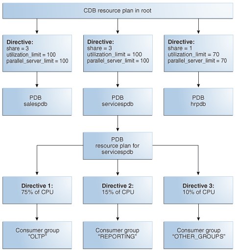

You can use PL/SQL package procedures to administer Oracle Resource Manager (Resource Manager) to allocate resources to pluggable databases (PDBs) in a multitenant container database (CDB).

Before using Resource Manager for PDBs, meet the following requirements:

- You understand how to configure and manage a CDB. See " [Managing a Multitenant Environment](managing-a-multitenant-environment.md) " for information.
- You understand how to use Oracle Resource Manager to allocate resources in a non-CDB. See " [Managing Resources with Oracle Database Resource Manager](managing-resources-with-oracle-database-resource-manager.md) " for information.

Note:

- You can complete the tasks in this chapter using SQL\*Plus or Oracle SQL Developer.
- You can also administer the Resource Manager with the graphical user interface of Oracle Enterprise Manager Cloud Control (Cloud Control). For instructions about administering Resource Manager in a CDB with Cloud Control, see " [Using Oracle Resource Manager for PDBs with Cloud Control](using-oracle-resource-manager-for-pdbs-with-cloud-control.md) " and the Cloud Control online help.
- For simplicity, this chapter refers to PDBs, application roots, and application PDBs as “PDBs.”

- About Using Oracle Resource Manager with CDBs and PDBs  
	You can create CDB resource plans and PDB resource plans to manage resources for CDBs and PDBs.
- Prerequisites for Using Resource Manager with a CDB  
	You must meet prerequisites before using Resource Manager with a CDB.
- Creating a CDB Resource Plan for Individual PDBs  
	You use the `DBMS_RESOURCE_MANAGER` package to create a CDB resource plan for individual PDBs and define the directives for the plan.
- Creating a CDB Resource Plan with PDB Performance Profiles  
	You use the `DBMS_RESOURCE_MANAGER` package to create a CDB resource plan for PDB performance profiles and define the directives for the plan. Each PDB that uses a profile adopts the CDB resource plan for that profile.
- Enabling and Disabling a CDB Resource Plan  
	A CDB resource plan manages the workloads for multiple PDBs that are contending for system and CDB resources. You can enable or disable a CDB resource plan.
- Creating a PDB Resource Plan  
	You create a PDB resource plan in the same way that you create a resource plan for a non-CDB. You use procedures in the `DBMS_RESOURCE_MANAGER` PL/SQL package to create the plan.
- Enabling and Disabling a PDB Resource Plan  
	A PDB resource plan manages the workloads within a single PDB. You can enable or disable a PDB resource plan.
- Maintaining Plans and Directives in a CDB  
	This section provides instructions for maintaining CDB resource plans, the default directive for PDBs, the autotask directive, and PDB resource plans. You perform maintenance tasks using the `DBMS_RESOURCE_MANAGER` PL/SQL package.
- Viewing Information About Plans and Directives in a CDB  
	You can view information about CDB resource plans, CDB resource plan directives, and predefined resource plans in a CDB.
- Monitoring PDBs Managed by Oracle Database Resource Manager  
	A set of dynamic performance views enables you to monitor the results of your Oracle Database Resource Manager settings for PDBs.

**Parent topic:** [Managing a Multitenant Environment](managing-a-multitenant-environment.md)

### 46.1 About Using Oracle Resource Manager with CDBs and PDBs

You can create CDB resource plans and PDB resource plans to manage resources for CDBs and PDBs.

- About Managing Resources at the CDB Level and PDB Level  
	In a non-CDB, you can use Resource Manager to manage multiple workloads that are contending for system and database resources. However, in a CDB, you can have multiple workloads within multiple PDBs competing for system and CDB resources.
- What Solutions Does Resource Manager Provide for a CDB?  
	Resource Manager can provide more efficient use of resources for a CDB.
- CDB Resource Plans  
	In a CDB, PDBs might have different levels of priority. You can create CDB resource plans to distribute resources to different PDBs based on these priorities.
- PDB Resource Plans  
	A CDB resource plan determines the amount of resources allocated to each PDB. A PDB resource plan determines how the resources allocated to a specific PDB are allocated to consumer groups within that PDB.
- Background and Administrative Tasks and Consumer Groups  
	In a CDB, background and administrative tasks are mapped to the Resource Manager consumer groups that run them optimally.
- Initialization Parameters That Control Memory for PDBs  
	Several initialization parameters can control the memory usage of a PDB.
- Initialization Parameters That Limit I/O for PDBs  
	You can set the `MAX_IOPS` initialization parameter and the `MAX_MBPS` initialization parameter to limit the disk I/O generated by a PDB.

**Parent topic:** Using Oracle Resource Manager for PDBs with SQL\*Plus

#### 46.1.1 About Managing Resources at the CDB Level and PDB Level

In a non-CDB, you can use Resource Manager to manage multiple workloads that are contending for system and database resources. However, in a CDB, you can have multiple workloads within multiple PDBs competing for system and CDB resources.

In a CDB, Resource Manager can manage resources on two basic levels:

- CDB level - Resource Manager can manage the workloads for multiple PDBs that are contending for system and CDB resources. You can specify how resources are allocated to PDBs, and you can limit the resource utilization of specific PDBs.
- PDB level - Resource Manager can manage the workloads within each PDB.

Resource Manager allocates the resources in two steps:

1. It allocates a portion of the system's resources to each PDB.
2. In a specific PDB, it allocates a portion of system resources obtained in Step 1 to each session connected to the PDB.

Note:

All activity in the root is automatically managed by Resource Manager.

**Parent topic:** About Using Oracle Resource Manager with CDBs and PDBs

#### 46.1.2 What Solutions Does Resource Manager Provide for a CDB?

Resource Manager can provide more efficient use of resources for a CDB.

When resource allocation decisions for a CDB are left to the operating system, you may encounter the following problems with workload management:

- Inappropriate allocation of resources among PDBs
	The operating system distributes resources equally among all active processes and cannot prioritize one task over another. Therefore, one or more PDBs might use an inordinate amount of the system resources, leaving the other PDBs starved for resources.
- Inappropriate allocation of resources within a single PDB
	One or more sessions connected to a single PDB might use an inordinate amount of the system resources, leaving other sessions connected to the same PDB starved for resources.
- Inconsistent performance of PDBs
	A single PDB might perform inconsistently when other PDBs are competing for more system resources or less system resources at various times.
- Lack of resource usage data for PDBs
	Resource usage data is critical for monitoring and tuning PDBs. It might be possible to use operating system monitoring tools to gather the resource usage data for a non-CDB if it is the only database running on the system. However, in a CDB, operating system monitoring tools are no longer as useful because there are multiple PDBs running on the system.

Resource Manager helps to overcome these problems by allowing the CDB more control over how hardware resources are allocated among the PDBs and within PDBs.

In a CDB with multiple PDBs, some PDBs typically are more important than others. The Resource Manager enables you to prioritize and limit the resource usage of specific PDBs.

With the Resource Manager, you can:

- Specify that different PDBs should receive different shares of the system resources so that more resources are allocated to the more important PDBs
- Limit the CPU usage of a particular PDB
- Limit the number of parallel execution servers that a particular PDB can use
- Limit the memory usage of a particular PDB
- Specify the amount of memory guaranteed for a particular PDB
- Specify the maximum amount of memory a particular PDB can use
- Use PDB performance profiles for different sets of PDB
	A performance profile for a set of PDBs can specify shares of system resources, CPU usage, and number of parallel execution servers. PDB performance profiles enable you to manage resources for large numbers of PDBs by specifying Resource Manager directives for profiles instead of individual PDBs.
- Limit the resource usage of different sessions connected to a single PDB
- Limit the I/O generated by specific PDBs
- Monitor the resource usage of PDBs

**Parent topic:** About Using Oracle Resource Manager with CDBs and PDBs

#### 46.1.3 CDB Resource Plans

In a CDB, PDBs might have different levels of priority. You can create CDB resource plans to distribute resources to different PDBs based on these priorities.

**Parent topic:** About Using Oracle Resource Manager with CDBs and PDBs

##### 46.1.3.1 About CDB Resource Plans

A CDB resource plan allocates resources to its PDBs according to its set of resource plan directives (directives).

There is a parent-child relationship between a CDB resource plan and its directives. Each directive references one of the following:

- A single PDB
- A set of PDBs in a PDB performance profile

PDB performance profiles are a good way to configure CDB resource plan directives for a group of PDBs. For example, you might create a performance profile for "gold" PDBs, "silver" PDBs, and "bronze" PDBs. A PDB specifies its performance profile with the `DB_PERFORMANCE_PROFILE` initialization parameter. You can specify PDB initialization parameters that control resources, such as `SGA_TARGET` and `PGA_AGGREGATE_LIMIT`, for a group of PDBs using PDB lockdown profiles. It is best practice to use matching names for PDB performance profiles and PDB lockdown profiles. In addition, it is best practice to put the PDB's performance profile in the PDB’s lockdown profile to prevent PDB owners from switching profiles.

You can specify directives for both individual PDBs and for PDB performance profiles in the same CDB. No two directives for the currently active plan can reference the same PDB or the same PDB performance profile.

The directives control allocation of the following resources to the PDBs:

- CPU
- Parallel execution servers

A directive can control the allocation of resources to PDBs based on the share value that you specify for each PDB or PDB performance profile. A higher share value results in more resources. For example, you can specify that one PDB is allocated double the resources allocated to a second PDB by setting the share value for the first PDB twice as high as the share value for the second PDB. Similarly, you can specify that one PDB performance profile is allocated double the resources allocated to a second PDB performance profile by setting the share value for the first PDB performance profile twice as high as the share value for the second PDB performance profile. The settings apply to the set of PDBs that use each profile.

You can also specify utilization limits for PDBs and PDB performance profiles. The utilization limit limits resource allocation to the PDB or PDB performance profile. For example, it can control how much CPU a PDB gets as a percentage of the total CPU available to the CDB.

You can use both shares and utilization limits together for precise control over the resources allocated to each PDB and PDB performance profile in a CDB.

See Also:

" [About Restricting PDB Users for Enhanced Security](administering-a-cdb-with-sql-plus.md) " for more information about PDB lockdown profiles

**Parent topic:** CDB Resource Plans

##### 46.1.3.2 Shares for Allocating Resources to PDBs

To allocate resources among PDBs, you assign a share value to each PDB or to each PDB performance profile. A higher share value results in more guaranteed resources for a PDB or the PDBs that use the PDB performance profile.

You specify a share value for a PDB using the `CREATE_CDB_PLAN_DIRECTIVE` procedure in the `DBMS_RESOURCE_MANAGER` package. The `shares` parameter in this procedure specifies the share value for the PDB.

You specify a share value for a PDB performance profile using the `CREATE_CDB_PROFILE_DIRECTIVE` procedure in the `DBMS_RESOURCE_MANAGER` package. The `shares` parameter in this procedure specifies the share value for the PDB performance profile. Multiple PDBs can use the same PDB performance profile.

Figure 46-1 shows an example of three PDBs with share values specified for them in a CDB resource plan.

Figure 46-1 Shares in a CDB Resource Plan


> This illustration shows a CDB resource plan in root. The plan includes three directives, and each directive specifies a share for a PDB. One directive specifies three shares for the salespdb PDB, a second share specifies three shares for the servicespdb PDB, and a third directive specifies one share for the hrpdb PDB.


Figure 46-1 shows that the total number of shares is seven (3 plus 3 plus 1). The `salespdb` and the `servicespdb` PDB are each guaranteed 3/7th of the resources, while the `hrpdb` PDB is guaranteed 1/7th of the resources. However, any PDB can use more than the guaranteed amount of a resource if there is no resource contention.

Table 46-1 shows the resources allocation to the PDBs in Figure 46-1 based on the share values, assuming that loads of the PDBs consume all of the system resources allocated.

Table 46-1 Resource Allocation for Sample PDBs

| Resource | Resource Allocation |
| --- | --- |
| CPU | The `salespdb` and `servicespdb` PDBs can consume the same amount of CPU resources. The `salespdb` and `servicespdb` PDBs are each guaranteed three times more CPU resource than the `hrpdb` PDB.  See " [CPU](managing-resources-with-oracle-database-resource-manager.md) " for more information about this resource. |
| Parallel execution servers | Queued parallel queries from the `salespdb` and `servicespdb` PDBs are selected equally. Queued parallel queries from the `salespdb` and `servicespdb` PDBs are selected three times as often as queued parallel queries from the `hrpdb` PDB.  See " [Degree of Parallelism Limit](managing-resources-with-oracle-database-resource-manager.md) " for more information about this resource. |

**Parent topic:** CDB Resource Plans

##### 46.1.3.3 Utilization Limits for PDBs

A utilization limit restrains the system resource usage of a specific PDB or a specific PDB performance profile. You can specify utilization limits for CPU, parallel execution servers, and memory.

Utilization limits for a PDB are set either by the CDB resource plan or by PDB initialization parameters. Table 46-2 describes utilization limits for PDBs and the Resource Manager action taken when a PDB reaches a utilization limit. For limits specified with a PDB performance profile, each limit applies to each PDB that uses the PDB performance profile.

Table 46-2 Utilization Limits for PDBs

| Resource | Resource Utilization Limit | Resource Manager Action |
| --- | --- | --- |
| CPU | The sessions connected to a PDB reach the CPU utilization limit for the PDB.  This utilization limit for CPU is set by the `utilization_limit` parameter in subprograms of the `DBMS_RESOURCE_MANAGER` package. The `utilization_limit` parameter specifies the percentage of the system resources that a PDB can use. The value ranges from 0 to 100.  You can also limit CPU for a PDB by setting the initialization parameter `CPU_COUNT`. For example, if you set the `CPU_COUNT` to `8`, then the PDB cannot use more than 8 CPUs at any time. If both `utilization_limit` and `CPU_COUNT` are specified, then the more restrictive (lower) value is enforced. | Resource Manager throttles the PDB sessions so that the CPU utilization for the PDB does not exceed the utilization limit. |
| Parallel execution servers | A PDB uses more than the value of the `PARALLEL_SERVERS_TARGET` initialization parameter multiplied by the value of the `parallel_server_limit` parameter in subprograms of the `DBMS_RESOURCE_MANAGER` package.  For example, if the `PARALLEL_SERVERS_TARGET` initialization parameter is set to 200 and the `parallel_server_limit` parameter for a PDB is set to 10%, then utilization limit for the PDB is 20 parallel execution servers (200 X.10). | Resource Manager queues parallel queries if the number of parallel execution servers used by the PDB would exceed the limit specified by the `PARALLEL_SERVERS_TARGET` initialization parameter value multiplied by the value of the `parallel_server_limit` parameter. |
| Memory | Several initialization parameters can control the memory usage of a PDB. For example, the `SGA_TARGET` initialization parameter limits the PDB's SGA usage, and the `PGA_AGGREGATE_LIMIT` initialization parameter limits the PDB's PGA usage.  See " Initialization Parameters That Control Memory for PDBs " for more information about this resource. | Oracle Database prevents the PDB from using more memory than the amount specified in a limiting initialization parameter. |

Figure 46-2 shows an example of three PDBs with shares and utilization limits specified for them in a CDB resource plan.

Figure 46-2 Shares and Utilization Limits in a CDB Resource Plan


> This illustration shows a CDB resource plan in root. The plan includes three directives, and each directive specifies a share, a utilization\_limit, and a parallel\_server\_limit for a PDB. One directive specifies the following for the salespdb PDB:
>
> - share = 3
> - utilization\_limit = 100
> - parallel\_server\_limit = 100
> - memory\_limit = 100
>
> A second directive specifies the following for the servicespdb PDB:
>
> - share = 3
> - utilization\_limit = 100
> - parallel\_server\_limit = 100
> - memory\_limit = 100
>
> A third directive specifies the following for the hrpdb PDB:
>
> - share = 1
> - utilization\_limit = 70
> - parallel\_server\_limit = 70
> - memory\_limit = 70


Figure 46-2 shows that there are no utilization limits on the `salespdb` and `servicespdb` PDBs because `utilization_limit` and `parallel_server_limit` are both set to 100% for them. However, the `hrpdb` PDB is limited to 70% of the applicable system resources because `utilization_limit` and `parallel_server_limit` are both set to 70%.

**Parent topic:** CDB Resource Plans

##### 46.1.3.4 The Default Directive for PDBs

When you do not explicitly define directives for a PDB, the PDB uses the default directive for PDBs.

Table 46-3 shows the attributes of the initial default directive for PDBs.

Table 46-3 Initial Default Directive Attributes for PDBs

| Directive Attribute | Value |
| --- | --- |
| `shares` | 1 |
| `utilization_limit` | 100 |
| `parallel_server_limit` | 100 |

When a PDB is plugged into a CDB and no directive is defined for it, the PDB uses the default directive for PDBs.

You can create new directives for the new PDB. You can also change the default directive attribute values for PDBs by using the `UPDATE_CDB_DEFAULT_DIRECTIVE` procedure in the `DBMS_RESOURCE_MANAGER` package.

When a PDB is unplugged from a CDB, the directive for the PDB is retained. If the same PDB is plugged back into the CDB, then it uses the directive defined for it if the directive was not deleted manually.

Figure 46-3 shows an example of the default directive in a CDB resource plan.

Figure 46-3 Default Directive in a CDB Resource Plan


> This illustration shows a CDB resource plan in root. The plan includes three directives and one default directive, and each directive specifies a share, a utilization\_limit, and a parallel\_server\_limit for a PDB. One directive specifies the following for the salespdb PDB:
>
> - share = 3
> - utilization\_limit = 100
> - parallel\_server\_limit = 100
> - memory\_limit = 100
>
> A second directive specifies the following for the servicespdb PDB:
>
> - share = 3
> - utilization\_limit = 100
> - parallel\_server\_limit = 100
> - memory\_limit = 100
>
> A third directive specifies the following for the hrpdb PDB:
>
> - share = 1
> - utilization\_limit = 70
> - parallel\_server\_limit = 70
> - memory\_limit = 70
>
> The default directive specifies the following for any PDB with no directive:
>
> - share = 1
> - utilization\_limit = 50
> - parallel\_server\_limit = 50
> - memory\_limit = 50
>
> The illustration shows the default directive applied to two PDBs with no directive, `marketingpdb` and `testingpdb`, and three dots indicate that the default directive applies to any number of PDBs with no directive.


Figure 46-3 shows that the default PDB directive specifies that the `share` is 1, the `utilization_limit` is 50%, and the `parallel_server_limit` is 50%. Any PDB that is part of the CDB and does not have directives defined for it uses the default PDB directive. Figure 46-3 shows the PDBs `marketingpdb` and `testingpdb` using the default PDB directive. Therefore, `marketingpdb` and `testingpdb` each get 1 share and utilization limits of 50.

See Also:

- " Creating New CDB Resource Plan Directives for a PDB "
- " Updating the Default Directive for PDBs in a CDB Resource Plan "
- [Creating and Removing PDBs with SQL\*Plus](creating-and-removing-pdbs-with-sql-plus.md)
- " [Unplugging a PDB from a CDB](creating-and-removing-pdbs-with-sql-plus.md) "
- " [Parallel Server Limit](managing-resources-with-oracle-database-resource-manager.md) "

**Parent topic:** CDB Resource Plans

#### 46.1.4 PDB Resource Plans

A CDB resource plan determines the amount of resources allocated to each PDB. A PDB resource plan determines how the resources allocated to a specific PDB are allocated to consumer groups within that PDB.

A PDB resource plan is similar to a resource plan for a non-CDB. Specifically, a PDB resource plan allocates resource among the consumer groups within a PDB. You can use a PDB resource plan to allocate the resources described in " [The Types of Resources Managed by the Resource Manager](managing-resources-with-oracle-database-resource-manager.md) ".

When you create one or more PDB resource plans, the CDB resource plan for the PDB's CDB should meet certain requirements. Table 46-4 describes the requirements for the CDB resource plan and the results when the requirements are not met.

You create directives for a CDB resource plan by using the `CREATE_CDB_PLAN_DIRECTIVE` procedure in the `DBMS_RESOURCE_MANAGER` package. You create directives for a PDB resource plan using the `CREATE_PLAN_DIRECTIVE` procedure in the same package. When you create one or more PDB resource plans and there is no CDB resource plan, the CDB uses the `DEFAULT_CDB_PLAN` that is supplied with Oracle Database.

Note:

Table 46-4 describes parameter values for PL/SQL procedures. The parameter values described in the "CDB Resource Plan Requirements" column are for the `CREATE_CDB_PLAN_DIRECTIVE` procedure. The parameter values described in the "Results When Requirements Are Not Met" column are for the `CREATE_PLAN_DIRECTIVE` procedure.

Table 46-4 CDB Resource Plan Requirements for PDB Resource Plans

| Resource | CDB Resource Plan Requirements | Results When Requirements Are Not Met |
| --- | --- | --- |
| CPU | One of the following requirements must be met:  - A share value must be specified for the PDB using the `shares` parameter. - A utilization limit for CPU below 100 must be specified for the PDB using the `utilization_limit` parameter.  These values can be set in a directive for the specific PDB or in a default directive. | The CPU allocation policy of the PDB resource plan is not enforced.  The CPU limit specified by the `utilization_limit` parameter in the PDB resource plan is not enforced. |
| Parallel execution servers | One of the following requirements must be met:  - A share value must be specified for the PDB using the `shares` parameter. - A utilization limit for CPU below 100 must be specified for the PDB using the `utilization_limit` parameter. - A parallel server limit below 100 must be specified for the PDB using the `parallel_server_limit` parameter.  These values can be set in a directive for the specific PDB or in a default directive. | The parallel execution server allocation policy of the PDB resource plan is not enforced.  The parallel server limit specified by the `parallel_server_limit` parameter in the PDB resource plan is not enforced. |
| Memory | A share value must be specified for the PDB using the `shares` parameter.  This value can be set in a directive for the specific PDB or in a default directive. | The memory allocation policy of the PDB resource plan is not enforced. |

Figure 46-4 shows an example of a CDB resource plan and a PDB resource plan.

Figure 46-4 A CDB Resource Plan and a PDB Resource Plan



> This illustration shows a CDB resource plan in root and a PDB resource plan in the servicespdb PDB.
>
> The CDB resource plan includes three directives, and each directive specifies a share, a utilization\_limit, and a parallel\_server\_limit for a PDB. One directive specifies the following for the salespdb PDB:
>
> - share = 3
> - utilization\_limit = 100
> - parallel\_server\_limit = 100
> - memory\_limit = 100
>
> A second directive specifies the following for the servicespdb PDB:
>
> - share = 3
> - utilization\_limit = 100
> - parallel\_server\_limit = 100
> - memory\_limit = 100
>
> A third directive specifies the following for the hrpdb PDB:
>
> - share = 1
> - utilization\_limit = 70
> - parallel\_server\_limit = 70
> - memory\_limit = 70
>
> The illustration shows the salespdb PDB, the servicespdb PDB, and the hrpdb PDB. It shows the PDB resource plan for the servicespdb PDB. This PDB resource plan includes three directives, and each directive specifies a CPU percentage for a consumer group. One directive specifies 75% of CPU for the "OLTP" consumer group, a second directive specifies 15% of CPU for the "REPORTING" consumer group, and a third directive specifies 10% of CPU for the "OTHER\_GROUPS" consumer group.


Figure 46-4 shows some of the directives in a PDB resource plan for the `servicespdb` PDB. Other PDBs in the CDB can also have PDB resource plans.

In a CDB, the following restrictions apply to PDB resource plans:

- A PDB resource plan cannot have subplans.
- A PDB resource plan can have a maximum of eight consumer groups.
- A PDB resource plan cannot have a multiple-level scheduling policy.

If you create a PDB using a non-CDB, and the non-CDB contains resource plans, then these resource plans might not conform to these restrictions. In this case, Oracle Database automatically transforms these resource plans into equivalent PDB resource plans that meet these requirements. The original resource plans and directives are recorded in the `DBA_RSRC_PLANS` and `DBA_RSRC_PLAN_DIRECTIVES` views with the `LEGACY` status.

See Also:

- " CDB Resource Plans "
- " [Creating a PDB Using a Non-CDB](creating-and-removing-pdbs-with-sql-plus.md) "

**Parent topic:** About Using Oracle Resource Manager with CDBs and PDBs

#### 46.1.5 Background and Administrative Tasks and Consumer Groups

In a CDB, background and administrative tasks are mapped to the Resource Manager consumer groups that run them optimally.

Resource Manager uses the following rules to map a task to a consumer group:

- A task is mapped to a consumer group in the container that starts the task. If a task starts in the root, then the task is mapped to a consumer group in the root. If the task starts in a PDB, then the task is mapped to a consumer group in the PDB.
- When a task is started by an internal client using an internal API, the internal API determines the consumer group to which the task is mapped.
	For example, a backup task uses an internal Oracle function. When `SYS` starts a backup task in the root, the backup task is mapped based on the Oracle function to the `SYS_GROUP` consumer group in the root.
- When a task is started without using an internal API, the task is mapped to a consumer group based on the user-defined mapping rules.
	For example, when `SYS` is mapped to the `SYS_GROUP` consumer group, a task started by `SYS` is mapped to the `SYS_GROUP` consumer group.

The following background and administrative tasks follow these rules:

- Backup and recovery
- Auditing
- Replication and Advanced Queuing
- Unplugging a PDB
- Maintenance windows

**Parent topic:** About Using Oracle Resource Manager with CDBs and PDBs

#### 46.1.6 Initialization Parameters That Control Memory for PDBs

Several initialization parameters can control the memory usage of a PDB.

When you set the following initialization parameters with the PDB as the current container, the parameters control the memory usage of the current PDB. When one or more of these parameters is set for a PDB, ensure that the CDB and the other PDBs have sufficient memory for their operations.

Table 46-5 Initialization Parameters That Control the Memory Usage of PDBs

| Initialization Parameter | Description |
| --- | --- |
| `DB_CACHE_SIZE` | Sets the minimum, guaranteed buffer cache space for the PDB.  The following requirements must be met:  - It must be less than or equal to 50% of the setting for the `DB_CACHE_SIZE` in the CDB root. - The sum of the `DB_CACHE_SIZE` settings for all PDBs must be less than or equal to 50% of the setting for the `DB_CACHE_SIZE` in the CDB root.  These requirements do not apply if the `SGA_TARGET` initialization parameter is set to a non-zero value in the CDB root.  When the `SGA_TARGET` initialization parameter is set to a non-zero, the following requirements must be met:  - The values of `DB_CACHE_SIZE` plus `SHARED_POOL_SIZE` in a PDB must be less than or equal to 50% of the PDB’s `SGA_TARGET` value. - The values of `DB_CACHE_SIZE` plus `SHARED_POOL_SIZE` in a PDB must be less than or equal to 50% of the `SGA_TARGET` value at the CDB level. - The sum of `DB_CACHE_SIZE` plus `SHARED_POOL_SIZE` across all the PDBs in a CDB must be less than or equal to 50% of the `SGA_TARGET` value at the CDB level. |
| `SHARED_POOL_SIZE` | Sets the minimum, guaranteed shared pool space for the PDB.  The following requirements must be met:  - It must be less than or equal to 50% of the setting for the `SHARED_POOL_SIZE` in the CDB root. - The sum of the `SHARED_POOL_SIZE` settings for all PDBs must be less than or equal to 50% of the setting for the `SHARED_POOL_SIZE` in the CDB root.  These requirements do not apply if the `SGA_TARGET` initialization parameter is set to a non-zero value in the CDB root.  When the `SGA_TARGET` initialization parameter is set to a non-zero, the following requirements must be met:  - The values of `DB_CACHE_SIZE` plus `SHARED_POOL_SIZE` in a PDB must be less than or equal to 50% of the PDB’s `SGA_TARGET` value. - The values of `DB_CACHE_SIZE` plus `SHARED_POOL_SIZE` in a PDB must be less than or equal to 50% of the `SGA_TARGET` value at the CDB level. - The sum of `DB_CACHE_SIZE` plus `SHARED_POOL_SIZE` across all the PDBs in a CDB must be less than or equal to 50% of the `SGA_TARGET` value at the CDB level. |
| `PGA_AGGREGATE_LIMIT` | Sets the maximum PGA size for the PDB.  The following requirements must be met:  - It must be less than or equal to the setting for the `PGA_AGGREGATE_LIMIT` in the CDB root. - It must be greater than or equal to two times the setting for the `PGA_AGGREGATE_TARGET` in the PDB. |
| `PGA_AGGREGATE_TARGET` | Sets the target aggregate PGA size for the PDB.  The following requirements must be met:  - It must be less than or equal to the `PGA_AGGREGATE_TARGET` value set at the CDB level. - It must be less than or equal to 50% of the `PGA_AGGREGATE_LIMIT` initialization parameter value set at the CDB level. - It must be less than or equal to 50% of the `PGA_AGGREGATE_LIMIT` value set in the PDB. |
| `SGA_MIN_SIZE` | Sets the minimum SGA size for the PDB.  The following requirements must be met:  - It must be less than or equal to 50% of the setting for the `SGA_TARGET` in the CDB root. - It must be less than or equal to 50% of the setting for the `SGA_TARGET` in the PDB. - The sum of the `SGA_MIN_SIZE` settings for all PDBs must be less than or equal to 50% of the setting for the `SGA_TARGET` in the CDB root.  These requirements do not apply if the `SGA_TARGET` initialization parameter is not set or is set to `0` (zero) in the CDB root.  The best practice is to limit the sum of the `SGA_MIN_SIZE` values for all PDBs to 50% or less of the SGA size of the CDB. |
| `SGA_TARGET` | Sets the maximum SGA size for the PDB.  The `SGA_TARGET` setting in the PDB is enforced only if the `SGA_TARGET` initialization parameter is set to a non-zero value in the CDB root. The `SGA_TARGET` setting in the PDB must be less than or equal to the `SGA_TARGET` setting in the CDB root. |

These initialization parameters control the memory usage of PDBs only if the following conditions are met:

- The `NONCDB_COMPATIBLE` initialization parameter is set to `false` in the CDB root.
- The `MEMORY_TARGET` initialization parameter is not set or is set to `0` (zero) in the CDB root.

Example 46-1 Setting the Maximum Aggregate PGA Memory Available for a PDB

With the PDB as the current container, run the following SQL statement to set he `PGA_AGGREGATE_LIMIT` initialization parameter both in memory and in the spfile to 90 megabytes:

`ALTER SYSTEM SET PGA_AGGREGATE_LIMIT = 90M SCOPE = BOTH;`

Example 46-2 Setting the Minimum SGA Size for a PDB

With the PDB as the current container, run the following SQL statement to set the `SGA_MIN_SIZE` initialization parameter both in memory and in the spfile to 500 megabytes:

`ALTER SYSTEM SET SGA_MIN_SIZE = 500M SCOPE = BOTH;`

#### 46.1.7 Initialization Parameters That Limit I/O for PDBs

You can set the `MAX_IOPS` initialization parameter and the `MAX_MBPS` initialization parameter to limit the disk I/O generated by a PDB.

A large amount of disk I/O can cause poor performance. Several factors can result in excess disk I/O, such as poorly designed SQL or index and table scans in high-volume transactions. If one PDB is generating a large amount of disk I/O, then it can degrade the performance of other PDBs in the same CDB.

Use one or both of the following initialization parameters to limit the I/O generated by a particular PDB:

- The `MAX_IOPS` initialization parameter limits the number of I/O operations for each second.
- The `MAX_MBPS` initialization parameter limits the megabytes for I/O operations for each second.

Both limits are enforced if you set both initialization parameters for a single PDB.

If these initialization parameters are set with the CDB root as the current container, then the values become the default values for all of the containers in the CDB. If they are set with an application root as the current container, then the values become the default values for all of the application PDBs in the application container. When they are set with a PDB or application PDB as the current container, then the settings take precedence over the default settings in the CDB root or the application root. These parameters cannot be set in a non-CDB.

The default for both of these initialization parameters is 0 (zero). If these initialization parameters are set to 0 (zero) in a PDB, and the CDB root is set to 0, then there is no I/O limit for the PDB. If these initialization parameters are set to 0 (zero) in an application PDB, and its application root is set to 0, then there is no I/O limit for the application PDB.

Critical I/O operations, such as ones for the control file and password file are exempted from the limit and continue to run even if the limit is reached. However, all I/O operations, including critical I/O operations, are counted when the number of I/O operations and the megabytes for I/O operations are calculated.

You can use the `DBA_HIST_RSRC_PDB_METRIC` view to calculate a reasonable I/O limit for a PDB. Consider the values in the following columns when calculating a limit: `IOPS`, `IOMBPS`, `IOPS_THROTTLE_EXEMPT`, and `IOMBPS_THROTTLE_EXEMPT`. The "rsmgr:io rate limit" wait event indicates that a limit was reached.

Example 46-3 Limiting the I/O Generated by a PDB

With the PDB as the current container, run the following SQL statement to set the `MAX_IOPS` initialization parameter both in memory and in the spfile to a limit of 1,000 I/O operations for each second:

`ALTER SYSTEM SET MAX_IOPS = 1000 SCOPE = BOTH;`

Example 46-4 Limiting the Megabytes of I/O Generated by a PDB

With the PDB as the current container, run the following SQL statement to set the `MAX_MBPS` initialization parameter both in memory and in the spfile to a limit of 5 megabytes of I/O for each second:

`ALTER SYSTEM SET MAX_MBPS = 5 SCOPE = BOTH;`

See Also:

- [Using the ALTER SYSTEM Statement to Modify a PDB](administering-pdbs-with-sql-plus.md)
- [Oracle Database Reference](https://docs.oracle.com/pls/topic/lookup?ctx=en/database/oracle/oracle-database/12.2/admin&id=REFRN-GUID-7D89F457-0CE6-4152-98EA-7F1BE4E0ADC7) for more information about the `MAX_IOPS` initialization parameter
- [Oracle Database Reference](https://docs.oracle.com/pls/topic/lookup?ctx=en/database/oracle/oracle-database/12.2/admin&id=REFRN-GUID-9F7E0143-76FB-488A-9A04-2D85F1417CB6) for more information about the `MAX_MBPS` initialization parameter

**Parent topic:** About Using Oracle Resource Manager with CDBs and PDBs

### 46.2 Prerequisites for Using Resource Manager with a CDB

You must meet prerequisites before using Resource Manager with a CDB.

Before you can use Resource Manager with a CDB, the following prerequisites must be met:

- The CDB must exist and must contain PDBs.
	See [Creating and Configuring a CDB](creating-and-configuring-a-cdb.md) and [Creating and Removing PDBs with SQL\*Plus](creating-and-removing-pdbs-with-sql-plus.md).
- To complete a task that uses the `DBMS_RESOURCE_MANAGER` package, a user must have `ADMINISTER_RESOURCE_MANAGER` system privilege.
	See " [About Resource Manager Administration Privileges](managing-resources-with-oracle-database-resource-manager.md) ".

**Parent topic:** Using Oracle Resource Manager for PDBs with SQL\*Plus

### 46.3 Creating a CDB Resource Plan for Individual PDBs

You use the `DBMS_RESOURCE_MANAGER` package to create a CDB resource plan for individual PDBs and define the directives for the plan.

The general steps for creating a CDB resource plan for individual PDBs are the following:

1. Create the pending area using the `CREATE_PENDING_AREA` procedure.
2. Create the CDB resource plan using the `CREATE_CDB_PLAN` procedure.
3. Create directives for the PDBs using the `CREATE_CDB_PLAN_DIRECTIVE` procedure.
4. (Optional) Update the default PDB directive using the `UPDATE_CDB_DEFAULT_DIRECTIVE` procedure.
5. (Optional) Update the default autotask directive using the `UPDATE_CDB_AUTOTASK_DIRECTIVE` procedure.
6. Validate the pending area using the `VALIDATE_PENDING_AREA` procedure.
7. Submit the pending area using the `SUBMIT_PENDING_AREA` procedure.

- Creating a CDB Resource Plan for Individual PDBs: A Scenario  
	A scenario illustrates each of the steps involved in creating a CDB resource plan for individual PDBs.

**Parent topic:** Using Oracle Resource Manager for PDBs with SQL\*Plus

#### 46.3.1 Creating a CDB Resource Plan for Individual PDBs: A Scenario

A scenario illustrates each of the steps involved in creating a CDB resource plan for individual PDBs.

The scenario assumes that you want to create a CDB resource plan for a CDB named `newcdb`. The plan includes a directive for each PDB. In this scenario, you also update the default directive and the autotask directive.

The directives are defined using various procedures in the `DBMS_RESOURCE_MANAGER` package. The attributes of each directive are defined using parameters in these procedures. Table 46-6 describes the types of directives in the plan.

Table 46-6 Attributes for PDB Directives in a CDB Resource Plan

| Directive Attribute | Description |
| --- | --- |
| `shares` | Resource allocation share for CPU and parallel execution server resources. See " Shares for Allocating Resources to PDBs ". |
| `utilization_limit` | Resource utilization limit for CPU. See " Utilization Limits for PDBs ". |
| `parallel_server_limit` | Maximum percentage of parallel execution servers that a PDB can use.  When the `parallel_server_limit` directive is specified for a PDB, the limit is the value of the `PARALLEL_SERVERS_TARGET` initialization parameter multiplied by the value of the `parallel_server_limit` parameter in the `CREATE_CDB_PLAN_DIRECTIVE` procedure. See " Utilization Limits for PDBs ". |

Table 46-7 describes how the CDB resource plan allocates resources to its PDBs using the directive attributes described in Table 46-6.

Table 46-7 Sample Directives for PDBs in a CDB Resource Plan

| PDB | shares Directive | utilization\_limit Directive | parallel\_server\_limit Directive |
| --- | --- | --- | --- |
| `salespdb` | 3 | Unlimited | Unlimited |
| `servicespdb` | 3 | Unlimited | Unlimited |
| `hrpdb` | 1 | 70 | 70 |
| Default | 1 | 50 | 50 |
| Autotask | 1 | 75 | 75 |

The `salespdb` and `servicespdb` PDBs are more important than the other PDBs in the CDB. Therefore, they get a higher share (3), unlimited CPU utilization resource, unlimited parallel execution server resource, and unlimited memory resource.

The default directive applies to PDBs for which specific directives have not been defined. For this scenario, assume that the CDB has several PDBs that use the default directive. This scenario updates the default directive.

In addition, this scenario updates the autotask directive. The autotask directive applies to automatic maintenance tasks that are run in the root maintenance window.

The following tasks use the `DBMS_RESOURCE_MANAGER` package to create the CDB resource plan and update the default and autotask directives for this scenario:

1. Create a pending area using the `CREATE_PENDING_AREA` procedure:
	```
	exec DBMS_RESOURCE_MANAGER.CREATE_PENDING_AREA();
	```
2. Create a CDB resource plan named `newcdb_plan` using the `CREATE_CDB_PLAN` procedure:
	```
	BEGIN
	  DBMS_RESOURCE_MANAGER.CREATE_CDB_PLAN(
	    plan    => 'newcdb_plan',
	    comment => 'CDB resource plan for newcdb');
	END;
	/
	```
3. Create the CDB resource plan directives for the PDBs using the `CREATE_CDB_PLAN_DIRECTIVE` procedure. Each directive specifies how resources are allocated to a specific PDB.
	Table 46-7 describes the directives for the `salespdb`, `servicespdb`, and `hrpdb` PDBs in this scenario. Run the following procedures to create these directives:
	```
	BEGIN
	  DBMS_RESOURCE_MANAGER.CREATE_CDB_PLAN_DIRECTIVE(
	    plan                  => 'newcdb_plan', 
	    pluggable_database    => 'salespdb', 
	    shares                => 3, 
	    utilization_limit     => 100,
	    parallel_server_limit => 100);
	END;
	/
	BEGIN
	  DBMS_RESOURCE_MANAGER.CREATE_CDB_PLAN_DIRECTIVE(
	    plan                  => 'newcdb_plan', 
	    pluggable_database    => 'servicespdb', 
	    shares                => 3, 
	    utilization_limit     => 100,
	    parallel_server_limit => 100);
	END;
	/
	BEGIN
	  DBMS_RESOURCE_MANAGER.CREATE_CDB_PLAN_DIRECTIVE(
	    plan                  => 'newcdb_plan', 
	    pluggable_database    => 'hrpdb', 
	    shares                => 1, 
	    utilization_limit     => 70,
	    parallel_server_limit => 70);
	END;
	/
	```
	All other PDBs in this CDB use the default PDB directive.
4. If the current default CDB resource plan directive for PDBs does not meet your requirements, then update the directive using the `UPDATE_CDB_DEFAULT_DIRECTIVE` procedure.
	The default directive applies to PDBs for which specific directives have not been defined. See " The Default Directive for PDBs " for more information.
	Table 46-7 describes the default directive that PDBs use in this scenario. Run the following procedure to update the default directive:
	```
	BEGIN
	  DBMS_RESOURCE_MANAGER.UPDATE_CDB_DEFAULT_DIRECTIVE(
	    plan                      => 'newcdb_plan', 
	    new_shares                => 1, 
	    new_utilization_limit     => 50,
	    new_parallel_server_limit => 50);
	END;
	/
	```
5. If the current autotask CDB resource plan directive does not meet your requirements, then update the directive using the `UPDATE_CDB_AUTOTASK_DIRECTIVE` procedure.
	The autotask directive applies to automatic maintenance tasks that are run in the root maintenance window.
	Table 46-7 describes the autotask directive in this scenario. Run the following procedure to update the autotask directive:
	```
	BEGIN
	  DBMS_RESOURCE_MANAGER.UPDATE_CDB_AUTOTASK_DIRECTIVE(
	    plan                      => 'newcdb_plan', 
	    new_shares                => 1, 
	    new_utilization_limit     => 75,
	    new_parallel_server_limit => 75);
	END;
	/
	```
6. Validate the pending area using the `VALIDATE_PENDING_AREA` procedure:
	```
	exec DBMS_RESOURCE_MANAGER.VALIDATE_PENDING_AREA();
	```
7. Submit the pending area using the `SUBMIT_PENDING_AREA` procedure:
	```
	exec DBMS_RESOURCE_MANAGER.SUBMIT_PENDING_AREA();
	```

**Parent topic:** Creating a CDB Resource Plan for Individual PDBs

### 46.4 Creating a CDB Resource Plan with PDB Performance Profiles

You use the `DBMS_RESOURCE_MANAGER` package to create a CDB resource plan for PDB performance profiles and define the directives for the plan. Each PDB that uses a profile adopts the CDB resource plan for that profile.

The general steps for creating a CDB resource plan with PDB performance profiles are the following:

1. For each PDB that will use a profile, set the `DB_PERFORMANCE_PROFILE` initialization parameter and specify the profile name.
2. Create the pending area using the `CREATE_PENDING_AREA` procedure.
3. Create the CDB resource plan using the `CREATE_CDB_PLAN` procedure.
4. Create directives for the PDB performance profiles using the `CREATE_CDB_PROFILE_DIRECTIVE` procedure.
5. (Optional) Update the default PDB directive using the `UPDATE_CDB_DEFAULT_DIRECTIVE` procedure.
6. (Optional) Update the default autotask directive using the `UPDATE_CDB_AUTOTASK_DIRECTIVE` procedure.
7. Validate the pending area using the `VALIDATE_PENDING_AREA` procedure.
8. Submit the pending area using the `SUBMIT_PENDING_AREA` procedure.

- Creating a CDB Resource Plan for PDB Performance Profiles: A Scenario  
	A scenario illustrates each of the steps involved in creating a CDB resource plan for PDB performance profiles.

**Parent topic:** Using Oracle Resource Manager for PDBs with SQL\*Plus

#### 46.4.1 Creating a CDB Resource Plan for PDB Performance Profiles: A Scenario

A scenario illustrates each of the steps involved in creating a CDB resource plan for PDB performance profiles.

The scenario assumes that you want to create a CDB resource plan for a CDB named `newcdb`. The plan includes a directive for each PDB performance profile. In this scenario, you also update the default directive and the autotask directive.

In the CDB resource plan, you give each profile a name. In each PDB, you set the `DB_PERFORMANCE_PROFILE` initialization parameter to specify which PDB performance profile the PDB uses.

The directives are defined using various procedures in the `DBMS_RESOURCE_MANAGER` package. The attributes of each directive are defined using parameters in these procedures. Table 46-8 describes the types of directives in the plan.

Table 46-8 Attributes for PDB Performance Profile Directives in a CDB Resource Plan

| Directive Attribute | Description |
| --- | --- |
| `shares` | Resource allocation share for CPU and parallel execution server resources. See " Shares for Allocating Resources to PDBs ". |
| `utilization_limit` | Resource utilization limit for CPU. See " Utilization Limits for PDBs ". |
| `parallel_server_limit` | Maximum percentage of parallel execution servers that a PDB can use.  When the `parallel_server_limit` directive is specified for a PDB performance profile, the limit is the value of the `PARALLEL_SERVERS_TARGET` initialization parameter multiplied by the value of the `parallel_server_limit` parameter in the `CREATE_CDB_PLOFILE_DIRECTIVE` procedure. See " Utilization Limits for PDBs ". |

Table 46-9 describes how the CDB resource plan allocates resources to its PDB performance profiles using the directive attributes described in Table 46-8.

Table 46-9 Sample Directives for PDB Performance Profiles in a CDB Resource Plan

| PDB | shares Directive | utilization\_limit Directive | parallel\_server\_limit Directive |
| --- | --- | --- | --- |
| `gold` | 3 | Unlimited | Unlimited |
| `silver` | 2 | 40 | 40 |
| `bronze` | 1 | 20 | 20 |
| Default | 1 | 10 | 10 |
| Autotask | 2 | 60 | 60 |

The PDBs that use the `gold` PDB performance profile are more important than the other PDBs in the CDB. Therefore, they get a higher share (3), unlimited CPU utilization resource, and unlimited parallel execution server resource.

The PDBs that use the `silver` PDB performance profile are of moderate importance. Therefore, they get a share of 2. They are guaranteed a minimum of 40 percent of the CPU utilization resource and parallel execution server resource.

The PDBs that use the `bronze` PDB performance profile are the least important PDBs in the CDB. Therefore, they get the lowest share (1). They are guaranteed a minimum of 20 percent of the CPU utilization resource and parallel execution server resource.

The default directive applies to PDBs for which specific directives have not been defined. For this scenario, assume that the CDB has several PDBs that use the default directive. This scenario updates the default directive.

In addition, this scenario updates the autotask directive. The autotask directive applies to automatic maintenance tasks that are run in the root maintenance window.

Complete the following steps to create the CDB resource plan for PDB performance profiles and update the default and autotask directives for this scenario:

1. For each PDB that will use a profile, set the `DB_PERFORMANCE_PROFILE` initialization parameter to the name of the profile that the PDB will use.
	1. Run an `ALTER SYSTEM` statement to set the parameter.
		For example, with the PDB as the current container, run the following SQL statement:
		```
		ALTER SYSTEM SET DB_PERFORMANCE_PROFILE=gold SCOPE=spfile;
		```
		2. Close the PDB:
		```
		ALTER PLUGGABLE DATABASE CLOSE IMMEDIATE;
		```
		3. Open the PDB:
		```
		ALTER PLUGGABLE DATABASE OPEN;
		```
2. Create a pending area using the `CREATE_PENDING_AREA` procedure:
	```
	exec DBMS_RESOURCE_MANAGER.CREATE_PENDING_AREA();
	```
3. Create a CDB resource plan named `newcdb_plan` using the `CREATE_CDB_PLAN` procedure:
	```
	BEGIN
	  DBMS_RESOURCE_MANAGER.CREATE_CDB_PLAN(
	    plan    => 'newcdb_plan',
	    comment => 'CDB resource plan for newcdb');
	END;
	/
	```
4. Create the CDB resource plan directives for the PDBs using the `CREATE_CDB_PLAN_DIRECTIVE` procedure. Each directive specifies how resources are allocated to a specific PDB.
	Table 46-7 describes the directives for the `gold`, `silver`, and `bronze` profiles in this scenario. Run the following procedures to create these directives:
	```
	BEGIN
	  DBMS_RESOURCE_MANAGER.CREATE_CDB_PROFILE_DIRECTIVE(
	    plan                  => 'newcdb_plan', 
	    profile               => 'gold', 
	    shares                => 3, 
	    utilization_limit     => 100,
	    parallel_server_limit => 100);
	END;
	/
	BEGIN
	  DBMS_RESOURCE_MANAGER.CREATE_CDB_PROFILE_DIRECTIVE(
	    plan                  => 'newcdb_plan', 
	    profile               => 'silver', 
	    shares                => 2, 
	    utilization_limit     => 40,
	    parallel_server_limit => 40);
	END;
	/
	BEGIN
	  DBMS_RESOURCE_MANAGER.CREATE_CDB_PROFILE_DIRECTIVE(
	    plan                  => 'newcdb_plan', 
	    profile               => 'bronze', 
	    shares                => 1, 
	    utilization_limit     => 20,
	    parallel_server_limit => 20);
	END;
	/
	```
	All other PDBs in this CDB use the default PDB directive.
5. If the current default CDB resource plan directive for PDBs does not meet your requirements, then update the directive using the `UPDATE_CDB_DEFAULT_DIRECTIVE` procedure.
	The default directive applies to PDBs for which specific directives have not been defined. See " The Default Directive for PDBs " for more information.
	Table 46-7 describes the default directive that PDBs use in this scenario. Run the following procedure to update the default directive:
	```
	BEGIN
	  DBMS_RESOURCE_MANAGER.UPDATE_CDB_DEFAULT_DIRECTIVE(
	    plan                      => 'newcdb_plan', 
	    new_shares                => 1, 
	    new_utilization_limit     => 10,
	    new_parallel_server_limit => 10);
	END;
	/
	```
6. If the current autotask CDB resource plan directive does not meet your requirements, then update the directive using the `UPDATE_CDB_AUTOTASK_DIRECTIVE` procedure.
	The autotask directive applies to automatic maintenance tasks that are run in the root maintenance window.
	Table 46-7 describes the autotask directive in this scenario. Run the following procedure to update the autotask directive:
	```
	BEGIN
	  DBMS_RESOURCE_MANAGER.UPDATE_CDB_AUTOTASK_DIRECTIVE(
	    plan                      => 'newcdb_plan', 
	    new_shares                => 1, 
	    new_utilization_limit     => 60,
	    new_parallel_server_limit => 60);
	END;
	/
	```
7. Validate the pending area using the `VALIDATE_PENDING_AREA` procedure:
	```
	exec DBMS_RESOURCE_MANAGER.VALIDATE_PENDING_AREA();
	```
8. Submit the pending area using the `SUBMIT_PENDING_AREA` procedure:
	```
	exec DBMS_RESOURCE_MANAGER.SUBMIT_PENDING_AREA();
	```

**Parent topic:** Creating a CDB Resource Plan with PDB Performance Profiles

### 46.5 Enabling and Disabling a CDB Resource Plan

A CDB resource plan manages the workloads for multiple PDBs that are contending for system and CDB resources. You can enable or disable a CDB resource plan.

- Enabling a CDB Resource Plan  
	You enable the Resource Manager for a CDB by setting the `RESOURCE_MANAGER_PLAN` initialization parameter in the root.
- Disabling a CDB Resource Plan  
	You disable the Resource Manager for a CDB by unsetting the `RESOURCE_MANAGER_PLAN` initialization parameter in the root.

**Parent topic:** Using Oracle Resource Manager for PDBs with SQL\*Plus

#### 46.5.1 Enabling a CDB Resource Plan

You enable the Resource Manager for a CDB by setting the `RESOURCE_MANAGER_PLAN` initialization parameter in the root.

This parameter specifies the top plan, which is the plan to be used for the current CDB instance. If no plan is specified with this parameter, then the Resource Manager is not enabled.

Before enabling a CDB resource plan, complete the prerequisites described in " Prerequisites for Using Resource Manager with a CDB ".

To enable a CDB resource plan:

1. In SQL\*Plus, ensure that the current container is the root.
	See " [Accessing a Container in a CDB with SQL\*Plus](administering-a-cdb-with-sql-plus.md) ".
2. Perform one of the following actions:
	- Use an `ALTER` `SYSTEM` statement to set the `RESOURCE_MANAGER_PLAN` initialization parameter to the CDB resource plan.
		The following example sets the CDB resource plan to `newcdb_plan` using an `ALTER` `SYSTEM` statement:
		```
		ALTER SYSTEM SET RESOURCE_MANAGER_PLAN = 'newcdb_plan';
		```
		- In a text initialization parameter file, set the `RESOURCE_MANAGER_PLAN` initialization parameter to the CDB resource plan, and restart the CDB.
		The following example sets the CDB resource plan to `newcdb_plan` in an initialization parameter file:
		```
		RESOURCE_MANAGER_PLAN = 'newcdb_plan'
		```

You can also schedule a CDB resource plan change with Oracle Scheduler.

#### 46.5.2 Disabling a CDB Resource Plan

You disable the Resource Manager for a CDB by unsetting the `RESOURCE_MANAGER_PLAN` initialization parameter in the root.

If you disable a CDB resource plan, then some directives in PDB resource plans become disabled. See " PDB Resource Plans " for information about the CDB resource plan requirements for PDB resource plans.

Before disabling a CDB resource plan, complete the prerequisites described in " Prerequisites for Using Resource Manager with a CDB ".

To disable a CDB resource plan:

1. In SQL\*Plus, ensure that the current container is the root.
	See " [Accessing a Container in a CDB with SQL\*Plus](administering-a-cdb-with-sql-plus.md) ".
2. Perform one of the following actions:
	- Use an `ALTER` `SYSTEM` statement to unset the `RESOURCE_MANAGER_PLAN` initialization parameter for the CDB.
		The following example unsets the `RESOURCE_MANAGER_PLAN` initialization parameter using an `ALTER` `SYSTEM` statement:
		```
		ALTER SYSTEM SET RESOURCE_MANAGER_PLAN = '';
		```
		- In an initialization parameter file, unset the `RESOURCE_MANAGER_PLAN` initialization parameter, and restart the CDB.
		The following example unsets the `RESOURCE_MANAGER_PLAN` initialization parameter in an initialization parameter file:
		```
		RESOURCE_MANAGER_PLAN =
		```
		To shut down and restart a CDB, see " [Shutting Down a CDB Instance](administering-a-cdb-with-sql-plus.md) " and " [Starting Up a Database](starting-up-and-shutting-down.md) ".

**Parent topic:** Enabling and Disabling a CDB Resource Plan

### 46.6 Creating a PDB Resource Plan

You create a PDB resource plan in the same way that you create a resource plan for a non-CDB. You use procedures in the `DBMS_RESOURCE_MANAGER` PL/SQL package to create the plan.

A CDB resource plan allocates a portion of the system's resources to a PDB. A PDB resource plan determines how this portion is allocated within the PDB.

The following is a summary of the steps required to create a PDB resource plan:

1. In SQL\*Plus, ensure that the current container is a PDB.
2. Create a pending area using the `CREATE_PENDING_AREA` procedure.
3. Create, modify, or delete consumer groups using the `CREATE_CONSUMER_GROUP` procedure.
4. Map sessions to consumer groups using the `SET_CONSUMER_GROUP_MAPPING` procedure.
5. Create the PDB resource plan using the `CREATE_PLAN` procedure.
6. Create PDB resource plan directives using the `CREATE_PLAN_DIRECTIVE` procedure.
7. Validate the pending area using the `VALIDATE_PENDING_AREA` procedure.
8. Submit the pending area using the `SUBMIT_PENDING_AREA` procedure.

Ensure that the current container is a PDB and that the user has the required privileges when you complete these steps. See " [Creating a Complex Resource Plan](managing-resources-with-oracle-database-resource-manager.md) " for detailed information about completing these steps.

You also have the option of creating a simple resource plan that is adequate for many situations using the `CREATE_SIMPLE_PLAN` procedure. See " [Creating a Simple Resource Plan](managing-resources-with-oracle-database-resource-manager.md) ".

Note:

Some restrictions apply to PDB resource plans. See " PDB Resource Plans " for information.

**Parent topic:** Using Oracle Resource Manager for PDBs with SQL\*Plus

### 46.7 Enabling and Disabling a PDB Resource Plan

A PDB resource plan manages the workloads within a single PDB. You can enable or disable a PDB resource plan.

- Enabling a PDB Resource Plan  
	You enable a PDB resource plan by setting the `RESOURCE_MANAGER_PLAN` initialization parameter to the plan with an `ALTER` `SYSTEM` statement when the current container is the PDB.
- Disabling a PDB Resource Plan  
	You disable a PDB resource plan by unsetting the `RESOURCE_MANAGER_PLAN` initialization parameter in the PDB.

**Parent topic:** Using Oracle Resource Manager for PDBs with SQL\*Plus

#### 46.7.1 Enabling a PDB Resource Plan

You enable a PDB resource plan by setting the `RESOURCE_MANAGER_PLAN` initialization parameter to the plan with an `ALTER` `SYSTEM` statement when the current container is the PDB.

If no plan is specified with this parameter, then no PDB resource plan is enabled for the PDB.

Before enabling a PDB resource plan, complete the prerequisites described in " Prerequisites for Using Resource Manager with a CDB ".

To enable a PDB resource plan:

1. In SQL\*Plus, ensure that the current container is a PDB.
	See " [Accessing a Container in a CDB with SQL\*Plus](administering-a-cdb-with-sql-plus.md) ".
2. Use an `ALTER` `SYSTEM` statement to set the `RESOURCE_MANAGER_PLAN` initialization parameter to the PDB resource plan.

You can also schedule a PDB resource plan change with Oracle Scheduler.

Example 46-5 Enabling a PDB Resource Plan

The following example sets the PDB resource plan to `salespdb_plan`.

```
ALTER SYSTEM SET RESOURCE_MANAGER_PLAN = 'salespdb_plan';
```

See Also:

- " [Enabling Oracle Database Resource Manager and Switching Plans](managing-resources-with-oracle-database-resource-manager.md) "
- " [Oracle Scheduler Concepts](oracle-scheduler-concepts.md) "
- " [Using the ALTER SYSTEM Statement to Modify a PDB](administering-pdbs-with-sql-plus.md) "

**Parent topic:** Enabling and Disabling a PDB Resource Plan

#### 46.7.2 Disabling a PDB Resource Plan

You disable a PDB resource plan by unsetting the `RESOURCE_MANAGER_PLAN` initialization parameter in the PDB.

Before disabling a PDB resource plan, complete the prerequisites described in " Prerequisites for Using Resource Manager with a CDB ".

To disable a PDB resource plan:

1. In SQL\*Plus, ensure that the current container is a PDB.
	See " [Accessing a Container in a CDB with SQL\*Plus](administering-a-cdb-with-sql-plus.md) ".
2. Use an `ALTER` `SYSTEM` statement to unset the `RESOURCE_MANAGER_PLAN` initialization parameter for the PDB.

Example 46-6 Disabling a PDB Resource Plan

The following example disables the PDB resource plan.

```
ALTER SYSTEM SET RESOURCE_MANAGER_PLAN = '';
```

See Also:

" [Using the ALTER SYSTEM Statement to Modify a PDB](administering-pdbs-with-sql-plus.md) "

**Parent topic:** Enabling and Disabling a PDB Resource Plan

### 46.8 Maintaining Plans and Directives in a CDB

This section provides instructions for maintaining CDB resource plans, the default directive for PDBs, the autotask directive, and PDB resource plans. You perform maintenance tasks using the `DBMS_RESOURCE_MANAGER` PL/SQL package.

- Managing a CDB Resource Plan  
	Managing a CDB resource plan includes tasks such as updating the plan, creating, updating, or deleting plan directives for PDBs, and updating default directives.
- Modifying a PDB Resource Plan  
	You can use the `DBMS_RESOURCE_MANAGER` package to modify a PDB resource plan in the same way you would modify the resource plan for a non-CDB.

**Parent topic:** Using Oracle Resource Manager for PDBs with SQL\*Plus

#### 46.8.1 Managing a CDB Resource Plan

Managing a CDB resource plan includes tasks such as updating the plan, creating, updating, or deleting plan directives for PDBs, and updating default directives.

- Updating a CDB Resource Plan  
	You can update a CDB resource plan to change its comment using the `UPDATE_CDB_PLAN` procedure.
- Managing CDB Resource Plan Directives for a PDB  
	You can create, update, and delete CDB resource plan directives for a PDB.
- Managing CDB Resource Plan Directives for a PDB Performance Profile  
	You can create, update, and delete CDB resource plan directives for a PDB performance profile.
- Updating the Default Directive for PDBs in a CDB Resource Plan  
	You can update the default directive for PDBs in a CDB resource plan using the `UPDATE_CDB_DEFAULT_DIRECTIVE` procedure. The default directive applies to PDBs for which specific directives have not been defined.
- Updating the Default Directive for Maintenance Tasks in a CDB Resource Plan  
	You can update the autotask directive in a CDB resource plan using the `UPDATE_CDB_AUTOTASK_DIRECTIVE` procedure. The autotask directive applies to automatic maintenance tasks that are run in the root maintenance window.
- Deleting a CDB Resource Plan  
	You can delete a CDB resource plan using the `DELETE_CDB_PLAN` procedure.

**Parent topic:** Maintaining Plans and Directives in a CDB

##### 46.8.1.1 Updating a CDB Resource Plan

You can update a CDB resource plan to change its comment using the `UPDATE_CDB_PLAN` procedure.

Before updating a CDB resource plan, complete the prerequisites described in " Prerequisites for Using Resource Manager with a CDB ".

To update a CDB resource plan:

1. In SQL\*Plus, ensure that the current container is the root.
	See " [Accessing a Container in a CDB with SQL\*Plus](administering-a-cdb-with-sql-plus.md) ".
2. Create a pending area:
	```
	exec DBMS_RESOURCE_MANAGER.CREATE_PENDING_AREA();
	```
3. Run the `UPDATE_CDB_PLAN` procedure, and enter a new comment in the `new_comment` parameter.
	For example, the following procedure changes the comment for the `newcdb_plan` CDB resource plan:
	```
	BEGIN
	  DBMS_RESOURCE_MANAGER.UPDATE_CDB_PLAN(
	    plan        => 'newcdb_plan',
	    new_comment => 'CDB plan for PDBs in newcdb');
	END;
	/
	```
4. Validate the pending area:
	```
	exec DBMS_RESOURCE_MANAGER.VALIDATE_PENDING_AREA();
	```
5. Submit the pending area:
	```
	exec DBMS_RESOURCE_MANAGER.SUBMIT_PENDING_AREA();
	```

See Also:

" CDB Resource Plans "

**Parent topic:** Managing a CDB Resource Plan

##### 46.8.1.2 Managing CDB Resource Plan Directives for a PDB

You can create, update, and delete CDB resource plan directives for a PDB.

- Creating New CDB Resource Plan Directives for a PDB  
	When you create a PDB in a CDB, you can create a CDB resource plan directive for the PDB using the `CREATE_CDB_PLAN_DIRECTIVE` procedure. The directive specifies how resources are allocated to the new PDB.
- Updating CDB Resource Plan Directives for a PDB  
	You can update the CDB resource plan directive for a PDB using the `UPDATE_CDB_PLAN_DIRECTIVE` procedure. The directive specifies how resources are allocated to the PDB.
- Deleting CDB Resource Plan Directives for a PDB  
	You can delete the CDB resource plan directive for a PDB using the `DELETE_CDB_PLAN_DIRECTIVE` procedure.

**Parent topic:** Managing a CDB Resource Plan

###### 46.8.1.2.1 Creating New CDB Resource Plan Directives for a PDB

When you create a PDB in a CDB, you can create a CDB resource plan directive for the PDB using the `CREATE_CDB_PLAN_DIRECTIVE` procedure. The directive specifies how resources are allocated to the new PDB.

Before creating a new CDB resource plan directive for a PDB, complete the prerequisites described in " Prerequisites for Using Resource Manager with a CDB ".

To create a new CDB resource plan directive for a PDB:

1. In SQL\*Plus, ensure that the current container is the root.
	See " [Accessing a Container in a CDB with SQL\*Plus](administering-a-cdb-with-sql-plus.md) ".
2. Create a pending area:
	```
	exec DBMS_RESOURCE_MANAGER.CREATE_PENDING_AREA();
	```
3. Run the `CREATE_CDB_PLAN_DIRECTIVE` procedure, and specify the appropriate values for the new PDB.
	For example, the following procedure allocates resources to a PDB named `operpdb` in the `newcdb_plan` CDB resource plan:
	```
	BEGIN
	  DBMS_RESOURCE_MANAGER.CREATE_CDB_PLAN_DIRECTIVE(
	    plan                  => 'newcdb_plan', 
	    pluggable_database    => 'operpdb', 
	    shares                => 1, 
	    utilization_limit     => 20,
	    parallel_server_limit => 30);
	END;
	/
	```
4. Validate the pending area:
	```
	exec DBMS_RESOURCE_MANAGER.VALIDATE_PENDING_AREA();
	```
5. Submit the pending area:
	```
	exec DBMS_RESOURCE_MANAGER.SUBMIT_PENDING_AREA();
	```

See Also:

" CDB Resource Plans "

**Parent topic:** Managing CDB Resource Plan Directives for a PDB

###### 46.8.1.2.2 Updating CDB Resource Plan Directives for a PDB

You can update the CDB resource plan directive for a PDB using the `UPDATE_CDB_PLAN_DIRECTIVE` procedure. The directive specifies how resources are allocated to the PDB.

Before updating a CDB resource plan directive for a PDB, complete the prerequisites described in " Prerequisites for Using Resource Manager with a CDB ".

To update a CDB resource plan directive for a PDB:

1. In SQL\*Plus, ensure that the current container is the root.
	See " [Accessing a Container in a CDB with SQL\*Plus](administering-a-cdb-with-sql-plus.md) ".
2. Create a pending area:
	```
	exec DBMS_RESOURCE_MANAGER.CREATE_PENDING_AREA();
	```
3. Run the `UPDATE_CDB_PLAN_DIRECTIVE` procedure, and specify the new resource allocation values for the PDB.
	For example, the following procedure updates the resource allocation to a PDB named `operpdb` in the `newcdb_plan` CDB resource plan:
	```
	BEGIN
	  DBMS_RESOURCE_MANAGER.UPDATE_CDB_PLAN_DIRECTIVE(
	    plan                      => 'newcdb_plan', 
	    pluggable_database        => 'operpdb', 
	    new_shares                => 1, 
	    new_utilization_limit     => 10,
	    new_parallel_server_limit => 20);
	END;
	/
	```
4. Validate the pending area:
	```
	exec DBMS_RESOURCE_MANAGER.VALIDATE_PENDING_AREA();
	```
5. Submit the pending area:
	```
	exec DBMS_RESOURCE_MANAGER.SUBMIT_PENDING_AREA();
	```

See Also:

" CDB Resource Plans "

**Parent topic:** Managing CDB Resource Plan Directives for a PDB

###### 46.8.1.2.3 Deleting CDB Resource Plan Directives for a PDB

You can delete the CDB resource plan directive for a PDB using the `DELETE_CDB_PLAN_DIRECTIVE` procedure.

You might delete the directive for a PDB if you unplug or drop the PDB. However, you can retain the directive, and if the PDB is plugged into the CDB in the future, the existing directive applies to the PDB.

Before deleting a CDB resource plan directive for a PDB, complete the prerequisites described in " Prerequisites for Using Resource Manager with a CDB ".

To delete a CDB resource plan directive for a PDB:

1. In SQL\*Plus, ensure that the current container is the root.
	See " [Accessing a Container in a CDB with SQL\*Plus](administering-a-cdb-with-sql-plus.md) ".
2. Create a pending area:
	```
	exec DBMS_RESOURCE_MANAGER.CREATE_PENDING_AREA();
	```
3. Run the `DELETE_CDB_PLAN_DIRECTIVE` procedure, and specify the CDB resource plan and the PDB.
	For example, the following procedure deletes the directive for a PDB named `operpdb` in the `newcdb_plan` CDB resource plan:
	```
	BEGIN
	  DBMS_RESOURCE_MANAGER.DELETE_CDB_PLAN_DIRECTIVE(
	    plan               => 'newcdb_plan', 
	    pluggable_database => 'operpdb');
	END;
	/
	```
4. Validate the pending area:
	```
	exec DBMS_RESOURCE_MANAGER.VALIDATE_PENDING_AREA();
	```
5. Submit the pending area:
	```
	exec DBMS_RESOURCE_MANAGER.SUBMIT_PENDING_AREA();
	```

See Also:

" CDB Resource Plans "

**Parent topic:** Managing CDB Resource Plan Directives for a PDB

##### 46.8.1.3 Managing CDB Resource Plan Directives for a PDB Performance Profile

You can create, update, and delete CDB resource plan directives for a PDB performance profile.

- Creating New CDB Resource Plan Directives for a PDB Performance Profile  
	You can create a CDB resource plan directive for the a new PDB performance profile using the `CREATE_CDB_PROFILE_DIRECTIVE` procedure. The directive specifies how resources are allocated to the all PDBs that use the new profile.
- Updating CDB Resource Plan Directives for a PDB Performance Profile  
	You can update the CDB resource plan directive for a PDB performance profile using the `UPDATE_CDB_PROFILE_DIRECTIVE` procedure. The directive specifies how resources are allocated to the PDBs that use the PDB performance profile.
- Deleting CDB Resource Plan Directives for a PDB Performance Profile  
	You can delete the CDB resource plan directive for a PDB performance profile using the `DELETE_CDB_PROFILE_DIRECTIVE` procedure.

**Parent topic:** Managing a CDB Resource Plan

###### 46.8.1.3.1 Creating New CDB Resource Plan Directives for a PDB Performance Profile

You can create a CDB resource plan directive for the a new PDB performance profile using the `CREATE_CDB_PROFILE_DIRECTIVE` procedure. The directive specifies how resources are allocated to the all PDBs that use the new profile.

Before creating a new CDB resource plan directive for a PDB performance profile, complete the prerequisites described in " Prerequisites for Using Resource Manager with a CDB ".

To create a new CDB resource plan directive for a PDB performance profile:

1. In SQL\*Plus, ensure that the current container is the root.
	See " [Accessing a Container in a CDB with SQL\*Plus](administering-a-cdb-with-sql-plus.md) ".
2. Create a pending area:
	```
	exec DBMS_RESOURCE_MANAGER.CREATE_PENDING_AREA();
	```
3. Run the `CREATE_CDB_PROFILE_DIRECTIVE` procedure, and specify the appropriate values for the new PDB performance profile.
	For example, the following procedure allocates resources to a PDB performance profile named `copper` in the `newcdb_plan` CDB resource plan:
	```
	BEGIN
	  DBMS_RESOURCE_MANAGER.CREATE_CDB_PROFILE_DIRECTIVE(
	    plan                  => 'newcdb_plan', 
	    profile               => 'copper', 
	    shares                => 1, 
	    utilization_limit     => 20,
	    parallel_server_limit => 30);
	END;
	/
	```
4. Validate the pending area:
	```
	exec DBMS_RESOURCE_MANAGER.VALIDATE_PENDING_AREA();
	```
5. Submit the pending area:
	```
	exec DBMS_RESOURCE_MANAGER.SUBMIT_PENDING_AREA();
	```

Note:

For a PDB to use the new profile, the PDB must have the `DB_PERFORMANCE_PROFILE` initialization parameter set to the profile name.

See Also:

" CDB Resource Plans "

**Parent topic:** Managing CDB Resource Plan Directives for a PDB Performance Profile

###### 46.8.1.3.2 Updating CDB Resource Plan Directives for a PDB Performance Profile

You can update the CDB resource plan directive for a PDB performance profile using the `UPDATE_CDB_PROFILE_DIRECTIVE` procedure. The directive specifies how resources are allocated to the PDBs that use the PDB performance profile.

Before updating a CDB resource plan directive for a PDB performance profile, complete the prerequisites described in " Prerequisites for Using Resource Manager with a CDB ".

To update a CDB resource plan directive for a PDB performance profile:

1. In SQL\*Plus, ensure that the current container is the root.
	See " [Accessing a Container in a CDB with SQL\*Plus](administering-a-cdb-with-sql-plus.md) ".
2. Create a pending area:
	```
	exec DBMS_RESOURCE_MANAGER.CREATE_PENDING_AREA();
	```
3. Run the `UPDATE_CDB_PROFILE_DIRECTIVE` procedure, and specify the new resource allocation values for the PDB performance profile.
	For example, the following procedure updates the resource allocation for a PDB performance profile named `copper` in the `newcdb_plan` CDB resource plan:
	```
	BEGIN
	  DBMS_RESOURCE_MANAGER.UPDATE_CDB_PROFILE_DIRECTIVE(
	    plan                      => 'newcdb_plan', 
	    profile                   => 'copper', 
	    new_shares                => 1, 
	    new_utilization_limit     => 10,
	    new_parallel_server_limit => 20);
	END;
	/
	```
4. Validate the pending area:
	```
	exec DBMS_RESOURCE_MANAGER.VALIDATE_PENDING_AREA();
	```
5. Submit the pending area:
	```
	exec DBMS_RESOURCE_MANAGER.SUBMIT_PENDING_AREA();
	```

See Also:

" CDB Resource Plans "

**Parent topic:** Managing CDB Resource Plan Directives for a PDB Performance Profile

###### 46.8.1.3.3 Deleting CDB Resource Plan Directives for a PDB Performance Profile

You can delete the CDB resource plan directive for a PDB performance profile using the `DELETE_CDB_PROFILE_DIRECTIVE` procedure.

You might delete the directive for a PDB performance profile if no PDBs use the profile.

Before deleting a CDB resource plan directive for a PDB performance profile, complete the prerequisites described in " Prerequisites for Using Resource Manager with a CDB ".

To delete a CDB resource plan directive for a PDB performance profile:

1. In SQL\*Plus, ensure that the current container is the root.
	See " [Accessing a Container in a CDB with SQL\*Plus](administering-a-cdb-with-sql-plus.md) ".
2. Create a pending area:
	```
	exec DBMS_RESOURCE_MANAGER.CREATE_PENDING_AREA();
	```
3. Run the `DELETE_CDB_PROFILE_DIRECTIVE` procedure, and specify the CDB resource plan and the PDB performance profile.
	For example, the following procedure deletes the directive for a PDB named `operpdb` in the `newcdb_plan` CDB resource plan:
	```
	BEGIN
	  DBMS_RESOURCE_MANAGER.DELETE_CDB_PLAN_DIRECTIVE(
	    plan    => 'newcdb_plan', 
	    profile => 'operpdb');
	END;
	/
	```
4. Validate the pending area:
	```
	exec DBMS_RESOURCE_MANAGER.VALIDATE_PENDING_AREA();
	```
5. Submit the pending area:
	```
	exec DBMS_RESOURCE_MANAGER.SUBMIT_PENDING_AREA();
	```

See Also:

" CDB Resource Plans "

**Parent topic:** Managing CDB Resource Plan Directives for a PDB Performance Profile

##### 46.8.1.4 Updating the Default Directive for PDBs in a CDB Resource Plan

You can update the default directive for PDBs in a CDB resource plan using the `UPDATE_CDB_DEFAULT_DIRECTIVE` procedure. The default directive applies to PDBs for which specific directives have not been defined.

See " The Default Directive for PDBs " for more information.

Before updating the default directive for PDBs in a CDB resource plan, complete the prerequisites described in " Prerequisites for Using Resource Manager with a CDB ".

To update the default directive for PDBs in a CDB resource plan:

1. In SQL\*Plus, ensure that the current container is the root.
	See " [Accessing a Container in a CDB with SQL\*Plus](administering-a-cdb-with-sql-plus.md) ".
2. Create a pending area:
	```
	exec DBMS_RESOURCE_MANAGER.CREATE_PENDING_AREA();
	```
3. Run the `UPDATE_CDB_DEFAULT_DIRECTIVE` procedure, and specify the appropriate default resource allocation values.
	For example, the following procedure updates the default directive for PDBs in the `newcdb_plan` CDB resource plan:
	```
	BEGIN
	  DBMS_RESOURCE_MANAGER.UPDATE_CDB_DEFAULT_DIRECTIVE(
	    plan                  => 'newcdb_plan', 
	    new_shares            => 2, 
	    new_utilization_limit => 40);
	END;
	/
	```
4. Validate the pending area:
	```
	exec DBMS_RESOURCE_MANAGER.VALIDATE_PENDING_AREA();
	```
5. Submit the pending area:
	```
	exec DBMS_RESOURCE_MANAGER.SUBMIT_PENDING_AREA();
	```

See Also:

" CDB Resource Plans "

**Parent topic:** Managing a CDB Resource Plan

##### 46.8.1.5 Updating the Default Directive for Maintenance Tasks in a CDB Resource Plan

You can update the autotask directive in a CDB resource plan using the `UPDATE_CDB_AUTOTASK_DIRECTIVE` procedure. The autotask directive applies to automatic maintenance tasks that are run in the root maintenance window.

Before updating the default directive for maintenance tasks in a CDB resource plan, complete the prerequisites described in " Prerequisites for Using Resource Manager with a CDB ".

To update the autotask directive for maintenance tasks in a CDB resource plan:

1. In SQL\*Plus, ensure that the current container is the root.
	See " [Accessing a Container in a CDB with SQL\*Plus](administering-a-cdb-with-sql-plus.md) ".
2. Create a pending area:
	```
	exec DBMS_RESOURCE_MANAGER.CREATE_PENDING_AREA();
	```
3. Run the `UPDATE_CDB_AUTOTASK_DIRECTIVE` procedure, and specify the appropriate autotask resource allocation values.
	For example, the following procedure updates the autotask directive for maintenance tasks in the `newcdb_plan` CDB resource plan:
	```
	BEGIN
	  DBMS_RESOURCE_MANAGER.UPDATE_CDB_AUTOTASK_DIRECTIVE(
	    plan                  => 'newcdb_plan', 
	    new_shares            => 2, 
	    new_utilization_limit => 60);
	END;
	/
	```
4. Validate the pending area:
	```
	exec DBMS_RESOURCE_MANAGER.VALIDATE_PENDING_AREA();
	```
5. Submit the pending area:
	```
	exec DBMS_RESOURCE_MANAGER.SUBMIT_PENDING_AREA();
	```

See Also:

" CDB Resource Plans "

**Parent topic:** Managing a CDB Resource Plan

##### 46.8.1.6 Deleting a CDB Resource Plan

You can delete a CDB resource plan using the `DELETE_CDB_PLAN` procedure.

The resource plan must be disabled. You might delete a CDB resource plan if the plan is no longer needed. You can enable a different CDB resource plan, or you can disable Resource Manager for the CDB.

Before deleting a CDB resource plan, complete the prerequisites described in " Prerequisites for Using Resource Manager with a CDB ".

To delete a CDB resource plan:

1. In SQL\*Plus, ensure that the current container is the root.
	See " [Accessing a Container in a CDB with SQL\*Plus](administering-a-cdb-with-sql-plus.md) ".
2. Create a pending area:
	```
	exec DBMS_RESOURCE_MANAGER.CREATE_PENDING_AREA();
	```
3. Run the `DELETE_CDB_PLAN` procedure, and specify the CDB resource plan.
	For example, the following procedure deletes the `newcdb_plan` CDB resource plan:
	```
	BEGIN
	  DBMS_RESOURCE_MANAGER.DELETE_CDB_PLAN(
	    plan => 'newcdb_plan');
	END;
	/
	```
4. Validate the pending area:
	```
	exec DBMS_RESOURCE_MANAGER.VALIDATE_PENDING_AREA();
	```
5. Submit the pending area:
	```
	exec DBMS_RESOURCE_MANAGER.SUBMIT_PENDING_AREA();
	```

#### 46.8.2 Modifying a PDB Resource Plan

You can use the `DBMS_RESOURCE_MANAGER` package to modify a PDB resource plan in the same way you would modify the resource plan for a non-CDB.

Before modifying a PDB resource plan, complete the prerequisites described in " Prerequisites for Using Resource Manager with a CDB ".

To modify a PDB resource plan:

1. In SQL\*Plus, ensure that the current container is a PDB.
	See " [About Accessing a Container in a CDB with SQL\*Plus](administering-a-cdb-with-sql-plus.md) ".
2. Create a pending area:
	```
	exec DBMS_RESOURCE_MANAGER.CREATE_PENDING_AREA();
	```
3. Modify the PDB resource plan by completing one or more of the following tasks:
	- Update a consumer group using the `UPDATE_CONSUMER_GROUP` procedure.
		- Delete a consumer group using the `DELETE_CONSUMER_GROUP` procedure.
		- Update a resource plan using the `UPDATE_PLAN` procedure.
		- Delete a resource plan using the `DELETE_PLAN` procedure.
		- Update a resource plan directive using the `UPDATE_PLAN_DIRECTIVE` procedure.
		- Delete a resource plan directive using the `DELETE_PLAN_DIRECTIVE` procedure.
	See " [Maintaining Consumer Groups, Plans, and Directives](managing-resources-with-oracle-database-resource-manager.md) " for instructions about completing these tasks.
4. Validate the pending area:
	```
	exec DBMS_RESOURCE_MANAGER.VALIDATE_PENDING_AREA();
	```
5. Submit the pending area:
	```
	exec DBMS_RESOURCE_MANAGER.SUBMIT_PENDING_AREA();
	```

See Also:

" PDB Resource Plans "

**Parent topic:** Maintaining Plans and Directives in a CDB

### 46.9 Viewing Information About Plans and Directives in a CDB

You can view information about CDB resource plans, CDB resource plan directives, and predefined resource plans in a CDB.

- Viewing CDB Resource Plans  
	An example illustrates using the `DBA_CDB_RSRC_PLANS` view to display all of the CDB resource plans defined in the CDB.
- Viewing CDB Resource Plan Directives  
	An example illustrates using the `DBA_CDB_RSRC_PLAN_DIRECTIVES` view to display all of the directives defined in all of the CDB resource plans in the CDB.

See Also:

" [Monitoring Oracle Database Resource Manager](managing-resources-with-oracle-database-resource-manager.md) "

**Parent topic:** Using Oracle Resource Manager for PDBs with SQL\*Plus

#### 46.9.1 Viewing CDB Resource Plans

An example illustrates using the `DBA_CDB_RSRC_PLANS` view to display all of the CDB resource plans defined in the CDB.

Run the following query in the root:

```
COLUMN PLAN FORMAT A30
COLUMN STATUS FORMAT A10
COLUMN COMMENTS FORMAT A35
 
SELECT PLAN, STATUS, COMMENTS FROM DBA_CDB_RSRC_PLANS ORDER BY PLAN;
```

Your output looks similar to the following:

```
PLAN                           STATUS     COMMENTS
------------------------------ ---------- -----------------------------------
DEFAULT_CDB_PLAN                          Default CDB plan
DEFAULT_MAINTENANCE_PLAN                  Default CDB maintenance plan
NEWCDB_PLAN                               CDB plan for PDBs in newcdb
ORA$INTERNAL_CDB_PLAN                     Internal CDB plan
```

The `DEFAULT_CDB_PLAN` is a default CDB plan that is supplied with Oracle Database. You can use this default plan if it meets your requirements.

Note:

Plans in the pending area have a status of `PENDING`. Plans in the pending area are being edited. Any plan that is not in the pending area has a `NULL` status.

See Also:

" CDB Resource Plans "

**Parent topic:** Viewing Information About Plans and Directives in a CDB

#### 46.9.2 Viewing CDB Resource Plan Directives

An example illustrates using the `DBA_CDB_RSRC_PLAN_DIRECTIVES` view to display all of the directives defined in all of the CDB resource plans in the CDB.

Run the following query in the root:

```
COLUMN PLAN HEADING 'Plan' FORMAT A11
COLUMN PLUGGABLE_DATABASE HEADING 'Pluggable|Database' FORMAT A13
COLUMN SHARES HEADING 'Shares' FORMAT 999
COLUMN UTILIZATION_LIMIT HEADING 'Utilization|Limit' FORMAT 999
COLUMN PARALLEL_SERVER_LIMIT HEADING 'Parallel|Server|Limit' FORMAT 999
 
SELECT PLAN, 
       PLUGGABLE_DATABASE, 
       SHARES, 
       UTILIZATION_LIMIT,
       PARALLEL_SERVER_LIMIT
  FROM DBA_CDB_RSRC_PLAN_DIRECTIVES
  ORDER BY PLAN;
```

Your output looks similar to the following:

```
Parallel  
            Pluggable            Utilization   Server 
Plan        Database      Shares       Limit    Limit  
----------- ------------- ------ ----------- -------- 
DEFAULT_CDB ORA$DEFAULT_P      1         100      100
_PLAN       DB_DIRECTIVE
DEFAULT_CDB ORA$AUTOTASK                  90      100
_PLAN
DEFAULT_MAI ORA$AUTOTASK                  90      100
NTENANCE_PL
AN
DEFAULT_MAI ORA$DEFAULT_P      1         100      100
NTENANCE_PL DB_DIRECTIVE
AN
NEWCDB_PLAN HRPDB              1          70       70 
NEWCDB_PLAN SALESPDB           3         100      100  
NEWCDB_PLAN ORA$DEFAULT_P      1          50       50   
            DB_DIRECTIVE
NEWCDB_PLAN ORA$AUTOTASK       1          75       75    
NEWCDB_PLAN SERVICESPDB        3         100      100
```

The `DEFAULT_CDB_PLAN` is a default CDB plan that is supplied with Oracle Database. You can use this default plan if it meets your requirements.

This output shows the directives for the `newcdb_plan` created in " Creating a CDB Resource Plan: A Scenario " and modified in " Managing a CDB Resource Plan ".

Note:

The `ORA$DEFAULT_PDB_DIRECTIVE` is the default directive for PDBs. See " The Default Directive for PDBs ".

See Also:

" CDB Resource Plans "

**Parent topic:** Viewing Information About Plans and Directives in a CDB

### 46.10 Monitoring PDBs Managed by Oracle Database Resource Manager

A set of dynamic performance views enables you to monitor the results of your Oracle Database Resource Manager settings for PDBs.

Use the following dynamic performance views to help you monitor the results of your Oracle Database Resource Manager settings for PDBs:

- `V$RSRCPDBMETRIC`
- `V$RSRCPDBMETRIC_HISTORY`

The `V$RSRCPDBMETRIC` view provides current statistics on resource consumption for PDBs, including CPU usage, parallel execution, I/O generated, and memory usage.

In addition, historical statistics are available through the `DBA_HIST_RSRC_PDB_METRIC` view, which contains Automatic Workload Repository (AWR) snapshots.

The columns in the `V$RSRCPDBMETRIC_HISTORY` view are the same as the columns in the `V$RSRCPDBMETRIC` view. The only difference between these views is that the `V$RSRCPDBMETRIC` view contains metrics for the past one minute only, whereas the `V$RSRCPDBMETRIC_HISTORY` view contains metrics for the last 60 minutes.

Note:

The `V$RSRCPDBMETRIC` and `V$RSRCPDBMETRIC_HISTORY` views record statistics for resources that are not currently being managed by Resource Manager when the `STATISTICS_LEVEL` initialization parameter is set to `ALL` or `TYPICAL`.

- Monitoring CPU Usage for PDBs  
	The `V$RSRCPDBMETRIC` view enables you to track CPU metrics in milliseconds, in terms of number of sessions, or in terms of utilization for the past one minute. It provides real-time metrics for each PDB and is very useful in scenarios where you are running workloads and want to continuously monitor CPU resource utilization.
- Monitoring Parallel Execution for PDBs  
	The `V$RSRCPDBMETRIC` view enables you to track parallel statements and parallel server use for PDBs.
- Monitoring the I/O Generated by PDBs  
	The `V$RSRCPDBMETRIC` view enables you to track the amount of I/O generated by PDBs.
- Monitoring Memory Usage for PDBs  
	The `V$RSRCPDBMETRIC` view enables you to track the amount memory used by PDBs.

See Also:

- [Oracle Database Reference](https://docs.oracle.com/pls/topic/lookup?ctx=en/database/oracle/oracle-database/12.2/admin&id=REFRN-GUID-35F9BE03-3DCB-46FC-8D00-4BC5BCBBC443)
- [Oracle Database SQL Tuning Guide](https://docs.oracle.com/pls/topic/lookup?ctx=en/database/oracle/oracle-database/12.2/admin&id=TGSQL789) for more information about real-time SQL monitoring

**Parent topic:** Using Oracle Resource Manager for PDBs with SQL\*Plus

#### 46.10.1 Monitoring CPU Usage for PDBs

The `V$RSRCPDBMETRIC` view enables you to track CPU metrics in milliseconds, in terms of number of sessions, or in terms of utilization for the past one minute. It provides real-time metrics for each PDB and is very useful in scenarios where you are running workloads and want to continuously monitor CPU resource utilization.

CPU usage for a PDB is managed with the active CDB resource plan of the PDB's CDB. You can use this view to compare the maximum possible CPU utilization and average CPU utilization percentage for PDBs with other PDB settings such as CPU time used, time waiting for CPU, average number of sessions that are consuming CPU, and number of sessions that are waiting for CPU allocation. For example, you can view the amount of CPU resources a PDB used and how long it waited for resource allocation. Or, you can view how many sessions from each PDB are executed against the total number of active sessions.

Tracking CPU Consumption in Terms of CPU Utilization for PDBs

To track CPU consumption in terms of CPU utilization, use the `CPU_UTILIZATION_LIMIT` and `AVG_CPU_UTILIZATION` columns. `AVG_CPU_UTILIZATION` lists the average percentage of the server's CPU that is consumed by a PDB. `CPU_UTILIZATION_LIMIT` represents the maximum percentage of the server's CPU that a PDB can use. This limit is set using the `UTILIZATION_LIMIT` directive attribute.

The following query displays this information by showing the container ID (`CON_ID`) and name of each PDB:

```
COLUMN PDB_NAME FORMAT A10

SELECT r.CON_ID, p.PDB_NAME, r.CPU_UTILIZATION_LIMIT, r.AVG_CPU_UTILIZATION 
   FROM V$RSRCPDBMETRIC r, CDB_PDBS p
   WHERE r.CON_ID = p.CON_ID;
```

Tracking CPU Consumption and Throttling for PDBs

Use the `CPU_CONSUMED_TIME` and `CPU_TIME_WAIT` columns to track CPU consumption and throttling in milliseconds for each PDB. The column `NUM_CPUS` represents the number of CPUs that Resource Manager is managing.

The following query displays this information by showing the container ID (`CON_ID`) and name of each PDB:

```
COLUMN PDB_NAME FORMAT A10

SELECT r.CON_ID, p.PDB_NAME, r.CPU_CONSUMED_TIME, r.CPU_WAIT_TIME, r.NUM_CPUS 
   FROM V$RSRCPDBMETRIC r, CDB_PDBS p
   WHERE r.CON_ID = p.CON_ID;
```

Tracking CPU Consumption and Throttling in Terms of Number of Sessions for PDBs

To track the CPU consumption and throttling in terms of number of sessions, use the `RUNNING_SESSIONS_LIMIT`, `AVG_RUNNING_SESSIONS`, and `AVG_WAITING_SESSIONS` columns. `RUNNING_SESSIONS_LIMIT` lists the maximum number of sessions from a particular PDB that can be running at any time. This limit is defined by the `UTILIZATION_LIMIT` directive attribute that you set for the PDB. `AVG_RUNNING_SESSIONS` lists the average number of sessions that are consuming CPU, and `AVG_WAITING_SESSIONS` lists the average number of sessions that are waiting for CPU.

The following query displays this information by showing the container ID (`CON_ID`) and name of each PDB:

```
COLUMN PDB_NAME FORMAT A10

SELECT r.CON_ID, p.PDB_NAME, r.RUNNING_SESSIONS_LIMIT, r.AVG_RUNNING_SESSIONS, r.AVG_WAITING_SESSIONS 
   FROM V$RSRCPDBMETRIC r, CDB_PDBS p
   WHERE r.CON_ID = p.CON_ID;
```

**Parent topic:** Monitoring PDBs Managed by Oracle Database Resource Manager

#### 46.10.2 Monitoring Parallel Execution for PDBs

The `V$RSRCPDBMETRIC` view enables you to track parallel statements and parallel server use for PDBs.

Parallel execution servers for a PDB are managed with the active CDB resource plan of the PDB's CDB. To track parallel statements and parallel server use for PDBs, use the `AVG_ACTIVE_PARALLEL_STMTS`, `AVG_QUEUED_PARALLEL_STMTS`, `AVG_ACTIVE_PARALLEL_SERVERS`, `AVG_QUEUED_PARALLEL_SERVERS`, and `PARALLEL_SERVERS_LIMIT` columns.

`AVG_ACTIVE_PARALLEL_STMTS` and `AVG_ACTIVE_PARALLEL_SERVERS` list the average number of parallel statements running and the average number of parallel servers used by the parallel statements. `AVG_QUEUED_PARALLEL_STMTS` and `AVG_QUEUED_PARALLEL_SERVERS` list the average number of parallel statements queued and average number of parallel servers that were requested by queued parallel statements. `PARALLEL_SERVERS_LIMIT` lists the number of parallel servers allowed to be used by the PDB.

The following query displays this information by showing the container ID (`CON_ID`) and name of each PDB:

```
COLUMN PDB_NAME FORMAT A10

SELECT r.CON_ID, p.PDB_NAME, r.AVG_ACTIVE_PARALLEL_STMTS, r.AVG_QUEUED_PARALLEL_STMTS, 
   r.AVG_ACTIVE_PARALLEL_SERVERS, r.AVG_QUEUED_PARALLEL_SERVERS, r.PARALLEL_SERVERS_LIMIT
   FROM V$RSRCPDBMETRIC r, CDB_PDBS p
   WHERE r.CON_ID = p.CON_ID;
```

**Parent topic:** Monitoring PDBs Managed by Oracle Database Resource Manager

#### 46.10.3 Monitoring the I/O Generated by PDBs

The `V$RSRCPDBMETRIC` view enables you to track the amount of I/O generated by PDBs.

I/O is limited for a PDB by setting the `MAX_IOPS` initialization parameter or the `MAX_MBPS` initialization parameter in the PDB. Use this view to compare the I/O generated by PDBs in terms of the number of operations each second and the number of megabytes each second.

Tracking the Number of I/O Operations Generated Each Second by PDBs

To track the I/O operations generated each second by PDBs during the previous minute, use the `IOPS` column.

The following query displays this information by showing the container ID (`CON_ID`) and name of each PDB:

```
COLUMN PDB_NAME FORMAT A10

SELECT r.CON_ID, p.PDB_NAME, r.IOPS 
   FROM V$RSRCPDBMETRIC r, CDB_PDBS p
   WHERE r.CON_ID = p.CON_ID;
```

Tracking the Number Megabytes Generated for I/O Operations Each Second by PDBs

To track number of megabytes generated for I/O operations each second by PDBs during the previous minute, use the `IOMBPS` column.

The following query displays this information by showing the container ID (`CON_ID`) and name of each PDB:

```
COLUMN PDB_NAME FORMAT A10

SELECT r.CON_ID, p.PDB_NAME, r.IOMBPS 
   FROM V$RSRCPDBMETRIC r, CDB_PDBS p
   WHERE r.CON_ID = p.CON_ID;
```

**Parent topic:** Monitoring PDBs Managed by Oracle Database Resource Manager

#### 46.10.4 Monitoring Memory Usage for PDBs

The `V$RSRCPDBMETRIC` view enables you to track the amount memory used by PDBs.

Use this view to track the amount of SGA, PGA, buffer cache, and shared pool memory currently used by PDBs.

To track the current memory usage, in bytes, for specific PDBs, use the `SGA_BYTES`, `PGA_BYTES`, `BUFFER_CACHE_BYTES`, and `SHARED_POOL_BYTES` columns.

The following query displays this information by showing the container ID (`CON_ID`) and name of each PDB:

```
COLUMN PDB_NAME FORMAT A10

SELECT r.CON_ID, p.PDB_NAME, r.SGA_BYTES, r.PGA_BYTES, r.BUFFER_CACHE_BYTES, r.SHARED_POOL_BYTES
   FROM V$RSRCPDBMETRIC r, CDB_PDBS p
   WHERE r.CON_ID = p.CON_ID;
```

**Parent topic:** Monitoring PDBs Managed by Oracle Database Resource Manager