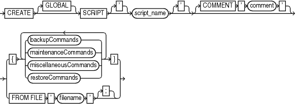

Purpose

Use the `CREATE SCRIPT` command to create a stored script in the recovery catalog. A stored script is a sequence of RMAN commands that is given a name and stored in the recovery catalog for later execution.

See Also:

- [Oracle Database Backup and Recovery User's Guide](https://www.oracle.com/pls/topic/lookup?ctx=en/database/oracle/oracle-database/12.2/rcmrf&id=BRADV182) to learn how to use stored scripts
- `REPLACE SCRIPT` to learn how to update a stored script

Prerequisites

Execute `CREATE SCRIPT` only at the RMAN prompt. RMAN must be connected to a target database and a recovery catalog. The recovery catalog database must be open.

If `GLOBAL` is specified, then a global script with this name must not already exist in the recovery catalog. If `GLOBAL` is not specified, then a local script must not already exist with the same name for the same target database. In you do not meet these prerequisites, then RMAN returns error `RMAN-20401`.

Usage Notes

A stored script may be local or global. A local script is created for the current target database only, whereas a global script is available for use with any database registered in the recovery catalog.

It is permissible to create a global script with the same name as a local script, or a local script with the same name as a global script.

Substitution Variables in Stored Scripts

RMAN supports the use of substitution variables in a stored script. `&1` indicates where to place the first value, `&2` indicate where to place the second value, and so on. Special characters must be quoted.

The substitution variable syntax is `&` `integer` followed by an optional period, for example, `&1.3`. The optional period is part of the variable and replaced with the value, thus enabling the substitution text to be immediately followed by another integer. For example, if you pass the value `mybackup` to a command file that contains the substitution variable `&1.3`, then the result of the substitution is `mybackup3`. To create the result `mybackup.3`, use two periods in the syntax `&1..3`.

When you create a stored script with substitution variables, you must provide example values at create time. You can provide these values with the `USING` clause when starting RMAN (see `RMAN`) or enter them when prompted (see Example 2-74).

Syntax

createScript::=

> CREATE \[GLOBAL\] SCRIPT \['\] script\_name \['\] \[COMMENT ' comment '\]

[backupCommands::=](RUN.md), [maintenanceCommands::=](RUN.md), [miscellaneousCommands::=](RUN.md), [restoreCommands::=](RUN.md))

Semantics

| Syntax Element | Description |
| --- | --- |
| `GLOBAL` | Identifies the script as global.  Note: A virtual private catalog has read-only access to global scripts. Creating or updating global scripts must be done while connected to the base recovery catalog. |
| `SCRIPT ` `script_name` | Specifies the name of the script. Quotes must be used around the script name when the name contains either spaces or reserved words. |
| `   COMMENT` ` '` |  |