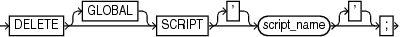

Purpose

Use the `DELETE SCRIPT` command to delete a local or global stored script from the recovery catalog.

Prerequisites

Execute `DELETE SCRIPT` only at the RMAN prompt. RMAN must be connected to a recovery catalog and target database. The recovery catalog database must be open.

Usage Notes

A stored script may be local or global. A local script is created for the current target database only, whereas a global script is available for use with any database registered in the recovery catalog.

If `GLOBAL` is specified, then a global script with this name must exist in the recovery catalog; otherwise, RMAN returns error `RMAN-06710`. If you do not specify `GLOBAL`, then RMAN looks for a local stored script with the specified name defined on the current target database. If no such script is defined on the target database, then RMAN checks for a global stored script with this name and deletes it if it exists.

Syntax

deleteScript::=



> DELETE \[GLOBAL\] SCRIPT \['\] script\_name \['\]


Semantics

| Syntax Element | Description |
| --- | --- |
| `GLOBAL` | Identifies the script as global.  If you attempt to delete a global script, then RMAN must not be connected to a virtual private catalog. Virtual catalog users cannot modify global scripts, although they can execute them.  See Also: " [Usage Notes](CREATE-SCRIPT.md) " for an explanation of the difference between global and local scripts |
| `SCRIPT ` `script_name` | Specifies the name of the script to delete. Quotes must be used around the script name when the name contains either spaces or reserved words. |

Example

Example 2-81 Deleting a Global Script

This example deletes global script `backup_db` from the recovery catalog (sample output included):

```
RMAN> LIST SCRIPT NAMES;
 
List of Stored Scripts in Recovery Catalog
 
 
    Scripts of Target Database PROD
 
       Script Name
       Description
       -----------------------------------------------------------------------
       backup_whole
       backup whole database and archived redo log files
 
 
    Global Scripts
 
 
       Script Name
       Description
       -----------------------------------------------------------------------
       global_backup_db
       back up any database from the recovery catalog, with logs
 
RMAN> DELETE GLOBAL SCRIPT global_backup_db;
 
deleted global script: global_backup_db
 
RMAN> LIST SCRIPT NAMES;
 
List of Stored Scripts in Recovery Catalog
 
 
    Scripts of Target Database PROD
 
       Script Name
       Description
       -----------------------------------------------------------------------
       backup_whole
       backup whole database and archived redo log files
```