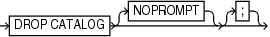

Purpose

Use the `DROP CATALOG` command to remove the recovery catalog or a virtual private catalog.

See Also:

[Oracle Database Backup and Recovery User’s Guide](https://www.oracle.com/pls/topic/lookup?ctx=en/database/oracle/oracle-database/12.2/rcmrf&id=BRADV189) to learn how to drop the recovery catalog

Prerequisites

Execute this command only at the RMAN prompt.

You must be connected to the recovery catalog schema or virtual private catalog schema with the `CATALOG` command-line option or the `CONNECT` `CATALOG` command. The recovery catalog database must be open.

You do not have to be connected to a target database.

Usage Notes

After you execute `DROP CATALOG`, RMAN prompts you to enter the command again to confirm that you want to perform the operation.

To bypass the command confirmation step, execute the `DROP CATALOG` command with the `NOPROMPT` option when you run it the first time.

A base recovery catalog is created with `CREATE CATALOG`, whereas a virtual private catalog is created with `CREATE VIRTUAL CATALOG`. To drop the base recovery catalog, execute `DROP CATALOG` while connected to the recovery catalog database as the recovery catalog owner.

Note:

When you drop the base recovery catalog, all RMAN metadata is removed from the recovery catalog. Any backups recorded in the recovery catalog but not in a target database control are not usable by RMAN.

To drop a virtual private catalog using Oracle Database 12c Release 1 (12.1.0.1), execute the `DROP CATALOG` command while connected to the virtual private catalog. When connected to a virtual private catalog, the `DROP CATALOG` command does not remove the base recovery catalog itself, but only drops the security policies that are used to restrict user access to the base catalog. To drop a virtual private catalog using Oracle Database 12c Release 1 (12.1.0.2), see [Oracle Database Backup and Recovery User’s Guide](https://www.oracle.com/pls/topic/lookup?ctx=en/database/oracle/oracle-database/12.2/rcmrf&id=BRADV-GUID-A7502D0D-5840-4B13-869D-7259F2D73119).

You must use a different technique to drop a virtual catalog when using a 10.2 or earlier release of the RMAN client. Before dropping the virtual private catalog, the user must connect to the recovery catalog database as the virtual private catalog owner and execute the following PL/SQL procedure (where `base_catalog_owner` is the database user who owns the base recovery catalog):

```
base_catalog_owner.DBMS_RCVCAT.DROP_VIRTUAL_CATALOG
```

If you drop the base recovery catalog but not the virtual private catalog, then the virtual catalog is unusable. However, if a dedicated database user owns the virtual private catalog, then you can execute `DROP USER ... CASCADE` to remove the virtual catalog.

Syntax

dropCatalog::=



> DROP CATALOG \[NOPROMPT\]


Semantics

NOPROMPT

Bypasses the confirmation step while dropping a catalog.

Example

Example 2-82 Dropping a Virtual Private Catalog

Assume that you are using Oracle Database 12c Release 1 (12.1.0.1). You want to remove the virtual private catalog belonging to database user `vpu1`, but do not want to drop the base recovery catalog. This example connects to the recovery catalog database as `vpu1` and drops the virtual private catalog for this user. The base recovery catalog is not affected by the removal of this virtual private catalog.

```
RMAN> CONNECT CATALOG vpu1@catdb

recovery catalog database Password: password
connected to recovery catalog database
 
RMAN> DROP CATALOG;
 
recovery catalog owner is VPU1
enter DROP CATALOG command again to confirm catalog removal
 
RMAN> DROP CATALOG;
 
virtual catalog dropped
```