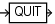

Purpose

Use the `QUIT` command to shut down the Recovery Manager utility. This command is functionally equivalent to the `EXIT` command.

Prerequisites

Execute only at the RMAN prompt.

Syntax

quit::=



> QUIT


Example

Example 2-116 Quitting RMAN

This example terminates RMAN (sample output included):

```
RMAN> QUIT
 
 
Recovery Manager complete.
```