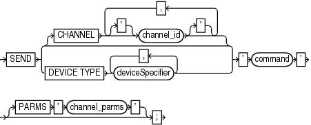

Purpose

Use the `SEND` command to send a vendor-specific string to one or more channels supported by a media manager. Refer to your media management documentation to determine which commands are supported.

Usage Notes

Unless you specify `DEVICE TYPE` or `CHANNEL`, RMAN uses all allocated channels.

On Windows platforms, use `SEND` to pass command strings to the SBT library, instead of using `ENV` settings in the `PARAMS` option during channel allocation. In Oracle Database, operations that run in parallel on Windows use multiple threads within a single process. The environment variables set by one thread are visible to all threads. Thus, parallel operations that depend on environment variables set by a particular thread may not work as expected.

Syntax

send::=



> SEND {\[CHANNEL \['\] channel\_id \['\] \[, \['\] channel\_id \['\]\]...\] | DEVICE TYPE deviceSpecifier \[, deviceSpecifier\]...} ' command ' \[PARMS ' channel\_parms '\]


([deviceSpecifier::=](deviceSpecifier.md))

Semantics

| Syntax Element | Description |
| --- | --- |
| `CHANNEL` `channel_id` | Specifies which channel to use. You must specify a case-sensitive channel ID, which is the name of the channel, after the `CHANNEL` keyword. The database uses the channel ID to report I/O errors. |
| `DEVICE TYPE` `deviceSpecifier` | Specifies the type of storage device and sends the command to all channels of the specified type.  See Also: `deviceSpecifier` |
| `'` `command` `'` | Specifies a vendor-specific media management command.  See Also: Your media management documentation to determine which commands are supported. You must only send commands supported by the media manager. The contents of the string are not interpreted by the database, but are passed unaltered to the media management subsystem. |
| `   PARMS` `'` `channel_parms` `'` | Specifies parameters for the channel communicating with the media manager. |

Example

Example 3-56 Specifying a Tape Drive in Oracle Secure Backup

This example uses the `SEND` command to specify a tape drive for a backup of the `users` tablespace to Oracle Secure Backup. No equal sign is inserted between the parameter `OB_DEVICE` and the names of the tape drive.

```
RUN
{
  ALLOCATE CHANNEL c1 DEVICE TYPE sbt;
  SEND 'OB_DEVICE stape1';
  BACKUP TABLESPACE users;
}
```