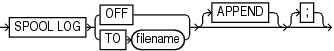

Purpose

Use the `SPOOL` command to direct RMAN output to a log file.

See Also:

`RMAN` for a description of `LOG` files

Prerequisites

Execute the `SPOOL` command at the RMAN prompt.

Syntax

spool::=



> SPOOL LOG { OFF | TO filename } \[APPEND\]


Semantics

| Syntax Element | Description |
| --- | --- |
| `OFF` | Turns off spooling. |
| `TO` `filename` | Specifies the name of the log file to which RMAN directs its output. RMAN creates the file if it does not exist, or overwrites the file if it does exist. If the specified file cannot be opened for writing, then RMAN turns `SPOOL` to `OFF` and continues execution. |
| `   APPEND` | Appends the RMAN output to the end of the existing log. |

Example

Example 3-66 Spooling RMAN Output to a File

This example directs RMAN output to standard output for configuration of the default device type, spools output of the `SHOW` command to log file `current_config.log`, and then spools output to `db_backup.log` for the whole database backup:

```
CONFIGURE DEFAULT DEVICE TYPE TO sbt;
SPOOL LOG TO '/tmp/current_config.log';
SHOW ALL;
SPOOL LOG OFF;
SPOOL LOG TO '/tmp/db_backup.log';
BACKUP DATABASE;
SPOOL LOG OFF;
```