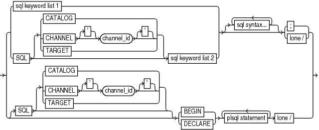
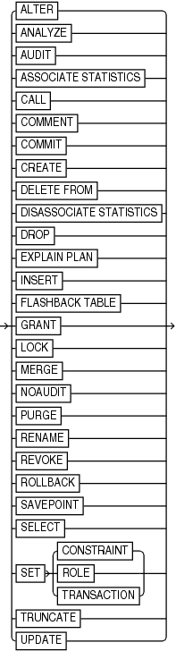
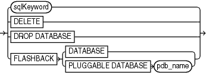

Purpose

Use the SQL command to execute SQL commands and PL/SQL procedures. This command is easier to use than in Oracle Database 11.2 and earlier releases, because the SQL command does not need to be enclosed in quotation marks and does not need to be prefixed with "SQL". For the original syntax, see [SQL (Quoted)](SQL-Quoted.md).

See Also:

[Oracle Database SQL Language Reference](https://www.oracle.com/pls/topic/lookup?ctx=en/database/oracle/oracle-database/12.2/rcmrf&id=SQLRF)

Prerequisites

None

Syntax

sqlcommand::=



> {{ sql keyword list 1 | SQL \[{ CATALOG | CHANNEL \['\] channel\_id \['\] | TARGET } \] sql keyword list 2 } \[ {sql syntax...} \] {; | lone /}} | { \[SQL \[{CATALOG | CHANNEL \['\] channel\_id \['\] | TARGET}\]\] {BEGIN | DECLARE} {plsql statement} lone /}


(sqlKeyword::=, allSqlKeywords::=

sqlKeyword::=



> ALTER | ANALYZE | AUDIT | ASSOCIATE STATISTICS | CALL | COMMENT | COMMIT | CREATE | DELETE FROM | DISASSOCIATE STATISTICS | DROP | EXPLAIN PLAN | INSERT | FLASHBACK TABLE | GRANT | LOCK | MERGE | NOAUDIT | PURGE | RENAME | REVOKE | ROLLBACK | SAVEPOINT | SELECT | SET {CONSTRAINT | ROLE | TRANSACTION} | TRUNCATE | UPDATE


allSqlKeywords::=



> sqlKeyword | DELETE | DROP DATABASE | FLASHBACK {DATABASE | PLUGGABLE DATABASE pdb\_name}


sqlKeyword::=

Semantics

sqlcommand::=

| Syntax Element | Description |
| --- | --- |
| `SQL CATALOG` | Executes the SQL command in the catalog database. |
| `SQL CHANNEL` `'channel_id'` | Executes the SQL command over the named channel. |
| `TARGET` | Executes the SQL command in the target database. |
| `sql syntax` | The appropriate SQL syntax for the specified keyword, which RMAN sends to SQL for processing. |
| `BEGIN` | Indicates the body of a PL/SQL block. |
| `DECLARE` | Indicates a declarative part of a PL/SQL block. |
| `plsql statement` | A PL/SQL statement or block, which RMAN sends to SQL for processing. Bind variables are not supported and cause execution errors. Any output cannot be viewed. |
| `lone /` | A single slash (/) as the first and only character on a line. |

sqlKeyword::=

The `sqlkeyword` clause lists the SQL commands that you can execute in RMAN. For the SQL syntax, see the [Oracle Database SQL Language Reference](https://www.oracle.com/pls/topic/lookup?ctx=en/database/oracle/oracle-database/12.2/rcmrf&id=SQLRF). The exceptions are described in the following table.

| Syntax Element | Description |
| --- | --- |
| `ALTER` | Replaces the RMAN `ALTER DATABASE` command and provides the full functionality of the SQL `ALTER` command. |
| `DELETE FROM` | Requires the `FROM` keyword to execute the SQL `DELETE` command; otherwise, executes the RMAN `DELETE` command. |
| `DROP DATABASE` | Executes the RMAN `DROP DATABASE` command. |
| `FLASHBACK` | Executes the RMAN `FLASHBACK DATABASE` command. |
| `SELECT` | Uses these column widths to display the returned rows:  - Numbers: 10 characters - Characters: Maximum length - Long: 80 characters  Use the SQL `SET` command to change the display size of number and long columns. No other commands or options are available for formatting the output.  Bind variables are not supported and cause execution errors. `INTO` clauses are ignored. |

allSqlKeywords::=

The allSqlKeywords clause is preceded by the `SQL` keyword, which eliminates the ambiguity between SQL and RMAN commands.

| Syntax Element | Description |
| --- | --- |
| `DELETE` | Executes the SQL `DELETE` command. |
| `DROP DATABASE` | Executes the SQL `DROP DATABASE` command. |
| `FLASHBACK DATABASE` | Executes the SQL `FLASHBACK` command. |
| `FLASHBACK PLUGGABLE DATABASE` | Executes the SQL `FLASHBACK PLUGGABLE DATABASE` command. |

Examples

Example 3-67 Adding a Data File

This example adds a data file to the `USERS` tablespace:

```
RMAN> ALTER TABLESPACE users ADD DATAFILE '/disk1/oradata/users02.dbf' SIZE 1M AUTOEXTEND ON NEXT 10K MAXSIZE 2M;
 
Statement processed
```

Example 3-68 Querying a Table

This example selects a column from the `V$DATABASE` dynamic performance view:

```
RMAN> SELECT dbid FROM v$database;
 
using target database control file instead of recovery catalog
      DBID
----------
3152825380
```

Example 3-69 Creating a Directory

This example creates the `DEST_DIR` directory:

```
RMAN> CREATE DIRECTORY dest_dir AS '/usr/admin/destination';
 
Statement processed
```