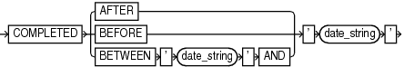

Purpose

Use the `completedTimeSpec` subclause to specify when a backup or copy completed.

Usage Notes

All date strings must be either:

- Formatted according to the Global Technology date format specification currently in effect.
- Created by a SQL expression that returns a `DATE` value, as in the following examples:
	- ' `SYSDATE-30` '
		- `TO_DATE('09/30/2013 08:00:00','MM/DD/YYYY HH24:MI:SS')`
	The `TO_DATE` function specifies dates independently of the current Global Technology environment variable settings.

Syntax

completedTimeSpec::=



> COMPLETED {AFTER | BEFORE | BETWEEN ' date\_string ' AND} ' date\_string '


Semantics

| Syntax Element | Description |
| --- | --- |
| `AFTER` `'` `date_string` `'` | Specifies the time after which the backup was completed (see Example 4-7). |
| `BEFORE` `'` `date_string` `'` | Specifies the time before which the backup was completed (see Example 4-9). |
| `BETWEEN` `'` `date_string` `'` `AND` `'` `date_string` `'` | Specifies a time range during which the backup was completed (see Example 4-8). `BETWEEN` `'` `date1` `' AND` `'` `date2` `'` equals `AFTER` `'` `date1` `'` `BEFORE` `'` `date2` `'`. |

Examples

Example 4-7 Crosschecking Backups Within a Time Range

This example crosschecks the backup sets of the database made last month:

```
CROSSCHECK BACKUP OF DATABASE 
  COMPLETED BETWEEN 'SYSDATE-62' AND 'SYSDATE-31';
```

Example 4-8 Deleting Expired Backups

This example deletes expired backups of archived logs made in the last two weeks:

```
DELETE EXPIRED BACKUP OF ARCHIVELOG ALL
  COMPLETED AFTER 'SYSDATE-14';
```

Example 4-9 Listing Copies

This example lists image copies of data file `/disk1/oradata/prod/users01.dbf` made before March 9, 2013:

```
RMAN> LIST COPY OF DATAFILE '/disk1/oradata/prod/users01.dbf' COMPLETED BEFORE '9-MAR-13';

List of Datafile Copies
=======================

Key     File S Completion Time Ckp SCN    Ckp Time
------- ---- - --------------- ---------- ---------------
3794    28   A 06-MAR-13       1010097    06-MAR-13
        Name: /disk1/oradata/prod/users01.dbf
3793    28   A 06-MAR-13       1009950    06-MAR-13
        Name: /disk2/PROD/datafile/o1_mf_users_2yvg4v6o_.dbf
        Tag: TAG20130306T105314
```