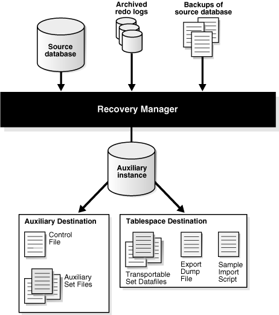

This chapter explains how to use RMAN to create transportable tablespace sets by restoring backups. This discussion assumes that you are familiar with the [transportable tablespace](glossary.md) procedure described in [Oracle Database Administrator's Guide](https://www.oracle.com/pls/topic/lookup?ctx=en/database/oracle/oracle-database/12.2/bradv&id=ADMIN01101). The procedure in this chapter is an alternative technique for generating transportable tablespace sets.This chapter contains the following sections:

### 27.1 Overview of Creating Transportable Tablespace Sets

This section explains the basic concepts and tasks involved in creating transportable tablespace sets from RMAN backups.

#### 27.1.1 Purpose of Creating Transportable Tablespace Sets

A [transportable tablespace set](glossary.md) contains data files for a set of tablespaces and an export file containing structural metadata for the set of tablespaces. The export file is generated by Data Pump Export.

One use of transportable tablespace sets is to create a tablespace repository. For example, if you have a database with some tablespaces used for quarterly reporting, you can create transportable sets for these tablespaces for storage in a tablespace repository. Subsequently, versions of the tablespace can be requested from the repository and attached to another database for use in generating reports.

Another use for transportable tablespaces is in an Oracle Streams environment. When preparing to use Oracle Streams to keep a destination database synchronized with a source database, you must perform Oracle Streams instantiation. You must bring the destination database up to a given SCN at which the two databases were known to be synchronized before you can use Oracle Streams to move subsequent updates from the source database to the destination database. You can create transportable tablespace sets from backups as part of the Oracle Streams instantiation.

A key benefit of the RMAN `TRANSPORT` `TABLESPACE` command is that it does not need access to the live data files from the tablespaces to be transported. In contrast, the transportable tablespace technique described in [Oracle Database Administrator's Guide](https://www.oracle.com/pls/topic/lookup?ctx=en/database/oracle/oracle-database/12.2/bradv&id=ADMIN01101) requires that the tablespaces to be transported are open read-only during the transport. Thus, transporting from backups improves database availability, especially for large tablespaces, because the tablespaces to be transported can remain open for writes during the operation. Also, placing a tablespace in read-only mode can take a long time, depending on current database activity.

The RMAN `TRANSPORT` `TABLESPACE` command also enables you to specify a target point in time, SCN, or restore point during your recovery window and transport tablespace data as it existed at that time (see " Creating a Transportable Tablespace Set at a Specified Time or SCN "). For example, if your [backup retention policy](glossary.md) guarantees a 1 week recovery window, and if you want to create transportable tablespaces based on the contents of the database on the last day of the month, then RMAN can perform this task at any time during the first week of the next month.

See Also:

- [Oracle Database Backup and Recovery Reference](https://www.oracle.com/pls/topic/lookup?ctx=en/database/oracle/oracle-database/12.2/bradv&id=RCMRF1919) for reference information about the `TRANSPORT` `TABLESPACE` command
- [Oracle Streams Replication Administrator's Guide](https://www.oracle.com/pls/topic/lookup?ctx=en/database/oracle/oracle-database/12.2/bradv&id=STREP139) for more details on RMAN and Oracle Streams instantiations

#### 27.1.2 Basic Concepts of Transportable Tablespace Sets

You create a transportable tablespace set by connecting RMAN to a source database as `TARGET` and then executing the `TRANSPORT TABLESPACE` command. The source database contains the tablespaces to be transported.

You must have a backup of all needed tablespaces and archived redo log files available for use by RMAN that can be recovered to the target point in time for the `TRANSPORT` `TABLESPACE` operation. Figure 27-1 illustrates the basic process of transportable tablespace creation.

Figure 27-1 RMAN Transportable Tablespace from Backup: Architecture



> The figure shows the major entities involved in RMAN transportable tablespace from backup:
>
> - The source database, with RMAN-usable backups and archived redo logs
> - The RMAN client, connected to the source database
> - The auxiliary instance created by RMAN for use in creating the transportable tablespace set
> - The auxiliary destination, where the output files for the auxiliary instance that are not part of the transportable set are stored
> - The tablespace destination, where the data files and Data Pump Export dump file are written, along with a sample import script
>
> The part played by each of these entities is described in the text which follows.


The process shown in Figure 27-1 occurs in the following phases:

1. RMAN starts an [auxiliary instance](glossary.md).
	An auxiliary instance is created by RMAN on the same host as the source database to perform the restore and recovery of the tablespaces. RMAN automatically creates an initialization parameter file for the auxiliary instance and starts it `NOMOUNT`.
2. RMAN restores a backup of the source database control file to serve as the auxiliary instance control file and mounts this control file.
3. RMAN restores [auxiliary set](glossary.md) and transportable set data files from the backups of the source database.
	The [auxiliary set](glossary.md) includes data files and other files required for the tablespace transport but which are not themselves part of the transportable tablespace set. The auxiliary set typically includes the `SYSTEM` and `SYSAUX` tablespaces, temp files, and data files containing rollback or undo segments. The auxiliary instance has other files associated with it, such as its own control file, parameter file, and online logs, but they are not part of the auxiliary set.
	RMAN stores the auxiliary data files in the selected [auxiliary destination](glossary.md). The auxiliary destination is a disk location where RMAN can store auxiliary set files such as the parameter file, data files (other than those in the transportable set), control files, and online logs of the auxiliary instance during the transport. If the transport succeeds, then RMAN deletes these files.
	RMAN stores the transportable set files in the [tablespace destination](glossary.md). The tablespace destination is a disk location that by default contains the data file copies and other output files when the tablespace transport command completes.
4. RMAN performs [database point-in-time recovery (DBPITR)](glossary.md) at the auxiliary instance.
	The recovery updates auxiliary and transportable set data files to their contents as of the target time specified for the `TRANSPORT` `TABLESPACE` command. If no target time is specified, then RMAN recovers with all available redo. RMAN restores archived redo logs from backup as necessary at the auxiliary destination (or other location) and deletes them after they are applied.
5. RMAN opens the auxiliary database with the `RESETLOGS` option.
	The data files now reflect the tablespace contents as of the target SCN for the tablespace transport operation.
6. RMAN places the transportable set tablespaces of the auxiliary instance into read-only mode. RMAN also invokes Data Pump Export in transportable tablespace mode to create the [export dump file](glossary.md) for the transportable set.
	By default, the dump file is located in the tablespace destination. To specify the dump file location, see " Specifying Locations for Data Pump Files ".
	RMAN also generates the sample Data Pump import script for use when plugging in the transported tablespaces at a target database. The contents of this script are written to a file named `impscript.sql` in the tablespace destination. The commands for the script are also included in the RMAN command output.
7. If the preceding steps are successful, then RMAN shuts down the auxiliary instance and deletes all files created during the `TRANSPORT` `TABLESPACE` operation except for the transportable set files, the Data Pump Export file, and the sample import script.

#### 27.1.3 Basic Steps of Creating Transportable Tablespace Sets

Before creating transportable tablespace sets you must meet several prerequisites. These prerequisites are described in the `TRANSPORT` `TABLESPACE` entry in [Oracle Database Backup and Recovery Reference](https://www.oracle.com/pls/topic/lookup?ctx=en/database/oracle/oracle-database/12.2/bradv&id=RCMRF1919).

The basic steps of creating transportable tablespace sets are as follows:

1. Start the RMAN client and connect to the source database and, if used, the recovery catalog.
2. If necessary, set additional parameters in the auxiliary instance parameter file.
	This task is described in " Customizing Initialization Parameters for the Auxiliary Instance ".
3. Execute the `TRANSPORT TABLESPACE` command.
	This basic technique is described in " Creating a Transportable Tablespace Set ". Variations on this technique are described in " Transportable Tablespace Set Scenarios ".
4. If the `TRANSPORT TABLESPACE` command fails, troubleshoot the problem and then retry the command until it succeeds.
	This technique is described in " Troubleshooting the Creation of Transportable Tablespace Sets ".
5. Return to the procedure for transporting tablespaces described in [Oracle Database Administrator's Guide](https://www.oracle.com/pls/topic/lookup?ctx=en/database/oracle/oracle-database/12.2/bradv&id=ADMIN01101).

### 27.2 Customizing Initialization Parameters for the Auxiliary Instance

RMAN enables you to customise initialization parameters that are used for the auxiliary instance.

When RMAN creates the auxiliary instance, it creates an initialization parameter file. The default values work for most `TRANSPORT TABLESPACE` cases, especially if you specify the `AUXILIARY DESTINATION` option on the `TRANSPORT TABLESPACE` command. RMAN can also use an auxiliary instance parameter file that contains values for additional initialization parameters. These values override the values of parameters defined in the default initialization parameter file.

You might use an auxiliary instance parameter file for the following reasons:

- To increase `STREAMS_POOL_SIZE` and `SHARED_POOL_SIZE` if needed for Data Pump Export.
- To manage locations for auxiliary instance data files. For example, you do not want all auxiliary instance data files stored in the same location on disk, but you do not want to specify the location of every file individually.
- To specify names for online redo logs with `LOG_FILE_NAME_CONVERT`.

The auxiliary instance parameter file is not intended to be a complete initialization parameter file for the auxiliary instance. Any parameters specified are added to or override the default parameters for the auxiliary instance. It is not necessary to specify parameters in the initialization file that you do not intend to override.

See Also:

- Using Initialization Parameters to Name Auxiliary Files
- Using Initialization Parameters to Name Auxiliary Files
- About Setting Initialization Parameters for the RMAN Auxiliary Instance
- Setting the Location of the Auxiliary Instance Parameter File

#### 27.2.1 About Setting Initialization Parameters for the RMAN Auxiliary Instance

RMAN defines the basic initialization parameters in Table 27-1 for the automatic auxiliary instance.

Table 27-1 Default Initialization Parameters for the Auxiliary Instance

| Initialization Parameter | Value |
| --- | --- |
| `DB_NAME` | Same as `DB_NAME` of the source database. |
| `COMPATIBLE` | Same as the compatible setting of the source database. |
| `DB_UNIQUE_NAME` | Generated unique value based on `DB_NAME`. |
| `DB_BLOCK_SIZE` | Same as the `DB_BLOCK_SIZE` of the source database. |
| `DB_FILES` | Same value as `DB_FILES` for the source database |
| `SGA_TARGET` | 280M recommended value. |
| `DB_CREATE_FILE_DEST` | Auxiliary destination (only if the `AUXILIARY DESTINATION` argument to `TRANSPORT TABLESPACE` is set). RMAN creates Oracle managed control files and online logs in this location. |

Overriding a basic initialization parameter in Table 27-1 with an inappropriate value in the auxiliary instance parameter file can cause `TRANSPORT TABLESPACE` to fail. If you encounter a problem, then try returning the initialization parameter to its default value.

See Also:

" Using Initialization Parameters to Name Auxiliary Files " to learn how to use `DB_FILE_NAME_CONVERT` and `LOG_FILE_NAME_CONVERT` to name files

#### 27.2.2 Setting the Location of the Auxiliary Instance Parameter File

By default, RMAN looks for the auxiliary initialization parameter file at an operating system-dependent location on the host running the RMAN client. This location may not be on the host running the auxiliary instance. For UNIX systems, this location is `?/rdbms/admin/params_auxint.ora`, where the question mark (`?`) stands for `ORACLE_HOME` on the host running RMAN. If no file is found in the default location, then RMAN does not generate an error.

If you use the default initialization parameters for the auxiliary instance, then check whether an auxiliary instance parameter file exists before running `TRANSPORT` `TABLESPACE`.

To specify a different location for the auxiliary instance parameter file, you can use the RMAN `SET` `AUXILIARY` `INSTANCE` `PARAMETER` `FILE` command in a `RUN` block before the `TRANSPORT` `TABLESPACE` command. As with the default location of the auxiliary instance parameter file, the path specified when using the `SET AUXILIARY INSTANCE PARAMETER FILE` command is a client-side path.

Assume that you create a file named `/tmp/auxinstparams.ora` on the host running the RMAN client. This file contains the following initialization parameter:

```
SHARED_POOL_SIZE=150M;
```

You can then use the initialization parameter file with `TRANSPORT` `TABLESPACE` as shown in Example 27-1. The `SHARED_POOL_SIZE` parameter in `/tmp/auxinstparams.ora` overrides the default value used for `SHARED_POOL_SIZE` when RMAN creates the auxiliary instance.

Example 27-1 Specifying an Auxiliary Instance Parameter File

```
RUN
{
  SET AUXILIARY INSTANCE PARAMETER FILE TO '/tmp/auxinstparams.ora';
  TRANSPORT TABLESPACE tbs_2 
    TABLESPACE DESTINATION '/disk1/transportdest' 
    AUXILIARY DESTINATION '/disk1/auxdest';
}
```

### 27.3 Creating a Transportable Tablespace Set

This section describes the use of `TRANSPORT` `TABLESPACE` in the most basic and automated case. See " Transportable Tablespace Set Scenarios " for variations on the basic case.

It is assumed that you have met the prerequisites described in the `TRANSPORT` `TABLESPACE` entry in [Oracle Database Backup and Recovery Reference](https://www.oracle.com/pls/topic/lookup?ctx=en/database/oracle/oracle-database/12.2/bradv&id=RCMRF1919). It is also assumed that you have met the requirements described in [Oracle Database Administrator's Guide](https://www.oracle.com/pls/topic/lookup?ctx=en/database/oracle/oracle-database/12.2/bradv&id=ADMIN01101):

- Confirmed that tablespace transport is supported between your source and destination platforms
- Identified a self-contained set of tablespaces to include in the transportable set

To create a transportable tablespace set:

1. Start the RMAN client and connect to the source database and, if used, the recovery catalog database.
2. Run the `TRANSPORT` `TABLESPACE` command in RMAN.
	In the most basic case, you specify an `AUXILIARY` `DESTINATION` clause, which is optional but recommended. RMAN uses default values that work for most cases. If you do not specify an auxiliary location, then ensure that locations are specified for all auxiliary instance files. See the rules described in " Specifying Auxiliary File Locations with Transportable Tablespaces " to learn how to name auxiliary files.
	The following example creates a transportable tablespace set that includes tablespaces `tbs_2` and `tbs_3`.
	```
	TRANSPORT TABLESPACE tbs_2, tbs_3
	   TABLESPACE DESTINATION '/disk1/transportdest'
	   AUXILIARY DESTINATION '/disk1/auxdest';
	```
	After the command completes successfully, note the following results:
	- The transportable set data files are left in the location `/disk1/transportdest` with their original names. The transportable tablespace set data files are not automatically converted to the endian format of the destination database by `TRANSPORT` `TABLESPACE`. If necessary, use the RMAN `CONVERT` command to convert the data files to the endian format of the destination database after creating the transportable set.
	- The Data Pump [export dump file](glossary.md) for the transportable set is named `dmpfile.dmp`, the export log is named `explog.log`, and the sample import script is named `impscrpt.sql`.
		All files are created in `/disk1/transportdest`. If a file under the name of the [export dump file](glossary.md) already exists in the tablespace destination, then `TRANSPORT` `TABLESPACE` fails when it calls Data Pump Export. If you are repeating a previous `TRANSPORT` `TABLESPACE` operation, delete the previous output files, including the [export dump file](glossary.md).
	- The auxiliary set files are removed from `/disk1/auxdest`.
3. If necessary, edit the sample import script.
	The sample import script assumes that the files used to import the tablespaces into the destination database are stored in the same locations where they were created by `TRANSPORT` `TABLESPACE`. If files have been moved to new disk locations before being plugged in, then you must update the sample script with the new locations of the files before using the script to plug in the transported tablespaces.
4. Return to the process for transporting tablespaces described in [Oracle Database Administrator's Guide](https://www.oracle.com/pls/topic/lookup?ctx=en/database/oracle/oracle-database/12.2/bradv&id=ADMIN01101).

### 27.4 Troubleshooting the Creation of Transportable Tablespace Sets

When the RMAN `TRANSPORT` `TABLESPACE` command fails, the failed auxiliary instance files are left intact in the auxiliary instance destination for troubleshooting.

If your `SET NEWNAME`, `CONFIGURE AUXNAME`, and `DB_FILE_NAME_CONVERT` settings cause multiple files in the auxiliary or transportable tablespace sets to have the same name, then RMAN reports an error during the `TRANSPORT` `TABLESPACE` command. To correct the problem, use different values for these parameters to ensure that duplicate file names are not created. Naming techniques are described in " Specifying Auxiliary File Locations with Transportable Tablespaces ".

### 27.5 Transportable Tablespace Set Scenarios

This section contains the following topics:

- Creating a Transportable Tablespace Set at a Specified Time or SCN
- Specifying Locations for Data Pump Files
- Specifying Auxiliary File Locations with Transportable Tablespaces

#### 27.5.1 Creating a Transportable Tablespace Set at a Specified Time or SCN

You can specify a target time or SCN with the `TRANSPORT` `TABLESPACE` command. During the tablespace transport operation, RMAN restores the tablespace at the auxiliary instance with backups from before the target time and performs point-in-time recovery on the auxiliary database to the specified target time. Backups and archived redo logs needed for this point-in-time recovery must be available.

You can specify the target time with an SCN (in the current incarnation or its ancestors) as shown in Example 27-2.

Example 27-2 Specifying an End SCN

```
TRANSPORT TABLESPACE tbs_2 
   TABLESPACE DESTINATION '/disk1/transportdest' 
   AUXILIARY DESTINATION '/disk1/auxdest'
   UNTIL SCN 11379;
```

You can also specify a restore point as shown in Example 27-3.

Example 27-3 Specifying an End Restore Point

```
TRANSPORT TABLESPACE tbs_2 
   TABLESPACE DESTINATION '/disk1/transportdest' 
   AUXILIARY DESTINATION '/disk1/auxdest'
   TO RESTORE POINT 'before_upgrade';
```

You can also specify an end time as shown in Example 27-4.

Example 27-4 Specifying an End Time

```
TRANSPORT TABLESPACE tbs_2 
   TABLESPACE DESTINATION '/disk1/transportdest' 
   AUXILIARY DESTINATION '/disk1/auxdest'
   UNTIL TIME 'SYSDATE-1';
```

#### 27.5.2 Specifying Locations for Data Pump Files

You can change the names of the Data Pump [export dump file](glossary.md) for the transportable set, the sample import script for use at the target database, the log file generated by Data Pump Export, and the directory to which they are written.

By default, these files are stored in the tablespace destination and named as follows:

- The Data Pump [export dump file](glossary.md) is named `dmpfile.dmp`.
- The export log file is named `explog.log`.
- The sample import script is named `impscrpt.sql`.

You can place the dump file and the export log in a different directory by using the `DATAPUMP` `DIRECTORY` clause of the `TRANSPORT TABLESPACE` command, passing in the name of a database directory object. The database directory object used by the `DATAPUMP` `DIRECTORY` clause is not the directory path of an actual file system directory. The value passed corresponds to the `DIRECTORY` command-line argument of Data Pump Export.

See Also:

[Oracle Database Utilities](https://www.oracle.com/pls/topic/lookup?ctx=en/database/oracle/oracle-database/12.2/bradv&id=SUTIL100) for more details on the use of directory objects with Data Pump Export

You can rename these files with the `DUMP` `FILE`, `EXPORT` `LOG`, and `IMPORT` `SCRIPT` clauses of `TRANSPORT` `TABLESPACE`. The file names cannot contain full file paths with directory names. If the `DUMP` `FILE` or `EXPORT` `LOG` file names specify file paths, then `TRANSPORT` `TABLESPACE` fails when it attempts to generate the export dump files. Use the `DATAPUMP` `DIRECTORY` clause to specify a database directory object that identifies a location for the outputs of Data Pump Export.

The following scenario illustrates the use of `TRANSPORT` `TABLESPACE` with the `DATAPUMP` `DIRECTORY`, `DUMP` `FILE`, `EXPORT` `LOG`, and `IMPORT` `SCRIPT` file names specified. Assume that you create a database directory object as follows for use with Data Pump Export:

```
CREATE OR REPLACE DIRECTORY mypumpdir as '/datapumpdest';
```

Example 27-5 shows a `TRANSPORT` `TABLESPACE` command with optional arguments that specify output file locations.

Example 27-5 Specifying Output File Locations

```
TRANSPORT TABLESPACE tbs_2
   TABLESPACE DESTINATION '/transportdest'
   AUXILIARY DESTINATION '/auxdest'
   DATAPUMP DIRECTORY  mypumpdir
   DUMP FILE 'mydumpfile.dmp'
   IMPORT SCRIPT 'myimportscript.sql'
   EXPORT LOG 'myexportlog.log';
```

After a successful run, RMAN cleans up the auxiliary destination, creates the Data Pump [export dump file](glossary.md) and the export log in the directory referenced by `DATAPUMP` `DIRECTORY` (`/datapumpdest/mydumpfile.dmp` and `/datapumpdest/myexportlog.log`), and stores the transportable set data files in `/transportdest`.

#### 27.5.3 Specifying Auxiliary File Locations with Transportable Tablespaces

Several rules are applicable to the location of auxiliary instance files created during the transport.

If RMAN determines that any of the auxiliary files, designated by any of the methods for specifying auxiliary file locations, contain a data file copy that is suitable to be used for the desired point in time for this transport operation, then that data file copy is used instead of restoring the data file. Any data file copies that are present, but not suitable for this transport operation, because they are more recent than the requested point in time, or are not recognized as part of the target database, are overwritten when the data files are restored.

The simplest technique is to use the `AUXILIARY` `DESTINATION` clause of the `TRANSPORT TABLESPACE` command and let RMAN manage all file locations automatically.

The following table lists the techniques available for specifying file locations when relocating some or all auxiliary instance files, in the order of precedence that RMAN uses:

Table 27-2 Options for specifying auxiliary file locations

| Order of Precedence | Auxiliary File Naming Technique | Additional Information |
| --- | --- | --- |
| 1 | `SET NEWNAME FOR DATAFILES`  `SET NEWNAME FOR TABLESPACE`  `SET NEWNAME FOR DATABASE` | " Using SET NEWNAME for Auxiliary Data Files " |
| 2 | `CONFIGURE AUXNAME` | " Using CONFIGURE AUXNAME for Auxiliary Data Files " |
| 3 | `AUXILIARY DESTINATION` clause of the `TRANSPORT TABLESPACE` command | " Using AUXILIARY DESTINATION to Specify a Location for Auxiliary Files " |
| 4 | `LOG_FILE_NAME_CONVERT` and `DB_FILE_NAME_CONVERT` in the initialization parameter file | " Using Initialization Parameters to Name Auxiliary Files " |

If you use several of these options, then the first option in the list that applies to a file determines the file name.

##### 27.5.3.1 Using SET NEWNAME for Auxiliary Data Files

You can use the following `SET` `NEWNAME` commands in a `RUN` block to specify file names for use in the `TRANSPORT` `TABLESPACE` command:

- `SET NEWNAME FOR DATAFILE`
- `SET NEWNAME FOR DATABASE`
- `SET NEWNAME FOR TABLESPACE`

The `SET` `NEWNAME FOR DATAFILE` commands in Example 27-6 cause the auxiliary instance data files to be restored to the locations named instead of to `/disk1/auxdest`.

Example 27-6 Using SET NEWNAME FOR DATAFILE to Name Auxiliary Data Files

```
RUN
{
  SET NEWNAME FOR DATAFILE '/oracle/dbs/tbs_12.f' 
    TO '/bigdrive/auxdest/tbs_12.f';
  SET NEWNAME FOR DATAFILE '/oracle/dbs/tbs_11.f'
    TO '/bigdrive/auxdest/tbs_11.f';
  TRANSPORT TABLESPACE tbs_2 
    TABLESPACE DESTINATION '/disk1/transportdest' 
    AUXILIARY DESTINATION '/disk1/auxdest';
}
```

`SET` `NEWNAME` is best used with one-time operations. If you expect to create transportable tablespaces from backup regularly for a particular set of tablespaces, then consider using `CONFIGURE` `AUXNAME` instead of `SET` `NEWNAME` to make persistent settings for the location of the auxiliary instance data files.

##### 27.5.3.2 Using CONFIGURE AUXNAME for Auxiliary Data Files

You can use the `CONFIGURE` `AUXNAME` command to specify persistent locations for transportable tablespace set or auxiliary set data files. RMAN restores each data file for which a `CONFIGURE` `AUXNAME` command has been used to the specified location before recovery. RMAN deletes auxiliary set data files when the operation is complete, unless the operation failed.

An example illustrates the relationship between the `CONFIGURE AUXNAME` and `TRANSPORT ... AUXILIARY DESTINATION` commands. Suppose that you want to transport tablespace `tbs_11`. The tablespace `tbs_12`, which contains data file `tbs_12.f`, is part of the auxiliary set. You execute the following steps:

1. You use the `CONFIGURE` `AUXNAME` statement to set a persistent nondefault location for the auxiliary set data file `/oracle/dbs/tbs_12.f`.
	For example, you enter the following command:
	```
	CONFIGURE AUXNAME FOR DATAFILE '/oracle/dbs/tbs_12.f' 
	                   TO '/disk1/auxdest/tbs_12.f';
	```
2. You execute the `TRANSPORT` `TABLESPACE` command with the `AUXILIARY DESTINATION` and `TABLESPACE DESTINATION` parameters.
	For example, you enter the following command:
	```
	TRANSPORT TABLESPACE tbs_11
	  AUXILIARY DESTINATION '/myauxdest'
	  TABLESPACE DESTINATION '/disk1/transportdest';
	```

In the preceding scenario, RMAN restores the auxiliary set copy of data file `/oracle/dbs/tbs_12.f` to `/disk1/auxdest/tbs_12.f` instead of the location specified by `AUXILIARY` `DESTINATION`. The `CONFIGURE AUXNAME` setting is higher in the order of precedence than `AUXILIARY DESTINATION`.

Note:

You can view any current `CONFIGURE` `AUXNAME` settings by executing the `SHOW` `AUXNAME` command, which is described in [Oracle Database Backup and Recovery Reference](https://www.oracle.com/pls/topic/lookup?ctx=en/database/oracle/oracle-database/12.2/bradv&id=RCMRF154).

##### 27.5.3.3 Using AUXILIARY DESTINATION to Specify a Location for Auxiliary Files

If you use an `AUXILIARY` `DESTINATION` argument with `TRANSPORT ` `TABLESPACE`, then any auxiliary set file that is not moved to another location using a `SET NEWNAME` or `CONFIGURE AUXNAME` command is stored in the auxiliary destination during the `TRANSPORT` `TABLESPACE` operation.

If you do not use `AUXILIARY` `DESTINATION`, then you must use `LOG_FILE_NAME_CONVERT` to specify the location of the online redo log files for the auxiliary instance. Neither `SET` `NEWNAME` nor `CONFIGURE` `AUXNAME` can affect the location of the auxiliary instance online redo logs. Thus, if you do not use `AUXILIARY` `DESTINATION` or `LOG_FILE_NAME_CONVERT`, then RMAN has no information about where to create the online redo logs.

##### 27.5.3.4 Using Initialization Parameters to Name Auxiliary Files

You can use the `LOG_FILE_NAME_CONVERT` and `DB_FILE_NAME_CONVERT` initialization parameters in an auxiliary instance parameter file to determine the names for online redo logs and other database files at the auxiliary instance. If no `AUXILIARY` `DESTINATION` clause is specified on the `TRANSPORT` `TABLESPACE` command, then these parameters determine the location of any files for which no `CONFIGURE AUXNAME` or `SET NEWNAME` command was run.

You cannot use `LOG_FILE_NAME_CONVERT` or `DB_FILE_NAME_CONVERT` to generate new Oracle Managed Files (OMF) names for files at the auxiliary instance when the original files are OMF files. The database manages the generation of unique file names in each OMF destination. You must use an `AUXILIARY` `DESTINATION` clause to control the location of the online redo log files. You must use the `AUXILIARY` `DESTINATION` clause, `SET` `NEWNAME` or `CONFIGURE` `AUXNAME` commands, or `DB_CREATE_FILE_DEST` initialization parameter to specify the location for OMF data files.

See Also:

[Oracle Database Reference](https://www.oracle.com/pls/topic/lookup?ctx=en/database/oracle/oracle-database/12.2/bradv&id=REFRN) for more details on the [`LOG_FILE_NAME_CONVERT`](https://www.oracle.com/pls/topic/lookup?ctx=en/database/oracle/oracle-database/12.2/bradv&id=REFRN10098) and [`DB_FILE_NAME_CONVERT`](https://www.oracle.com/pls/topic/lookup?ctx=en/database/oracle/oracle-database/12.2/bradv&id=REFRN10038) initialization parameters