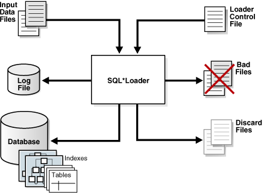
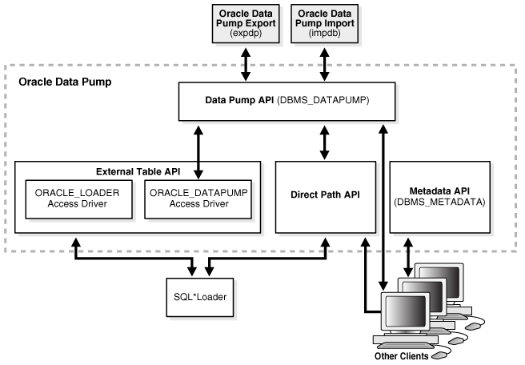
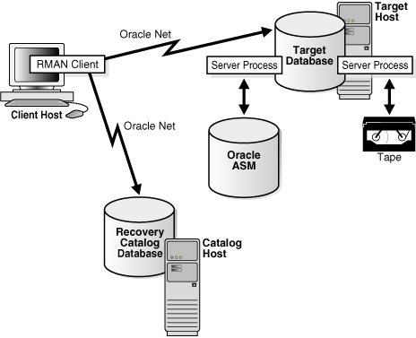
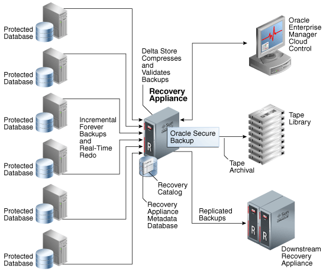
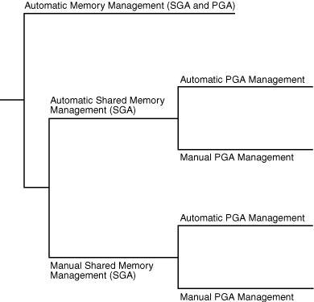
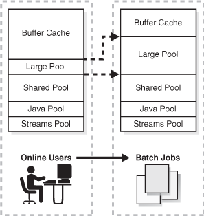
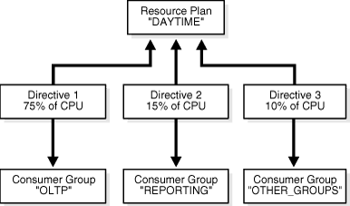
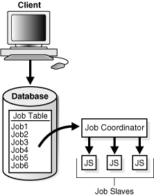
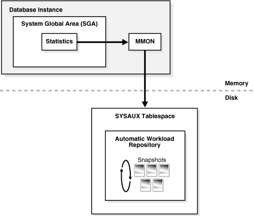

This part describes the duties, tools, and essential knowledge for database administrators.

This chapter contains the following sections:

### Duties of Database Administrators

The principal responsibility of a database administrator (DBA) is to make enterprise data available to its users.

DBAs must work closely with developers to ensure that their applications make efficient use of the database, and with system administrators to ensure that physical resources are adequate and used efficiently.

Oracle DBAs are responsible for understanding the Oracle Database architecture and how the database works. DBAs can expect to perform the following tasks:

- Installing, upgrading, and patching Oracle Database software
- Designing databases, including identifying requirements, creating the logical design (conceptual model), and physical database design
- Creating Oracle databases
- Developing and testing a backup and recovery strategy, backing up Oracle databases regularly, and recovering them in case of failures
- Configuring the network environment to enable clients to connect to databases
- Starting up and shutting down the database
- Managing storage for the database
- Managing users and security
- Managing database objects such as tables, indexes, and views
- Monitoring and tuning database performance
- Investigating, gathering data for, and reporting to Oracle Support Services any critical database errors
- Evaluating and testing new database features

The types of users and their roles and responsibilities depend on the database environment. A small database may have one DBA. A very large database may divide the DBA duties among several specialists, for example, security officers, backup operators, and application administrators.

See Also:

- [Oracle Database 2 Day DBA](https://www.oracle.com/pls/topic/lookup?ctx=en/database/oracle/oracle-database/12.2/cncpt&id=ADMQS037) for an introduction to DBA tasks
- [Oracle Database Administrator’s Guide](https://www.oracle.com/pls/topic/lookup?ctx=en/database/oracle/oracle-database/12.2/cncpt&id=ADMQS037) for a more in-depth presentation of DBA concepts and tasks

### Tools for Database Administrators

Oracle provides several tools for use in administering a database.

This section describes some commonly used tools:

- Oracle Enterprise Manager
- SQL\*Plus
- Tools for Database Installation and Configuration
- Tools for Oracle Net Configuration and Administration
- Tools for Data Movement and Analysis

#### Oracle Enterprise Manager

**Oracle Enterprise Manager** (Enterprise Manager) is a web-based system management tool that provides management of Oracle databases, Exadata database machine, Fusion Middleware, Oracle applications, servers, storage, and non-Oracle hardware and software.

##### Oracle Enterprise Manager Cloud Control

Oracle Enterprise Manager Cloud Control (Cloud Control) is a web-based interface that provides the administrator with complete monitoring across the Oracle technology stack and non-Oracle components.

Sometimes a component of fast application notification (FAN) can become unavailable or experiences performance problems. In this case, Cloud Control displays the automatically generated alert so that the administrator can take the appropriate recovery action.

The components of Cloud Control include:

- Oracle Management Service (OMS)
	The OMS feature is a set of J2EE applications that renders the interface for Cloud Control, works with all Oracle management agents to process monitoring information, and uses the Enterprise Manager repository as its persistent data store.
- Oracle Management Agents
	These agents are processes deployed on each monitored host to monitor all targets on the host, communicate this information to the OMS, and maintain the host and its targets.
- Oracle Management Repository
	The repository is a schema in an Oracle database that contains all available information about administrators, targets, and applications managed by Cloud Control.

See Also:

- [Oracle Database Administrator’s Guide](https://www.oracle.com/pls/topic/lookup?ctx=en/database/oracle/oracle-database/12.2/cncpt&id=ADMIN12110) to learn how to use Cloud Control to administer a database
- Online Help for Cloud Control

##### Oracle Enterprise Manager Database Express 12c

Oracle Enterprise Manager Database Express (EM Express) is a web management product built into the Oracle database. It requires no special installation or management.

EM Express contains the key performance management and basic administration pages in Cloud Control. These pages include the following:

- Database Home page
- Real-Time SQL Monitoring
- ASH Analytics

You can access these features online through the EM Express console and offline through Active Reports technology. From an architectural perspective, EM Express has no mid-tier or middleware components, ensuring that its overhead on the database server is negligible.

Using EM Express, you can perform administrative tasks such as managing user security and managing database memory and storage. You can also view performance and status information about your database.

See Also:

[Oracle Database 2 Day + Performance Tuning Guide](https://www.oracle.com/pls/topic/lookup?ctx=en/database/oracle/oracle-database/12.2/cncpt&id=ADMQS031) to learn how to administer the database with EM Express

#### SQL\*Plus

**SQL\*Plus** is an interactive and batch query tool included in every Oracle Database installation.

It has a command-line user interface that acts as the client when connecting to the database. SQL\*Plus has its own commands and environment. It enables you to enter and execute SQL, PL/SQL, SQL\*Plus and operating system commands to perform tasks such as:

- Formatting, performing calculations on, storing, and printing from query results
- Examining table and object definitions
- Developing and running batch scripts
- Administering a database

You can use SQL\*Plus to generate reports interactively, to generate reports as batch processes, and to output the results to text file, to screen, or to HTML file for browsing on the Internet. You can generate reports dynamically using the HTML output facility.

See Also:

[SQL\*Plus User's Guide and Reference](https://www.oracle.com/pls/topic/lookup?ctx=en/database/oracle/oracle-database/12.2/cncpt&id=SQPUG002) to learn more about SQL\*Plus

#### Tools for Database Installation and Configuration

Oracle provides several tools to simplify the task of installing and configuring Oracle Database software.

The following table describes supported tools.

Table 21-1 Tools for Database Installation and Configuration

| Tool | Description | To Learn More |
| --- | --- | --- |
| Oracle Universal Installer (OUI) | OUI is a GUI utility that enables you to view, install, and uninstall Oracle Database software. Online Help is available to guide you through the installation. | Online Help to guide you through the installation |
| Database Upgrade Assistant (DBUA) | DBUA interactively guides you through a database upgrade and configures the database for the new release. DBUA automates the upgrade by performing all tasks normally performed manually. DBUA makes recommendations for configuration options such as tablespaces and the [online redo log](glossary.md). | [Oracle Database 2 Day DBA](https://www.oracle.com/pls/topic/lookup?ctx=en/database/oracle/oracle-database/12.2/cncpt&id=ADMQS024) to learn how to upgrade a database with DBUA |
| Database Configuration Assistant (DBCA) | DBCA provides a graphical interface and guided workflow for creating and configuring a database. This tool enables you to create a database from Oracle-supplied templates or create your own database and templates. | [Oracle Database Administrator’s Guide](https://www.oracle.com/pls/topic/lookup?ctx=en/database/oracle/oracle-database/12.2/cncpt&id=ADMIN12479) to learn how to create a database with DBCA |

#### Tools for Oracle Net Configuration and Administration

Oracle Net Services provides enterprise wide connectivity solutions in distributed, heterogeneous computing environments. Oracle Net, a component of Oracle Net Services, enables a network session from a client application to a database.

You can use the following tools to configure and administer Oracle Net Services:

- Oracle Net Manager
	This tool enables you to configure Oracle Net Services for an Oracle home on a local client or server host. You can use Oracle Net Manager to configure naming, naming methods, profiles, and listeners. You can start Oracle Net Manager using the Oracle Enterprise Manager Console or as an independent application.
- Oracle Net Configuration Assistant
	This tools runs automatically during software installation. The Assistant enables you to configure basic network components during installation, including listener names and protocol addresses, naming methods, net service names in a `tnsnames.ora` file, and directory server usage.
- Listener Control Utility
	The Listener Control utility enables you to configure listeners to receive client connections. You can access the utility through Enterprise Manager or as a standalone command-line application.
- Oracle Connection Manager Control Utility
	This command-line utility enables you to administer an [Oracle Connection Manager](glossary.md), which is a router through which a client connection request may be sent either to its next hop or directly to the database. You can use utility commands to perform basic management functions on one or more Oracle Connection Managers. Additionally, you can view and change parameter settings.

See Also:

- " [The Oracle Net Listener](application-and-networking-architecture.md) "
- " [Overview of Oracle Net Services Architecture](application-and-networking-architecture.md) "
- [Oracle Database Net Services Administrator's Guide](https://www.oracle.com/pls/topic/lookup?ctx=en/database/oracle/oracle-database/12.2/cncpt&id=NETAG005) and [Oracle Database Net Services Reference](https://www.oracle.com/pls/topic/lookup?ctx=en/database/oracle/oracle-database/12.2/cncpt&id=GUID-29A6AB8F-43D8-4F6D-B5B0-D2850897B864) to learn more about Oracle Net Services tools

#### Tools for Data Movement and Analysis

Oracle Database includes several utilities to assist in data movement and analysis.

For example, you can use database utilities to:

Table 21-2 Data Movement and Analysis Tasks

| Task | To Learn More |
| --- | --- |
| Load data into Oracle Database tables from operating system files | " SQL\*Loader " |
| Move data and metadata from one database to another database | " Oracle Data Pump Export and Import " |
| Query redo log files through a SQL interface | " Oracle LogMiner " |
| Manage Oracle Database data | " ADR Command Interpreter (ADRCI) " |

Other tasks include performing physical data structure integrity checks on an offline database or data file with DBVERIFY, or changing the database identifier (DBID) or database name for an operational database using the DBNEWID utility.

Note:

##### SQL\*Loader

SQL\*Loader loads data from external files, called data files (not to be confused with the internal database data files), into database tables. It has a powerful data parsing engine that puts little limitation on the format of the data in the data file.

You can use SQL\*Loader to do the following:

- Load data from multiple data files into multiple tables
	You store the data to be loaded in SQL\*Loader data files. The SQL\*Loader control file is a text file that contains [DDL](glossary.md) instructions that SQL\*Loader uses to determine where to find the data, how to parse and interpret it, where to insert it, and more.
	Note:
	The SQL\*Loader data files and control file are unrelated to the Oracle Database data files and control file.
- Control various aspects of the load operation
	For example, you can selectively load data, specify the data character set, manipulate the data with SQL functions, generate unique sequential key values in specified columns, and so on. You can also generate sophisticated error reports.
- Use conventional path, direct path, or external table loads
	A conventional path load executes SQL `INSERT` statements to populate tables. In contrast, a [direct path INSERT](glossary.md) eliminates much of the database overhead by formatting data blocks and writing them directly to the data files. Direct writes operate on blocks above the [high water mark (HWM)](glossary.md) and write directly to disk, bypassing the [database buffer cache](glossary.md). Direct reads read directly from disk into the [PGA](glossary.md), again bypassing the buffer cache.
	An external table load creates an [external table](glossary.md) for data that is contained in a data file. The load executes `INSERT` statements to insert the data from the data file into the target table.

A typical SQL\*Loader session takes as input a SQL\*Loader control file and one or more data files. The output is an Oracle database, a log file, a bad file, and potentially, a discard file. The following figure illustrates the flow of a typical SQL\*Loader session.

Figure 21-1 SQL\*Loader Session



> On the left of this graphic are three icons: Input Data Files, Log File, and Database. The first has an arrow pointing to a large SQL\*Loader icon in the middle. This SQL\*Loader icon points to the Log File and Database icons. On the right of the figure are Loader Control File, Bad Files, and Discard Files icons. Control File points to SQL\*Loader, while the others point away.


You can also use SQL\*Loader express mode, which is activated when you specify the `table` parameter in the SQL\*Loader command, as in the following example:

```
% sqlldr hr table=employees
```

No control file is permitted, which makes SQL\*Loader easier to use. Instead of parsing a control file, SQL\*Loader uses the table column definitions to determine the input data types. SQL\*Loader makes several default assumptions, including the character set, field delimiters, and the names of data, log, and bad files. You can override many of the defaults with command-line parameters.

See Also:

- " [Overview of External Tables](tables-and-table-clusters.md) "
- " [Character Sets](concepts-for-database-developers.md) "
- [Oracle Database Utilities](https://www.oracle.com/pls/topic/lookup?ctx=en/database/oracle/oracle-database/12.2/cncpt&id=SUTIL003) to learn about SQL\*Loader

##### Oracle Data Pump Export and Import

Oracle Data Pump enables high-speed movement of data and metadata from one database to another.

This technology is the basis for the following Oracle Database data movement utilities:

- Data Pump Export (Export)
	Export is a utility for unloading data and metadata into a set of operating system files called a dump file set. The dump file set is made up of one or more binary files that contain table data, database object metadata, and control information.
- Data Pump Import (Import)
	Import is a utility for loading an export dump file set into a database. You can also use Import to load a destination database directly from a source database with no intervening files, which allows export and import operations to run concurrently, minimizing total elapsed time.

Oracle Data Pump is made up of the following distinct parts:

- The command-line clients `expdp` and `impdp`
	These clients make calls to the `DBMS_DATAPUMP` package to perform Oracle Data Pump operations.
- The `DBMS_DATAPUMP` PL/SQL package, also known as the Data Pump API
	This API provides high-speed import and export functionality.
- The `DBMS_METADATA` PL/SQL package, also known as the Metadata API
	All processes that load and unload metadata use this API, which stores object definitions in XML.

The following figure shows how Oracle Data Pump integrates with SQL\*Loader and external tables. As shown, SQL\*Loader is integrated with the External Table API and the Data Pump API to load data into external tables. Clients such as Oracle Enterprise Manager Cloud Control (Cloud Control) and transportable tablespaces can use the Oracle Data Pump infrastructure.

Figure 21-2 Oracle Data Pump Architecture



> At the top of this figure are the Oracle Data Pump Export and Oracle Data Pump Import icons. Each has a two-way arrow to Data Pump API (DBMS\_DATAPUMP), which is inside a large rectangle with a dotted border. This rectangle is labeled Data Pump. The Data Pump API has a two-way arrow going to External Table API, which is next to Direct Path API and Metadata API (DBMLS\_METADATA). Underneath the dotted rectangle is a SQL\*Loader icon and Other Clients icons. SQL\*Loader has a two-way arrow going to External Table API and Direct Path API. Other Client has an arrow pointing to Direct Path API and a double-arrow pointing to Data Pump API. Other Clients has a two-way arrow pointing to Metadata API (DBMS\_METADATA).


See Also:

- " [Overview of External Tables](tables-and-table-clusters.md) "
- " [PL/SQL Packages](server-side-programming.md) "
- [Oracle Database Utilities](https://www.oracle.com/pls/topic/lookup?ctx=en/database/oracle/oracle-database/12.2/cncpt&id=SUTIL100) for an overview of Oracle Data Pump
- [Oracle Database PL/SQL Packages and Types Reference](https://www.oracle.com/pls/topic/lookup?ctx=en/database/oracle/oracle-database/12.2/cncpt&id=ARPLS356) for a description of `DBMS_DATAPUMP` and `DBMS_METADATA`

##### Oracle LogMiner

Oracle LogMiner enables you to query redo log files through a SQL interface.

Potential uses for data contained in redo log files include:

- Pinpointing when a logical corruption to a database, such as errors made at the application level, may have begun
- Detecting user error
- Determining what actions you would have to take to perform fine-grained recovery at the transaction level
- Using trend analysis to determine which tables get the most updates and inserts
- Analyzing system behavior and auditing database use through the LogMiner comprehensive relational interface to redo log files

LogMiner is accessible through a command-line interface or through the Oracle LogMiner Viewer GUI, which is a part of Enterprise Manager.

See Also:

[Oracle Database Utilities](https://www.oracle.com/pls/topic/lookup?ctx=en/database/oracle/oracle-database/12.2/cncpt&id=SUTIL1553) to learn more about LogMiner

##### ADR Command Interpreter (ADRCI)

ADRCI is a command-line utility that enables you to investigate problems, view health check reports, and package and upload first-failure data to Oracle Support.

You can also use the utility to view the names of the trace files in the [Automatic Diagnostic Repository (ADR)](glossary.md) and to view the [alert log](glossary.md). ADRCI has a rich command set that you can use interactively or in scripts.

See Also:

- " [Automatic Diagnostic Repository](oracle-database-instance.md) "
- [Oracle Database Utilities](https://www.oracle.com/pls/topic/lookup?ctx=en/database/oracle/oracle-database/12.2/cncpt&id=SUTIL700) and [Oracle Database Administrator’s Guide](https://www.oracle.com/pls/topic/lookup?ctx=en/database/oracle/oracle-database/12.2/cncpt&id=ADMIN11257) for more information on ADR and ADRCI

### Topics for Database Administrators

This section covers topics that are most essential to DBAs and that have not been discussed elsewhere in the manual.

This section contains the following topics:

- Backup and Recovery
- Memory Management
- Resource Management and Task Scheduling
- Performance and Tuning

#### Backup and Recovery

Backup and recovery is the set of concepts, procedures, and strategies involved in protecting the database against data loss caused by media failure or users errors. In general, the purpose of a backup and recovery strategy is to protect the database against data loss and reconstruct lost data.

A [backup](glossary.md) is a copy of data. A backup can include crucial parts of the database such as data files, the [server parameter file](glossary.md), and control file. A sample backup and recovery scenario is a failed disk drive that causes the loss of a data file. If a backup of the lost file exists, then you can restore and recover it. The operations involved in restoring data to its state before the loss is known as [media recovery](glossary.md).

This section contains the following topics:

- Backup and Recovery Techniques
- Recovery Manager Architecture
- Database Backups
- Data Repair
- Zero Data Loss Recovery Appliance

See Also:

- [Oracle Database Backup and Recovery User's Guide](https://www.oracle.com/pls/topic/lookup?ctx=en/database/oracle/oracle-database/12.2/cncpt&id=BRADV8001) for backup and recovery concepts and tasks
- [Oracle Database Platform Guide for Microsoft Window](https://www.oracle.com/pls/topic/lookup?ctx=en/database/oracle/oracle-database/12.2/cncpt&id=NTQRF285) to learn how to use Volume Shadow Copy Service (VSS) applications to back up and recover databases on Microsoft Windows

##### Backup and Recovery Techniques

You can use either Recovery Manager or user-managed techniques to back up, restore, and recover an Oracle database.

The principal differences between the two approaches are as follows:

- [Recovery Manager (RMAN)](glossary.md)
	RMAN is an Oracle Database utility that integrates with an Oracle database to perform backup and recovery activities, including maintaining a repository of historical backup metadata in the control file of every database that it backs up. RMAN can also maintain a centralized backup repository called a [recovery catalog](glossary.md) in a different database. RMAN is an Oracle Database feature and does not require separate installation.
	RMAN is integrated with Oracle Secure Backup, which provides reliable, centralized tape backup management, protecting file system data and Oracle Database files. The Oracle Secure Backup SBT interface enables you to use RMAN to back up and restore database files to and from tape and internet-based Web Services such as Amazon S3. Oracle Secure Backup supports almost every tape drive and tape library in SAN and SCSI environments.
- User-Managed techniques
	As an alternative to RMAN, you can use operating system commands such as the Linux `dd` for backing up and restoring files and the SQL\*Plus `RECOVER` command for media recovery. User-managed backup and recovery is fully supported by Oracle, although RMAN is recommended because it is integrated with Oracle Database and simplifies administration.

See Also:

- [Oracle Database Backup and Recovery User’s Guide](https://www.oracle.com/pls/topic/lookup?ctx=en/database/oracle/oracle-database/12.2/cncpt&id=BRADV89341) for an overview of backup and recovery solutions
- [Oracle Secure Backup Administrator’s Guide](https://www.oracle.com/pls/topic/lookup?ctx=en/database/oracle/oracle-database/12.2/cncpt&id=OBADM-GUID-8823172F-5367-4255-A209-83975273C3B3) for an overview of Oracle Secure Backup

##### Recovery Manager Architecture

RMAN and Oracle Secure Backup are accessible both from the command line and from Enterprise Manager Cloud Control (Cloud Control).

Cloud Control provides a graphical front end and scheduling facility for RMAN. You enter job parameters, and then specify a job schedule. Cloud Control runs RMAN at the designated time or designated repeat interval to conduct the backup and recovery operations. Cloud Control provides access to RMAN through a set of wizards. These wizards lead you through a variety of recovery procedures based on an analysis of your database, your available backups, and your data recovery objectives.

By using Cloud Control, you can perform the simpler restore and recovery scenarios outlined in this documentation. You can also use more sophisticated restore and recovery techniques such as point-in-time recovery and Oracle Flashback operations, which allow for efficient repair of media failures and user errors. Using Cloud Control is often simpler than the RMAN command-line client.

The following graphic shows a sample RMAN architecture. The RMAN client, accessible through Cloud Control, uses server sessions on a target database to back up data to disk or tape. RMAN can update an external recovery catalog with backup metadata.

Figure 21-3 RMAN Architecture



> On the top row of this graphic are three icons: Enterprise Manager, Recovery Manager, and Oracle Recovery Catalog. They are connected by double-headed arrows. On the second row, which is labeled "Oracle Server Sessions," are Target Oracle Database and four Oracle Server Session icons. The session icons are connected to Recovery Manager with double-headed arrows. The last row, labeled "Tertiary Storage Subsystems," has four disk and tape icons. Each icon is connected to a Server Session with a double-headed arrow.


Whichever backup and recovery technique you use, Oracle recommends that you configure a [fast recovery area](glossary.md). This database-managed directory, file system, or [Oracle ASM disk group](glossary.md) centralizes backup and recovery files, including active control files, online and archived redo log files, and backups. Oracle Database recovery components interact with the fast recovery area to ensure database recoverability.

See Also:

- [Oracle Database 2 Day DBA](https://www.oracle.com/pls/topic/lookup?ctx=en/database/oracle/oracle-database/12.2/cncpt&id=ADMQS009) to learn how to perform backup and recovery with Recovery Manager
- [Oracle Database Administrator’s Guide](https://www.oracle.com/pls/topic/lookup?ctx=en/database/oracle/oracle-database/12.2/cncpt&id=ADMIN11103) for information about how to set up and administer the fast recovery area

##### Database Backups

Database backups can be either physical or logical.

Physical backups, which are the primary concern in a backup and recovery strategy, are copies of physical database files. You can make physical backups with RMAN or operating system utilities.

In contrast, logical backups contain tables, stored procedures, and other logical data. You can extract logical data with an Oracle Database utility such as Data Pump Export and store it in a binary file. Logical backups can supplement physical backups.

Physical backups have large granularity and limited transportability, but are very fast. Logical backups have fine granularity and complete transportability, but are slower than physical backups.

See Also:

[Oracle Database Backup and Recovery User’s Guide](https://www.oracle.com/pls/topic/lookup?ctx=en/database/oracle/oracle-database/12.2/cncpt&id=BRADV89335) to learn about physical and logical backups

###### Whole and Partial Database Backups

A whole database backup is a backup of every data file in the database, plus the control file. Whole database backups are the most common type of backup.

A partial database backup includes a subset of the database: individual tablespaces or data files. A tablespace backup is a backup of all the data files in a tablespace or in multiple tablespaces. Tablespace backups, whether consistent or inconsistent, are valid only if the database is operating in `ARCHIVELOG` mode because redo is required to make the restored tablespace consistent with the rest of the database.

###### Consistent and Inconsistent Backups

A whole database backup is either consistent or inconsistent.

In a [consistent backup](glossary.md), all read/write data files and control files have the same [checkpoint](glossary.md) [SCN](glossary.md), guaranteeing that these files contain all changes up to this SCN. This type of backup does not require recovery after it is restored.

A consistent backup of the database is only possible after a consistent shutdown and is the only valid backup option for a database operating in `NOARCHIVELOG` mode. Other backup options require media recovery for consistency, which is not possible without applying archived redo log files.

Note:

If you restore a consistent whole database backup without applying redo, then you lose all transactions made after the backup.

In an [inconsistent backup](glossary.md), read/write data files and control files are not guaranteed to have the same checkpoint SCN, so changes can be missing. All online backups are necessarily inconsistent because data files can be modified while backups occur.

Inconsistent backups offer superior availability because you do not have to shut down the database to make backups that fully protect the database. If the database runs in `ARCHIVELOG` mode, and if you back up the archived redo logs and data files, then inconsistent backups can be the foundation for a sound backup and recovery strategy.

See Also:

- " [Shutdown Modes](oracle-database-instance.md) "
- [Oracle Database Backup and Recovery User’s Guide](https://www.oracle.com/pls/topic/lookup?ctx=en/database/oracle/oracle-database/12.2/cncpt&id=BRADV89479) to learn more about inconsistent backups

###### Backup Sets and Image Copies

The RMAN `BACKUP` command generates either image copies or backup sets.

The backup types differ as follows:

- Image copy
	An [image copy](glossary.md) is a bit-for-bit, on-disk duplicate of a data file, control file, or archived redo log file. You can create image copies of physical files with operating system utilities or RMAN and use either tool to restore them.
	Note:
	Unlike operating system copies, RMAN validates the blocks in the file and records the image copy in the RMAN repository.
- Backup set
	RMAN can also create backups in a proprietary format called a [backup set](glossary.md). A backup set contains the data from one or more data files, archived redo log files, or control files or server parameter file. The smallest unit of a backup set is a binary file called a [backup piece](glossary.md). Backup sets are the only form in which RMAN can write backups to sequential devices such as tape drives.
	Backup sets enable tape devices to stream continuously. For example, RMAN can mingle blocks from slow, medium, and fast disks into one backup set so that the tape device has a constant input of blocks. Image copies are useful for disk because you can update them incrementally, and also recover them in place.

See Also:

[Oracle Database Backup and Recovery User's Guide](https://www.oracle.com/pls/topic/lookup?ctx=en/database/oracle/oracle-database/12.2/cncpt&id=BRADV002) to learn more about backup sets and image copies

##### Data Repair

While several problems can halt the normal operation of a database or affect I/O operations, only some problems require DBA intervention and data repair.

Data repair is typically required in the following cases:

- Media failures
	A media failure occurs when a problem external to the database prevents it from reading from or writing to a file. Typical media failures include physical failures, such as disk head crashes, and the overwriting, deletion, or corruption of a database file. Media failures are less common than user or application errors, but a sound backup and recovery strategy must prepare for them.
- User errors
	A user or application may make unwanted changes to your database, such as erroneous updates, deleting the contents of a table, or dropping database objects. A good backup and recovery strategy enables you to return your database to the desired state, with the minimum possible impact upon database availability, and minimal DBA effort.

Typically, you have multiple ways to solve the preceding problems. This section summarizes some of these solutions.

See Also:

- " [Human Errors](topics-for-database-administrators-and-developers.md) "
- [Oracle Database Backup and Recovery User’s Guide](https://www.oracle.com/pls/topic/lookup?ctx=en/database/oracle/oracle-database/12.2/cncpt&id=BRADV89703) for data repair concepts

###### Oracle Flashback Technology

Oracle Database provides a group of features known as **Oracle Flashback Technology** that support viewing past states of data, and winding data back and forth in time, without needing to restore backups.

Depending on the database changes, flashback features can often reverse unwanted changes more quickly and with less impact on availability than media recovery. The following flashback features are most relevant for backup and recovery:

- Flashback Database
	In a non-CDB, you can rewind an Oracle database to a previous time to correct problems caused by logical data corruptions or user errors. Flashback Database can also be used to complement Data Guard, Data Recovery Advisor, and for synchronizing clone databases. Flashback Database does not restore or perform media recovery on files, so you cannot use it to correct media failures such as disk crashes.
- Flashback PDB
	In a multitenant container database (CDB), you can rewind a pluggable database (PDB) without affecting other PDBs. You can also create a [PDB restore point](glossary.md), and rewind the PDB to this restore point without affecting other PDB.
- Flashback Table
	You can rewind tables to a specified point in time with a single SQL statement. You can restore table data along with associated indexes, triggers, and constraints, while the database is online, undoing changes to only the specified tables. Flashback Table does not address physical corruption such as bad disks or data segment and index inconsistencies.
- Flashback Drop
	You can reverse the effects of a `DROP TABLE` operation. Flashback Drop is substantially faster than recovery mechanisms such as point-in-time recovery and does not lead to loss of recent transactions or downtime.

See Also:

- " [Overview of Flashback PDB in a CDB](overview-of-the-multitenant-architecture.md) "
- [Oracle Database Backup and Recovery User’s Guide](https://www.oracle.com/pls/topic/lookup?ctx=en/database/oracle/oracle-database/12.2/cncpt&id=BRADV89342) to learn more about flashback features
- [Oracle Database SQL Language Reference](https://www.oracle.com/pls/topic/lookup?ctx=en/database/oracle/oracle-database/12.2/cncpt&id=SQLRF01801) and [Oracle Database Reference](https://www.oracle.com/pls/topic/lookup?ctx=en/database/oracle/oracle-database/12.2/cncpt&id=RCMRF194) to learn about the `FLASHBACK DATABASE` statement

###### Data Recovery Advisor

Use Data Recovery Advisor to diagnose data failures, present best repair options for your environment, and carry out and verify repairs.

The [Data Recovery Advisor](glossary.md) tool automatically diagnoses persistent data failures, presents appropriate repair options, and executes repairs at the user's request. By providing a centralized tool for automated data repair, Data Recovery Advisor improves the manageability and reliability of an Oracle database and thus helps reduce recovery time.

The database includes a Health Monitor framework for running checks. A checker is an operation or procedure registered with Health Monitor to assess the health of the database or its components. The health assessment is known as a data integrity check and can be invoked reactively or proactively.

A failure is a persistent data corruption detected by a data integrity check. Failures are normally detected reactively. A database operation involving corrupted data results in an error, which automatically invokes a data integrity check that searches the database for failures related to the error. If failures are diagnosed, then the database records them in the Automatic Repository (ADR).

After failures have been detected by the database and stored in ADR, Data Recovery Advisor automatically determines the best repair options and their impact on the database. Typically, Data Recovery Advisor generates both manual and automated repair options for each failure or group of failures.

Before presenting an automated repair option, Data Recovery Advisor validates it for the specific environment and for the availability of media components required to complete the proposed repair. If you choose an automatic repair, then Oracle Database executes it for you. Data Recovery Advisor verifies the repair success and closes the appropriate failures.

See Also:

[Oracle Database Backup and Recovery User’s Guide](https://www.oracle.com/pls/topic/lookup?ctx=en/database/oracle/oracle-database/12.2/cncpt&id=BRADV246) to learn how to use Data Recovery Advisor

###### Block Media Recovery

Block media recovery is a technique for restoring and recovering corrupt data blocks while data files are online.

A [block corruption](glossary.md) is a data block that is not in a recognized Oracle format, or whose contents are not internally consistent. If you detect block corruptions, and if only a few blocks are corrupt, then block recovery may be preferable to data file recovery.

See Also:

- " [Data Corruption](topics-for-database-administrators-and-developers.md) "
- [Oracle Database Backup and Recovery User’s Guide](https://www.oracle.com/pls/topic/lookup?ctx=en/database/oracle/oracle-database/12.2/cncpt&id=BRADV89781) to learn how to perform block media recovery

###### Data File Recovery

Data file recovery repairs a lost or damaged current data file or control file. It can also recover changes lost when a tablespace went offline without the `OFFLINE` `NORMAL` option.

Media recovery is necessary if you restore a backup of a data file or control file or a data file is taken offline without the `OFFLINE` `NORMAL` option. The database cannot be opened if online data files needs media recovery, nor can a data file that needs media recovery be brought online until media recovery completes.

To restore a physical backup of a data file or control file is to reconstruct it and make it available to Oracle Database. To recover a backup is to apply archived redo log files to reconstruct lost changes. RMAN can also recover data files with incremental backups, which contain only data blocks modified after a previous backup.

Unlike instance recovery, which automatically applies changes to online files, media recovery must be invoked by a user and applies archived redo log files to restored backups. Data file media recovery can only operate on offline data files or data files in a database that is not opened by any database instance.

Data file media recovery differs depending on whether all changes are applied:

- Complete recovery
	Complete recovery applies all redo changes contained in the archived and online redo logs to a backup. Typically, you perform complete media recovery after a media failure damages data files or the control file. You can perform complete recovery on a database, tablespace, or data file.
- Incomplete recovery
	Incomplete recovery, also called [database point-in-time recovery](glossary.md), results in a noncurrent version of the database. In this case, you do not apply all of the redo generated after the restored backup. Typically, you perform point-in-time database recovery to undo a user error when Oracle Flashback Database is not possible.
	To perform incomplete recovery, you must restore all data files from backups created before the time to which you want to recover and then open the database with the `RESETLOGS` option when recovery completes. Resetting the logs creates a new stream of log sequence numbers starting with log sequence 1.
	Note:
	If current data files are available, then Flashback Database is an alternative to DBPITR.
	The tablespace point-in-time recovery (TSPITR) feature lets you recover one or more tablespaces to a point in time older than the rest of the database.

See Also:

- " [Overview of Instance Recovery](oracle-database-instance.md) "
- [Oracle Database Backup and Recovery User’s Guide](https://www.oracle.com/pls/topic/lookup?ctx=en/database/oracle/oracle-database/12.2/cncpt&id=BRADV117) for media recovery concepts

##### Zero Data Loss Recovery Appliance

The cloud-scale Zero Data Loss Recovery Appliance, commonly known as Recovery Appliance, is an Engineered System that dramatically reduces data loss and backup overhead for all Oracle databases in the enterprise.

Integrated with RMAN, the Recovery Appliance deploys a centralized backup and recovery strategy for large numbers of databases, using cloud-scale, fault-tolerant hardware and storage. The Recovery Appliance continuously validates backups for recoverability.

###### Benefits of Recovery Appliance

A centralized Recovery Appliance performs most database backup and restore processing, making storage utilization, performance, and manageability of backups more efficient.

The primary benefits are as follows:

- Elimination of data loss
	The Recovery Appliance eliminates the data loss exposure experienced by most databases in the data center, using technologies such as the following:
	- The continuous transfer of redo changes from the SGA of a protected database to a Recovery Appliance, known as [real-time redo transport](glossary.md)
		- Replication to remote Recovery Appliances
		- Automated tape backups made by the centralized Recovery Appliance
		- End-to-End database block validation
- Minimal backup overhead
	Backup overhead on database servers is minimized by offloading work to the Recovery Appliance, which manages backups of multiple databases in a unified disk pool. The RMAN [incremental-forever backup strategy](glossary.md) involves taking an initial level 0 backup to the Recovery Appliance, with all subsequent incremental backups at level 1. The Recovery Appliance creates a [virtual full backup](glossary.md) by combining the level 0 with level 1 backups. The Recovery Appliance continually compresses, deduplicates, and validates backups at the block level.
- Improved end-to-end data protection visibility
	Cloud Control provides a complete, end-to-end view into the backup lifecycle managed by the Recovery Appliance, from the time the RMAN backup is initiated, to when it is stored on disk, tape, or replicated to a downstream Recovery Appliance. The installation of the Enterprise Manager for Zero Data Loss Recovery Appliance plug-in (Recovery Appliance plug-in) enables monitoring and administration.
- Cloud-Scale protection
	Recovery Appliance scales to support tens to hundreds or thousands of databases. The key components of the architecture as follows:
	- Recovery Appliance simplifies management through a [protection policy](glossary.md), which defines a [recovery window goal](glossary.md) enforced for each database associated with the policy. Protection policies improve manageability by grouping databases into tiers with shared characteristics.
		- Using protection policies, the Recovery Appliance manages backup storage space according to the recovery window goal for each protected database. This granular, database-oriented space management approach eliminates the need to manage space at the storage-volume level, as third-party appliances do.
		- Recovery Appliance can scale to accommodate increases in backup traffic, storage usage, and the number of databases by adding compute and storage resources in a simple, modular fashion.

###### Recovery Appliance Environment

A protected database is a client database that backs up data to a Recovery Appliance.

The following figure shows a sample environment, which includes six protected databases and two Recovery Appliances. Each database uses the Zero Data Loss Recovery Appliance Backup Module ([Recovery Appliance Backup Module](glossary.md)) for its backups. This module is an Oracle-supplied SBT library that RMAN uses to transfer backups over the network to the Recovery Appliance.

Figure 21-4 Recovery Appliance Environment



> This image shows an overview of a Database Logging Recovery Appliance installation. At the center is a single rack labeled Recovery Appliance. At the left, one above the other, are 6 hosts, all labeled "Protected Database." The top three each look like a tower workstation with attached storage. The bottom three are racks. All have arrows pointing to the central DBLRA rack, and the arrows have the label "Backups and Redo." At the upper right is a desktop workstation labeled Enterprise Manager. It is connected to the central Database Backup Logging Recovery Appliance rack by an unlabeled two-way arrow. At the right center is an image of a tape library, and an arrow going from the central Database Backup Logging Recovery Appliance rack to the tape library is labeled "Tape Backup." At the bottom right is a double rack labeled Remote Recovery Appliance. An arrow going from the central Database Backup Logging Recovery Appliance rack to the remote Database Backup Logging Recovery Appliance rack is labeled "Replicated Backups."


The [Recovery Appliance metadata database](glossary.md), which resides on each Recovery Appliance, manages metadata stored in the recovery catalog. All protected databases that send backups to Recovery Appliance must use this recovery catalog. The backups are located in the [Recovery Appliance storage location](glossary.md), which is a set of Oracle ASM disk groups.

Note:

Databases may use Recovery Appliance as their recovery catalog without also using it as a backup repository.

Administrators use Cloud Control to manage and monitor the environment. Cloud Control provides a "single pane of glass" view of the entire backup lifecycle for each database, whether backups reside on disk, tape, or another Recovery Appliance.

See Also:

[Zero Data Loss Recovery Appliance Administrator's Guide](https://www.oracle.com/pls/topic/lookup?ctx=en/database/oracle/oracle-database/12.2/cncpt&id=AMAGD107) for a thorough introduction to the product

#### Memory Management

Memory management involves maintaining optimal sizes for the Oracle instance memory structures as demands on the database change. Initialization parameter settings determine how SGA and instance PGA memory is managed.

Figure 21-5 shows a decision tree for memory management options. The following sections explain the options in detail.

Figure 21-5 Memory Management Methods



> This graphic shows a decision tree. The first branch is between Automatic Memory Management (SGA and PGA) and an unnamed branch. The unnamed branch then splits between Automatic Shared Memory Management (SGA), which further branches between Automatic PGA Management and Manual PGA Management, and Manual Shared Memory Management (SGA), which further branches between Automatic PGA Management and Manual PGA Management.


See Also:

" [Memory Architecture](memory-architecture.md) " to learn more about the SGA and PGA

##### Automatic Memory Management

In automatic memory management, Oracle Database manages the SGA and instance PGA memory completely automatically. This method is the simplest and is strongly recommended by Oracle.

The only user-specified controls are the target memory size initialization parameter (`MEMORY_TARGET`) and optional maximum memory size initialization parameter (`MEMORY_MAX_TARGET`). Oracle Database tunes to the target memory size, redistributing memory as needed between the SGA and the instance PGA.

Starting in Oracle Database 12c Release 1 (12.1.0.2), the SGA contains an optional memory area known as the [In-Memory Column Store](glossary.md) (IM column store). No matter which memory management method you use, you must size the IM column store separately with the `INMEMORY_SIZE` initialization parameter. The IM column store size is accounted for in the memory target, but it is not part of the automatic area resize algorithm. Thus, if you set `MEMORY_TARGET` to 5 GB, and `INMEMORY_SIZE` to 1 GB, then the overall memory target is 5 GB (not 6 GB), and the `INMEMORY_SIZE` is always 1 GB.

The following graphic shows a database that sometimes processes jobs submitted by online users and sometimes batch jobs. Using automatic memory management, the database automatically adjusts the size of the [large pool](glossary.md) and [database buffer cache](glossary.md) depending on which type of jobs are running.

Figure 21-6 Automatic Memory Management



> This graphic shows two vertical rectangles. Both rectangles contain a set of blocks: Buffer cache, Large Pool, Shared Pool, Java Pool, and Streams Pool. The difference is that in the rectangle on the right Buffer cache is smaller but Large Pool is bigger. Below the blocks in the left rectangle is the Online Users icon. Below the blocks on the right is the Batch Jobs icon.


If you create a database with DBCA and choose the basic installation option, then Oracle Database enables automatic memory management by default.

See Also:

- " [In-Memory Area](memory-architecture.md) "
- [Oracle Database Administrator's Guide](https://www.oracle.com/pls/topic/lookup?ctx=en/database/oracle/oracle-database/12.2/cncpt&id=ADMIN11199) to learn about automatic memory management

##### Shared Memory Management of the SGA

You can control the size of the SGA manually, either by setting the SGA size with automatic shared memory management, or by manually tuning SGA components.

If automatic memory management is not enabled, then the system must use shared memory management of the SGA. Shared memory management is possible in either of the following forms:

- Automatic shared memory management
	This mode enables you to exercise more direct control over the size of the SGA and is the default when automatic memory management is disabled. The database tunes the total SGA to the target size and dynamically tunes the sizes of SGA components. If you are using a server parameter file, then Oracle Database remembers the sizes of the automatically tuned components across database instance shutdowns.
- Manual shared memory management
	In this mode, you set the sizes of several individual SGA components and manually tune individual SGA components on an ongoing basis. You have complete control of individual SGA component sizes. The database defaults to this mode when both automatic memory management and automatic shared memory management are disabled.
	Note:
	When automatic memory management is disabled, then in some cases the database can automatically adjust the relative sizes of the shared pool and buffer cache, based on user workload.

See Also:

- [Oracle Database Administrator’s Guide](https://www.oracle.com/pls/topic/lookup?ctx=en/database/oracle/oracle-database/12.2/cncpt&id=ADMIN11203) to learn about shared memory management
- My Oracle Support note 1269139.1 to learn more about automatic resizing during manual mode:
	[`https://support.oracle.com/CSP/main/article?cmd=show&type=NOT&id=1269139.1`](https://support.oracle.com/CSP/main/article?cmd=show&type=NOT&id=1269139.1)

##### Memory Management of the Instance PGA

If automatic memory management is not enabled, then Oracle Database uses either automatic or manual PGA memory management.

The following modes are possible for management of PGA memory:

- Automatic PGA memory management
	When automatic memory management (`MEMORY_TARGET`) is disabled and `PGA_AGGREGATE_TARGET` is set to a nonzero value, the database uses automatic PGA memory management. In this mode, `PGA_AGGREGATE_TARGET` specifies a "soft" target size for the instance PGA. The target is soft because it only applies to specific types of memory allocations that can choose to use temporary space rather than the PGA. The database tunes the size of the instance PGA to this target and dynamically tunes the sizes of individual PGAs. If you do not explicitly set a target size, then the database automatically configures a reasonable default.
	The `PGA_AGGREGATE_LIMIT` initialization parameter dynamically sets an instance-wide hard limit for PGA memory. Because the parameter responds to changing memory conditions, you do not need to set the parameter value explicitly. By default, `PGA_AGGREGATE_LIMIT` is set to the greater of the following:
	- 2 GB
		- 200% of `PGA_AGGREGATE_TARGET` initialization parameter setting
		- (Value of `PROCESSES` initialization parameter setting) \* 3 MB
	A background process periodically compares the PGA size to the limit set by `PGA_AGGREGATE_LIMIT`. If the limit is reached or exceeded, then this process terminates calls for the sessions using the most untunable PGA memory. If these sessions still do not release enough memory, then they are also terminated.
- Manual PGA memory management
	When automatic memory management is disabled and `PGA_AGGREGATE_TARGET` is set to `0`, the database defaults to manual PGA management. Previous releases of Oracle Database required the DBA to manually specify the maximum work area size for each type of SQL [operator](glossary.md) (such as a sort or [hash join](glossary.md)). This technique proved to be very difficult because the workload is always changing. Although Oracle Database supports the manual PGA memory management method, Oracle strongly recommends automatic memory management.

See Also:

[Oracle Database Performance Tuning Guide](https://www.oracle.com/pls/topic/lookup?ctx=en/database/oracle/oracle-database/12.2/cncpt&id=TGDBA346) to learn about PGA memory management

##### Summary of Memory Management Methods

Memory management is either automatic or manual.

If you do not enable automatic memory management, then you must separately configure one memory management method for the SGA and one for the PGA.

Note:

When automatic memory management is disabled for the database instance as a whole, Oracle Database enables automatic PGA memory management by default.

The following table includes the `INMEMORY_SIZE` initialization parameter, which is available starting in Oracle Database 12c Release 1 (12.1.0.2). The IM column store is optional, but the `INMEMORY_SIZE` parameter is necessary to enable it.

Table 21-3 Memory Management Methods

| Instance | SGA | PGA | Description | Initialization Parameters |
| --- | --- | --- | --- | --- |
| Auto | n/a | n/a | The database tunes the size of the instance based on a single instance target size. | You set:  - Total memory target size for the database instance (`MEMORY_TARGET`) - Optional maximum memory size for the database instance (`MEMORY_MAX_TARGET`) - Optional size for the IM column store (`INMEMORY_SIZE`) in the SGA |
| n/a | Auto | Auto | The database automatically tunes the SGA based on an SGA target.  The database automatically tunes the PGA based on a PGA target. | You set:  - SGA target size (`SGA_TARGET`) - Optional SGA maximum size (`SGA_MAX_SIZE`) - Optional size for the IM column store (`INMEMORY_SIZE`) in the SGA - PGA aggregate target size (`PGA_AGGREGATE_TARGET`) <sup>Foot 1</sup>  The database automatically configures the `PGA_AGGREGATE_LIMIT` initialization parameter. You may set this parameter manually. |
| n/a | Auto | Manual | The database automatically tunes the SGA based on an SGA target.  You control the PGA manually, setting the maximum work area size for each type of SQL [operator](glossary.md). | You set:  - SGA target size (`SGA_TARGET`) - Optional SGA maximum size (`SGA_MAX_SIZE`) - Optional size for the IM column store in the SGA (`INMEMORY_SIZE`) - PGA work area parameters such as `SORT_AREA_SIZE`, `HASH_AREA_SIZE`, and `BITMAP_MERGE_AREA_SIZE` |
| n/a | Manual | Auto | You control the SGA manually by setting individual component sizes.  The database automatically tunes the PGA based on a PGA target. | You set:  - Shared pool size (`SHARED_POOL_SIZE`) - Buffer cache size (`DB_CACHE_SIZE`) - Large pool size (`LARGE_POOL_SIZE`) - Java pool size (`JAVA_POOL_SIZE`) - Optional size for the IM column store (`INMEMORY_SIZE`) in the SGA - PGA aggregate target size (`PGA_AGGREGATE_TARGET`) <sup>Foot 2</sup>  The database automatically configures the `PGA_AGGREGATE_LIMIT` initialization parameter. You may set this parameter manually. |
| n/a | Manual | Manual | You must manually configure SGA component sizes.  You control the PGA manually, setting the maximum work area size for each type of SQL operator. | You must manually configure SGA component sizes. You set:  - Shared pool size (`SHARED_POOL_SIZE`) - Buffer cache size (`DB_CACHE_SIZE`) - Large pool size (`LARGE_POOL_SIZE`) - Java pool size (`JAVA_POOL_SIZE`) - Optional size for the IM column store (`INMEMORY_SIZE`) in the SGA - PGA work area parameters such as `SORT_AREA_SIZE`, `HASH_AREA_SIZE`, and `BITMAP_MERGE_AREA_SIZE` |

<sup>Footnote 1</sup>

The database automatically configures the `PGA_AGGREGATE_LIMIT` initialization parameter. You also choose to set this parameter manually.

<sup>Footnote 2</sup>

The database automatically configures the `PGA_AGGREGATE_LIMIT` initialization parameter. You also choose to set this parameter manually.

See Also:

[Oracle Database Administrator’s Guide](https://www.oracle.com/pls/topic/lookup?ctx=en/database/oracle/oracle-database/12.2/cncpt&id=ADMIN11236) because automatic memory management is not available on all platforms

#### Resource Management and Task Scheduling

Oracle Database provides tools to assist you with managing resources, and with scheduling tasks to reduce the impact on users.

In a database with many active users, resource management is an important part of database administration. Sessions that consume excessive resources can prevent other sessions from doing their work. A related problem is how to schedule tasks so that they run at the best time. Oracle Database provides tools to help solve these problems.

##### Database Resource Manager

Oracle Database Resource Manager (the Resource Manager) provides granular control of database resources allocated to user accounts, applications, and services. The Resource Manager acts primarily as a gatekeeper, slowing some jobs run slow so that others can run fast.

The `DBMS_RESOURCE_MANAGER` PL/SQL package solves many resource allocation problems that an operating system does not manage well, including:

- Excessive overhead
- Inefficient scheduling
- Inappropriate allocation of resources
- Inability to manage database-specific resources

The Resource Manager helps overcome the preceding problems by giving the database more control over allocation of hardware resources and prioritization of work within the database. You can classify sessions into groups based on session attributes, and then allocate resources to these groups to optimize hardware utilization. You can use the Resource Manager to set limits for PDB memory consumption.

Resources are allocated to users according to a resource plan specified by the database administrator. The plan specifies how the resources are to be distributed among resource consumer groups, which are user sessions grouped by resource requirements. A resource plan directive associates a resource consumer group with a plan and specifies how resources are to be allocated to the group.

Figure 21-7 shows a simple resource plan for an organization that runs OLTP applications and reporting applications simultaneously during the daytime. The currently active plan, `DAYTIME`, allocates CPU resources among three resource consumer groups. Specifically, `OLTP` is allotted 75% of the CPU time, `REPORTS` is allotted 15%, and `OTHER_GROUPS` receives the remaining 10%.

Figure 21-7 Simple Resource Plan



> At the top of this figure is an icon labeled Resource Plan "DAYTIME." Below it is a series of three boxes: Directive 1 75% of CPU, Directive 2 15% of CPU, Directive 3 10% of CPU. These boxes point to Resource Plan "DAYTIME". The Directive 1 box points down to a Consumer Group "OLTP" box. Directive 2 points down to a Consumer Group "REPORTING" box. Directive 3 points down to a Consumer Group "OTHER\_GROUPS" box.


One problem that Resource Manager can solve is runaway queries, which can monitor using SQL Monitor. Resource Manager enables you to specify thresholds to identify and respond to runaway SQL statements. For example, you can specify thresholds for CPU time, elapsed time, physical or logical I/Os, and PGA usage by each foreground process in a consumer group. In response, Resource Manager can switch to a lower priority consumer group, terminate the SQL statement, or log the threshold violation.

See Also:

- [Oracle Database Administrator's Guide](https://www.oracle.com/pls/topic/lookup?ctx=en/database/oracle/oracle-database/12.2/cncpt&id=ADMIN027) to learn how to use the Resource Manager
- [Oracle Database PL/SQL Packages and Types Reference](https://www.oracle.com/pls/topic/lookup?ctx=en/database/oracle/oracle-database/12.2/cncpt&id=ARPLS050) to learn how to use the `DBMS_RESOURCE_MANAGER` PL/SQL package

##### Oracle Scheduler

Oracle Scheduler (the Scheduler) enables database administrators and application developers to control when and where various tasks take place in the database environment.

The Scheduler provides complex enterprise scheduling functionality, which you can use to:

- Schedule job execution based on time or events
- Schedule job processing in a way that models your business requirements
- Manage and monitor jobs
- Execute and manage jobs in a clustered environment

Program objects (programs) contain metadata about the command that the Scheduler will run, including default values for any arguments. Schedule objects (schedules) contain information about run date and time and recurrence patterns. Job objects (jobs) associate a program with a schedule. To define what is executed and when, you assign relationships among programs, schedules, and jobs.

The Scheduler is implemented as a set of functions and procedures in the `DBMS_SCHEDULER` PL/SQL package. You create and manipulate Scheduler objects with this package or with Enterprise Manager. Because Scheduler objects are standard database objects, you can control access to them with system and object privileges.

Figure 21-8 shows the basic architecture of the Scheduler. The job table is a container for all the jobs, with one table per database. The job coordinator background process is automatically started and stopped as needed. Job slaves are awakened by the coordinator when a job must be run The slaves gather metadata from the job table and run the job.

Figure 21-8 Scheduler Components



> The image illustrates how clients, databases, job coordinators, and job slaves are related. A client interacts with the database in the usual way. The database contains a Job Table, which includes Job1, Job2, Job3, Job4, Job5, and Job6. The Job Table is used by the Job Coordinator, which spawns and controls job slaves. In the figure, the Job Coordinator has three slaves working.
>
> End of image description.


See Also:

- " [Job Queue Processes (CJQ0 and Jnnn)](process-architecture.md) "
- [Oracle Database Administrator’s Guide](https://www.oracle.com/pls/topic/lookup?ctx=en/database/oracle/oracle-database/12.2/cncpt&id=ADMIN033) to learn about the Scheduler

#### Performance and Tuning

As a DBA, you are responsible for the performance of your Oracle database. Typically, performance problems result from unacceptable response time, which is the time to complete a specified workload, or throughput, which is the amount of work that can be completed in a specified time.

Typical problems include:

- CPU bottlenecks
- Undersized memory structures
- I/O capacity issues
- Inefficient or high-load SQL statements
- Unexpected performance regression after tuning SQL statements
- Concurrency and contention issues
- Database configuration issues

The general goal of tuning is usually to improve response time, increase throughput, or both. A specific and measurable goal might be "Reduce the response time of the specified `SELECT` statement to under 5 seconds." Whether this goal is achievable depends on factors that may or may not be under the control of the DBA. In general, tuning is the effort to achieve specific, measurable, and achievable tuning goals by using database resources in the most efficient way possible.

The Oracle performance method is based on identifying and eliminating bottlenecks in the database, and developing efficient SQL statements. Applying the Oracle performance method involves the following tasks:

- Performing pre-tuning preparations
- Tuning the database proactively on a regular basis
- Tuning the database reactively when users report performance problems
- Identifying, tuning, and optimizing high-load SQL statements

This section describes essential aspects of Oracle Database performance tuning, including the use of advisors. Oracle Database advisors provide specific advice on how to address key database management challenges, covering a wide range of areas including space, performance, and undo management.

See Also:

[Oracle Database 2 Day + Performance Tuning Guide](https://www.oracle.com/pls/topic/lookup?ctx=en/database/oracle/oracle-database/12.2/cncpt&id=GUID-6203E485-FA06-4EE3-9003-4449FBDE214B) and [Oracle Database SQL Tuning Guide](https://www.oracle.com/pls/topic/lookup?ctx=en/database/oracle/oracle-database/12.2/cncpt&id=GUID-C8B23C09-35B5-4F0E-90B2-272805EC4062) provide to learn how to implement the Oracle performance method

##### Database Self-Monitoring

Self-monitoring take place as the database performs its regular operation, ensuring that the database is aware of problems as they arise. Oracle Database can send a server-generated alert to notify you of an impending problem.

Alerts are automatically generated when a problem occurs or when data does not match expected values for metrics such as physical reads per second or SQL response time. A [metric](glossary.md) is the rate of change in a cumulative statistic. Server-generated alerts can be based on user-specified threshold levels or because an event has occurred.

Server-generated alerts not only identify the problem, but sometimes recommend how the reported problem can be resolved. An example is an alert that the fast recovery area is running out of space with the recommendation that obsolete backups should be deleted or additional disk space added.

See Also:

[Oracle Database Administrator’s Guide](https://www.oracle.com/pls/topic/lookup?ctx=en/database/oracle/oracle-database/12.2/cncpt&id=ADMIN11247)

##### Automatic Workload Repository (AWR)

Automatic Workload Repository (AWR) is a repository of historical performance data that includes cumulative statistics for the system, sessions, individual SQL statements, segments, and services.

AWR statistics are the foundation of performance tuning. By automating the gathering of database statistics for problem detection and tuning, AWR serves as the foundation for database self-management.

As shown in the following graphic, the database stores recent AWR statistics in the SGA. By default, the MMON process gathers statistics every hour and creates an AWR snapshot. An [AWR snapshot](glossary.md) is a set of performance statistics captured at a specific time. The database writes snapshots to the `SYSAUX` tablespace. AWR manages snapshot space, purging older snapshots according to a configurable snapshot retention policy.

Figure 21-9 Automatic Workload Repository (AWR)



> The graphic depicts AWR. The SGA contains statistics that MMON uses to create snapshots in AWR. The graphic depicts AWR as in the SYSAUX tablespace. The AWR contains snapshots being reused in round-robin fashion.


An [AWR baseline](glossary.md) is a collection of statistic rates usually taken over a period when the system is performing well at peak load. You can specify a pair or range of AWR snapshots as a baseline. By using an AWR report to compare statistics captured during a period of bad performance to a baseline, you can diagnose problems.

An automated maintenance infrastructure known as AutoTask illustrates how Oracle Database uses AWR for self-management. By analyzing AWR data, AutoTask can determine the need for maintenance tasks and schedule them to run in Oracle Scheduler maintenance windows. Examples of tasks include gathering statistics for the [optimizer](glossary.md) and running the Automatic Segment Advisor.

See Also:

- " [Manageability Monitor Processes (MMON and MMNL)](process-architecture.md) "
- " [The SYSAUX Tablespace](logical-storage-structures.md) "
- [Oracle Database Performance Tuning Guide](https://www.oracle.com/pls/topic/lookup?ctx=en/database/oracle/oracle-database/12.2/cncpt&id=TGDBA169) to learn about AWR
- [Oracle Database Administrator’s Guide](https://www.oracle.com/pls/topic/lookup?ctx=en/database/oracle/oracle-database/12.2/cncpt&id=ADMIN0235) to learn how to manage automatic maintenance tasks

##### Automatic Database Monitor (ADDM)

Using statistics captured in AWR (Automatic Workload Repository), ADDM automatically and proactively diagnoses database performance and determines how identified problems can be resolved. You can also run ADDM manually.

[Automatic Database Diagnostic Monitor (ADDM)](glossary.md) is a self- advisor built into Oracle Database.

ADDM takes a holistic approach to system performance, using time as a common currency between components. ADDM identifies areas of Oracle Database consuming the most time. For example, the database may be spending an excessive amount of time waiting for free database buffers. ADDM drills down to identify the root cause of problems, rather than just the symptoms, and reports the effect of the problem on Oracle Database overall. Minimal overhead occurs during the process.

In many cases, ADDM recommends solutions and quantifies expected performance benefits. For example, ADDM may recommend changes to hardware, database configuration, database schema, or applications. If a recommendation is made, then ADDM reports the time benefit. The use of time as a measure enables comparisons of problems or recommendations.

Besides reporting potential performance issues, ADDM documents areas of the database that are not problems. Subcomponents such as I/O and memory that are not significantly impacting database performance are pruned from the classification tree at an early stage. ADDM lists these subcomponents so that you can quickly see that there is little benefit to performing actions in those areas.

See Also:

[Oracle Database 2 Day + Performance Tuning Guide](https://www.oracle.com/pls/topic/lookup?ctx=en/database/oracle/oracle-database/12.2/cncpt&id=TDPPT021) and [Oracle Database Performance Tuning Guide](https://www.oracle.com/pls/topic/lookup?ctx=en/database/oracle/oracle-database/12.2/cncpt&id=TGDBA02602)

##### Active Session History (ASH)

Active Session History (ASH) samples active database sessions each second, writing the data to memory and persistent storage. ASH is an integral part of the database self-management framework and is useful for diagnosing performance problems.

Unlike instance-level statistics gathered by Automatic Workload Repository (AWR), the database gathers ASH statistics at the session level. An [active session](glossary.md) is a session that is using CPU and is not waiting for an event in the idle wait class.

You can use Enterprise Manager or SQL scripts to generate ASH reports that gather session statistics gathered over a specified duration. You can use ASH reports for:

- Analysis of short-lived performance problems not identified by Automatic Database Diagnostic Monitor (ADDM)
- Scoped or targeted performance analysis by various dimensions or their combinations, such as time, session, module, action, or SQL ID

For example, a user notifies you that the database was slow between 10:00 p.m. and 10:02 p.m. However, the 2-minute performance degradation represents a small portion of the AWR snapshot interval from 10:00 p.m. and 11:00 p.m. and does not appear in ADDM findings. ASH reports can help identify the source of the transient problem.

See Also:

[Oracle Database 2 Day + Performance Tuning Guide](https://www.oracle.com/pls/topic/lookup?ctx=en/database/oracle/oracle-database/12.2/cncpt&id=TDPPT065) and [Oracle Database Performance Tuning Guide](https://www.oracle.com/pls/topic/lookup?ctx=en/database/oracle/oracle-database/12.2/cncpt&id=TGDBA278)

##### Application and SQL Tuning

Oracle Database completely automates the SQL tuning process.

ADDM identifies SQL statements consuming unusually high system resources and therefore causing performance problems. In addition, AWR automatically captures the top SQL statements in terms of CPU and shared memory consumption. The identification of high-load SQL statements happens automatically and requires no intervention.

###### EXPLAIN PLAN Statement

Tools such as the `EXPLAIN PLAN` statement enable you to view execution plans chosen by the optimizer.

`EXPLAIN PLAN` shows the query plan for the specified SQL query if it were executed now in the current session. Other tools are Oracle Enterprise Manager and the SQL\*Plus `AUTOTRACE` command.

See Also:

[Oracle Database SQL Language Reference](https://www.oracle.com/pls/topic/lookup?ctx=en/database/oracle/oracle-database/12.2/cncpt&id=SQLRF01601) to learn about `EXPLAIN PLAN`

###### Optimizer Statistics Advisor

Optimizer Statistics Advisor is diagnostic software that analyzes how you are currently gathering statistics, the effectiveness of existing statistics gathering jobs, and the quality of the gathered statistics. Optimizer Statistics Advisor uses the same advisor framework as Automatic Database Diagnostic Monitor (ADDM), SQL Performance Analyzer, and other advisors.

Optimizer Statistics Advisor provides the following advantages over the traditional approach, which relies on best practices:

- Provides easy-to-understand reports
- Supplies scripts to implement necessary fixes without requiring changes to application code
- Runs a predefined task named `AUTO_STATS_ADVISOR_TASK` once per day in the maintenance window
- Provides an API in the `DBMS_STATS` package that enables you to create and run tasks manually, store findings and recommendations in data dictionary views, generate reports for the tasks, and implement corrections when necessary
- Integrates with existing tools such as Oracle Enterprise Manager (Enterprise Manager)

Optimizer Statistics Advisor maintains rules, which are Oracle-supplied standards by which the advisor performs its checks. The rules embody Oracle best practices based on the current feature set. If the best practices change from release to release, then the Optimizer Statistics Advisor rules also change. In this way, the advisor always provides the most up-to-date recommendations.

Optimizer Statistics Advisor inspects the statistics gathering process, and then generates a report of findings, which are violations of the rules. If the advisor makes recommendations, and if it proposes actions based on these recommendations, then you can either implement the actions automatically or generate an editable, executable PL/SQL script.

The advisor task runs automatically in the maintenance window, but you can also run it on demand.

See Also:

- [Oracle Database SQL Tuning Guide](https://www.oracle.com/pls/topic/lookup?ctx=en/database/oracle/oracle-database/12.2/cncpt&id=TGSQL-GUID-054F4B76-DD57-46EE-98EA-0FF04F49D1B3) to learn more about Optimizer Statistics Advisor
- [Oracle Database PL/SQL Packages and Types Reference](https://www.oracle.com/pls/topic/lookup?ctx=en/database/oracle/oracle-database/12.2/cncpt&id=ARPLS150) to learn about the `DBMS_STATS` package

###### SQL Tuning Advisor

The interface for automatic SQL tuning is SQL Tuning Advisor, which runs automatically during system maintenance windows as a maintenance task.

During each automatic run, the advisor selects high-load SQL queries in the database and generates recommendations for tuning these queries.

SQL Tuning Advisor recommendations fall into the following categories:

- Statistics analysis
- SQL profiling
- Access path analysis
- SQL structure analysis

A [SQL profile](glossary.md) contains additional statistics specific to a SQL statement and enables the optimizer to generate a better [execution plan](glossary.md). Essentially, a SQL profile is a method for analyzing a query. Both [access path](glossary.md) and SQL structure analysis are useful for tuning an application under development or a homegrown production application.

A principal benefit of SQL Tuning Advisor is that solutions come from the optimizer rather than external tools. Thus, tuning is performed by the database component that is responsible for the execution plans and SQL performance. The tuning process can consider past execution statistics of a SQL statement and customizes the optimizer settings for this statement.

See Also:

- " [Overview of the Optimizer](sql.md) "
- [Oracle Database 2 Day + Performance Tuning Guide](https://www.oracle.com/pls/topic/lookup?ctx=en/database/oracle/oracle-database/12.2/cncpt&id=TDPPT160) and [Oracle Database SQL Tuning Guide](https://www.oracle.com/pls/topic/lookup?ctx=en/database/oracle/oracle-database/12.2/cncpt&id=TGSQL540)

###### SQL Access Advisor

Use SQL Access Advisor to assist you with analyzing SQL queries, and determining ways of optimizing schema objects or tuning queries.

SQL Access Advisor offers advice on how to optimize data access paths. Specifically, it recommends how database performance can be improved through partitioning, materialized views, indexes, and materialized view logs.

Schema objects such as partitions and indexes are essential for optimizing complex, data-intensive queries. However, creation and maintenance of these objects can be time-consuming, and space requirements can be significant. SQL Access Advisor helps meet performance goals by recommending data structures for a specified workload.

You can run SQL Access Advisor from Enterprise Manager using a wizard or by using the `DBMS_ADVISOR` package. `DBMS_ADVISOR` consists of a collection of analysis and advisory functions and procedures callable from any PL/SQL program.

See Also:

[Oracle Database 2 Day + Performance Tuning Guide](https://www.oracle.com/pls/topic/lookup?ctx=en/database/oracle/oracle-database/12.2/cncpt&id=TDPPT170) and [Oracle Database SQL Tuning Guide](https://www.oracle.com/pls/topic/lookup?ctx=en/database/oracle/oracle-database/12.2/cncpt&id=TGSQL591)

###### SQL Plan Management

Manage SQL execution plans by using SQL plan management to carry out only tested and verified plans.

[SQL plan management](glossary.md) is a preventative mechanism that enables the optimizer to automatically manage execution plans, ensuring that the database uses only verified plans. This mechanism can build a [SQL plan baseline](glossary.md), which is a set of one or more accepted plans for a repeatable SQL statement. The effect of a baseline is that the optimizer limits its choice to a verified plan in the baseline.

Starting in Oracle Database 12c, the database can use adaptive SPM. SPM Evolve Advisor runs daily in the scheduled maintenance window, ranks all unaccepted plans, and then performs test executions of as many plans as possible during the window. SPM Evolve Advisor selects the lowest-cost accepted plan in the SQL plan baseline to compare against each unaccepted plan. If the unaccepted plan performs sufficiently better than the existing accepted plan, then the advisor accepts the plan. If not, the advisor leaves the plan as unaccepted, and updates the last verified date.

See Also:

- " Tools for Database Administrators "
- [Oracle Database SQL Tuning Guide](https://www.oracle.com/pls/topic/lookup?ctx=en/database/oracle/oracle-database/12.2/cncpt&id=TGSQL202) to learn about SQL Plan Management