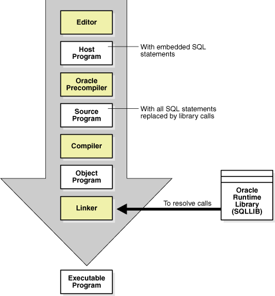

The Oracle Database developer creates and maintains a database application. This section presents a brief overview of what a database developer does and the development tools available.

This section contains the following topics:

### Duties of Database Developers

An Oracle developer is responsible for creating or maintaining the database components of an application that uses the Oracle technology stack.

Oracle developers either develop new applications or convert existing applications to run in an Oracle Database environment. For this reason, developers work closely with the database administrators, sharing knowledge and information.

Oracle database developers can expect to be involved in the following tasks:

- Implementing the data model required by the application
- Creating schema objects
- Implementing rules for data integrity
- Choosing a programming environment for a new development project
- Writing server-side PL/SQL or Java subprograms and client-side procedural code that use SQL statements
- Creating the application interface with the chosen development tool
- Establishing a Globalization Support environment for developing globalized applications
- Instantiating applications in different databases for development, testing, education, and deployment in a production environment

See Also:

- [Oracle Database 2 Day Developer's Guide](https://www.oracle.com/pls/topic/lookup?ctx=en/database/oracle/oracle-database/12.2/cncpt&id=TDDDG10000) for an introduction and GUI-based tutorials in Oracle Database development
- [Oracle Database Development Guide](https://www.oracle.com/pls/topic/lookup?ctx=en/database/oracle/oracle-database/12.2/cncpt&id=GUID-EBCEA9FE-4F25-40DF-B5FD-682C3692E92F) for in-depth discussions of topics such as database design, SQL for developers, and PL/SQL for developers

### Tools for Database Developers

Oracle provides several tools for use in developing database applications. This section describes some commonly used development tools.

#### SQL Developer

**SQL Developer** is a convenient way for database developers to edit and develop basic tasks using SQL\*Plus.

[SQL Developer](glossary.md) is a graphical version of [SQL\*Plus](glossary.md), written in Java, that supports development in SQL and PL/SQL. You can connect to any Oracle database schema using standard database authentication. SQL Developer enables you to:

- Browse, create, edit, and delete schema objects
- Execute SQL statements
- Edit and debug PL/SQL program units
- Manipulate and export data
- Create and display reports

SQL Developer is available in the default Oracle Database installation and by free download.

See Also:

[Oracle Database 2 Day Developer's Guide](https://www.oracle.com/pls/topic/lookup?ctx=en/database/oracle/oracle-database/12.2/cncpt&id=TDDDG12200) and [Oracle SQL Developer User's Guide](https://www.oracle.com/pls/topic/lookup?ctx=en/database/oracle/oracle-database/12.2/cncpt&id=RPTUG10000) to learn how to use SQL Developer

#### Oracle Application Express

Oracle Application Express is a Web application development tool for Oracle Database. Oracle Application Express uses built-in features such as user interface themes, navigational controls, form handlers, and flexible reports to accelerate application development.

Oracle Application Express installs with the database and consists of data in tables and PL/SQL code. When you run an application, your browser sends a URL request that is translated into an Oracle Application Express PL/SQL call. After the database processes the PL/SQL, the results are relayed back to the browser as HTML. This cycle happens each time you request or submit a page.

You can use Oracle Application Express with the embedded PL/SQL gateway. The gateway runs in the Oracle XML DB HTTP server in the database and provides the necessary infrastructure to create dynamic applications. As shown in Figure 22-1, the embedded PL/SQL gateway simplifies the application architecture by eliminating the middle tier.

Figure 22-1 Application Express with Embedded PL/SQL Gateway


> This illustration graphically depicts the architecture of Oracle Application Express when using the Embedded PL/SQL Gateway instead of Oracle HTTP Server (Apache). It shows arrows going in both directions between the Web browser and the Oracle database. The Application Express engine resides within the Oracle database.


See Also:

[Oracle Database 2 Day + Application Express Developer's Guide](https://www.oracle.com/pls/topic/lookup?ctx=en/database/oracle/oracle-database/12.2/cncpt&id=TDPAX01000) to learn how to use Oracle Application Express

#### Oracle JDeveloper

**Oracle JDeveloper** is an integrated development environment (IDE) for building service-oriented applications using the latest industry standards for Java, XML, Web services, and SQL.

[Oracle JDeveloper](glossary.md) supports the complete software development life cycle, with integrated features for modeling, coding, debugging, testing, profiling, tuning, and deploying applications.

Oracle JDeveloper uses windows for various application development tools. For example, when creating a Java application, you can use tools such as the Java Visual Editor and Component Palette. In addition to these tools, Oracle JDeveloper provides a range of navigators to help you organize and view the contents of your projects.

See Also:

- [Oracle Database 2 Day + Java Developer's Guide](https://www.oracle.com/pls/topic/lookup?ctx=en/database/oracle/oracle-database/12.2/cncpt&id=TDPJD-GUID-3F5E954A-D922-4870-96A9-2D389D72692C) to learn how to use JDeveloper
- You can download JDeveloper from the following URL: [`http://www.oracle.com/technetwork/developer-tools/jdev/downloads/`](http://www.oracle.com/technetwork/developer-tools/jdev/downloads/)

#### Oracle Developer Tools for Visual Studio.NET

**Oracle Developer Tools for Visual Studio.NET** is a set of application tools integrated with the Visual Studio.NET environment.

[Oracle Developer Tools for Visual Studio.NET](glossary.md) tools provide GUI access to Oracle functionality, enable the user to perform a wide range of application development tasks, and improve development productivity and ease of use.

Oracle Developer Tools support the programming and implementation of.NET stored procedures using Visual Basic, C#, and other.NET languages. These procedures are written in a.NET language and contain SQL or PL/SQL statements.

See Also:

[Oracle Database 2 Day +.NET Developer's Guide for Microsoft Windows](https://www.oracle.com/pls/topic/lookup?ctx=en/database/oracle/oracle-database/12.2/cncpt&id=TDPNG10000)

### Topics for Database Developers

This section covers topics that are most essential to database developers and that have not been discussed elsewhere in the manual.

This section contains the following topics:

- Principles of Application Design and Tuning
- Client-Side Database Programming
- Globalization Support
- Unstructured Data

#### Principles of Application Design and Tuning

Oracle developers must design, create, and tune database applications so that they achieve security and performance goals.

The following principles of application design and tuning are useful guidelines:

- Learn how Oracle Database works
	As a developer, you want to develop applications in the least amount of time against an Oracle database, which requires exploiting the database architecture and features. For example, not understanding Oracle Database data concurrency controls and multiversioning read consistency may make an application corrupt the integrity of the data, run slowly, and decrease scalability. Knowing how Transaction Guard and Application Continuity work enables you to avoid writing unnecessary exception handling code.
- Use bind variables unless you have a good reason not to use them
	When a query uses bind variables, the database can compile it once and store the [query plan](glossary.md) in the [shared pool](glossary.md). If the same statement is executed again, then the database can perform a [soft parse](glossary.md) and reuse the plan. In contrast, a [hard parse](glossary.md) takes longer and uses more resources. Using bind variables to allow soft parsing is very efficient and is the way the database intends developers to work.
- Implement integrity constraints in the database server rather than in the client
	Using primary and foreign keys enables data to be reused in multiple applications. Coding the rules in a client means that other clients do not have access to these rules when running against the databases.
- Build a test environment with representative data and session activity
	A test environment that simulates your live production environment provides multiple benefits. For example, you can benchmark the application to ensure that it scales and performs well. Also, you can use a test environment to measure the performance impact of changes to the database, and ensure that upgrades and patches work correctly.
- Design the data model with the goal of good performance
	Typically, attempts to use generic data models result in poor performance. A well-designed data model answer the most common queries as efficiently as possible. For example, the data model should use the type of indexes that provide the best performance. Tuning after deployment is undesirable because changes to logical and physical structures may be difficult or impossible.
- Define clear performance goals and keep historical records of metrics
	An important facet of development is determining exactly how the application is expected to perform and scale. For example, use metrics that include expected user load, transactions per second, acceptable response times, and so on. Good practice dictates that you maintain historical records of performance metrics. In this way, you can monitor performance proactively and reactively.
- Instrument the application code
	Good development practice involves adding debugging code to your application. The ability to generate trace files is useful for debugging and diagnosing performance problems.

See Also:

- " [SQL Parsing](sql.md) "
- " [Introduction to Data Concurrency and Consistency](data-concurrency-and-consistency.md) "
- " [Advantages of Integrity Constraints](data-integrity.md) "
- [Oracle Database 2 Day Developer's Guide](https://www.oracle.com/pls/topic/lookup?ctx=en/database/oracle/oracle-database/12.2/cncpt&id=TDDDG70000) for considerations when designing database applications
- [Oracle Database SQL Tuning Guide](https://www.oracle.com/pls/topic/lookup?ctx=en/database/oracle/oracle-database/12.2/cncpt&id=TGSQL133) to learn how to design applications for performance

#### Client-Side Database Programming

You can use precompilers or Java translators to place SQL statements in source code, or you can use APIs to enable applications to interact with the database.

There are two basic techniques enable procedural database applications to use SQL: server-side programming with PL/SQL and Java, and client-side programming with precompilers and APIs such as Java Database Connectivity (JDBC) or Oracle Call Interface (OCI).

See Also:

[Oracle Database Development Guide](https://www.oracle.com/pls/topic/lookup?ctx=en/database/oracle/oracle-database/12.2/cncpt&id=ADFNS00109) to learn how to choose a programming environment

[Server-Side Programming: PL/SQL and Java](server-side-programming.md) to review

##### Embedded SQL

Historically, client/server programs have used embedded SQL to interact with the database.

###### Oracle Precompilers

Client/server programs are typically written using an Oracle precompiler, which is a programming tool that enables you to embed SQL statements in high-level programs.

For example, the Oracle Pro\*C/C++ precompiler enables you to embed SQL statements in a C or C++ source file. Oracle precompilers are also available for COBOL and FORTRAN.

A precompiler provides several benefits, including the following:

- Increases productivity because you typically write less code than equivalent OCI applications
- Enables you to create highly customized applications
- Allows close monitoring of resource use, SQL statement execution, and various run-time indicators
- Saves time because the precompiler, not you, translates each embedded SQL statement into calls to the Oracle Database run-time library
- Uses the Object Type Translator to map Oracle Database object types and collections into C data types to be used in the Pro\*C/C++ application
- Provides compile time type checking of object types and collections and automatic type conversion from database types to C data types

The client application containing the SQL statements is the host program. This program is written in the host language. In the host program, you can mix complete SQL statements with complete C statements and use C variables or structures in SQL statements. When embedding SQL statements you must begin them with the keywords `EXEC SQL` and end them with a semicolon. Pro\*C/C++ translates `EXEC SQL` statements into calls to the run-time library SQLLIB.

Many embedded SQL statements differ from their interactive counterparts only through the addition of a new clause or the use of program variables. The following example compares interactive and embedded `ROLLBACK` statements:

```
ROLLBACK;           -- interactive
EXEC SQL ROLLBACK;  -- embedded
```

The statements have the same effect, but you would use the first in an interactive SQL environment (such as SQL Developer), and the second in a Pro\*C/C++ program.

A precompiler accepts the host program as input, translates the embedded SQL statements into standard database run-time library calls, and generates a source program that you can compile, link, and run in the usual way. Figure 22-2 illustrates typical steps of developing programs that use precompilers.

Figure 22-2 Program Development with Precompilers



> This graphic is depicted as a large, downward-pointing arrow. The arrow contains a stack of boxes. From top to bottom, the boxes are: Editor, Host Program (labeled "With embedded SQL statements"), Oracle Precompiler, Source Program (labeled "With all SQL statements replaced by library calls"), Compiler, Object Program, Linker (pointed to by an Oracle Runtime Library (SQLLIB) box). The arrow point to an Executable Program box.


See Also:

- [Pro\*C/C++ Programmer's Guide](https://www.oracle.com/pls/topic/lookup?ctx=en/database/oracle/oracle-database/12.2/cncpt&id=GUID-20CBCC27-EC6B-4651-92CC-7E008BD73611) for a complete description of the Pro\*C/C++ precompiler
- [Pro\*FORTRAN Supplement to the Oracle Precompilers Guide](https://www.oracle.com/pls/topic/lookup?ctx=en/database/oracle/oracle-database/12.2/cncpt&id=GUID-6CA45FB3-3F07-47F9-BDF5-602BDE0578BE)

###### SQLJ

SQLJ is an ANSI SQL-1999 standard for embedding SQL statements in Java source code. SQLJ provides a simpler alternative to the Java Database Connectivity (JDBC) API for client-side SQL data access from Java.

The SQLJ interface is the Java equivalent of the Pro\* interfaces. You insert SQL statements in your Java source code. Afterward, you submit the Java source files to the SQLJ translator, which translates the embedded SQL to pure JDBC-based Java code.

See Also:

" [SQLJ](server-side-programming.md) "

##### Client-Side APIs

Most developers today use an API to embed SQL in their database applications.

For example, two popular APIs for enabling programs to communicate with Oracle Database are Open Database Connectivity (ODBC) and JDBC. The Oracle Call Interface (OCI) and Oracle C++ Call Interface (OCCI) are two other common APIs for client-side programming.

###### OCI and OCCI

As an alternative to precompilers, Oracle provides the OCI and OCCI APIs.

OCI lets you manipulate data and schemas in a database using a host programming language such as C. OCCI is an object-oriented interface suitable for use with C++. Both APIs enable developers to use native subprogram invocations to access Oracle Database and control SQL execution.

In some cases, OCI provides better performance or more features than higher-level interfaces. OCI and OCCI provide many features, including the following:

- Support for all SQL [DDL](glossary.md), [DML](glossary.md), query, and transaction control facilities available through Oracle Database
- Instant client, a way to deploy applications when disk space is an issue
- Thread management, connection pooling, globalization functions, and direct path loading of data from a C application

OCI and OCCI provide a library of standard database access and retrieval functions in the form of a dynamic run-time library (OCILIB). This library can be linked in an application at run time. Thus, you can compile and link an OCI or OCCI program in the same way as a nondatabase application, avoiding a separate preprocessing or precompilation step. Figure 22-3 illustrates the development process.

Figure 22-3 Development Process Using OCI or OCCI


> This illustration shows the Source Files being processed by the Host Language Compiler, which produces object files.
>
> The object files are next linked by the host linker, with the OCI Library, which outputs the application executable.
>
> The application can then communicate with the Oracle Server.


See Also:

- [Oracle Call Interface Programmer's Guide](https://www.oracle.com/pls/topic/lookup?ctx=en/database/oracle/oracle-database/12.2/cncpt&id=LNOCI16114)
- [Oracle C++ Call Interface Programmer's Guide](https://www.oracle.com/pls/topic/lookup?ctx=en/database/oracle/oracle-database/12.2/cncpt&id=LNCPP001)

###### ODBC and JDBC

ODBC is a standard API that enables applications to connect to a database and then prepare and run SQL statements.

ODBC is independent of programming language, database, and operating system. The goal of ODBC is to enable any application to access data contained in any database.

A [database driver](glossary.md) is software that sits between an application and the database. The driver translates the API calls made by the application into commands that the database can process. By using an ODBC driver, an application can access any data source, including data stored in spreadsheets. The ODBC driver performs all mappings between the ODBC standard and the database.

The Oracle ODBC driver provided by Oracle enables ODBC-compliant applications to access Oracle Database. For example, an application written in Visual Basic can use ODBC to query and update tables in an Oracle database.

JDBC is a low-level Java interface that enables Java applications to interact with Oracle database. Like ODBC, JDBC is a vendor-independent API. The JDBC standard is defined by Sun Microsystems and implemented through the `java.sql` interfaces.

The JDBC standard enables individual providers to implement and extend the standard with their own JDBC drivers. Oracle provides the following JDBC drivers for client-side programming:

- JDBC thin driver
	This pure Java driver resides on the client side without an Oracle client installation. It is platform-independent and usable with both applets and applications.
- JDBC OCI driver
	This driver resides on the client-side with an Oracle client installation. It is usable only with applications. The JDBC OCI driver, which is written in both C and Java, converts JDBC calls to OCI calls.

The following snippets are from a Java program that uses the JDBC OCI driver to create a `Statement` object and query the `dual` table:

```
// Create a statement
Statement stmt = conn.createStatement();
 
// Query dual table
ResultSet rset = stmt.executeQuery("SELECT 'Hello World' FROM DUAL");
```

See Also:

- [Oracle Database Development Guide](https://www.oracle.com/pls/topic/lookup?ctx=en/database/oracle/oracle-database/12.2/cncpt&id=ADFNS00103) and [Oracle Database 2 Day + Java Developer's Guide](https://www.oracle.com/pls/topic/lookup?ctx=en/database/oracle/oracle-database/12.2/cncpt&id=TDPJD-GUID-2ADAB75C-88C9-4956-98C3-FE0ED96444CA) to learn more about JDBC
- [Oracle Database Gateway for ODBC User's Guide](https://www.oracle.com/pls/topic/lookup?ctx=en/database/oracle/oracle-database/12.2/cncpt&id=ODBCU100)

#### Globalization Support

Oracle Database globalization support enables you to store, process, and retrieve data in native languages.

Globalization support enables you to develop multilingual applications and software that can be accessed and run from anywhere in the world simultaneously.

Developers who write globalized database application must do the following:

- Understand the Oracle Database globalization support architecture, including the properties of the different character sets, territories, languages, and linguistic sort definitions
- Understand the globalization functionality of their middle-tier programming environment, including how it can interact and synchronize with the locale model of the database
- Design and write code capable of simultaneously supporting multiple clients running on different operating systems, with different character sets and locale requirements

For example, an application may be required to render content of the user interface and process data in languages and locale preferences of native users. For example, the application must process multibyte Kanji data, display messages and dates in the proper regional format, and process 7-bit ASCII data without requiring users to change settings.

See Also:

[Oracle Database Globalization Support Guide](https://www.oracle.com/pls/topic/lookup?ctx=en/database/oracle/oracle-database/12.2/cncpt&id=NLSPG001) for more information about globalization

##### Globalization Support Environment

The globalization support environment includes the client application and the database. You can control language-dependent operations by setting parameters and environment variables on the client and server, which may exist in separate locations.

Note:

In previous releases, Oracle referred to globalization support capabilities as National Language Support (NLS) features. NLS is actually a subset of globalization support and provides the ability to choose a national language and store data in a specific character set.

Oracle Database provides globalization support for features such as:

- Native languages and territories
- Local formats for date, time, numbers, and currency
- Calendar systems (Gregorian, Japanese Imperial, Thai Buddha, and so on)
- Multiple character sets, including Unicode
- Character semantics

###### Character Sets

A key component of globalization support is a character set, which is an encoding scheme used to display characters on a computer screen.

The following distinction is important in application development:

- A [database character set](glossary.md) determines which languages can be represented in a database. The character set is specified at database creation.
	Note:
	After a database is created, changing its character set is usually very expensive in terms of time and resources. This operation may require converting all character data by exporting the whole database and importing it back.
- A [client character set](glossary.md) is the character set for data entered or displayed by a client application. The character set for the client and database can be different.

A group of characters (for example, alphabetic characters, ideographs, symbols, punctuation marks, and control characters) can be encoded as a character set. An encoded character set assigns a unique numeric code, called a code point or encoded value, to each character in the set. Code points are important in a global environment because of the potential need to convert data between different character sets.

The computer industry uses many encoded character sets. These sets differ in the number of characters available, the characters available for use, code points assigned to each character, and so on. Oracle Database supports most national, international, and vendor-specific encoded character set standards.

Oracle Database supports the following classes of encoded character sets:

- Single-Byte character sets
	Each character occupies one byte. An example of a 7-bit character set is US7ASCII. An example of an 8-bit character set is WE8DEC.
- Multibyte character sets
	Each character occupies multiple bytes. Multibyte sets are commonly used for Asian languages.
- Unicode
	The universal encoded character set enables you to store information in any language by using a single character set. Unicode provides a unique code value for every character, regardless of the platform, program, or language.

See Also:

[Oracle Database Globalization Support Guide](https://www.oracle.com/pls/topic/lookup?ctx=en/database/oracle/oracle-database/12.2/cncpt&id=NLSPG011) to learn about character set migration

###### Locale-Specific Settings

A locale is a linguistic and cultural environment in which a system or program is running. NLS parameters determine locale-specific behavior on both the client and database.

A database session uses NLS settings when executing statements on behalf of a client. For example, the database makes the correct territory usage of the thousands separator for a client. Typically, the `NLS_LANG` environment variable on the client host specifies the locale for both the server session and client application. The process is as follows:

1. When a client application starts, it initializes the client NLS environment from the environment settings.
	All NLS operations performed locally, such as displaying formatting in Oracle Developer applications, use these settings.
2. The client communicates the information defined by `NLS_LANG` to the database when it connects.
3. The database session initializes its NLS environment based on the settings communicated by the client.
	If the client did not specify settings, then the session uses the settings in the initialization parameter file. The database uses the initialization parameter settings only if the client did not specify any NLS settings. If the client specified some NLS settings, then the remaining NLS settings default.

Each session started on behalf of a client application may run in the same or a different locale as other sessions. For example, one session may use the German locale while another uses the French locale. Also, each session may have the same or different language requirements specified.

The following table shows two clients using different `NLS_LANG` settings. A user starts SQL\*Plus on each host, logs on to the same database as `hr`, and runs the same query simultaneously. The result for each session differs because of the locale-specific NLS setting for floating-point numbers.

Table 22-1 Locale-Specific NLS Settings

| t | Client Host 1 | Client Host 2 |
| --- | --- | --- |
| t0 | ``` $ NLS_LANG=American_America.US7ASCII $ export NLS_LANG ``` | ``` $ NLS_LANG=German_Germany.US7ASCII $ export NLS_LANG ``` |
| t1 | ``` $ sqlplus /nolog SQL> CONNECT hr@proddb Enter password: ******* SQL> SELECT 999/10 FROM DUAL;  999/10  ----------  99.9 ``` | ``` $ sqlplus /nolog  SQL> CONNECT hr@proddb  Enter password: *******  SQL> SELECT 999/10 FROM DUAL;     999/10  ----------  99,9 ``` |

See Also:

[Oracle Database 2 Day + Java Developer's Guide](https://www.oracle.com/pls/topic/lookup?ctx=en/database/oracle/oracle-database/12.2/cncpt&id=TDPJD253) and [Oracle Database Globalization Support Guide](https://www.oracle.com/pls/topic/lookup?ctx=en/database/oracle/oracle-database/12.2/cncpt&id=NLSPG189) to learn about NLS settings

##### Oracle Globalization Development Kit

The **Oracle Globalization Development Kit (GDK)** includes comprehensive programming APIs.

APIs are available for both Java and PL/SQL, and include code samples, and documentation that address many of the design, development, and deployment issues encountered while creating global applications. The GDK simplifies the development process and reduces the cost of developing Internet applications used to support a global environment.

The GDK mainly consists of two parts: GDK for Java and GDK for PL/SQL. GDK for Java provides globalization support to Java applications. GDK for PL/SQL provides globalization support to the PL/SQL programming environment. The features offered in the two parts are not identical.

See Also:

[Oracle Database Globalization Support Guide](https://www.oracle.com/pls/topic/lookup?ctx=en/database/oracle/oracle-database/12.2/cncpt&id=NLSPG008)

#### Unstructured Data

Unstructured data is data that is not broken down into smaller logical structures.

The traditional relational model deals with simple structured data that fits into simple tables. Oracle Database also provides support for unstructured data, which cannot be decomposed into standard components. Unstructured data includes text, graphic images, video clips, and sound waveforms.

Oracle Database includes data types to handle unstructured content. These data types appear as native types in the database and can be queried using SQL.

##### Overview of XML in Oracle Database

Oracle XML DB is a set of Oracle Database technologies related to high-performance XML manipulation, storage, and retrieval. Oracle XML DB provides native XML support by encompassing both SQL and XML data models in an interoperable manner.

Oracle XML DB is suited for any Java or PL/SQL application where some or all of the data processed by the application is represented using XML. For example, the application may have large numbers of XML documents that must be ingested, generated, validated, and searched.

Oracle XML DB provides many features, including the following:

- The native `XMLType` data type, which can represent an XML document in the database so that it is accessible by SQL
- Support for XML standards such as XML Schema, XPath, XQuery, XSLT, and DOM
- `XMLIndex`, which supports all forms of XML data, from highly structured to completely unstructured

The following example creates a table `orders` of type `XMLType`:

```
CREATE TABLE orders OF XMLType;
CREATE DIRECTORY xmldir AS path_to_folder_containing_XML_file;
INSERT INTO orders
  VALUES (XMLType(BFILENAME('XMLDIR','purOrder.xml'),NLS_CHARSET_ID('AL32UTF8')));
```

The preceding example also creates a SQL [directory object](glossary.md), which is a logical name in the database for a physical directory on the host computer. This directory contains XML files. The example inserts XML content from the `purOrder.xml` file into the `orders` table.

The [Oracle XML Developer's Kit (XDK)](glossary.md) contains the basic building blocks for reading, manipulating, transforming, and viewing XML documents, whether on a file system or in a database. APIs and tools are available for Java, C, and C++. The production Oracle XDK comes with a commercial redistribution license.

Example 22-1 XMLType

```
CREATE TABLE orders OF XMLType;
CREATE DIRECTORY xmldir AS path_to_folder_containing_XML_file;
INSERT INTO orders
  VALUES (XMLType(BFILENAME('XMLDIR','purOrder.xml'),NLS_CHARSET_ID('AL32UTF8')));
```

See Also:

- [Oracle XML DB Developer’s Guide](https://www.oracle.com/pls/topic/lookup?ctx=en/database/oracle/oracle-database/12.2/cncpt&id=ADXDB0100)
- [Oracle XML Developer's Kit Programmer's Guide](https://www.oracle.com/pls/topic/lookup?ctx=en/database/oracle/oracle-database/12.2/cncpt&id=ADXDK100)

##### Overview of JSON in Oracle Database

Oracle Database provides native support for JavaScript Object Notation (JSON) data, including querying and indexing.

This section contains the following topics:

- What Is JSON?
- JSON and XML
- Native Database Support for JSON

###### What Is JSON?

JavaScript Object Notation (JSON) is a language-independent, text-based data format that can represent objects, arrays, and scalar data. A variety of programming languages can parse and generate JSON data.

JSON commonly serves as a data-interchange language. It is often used for serializing structured data and exchanging it over a network, typically between a server and web applications. JSON is the dominant data format in web browsers that run applications written in HTML-embedded JavaScript.

A [JavaScript object](glossary.md) is an associative array of zero or more pairs of property names and associated JSON values. A [JSON object](glossary.md) is a JavaScript object literal, which is written as a property list enclosed in braces, with name-value pairs separated by commas, and with the name and value of each pair separated by a colon. An object property is sometimes called a key. An object property name-value pair is sometimes called an object member.

Example 22-2 JSON Object

This example shows a JSON object that represents a purchase order, with top-level property names `PONumber`, `Reference`, `Requestor`, `User`, `Costcenter`, `ShippingInstruction`, `Special Instructions`, `AllowPartialShipment`, and `LineItems`.

```
{ "PONumber"             : 1600,
  "Reference"            : "ABULL-20140421",
  "Requestor"            : "Alexis Bull",
  "User"                 : "ABULL",
  "CostCenter"           : "A50",
  "ShippingInstructions" : { "name"   : "Alexis Bull",
                             "Address": { "street"  : "200 Sporting Green",
                                          "city"    : "South San Francisco",
                                          "state"   : "CA",
                                          "zipCode" : 99236,
                                          "country" : "United States of America" },
                             "Phone" : [ { "type" : "Office", "number" : "909-555-7307" },
                                         { "type" : "Mobile", "number" : "415-555-1234" } ] },
  "Special Instructions" : null,
  "AllowPartialShipment" : false,
  "LineItems"            : [ { "ItemNumber" : 1,
                               "Part"       : { "Description" : "One Magic Christmas",
                                                "UnitPrice"   : 19.95,
                                                "UPCCode"     : 13131092899 },
                               "Quantity"   : 9.0 },
                             { "ItemNumber" : 2,
                               "Part"       : { "Description" : "Lethal Weapon",
                                                "UnitPrice"   : 19.95,
                                                "UPCCode"     : 85391628927 },
                               "Quantity"   : 5.0 } ] }
```

In the preceding example, most properties have string values. `PONumber`, `zipCode`, `ItemNumber`, and `Quantity` have numeric values. `Shipping Instructions` and `Address` have objects as values. `LineItems` has an array as a value.

Note:

[Oracle XML DB Developer’s Guide](https://www.oracle.com/pls/topic/lookup?ctx=en/database/oracle/oracle-database/12.2/cncpt&id=ADXDB6247) for a more comprehensive overview of JSON

###### JSON and XML

Both JSON and XML are commonly used as data-interchange languages. Unlike relational data, both JSON data and XML data can be stored, indexed, and queried in the database without any schema that defines the data.

Because of its simple definition and features, JSON data is generally easier to generate, parse, and process than XML data. It is also easier for human beings to learn and to use. The following table describes further differences between JSON and XML.

Table 22-2 Differences Between JSON and XML

| Feature | JSON | XML |
| --- | --- | --- |
| Useful for simple, structured data | Yes | Yes, but also supports semi-structured data and complex structured data |
| Useful for mixed content | No | Yes |
| Lacks attributes, namespaces, inheritance, and substitution | Yes | No |
| Places importance on ordering | No | Yes |
| Primarily intended for documents rather than data | No | Yes |
| Includes a date data type | No | Yes |

Note:

[Oracle Database JSON Developer’s Guide](https://www.oracle.com/pls/topic/lookup?ctx=en/database/oracle/oracle-database/12.2/cncpt&id=GUID-C347AC02-31E4-49CE-9F74-C7C0F339D68E) for a more comprehensive comparison of XML and JSON

###### Native Database Support for JSON

JSON is widely stored in noSQL databases that lack relational database features. In contrast, Oracle Database supports JSON natively with features such as transactions, indexing, declarative querying, and views.

You can access JSON data stored in the database the same way you access other database data, including using OCI,.NET, and JDBC. Unlike XML data, which is stored using SQL data type `XMLType`, JSON data is stored using `VARCHAR2`, `BLOB`, or `CLOB`. By using Oracle SQL, you can perform the operations such as the following on JSON data:

- Join JSON data with non-JSON relational data.
- Generate JSON document from relational data using SQL functions `json_object` and `json_array`.
- Project JSON data into a relational format by using the SQL function `json_table`.
- Create a check constraint with `is_json` to enforce JSON data in a column. The database uses the check constraint to confirm that the column is JSON for JSON-specific operations such as simplified syntax.
- Manipulate JSON documents as PL/SQL objects.
- Use SQL functions `json_query` and `json_value` to accept an Oracle JSON path expression as an argument and match it against the target JSON data.
- Index JSON data.
- Query JSON data stored in an external table.
- Replicate tables with columns containing JSON data using Oracle GoldenGate.

Textual JSON data always uses the Unicode character set, either UTF8 or UTF16. Oracle Database uses UTF8 internally when it parses and queries JSON data. If the data that is input to or output from such processing must be in a different character set from UTF8, then appropriate character-set conversion is carried out automatically.

Example 22-3 Creating, Loading, and Querying a Table with a JSON Column

In this example, you create table `j_purchaseorder` with JSON column `po_document`, and then insert some simple JSON data. Some of the data is elided (`...`).

```
CREATE TABLE j_purchaseorder
   (id          RAW (16) NOT NULL,
    date_loaded TIMESTAMP WITH TIME ZONE,
    po_document CLOB
      CONSTRAINT ensure_json CHECK (po_document IS JSON));

INSERT INTO j_purchaseorder
  VALUES (SYS_GUID(),
          SYSTIMESTAMP,
          '{"PONumber"             : 1600,
            "Reference"            : "ABULL-20140421",
            "Requestor"            : "Alexis Bull",
            "User"                 : "ABULL",
            "CostCenter"           : "A50",
            "ShippingInstructions" : {...}
            "Special Instructions" : null,
            "AllowPartialShipment" : true,
            "LineItems"            : [...]}');
```

The following query extracts the `PONumber` for the objects in JSON column `po_document`:

```
SELECT po.po_document.PONumber FROM j_purchaseorder po;
```

Note:

[Oracle Database JSON Developer’s Guide](https://www.oracle.com/pls/topic/lookup?ctx=en/database/oracle/oracle-database/12.2/cncpt&id=GUID-D7BCE045-EF6D-47E9-9BB2-30C01933248E) for a more comprehensive overview of JSON support in Oracle Database

##### Overview of LOBs

Large object (LOB) data types enable you to store and manipulate large blocks of unstructured data in binary or character format.

The [large object (LOB)](glossary.md) data type provides efficient, random, piece-wise access to the data.

###### Internal LOBs

An internal LOB stores data in the database itself rather than in external files.

Internal LOBS include the following:

- `CLOB` (character LOB), which stores large amounts of text, such as text or XML files, in the database character set
- `NCLOB` (national character set LOB), which stores Unicode data
- `BLOB` (binary LOB), which stores large amounts of binary information as a bit stream and is not subject to character set translation

The database stores LOBs differently from other data types. Creating a LOB column implicitly creates a LOB segment and a LOB index. The tablespace containing the LOB segment and LOB index, which are always stored together, may be different from the tablespace containing the table.

Note:

Sometimes the database can store small amounts of LOB data in the table itself rather than in a separate LOB segment.

The LOB segment stores data in pieces called chunks. A chunk is a logically contiguous set of data blocks and is the smallest unit of allocation for a LOB. A row in the table stores a pointer called a LOB locator, which points to the LOB index. When the table is queried, the database uses the LOB index to quickly locate the LOB chunks.

The database manages read consistency for LOB segments differently from other data. Instead of using undo data to record changes, the database stores the before images in the segment itself. When a transaction changes a LOB, the database allocates a new chunk and leaves the old data in place. If the transaction rolls back, then the database rolls back the changes to the index, which points to the old chunk.

See Also:

- " [User Segment Creation](logical-storage-structures.md) "
- " [Read Consistency and Undo Segments](data-concurrency-and-consistency.md) "

###### External LOBs

A `BFILE` (binary file large object, or LOB) is an external large object.

A `BFILE` is an external LOB, because the database stores a pointer to a file in the operating system. The external data is read-only.

A `BFILE` uses a directory object to locate data. The amount of space consumed depends on the length of the directory object name and the length of the file name.

A `BFILE` does not use the same read consistency mechanism as internal LOBS because the binary file is external to the database. If the data in the file changes, then repeated reads from the same binary file may produce different results.

###### SecureFiles

SecureFiles LOB storage is one of two storage types; the other type is BasicFiles LOB storage.

The `SECUREFILE` LOB parameter enables advanced features, including compression and deduplication (part of the Advanced Compression Option), and encryption (part of the Advanced Security Option). Starting with Oracle Database 12c, SecureFiles is the default storage mechanism for LOBs.

See Also:

- " [Oracle Data Types](tables-and-table-clusters.md) "
- [Oracle Database SecureFiles and Large Objects Developer's Guide](https://www.oracle.com/pls/topic/lookup?ctx=en/database/oracle/oracle-database/12.2/cncpt&id=ADLOB4444) to learn more about LOB data types

##### Overview of Oracle Text

Oracle Text (Text) is a full-text retrieval technology integrated with Oracle Database. Oracle Text indexes any document or textual content stored in file systems, databases, or on the Web. These documents can be searched based on their textual content, metadata, or attributes.

Oracle Text provides the following advantages:

- Oracle Text allows text searches to be combined with regular database searches in a single SQL statement. The Text index is in the database, and Text queries are run in the Oracle Database process. The [optimizer](glossary.md) can choose the best [execution plan](glossary.md) for any query, giving the best performance for ad hoc queries involving Text and structured criteria.
- You can use Oracle Text with XML data. In particular, you can combine `XMLIndex` with Oracle Text indexing, taking advantage of both XML and a full-text index.
- The Oracle Text SQL API makes it simple and intuitive to create and maintain Oracle Text indexes and run searches.

For a use case, suppose you must create a catalog index for an auction site that sells electronic equipment. New inventory is added every day. Item descriptions, bid dates, and prices must be stored together. The application requires good response time for mixed queries. First, you create and populate a `catalog` table. You then use Oracle Text to create a `CTXCAT` index that you can query with the `CATSEARCH` operator in a `SELECT ... WHERE CATSEARCH` statement.

Figure 22-4 illustrates the relation of the catalog table, its `CTXCAT` index, and the catalog application that uses the `CATSEARCH` operator to query the index.

Figure 22-4 Catalog Query Application


> This illustration shows a generalized schema of a catalog query application. It shows a CTXCAT index and a document table as part of the database, and a two-way arrow between the database and a catalog application, representing a SQL CATSEARCH query.


See Also:

- [Oracle Text Application Developer's Guide](https://www.oracle.com/pls/topic/lookup?ctx=en/database/oracle/oracle-database/12.2/cncpt&id=CCAPP9001) and [Oracle Text Reference](https://www.oracle.com/pls/topic/lookup?ctx=en/database/oracle/oracle-database/12.2/cncpt&id=GUID-4775F5FE-4569-4DF4-A7CA-B20EC6880CAB)
- [Oracle XML DB Developer’s Guide](https://www.oracle.com/pls/topic/lookup?ctx=en/database/oracle/oracle-database/12.2/cncpt&id=ADXDB1000) to learn how to perform full-text search over XML data

##### Overview of Oracle Multimedia

Oracle Multimedia enables Oracle Database to store, manage, and retrieve images, DICOM format medical images and other objects, audio, video, or other heterogeneous media data in an integrated fashion with other enterprise information.

Oracle Multimedia provides functions, procedures, and methods for:

- Extracting metadata and attributes from multimedia data
- Embedding metadata created by applications into image and DICOM data
- Obtaining and managing multimedia data from Oracle Database, Web servers, file systems, Picture Archiving and Communication Systems (PACS), and other servers
- Performing operations such as thumbnail generation on image and DICOM data
- Making DICOM data anonymous
- Checking DICOM data for conformity to user-defined validation rules
- Storing, querying, and retrieving DICOM data from Oracle Database using SQL, Java, or the DICOM networking protocol

Stored PL/SQL packages provide multimedia functionality such as image thumbnail creation, image watermarking, and metadata extraction for multimedia data stored in BLOBs and BFILEs. For example, the `ORD_IMAGE` package provides procedures and functions for image data.

##### Overview of Oracle Spatial and Graph

Oracle Spatial and Graph (Spatial and Graph) includes advanced features for spatial data and analysis and for physical, logical, network, and social and semantic graph applications.

The spatial features provide a schema and functions that facilitate the storage, retrieval, update, and query of collections of spatial features in an Oracle database. An example of spatial data is a road map. The spatial data indicates the Earth location (such as longitude and latitude) of objects on the map. When the map is rendered, this spatial data can project the locations of the objects on a two-dimensional piece of paper. A geographic information system (GIS) can store, retrieve, and render this Earth-relative spatial data. When an Oracle database stores this spatial data, you can use Spatial and Graph to manipulate and retrieve this data, and relate this data to other data.

See Also:

[Oracle Spatial and Graph Developer's Guide](https://www.oracle.com/pls/topic/lookup?ctx=en/database/oracle/oracle-database/12.2/cncpt&id=SPATL010)