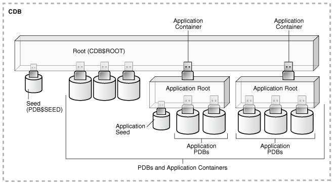
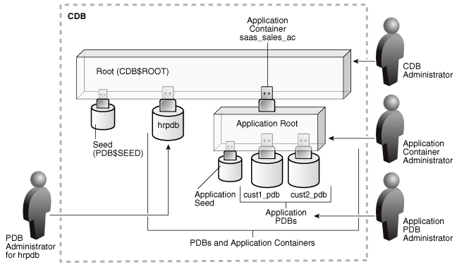
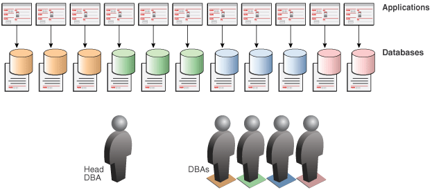
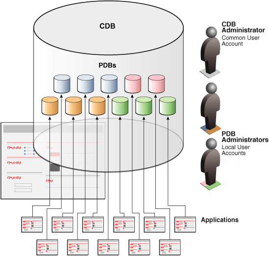
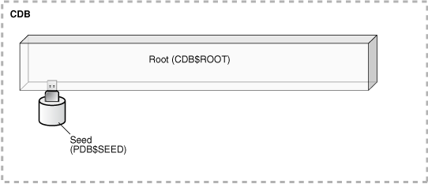
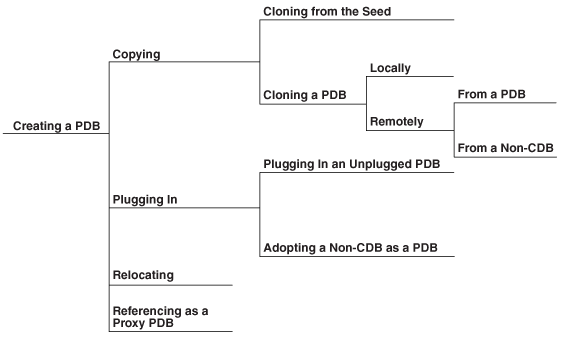
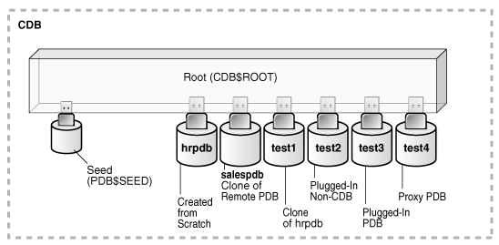
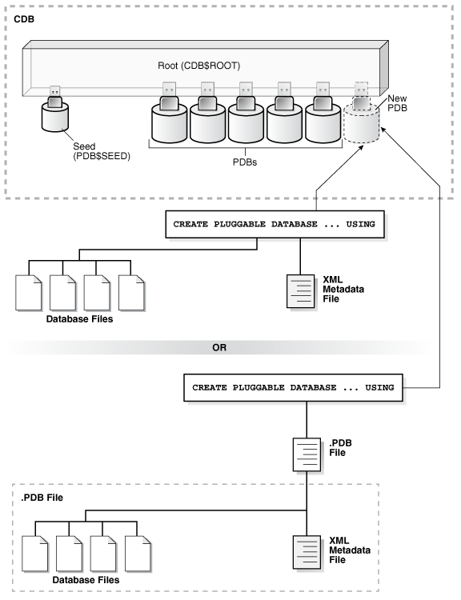

This chapter contains information specific to the Oracle Multitenant option.

It includes the following topics:

### About the Multitenant Architecture

The multitenant architecture enables an Oracle database to function as a multitenant container database (CDB).

A [CDB](glossary.md) includes zero, one, or many customer-created pluggable databases (PDBs). A [PDB](glossary.md) is a portable collection of schemas, schema objects, and nonschema objects that appears to an Oracle Net client as a [non-CDB](glossary.md). All Oracle databases before Oracle Database 12c were non-CDBs.

Video:

[Oracle Database 12c: Introduction to a Multitenant Environment with Tom Kyte](https://www.oracle.com/pls/topic/lookup?ctx=en/database/oracle/oracle-database/12.2/cncpt&id=vid_db_multitenant_kyte)

#### About Containers in a CDB

A container is logical collection of data or metadata within the multitenant architecture.

The following figure represents possible containers in a CDB.

Figure 18-1 Containers in a CDB



> This illustration shows a CDB with the following components:
>
> - The CDB has a `CDB$ROOT` container.
> - A `PDB$SEED` container is plugged into the root container.
> - Several PDBs are plugged into the root container.
> - Two application containers plugged into the root container.
> - Each application container has an application root container.
> - One application container has two application PDBs plugged into its application root container.
> - One application container has three application PDBs plugged into its application root container.
> - The application container with two application PDBs also has an application seed plugged into its application root container.


Every CDB has the following containers:

- Exactly one CDB root container (also called simply the root)
	The [CDB root](glossary.md) is a collection of schemas, schema objects, and nonschema objects to which all PDBs belong (see " [Overview of Containers in a CDB](overview-of-the-multitenant-architecture.md) "). The root stores Oracle-supplied metadata and common users. An example of metadata is the source code for Oracle-supplied PL/SQL packages (see " [Data Dictionary Architecture in a CDB](overview-of-the-multitenant-architecture.md) "). A common user is a database user known in every container (see " [Common Users in a CDB](overview-of-the-multitenant-architecture.md) "). The root container is named `CDB$ROOT`.
- Exactly one system container
	The [system container](glossary.md) includes the root CDB and all PDBs in the CDB. Thus, the system container is the logical container for the CDB itself.
- Zero or more application containers
	An [application container](glossary.md) consists of exactly one [application root](glossary.md), and the PDBs plugged in to this root. Whereas the system container contains the CDB root and all the PDBs within the CDB, an application container includes only the PDBs plugged into the application root. An application root belongs to the CDB root and no other container.
- Zero or more user-created PDBs
	A PDB contains the data and code required for a specific set of features (see " [PDBs](overview-of-the-multitenant-architecture.md) "). For example, a PDB can support a specific application, such as a human resources or sales application. No PDBs exist at creation of the CDB. You add PDBs based on your business requirements.
	A PDB belongs to exactly zero or one application container. If a PDB belongs to an application container, then it is an [application PDB](glossary.md). For example, the `cust1_pdb` and `cust2_pdb` application PDBs might belong to the `saas_sales_ac` application container, in which case they belong to no other application containers. An [application seed](glossary.md) is an optional application PDB that acts as a user-created PDB template, enabling you to create new application PDBs rapidly.
- Exactly one [seed PDB](glossary.md)
	The seed PDB is a system-supplied template that the CDB can use to create new PDBs. The seed PDB is named `PDB$SEED`. You cannot add or modify objects in `PDB$SEED`.

Example 18-1 CDB with No Application Containers

This example shows a simple CDB with five containers: the system container (the entire CDB), the CDB root, the CDB seed, and two PDBs. Each PDB has its own dedicated application. A different PDB administrator manages each PDB. A [common user](glossary.md) exists across a CDB with a single identity. In this example, common user `SYS` can manage the root and every PDB. At the physical level, this CDB has a database instance and database files, just as a non-CDB does.

Figure 18-2 CDB with No Application Containers


> This graphic depicts a CDB as a cylinder. Inside the CDB is a box labeled "Root (CDB$ROOT)." Plugged into the box is the Seed (CDB$SEED), hrpdb, and salespdb. A box labeled "Sales Application" points to salespdb. A box labeled "HR Application" points to hrpdb. To the right of the cylinder is an icon of a person labeled "CDB Administrator." To the left of the cylinder is a person icon labeled "PDB Administrator for hrpdb." An arrow points from this icon to hrpdb. Beneath the hrpdb administrator is a person icon labeled "PDB Administrator for salespdb." This icon points to the salespdb icon. Beneath the cylinder is a horizontal dotted line. Above the line is the text "Logical." Below the line is the text "Physical." A dotted line labeled "Database" contains Data Files icons, Control Files icons, and Online Redo Log icons. Outside the Database box are Archived Redo Log icons and Flashback Log icons.


Example 18-2 CDB with an Application Container

In this variation, the CDB contains an application container named `saas_sales_ac`. Within the application container, the application PDB `cust1_pdb` supports an application for one customer, and the application PDB `cust2_pdb` supports an application for a different customer. The CDB also contains a PDB named `hrpdb`, which supports an HR application, but does not belong to an application container.

Figure 18-3 CDB with an Application Container



> This illustration shows a CDB with the following components:
>
> - The CDB has a `CDB$ROOT` container.
> - A `PDB$SEED` container is plugged into the root container.
> - Several PDBs are plugged into the root container.
> - One application container is plugged into the root container.
> - The application container has an application root container.
> - The application container has two application PDBs plugged into its application root container.
> - The application container also has an application seed plugged into its application root container.
> - A person icon labeled “PDB Administrator for hrpdb” has an arrow pointing to hrpdb.
> - A person icon labeled “CDB Administrator” points toward `CDB$ROOT`.
> - A person icon labeled “Application Container Administrator” points to the application root.
> - A person icon labeled “Application PDB Administrator” points to the application PDBs.


In this example, multiple DBAs manage the CDB environment:

- A CDB administrator manages the CDB itself.
- An application container administrator manages the `saas_sales_ac` container, including application installation and upgrades.
- An application PDB administrator manages the two PDBs in the `saas_sales_ac` container: `cust1_pdb` and `cust2_pdb`.
- A PDB administrator manages `hrpdb`.

See Also:

[Oracle Database Administrator’s Guide](https://www.oracle.com/pls/topic/lookup?ctx=en/database/oracle/oracle-database/12.2/cncpt&id=ADMIN13507) for an introduction to the multitenant architecture

#### About User Interfaces for the Multitenant Architecture

You can use the same administration tools for both CDBs and non-CDBs.

For example, you can use the following tools in a multitenant environment:

- SQL\*Plus for command-line access
	See [SQL\*Plus User's Guide and Reference](https://www.oracle.com/pls/topic/lookup?ctx=en/database/oracle/oracle-database/12.2/cncpt&id=SQPUG008).
- Oracle Enterprise Manager Cloud Control (Cloud Control)
	Cloud Control is an Oracle Database administration tool that provides a graphical user interface (GUI). Cloud Control supports Oracle Database 12c targets, including PDBs, CDBs, and non-CDBs.
	See [Oracle Database Administrator’s Guide](https://www.oracle.com/pls/topic/lookup?ctx=en/database/oracle/oracle-database/12.2/cncpt&id=ADMIN14124) to learn more about Cloud Control.
- Oracle Enterprise Manager Database Express (EM Express)
	EM Express is a web-based management product built into the Oracle database. EM Express enables you to provision and manage PDBs, including the following operations:
	- Creating and dropping PDBs
		- Plugging in and unplugging and PDBs
		- Cloning PDBs
		- Setting resource limits for PDBs
	See [Oracle Database 2 Day DBA](https://www.oracle.com/pls/topic/lookup?ctx=en/database/oracle/oracle-database/12.2/cncpt&id=ADMQS12495) to learn more about using EM Express for managing CDBs and PDBs.
- Oracle Database Configuration Assistant (DBCA)
	DBCA enables you to create CDBs or non-CDBs, and create, plug, and unplug PDBs. See [Oracle Database 2 Day DBA](https://www.oracle.com/pls/topic/lookup?ctx=en/database/oracle/oracle-database/12.2/cncpt&id=ADMQS023) and [Oracle Database Administrator’s Guide](https://www.oracle.com/pls/topic/lookup?ctx=en/database/oracle/oracle-database/12.2/cncpt&id=ADMIN12479) for more information about DBCA.

See Also:

" [Tools for Database Administrators](concepts-for-database-administrators.md) "

### Benefits of the Multitenant Architecture

The multitenant architecture solves a number of problems posed by the traditional non-CDB architecture.

#### Challenges for a Non-CDB Architecture

Large enterprises may use hundreds or thousands of databases. Often these databases run on different platforms on multiple physical servers.

Because of improvements in hardware technology, especially the increase in the number of CPUs, servers are able to handle heavier workloads than before. A database may use only a fraction of the server hardware capacity. This approach wastes both hardware and human resources.

For example, 100 servers may have one database each, with each database using 10% of hardware resources and 10% of an administrator's time. A team of DBAs must manage the SGA, database files, accounts, security, and so on of each database separately, while system administrators must maintain 100 different computers.

To show the problem in reduced scale, Figure 18-4 depicts 11 databases, each with its own application and server. A head DBA oversees a team of four DBAs, each of whom is responsible for two or three databases.

Figure 18-4 Database Environment Before Database Consolidation



> This graphic shows a row of 11 icons labeled "Applications." Each application points down to a cylinder with a file icon behind it. The row is labeled "Databases." Below this set of icons is a person icon labeled "Head DBA." To the right are four person icons labeled "DBAs."


Typical responses include:

- Use virtual machines (VMs).
	In this model, you replicate the operating infrastructure of the physical server—operating system and database—in a virtual machine. VMs are agile, but use technical resources inefficiently, and require individual management. Virtual sprawl, which is just as expensive to manage, replaces the existing physical sprawl.
- Place multiple databases on each server.
	Separate databases eliminate operating system replication, but do not share background processes, system and process memory, or Oracle metadata. The databases require individual management.
- Separate the data logically into schemas or virtual private databases (VPDs).
	This technique uses technical resources efficiently. You can manage multiple schemas or VPDs as one. However, this model is less agile than its alternatives, requiring more effort to manage, secure, and transport. Also, the logical model typically requires extensive application changes, which discourages adoption.

#### Benefits of the Multitenant Architecture for Database Consolidation

Database consolidation is the process of consolidating data from multiple databases into one database on one computer. The Oracle Multitenant option enables you to consolidate data and code without altering existing schemas or applications.

The [PDB/non-CDB compatibility guarantee](glossary.md) means that a PDB behaves the same as a non-CDB as seen from a client connecting with Oracle Net. The installation scheme for an application definition (for example, tables and PL/SQL packages) that runs against a non-CDB runs the same against a PDB and produces the same result. Also, the run-time behavior of client code that connects to the PDB containing the application definition is identical to the behavior of client code that connected to the non-CDB containing this application definition.

Operations that act on an entire non-CDB act in the same way on an entire CDB, for example, when using Oracle Data Guard and database backup and recovery. Thus, the users, administrators, and developers of a non-CDB have substantially the same experience after the database has been consolidated.

The following graphic depicts the databases in Figure 18-4 after consolidation onto one computer. The DBA team is reduced from five to three, with one CDB administrator managing the CDB while two PDB administrators split management of the PDBs.

Figure 18-5 Single CDB



> This graphic depicts a CDB as a cylinder. Inside the cylinder are 11 PDBs. Outside of the cylinder are 11 applications, each one pointing to a different PDB. To the right of the cylinder is a person icon for the CDB Administrator. Below this icon are two person icons for PDB Administrators.


Starting in Oracle Database 12c Release 2 (12.2), you can create an application container that contains application PDBs. This approach enables you to create and manage an application within this container. Most benefits that apply to consolidation into a CDB also apply to consolidation within an application container.

Using the multitenant architecture for database consolidation has the following benefits:

- Cost reduction
	By consolidating hardware and database infrastructure to a single set of background processes, and efficiently sharing computational and memory resources, you reduce costs for hardware and maintenance. For example, 100 PDBs on a single server share one database instance.
- Easier and more rapid movement of data and code
	By design, you can quickly plug a PDB into a CDB, unplug the PDB from the CDB, and then plug this PDB into a different CDB. You can also clone PDBs while they remain available. You can plug in a PDB with any character set and access it without character set conversion. If the character set of the CDB is CDB's character set is AL32UTF8, then PDBs with different database character sets can exist in the same CDB.
- Easier management and monitoring of the physical database
	The [CDB administrator](glossary.md) can manage the environment as an aggregate by executing a single operation, such as patching or performing an RMAN backup, for all hosted tenants and the CDB root. Backup strategies and disaster recovery are simplified.
- Separation of data and code
	Although consolidated into a single physical database, PDBs mimic the behavior of non-CDBs. For example, if user error loses critical data, then a PDB administrator can use Oracle Flashback or point-in-time recovery to retrieve the lost data without affecting other PDBs.
- Secure separation of administrative duties
	A [common user](glossary.md) can connect to any container on which it has sufficient privileges, whereas a [local user](glossary.md) is restricted to a specific PDB. Administrators can divide duties as follows:
	- An administrator uses a common account to manage a CDB or application container. Because a privilege is contained within the container in which it is granted, a local user on one PDB does not have privileges on other PDBs within the same CDB.
	- An administrator uses a local account to manage an individual PDB.
- Ease of performance tuning
	It is easier to collect performance metrics for a single database than for multiple databases. It is easier to size one SGA than 100 SGAs.
- Fewer database patches and upgrades
	It is easier to apply a patch to one database than to 100 databases, and to upgrade one database than to upgrade 100 databases.

See Also:

- [Oracle Database Administrator’s Guide](https://www.oracle.com/pls/topic/lookup?ctx=en/database/oracle/oracle-database/12.2/cncpt&id=ADMIN13509) to learn about managing CDBs and PDBs
- [Oracle Database Security Guide](https://www.oracle.com/pls/topic/lookup?ctx=en/database/oracle/oracle-database/12.2/cncpt&id=DBSEG580) to learn about common users

#### Benefits of the Multitenant Architecture for Manageability

The multitenant architecture has benefits beyond database consolidation. These benefits derive from storing the data and metadata specific to a PDB in the PDB itself rather than storing all dictionary metadata in one place.

By storing its own dictionary metadata, a PDB becomes easier to manage as a distinct unit. This benefit occurs even when only one PDB resides in a CDB. Grouping PDBs into a separately managed application container increases manageability even further.

In a CDB, the data dictionary metadata is split between the root and the PDBs. Benefits of data dictionary separation include the following:

- Easier upgrade of data and code
	For example, instead of upgrading a CDB from one database release to another, you can rapidly unplug a PDB from the existing CDB, and then plug it into a newly created CDB from a higher release.
- Easier migration between servers
	To perform load balancing or to meet SLAs, you can migrate an application database from an on-premise data center to the cloud, or between two servers in the same environment.
- Protection against data corruption within a PDB
	You can flash back a PDB to an SCN or PDB-specific restore point, without affecting other PDBs. This feature is analogous to the Flashback Database feature for a non-CDB.
- Ability to install, administer, and upgrade application-specific data and metadata in a single place
	You can define a set of application-specific PDBs as a single component, called an [application container](glossary.md). You can then define one or more applications within this container. Each application is a named, versioned set of common metadata and data shared within this application container.
	For example, each customer of a SaaS vendor could have its own [application PDB](glossary.md). Each application PDB might have identically defined tables named `sales_mlt`, with different data in each PDB. The PDBs could share a [data-linked common object](glossary.md) named `countries_olt`, which has identical data in each PDB. As an application administrator, you could manage the master application definition so that every new customer gets a PDB with the same objects, and every change to existing schemas (for example, the addition of a new table, or a change in the definition of a table) applies to all PDBs that share the application definition.
- Integration with Oracle Database Resource Manager
	In a multitenant environment, one concern is contention for system resources among the PDBs running on the same server. Another concern is limiting resource usage for more consistent, predictable performance. To address such resource contention, usage, and monitoring issues, use Oracle Database Resource Manager (see " [Overview of Oracle Resource Manager in a CDB](overview-of-the-multitenant-architecture.md) ").

See Also:

- " [Data Dictionary Architecture in a CDB](overview-of-the-multitenant-architecture.md) "
- [Oracle Database Administrator’s Guide](https://www.oracle.com/pls/topic/lookup?ctx=en/database/oracle/oracle-database/12.2/cncpt&id=ADMIN-GUID-1AFD0268-6A2B-4F84-BB4D-4D36976DE53B) to learn more about managing application containers

### Path to Database Consolidation

For the duration of its existence, a database is either a CDB or a non-CDB. You cannot transform a non-CDB into a CDB, or a CDB into a non-CDB. You must define a database as a CDB at creation, and then create PDBs and application containers within this CDB.

The basic path to database consolidation is:

1. Creation of a CDB
2. Creation of a PDB

#### Creation of a CDB

The `CREATE DATABASE ... ENABLE PLUGGABLE DATABASE` SQL statement creates a new CDB. If you do not specify the `ENABLE PLUGGABLE DATABASE` clause, then the newly created database is a non-CDB and can never contain PDBs.

Along with the root container (`CDB$ROOT`), Oracle Database automatically creates a seed PDB (`PDB$SEED`). The following graphic shows a newly created CDB:

Figure 18-6 CDB with Seed PDB



> This graphic depicts a rectangle with a dotted-line border. The rectangle is labeled "CDB." Inside the CDB is a long box labeled "Root (CDB$ROOT)." An cylinder icon labeled "Seed (PDB$SEED)" is plugged into the Root box.


Example 18-3 Determining Whether a Database Is a CDB

The following simple query determines whether the database to which an administrative user is currently connected is a non-CDB, or a container in a CDB:

```
SQL> SELECT NAME, CDB, CON_ID FROM V$DATABASE;
 
NAME      CDB     CON_ID
--------- --- ----------
CDB1      YES          0
```

See Also:

- [Oracle Database Administrator’s Guide](https://www.oracle.com/pls/topic/lookup?ctx=en/database/oracle/oracle-database/12.2/cncpt&id=ADMIN13514) to learn how to create a CDB using DBCA or the `CREATE DATABASE` statement
- [Oracle Database SQL Language Reference](https://www.oracle.com/pls/topic/lookup?ctx=en/database/oracle/oracle-database/12.2/cncpt&id=SQLRF01204) for more information about specifying the clauses and parameter values for the `CREATE DATABASE` statement

#### Creation of a PDB

The `CREATE PLUGGABLE DATABASE` SQL statement creates a PDB.

The following sections describe the different techniques for creating PDBs.

- Creation of a PDB by Cloning
- Creation of a PDB by Plugging In an Unplugged PDB
- Creation of a PDB by Relocating
- Creation of a PDB as a Proxy PDB

See Also:

[Oracle Database Administrator’s Guide](https://www.oracle.com/pls/topic/lookup?ctx=en/database/oracle/oracle-database/12.2/cncpt&id=GUID-F6C4F50C-E31C-450A-A2F4-8903515DDEFE) to learn how to create PDBs

##### About PDB Creation

A CDB supports multiple techniques for creating PDBs.

The created PDB automatically includes a full data dictionary including metadata and internal links to system-supplied objects in the CDB root. You must define every PDB from a single root: either the [CDB root](glossary.md) or an [application root](glossary.md).

The following graphic depicts the options for creating a PDB.

Figure 18-7 Creating a PDB



> This graphic depicts a flowchart. On the left is "Creating a PDB." Two options flow from "Creating a PDB:" "Copying" and "Plugging In."
>
> Two options flow from "Copying:" "Copying Files from the Seed" and "Cloning a PDB." Two options flow from "Cloning a PDB:" "Locally" and "Remotely."
>
> Two options flow from "Plugging In:" "Plugging In an Unplugged PDB" and "Plugging in a Non-CDB as a PDB."


Each PDB has a globally unique identifier (GUID). The PDB GUID is primarily used to generate names for directories that store the PDB's files, including both Oracle Managed Files directories and non-Oracle Managed Files directories.

Example 18-4 PDBs Created Using Different Techniques

The following graphic shows a sample CDB that contains six PDBs:



> This graphic depicts a rectangle with a dotted-line border. The rectangle is labeled "CDB." Inside the CDB is a long box labeled "Root (CDB$ROOT)." An cylinder icon labeled "Seed (PDB$SEED)" is plugged into the Root box. Six other cylinder icons are plugged into the root box. From left to right, the icons are hrpdb, salespdb, test1, test, test3, and test4. The hrpdb icon has the callout "Created from Scratch." The salespdb icon has the icon "Plugged in." The remaining PDBs have the callout "Copied from salespdb."


The PDBs were created as follows:

- `hrpdb` is a new PDB that was created (cloned) from the [seed PDB](glossary.md).
- `salespdb` is a clone of a PDB that resides in a remote CDB.
- `test1` is a clone of the local PDB named `hrpdb`.
- `test2` is a PDB created by plugging in a non-CDB.
- `test3` is a PDB created by plugging in an unplugged PDB.
- `test4` is a [proxy PDB](glossary.md), which is a PDB that references a different PDB. In this case, the proxy PDB is local, whereas the referenced PDB is in a separate CDB. All statements that you issue in `test4` execute in the remote PDB.

##### Creation of a PDB by Cloning

One technique for creating a PDB is called cloning. You can clone a PDB from `PDB$SEED`, an application seed, a remote or local PDB, or a non-CDB.

This section contains the following topics:

- Creation of a PDB from a Seed
- Creation of a PDB by Cloning a PDB or a Non-CDB

###### Creation of a PDB from a Seed

You can use the `CREATE PLUGGABLE DATABASE` statement to create a PDB from a seed.

A seed is a PDB that serves as a template for creation of another PDB. Creation from a seed copies some or all of the contents of a PDB, and then assigning a new unique identifier.

A seed PDB is either:

- The CDB seed (`PDB$SEED`), which is a system-supplied template for creating PDBs
	Every CDB has exactly one CDB seed, which cannot be modified or dropped.
- An [application seed](glossary.md), which is a user-created PDB for a specified [application root](glossary.md)
	Within an [application container](glossary.md), you can create an application seed using the `CREATE PLUGGABLE DATABASE AS SEED` statement, which you can then use to accelerate creation of new application PDBs.

Figure 18-8 Creation from PDB$SEED


> This illustration shows a CDB with a CDB$ROOT container, a PDB$SEED container plugged into the root, and several PDBs plugged into the root. One PDB is a new PDB. The illustration shows the PDB$SEED database files associated with the PDB$SEED container. The illustration shows the seed database files copied to a new location. The copied files are the files of the new PDB. The illustration shows the copied files associated with the new PDB. A CREATE PLUGGABLE DATABASE statement uses these copied files to create the new PDB.


Example 18-5 Creation of a PDB from PDB$SEED

The following SQL statement creates a PDB named `hrpdb` from the CDB seed using Oracle Managed Files:

```
CREATE PLUGGABLE DATABASE hrpdb
 ADMIN USER dba1 IDENTIFIED BY password;
```

See Also:

[Oracle Database Administrator’s Guide](https://www.oracle.com/pls/topic/lookup?ctx=en/database/oracle/oracle-database/12.2/cncpt&id=ADMIN13566) to learn this technique

###### Creation of a PDB by Cloning a PDB or a Non-CDB

To clone a PDB or non-CDB, use the `CREATE PLUGGABLE DATABASE` statement with the `FROM` clause.

In this technique, the source is either a non-CDB, or a PDB in a local or remote CDB. The target is the PDB copied from the source. The cloning operation copies the files associated with the source to a new location, and then assigns a new GUID to create the PDB.

This technique is useful for quickly creating PDBs for testing and development. For example, you might test a new or modified application on a cloned PDB before deploying the application in a production PDB. If a PDB is in [local undo mode](glossary.md), then the source PDB can be open in read/write mode during the operation, referred to as [hot cloning](glossary.md).

Note:

If you clone a PDB from a remote CDB, then you must use a [database link](glossary.md).

If you run `CREATE PLUGGABLE DATABASE` statement in an application root, then the cloned PDB is created in the application container. In this case, the application name and version of the source PDB must be compatible with the application name and version of the application container.

The following graphic illustrates cloning a PDB when both source and target are in the same CDB.

Figure 18-9 Cloning a PDB


> This illustration shows a CDB with a CDB$ROOT container, a PDB$SEED container plugged into the root, and several PDBs plugged into the root. One PDB is a new PDB. The illustration shows the database files of the source PDB. The illustration shows the source PDB files copied to a new location. The copied files are the files of the new PDB. The illustration shows the copied files associated with the new PDB. A CREATE PLUGGABLE DATABASE... FROM statement uses these copied files to create the new PDB.


Example 18-6 Cloning a PDB

The following SQL statement clones a PDB named `salespdb` from the plugged-in PDB named `hrpdb`:

```
CREATE PLUGGABLE DATABASE salespdb FROM hrpdb;
```

See Also:

- " [Overview of Tablespaces and Database Files in a CDB](overview-of-the-multitenant-architecture.md) "
- " [Application Maintenance](overview-of-the-multitenant-architecture.md) "
- [Oracle Database Administrator’s Guide](https://www.oracle.com/pls/topic/lookup?ctx=en/database/oracle/oracle-database/12.2/cncpt&id=ADMIN13583) to learn how to create a PDB by cloning an existing PDB or non-CDB

###### Snapshot Copy PDBs

If the underlying file system supports storage snapshots, then you can use them by specifying the `SNAPSHOT COPY` clause. Snapshot copies make cloning almost instantaneous.

When creating a [snapshot copy PDB](glossary.md), Oracle Database does not make a complete copy of the source data files. Rather, Oracle Database creates a storage-level snapshot of the underlying file system, and then uses the snapshot to create PDB clones. Unlike a standard clone PDB, a snapshot copy PDB cannot be unplugged from the CDB root or application root.

Note:

[Oracle Database Administrator’s Guide](https://www.oracle.com/pls/topic/lookup?ctx=en/database/oracle/oracle-database/12.2/cncpt&id=ADMIN-GUID-8A6287A1-14E5-4B45-972F-FC2FB3CDCF8B) to learn how to clone a PDB using the `SNAPSHOT COPY` clause

###### Refreshable Clone PDBs

A refreshable clone PDB is a read-only clone of a source PDB that can periodically synchronize with a source PDB. Depending on the value you specify in the `REFRESH MODE` clause, the synchronization occurs either automatically or manually.

For example, if you clone `hrpdb_dev` from `hrpdb`, then every month you could manually update `hrpdb_dev` with the changed data contained in `hrpdb`. Alternatively, you could specify that `hrpdb` should propagate changes to `hrpdb_dev` automatically every 24 hours.

Note:

[Oracle Database Administrator’s Guide](https://www.oracle.com/pls/topic/lookup?ctx=en/database/oracle/oracle-database/12.2/cncpt&id=ADMIN-GUID-B99FE87D-151B-4350-84B3-BB5E7150E414) to learn how to clone a PDB using the `REFRESH MODE` clause

##### Creation of a PDB by Plugging In

You can create a PDB by plugging in an unplugged PDB, or plugging in a non-CDB as a PDB.

This section contains the following topics:

- Creation of a PDB by Plugging In an Unplugged PDB
- Creation of a PDB from a Non-CDB

###### Creation of a PDB by Plugging In an Unplugged PDB

An unplugged PDB is a self-contained set of data files, and an XML metadata file that specifies the locations of the PDB files. To plug in an unplugged PDB, use the `CREATE PLUGGABLE DATABASE` statement with the `USING` clause.

When plugging in an unplugged PDB, you have the following options:

- Specify the XML metadata file that describes the PDB and the files associated with the PDB.
- Specify a [PDB archive file](glossary.md), which is a compressed file that contains both the XML file and PDB data files. You can create a PDB by specifying the archive file, and thereby avoid copying the XML file and the data files separately.

The following graphic illustrates plugging in an unplugged PDB using the XML file.

Figure 18-10 Plugging In an Unplugged PDB



> This illustration shows a CDB with a `CDB$ROOT` container, a `PDB$SEED` container plugged into the root, and several PDBs plugged into the root. One PDB is a new PDB. The illustration shows two options for creating the new PDB:
>
> - A `CREATE` `PLUGGABLE` `DATABASE` `...` `USING` statement uses the unplugged PDB’s XML metadata file along with the unplugged PDB’s database files to create the new PDB.
> - A `CREATE` `PLUGGABLE` `DATABASE` `...` `USING` statement uses a.PDB archive file to create the new PDB. The.PDB archive file contains the unplugged PDB’s database files and the unplugged PDB’s XML metadata file that are used to create the new PDB.


Example 18-7 Plugging In a PDB

The following SQL statement plugs in a PDB named `salespdb` based on the metadata stored in the named XML file, and specifies `NOCOPY` because the files of the unplugged PDB do not need to be moved to a new location:

```
CREATE PLUGGABLE DATABASE salespdb USING '/disk1/usr/salespdb.xml' NOCOPY;
```

See Also:

[Oracle Database Administrator’s Guide](https://www.oracle.com/pls/topic/lookup?ctx=en/database/oracle/oracle-database/12.2/cncpt&id=ADMIN13572) to learn how to perform this technique

###### Creation of a PDB from a Non-CDB

You can move a non-CDB into a PDB.

You can accomplish this task in the following ways:

- Executing `DBMS_PDB.DESCRIBE` on a non-CDB in Oracle Database 12c
	You place a non-CDB in a transactionally consistent state, and then run the `DBMS_PDB.DESCRIBE` function to generate XML metadata about this database. While connected to the root in the CDB, you execute the `CREATE PLUGGABLE DATABASE` statement to create a PDB from the existing non-CDB. Finally, to convert the definitions in the PDB data dictionary to references to objects in `CDB$ROOT`, log in to the PDB and run the `noncdb_to_pdb.sql` script.
	See [Oracle Database Administrator’s Guide](https://www.oracle.com/pls/topic/lookup?ctx=en/database/oracle/oracle-database/12.2/cncpt&id=ADMIN13598) to learn how to perform this technique.
- Using Oracle Data Pump with or without transportable tablespaces
	You can define a data set on a non-CDB using Oracle Data Pump. This non-CDB can be in the current or a previous Oracle Database release, for example, Oracle Database 10g. You create an empty PDB in an existing CDB, and then use Oracle Data Pump to import the data set into the PDB.
	A Full Transportable Export using Oracle Data Pump exports all objects and data necessary to create a complete copy of the database. Oracle Data Pump exports objects using direct path unload and external tables, and then imports objects using [direct path INSERT](glossary.md) and external tables. The Full Transportable dump file contains all objects in the database, not only table-related objects. Full Transportable Export is available starting in Oracle Database 11g Release 2 (11.2.0.3) for import into Oracle Database 12c.
	See [Oracle Database Administrator’s Guide](https://www.oracle.com/pls/topic/lookup?ctx=en/database/oracle/oracle-database/12.2/cncpt&id=ADMIN13597) to learn how to perform this technique.
- Using Oracle GoldenGate replication
	You replicate the data from the non-CDB to a PDB. When the PDB becomes current with the non-CDB, you switch over to the PDB.
	See [Oracle Database Administrator’s Guide](https://www.oracle.com/pls/topic/lookup?ctx=en/database/oracle/oracle-database/12.2/cncpt&id=ADMIN13597) to learn how to perform this technique.

The following figure illustrates running the `DBMS_PDB.DESCRIBE` function on a non-CDB, and then creating a PDB using the non-CDB files.

Figure 18-11 Creating a PDB from a Non-CDB


> This illustration shows a CDB with a `CDB$ROOT` container, a `PDB$SEED` container plugged into the root, and several PDBs plugged into the root. One PDB is a new PDB. The illustration shows the non-CDB being moved into the new PDB using the `DBMS_PDB.DESCRIBE` procedure. The illustration shows this procedure extracting an XML metadata file that contains information about the non-CDB's database files. A `CREATE` `PLUGGABLE` `DATABASE` `...` `USING` statement uses these XML metadata file and the database files to create the new PDB.


See Also:

- " [Oracle GoldenGate](topics-for-database-administrators-and-developers.md) "
- [Oracle Database Administrator’s Guide](https://www.oracle.com/pls/topic/lookup?ctx=en/database/oracle/oracle-database/12.2/cncpt&id=ADMIN13550) for an overview of how to create PDBs

##### Creation of a PDB by Relocating

To relocate a PDB from one CDB to another, use the `CREATE PLUGGABLE DATABASE` statement with the `FROM` clause and `RELOCATE` keyword.

This technique has the following advantages:

- The relocation occurs with minimal downtime.
- The technique keeps the PDB being relocated open in read/write mode during the relocation, and then brings the PDB online in its new location.

A database link created at the destination CDB is required. Also, the source PDB must use local undo data (see " [Overview of Tablespaces and Database Files in a CDB](overview-of-the-multitenant-architecture.md) ").

The following graphic depicts a PDB relocation.

Figure 18-12 Relocating a PDB


> This illustration shows two CDBs. Both CDBs have a `CDB$ROOT` container, a `PDB$SEED` container plugged into the root, and several PDBs plugged into the root. The top CDB has one PDB that is being relocated. The bottom CDB has one new PDB that was relocated from the top CDB. The illustration shows a database link going from the CDB root in the bottom CDB to the CDB root in the top CDB. The illustration shows the files of the PDB being relocated. The illustration shows the PDB’s files moved to a new location. The illustration shows the moved files associated with the new PDB. A `CREATE` `PLUGGABLE` `DATABASE` `...` `FROM``...` `RELOCATE` statement uses these moved files to create the new PDB.


Example 18-8 PDB Relocation

The following statement, which is issued at a destination CDB, relocates `hrpdb` from the source CDB to the destination CDB:

```
CREATE PLUGGABLE DATABASE hrpdb FROM hrpdb@lnk_to_source RELOCATE;
```

See Also:

[Oracle Database Administrator’s Guide](https://www.oracle.com/pls/topic/lookup?ctx=en/database/oracle/oracle-database/12.2/cncpt&id=ADMIN-GUID-75519361-3DA2-4558-A7E5-64BC16FAFC7D) to learn how to relocate a PDB

##### Creation of a PDB as a Proxy PDB

A **proxy PDB** provides access to different PDB, called the **referenced PDB**, in a remote CDB.

Proxy PDBs enable you to aggregate data from multiple sources. A SQL statement submitted for execution in a proxy PDB executes within the referenced PDB.

A typical use case is a proxy PDB that references application root replica. If multiple CDBs have the same application definition (for example, same tables and PL/SQL packages), then you can create a proxy PDB in the application container of the master application root. The referenced PDB for the proxy PDB is the application root in a different CDB. By running installation scripts in the master root, the application roots in the other CDBs become replicas of the master application root.

To create a proxy PDB, use the `CREATE PLUGGABLE DATABASE` statement with the `FROM` clause, which must specify a database link to the referenced PDB in the remote CDB, and the `AS PROXY` clause.

Note:

If you plug a proxy PDB directly into `CDB$ROOT`, then you must have created the proxy in `CDB$ROOT`. A proxy of an application PDB must both be plugged in to an application root.

Figure 18-13 Creating a Proxy PDB


> This illustration shows two CDBs. Both CDBs have a `CDB$ROOT` container, a `PDB$SEED` container plugged into the root, and several PDBs plugged into the root. The top CDB has one PDB that is being referenced for a new proxy PDB in the bottom CDB. The illustration shows a database link going from the bottom CDB to the PDB being referenced in the top CDB. The illustration shows the referenced PDB’s `SYSTEM` and `SYSAUX` tablespace files copied to a new location. The illustration shows the proxy PDB using the copied files. A `CREATE` `PLUGGABLE` `DATABASE` `...` `AS PROXY ``...` `FROM` statement creates the proxy PDB.


Example 18-9 Creation of a Proxy PDB

This example create a proxy PDB named `pdb1`. The referenced PDB is specified using a database link.

```
CREATE PLUGGABLE DATABASE pdb1 AS PROXY FROM pdb1@pdb1_link;
```

Note:

[Oracle Database Administrator’s Guide](https://www.oracle.com/pls/topic/lookup?ctx=en/database/oracle/oracle-database/12.2/cncpt&id=ADMIN-GUID-7C23D560-5AD5-4AF2-93B4-F4FDC6DE768C) to learn how to create a PDB as a proxy PDB

### Multitenant Environment Documentation Roadmap

This topic lists the most important topics for understanding and using CDBs, and includes cross-references to the appropriate documentation.

Table 18-1 Road map for the Multitenant Architecture Documentation

| Category | Topic | Documentation |
| --- | --- | --- |
| Concepts | Overview of CDBs and PDBs | Chapters in Oracle Database Concepts, and [Oracle Database Administrator’s Guide](https://www.oracle.com/pls/topic/lookup?ctx=en/database/oracle/oracle-database/12.2/cncpt&id=ADMIN13507) |
| Administration | Creating and configuring a CDB | [Oracle Database Administrator’s Guide](https://www.oracle.com/pls/topic/lookup?ctx=en/database/oracle/oracle-database/12.2/cncpt&id=ADMIN13514) |
| Administration | Managing a CDB | [Oracle Database Administrator’s Guide](https://www.oracle.com/pls/topic/lookup?ctx=en/database/oracle/oracle-database/12.2/cncpt&id=ADMIN13606) |
| Administration | Creating and configuring PDBs | [Oracle Database Administrator’s Guide](https://www.oracle.com/pls/topic/lookup?ctx=en/database/oracle/oracle-database/12.2/cncpt&id=ADMIN13549) |
| Administration | Managing PDBs | [Oracle Database Administrator’s Guide](https://www.oracle.com/pls/topic/lookup?ctx=en/database/oracle/oracle-database/12.2/cncpt&id=ADMIN13663) |
| Administration | Creating and removing application containers | [Oracle Database Administrator’s Guide](https://www.oracle.com/pls/topic/lookup?ctx=en/database/oracle/oracle-database/12.2/cncpt&id=GUID-E2B95068-D16D-438D-9A0B-974540988990) |
| Administration | Administering application containers | [Oracle Database Administrator’s Guide](https://www.oracle.com/pls/topic/lookup?ctx=en/database/oracle/oracle-database/12.2/cncpt&id=GUID-1AFD0268-6A2B-4F84-BB4D-4D36976DE53B) |
| Performance | Troubleshooting PDBs | [Oracle Database Performance Tuning Guide](https://www.oracle.com/pls/topic/lookup?ctx=en/database/oracle/oracle-database/12.2/cncpt&id=GUID-D64AEB01-18FF-47EF-BB5C-A0611117D180) |
| Monitoring | Viewing information about CDBs and PDBs | [Oracle Database Administrator’s Guide](https://www.oracle.com/pls/topic/lookup?ctx=en/database/oracle/oracle-database/12.2/cncpt&id=GUID-208C0C35-D105-443B-B788-381F090B1D11) |
| Backup and Recovery | Performing backup and recovery in a CDB | [Oracle Database Backup and Recovery User’s Guide](https://www.oracle.com/pls/topic/lookup?ctx=en/database/oracle/oracle-database/12.2/cncpt&id=BRADV428) |
| Security | Managing common users, roles, and privileges in a CDB | [Oracle Database Security Guide](https://www.oracle.com/pls/topic/lookup?ctx=en/database/oracle/oracle-database/12.2/cncpt&id=DBSEG573) |
| Miscellaneous | All other tasks relating to managing a CDB or PDB, including Oracle RAC, resource management, data transfer, and so on | [Oracle Database Administrator’s Guide](https://www.oracle.com/pls/topic/lookup?ctx=en/database/oracle/oracle-database/12.2/cncpt&id=GUID-93F1E584-D309-4301-82E0-AD0E60D4977C) is the primary task-oriented intermediate and advanced documentation for managing CDBs. This guide also contains See Also links to books that cover different CDB topics. For example, [Oracle Database Utilities](https://www.oracle.com/pls/topic/lookup?ctx=en/database/oracle/oracle-database/12.2/cncpt&id=SUTIL4334) explains concepts and tasks specific to PDBs when using Oracle Data Pump. |