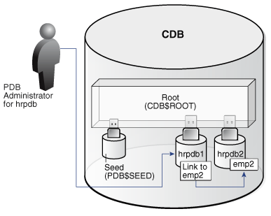
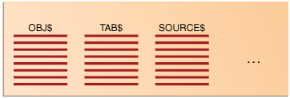
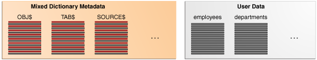
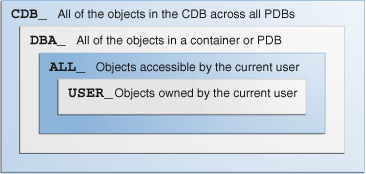
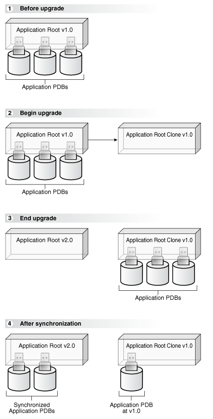
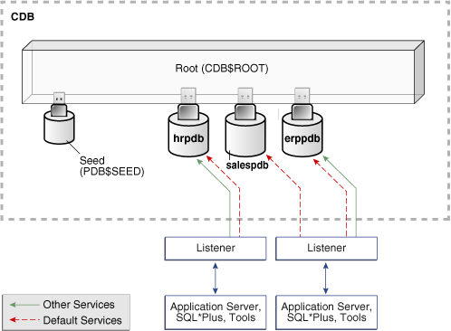
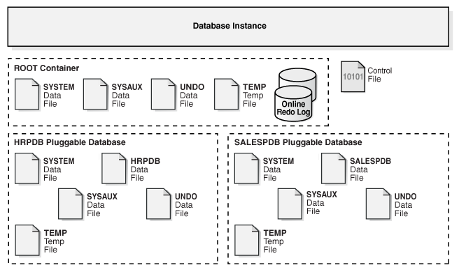

This chapter describes the most important components of the multitenant architecture.

This section contains the following topics:

### Overview of Containers in a CDB

A **container** is a collection of schemas, objects, and related structures in a **multitenant container database (CDB)**. Within a CDB, each container has a unique ID and name.

This section contains the following topics:

- The CDB Root and System Container
- PDBs
- Data Dictionary Architecture in a CDB
- Current Container
- Cross-Container Operations

#### The CDB Root and System Container

The **CDB root**, also called simply the root, is a collection of schemas, schema objects, and nonschema objects to which all PDBs belong.

Every CDB has one and only one root container named `CDB$ROOT`. The root stores the system metadata required to manage PDBs. All PDBs belong to the root. The [system container](glossary.md) is the CDB root and all PDBs that belong to this root.

The CDB root does not store user data. Oracle recommends that you do not add common objects to the root or modify Oracle-supplied schemas in the root. However, you can create common users and roles for database administration (see " Common Users in a CDB "). A common user with the necessary privileges can switch between containers.

Oracle recommends AL32UTF8 for the root character set. PDBs with different character sets can reside in the same CDB without requiring character set conversion.

Example 19-1 All Containers in a CDB

The following query, issued by an administrative user connected to the CDB root, lists all containers in the CDB (including the seed and CDB root), ordered by `CON_ID`.

```
SQL> COL NAME FORMAT A15
SQL> SELECT NAME, CON_ID, DBID, CON_UID, GUID FROM V$CONTAINERS ORDER BY CON_ID;

NAME                CON_ID       DBID    CON_UID GUID
--------------- ---------- ---------- ---------- --------------------------------
CDB$ROOT                 1 1895287725          1 2003321EDD4F60D6E0534E40E40A41C5
PDB$SEED                 2 2795386505 2795386505 200AC90679F07B55E05396C0E40A23FE
SAAS_SALES_AC            3 1239646423 1239646423 200B4CE0A8DC1D24E05396C0E40AF8EE
SALESPDB                 4 3692549634 3692549634 200B4928319C1BCCE05396C0E40A2432
HRPDB                    5 3784483090 3784483090 200B4928319D1BCCE05396C0E40A2432
```

See Also:

[Oracle Database Administrator’s Guide](https://www.oracle.com/pls/topic/lookup?ctx=en/database/oracle/oracle-database/12.2/cncpt&id=ADMIN13507)

#### PDBs

A PDB is a user-created set of schemas, objects, and related structures that appears logically to a client application as a separate database.

Every PDB is owned by `SYS`, which is a [common user](glossary.md) in the CDB, regardless of which user created the PDB.

This section contains the following topics:

- Types of PDBs
- Purpose of PDBs
- Proxy PDBs
- Names for PDBs
- Namespaces in a CDB
- Database Links Between PDBs

##### Types of PDBs

All PDBs are user-created with the `CREATE PLUGGABLE DATABASE` statement except for `PDB$SEED`, which is Oracle-supplied.

You can create the following types of PDBs.

Standard PDB

This type of PDB results from running `CREATE PLUGGABLE DATABASE` without specifying the PDB as a seed, proxy PDB, or [application root](glossary.md). Its capabilities depend on the container in which you create it:

- PDB plugged in to the [CDB root](glossary.md)
	This PDB belongs to the CDB root container and not an [application container](glossary.md). This type of PDB cannot use application common objects. See " Application Common Objects ".
- Application PDB
	An [application PDB](glossary.md) belongs to exactly one application container. Unlike PDBs plugged in to the CDB root, application PDBs can share a master [application](glossary.md) definition within an application container. For example, a `usa_zipcodes` table in an application root might be a [data-linked common object](glossary.md), which means it contains data accessible by all application PDBs plugged in to this root. PDBs that do not reside within the application container cannot access its application common objects.

A [refreshable clone PDB](glossary.md) is a read-only clone of a source PDB that can receive incremental changes from a source PDB. You can configure the clone PDB to receive the changes automatically or only manually.

A [snapshot copy PDB](glossary.md) is created using storage-level snapshot. Unlike a standard PDB clone, a snapshot copy PDB cannot be unplugged.

Application Root

Consider an application root as an application-specific root container. It serves as a repository for a master definition of an application back end, including common data and metadata. To create an application root, connect to the CDB root and specify the `AS APPLICATION CONTAINER` clause in a `CREATE PLUGGABLE DATABASE` statement. See " Application Root ".

Seed PDBs

Unlike a standard PDB, a seed PDB is not intended to support an application. Rather, the seed is a template for the creation of PDBs that support applications. A seed can be either of the following:

- Seed PDB plugged in the CDB root (`PDB$SEED`)
	You can use this system-supplied template to create new PDBs either in an application container or the system container. The system container contains exactly one CDB seed. You cannot drop the seed, or add or modify objects in `PDB$SEED`.
- Application seed PDB
	To accelerate creation of application PDBs within an application container, you can create an optional [application seed](glossary.md). An application container contains either zero or one application seed.
	You create an application seed by connecting to the application container and executing the `CREATE PLUGGABLE DATABASE ... AS SEED` statement. See " Application Seed ".

Proxy PDBs

A [proxy PDB](glossary.md) is a PDB that uses a database link to reference a PDB in a remote CDB. When you issue a statement in a proxy PDB while the PDB is open, the statement executes in the referenced PDB.

You must create a proxy PDB while connected to the CDB root or application root. You can alter or drop a proxy PDB just as you can a standard PDB.

See Also:

[Oracle Database Administrator’s Guide](https://www.oracle.com/pls/topic/lookup?ctx=en/database/oracle/oracle-database/12.2/cncpt&id=ADMIN13550) to learn how to create PDBs

##### Purpose of PDBs

From the point of view of an application, a PDB is a self-contained, fully functional Oracle database. You can consolidate PDBs into a single CDB to achieve economies of scale, while maintaining isolation between PDBs.

You can use PDBs to achieve the following goals:

- Store data specific to an application
	For example, a sales application can have its own dedicated PDB, and a human resources application can have its own dedicated PDB. Alternatively, you can create an [application container](glossary.md), which is a named collection of PDBs, to store an application back end containing common data and metadata (see " About Application Containers ").
- Move data into a different CDB
	A database is "pluggable" because you can package it as a self-contained unit, called an [unplugged PDB](glossary.md), and then move it into another CDB.
- Perform rapid upgrades
	You can unplug a PDB from CDB at a lower Oracle Database release, and then plug it in to a CDB at a higher release.
- Copy data quickly without loss of availability
	For testing and development, you can clone a PDB while it remains open, storing the clone in the same or a different CDB. Optionally, you can specify the PDB as a [refreshable clone PDB](glossary.md). Alternatively, you use the Oracle-supplied [seed PDB](glossary.md) or a user-created [application seed](glossary.md) to copy new PDBs.
- Reference data in a different CDB
	You can create a [proxy PDB](glossary.md) that refers to a different PDB, either in the same CDB or in a separate CDB. When you issue statements in the proxy PDB, they execute in the referenced PDB.
- Isolate grants within PDBs
	A local or common user with appropriate privileges can grant `EXECUTE` privileges on a schema object to `PUBLIC` within an individual PDB.

See Also:

- " [Benefits of the Multitenant Architecture](introduction-to-the-multitenant-architecture.md) "
- [Oracle Database Security Guide](https://www.oracle.com/pls/topic/lookup?ctx=en/database/oracle/oracle-database/12.2/cncpt&id=DBSEG588) to learn how to grant roles and privileges in a CDB

##### Proxy PDBs

A **proxy PDB** refers to a remote PDB, called the **referenced PDB**.

Although you issue SQL statements in the proxy (referring) PDB, the statements execute in the referenced PDB. In this respect, a proxy PDB is loosely analogous to a symbolic link file in Linux.

Proxy PDBs provide the following benefits:

- Aggregate data from multiple application models
	Proxy PDBs enable you to build location-transparent applications that can aggregate data from multiple sources. These sources can be in the same data center or distributed across data centers.
- Enable an application root in one CDB to propagate application changes to a different application root
	Assume that CDBs `cdb_prod` and `cdb_test` have the same application model. You create a proxy PDB in an application container in `cdb_prod` that refers to an application root in `cdb_test`. When you run installation and upgrade scripts in the application root in `cdb_prod`, Oracle Database propagates these statements to the proxy PDB, which in turn sends them remotely to the application root in `cdb_test`. In this way, the application root in `cdb_test` becomes a replica of the application root in `cdb_prod`.

To create a proxy PDB, execute `CREATE PLUGGABLE DATABASE` with the `AS PROXY FROM` clause, where `FROM` specifies the referenced PDB name and a database link. The creation statement copies only the data files belonging to the `SYSTEM` and `SYSAUX` tablespaces.

Example 19-2 Creating a Proxy PDB

This example connects to the container `saas_sales_ac` in a local production CDB. The `sales_admin` common user creates a proxy PDB named `sales_sync_pdb`. This application PDB references an application root named `saas_sales_test_ac` in a remote development CDB, which it accesses using the `cdb_dev_rem` database link. When an application upgrade occurs in `saas_sales_ac` in the production CDB, the upgrade automatically propagates to the application root `saas_sales_test_ac` in the remote development CDB.

```
CONNECT sales_admin@saas_sales_ac
Password: ***********

CREATE PLUGGABLE DATABASE sales_sync_pdb AS PROXY FROM saas_sales_test_ac@cdb_dev_rem;
```

Note:

[Oracle Database Administrator’s Guide](https://www.oracle.com/pls/topic/lookup?ctx=en/database/oracle/oracle-database/12.2/cncpt&id=ADMIN-GUID-7C23D560-5AD5-4AF2-93B4-F4FDC6DE768C) to learn how to create a PDB as a proxy PDB

##### Names for PDBs

Containers in a CDB share the same namespace, which means that they must have unique names within this namespace.

Names for the following containers must not conflict within the same CDB:

- The CDB root
- PDBs plugged in to the CDB root
- Application roots
- Application PDBs

For example, if the same CDB contains the application containers `saas_sales_ac` and `saas_sales_test_ac`, then two application PDBs that are both named `cust1` cannot simultaneously reside in both containers. The namespace rules also prevents creation of a PDB named `cust1pdb` in the CDB root and a PDB named `cust1pdb` in an application root.

PDBs and application root containers must follow the same naming rules as service names. Moreover, because a PDB or application root has a service with its own name, the container name must be unique across all CDBs whose services are exposed through a specific listener. The first character of a user-created container name must be alphanumeric, with remaining characters either alphanumeric or an underscore (`_`). Because service names are case-insensitive, container names are case-insensitive, and are in upper case even if specified using delimited identifiers.

See Also:

- [Oracle Database Net Services Reference](https://www.oracle.com/pls/topic/lookup?ctx=en/database/oracle/oracle-database/12.2/cncpt&id=NETRF175) for the rules for service names
- [Oracle Database Administrator’s Guide](https://www.oracle.com/pls/topic/lookup?ctx=en/database/oracle/oracle-database/12.2/cncpt&id=ADMIN13565) to learn how to prepare for PDB creation

##### Database Links Between PDBs

By default, a user connected to one PDB must use database links to access objects in a different PDB. This behavior is directly analogous to a user in a non-CDB accessing objects in a different non-CDB.

Figure 19-1 Database Link Between PDBs

In this illustration, a PDB administrator is connected to the PDB named `hrpdb1`. By default, during this user session, `c##dba` cannot query the `emp2` table in `hrpdb2` without specifying a database link.



> This graphic depicts a PDB administrator connect to a PDB named hrpdb1, which contains a box labeled “Link to emp2.” This box points to a box labeled “emp2,” which is located in a PDB labeled hrpdb2.


Exceptions to the rule include:

- A [data-linked common object](glossary.md), which is accessible by all application PDBs that contain a [data link](glossary.md) that points to this object. For example, the application container `saas_sales_ac` might contain the data-linked table `usa_zipcodes` within its application. In this case, common CDB user `c##dba` can connect to an application PDB in this container, and then query `usa_zipcodes` even though the actual table resides in the application root. In this case, no database link is required.
- The `CONTAINERS()` clause in SQL issued from the CDB root or application root. Using this clause, you can query data across all PDBs plugged in to the root.

When creating a proxy PDB, you must specify a database link name in the `FROM` clause of the `CREATE PLUGGABLE DATABASE ... AS PROXY` statement. If the proxy PDB and referenced PDB reside in separate CDBs, then the database link must be defined in the root of the CDB that will contain the proxy PDB. The database link must connect either to the remote referenced PDB or to the CDB root of the remote CDB.

See Also:

- " Overview of Common and Local Objects in a CDB "
- [Oracle Database Administrator’s Guide](https://www.oracle.com/pls/topic/lookup?ctx=en/database/oracle/oracle-database/12.2/cncpt&id=ADMIN13859) to learn how to access objects in other PDBs using database links

#### Data Dictionary Architecture in a CDB

From the user and application perspective, the data dictionary in each container in a CDB is separate, as it would be in a non-CDB.

For example, the `DBA_OBJECTS` view in each PDB can show a different number of rows. This dictionary separation enables Oracle Database to manage the PDBs separately from each other and from the root.

##### Purpose of Data Dictionary Separation

In a newly created non-CDB that does not yet contain user data, the data dictionary contains only system metadata. For example, the `TAB$` table contains rows that describe only Oracle-supplied tables, for example, `TRIGGER$` and `SERVICE$`.

The following graphic depicts three underlying data dictionary tables, with the red bars indicating rows describing the system.

Figure 19-2 Unmixed Data Dictionary Metadata in a Non-CDB



> This graphic shows three tables: OBJ$, TAB$, and SOURCE$. Each table is shown with multiple rows.


If users create their own schemas and tables in this non-CDB, then the data dictionary now contains some rows that describe Oracle-supplied entities, and other rows that describe user-created entities. For example, the `TAB$` dictionary table now has a row describing `employees` and a row describing `departments`.

Figure 19-3 Mixed Data Dictionary Metadata in a Non-CDB



> This graphic shows two boxes. The box on the left is labeled "Mixed Dictionary Metadata." It contains three tables: OBJ$, TAB$, and SOURCE$. The tables contain rows of two different colors. The box on the right is labeled "User Data." It contains tables labeled "employees" and "departments." It contains rows that are of one color only. The point of the graphic is to show that the Dictionary Metadata contains rows that describe user data and system data.


In a CDB, the data dictionary metadata is split between the root and the PDBs. In the following figure, the `employees` and `departments` tables reside in a PDB. The data dictionary for this user data also resides in the PDB. Thus, the `TAB$` table in the PDB has a row for the `employees` table and a row for the `departments` table.

Figure 19-4 Data Dictionary Architecture in a CDB


> This box at the top is labeled "root" and contains a box labeled "Database Metadata Only." It contains boxes labeled "OBJ$," "TAB$," and "SOURCE$." The box on the bottom is labeled "PDB." It contains boxes "User Metadata Only" and "User Data." The "User Metadata Only" box contains the tables "OBJ$," "TAB$," and "SOURCE$." The top row of OBJ$ points to the top row of OBJ$ in the Database Metadata Only box. The User Data box contains the employees and departments tables.


The preceding graphic shows that the data dictionary in the PDB contains pointers to the data dictionary in the root. Internally, Oracle-supplied objects such as data dictionary table definitions and PL/SQL packages are represented only in the root. This architecture achieves two main goals within the CDB:

- Reduction of duplication
	For example, instead of storing the source code for the `DBMS_ADVISOR` PL/SQL package in every PDB, the CDB stores it only in `CDB$ROOT`, which saves disk space.
- Ease of database upgrade
	If the definition of a data dictionary table existed in every PDB, and if the definition were to change in a new release, then each PDB would need to be upgraded separately to capture the change. Storing the table definition only once in the root eliminates this problem.

##### Metadata and Data Links

The CDB uses an internal linking mechanism to separate data dictionary information.

Specifically, Oracle Database uses the following automatically managed pointers:

- Metadata links
	Oracle Database stores metadata about dictionary objects only in the CDB root. For example, the column definitions for the `OBJ$` dictionary table, which underlies the `DBA_OBJECTS` data dictionary view, exist only in the root. As depicted in Figure 19-4, the `OBJ$` table in each PDB uses an internal mechanism called a [metadata link](glossary.md) to point to the definition of `OBJ$` stored in the root.
	The data corresponding to a metadata link resides in its PDB, not in the root. For example, if you create table `mytable` in `hrpdb` and add rows to it, then the rows are stored in the PDB data files. The data dictionary views in the PDB and in the root contain different rows. For example, a new row describing `mytable` exists in the `OBJ$` table in `hrpdb`, but not in the `OBJ$` table in the CDB root. Thus, a query of `DBA_OBJECTS` in the CDB root and `DBA_OBJECTS` in `hrdpb` shows different results.
- Data links
	Note:
	Data links were called object links in Oracle Database 12c Release 1 (12.1.0.2).
	In some cases, Oracle Database stores the data (not only metadata) for an object only once in the application root. An application PDB uses an internal mechanism called a [data link](glossary.md) to refer to the objects in the application root. The application PDB in which the data link was created also stores the data link description. A data link inherits the data type of the object to which it refers.
- Extended data link
	An extended data link is a hybrid of a data link and a metadata link. Like a data link, an extended data link refers to an object in an application root. However, the extended data link also refers to a corresponding object in the application PDB. Like a metadata link, the object in the application PDB inherits metadata from the corresponding object in the application root.
	When queried in the application root, an extended data-linked object fetches rows only from the application root. However, when queried in an application PDB, an extended data-linked object fetches rows from both the application root and application PDB.

Oracle Database automatically creates and manages metadata and data links to `CDB$ROOT`. Users cannot add, modify, or remove these links.

See Also:

- " [Overview of the Data Dictionary](data-dictionary-and-dynamic-performance-views.md) "
- " Application Common Objects "

##### Container Data Objects in a CDB

A container data object is a table or view containing data pertaining to multiple containers or the whole CDB.

Container data privileges support a general requirement in which multiple PDBs reside in a single CDB, but with different local administration requirements. For example, if application DBAs do not want to administer locally, then they can grant container data privileges on appropriate views to the common users. In this case, the CDB administrator can access the data for these PDBs. In contrast, PDB administrators who do not want the CDB administrator accessing their data do not grant container data privileges.

Examples of container data objects are Oracle-supplied views whose names begin with `V$` and `CDB_`. All container data objects have a `CON_ID` column. The following table shows the meaning of the values for this column.

Table 19-1 Container ID Values

| Container ID | Rows pertain to |
| --- | --- |
| `0` | Whole CDB, or non-CDB |
| `1` | `CDB$ROOT` |
| `2` | `PDB$SEED` |
| All Other IDs | User-created PDBs, application roots, or application seeds |

In a CDB, for every `DBA_` view, a corresponding `CDB_` view exists. The owner of a `CDB_` view is the owner of the corresponding `DBA_` view. The following graphic shows the relationship among the different categories of dictionary views:

Figure 19-5 Dictionary Views in a CDB



> This graphic shows four boxes inside one another. The outer box is labeled "CDB\_ All of the objects in the CDB across all PDBs." The box inside of it is labeled "DBA\_ All of the objects in a container or PDB." The box inside of it is labeled "ALL\_ Objects accessible by the current user." The box inside of it is labeled "USER\_ Objects owned by the current user."


When the current container is a PDB, a user can view data dictionary information for the current PDB only. To an application connected to a PDB, the data dictionary appears as it would for a non-CDB. When the current container is the root, however, a common user can query `CDB_` views to see metadata for the root and for PDBs for which this user is privileged.

Note:

When queried from the root container, `CDB_` and `V$` views implicitly convert data to the AL32UTF8 character set. If a character set needs more bytes to represent a character when converted to AL32UTF8, and if the view column width cannot accommodate data from a specific PDB, then data truncation is possible.

The following table shows a scenario involving queries of `CDB_` views. Each row describes an action that occurs after the action in the preceding row.

Table 19-2 Querying CDB\_ Views

| Operation | Description |
| --- | --- |
| ``` SQL> CONNECT SYSTEM Enter password: ******** Connected. ``` | The `SYSTEM` user, which is common to all containers in the CDB, connects to the root (see " Common Users in a CDB "). |
| ``` SQL> SELECT COUNT(*) FROM CDB_USERS  WHERE CON_ID=1;  COUNT(*) --------       41 ``` | `SYSTEM` queries `CDB_USERS` to obtain the number of common users in the CDB. The output indicates that 41 common users exist. |
| ``` SQL> SELECT COUNT(DISTINCT(CON_ID))  FROM CDB_USERS;   COUNT(DISTINCT(CON_ID)) -----------------------                       4 ``` | `SYSTEM` queries `CDB_USERS` to determine the number of distinct containers in the CDB. |
| ``` SQL> CONNECT SYSTEM@hrdb Enter password: ******** Connected. ``` | The `SYSTEM` user now connects to the PDB named `hrpdb`. |
| ``` SQL> SELECT COUNT(*) FROM CDB_USERS;     COUNT(*) ----------         45 ``` | `SYSTEM` queries `CDB_USERS`. The output indicates that 45 users exist. Because `SYSTEM` is not connected to the root, the `CDB_USERS` view shows the same output as `DBA_USERS`. Because `DBA_USERS` only shows the users in the current container, it shows 45. |

See Also:

[Oracle Database Administrator’s Guide](https://www.oracle.com/pls/topic/lookup?ctx=en/database/oracle/oracle-database/12.2/cncpt&id=ADMIN13931) to learn more about container data objects

##### Data Dictionary Storage in a CDB

The data dictionary that stores the metadata for the CDB as a whole is stored only in the system tablespaces.

The data dictionary that stores the metadata for a specific PDB is stored in the self-contained tablespaces dedicated to this PDB. The PDB tablespaces contain both the data and metadata for an application back end. Thus, each set of data dictionary tables is stored in its own dedicated set of tablespaces.

See Also:

- " [Overview of the Data Dictionary](data-dictionary-and-dynamic-performance-views.md) "
- " Overview of Tablespaces and Database Files in a CDB "

#### Current Container

For a given session, the current container is the one in which the session is running. The current container can be the CDB root, an application root, or a PDB.

Each session has exactly one current container at any point in time. Because the data dictionary in each container is separate, Oracle Database uses the data dictionary in the current container for name resolution and privilege authorization.

See Also:

[Oracle Database Administrator’s Guide](https://www.oracle.com/pls/topic/lookup?ctx=en/database/oracle/oracle-database/12.2/cncpt&id=ADMIN14214) to learn more about the current container

#### Cross-Container Operations

A **cross-container operation** is a DDL or DML statement that affects multiple containers at once. Only a common user connected to either the CDB root or an application root can perform cross-container operations.

A cross-container operation can affect:

- The CDB itself
- Multiple containers within a CDB
- Multiple phenomena such as common users or common roles that are represented in multiple containers
- A container to which the user issuing the DDL or DML statement is currently not connected

Examples of cross-container DDL operations include user `SYSTEM` granting a privilege commonly to another common user (see " Roles and Privileges Granted Commonly in a CDB "), and an `ALTER DATABASE . . . RECOVER` statement that applies to the entire CDB.

When you are connected to either the CDB root or an application root, you can execute a single DML statement to modify tables or views in multiple PDBs within the container. The database infers the target PDBs from the value of the `CON_ID` column specified in the DML statement. If no `CON_ID` is specified, then the database uses the `CONTAINERS_DEFAULT_TARGET` property specified by the `ALTER PLUGGABLE DATABASE CONTAINERS DEFAULT TARGET` statement.

Example 19-3 Updating Multiple PDBs in a Single DML Statement

In this example, your goal is to set the `country_name` column to the value `USA` in the `sh.sales` table. This table exists in two separate PDBs, with container IDs of `7` and `8`. Both PDBs are in the application container named `saas_sales_ac`. You can connect to the application root as an administrator, and make the update as follows:

```
CONNECT sales_admin@saas_sales_ac
Password: *******

UPDATE CONTAINERS(sh.sales) sal 
  SET sal.country_name = 'USA' 
  WHERE sal.CON_ID IN (7,8);
```

In the preceding `UPDATE` statement, `sal` is an alias for `CONTAINERS(sh.sales)`.

See Also:

- " Common Users in a CDB "
- [Oracle Database Administrator’s Guide](https://www.oracle.com/pls/topic/lookup?ctx=en/database/oracle/oracle-database/12.2/cncpt&id=ADMIN13606)

### Overview of Commonality in the CDB

In a CDB, every user, role, or object is either common or local. Similarly, a privilege is granted either commonly or locally.

This section contains the following topics:

- About Commonality in a CDB
- Overview of Common and Local Users in a CDB
- Overview of Common and Local Roles in a CDB
- Overview of Privilege and Role Grants in a CDB
- Overview of Common and Local Objects in a CDB
- Overview of Common Audit Configurations
- Overview of PDB Lockdown Profiles

#### About Commonality in a CDB

A common phenomenon defined in a root is the same in all containers plugged in to this root.

This section contains the following topics:

- Principles of Commonality
- Namespaces in a CDB

##### Principles of Commonality

In a CDB, a phenomenon can be common within either the system container (the CDB itself), or within a specific application container.

For example, if you create a common user account while connected to `CDB$ROOT`, then this user account is common to all PDBs and application roots in the CDB. If you create an application common user account while connected to an application root, however, then this user account is common only to the PDBs in this application container.

Within the context of `CDB$ROOT` or an application root, the principles of commonality are as follows:

- A common phenomenon is the same in every existing and future container.
	Therefore, a common user defined in the CDB root has the same identity in every PDB plugged in to the CDB root; a common user defined in an application root has the same identity in every application PDB plugged in to this application root. In contrast, a local phenomenon is scoped to exactly one existing container.
- Only a common user can alter the existence of common phenomena.
	More precisely, only a common user logged in to either the CDB root or an application root can create, destroy, or modify attributes of a user, role, or object that is common to the current container.

##### Namespaces in a CDB

In a CDB, the namespace for every object is scoped to its container.

The following principles summarize the scoping rules:

- From an application perspective, a PDB is indistinguishable from a non-CDB.
- Local phenomena are created within and restricted to a single container.
	Note:
	In this topic, the word “phenomenon” means “user account, role, or database object.”
- Common phenomena are defined in a CDB root or application root, and exist in all PDBs that are or will be plugged into this root.

The preceding principles have implications for local and common phenomena.

Local Phenomena

A local phenomenon must be uniquely named within a container, but not across all containers in the CDB. Identically named local phenomena in different containers are distinct. For example, local user `sh` in one PDB does not conflict with local user `sh` in another PDB.

CDB$ROOT Common Phenomena

Common phenomena defined in `CDB$ROOT` exist in multiple containers and must be unique within each of these namespaces. For example, the CDB root includes pre-defined common users such as `SYSTEM` and `SYS`. To ensure namespace separation, Oracle Database prevents creation of a `SYSTEM` user within another container.

To ensure namespace separation, the name of user-created common phenomena in the CDB root must begin with the value specified by the `COMMON_USER_PREFIX` initialization parameter. The default prefix is `c##` or `C##`. The names of all other user-created phenomena must not begin with `c##` or `C##`. For example, you cannot create a local user in `hrpdb` named `c##hr`, nor can you create a common user in the CDB root named `hr`.

Application Common Phenomena

Within an application container, names for local and application common phenomena must not conflict.

- Application common users and roles
	The same principles apply to application common users as to CDB common users. The difference is that for CDB common users, the default value for the common user prefix is `c##` or `C##`, whereas in application root the default value for the common user prefix is the empty string.
	The multitenant architecture assumes that you create application PDBs from an application root, or convert a single-tenant application to a multitenant application.
- Application common objects
	The multitenant architecture assumes that you create application common objects in the application root. Later, you add data locally within the application PDBs. However, Oracle Database supports creation of local tables within an application PDB. In this case, the local tables reside in the same namespace as application common objects within the application PDB.

See Also:

[Oracle Database Security Guide](https://www.oracle.com/pls/topic/lookup?ctx=en/database/oracle/oracle-database/12.2/cncpt&id=DBSEG830) to learn more about common users and roles

#### Overview of Common and Local Users in a CDB

If a user account owns objects that define the database, then this user account is common. User accounts that are not Oracle-supplied are either local or common.

A CDB common user is a common user that is created in the [CDB root](glossary.md). An [application common user](glossary.md) is a user that is created in an application root, and is common only within this application container.

The following graphic shows the possible user account types in a CDB.

Figure 19-6 User Accounts in a CDB


> The graphic depicts an option tree. The first branch is between Common User and Local User. The Common User branch has branches for Oracle-Supplied and User-Created.


A CDB common user can connect to any container in the CDB to which it has sufficient privileges. In contrast, an application common user can only connect to the application root in which it was created, or a PDB that is plugged in to this application root, depending on its privileges.

See Also:

[Oracle Database Security Guide](https://www.oracle.com/pls/topic/lookup?ctx=en/database/oracle/oracle-database/12.2/cncpt&id=GUID-BBBD9904-F2F3-442B-9AFC-8ACDD9A588D8) for an overview of common and local users

##### Common Users in a CDB

Within the context of either the system container (CDB) or an application container, a common user is a database user that has the same identity in the root and in every existing and future PDB within this container.

Every common user can connect to and perform operations within the root of its container, and within any PDB in which it has sufficient privileges. Some administrative tasks must be performed by a common user. Examples include creating a PDB and unplugging a PDB.

For example, `SYSTEM` is a CDB common user with DBA privileges. Thus, `SYSTEM` can connect to the CDB root and any PDB in the database. You might create a common user `saas_sales_admin` in the `saas_sales` application container. In this case, the `saas_sales_admin` user could only connect to the `saas_sales` application root or to an application PDB within the `saas_sales` application container.

Every common user is either Oracle-supplied or user-created. Examples of Oracle-supplied common users are `SYS` and `SYSTEM`. Every user-created common user is either a CDB common user, or an application common user.

Figure 19-7 shows sample users and schemas in two PDBs: `hrpdb` and `salespdb`. `SYS` and `c##dba` are CDB common users who have schemas in `CDB$ROOT`, `hrpdb`, and `salespdb`. Local users `hr` and `rep` exist in `hrpdb`. Local users `hr` and `rep` also exist in `salespdb`.

Figure 19-7 Users and Schemas in a CDB


> This graphic shows a cylinder representing a container database. On the right side of the database are the following local users: hr in hrpdb, hr in salespdb, rep in salespdb, and rep in hrpdb. Each of these users points to the appropriate schema in the appropriate PDB. Within the CDB is a three-dimensional box labeled "Root(CDB$ROOT)." Plugged in to the root are three PDBs: Seed (PDB$SEED), hrpdb, and salespdb. The root box contains the schemas SYS, c##dba, and PUBLIC. On the left of the CDB are the common users SYS and c##dba. User SYS points to a SYS schema in the root and in each PDB. The c##dba user points to the schema in the root, in hrpdb, and salespdb. The root and each PDB contains a schema named "PUBLIC." Seed contains the schemas PUBLIC and SYS.


Common users have the following characteristics:

- A common user can log in to any container (including `CDB$ROOT`) in which it has the `CREATE SESSION` privilege.
	A common user need not have the same privileges in every container. For example, the `c##dba` user may have the privilege to create a session in `hrpdb` and in the root, but not to create a session in `salespdb`. Because a common user with the appropriate privileges can switch between containers, a common user in the root can administer PDBs.
- An application common user does not have the `CREATE SESSION` privilege in any container outside its own application container.
	Thus, an application common user is restricted to its own application container. For example, the application common user created in the `saas_sales` application can connect only to the application root and the PDBs in the `saas_sales` application container.
- The names of user-created CDB common users must follow the naming rules for other database users. Additionally, the names must begin with the characters specified by the `COMMON_USER_PREFIX` initialization parameter, which are `c##` or `C##` by default. Oracle-supplied common user names and user-created application common user names do not have this restriction.
	No local user name may begin with the characters `c##` or `C##`.
- Every common user is uniquely named across all PDBs within the container (either the system container or a specific application container) in which it was created.
	A CDB common user is defined in the CDB root, but must be able to connect to every PDB with the same identity. An application common user resides in the application root, and may connect to every application PDB in its container with the same identity.

See Also:

- [Oracle Database Security Guide](https://www.oracle.com/pls/topic/lookup?ctx=en/database/oracle/oracle-database/12.2/cncpt&id=DBSEG580) to learn about common user accounts
- [Oracle Database Reference](https://www.oracle.com/pls/topic/lookup?ctx=en/database/oracle/oracle-database/12.2/cncpt&id=GUID-516ADCCF-3661-4B54-908A-7041854EA14F) to learn about `COMMON_USER_PREFIX`

##### Local Users in a CDB

A local user is a database user that is not common and can operate only within a single PDB.

Local users have the following characteristics:

- A local user is specific to a particular PDB and may own a schema in this PDB.
	In Figure 19-7, local user `hr` on `hrpdb` owns the `hr` schema. On `salespdb`, local user `rep` owns the `rep` schema, and local user `hr` owns the `hr` schema.
- A local user can administer a PDB, including opening and closing it.
	A common user with `SYSDBA` privileges can grant `SYSDBA` privileges to a local user. In this case, the privileged user remains local.
- A local user in one PDB cannot log in to another PDB or to the CDB root.
	For example, when local user `hr` connects to `hrpdb`, `hr` cannot access objects in the `sh` schema that reside in the `salespdb` database without using a database link. In the same way, when local user `sh` connects to the `salespdb` PDB, `sh` cannot access objects in the `hr` schema that resides in `hrpdb` without using a database link.
- The name of a local user must not begin with the characters `c##` or `C##`.
- The name of a local user must only be unique within its PDB.
	The user name and the PDB in which that user schema is contained determine a unique local user. Figure 19-7 shows that a local user and schema named `rep` exist on `hrpdb`. A completely independent local user and schema named `rep` exist on the `salespdb` PDB.

The following table describes a scenario involving the CDB in Figure 19-7. Each row describes an action that occurs after the action in the preceding row. Common user `SYSTEM` creates local users in two PDBs.

Table 19-3 Local Users in a CDB

| Operation | Description |
| --- | --- |
| ``` SQL> CONNECT SYSTEM@hrpdb Enter password: ******** Connected. ``` | `SYSTEM` connects to the `hrpdb` container using the service name `hrpdb`. |
| ``` SQL> CREATE USER rep IDENTIFIED BY password;   User created.  SQL> GRANT CREATE SESSION TO rep;  Grant succeeded. ``` | `SYSTEM` now creates a local user `rep` and grants the `CREATE SESSION` privilege in this PDB to this user. The user is local because common users can only be created by a common user connected to the root. |
| ``` SQL> CONNECT rep@salespdb Enter password: ******* ERROR: ORA-01017: invalid username/password; logon denied ``` | The `rep` user, which is local to `hrpdb`, attempts to connect to `salespdb`. The attempt fails because `rep` does not exist in PDB `salespdb`. This behavior mimics the behavior of non-CDBs. A user account on one non-CDB is independent of user accounts on a different non-CDB. |
| ``` SQL> CONNECT SYSTEM@salespdb Enter password: ******** Connected. ``` | `SYSTEM` connects to the `salespdb` container using the service name `salespdb`. |
| ``` SQL> CREATE USER rep IDENTIFIED BY password;   User created.  SQL> GRANT CREATE SESSION TO rep;  Grant succeeded. ``` | `SYSTEM` creates a local user `rep` in `salespdb` and grants the `CREATE SESSION` privilege in this PDB to this user. Because the name of a local user must only be unique within its PDB, a user named `rep` can exist in both `salespdb` and `hrpdb`. |
| ``` SQL> CONNECT rep@salespdb Enter password: ******* Connected. ``` | The `rep` user successfully logs in to `salespdb`. |

See Also:

[Oracle Database Security Guide](https://www.oracle.com/pls/topic/lookup?ctx=en/database/oracle/oracle-database/12.2/cncpt&id=DBSEG581) to learn about local user accounts

#### Overview of Common and Local Roles in a CDB

Every Oracle-supplied role is common, for example, the predefined `DBA` role. In Oracle-supplied scripts, every privilege or role granted to Oracle-supplied users and roles is granted commonly, with one exception: system privileges are granted locally to the common role `PUBLIC`.

User-created roles are either local or common. Common roles are either common to the CDB itself, or to a specific application container.

See Also:

" Grants to PUBLIC in a CDB "

##### Common Roles in a CDB

A common role exists either in the CDB root or an application root, and applies to every PDB within the root container (either the CDB or the application container).

Common roles are useful for cross-container operations, ensuring that a common user has a role in every PDB. Every common role is one of the following types:

- Oracle-supplied
	All Oracle-supplied roles, such as `DBA` and `PUBLIC`, are common to the CDB.
- User-created
	Create a common role by executing `CREATE ROLE ... CONTAINER=ALL` in either the CDB root or application root, which determines the container to which the role is common. The standard naming conventions apply. Additionally, the names of CDB common roles must begin with the characters specified by the `COMMON_USER_PREFIX` initialization parameter, which are `c##` or `C##` by default.

The scope of the role is the scope of the root within which it is defined. If you define the role in `CDB$ROOT`, then its scope is the entire CDB. If you define the role within application root, then its scope is the application container.

See Also:

- " Cross-Container Operations "
- [Oracle Database Security Guide](https://www.oracle.com/pls/topic/lookup?ctx=en/database/oracle/oracle-database/12.2/cncpt&id=DBSEG761) to learn how to manage common roles
- [Oracle Database SQL Language Reference](https://www.oracle.com/pls/topic/lookup?ctx=en/database/oracle/oracle-database/12.2/cncpt&id=SQLRF01311) to learn about the `CREATE ROLE` statement

##### Local Roles in a CDB

A local role exists only in a single PDB, just as a role in a non-CDB exists only in the non-CDB.

A local role can only contain roles and privileges that apply within the container in which the role exists. For example, if you create the local role `pdbadmin` in `hrpdb`, then the scope of this role is restricted to this PDB.

PDBs in the same CDB, or in the same application container, may contain local roles with the same name. For example, the user-created role `pdbadmin` may exist in both `hrpdb` and `salespdb`. However, these roles are completely independent of each other, just as they would be in separate non-CDBs.

See Also:

[Oracle Database Security Guide](https://www.oracle.com/pls/topic/lookup?ctx=en/database/oracle/oracle-database/12.2/cncpt&id=DBSEG761) to learn how to manage local roles

#### Overview of Privilege and Role Grants in a CDB

Just as in a non-CDB, users in a CDB can grant and be granted roles and privileges. Roles and privileges in a CDB, however, are either locally or commonly granted.

A privilege or role granted locally is exercisable only in the PDB in which it was granted. A privilege or role granted commonly is exercisable in every existing and future PDB in the container—either the CDB or an application container—in which it was granted.

Users and roles may be common or local. However, a privilege is in itself neither common nor local. If a user grants a privilege locally using the `CONTAINER=CURRENT` clause, then the grantee has a privilege exercisable only in the current container. If a user connects to either the CDB root or an application root, and if this user grants a privilege commonly using the `CONTAINER=ALL` clause, then the grantee has this privilege in any existing or future PDB within the current container.

##### Principles of Privilege and Role Grants in a CDB

In a CDB, every act of granting, whether local or common, occurs within a container. The container may be the CDB root, an application root, or a PDB.

If the current container is the CDB root, then granting commonly means granting to all containers in the CDB. If the current container is an application root, however, then granting commonly means granting to all PDBs in the current application container.

The basic principles of granting are as follows:

- Both common and local phenomena may grant and be granted locally.
- Only common phenomena may grant or be granted commonly.

Local users, roles, and privileges are by definition restricted to a particular PDB. Thus, local users may not grant roles and privileges commonly, and local roles and privileges may not be granted commonly.

The following sections describe the implications of the preceding principles.

##### Privileges and Roles Granted Locally in a CDB

Roles and privileges may be granted locally to users and roles regardless of whether the grantees, grantors, or roles being granted are local or common.

The following table explains the valid possibilities for locally granted roles and privileges.

Table 19-4 Local Grants

| Phenomenon | May Grant Locally | May Be Granted Locally | May Receive a Role or Privilege Granted Locally |
| --- | --- | --- | --- |
| Common User | Yes | N/A | Yes |
| Local User | Yes | N/A | Yes |
| Common Role | N/A | Yes <sup>Foot 1</sup> | Yes |
| Local Role | N/A | Yes <sup>Foot 2</sup> | Yes |
| Privilege | N/A | Yes | N/A |

<sup>Footnote 1</sup>

Privileges in this role are available to the grantee only in the container in which the role was granted, regardless of whether the privileges were granted to the role locally or commonly.

<sup>Footnote 2</sup>

Privileges in this role are available to the grantee only in the container in which the role was granted and created.

###### What Makes a Privilege or Role Grant Local

To grant a role or privilege locally, use the `GRANT` statement with the `CONTAINER=CURRENT` clause, which is the default.

Specifically, a role or privilege is granted locally only when the following criteria are met:

- The grantor has the necessary privileges to grant the specified role or privileges.
	For system roles and privileges, the grantor must have the `ADMIN OPTION` for the role or privilege being granted. For object privileges, the grantor must have the `GRANT OPTION` for the privilege being granted.
- The grant applies to only one container.
	By default, the `GRANT` statement includes the `CONTAINER=CURRENT` clause, which indicates that the privilege or role is granted locally.

Example 19-4 Granting a Privilege Locally

In this example, both `SYSTEM` and `c##hr_admin` are common users. The example connects to `hrpdb` as `SYSTEM` (which has administrator privileges), and then locally grants read privileges on the `employees` table to `c##hr_admin`. This grant applies only to `c##hr_admin` within `hrpdb`, not within any other PDBs.

```
CONNECT SYSTEM@hrpdb
Enter password: password
Connected.

GRANT READ ON employees TO c##hr_admin CONTAINER=CURRENT;
```

See Also:

[Oracle Database Security Guide](https://www.oracle.com/pls/topic/lookup?ctx=en/database/oracle/oracle-database/12.2/cncpt&id=GUID-0EF81AD5-7102-499A-81F3-74ECCDFC2926) to learn more about granting local roles and privileges

###### Roles and Privileges Granted Locally

A user or role may be locally granted a privilege (`CONTAINER=CURRENT`).

For example, a `READ ANY TABLE` privilege granted locally to a local or common user in `hrpdb` applies only to this user in this PDB. Analogously, the `READ ANY TABLE` privilege granted to user `hr` in a non-CDB has no bearing on the privileges of an `hr` user that exists in a separate non-CDB.

A user or role may be locally granted a role (`CONTAINER=CURRENT`). As shown in Table 19-4, a common role may receive a privilege granted locally. For example, the common role `c##dba` may be granted the `READ ANY TABLE` privilege locally in `hrpdb`. If the `c##cdb` common role is granted locally, then privileges in the role apply only in the container in which the role is granted. In this example, a common user who has the `c##cdba` role does not, because of a privilege granted locally to this role in `hrpdb`, have the right to exercise this privilege in any PDB other than `hrpdb`.

See Also:

[Oracle Database Security Guide](https://www.oracle.com/pls/topic/lookup?ctx=en/database/oracle/oracle-database/12.2/cncpt&id=DBSEG588) to learn how to grant roles and privileges in a CDB

##### Roles and Privileges Granted Commonly in a CDB

Privileges and common roles may be granted commonly.

User accounts or roles may be granted roles and privileges commonly only if the grantees and grantors are both common. If a role is being granted commonly, then the role itself must be common. The following table explains the possibilities for common grants.

Table 19-5 Common Grants

| Phenomenon | May Grant Commonly | May Be Granted Commonly | May Receive Roles and Privileges Granted Commonly |
| --- | --- | --- | --- |
| Common User Account | Yes | N/A | Yes |
| Local User Account | No | N/A | No |
| Common Role | N/A | Yes <sup>Foot 3</sup> | Yes |
| Local Role | N/A | No | No |
| Privilege | N/A | Yes | N/A |

<sup>Footnote 3</sup>

Privileges that were granted commonly to a common role are available to the grantee across all containers. In addition, any privilege granted locally to a common role is available to the grantee only in the container in which that privilege was granted to the common role.

See Also:

[Oracle Database Security Guide](https://www.oracle.com/pls/topic/lookup?ctx=en/database/oracle/oracle-database/12.2/cncpt&id=GUID-0EF81AD5-7102-499A-81F3-74ECCDFC2926) to learn more about common grants

###### What Makes a Grant Common

The `CONTAINER=ALL` clause specifies that the privilege or role is being granted commonly.

A role or privilege is granted commonly when the following criteria are met:

- The grantor is a common user.
	The user that performs the grant is either common to the CDB itself, or common to a specific application container.
- The grantee is a common user or common role.
	The recipient of the grant is either common to the CDB itself, or common to a specific application container.
- The grantor has the necessary privileges to grant the specified role or privileges.
	For system roles and privileges, the grantor must have the `ADMIN OPTION` for the role or privilege being granted. For object privileges, the grantor must have the `GRANT OPTION` for the privilege being granted.
- The grant applies to all PDBs within the container (either CDB or application container) in which the grant occurred.
	The `GRANT` statement includes a `CONTAINER=ALL` clause specifying that the privilege or role is granted commonly.
- If a role is being granted, then it must be common, and if an object privilege is being granted, then the object on which the privilege is granted must be common.

Example 19-5 Granting a Privilege Commonly

In this example, both `SYSTEM` and `c##hr_admin` are common users. `SYSTEM` connects to the CDB root, and then grants the `CREATE ANY TABLE` privilege commonly to `c##hr_admin`. In this case, `c##hr_admin` can now create a table in any PDB in the CDB.

```
CONNECT SYSTEM@root 
Enter password: password
Connected.

GRANT CREATE ANY TABLE TO c##hr_admin CONTAINER=ALL;
```

See Also:

[Oracle Database Security Guide](https://www.oracle.com/pls/topic/lookup?ctx=en/database/oracle/oracle-database/12.2/cncpt&id=GUID-06F73CD9-A36C-47F9-86DD-643ED9DE8ABD) to learn how to grant common privileges privileges

###### Roles and Privileges Granted Commonly

A common user account or role may be granted a privilege commonly (`CONTAINER=ALL`).

Within the context of either the CDB root or an application root, the privilege is granted to this common user account or role in all existing and future PDBs within the current container. For example, if `SYSTEM` connects to the CDB root and grants a `SELECT ANY TABLE` privilege commonly to CDB common user account `c##dba`, then the `c##dba` user has this privilege in all PDBs in the CDB. A role or privilege granted commonly cannot be revoked locally.

A user or role may receive a common role granted commonly. As mentioned in a footnote on Table 19-5, a common role may receive a privilege granted locally. Thus, a common user can be granted a common role, and this role may contain locally granted privileges.

For example, the common role `c##admin` may be granted the `SELECT ANY TABLE` privilege that is local to `hrpdb`. Locally granted privileges in a common role apply only in the container in which the privilege was granted. Thus, the common user with the `c##admin` role does not have the right to exercise an `hrpdb` -contained privilege in `salespdb` or any PDB other than `hrpdb`.

See Also:

[Oracle Database Security Guide](https://www.oracle.com/pls/topic/lookup?ctx=en/database/oracle/oracle-database/12.2/cncpt&id=DBSEG588) to learn how to grant roles and privileges in a CDB

##### Grants to PUBLIC in a CDB

In a CDB, `PUBLIC` is a common role. In a PDB, privileges granted locally to `PUBLIC` enable all local and common user account to exercise these privileges in this PDB only.

Every privilege and role granted to Oracle-supplied users and roles is granted commonly except for system privileges granted to `PUBLIC`, which are granted locally. This exception exists because you may want to revoke some grants included by default in Oracle Database, such as `EXECUTE` on the `SYS.UTL_FILE` package.

Assume that local user account `hr` exists in `hrpdb`. This user locally grants the `SELECT` privilege on `hr.employees` to `PUBLIC`. Common and local users in `hrpdb` may exercise the privilege granted to `PUBLIC`. User accounts in `salespdb` or any other PDB do not have the privilege to query `hr.employees` in `hrpdb`.

Privileges granted commonly to `PUBLIC` enable all local users to exercise the granted privilege in their respective PDBs and enable all common users to exercise this privilege in the PDBs to which they have access. Oracle recommends that users do not commonly grant privileges and roles to `PUBLIC`.

See Also:

[Oracle Database Security Guide](https://www.oracle.com/pls/topic/lookup?ctx=en/database/oracle/oracle-database/12.2/cncpt&id=GUID-8386733A-6F0E-41D0-9E77-4E767FFE91C9) to learn how the `PUBLIC` role works in a multitenant environment

##### Grants of Privileges and Roles: Scenario

In this scenario, `SYSTEM` creates common user `c##dba` and tries to give this user privileges to query a table in the `hr` schema in `hrpdb`.

The scenario shows how the `CONTAINER` clause affects grants of roles and privileges. The first column shows operations in `CDB$ROOT`. The second column shows operations in `hrpdb`.

Table 19-6 Granting Roles and Privileges in a CDB

| t | Operations in CDB$ROOT | Operations in hrpdb | Explanation |
| --- | --- | --- | --- |
| t1 | ``` SQL> CONNECT SYSTEM@root Enter password: ******* Connected. ``` | n/a | Common user `SYSTEM` connects to the root container. |
| t2 | ``` SQL> CREATE USER c##dba  IDENTIFIED BY password  CONTAINER=ALL; ``` | n/a | `SYSTEM` creates common user `c##dba`. The clause `CONTAINER=ALL` makes the user a common user. |
| t3 | ``` SQL> GRANT CREATE SESSION    TO c##dba; ``` | n/a | `SYSTEM` grants the `CREATE SESSION` system privilege to `c##dba`. Because the clause `CONTAINER=ALL` is absent, this privilege is granted locally and thus applies only to the root, which is the current container. |
| t4 | ``` SQL> CREATE ROLE c##admin    CONTAINER=ALL; ``` | n/a | `SYSTEM` creates a common role named `c##admin`. The clause `CONTAINER=ALL` makes the role a common role. |
| t5 | ``` SQL> GRANT SELECT ANY TABLE    TO c##admin; Grant succeeded. ``` | n/a | `SYSTEM` grants the `SELECT ANY TABLE` privilege to the `c##admin` role. The absence of the `CONTAINER=ALL` clause makes the privilege local to the root. Thus, this common role contains a privilege that is exercisable only in the root. |
| t6 | ``` SQL> GRANT c##admin TO c##dba; SQL> EXIT; ``` | n/a | `SYSTEM` grants the `c##admin` role to `c##dba`. Because the `CONTAINER=ALL` clause is absent, the role applies only to the current container, even though it is a common role. If `c##dba` connects to a PDB, then `c##dba` does not have this role. |
| t7 | n/a | ``` SQL> CONNECT c##dba@hrpdb Enter password: ******* ERROR: ORA-01045: user c##dba lacks CREATE SESSION privilege; logon denied ``` | `c##dba` fails to connect to `hrpdb` because the grant at t3 was local to the root. |
| t8 | n/a | ``` SQL> CONNECT SYSTEM@hrpdb Enter password: ******* Connected. ``` | `SYSTEM` connects to `hrpdb`. |
| t9 | n/a | ``` SQL> GRANT CONNECT, RESOURCE TO c##dba; Grant succeeded. SQL> EXIT ``` | `SYSTEM` grants the `CONNECT` and `RESOURCE` roles to common user `c##dba`. Because the clause `CONTAINER=ALL` is absent, the grant is local to `hrpdb`. |
| t10 | n/a | ``` SQL> CONNECT c##dba@hrpdb Enter password: ******* Connected. ``` | Common user `c##dba` connects to `hrpdb`. |
| t11 | n/a | ``` SQL> SELECT COUNT(*) FROM hr.employees; select * from hr.employees                  * ERROR at line 1: ORA-00942: table or view does not exist ``` | The query of `hr.employees` still returns an error because `c##dba` does not have select privileges on tables in `hrpdb`. The `SELECT ANY TABLE` privilege granted locally at t5 is restricted to the root and thus does not apply to `hrpdb`. |
| t12 | ``` SQL> CONNECT SYSTEM@root Enter password: ******* Connected. ``` | n/a | Common user `SYSTEM` connects to the root container. |
| t13 | ``` SQL> GRANT SELECT ANY TABLE  TO c##admin CONTAINER=ALL; Grant succeeded. ``` | n/a | `SYSTEM` grants the `SELECT ANY TABLE` privilege to the `c##admin` role. The presence of `CONTAINER=ALL` means the privilege is being granted commonly. |
| t14 | n/a | ``` SQL> SELECT COUNT(*) FROM    hr.employees; select * from hr.employees                  * ERROR at line 1: ORA-00942: table or view does not exist ``` | A query of `hr.employees` still returns an error. The reason is that at t6 the `c##admin` common role was granted to `c##dba` in the root only. |
| t15 | ``` SQL> GRANT c##admin TO c##dba   CONTAINER=ALL; Grant succeeded. ``` | n/a | `SYSTEM` grants the common role named `c##admin` to `c##dba`, specifying `CONTAINER=ALL`. Now user `c##dba` has the role in all containers, not just the root. |
| t17 | n/a | ``` SQL> SELECT COUNT(*)   FROM hr.employees;    COUNT(*) ----------        107 ``` | The query succeeds. |

See Also:

[Oracle Database Security Guide](https://www.oracle.com/pls/topic/lookup?ctx=en/database/oracle/oracle-database/12.2/cncpt&id=DBSEG761) to learn how to manage common and local roles

#### Overview of Common and Local Objects in a CDB

A common object is defined in either the CDB root or an application root, and can be referenced using metadata links or object links. A local object is every object that is not a common object.

Database-supplied common objects are defined in `CDB$ROOT` and cannot be changed. Oracle Database does not support creation of common objects in `CDB$ROOT`.

You can create most schema objects—such as tables, views, PL/SQL and Java program units, sequences, and so on—as common objects in an application root. If the object exists in an application root, then it is called an [application common object](glossary.md).

A local user can own a common object. Also, a common user can own a local object, but only when the object is not data-linked or metadata-linked, and is also neither a metadata link nor a data link.

See Also:

- " Application Common Objects "
- [Oracle Database Administrator’s Guide](https://www.oracle.com/pls/topic/lookup?ctx=en/database/oracle/oracle-database/12.2/cncpt&id=GUID-76B6E6D4-F478-4EBE-9D9D-D10758835192) to learn more about application common objects
- [Oracle Database Security Guide](https://www.oracle.com/pls/topic/lookup?ctx=en/database/oracle/oracle-database/12.2/cncpt&id=GUID-D3336A29-71A4-42C3-BCBB-8E6738627539) to learn more about privilege management for common objects

#### Overview of Common Audit Configurations

For both mixed mode and unified auditing, a common audit configuration is visible and enforced across all PDBs.

Audit configurations are either local or common. The scoping rules that apply to other local or common phenomena, such as users and roles, all apply to audit configurations.

Note:

Audit initialization parameters exist at the CDB level and not in each PDB.

PDBs support the following auditing options:

- Object auditing
	Object auditing refers to audit configurations for specific objects. Only common objects can be part of the common audit configuration. A local audit configuration cannot contain common objects.
- Audit policies
	Audit policies can be local or common:
	- Local audit policies
		A local audit policy applies to a single PDB. You can enforce local audit policies for local and common users in this PDB only. Attempts to enforce local audit policies across all containers result in an error.
		In all cases, enforcing of a local audit policy is part of the local auditing framework.
		- Common audit policies
		A common audit policy applies to all containers. This policy can only contain actions, system privileges, common roles, and common objects. You can apply a common audit policy only to common users. Attempts to enforce a common audit policy for a local user across all containers result in an error.

A common audit configuration is stored in the `SYS` schema of the root. A local audit configuration is stored in the `SYS` schema of the PDB to which it applies.

Audit trails are stored in the `SYS` or `AUDSYS` schemas of the relevant PDBs. Operating system and XML audit trails for PDBs are stored in subdirectories of the directory specified by the `AUDIT_FILE_DEST` initialization parameter.

See Also:

- " [Database Auditing](topics-for-database-administrators-and-developers.md) "
- [Oracle Database Security Guide](https://www.oracle.com/pls/topic/lookup?ctx=en/database/oracle/oracle-database/12.2/cncpt&id=DBSEG617) to learn about common audit configurations

#### Overview of PDB Lockdown Profiles

A **PDB lockdown profile** is a named set of features that control operations available to users connected to a PDB. For example, a PDB lockdown profile can disable privileges that come with the `ALTER SYSTEM` statement.

A potential for elevation of privileges exists when PDBs share an identity. For example, identity can be shared at a network level, or when PDBs access common objects or connect through database links. To increase security, a CDB administrator may want to compartmentalize access, thereby restricting the operations that a user can perform in a PDB.

A use case might be the creation of high, medium, and low lockdown profiles. The high level might greatly restrict access, whereas the low level might enable access.

You can restrict the following types of access:

- Network access
	For example, restrict access to `UTL_HTTP` or `UTL_MAIL`.
- Common user and common object access
	For example, restrict operations in which a local user in a PDB can proxy through a common user or access objects in a common schema.
- Operating system access
	For example, restrict access to the `UTL_FILE` or `DBMS_FILE_TRANSFER` PL/SQL packages.
- Connections
	For example, you can restrict common users from connecting to the PDB or you can restrict a local user who has the `SYSOPER` administrative privilege from connecting to a PDB that is open in restricted mode.

The `PDB_LOCKDOWN` initialization parameter determines the PDB lockdown profile that applies to a given PDB. To create and alter lockdown profiles, you issue SQL statements when connected to the root.

Specify a lockdown profile by using the `PDB_LOCKDOWN` initialization parameter. You can set this parameter at the PDB level, in which case the profile applies only to the PDB in which it is set, or at the CDB level, in which case the profile applies to all PDBs. A common user who has common `SYSDBA` or common `ALTER SYSTEM` privileges can override a CDB-wide setting for a specific PDB.

Example 19-6 Creating a PDB Lockdown Profile

In this example, you connect to the CDB root as a common user with `SYSDBA` privileges. You create a profile called medium that disables all `ALTER SYSTEM` statements except for `ALTER SYSTEM FLUSH SHARED POOL`:

```
CREATE LOCKDOWN PROFILE medium;
ALTER LOCKDOWN PROFILE medium DISABLE STATEMENT=('ALTER SYSTEM');
ALTER LOCKDOWN PROFILE medium ENABLE STATEMENT=('ALTER SYSTEM') CLAUSE=('FLUSH SHARED POOL');
```

You can connect as the same common user to each PDB that requires this profile, and then use `ALTER SYSTEM` to set the `PDB_LOCKDOWN` initialization parameter to `medium`. For example, you could set `PDB_LOCKDOWN` to `medium` for `hrpdb`, but not `salespdb`.

### Overview of Applications in an Application Container

Within an application container, an application is the named, versioned set of common data and metadata stored in the application root.

In this context of an application container, the term “application” means “master application definition.” For example, the application might include definitions of tables, views, and packages.

This section contains the following topics:

- Application Maintenance
- Migration of an Existing Application
- Implicitly Created Applications
- Application Synchronization
- Container Maps

See Also:

- " Overview of Common and Local Objects in a CDB " to learn about application common objects
- [Oracle Database Administrator’s Guide](https://www.oracle.com/pls/topic/lookup?ctx=en/database/oracle/oracle-database/12.2/cncpt&id=GUID-E2B95068-D16D-438D-9A0B-974540988990) to learn how to manage application containers

#### About Application Containers

An **application container** is an optional, user-created CDB component that stores data and metadata for one or more application back ends. A CDB includes zero or more application containers.

For example, you might create multiple sales-related PDBs within one application container, with these PDBs sharing an application back end that consists of a set of common tables and table definitions. You might store multiple HR-related PDBs within a separate application container, with their own common tables and table definitions.

The `CREATE PLUGGABLE DATABASE` statement with the `AS APPLICATION CONTAINER` clause creates the application root of the application container, and thus implicitly creates the application container itself. When you first create the application container, it contains no PDBs. To create application PDBs, you must connect to the application root, and then execute the `CREATE PLUGGABLE DATABASE` statement.

In the `CREATE PLUGGABLE DATABASE` statement, you must specify a container name (which is the same as the application root name), for example, `saas_sales_ac`. The application container name must be unique within the CDB, and within the scope of all the CDBs whose instances are reached through a specific listener. Every application container has a default service with the same name as the application container.

See Also:

- " Overview of Applications in an Application Container "
- [Oracle Database Administrator’s Guide](https://www.oracle.com/pls/topic/lookup?ctx=en/database/oracle/oracle-database/12.2/cncpt&id=GUID-E2B95068-D16D-438D-9A0B-974540988990) to learn how to create and remove application containers

##### Purpose of Application Containers

In some ways, an application container functions as an application-specific CDB within a CDB. An application container, like the CDB itself, can include multiple PDBs, and enables these PDBs to share metadata and data.

The application root enables application PDBs to share an [application](glossary.md), which in this context means a named, versioned set of common metadata and data. A typical application installs application common users, metadata-linked common objects, and data-linked common objects.

###### Key Benefits of Application Containers

Application containers provide several benefits over storing each application in a separate PDB.

- The application root stores metadata and data that all application PDBs can share.
	For example, all application PDBs can share data in a central table, such as a table listed default application roles. Also, all PDBs can share a table definition to which they add PDB-specific rows.
- You maintain your master application definition in the application root, instead of maintaining a separate copy in each PDB.
	If you upgrade the application in the application root, then the changes are automatically propagated to all application PDBs. The application back end might contain the [data-linked common object](glossary.md) `app_roles`, which is a table that list default roles: `admin`, `manager`, `sales_rep`, and so on. A user connected to any application PDB can query this table.
- An application container can include an application seed, application PDBs, and proxy PDBs (which refer to PDBs in other CDBs).
- You can rapidly create new application PDBs from the [application seed](glossary.md).
- You can query views that report on all PDBs in the application container.
- While connected to the application root, you can use the `CONTAINERS` function to perform DML on objects in multiple PDBs.
	For example, if the `products` table exists in every application PDB, then you can connect to the application root and query the products in all application PDBs using a single `SELECT` statement.
- You can unplug a PDB from an application root, and then plug it in to an application root in a higher Oracle database release. Thus, PDBs are useful in an Oracle database upgrade.

See Also:

" Overview of Applications in an Application Container "

###### Application Container Use Case: SaaS

A SaaS deployment can use multiple application PDBs, each for a separate customer, that share metadata and data.

In a pure SaaS environment, the master application definition resides in the application root, but the customer-specific data resides in its own application PDB. For example, `sales_app` is the application model in the application root. The application PDB named `cust1_pdb` contains sales data only for customer 1, whereas the application PDB named `cust2_pdb` contains sales data only for customer 2. Plugging, unplugging, cloning, and other PDB-level operations are available for individual customer PDBs.

Figure 19-8 Saas Use Case


> This graphic depicts a three-dimension box labeled Root (CDB$ROOT). Below the Root and on the left, a cylinder with a USB connector plugs into the Root box. The cylinder is labeled Seed (PDB$SEED). Below the box and on the right, a box labeled Application Root is plugged into the Root. The connector is labeled Application Container. Application Root contains a smaller box labeled sales\_app. Plugged into the Application Root are Application Seed, cust1\_pdb, and cust2\_pdb. The latter two are labeled Application PDBs.


A pure SaaS configuration provides the following benefits:

- Performance
- Security
- Support for multiple customers
	The data for each customer resides in its own container, but is consolidated so that you can manage many customers collectively. This model extends the economies of scale of managing many as one to the application administrator, not only the DBA.

###### Application Containers Use Case: Logical Data Warehouse

A customer can use multiple application PDBs to address data sovereignty issues.

In a sample use case, a company puts data specific to each financial quarter in a separate PDB. For example, the application container named `sales_ac` includes `q1_2016_pdb`, `q2_2016_pdb`, `q3_2016_pdb`, and `q4_2016_pdb`. You define each transaction in the PDB corresponding to the associated quarter. To generate a report that aggregates performance across a year, you aggregate across the four PDBs using the `CONTAINERS()` clause.

Benefits of this logical warehouse design include:

- ETL for data specific to a single PDB does not affect the other PDBs.
- Execution plans are more efficient because they are based on actual data distribution.

##### Application Root

An application container has exactly one application root, which is the parent of the application PDBs in the container.

The property of being an application root is established at creation time, and cannot be changed. The only container to which an application root belongs is the CDB root. An application root is like the CDB root in some ways, and like a PDB in other ways:

- Like the CDB root, an application root serves as parent container to the PDBs plugged into it. When connected to the application root, you can manage common users and privileges, create application PDBs, switch containers, and issue DDL that applies to all PDBs in the application container.
- Like a PDB, you create an application root with the `CREATE PLUGGABLE DATABASE` statement, alter it with `ALTER PLUGGABLE DATABASE`, and change its availability with `STARTUP` and `SHUTDOWN`. You can use DDL to plug, unplug, and drop application roots. The application root has its own service name, and users can connect to the application root in the same way that they connect to a PDB.

An application root differs from both the CDB root and standard PDB because it can store user-created common objects, which are called application common objects. Application common objects are accessible to the application PDBs plugged in to the application root. Application common objects are not visible to the CDB root, other application roots, or PDBs that do not belong to the application root.

See Also:

[Oracle Database Administrator’s Guide](https://www.oracle.com/pls/topic/lookup?ctx=en/database/oracle/oracle-database/12.2/cncpt&id=ADMIN-GUID-E2B95068-D16D-438D-9A0B-974540988990) to learn how to create an application container

Example 19-7 Creating an Application Root

In this example, you log in to the CDB root as administrative common user `c##system`. You create an application container named `saas_sales_ac`, and then open the application root, which has the same name as the container.

```
-- Create the application container called saas_sales_ac
CREATE PLUGGABLE DATABASE saas_sales_ac AS APPLICATION CONTAINER
  ADMIN USER saas_sales_ac_adm IDENTIFIED BY manager; 

-- Open the application root
ALTER PLUGGABLE DATABASE saas_sales_ac OPEN;
```

You set the current container to `saas_sales_ac`, and then verify that this container is the application root:

```
-- Set the current container to saas_sales_ac
ALTER SESSION SET CONTAINER = saas_sales_ac;

COL NAME FORMAT a15
COL ROOT FORMAT a4
SELECT CON_ID, NAME, APPLICATION_ROOT AS ROOT, 
       APPLICATION_PDB AS PDB,
FROM   V$CONTAINERS;

    CON_ID NAME            ROOT PDB
---------- --------------- ---- ---
         3 SAAS_SALES_AC   YES    NO
```

##### Application PDBs

An application PDB is a PDB that resides in an application container. Every PDB in a CDB resides in either zero or one application containers.

For example, the `saas_sales_ac` application container might support multiple customers, with each customer application storing its data in a separate PDB. The application PDBs `cust1_sales_pdb` and `cust2_sales_pdb` might reside in `saas_sales_ac`, in which case they belong to no other application container (although as PDBs they necessarily belong also to the CDB root).

Create an application PDB by executing `CREATE PLUGGABLE DATABASE` while connected to the application root. You can either create the application PDB from a seed, or clone a PDB or plug in an unplugged PDB. Like a PDB that is plugged in to CDB root, you can clone, unplug, or drop an application PDB. However, an application PDB must always belong to an application root.

See Also:

[Oracle Database Administrator’s Guide](https://www.oracle.com/pls/topic/lookup?ctx=en/database/oracle/oracle-database/12.2/cncpt&id=ADMIN-GUID-9A250D93-5B3B-4643-BE85-F32CC7B0E413) to learn how to create application PDBs

##### Application Seed

An application seed is an optional, user-created PDB within an application container. An application container has either zero or one application seed.

An application seed enables you to create application PDBs quickly. It serves the same role within the application container as the CDB seed serves within the CDB itself.

The application seed name is always `application_container_name$SEED`, where `application_container_name` is the name of the application container. For example, use the `CREATE PDB ... AS SEED` statement to create `saas_sales_ac$SEED` in the `saas_sales_ac` application container.

See Also:

[Oracle Database Administrator’s Guide](https://www.oracle.com/pls/topic/lookup?ctx=en/database/oracle/oracle-database/12.2/cncpt&id=ADMIN-GUID-93AAE6F0-7969-4D05-B10B-F2514CB39417) to learn how to create application seeds

#### Application Common Objects

An application common object is a common object created within an application in an application root. Common objects are either data-linked or metadata-linked.

For a [data-linked common object](glossary.md), application PDBs share a single set of data. For example, an application for the `saas_sales_ac` application container is named `saas_sales_app`, has version `1.0`, and includes a data-linked `usa_zipcodes` table. In this case, the rows are stored once in the table in the application root, but are visible in all application PDBs.

For a [metadata-linked common object](glossary.md), application PDBs share only the metadata, but contain different sets of data. For example, a metadata-linked `products` table has the same definition in every application PDB, but the rows themselves are specific to the PDB. The application PDB named `cust1pdb` might have a `products` table that contains books, whereas the application PDB named `cust2pdb` might have a `products` table that contains auto parts.

See Also:

- " Overview of Common and Local Objects in a CDB " to learn about common objects
- [Oracle Database Administrator’s Guide](https://www.oracle.com/pls/topic/lookup?ctx=en/database/oracle/oracle-database/12.2/cncpt&id=GUID-76B6E6D4-F478-4EBE-9D9D-D10758835192) to learn more about application common objects

##### Creation of Application Common Objects

To create common objects, connect to an application root, and then execute a `CREATE` statement that specifies a sharing attribute.

You can only create or change application common objects as part of an application installation, upgrade, or patch. You can specify sharing in the following ways:

- `DEFAULT_SHARING` initialization parameter
	The setting is the default sharing attribute for all database objects of a supported type created in the root.
- `SHARING` clause
	You specify this clause in the `CREATE` statement itself. When a `SHARING` clause is included in a SQL statement, it takes precedence over the value specified in the `DEFAULT_SHARING` initialization parameter. Possible values are `METADATA`, `DATA`, `EXTENDED DATA`, and `NONE`.

The following table shows the types of application common objects, and where the data and metadata is stored.

Table 19-7 Application Common Objects

| Object Type | SHARING Value | Metadata Storage | Data Storage |
| --- | --- | --- | --- |
| Data-Linked | `DATA` | Application root | Application root |
| Extended Data-Linked | `EXTENDED DATA` | Application root | Application root and application PDB |
| Metadata-Linked | `METADATA` | Application root | Application PDB |

See Also:

- [Oracle Database Administrator’s Guide](https://www.oracle.com/pls/topic/lookup?ctx=en/database/oracle/oracle-database/12.2/cncpt&id=ADMIN-GUID-388FB5AD-A2DE-4951-833B-A98239F99F50) to learn how to create application common objects
- [Oracle Database Security Guide](https://www.oracle.com/pls/topic/lookup?ctx=en/database/oracle/oracle-database/12.2/cncpt&id=GUID-D3336A29-71A4-42C3-BCBB-8E6738627539) to learn how to manage privileges for common objects

##### Metadata-Linked Application Common Objects

A metadata link is a dictionary object that supports referring to, and granting privileges on, common metadata shared by all PDBs in the application container.

Specifying the `METADATA` value in either the `SHARING` clause or the `DEFAULT_SHARING` initialization parameter specifies a link to an object’s metadata, called a [metadata-linked common object](glossary.md). The metadata for the object is stored once in the application root.

Tables, views, and code objects (such as PL/SQL procedures) can share metadata. In this context, “metadata” includes column definitions, constraints, triggers, and code. For example, if `sales_mlt` is a metadata-linked common table, then all application PDBs access the same definition of this table, which is stored in the application root, by means of a metadata link. The rows in `sales_mlt` are different in every application PDB, but the column definitions are the same.

Typically, most objects in an application will be metadata-linked. Thus, you need only maintain one master application definition. This approach centralizes management of the application in multiple application PDBs.

Example 19-8 Creating a Metadata-Linked Common Object

In this example, the `SYSTEM` user logs in to the `saas_sales_ac` application container. `SYSTEM` installs an application named `saas_sales_app` at version 1.0 (see " Application Maintenance "). This application creates a common user account named `saas_sales_adm`. The schema contains a metadata-linked common table named `sales_mlt`.

```
-- Begin the install of saas_sales_app
ALTER PLUGGABLE DATABASE APPLICATION saas_sales_app BEGIN INSTALL '1.0';

-- Create the tablespace for the app
CREATE TABLESPACE saas_sales_tbs DATAFILE SIZE 100M AUTOEXTEND ON NEXT 10M MAXSIZE 200M;

-- Create the user account saas_sales_adm, which will own the app
CREATE USER saas_sales_adm IDENTIFIED BY ****** CONTAINER=ALL;

-- Grant necessary privileges to this user account
GRANT CREATE SESSION, DBA TO saas_sales_adm;

-- Makes the tablespace that you just created the default for saas_sales_adm
ALTER USER saas_sales_adm DEFAULT TABLESPACE saas_sales_tbs;

-- Now connect as the application owner
CONNECT saas_sales_adm/******@saas_sales_ac

-- Create a metadata-linked table
CREATE TABLE saas_sales_adm.sales_mlt SHARING=METADATA
(YEAR       NUMBER(4),
 REGION     VARCHAR2(10),
 QUARTER    VARCHAR2(4),
 REVENUE    NUMBER);

-- End the application installation
ALTER PLUGGABLE DATABASE APPLICATION saas_sales_app END INSTALL '1.0';
```

You can use the `ALTER PLUGGABLE DATABASE APPLICATION ... SYNC` statement to synchronize the application PDBs to use the same master application definition. In this way, every application PDB has a metadata link to the `saas_sales_adm.sales_mlt` common table. The middle-tier code that updates `sales_mlt` within the PDB named `cust1_pdb` adds rows to this table in `cust1_pdb`, whereas the middle-tier code that updates `sales_mlt` in `cust2_pdb` adds rows to the copy of this table in `cust2_pdb`. Only the table metadata, which is stored in the application root, is shared.

Note:

- [Oracle Database Administrator’s Guide](https://www.oracle.com/pls/topic/lookup?ctx=en/database/oracle/oracle-database/12.2/cncpt&id=ADMIN-GUID-76B6E6D4-F478-4EBE-9D9D-D10758835192) to learn more about metadata-linked common objects
- [Oracle Database Security Guide](https://www.oracle.com/pls/topic/lookup?ctx=en/database/oracle/oracle-database/12.2/cncpt&id=GUID-A804A571-D104-451E-83E0-8CEF716DBC68) to learn more about how commonly granted object privileges work

###### Metadata Links

For metadata-linked application common objects, the metadata for the object is stored once in the application root. A metadata link is a dictionary object whose object type is the same as the metadata it is sharing.

The description of a metadata link is stored in the data dictionary of the PDB in which it is created. A metadata link must be owned by an application common user. You can only use metadata links to share metadata of common objects owned by their creator in the CDB root or an application root.

Unlike a data link, a metadata link depends only on common data. For example, if an application contains the local tables `dow_close_lt` and `nasdaq_close_lt` in the application root, then a common user cannot create metadata links to these objects. However, an application common table named `sales_mlt` may be metadata-linked.

If a privileged common user changes the metadata for `sales_mlt`, for example, adds a column to the table, then this change propagates to the metadata links. Application PDB users may not change the metadata in the metadata link. For example, a DBA who manages the application PDB named `cust1_pdb` cannot add a column to `sales_mlt` in this PDB only: such metadata changes can be made only in the application root.

See Also:

[Oracle Database Administrator’s Guide](https://www.oracle.com/pls/topic/lookup?ctx=en/database/oracle/oracle-database/12.2/cncpt&id=GUID-76B6E6D4-F478-4EBE-9D9D-D10758835192) to learn more about metadata-linked common objects

##### Data-Linked Application Common Objects

A data-linked object is an object whose metadata and data reside in an application root, and are accessible from all application PDBs in this application container.

Specifying the `DATA` value in either the `SHARING` clause or the `DEFAULT_SHARING` initialization parameter specifies a link to a common object, called a [data-linked common object](glossary.md). Dimension tables in a data warehouse are often good candidates for data-linked common tables.

A data link is a dictionary object that functions much like a synonym. For example, if `countries` is an application common table, then all application PDBs access the same copy of this table by means of a data link. If a row is added to this table, then this row is visible in all application PDBs.

A data link must be owned by an application common user. The link inherits the object type from the object to which it is pointing. The description of a data link is stored in the dictionary of the PDB in which it is created. For example, if an application container contains 10 application PDBs, and if every PDB contains a link to the `countries` application common table, then all 10 PDBs contain dictionary definitions for this link.

Example 19-9 Creating a Data-Linked Object

In this example, `SYSTEM` connects to the `saas_sales_ac` application container. `SYSTEM` upgrades the application named `saas_sales_app` from version `1.0` to `2.0`. This application upgrade logs in to the container as common user `saas_sales_adm`, creates a data-linked table named `countries_dlt`, and then inserts rows into it.

```
-- Begin an upgrade of the application
ALTER PLUGGABLE DATABASE APPLICATION saas_sales_app BEGIN UPGRADE '1.0' to '2.0';

-- Connect as application owner to application root
CONNECT saas_sales_adm/manager@saas_sales_ac

-- Create data-linked table named countries_dlt
CREATE TABLE countries_dlt SHARING=DATA
(country_id   NUMBER,
 country_name VARCHAR2(20));

-- Insert records into countries_dlt
INSERT INTO countries_dlt VALUES(1, 'USA');
INSERT INTO countries_dlt VALUES(44, 'UK');
INSERT INTO countries_dlt VALUES(86, 'China');
INSERT INTO countries_dlt VALUES(91, 'India');

-- End application upgrade
ALTER PLUGGABLE DATABASE APPLICATION saas_sales_app END UPGRADE TO '2.0';
```

Use the `ALTER PLUGGABLE DATABASE APPLICATION ... SYNC` statement to synchronize application PDBs with the application root (see " Application Synchronization "). In this way, every synchronized application PDB has a data link to the `saas_sales_adm.countries_dlt` data-linked table.

Note:

[Oracle Database Administrator’s Guide](https://www.oracle.com/pls/topic/lookup?ctx=en/database/oracle/oracle-database/12.2/cncpt&id=ADMIN-GUID-76B6E6D4-F478-4EBE-9D9D-D10758835192) to learn more data-linked common objects

##### Extended Data-Linked Application Objects

An extended data-linked object is a hybrid of a data-linked object and metadata-linked object.

In an extended data-linked object, the data stored in the application root is common to all application PDBs, and all PDBs can access this data. However, each application PDB can create its own, PDB-specific data while sharing the common data in application root. Thus, the PDBs supplement the common data with their own data.

For example, a sales application might support several application PDBs. All application PDBs need the postal codes for the United States. In this case, you might create a `zipcodes_edt` extended data-linked table in the application root. The application root stores the United States postal codes, so all application PDBs can access them. However, one application PDB requires the postal codes for the United States and Canada. This application PDB can store the postal codes for Canada in the extended data-linked object in the application PDB instead of in the application root.

Create an extended data-linked object by connecting to the application root and specifying the `SHARING=EXTENDED DATA` keyword in the `CREATE` statement.

Example 19-10 Creating an Extended-Data Object

In this example, `SYSTEM` connects to the `saas_sales_ac` application container, and then upgrades the application named `saas_sales_app` (created in " Example 19-8 ") from version `2.0` to `3.0`. This application logs in to the container as common user `saas_sales_adm`, creates an extended data-linked table named `zipcodes_edt`, and then inserts rows into it.

```
-- Begin an upgrade of the app
ALTER PLUGGABLE DATABASE APPLICATION saas_sales_app BEGIN UPGRADE '2.0' to '3.0';

-- Connect as app owner to app root
CONNECT saas_sales_adm/manager@saas_sales_ac

-- Create a common-data table named zipcodes_edt
CREATE TABLE zipcodes_edt SHARING=EXTENDED DATA
(code       VARCHAR2(5),
 country_id NUMBER,
 region     VARCHAR2(10));

-- Load rows into zipcodes_edt
INSERT INTO zipcodes_edt VALUES ('08820','1','East');
INSERT INTO zipcodes_edt VALUES ('10005','1','East');
INSERT INTO zipcodes_edt VALUES ('44332','1','North');
INSERT INTO zipcodes_edt VALUES ('94065','1','West');
INSERT INTO zipcodes_edt VALUES ('73301','1','South');
COMMIT;

-- End app upgrade
ALTER PLUGGABLE DATABASE APPLICATION saas_sales_app END UPGRADE TO '3.0';
```

Use the `ALTER PLUGGABLE DATABASE APPLICATION ... SYNC` statement to synchronize application PDBs with the application (see " Application Synchronization "). In this way, every synchronized application PDB has a data link to the `saas_sales_adm.zipcodes_edt` data-linked table. Applications that connect to these PDBs can see the zipcodes that were inserted into `zipcodes_edt` during the application upgrade, but can also insert their own zipcodes into this table.

Note:

[Oracle Database Administrator’s Guide](https://www.oracle.com/pls/topic/lookup?ctx=en/database/oracle/oracle-database/12.2/cncpt&id=ADMIN-GUID-76B6E6D4-F478-4EBE-9D9D-D10758835192) to learn more about extended data-linked objects

#### Application Maintenance

In this context, application maintenance refers to installing, uninstalling, upgrading, or patching an application.

An application must have a name and version number. This combination of properties determines which maintenance operations you can perform. In all maintenance operations, you perform the following steps:

1. Begin by executing the `ALTER PLUGGABLE DATABASE ... APPLICATION` statement with the `BEGIN INSTALL`, `BEGIN UPGRADE`, or `BEGIN PATCH` clauses.
2. Execute statements to alter the application.
3. End by executing the `ALTER PLUGGABLE DATABASE ... APPLICATION` statement with the `END INSTALL`, `END UPGRADE`, or `END PATCH` clauses.

As the application evolves, the application container maintains all of the versions and patch changes.

Note:

[Oracle Database Administrator’s Guide](https://www.oracle.com/pls/topic/lookup?ctx=en/database/oracle/oracle-database/12.2/cncpt&id=ADMIN-GUID-9FE49E60-32D9-40BB-BD56-9FC53ED696AC) to learn how to manage an application

##### About Application Maintenance

Perform application installation, upgrade, and patching operations using an `ALTER PLUGGABLE DATABASE APPLICATION` statement.

The basic steps for application maintenance are as follows:

1. Log in to the application root.
2. Begin the operation with an `ALTER PLUGGABLE DATABASE APPLICATION ... BEGIN` statement in the application root.
3. Execute the application maintenance statements.
4. End the operation with an `ALTER PLUGGABLE DATABASE APPLICATION ... END` statement.

Perform the maintenance using scripts, SQL statements, or GUI tools.

See Also:

[Oracle Database Administrator’s Guide](https://www.oracle.com/pls/topic/lookup?ctx=en/database/oracle/oracle-database/12.2/cncpt&id=GUID-9FE49E60-32D9-40BB-BD56-9FC53ED696AC) to learn about maintaining applications in an application container

##### Application Installation

An **application installation** is the initial creation of a master application definition. A typical installation creates user accounts, tables, and PL/SQL packages.

To install the application, specify the following in the `ALTER PLUGGABLE DATABASE APPLICATION` statement:

- Name of the application
- Application version number

Example 19-11 Installing an Application

This example assumes that you are logged in to the application container named `saas_sales_ac` as. The example installs an application named `saas_sales_app` at version 1.0. Note that you specify the version with a string rather than a number. The application creates an application common user named `saas_sales_adm`, grants necessary privileges, and then connects to the application root as this user. This user creates a metadata-linked table named `sales_mlt`.

```
-- Begin the install of saas_sales_app
ALTER PLUGGABLE DATABASE APPLICATION saas_sales_app BEGIN INSTALL '1.0';

-- Create the tablespace for the app
CREATE TABLESPACE saas_sales_tbs DATAFILE SIZE 100M AUTOEXTEND ON NEXT 10M MAXSIZE 200M;

-- Create the user account saas_sales_adm, which will own the application
CREATE USER saas_sales_adm IDENTIFIED BY manager CONTAINER=ALL;

-- Grant necessary privileges to this user account
GRANT CREATE SESSION, DBA TO saas_sales_adm;

-- Make the tablespace that you just created the default for saas_sales_adm
ALTER USER saas_sales_adm DEFAULT TABLESPACE saas_sales_tbs;

-- Now connect as the application owner
CONNECT saas_sales_adm/manager@saas_sales_ac

-- Create a metadata-linked table
CREATE TABLE saas_sales_adm.sales_mlt SHARING=METADATA
(YEAR       NUMBER(4),
 REGION     VARCHAR2(10),
 QUARTER    VARCHAR2(4),
 REVENUE    NUMBER);

-- End the application installation
ALTER PLUGGABLE DATABASE APPLICATION saas_sales_app END INSTALL '1.0';
```

[PDB synchronization](glossary.md) is the user-initiated update of an application PDB with the application in the application root. After you synchronize the application PDBs with the `saas_sales_app` application, each application PDB will contain an empty table named `products_mlt`. An application can connect to an application PDB, and then insert PDB-specific rows into this table.

See Also:

- " Application Synchronization "
- [Oracle Database Administrator’s Guide](https://www.oracle.com/pls/topic/lookup?ctx=en/database/oracle/oracle-database/12.2/cncpt&id=ADMIN-GUID-BA920103-E69C-4B77-853E-BF1DC7709902) to learn how to install an application in an application container

##### Application Upgrade

An application upgrade is a major change to an installed application.

Typically, an upgrade changes the physical architecture of the application. For example, an upgrade might add new user accounts, tables, and packages, or alter the definitions of existing objects.

To upgrade the application, you must specify the following in the `ALTER PLUGGABLE DATABASE APPLICATION` statement:

- Name of the application
- Old application version number
- New application version number

Example 19-12 Upgrading an Application Using the Automated Technique

In this example, you connect to the application root as an administrator, and then upgrade the application `saas_sales_app` from version 1.0 to version 2.0. The upgrade creates a data-linked table named `countries_dlt`, and then adds rows to it. It also creates an extended data-linked table named `zipcodes_edt`, and then adds rows to it.

```
-- Begin an upgrade of the app
ALTER PLUGGABLE DATABASE APPLICATION saas_sales_app BEGIN UPGRADE '1.0' to '2.0';

-- Connect as app owner to app root
CONNECT saas_sales_adm/manager@saas_sales_ac

-- Create data-linked table named countries_dlt
CREATE TABLE countries_dlt SHARING=DATA
(country_id   NUMBER,
 country_name VARCHAR2(20));

-- Insert records into countries_dlt
INSERT INTO countries_dlt VALUES(1, 'USA');
INSERT INTO countries_dlt VALUES(44, 'UK');
INSERT INTO countries_dlt VALUES(86, 'China');
INSERT INTO countries_dlt VALUES(91, 'India');

-- Create an extended data-linked table named zipcodes_edt
CREATE TABLE zipcodes_edt SHARING=EXTENDED DATA
(code       VARCHAR2(5),
 country_id NUMBER,
 region     VARCHAR2(10));

-- Load rows into zipcodes_edt
INSERT INTO zipcodes_edt VALUES ('08820','1','East');
INSERT INTO zipcodes_edt VALUES ('10005','1','East');
INSERT INTO zipcodes_edt VALUES ('44332','1','North');
INSERT INTO zipcodes_edt VALUES ('94065','1','West');
INSERT INTO zipcodes_edt VALUES ('73301','1','South');
COMMIT;

-- End app upgrade
ALTER PLUGGABLE DATABASE APPLICATION saas_sales_app END UPGRADE TO '2.0';
```

See Also:

[Oracle Database Administrator’s Guide](https://www.oracle.com/pls/topic/lookup?ctx=en/database/oracle/oracle-database/12.2/cncpt&id=GUID-07C8EC31-0A4B-4F63-A40A-E87031858545) to learn how to upgrade an application

###### How an Application Upgrade Works

During an application upgrade, the application remains available. To make this availability possible, Oracle Database clones the application root.

The following figure gives an overview of the application upgrade process.

Figure 19-9 Application Upgrade



> This is a text description of admin122.eps.
>
> The figure shows the following steps:
>
> 1. Before upgrade.
> 	This step shows an application root labelled “Application Root v1.0.” The application root has three application PDBs plugged into it.
> 2. Begin upgrade.
> 	This step shows an application root labelled “Application Root v1.0.” The application root has three application PDBs plugged into it. There is an arrow pointing to another application root labelled “Application Root Clone v1.0.”
> 3. End upgrade.
> 	This step shows an application root labelled “Application Root v2.0.” There is another application root labelled “Application Root Clone v1.0.” The application root labelled “Application Root Clone v1.0.” has three application PDBs plugged into it.
> 4. After synchronization.
> 	This step shows an application root labelled “Application Root v2.0.” There is another application root labelled “Application Root Clone v1.0.” The application root labelled “Application Root v2.0.” has two synchronized application PDBs plugged into it. The application root labelled “Application Root Clone v1.0.” has one application PDB plugged into it.
>
> End of image description.


An upgrade occurs as follows:

1. In the initial state, the application root has an application in a specific version.
2. The user executes the `ALTER PLUGGABLE DATABASE APPLICATION BEGIN UPGRADE` statement, and then issues the application upgrade statements.
	During the upgrade, the database automatically does the following:
	- Clones the application root
		For example, if the `saas_sales_app` application is at version 1.0 in the application root, then the clone is also at version 1.0
		- Points the application PDBs to the application root clone
		The clone is in read-only mode. The application remains available to the application PDBs.
3. The user executes the `ALTER PLUGGABLE DATABASE APPLICATION END UPGRADE` statement.
	At this stage, the application PDBs are still pointing to the application root clone, and the original application root is at a new version. For example, if the `saas_sales_app` application is at version 1.0 in the application root, then the upgrade might bring it to version 2.0. The application root clone, however, remains at version 1.0.
4. Optionally, the user synchronizes the application PDBs with the upgraded application root by issuing `ALTER PLUGGABLE DATABASE APPLICATION` statement with the `SYNC` clause.
	For example, after the synchronization, some application PDBs are plugged in to the application root at version 2.0. However, the application root clone continues to support application PDBs that must stay on version 1.0, or any new application PDBs that are plugged in to the application root at version 1.0.

See Also:

- " Application Synchronization "
- [Oracle Database Administrator’s Guide](https://www.oracle.com/pls/topic/lookup?ctx=en/database/oracle/oracle-database/12.2/cncpt&id=GUID-46D899D7-C52C-4C50-B1B9-BF851D907DE3) to learn more about how an upgrade works

###### Applications at Different Versions

Different application PDBs might use different versions of the application.

For example, one application PDB might have version 1.0 of the `saas_sales_app`. In the same application container, another application PDB has version 2.0 of this application.

A use case is a SaaS application provided to different customers. If each customer has its own application PDB, then some customers might wait longer to upgrade the application. In this case, some application PDBs may use the latest version of the application, whereas other application PDBs use an older version.

See Also:

[Oracle Database Administrator’s Guide](https://www.oracle.com/pls/topic/lookup?ctx=en/database/oracle/oracle-database/12.2/cncpt&id=GUID-9FE49E60-32D9-40BB-BD56-9FC53ED696AC) to learn more about applications at different versions

##### Application Patch

An **application patch** is a minor change to an application.

Typical examples of application patching include bug fixes and security patches. New functions and packages are permitted within a patch.

In general, destructive operations are not permitted. For example, a patch cannot include `DROP` statements, or `ALTER TABLE` statements that drop a column or change a data type.

Just as the Oracle Database patching process restricts the kinds of operations permitted in an Oracle Database patch, the application patching process restricts the operations permitted in an application patch. If a fix includes an operation that raises an “operation not supported in an application patch” error, then perform an [application upgrade](glossary.md) instead.

Note:

You cannot patch an application when another application patch or upgrade is in progress.

To patch the application, specify the application name and patch number in the `ALTER PLUGGABLE DATABASE APPLICATION` statement. Optionally, you can specify an application minimum version.

Example 19-13 Patching an Application Using the Automated Technique

In this example, `SYSTEM` logs in to the application root, and then patches the application `saas_sales_app` at version 1.0 or greater. Patch 101 logs in to the application container as `saas_sales_adm`, and then creates a metadata-linked PL/SQL function named `get_total_revenue`.

```
ALTER PLUGGABLE DATABASE APPLICATION saas_sales_app BEGIN PATCH 101 MINIMUM VERSION '1.0';

-- Connect to the saas_sales_ac container as saas_sales_adm, who owns the application
CONNECT saas_sales_adm/*******@saas_sales_ac

-- Now install the get_total_revenue() function
CREATE FUNCTION get_total_revenue SHARING=METADATA (p_year IN NUMBER)
RETURN SYS_REFCURSOR
AS
c1_cursor SYS_REFCURSOR;
BEGIN
OPEN c1_cursor FOR
   SELECT a.year,sum(a.revenue)
   FROM containers(sales_data) a
   WHERE a.year = p_year
   GROUP BY a.year;
RETURN c1_cursor;
END;
/

-- End the patch
ALTER PLUGGABLE DATABASE APPLICATION saas_sales_app END PATCH 101;
```

See Also:

[Oracle Database Administrator’s Guide](https://www.oracle.com/pls/topic/lookup?ctx=en/database/oracle/oracle-database/12.2/cncpt&id=ADMIN-GUID-05F9AE85-20F2-451F-92DF-6EE1BB37C397) to learn how to patch an application

#### Migration of an Existing Application

You can migrate an application that is installed in a PDB to either an application root or to an application PDB.

Typical reasons for migrating a pre-existing application include the following:

- Applications that use an installation program
	Some applications use an installation program rather than a script. In this case, you can run the installation program in a new application root, and then use the `DBMS_PDB_ALTER_SHARING` package to set the objects to the appropriate sharing mode: `METADATA`, `DATA`, or `EXTENDED DATA`. The root automatically propagates the changes to the application PDBs. Oracle Database creates a statement log of the installation, so PDBs with previous application versions can be plugged into the application root.
- Applications that are defined separately in each PDB
	Some applications are defined in each PDB, but no application container exists. In this case, you can update the installation script to set the appropriate sharing mode. You create an application root, and then create the master application definition in this root. You can adopt the existing PDBs as application PDBs by plugging them into the application root, and then running a SQL script to replace the full definitions with references to the common definitions.

For example, you can migrate an application installed in a PDB plugged into an Oracle Database 12c Release 1 (12.1) CDB to an application container in an Oracle Database 12c Release 2 (12.2) CDB.

See Also:

[Oracle Database Administrator’s Guide](https://www.oracle.com/pls/topic/lookup?ctx=en/database/oracle/oracle-database/12.2/cncpt&id=ADMIN-GUID-D2F30723-9E70-469C-8048-CB06DE00173E) to learn how to migrate an existing application

#### Implicitly Created Applications

In addition to user-created applications, application containers can also contain implicitly created applications.

An application is created implicitly in an application root when an application common user operation is issued with a `CONTAINER=ALL` clause without being preceded by an `ALTER PLUGGABLE DATABASE BEGIN` statement.

Application common user operations include operations such as creating a common user with a `CREATE USER` statement or altering a common user with an `ALTER USER` statement. The database automatically names an implicit application `APP$guid`, where `guid` is the global unique ID of the application root. An implicit application is created when the application root is opened for the first time.

See Also:

[Oracle Database Administrator’s Guide](https://www.oracle.com/pls/topic/lookup?ctx=en/database/oracle/oracle-database/12.2/cncpt&id=ADMIN-GUID-27A78D0C-B90B-4BB9-A8D2-787353A667B1) to learn more about implicitly created applications

#### Application Synchronization

Within an application PDB, synchronization is the user-initiated update of the application to the latest version and patch in the application root.

When you are connected to an application PDB, synchronize an application by issuing the `ALTER PLUGGABLE DATABASE APPLICATION` statement with the `SYNC` keyword. If you specify the application name before `SYNC`, then the database synchronizes only the specified application. If you do not specify the application name, or if you specify `ALL SYNC`, then the database synchronizes all applications, including implicitly created applications.

Note:

When you are connected to the application root, the operations of installing, upgrading, and patching an application do not automatically propagate changes to the application PDBs.

Example 19-14 Synchronizing a Specific Application in an Application PDB

This following statement synchronizes an application named `saas_sales_app` with the latest application changes in the application root:

```
ALTER PLUGGABLE DATABASE APPLICATION saas_sales_app SYNC;
```

Example 19-15 Synchronizing a Specific Application to a Patch in an Application PDB

This following statement synchronizes an application named `saas_sales_app` with patch 100 in the application root:

```
ALTER PLUGGABLE DATABASE APPLICATION saas_sales_app SYNC TO PATCH 100;
```

See Also:

[Oracle Database Administrator’s Guide](https://www.oracle.com/pls/topic/lookup?ctx=en/database/oracle/oracle-database/12.2/cncpt&id=GUID-27A78D0C-B90B-4BB9-A8D2-787353A667B1) to learn more about synchronizing applications

#### Container Maps

A **container map** enables a session connected to application root to issue SQL statements that are routed to the appropriate PDB, depending on the value of a predicate used in the SQL statement.

A map table specifies a column in a metadata-linked common table, and uses partitions to associate different application PDBs with different column values. In this way, container maps enable the partitioning of data at the PDB level when the data is not physically partitioned at the table level.

The key components for using container maps are:

- Metadata-linked table
	This table is intended to be queried using the container map. For example, you might create a metadata-linked table named `countries_mlt` that stores different data in each application PDB. In `amer_pdb`, the `countries_mlt.cname` column stores North American country names; in `euro_pdb`, the `countries_mlt.cname` column stores European country names; and in `asia_pdb`, the `countries_mlt.cname` column stores Asian country names.
- Map table
	In the application root, you create a single-column map table partitioned by list, hash, or range. The map table enables the metadata-linked table to be queried using the partitioning strategy that is enabled by the container map. The map table must meet the following requirements:
	- The names of the partitions in the map object table the names of the application PDBs in the application container.
		- The column used in partitioning the map table must match a column in the metadata-linked table.
	For example, the map table named `pdb_map_tbl` may partition by list on the `cname` column. The partitions named `amer_pdb`, `euro_pdb`, and `asia_pdb` correspond to the names of the application PDBs. The values in each partition are the names of the countries, for example, `PARTITION amer_pdb VALUES ('US','MEXICO','CANADA')`.
- Container map
	A container map is a database property that specifies a map table. To set the property, you connect to the application root and execute the `ALTER PLUGGABLE DATABASE SET CONTAINER_MAP=map_table` statement, where `map_table` is the name of the map table.

Example 19-16 Creating a Metadata-Linked Table, Map Table, and Container Map: Part 1

In this example, you log in as an application administrator to the application root. Assume that an application container has three application PDBs: `amer_pdb`, `euro_pdb`, and `asia_pdb`. Each application PDB stores country names for a different region. A metadata-linked table named `oe.countries_mlt` has a `cname` column that stores the country name. For this partitioning strategy, you use partition by list to create a map object named `salesadm.pdb_map_tbl` that creates a partition for each region. The country name determines the region.

```
ALTER PLUGGABLE DATABASE APPLICATION saas_sales_app BEGIN INSTALL '1.0';

-- Create the metadata-linked table.
CREATE TABLE oe.countries_mlt SHARING=METADATA (
  region    VARCHAR2(30),
  cname     VARCHAR2(30));

-- Create the partitioned map table, which is list partitioned on the cname column.
-- The names of the partitions are the names of the application PDBs.
CREATE TABLE salesadm.pdb_map_tbl (cname VARCHAR2(30) NOT NULL)
  PARTITION BY LIST (cname) (
    PARTITION amer_pdb VALUES ('US','MEXICO','CANADA'),
    PARTITION euro_pdb VALUES ('UK','FRANCE','GERMANY'),
    PARTITION asia_pdb VALUES ('INDIA','CHINA','JAPAN'));

-- Set the CONTAINER_MAP database property to the map object.
ALTER PLUGGABLE DATABASE SET CONTAINER_MAP='salesadm.pdb_map_tbl';

-- Enable the container map for the metadata-linked table to be queried.
ALTER TABLE oe.countries_mlt ENABLE CONTAINER_MAP;

-- Ensure that the table to be queried is enabled for the CONTAINERS clause.
ALTER TABLE oe.countries_mlt ENABLE CONTAINERS_DEFAULT;

-- End the application installation.
ALTER PLUGGABLE DATABASE APPLICATION saas_sales_app END INSTALL '1.0';
```

Note:

Although you create container maps using partitioning syntax, the database does not use partitioning functionality. Defining a container map does not require Oracle Partitioning.

In the preceding script, the `ALTER TABLE oe.countries_mlt ENABLE CONTAINERS_DEFAULT` statement specifies that queries and DML statements issued in the application root must use the `CONTAINERS()` clause by default for the database object.

Example 19-17 Synchronizing the Application, and Adding Data: Part 2

This example continues from the previous example. While connected to the application root, you switch the current container to each PDB in turn, synchronize the `saas_sales_app` application, and then add PDB-specific data to the `oe.countries_mlt` table.

```
ALTER SESSION SET CONTAINER=amer_pdb;
ALTER PLUGGABLE DATABASE APPLICATION saas_sales_app SYNC;
INSERT INTO oe.countries_mlt VALUES ('AMER','US');
INSERT INTO oe.countries_mlt VALUES ('AMER','MEXICO');
INSERT INTO oe.countries_mlt VALUES ('AMER','CANADA');
COMMIT;

ALTER SESSION SET CONTAINER=euro_pdb;
ALTER PLUGGABLE DATABASE APPLICATION saas_sales_app SYNC;
INSERT INTO oe.countries_mlt VALUES ('EURO','UK');
INSERT INTO oe.countries_mlt VALUES ('EURO','FRANCE');
INSERT INTO oe.countries_mlt VALUES ('EURO','GERMANY');
COMMIT;

ALTER SESSION SET CONTAINER=asia_pdb;
ALTER PLUGGABLE DATABASE APPLICATION saas_sales_app SYNC;
INSERT INTO oe.countries_mlt VALUES ('ASIA','INDIA');
INSERT INTO oe.countries_mlt VALUES ('ASIA','CHINA');
INSERT INTO oe.countries_mlt VALUES ('ASIA','JAPAN');
COMMIT;
```

Example 19-18 Querying the Metadata-Linked Table: Part 3

This example continues from the previous example. You connect to the application root, and then query `oe.countries_mlt` multiple times, specifying different countries in the `WHERE` clause. The query returns the correct value from the `oe.countries_mlt.region` column.

```
ALTER SESSION SET CONTAINER=saas_sales_ac;

SELECT region FROM oe.countries_mlt WHERE cname='MEXICO';

REGION
------
AMER

SELECT region FROM oe.countries_mlt WHERE cname='GERMANY';

REGION
------
EURO

SELECT region FROM oe.countries_mlt WHERE cname='JAPAN';

REGION
------
ASIA
```

See Also:

[Oracle Database Administrator’s Guide](https://www.oracle.com/pls/topic/lookup?ctx=en/database/oracle/oracle-database/12.2/cncpt&id=GUID-AAF93A02-7C70-4024-8758-E351C213543E) to learn how to partition by PDB with container maps

### Overview of Services in a CDB

Clients must connect to PDBs or application roots using services.

A connection using a service name starts a new session in a PDB or application root. A foreground process, and therefore a session, at every moment of its lifetime, has a uniquely defined current container.

The following graphic shows two clients connecting to PDBs using two different listeners.

Figure 19-10 Services in a CDB



> This graphic is depicts a large rectangle with a dotted-line border. The box is labeled "CDB." Inside the box is a three-dimensional rectangular box labeled "Root (CDB$ROOT)." Plugged into this box are four cylinders that look like USB keys. The first cylinder is labeled "Seed (PDB$SEED)," the second is labeled "hrpdb," the third is labeled "salespdb," and the fourth is labeled "erppdb." Two boxes labeled "Listener" are outside of the CDB rectangle. Two arrows, one dotted and one solid, point from the first Listener to hrpdb. One dotted arrow leads from the second Listener box to the salespdb cylinder. One solid and one dotted arrow leads from the second Listener to the erppdb cylinder. A legend states that the solid arrow represents other services, and the dotted arrow represents default services. A box labeled "Application Server, SQL\*Plus, Tools" is connected to each Listener box by a double-headed arrow.


See Also:

[Oracle Database Administrator’s Guide](https://www.oracle.com/pls/topic/lookup?ctx=en/database/oracle/oracle-database/12.2/cncpt&id=GUID-6FDBCEFC-29DF-4CBB-A000-B105A7328955) to learn how to manage services associated with PDBs

#### Service Creation in a CDB

When you execute the `CREATE PLUGGABLE DATABASE` statement to create a PDB, the database automatically creates and starts a service inside the CDB.

The default service has a property that identifies the PDB as the initial current container for the service. The property is shown in the `DBA_SERVICES.PDB` column.

See Also:

[Oracle Database Administrator’s Guide](https://www.oracle.com/pls/topic/lookup?ctx=en/database/oracle/oracle-database/12.2/cncpt&id=GUID-70D5B1C3-06C3-4BD9-B777-8BFAD62CC2E0) to learn more about services associated with PDBs

##### Default Services in a CDB

The default service has the same name as the PDB. The PDB name must be a valid service name, which must be unique within the CDB.

When you create an application container, which requires specifying the `AS APPLICATION CONTAINER` clause, Oracle Database automatically creates a new default service for the application root. The service has the same name as the application container. Oracle Net Services must be configured properly for clients to access this service. Similarly, every application PDB has its own default service name, and an application seed PDB has its own default service name.

Example 19-19 Switching to a PDB Using a Default Service

This example switches to the PDB names `salespdb` using the default service, which has the same name as the PDB:

```
ALTER SESSION SET CONTAINER = salespdb;
```

See Also:

- " [Service Names](application-and-networking-architecture.md) "
- [Oracle Database Administrator's Guide](https://www.oracle.com/pls/topic/lookup?ctx=en/database/oracle/oracle-database/12.2/cncpt&id=ADMIN13973) to learn how to manage services associated with PDBs

##### Nondefault Services in a CDB

You can create additional services for each PDB, up to a per-CDB maximum of 10,000. Each additional service denotes its PDB as the initial current container.

In Figure 19-10, nondefault services exist for `erppdb` and `hrpdb`. Create, maintain, and drop additional services using the same techniques that you use in a non-CDB.

For example, in Figure 19-10 the PDB named `hrpdb` has a default service named `hrpdb`. The default service cannot be dropped.

When you switch to a container using `ALTER SESSION SET CONTAINER`, the session uses the default service for the container. Optionally, you can use a different service for the container by specifying `SERVICE = service_name`, where `service_name` is the name of the service. You might want to use a particular service so that the session can take advantage of its service attributes and features, such as service metrics, load balancing, Resource Manager settings, and so on.

Example 19-20 Switching to a PDB Using a Nondefault Service

In this example, the default service for `hrpdb` does not support all the service attributes and features such as service metrics, FAN, load balancing, Oracle Database Resource Manager, Transaction Guard, Application Continuity, and so on. You switch to a nondefault service as follows:

```
ALTER SESSION SET CONTAINER = hrpdb SERVICE = hrpdb_full;
```

#### Connections to Containers in a CDB

Typically, a CDB administrator must have appropriate privileges to provision PDBs and connect to various containers. CDB administrators are common users.

The CDB administrator can use either of the following techniques:

- Connect directly to a PDB or application root.
	The user requires the `CREATE SESSION` privilege in the container.
- Use the `ALTER SESSION SET CONTAINER` statement, which is useful for both connection pooling and advanced CDB administration, to switch between containers. The syntax is `ALTER SESSION SET CONTAINER = container_name [SERVICE = service_name]`.
	For example, a CDB administrator can connect to the root in one session, and then in the same session switch to a PDB. In this case, the user requires the `SET CONTAINER` system privilege in the container.

The following table describes a scenario involving the CDB in Figure 19-10. Each row describes an action that occurs after the action in the preceding row. Common user `SYSTEM` queries the name of the current container and the names of PDBs in the CDB.

Table 19-8 Services in a CDB

| Operation | Description |
| --- | --- |
| ``` SQL> CONNECT SYSTEM@prod Enter password: ******** Connected. ``` | The `SYSTEM` user, which is common to all containers in the CDB, connects to the root using service named `prod`. |
| ``` SQL> SHOW CON_NAME   CON_NAME -------- CDB$ROOT ``` | `SYSTEM` uses the SQL\*Plus command `SHOW CON_NAME` to list the name of the container to which the user is currently connected. `CDB$ROOT` is the name of the root container. |
| ``` SQL> SELECT NAME, PDB FROM V$SERVICES    2  ORDER BY PDB, NAME;  NAME                    PDB ----------------------  -------- SYS$BACKGROUND          CDB$ROOT SYS$USERS               CDB$ROOT prod.example.com        CDB$ROOT erppdb.example.com      ERPPDB erp.example.com         ERPPDB hr.example.com          HRPDB hrpdb.example.com       HRPDB salespdb.example.com    SALESPDB  8 rows selected. ``` | A query of `V$SERVICES` shows that three PDBs exist with service names that match the PDB name. Both `hrpdb` and `erppdb` have an additional service. |
| ``` SQL> ALTER SESSION SET CONTAINER = hrpdb;  Session altered. ``` | `SYSTEM` uses `ALTER SESSION` to connect to `hrpdb`. |
| ``` SQL> SELECT SYS_CONTEXT     2  ('USERENV', 'CON_NAME')   3  AS CUR_CONTAINER FROM DUAL;   CUR_CONTAINER ------------- HRPDB ``` | A query confirms that the current container is now `hrpdb`. |

See Also:

- [Oracle Database Administrator’s Guide](https://www.oracle.com/pls/topic/lookup?ctx=en/database/oracle/oracle-database/12.2/cncpt&id=ADMIN13861) to learn how to connect to PDBs
- [Oracle Database SQL Language Reference](https://www.oracle.com/pls/topic/lookup?ctx=en/database/oracle/oracle-database/12.2/cncpt&id=SQLRF56526) for the syntax and semantics of `ALTER SESSION SET CONTAINER`

### Overview of Tablespaces and Database Files in a CDB

A CDB has the same structure as a non-CDB, except that each PDB and application root has its own set of tablespaces, including its own `SYSTEM`, `SYSAUX`, and undo tablespaces.

A CDB contains the following files:

- One [control file](glossary.md)
- One [online redo log](glossary.md)
- One or more undo tablespaces
	Only a common user who has the appropriate privileges and whose current container is the root can create an undo tablespace. At any given time, a CDB is either in either of the following undo modes:
	- Local undo mode
		In this case, each PDB has its own undo tablespace. If a CDB is using local undo mode, then the database automatically creates an undo tablespace in every PDB. Local undo provides advantages such as the ability to perform a hot clone of a PDB, and speed the relocation of a PDB. Also, local undo provides level of isolation and enables faster unplug and point-in-time recovery operations.
		A local undo tablespace is required for each node in an Oracle Real Application Clusters (RAC) cluster in which the PDB is open. For example, if you move a PDB from a two-node cluster to a four-node cluster, and if the PDB is open in all nodes, then the database automatically creates the additional required undo tablespaces. If you move the PDB back again, then you can drop the redundant undo tablespaces.
		Note:
		By default, Database Configuration Assistant (DBCA) creates new CDBs with local undo enabled.
		- Shared undo mode
		In a single-instance CDB, only one active undo tablespace exists. For an Oracle RAC CDB, one active undo tablespace exists for every instance. All undo tablespaces are visible in the data dictionaries and related views of all containers.
	The undo mode applies to the entire CDB, which means that every container uses shared undo, or every container uses local undo. You can switch between undo modes in a CDB, which necessitates re-starting the database.
- `SYSTEM` and `SYSAUX` tablespaces for every container
	The primary physical difference between CDBs and non-CDBs is the data files in `SYSTEM` and `SYSAUX`. A non-CDB has only one `SYSTEM` tablespace and one `SYSAUX` tablespace. In contrast, the CDB root, each [application root](glossary.md), and each PDB in a CDB has its own `SYSTEM` and `SYSAUX` tablespaces. Each container also has its own set of dictionary tables describing the objects that reside in the container.
- Zero or more user-created tablespaces
	In a typical use case, each PDB has its own set of non-system tablespaces. These tablespaces contain the data for user-defined schemas and objects in the PDB.
	Within a PDB, you manage permanent and temporary tablespaces in the same way that you manage them in a non-CDB. You can also limit the amount of storage used by the data files for a PDB by using the `STORAGE` clause in a `CREATE PLUGGABLE DATABASE` or `ALTER PLUGGABLE DATABASE` statement.
	The storage of the data dictionary within the PDB enables it to be portable. You can unplug a PDB from a CDB, and plug it in to a different CDB.
- A set of temp files for every container
	One default temporary tablespace exists for the CDB root, and one for each [application root](glossary.md), [application PDB](glossary.md), and PDB.

Example 19-21 CDB in Local Undo Mode

This example shows aspects of the physical storage architecture of a CDB with two PDBs: `hrpdb` and `salespdb`. In this example, the database uses local undo mode, and so has undo data files in the CDB root, `hrpdb`, and `salespdb`.

Figure 19-11 Physical Architecture of a CDB in Local Undo Mode



> At the top of this graphic is a box labeled "Database Instance." Below this box is an icon labeled "Control File." Below the Database Instance box is a dotted-line box labeled "ROOT Container." It contains a SYSTEM icon, a SYSAUX icon, an UNDO icon, a TEMP icon, and two cylinders labeled "Online Redo Log." The HRPDB Pluggable Database dotted-line box contains a SYSTEM icon, a SYSAUX icon, and an HRPDB icon. The SALESPDB Pluggable Database dotted-line box contains a SYSTEM icon, a SYSAUX icon, and a SALESPDB icon.


See Also:

- " Data Dictionary Architecture in a CDB "
- [Oracle Database Administrator’s Guide](https://www.oracle.com/pls/topic/lookup?ctx=en/database/oracle/oracle-database/12.2/cncpt&id=ADMIN13547) to learn about the state of a CDB after creation

### Overview of Availability in a CDB

Many availability features that exist for a non-CDB also exist for individual PDBs within a CDB.

This section contains the following topics:

- Overview of Backup and Recovery in a CDB
- Overview of Flashback PDB in a CDB

#### Overview of Backup and Recovery in a CDB

RMAN and Oracle Enterprise Manager Cloud Control provide full support for backup and recovery in a multitenant environment.

You can back up and recover a whole CDB, the root only, or one or more PDBs. You can also back up and recover individual tablespaces and data files within a PDB.

From the perspective of recovery, separately backing up the root and all PDBs is equivalent to backing up the whole CDB. The main difference is in the number of RMAN commands that you must enter and the time to recover. Recovering a whole CDB requires less time than recovering the CDB root plus all PDBs.

You can perform complete recovery of one or more PDBs without affecting operations of other open PDBs. RMAN also provides support for point-in-time recovery at the PDB level. The procedure is similar to the procedure for point-in-time recovery of a non-CDB.

See Also:

[Oracle Database Backup and Recovery User’s Guide](https://www.oracle.com/pls/topic/lookup?ctx=en/database/oracle/oracle-database/12.2/cncpt&id=BRADV730) to learn about the state of a CDB after creation

#### Overview of Flashback PDB in a CDB

You can rewind a PDB using the `FLASHBACK PLUGGABLE DATABASE` command in SQL or Recovery Manager. This command is analogous to `FLASHBACK DATABASE` in a non-CDB.

Flashback PDB protects an individual PDB against data corruption, widespread user errors, and redo corruption. The operation does not rewind data in other PDBs in the CDB.

In releases prior to Oracle Database 12c Release 2 (12.2), you could create a [restore point](glossary.md) —an alias for an SCN—only when connected to the root. Now you can use `CREATE RESTORE POINT ... FOR PLUGGABLE DATABASE` to create a [PDB restore point](glossary.md), which is only usable within a specified PDB. As with CDB restore points, PDB restore points can be normal or guaranteed. A guaranteed restore point never ages out of the control file and must be explicitly dropped. If you connect to the root, and if you do not specify the `FOR PLUGGABLE DATABASE` clause, then you create a [CDB restore point](glossary.md), which is usable by all PDBs.

A special type of PDB restore point is a [clean restore point](glossary.md), which you can only create when a PDB is closed. For PDBs with shared undo, rewinding the PDB to a clean restore point preserves database consistency and improves performance. The database avoids using the automatic infrastructure, which can reduce performance.

See Also:

[Oracle Database Backup and Recovery User’s Guide](https://www.oracle.com/pls/topic/lookup?ctx=en/database/oracle/oracle-database/12.2/cncpt&id=BRADV8702) to learn about using `FLASHBACK PLUGGABLE DATABASE`

### Overview of Oracle Resource Manager in a CDB

Using Oracle Resource Manager (Resource Manager), you can create CDB resource plans and set initialization parameters to allocate resources to PDBs.

In a non-CDB, you can use Resource Manager to manage multiple workloads that are contending for system and database resources. Therefore, in a CDB, multiple workloads within multiple PDBs can also complete for system and CDB resources.

In a CDB, Resource Manager can manage resources on two levels: CDB and PDB.

CDB Resource Plans

A CDB resource plan allocates resources to its PDBs according to its set of resource plan directives (directives). A parent-child relationship exists between a CDB [resource plan](glossary.md) and its directives. Each [resource plan directive](glossary.md) references either a set of PDBs or an individual PDB.

A [performance profile](glossary.md) specifies shares of system resources for a set of PDBs. PDB performance profiles enable you to manage resources for large numbers of PDBs by specifying Resource Manager directives for profiles instead of individual PDBs.

The directives control allocation of CPU and parallel execution servers. A directive can control the allocation of resources to PDBs based on the share value that you specify for each PDB or PDB performance profile. A higher share value results in more guaranteed resources. For PDBs and PDB performance profiles, you can also set utilization limits for CPU and parallel servers.

You can create a CDB resource plan by using the `CREATE_CDB_PLAN` procedure in the `DBMS_RESOURCE_MANAGER` PL/SQL package, and set a CDB resource plan using the `RESOURCE_MANAGER_PLAN` parameter. You create directives for a CDB resource plan by using the `CREATE_CDB_PLAN_DIRECTIVE` procedure.

PDB Resource Plans

A CDB resource plan allocates a portion of the system resources to a PDB. A PDB resource plan determines how this portion is allocated within the PDB.

Create a PDB resource plan in the same way that you create a resource plan for a non-CDB: by using procedures in the `DBMS_RESOURCE_MANAGER` package to create the plan.

You can create a PDB resource plan by using the `CREATE_PLAN` procedure in the `DBMS_RESOURCE_MANAGER` PL/SQL package, and set a PDB resource plan using the `RESOURCE_MANAGER_PLAN` parameter. You create directives for a PDB resource plan by using the `CREATE_PLAN_DIRECTIVE` procedure.

PDB-Level Memory Controls

In a CDB, PDBs may contend for SGA or PGA memory. Several initialization parameters can control the memory usage of a PDB, either guaranteeing memory or limiting memory. When you set the following initialization parameters with the PDB as the current container, the parameters control the memory usage of the current PDB.

Examples of important parameters include:

- `SGA_MIN_SIZE` sets the minimum guaranteed SGA size of the PDB.
- `SGA_TARGET` specifies the maximum SGA that the PDB can use at any time.
- `PGA_AGGREGATE_LIMIT` sets the maximum PGA that the PDB can use at any time.

PDB-Level I/O Controls

Intensive disk I/O can cause poor performance. Several factors can result in excess disk I/O, such as poorly designed SQL or index and table scans in high-volume transactions. If one PDB generates excessive disk I/O, then it can degrade the performance of other PDBs in the same CDB.

On non-Engineered Systems, use one or both of the following initialization parameters to limit the I/O generated by a particular PDB:

- `MAX_IOPS` limits the number of I/O operations for each second.
- `MAX_MBPS` limits the MB/s for I/O operations.

For Engineered Systems, manage PDB I/Os with I/O Resource Management.

See Also:

- " [Database Resource Manager](concepts-for-database-administrators.md) "
- [Oracle Database Administrator’s Guide](https://www.oracle.com/pls/topic/lookup?ctx=en/database/oracle/oracle-database/12.2/cncpt&id=GUID-2708E76D-E18B-4586-920A-BD4B904AE14D) for an overview of using Resource Manager in a CDB
- [Oracle Database Reference](https://www.oracle.com/pls/topic/lookup?ctx=en/database/oracle/oracle-database/12.2/cncpt&id=GUID-68F83472-D74F-4C1D-B515-FC80C40CC61B) to learn more about `DB_CACHE_SIZE` and other initialization parameters
- [Oracle Database PL/SQL Packages and Types Reference](https://www.oracle.com/pls/topic/lookup?ctx=en/database/oracle/oracle-database/12.2/cncpt&id=GUID-9876C289-99E4-416B-AB6F-D8318642053E) to learn more about the `DBMS_RESOURCE_MANAGER` package
- [Oracle Exadata Storage Server Software User's Guide](https://www.oracle.com/pls/topic/lookup?ctx=en/database/oracle/oracle-database/12.2/cncpt&id=SAGUG20421) to learn more about I/O Resource Management