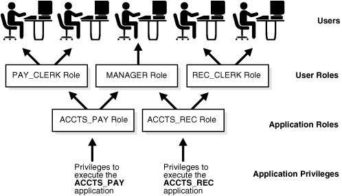
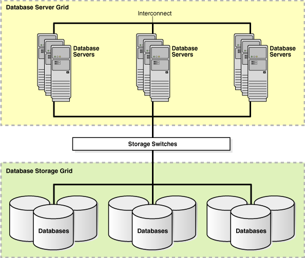
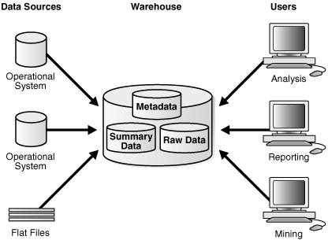
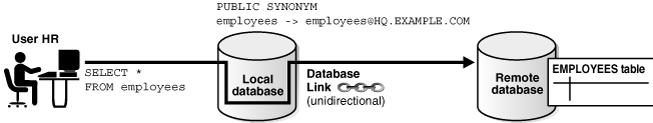
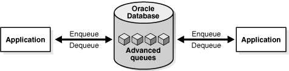

This chapter summarizes common database topics that are important for both database administrators and developers, and provides pointers to other manuals, not an exhaustive account of database features.

This chapter contains the following sections:

See Also:

" [Concepts for Database Administrators](concepts-for-database-administrators.md) " for topics specific to DBAs, and " [Concepts for Database Developers](concepts-for-database-developers.md) " for topics specific to database developers

### Overview of Database Security

#### User Accounts

Each Oracle database has a list of valid database users.

The database contains several default accounts, including the default administrative account `SYSTEM`. You can create user accounts as needed. You can also configure application users to access Oracle databases.

To access a database, a user must provide a valid user name and authentication credential. The credential may be a password, Kerberos ticket, or public key infrastructure (PKI) certificate. You can configure database security to lock accounts based on failed login attempts.

In general, [database access control](glossary.md) involves restricting data access and database activities. For example, you can restrict users from querying specified tables or executing specified database statements.

See Also:

- " [SYS and SYSTEM Schemas](tables-and-table-clusters.md) "
- [Oracle Database Administrator’s Guide](https://www.oracle.com/pls/topic/lookup?ctx=en/database/oracle/oracle-database/12.2/cncpt&id=ADMIN11042) to learn about administrative user accounts
- [Oracle Database Real Application Security Administrator's and Developer's Guide](https://www.oracle.com/pls/topic/lookup?ctx=en/database/oracle/oracle-database/12.2/cncpt&id=DBFSG20000) to learn how to configure application users

##### Privileges

A **user privilege** is the right to run specific SQL statements.

Privileges fall into the following categories:

- System privilege
	This is the right to perform a specific action in the database, or perform an action on any objects of a specific type. For example, `CREATE USER` and `CREATE SESSION` are system privileges.
- Object privilege
	This is the right to perform a specific action on an object, for example, query the `employees` table. Privilege types are defined by the database.

Privileges are granted to users at the discretion of other users. Administrators should grant privileges to users so they can accomplish tasks required for their jobs. Good security practice involves granting a privilege only to a user who requires that privilege to accomplish the necessary work.

See Also:

- [Oracle Database 2 Day + Security Guide](https://www.oracle.com/pls/topic/lookup?ctx=en/database/oracle/oracle-database/12.2/cncpt&id=TDPSG30000) and [Oracle Database Security Guide](https://www.oracle.com/pls/topic/lookup?ctx=en/database/oracle/oracle-database/12.2/cncpt&id=DBSEG40431) to learn how to manage privileges
- [Oracle Database Reference](https://www.oracle.com/pls/topic/lookup?ctx=en/database/oracle/oracle-database/12.2/cncpt&id=REFRN29027) to learn about the `SESSION_PRIVS` view

##### Roles

A role is a named group of related privileges that a user can grant to other users or roles. A role helps manage privileges for a database application or user group.

Figure 20-1 depicts a common use for roles. The roles `PAY_CLERK`, `MANAGER`, and `REC_CLERK` are assigned to different users. The application role `ACCTS_PAY`, which includes the privilege to execute the `ACCTS_PAY` application, is assigned to users with the `PAY_CLERK` and `MANAGER` role. The application role `ACCTS_REC`, which includes the privilege to execute the `ACCTS_REC` application, is assigned to users with the `REC_CLERK` and `MANAGER` role.

Figure 20-1 Common Uses for Roles



> At the top of the graphic are a series of five icons represent users. The second row shows User Roles. The first icon is a PAY\_CLERK Role, which points to the first two users, a MANAGER Role, which points to the third user, and a REC\_CLERK Role, which points to the last two users. The third row of icons shows Application Roles. The ACCTS\_PAY Role points to PAY\_CLERK Role and MANAGER Role. The ACCTS\_REC Role points to MANAGER Role and REC\_CLERK Role. The last row of icons shows Application Privileges. The text "Privileges to execute the ACCTS\_PAY application" points to the ACCTS\_PAY Role. The text "Privileges to execute the ACCTS\_REC application" points to the ACCTS\_REC Role.
>
> End of description.


See Also:

- [Oracle Database Security Guide](https://www.oracle.com/pls/topic/lookup?ctx=en/database/oracle/oracle-database/12.2/cncpt&id=DBSEG004) to learn about using roles for security
- [Oracle Database Administrator’s Guide](https://www.oracle.com/pls/topic/lookup?ctx=en/database/oracle/oracle-database/12.2/cncpt&id=ADMIN11240) to learn how to administer roles

##### Privilege Analysis

The **privilege analysis** mechanism captures privilege usage for a database according to a specified condition.

In this way, you can capture the privileges required to run an application module or execute specific SQL statements. For example, you can find the privileges that a user exercised during a specific database session.

In a production database, the relationships between privileges and roles, roles and roles, and roles and users can be complex. Privilege analysis enables you to identify privileges that are unnecessarily granted in a complex system. Based on the analysis of the captured results, you can remove unnecessary grants or reconfigure privilege grants to make the databases more secure.

See Also:

[Oracle Database Vault Administrator’s Guide](https://www.oracle.com/pls/topic/lookup?ctx=en/database/oracle/oracle-database/12.2/cncpt&id=DVADM591) to learn about privilege analysis

##### User Profiles

In the context of system resources, a user profile is a named set of resource limits and password parameters that restrict database usage and database instance resources for a user.

Profiles can limit the number of concurrent sessions for a user, CPU processing time available for each session, and amount of logical I/O available. For example, the `clerk` profile could limit a user to system resources required for clerical tasks.

Note:

It is preferable to use Database Resource Manager to limit resources and to use profiles to manage passwords.

Profiles provide a single point of reference for users that share a set of attributes. You can assign a profile to one set of users, and a default profile to all others. Each user has at most one profile assigned at any point in time.

See Also:

- " [Buffer I/O](memory-architecture.md) "
- [Oracle Database Security Guide](https://www.oracle.com/pls/topic/lookup?ctx=en/database/oracle/oracle-database/12.2/cncpt&id=DBSEG20244) to learn how to manage resources with profiles
- [Oracle Database SQL Language Reference](https://www.oracle.com/pls/topic/lookup?ctx=en/database/oracle/oracle-database/12.2/cncpt&id=SQLRF01310) for `CREATE PROFILE` syntax and semantics

#### Database Authentication

In Oracle Database, database authentication is the process by which a user presents credentials to the database, which verifies the credentials and allows access to the database.

Validating the identity establishes a trust relationship for further interactions. Authentication also enables accountability by making it possible to link access and actions to specific identities.

Oracle Database provides different authentication methods, including the following:

- Authentication by the database
	Oracle database can authenticate users using a password, Kerberos ticket, or PKI certificate. Oracle also supports RADIUS-compliant devices for other forms of authentication, including biometrics. The type of authentication must be specified when a user is created in the Oracle database.
- Authentication by the operating system
	Some operating systems permit Oracle Database to use information they maintain to authenticate users. After being authenticated by the operating system, users can connect to a database without specifying a user name or password.

Non-administrative database user accounts must not perform database operations such as shutting down or starting up the database. These operations require `SYSDBA`, `SYSOPER`, `SYSBACKUP`, or `SYSDG` privileges.

See Also:

- " [Connection with Administrator Privileges](oracle-database-instance.md) "
- [Oracle Database Security Guide](https://www.oracle.com/pls/topic/lookup?ctx=en/database/oracle/oracle-database/12.2/cncpt&id=DBSEG491) to learn about authentication methods
- [Oracle Database Administrator’s Guide](https://www.oracle.com/pls/topic/lookup?ctx=en/database/oracle/oracle-database/12.2/cncpt&id=ADMIN11046) to learn about administrative authentication

#### Encryption

Oracle Database encryption is the process of transforming data into an unreadable format using a secret key and an encryption algorithm.

Encryption is often used to meet regulatory compliance requirements, such as those associated with the Payment Card Industry Data Security Standard (PCI-DSS) or breach notification laws. For example, credit card numbers, social security numbers, or patient health information must be encrypted.

##### Network Encryption

Encrypting data as it travels across the network between a client and server is known as network encryption.

An intruder can use a network packet sniffer to capture information as it travels on the network, and then spool it to a file for malicious use. Encrypting data on the network prevents this sort of activity.

##### Transparent Data Encryption

Oracle Advanced Security Transparent Data Encryption enables you to encrypt individual table columns or a tablespace.

When a user inserts data into an encrypted column, the database automatically encrypts the data. When users select the column, the data is decrypted. This form of encryption is transparent, provides high performance, and is easy to implement.

Transparent Data Encryption includes industry-standard encryption algorithms such as the Advanced Encryption Standard (AES) and built-in key management.

See Also:

[Oracle Database 2 Day + Security Guide](https://www.oracle.com/pls/topic/lookup?ctx=en/database/oracle/oracle-database/12.2/cncpt&id=TDPSG94440) and [Oracle Database Advanced Security Guide](https://www.oracle.com/pls/topic/lookup?ctx=en/database/oracle/oracle-database/12.2/cncpt&id=ASOAG600)

#### Oracle Data Redaction

Oracle Data Redaction, a part of Oracle Advanced Security, enables you to mask (redact) data that is queried by low-privileged users or applications. The redaction occurs in real time when users query the data.

Data redaction supports the following redaction function types:

- Full data redaction
	In this case, the database redacts the entire contents of the specified columns in a table or view. For example, a `VARCHAR2` column for a last name displays a single space.
- Partial data redaction
	In this case, the database redacts portions of the displayed output. For example, an application can present a credit card number ending in `1234` as `xxxx-xxxx-xxxx-1234`. You can use regular expressions for both full and partial redaction. A regular expression can redact data based on a search pattern. For example, you can use regular expressions to redact specific phone numbers or email addresses.
- Random data redaction
	In this case, the database displays the data as randomly generated values, depending on the data type of the column. For example, the number `1234567` can appear as `83933895`.

Data redaction is not a comprehensive security solution. For example, it does not prevent directly connected, privileged users from performing inference attacks on redacted data. Such attacks identify redacted columns and, by process of elimination, try to back into actual data by repeating SQL queries that guess at stored values. To detect and prevent inference and other attacks from privileged users, Oracle recommends pairing Oracle Data Redaction with related database security products such as Oracle Audit Vault and Database Firewall, and Oracle Database Vault.

Data redaction works as follows:

- Use the `DBMS_REDACT` package to create a redaction policy for a specified table.
- In the policy, specify a predefined redaction function.
- Whether the database shows the actual or redacted value of a column depends on the policy. If the data is redacted, then the redaction occurs at the top-level select list immediately before display to the user.

The following example adds a full data redaction policy to redact the employee ID (`employee_id`) column of the `hr.employees` table:

```
BEGIN
 DBMS_REDACT.ADD_POLICY(
   object_schema    => 'hr'
,  object_name      => 'employees'
,  column_name      => 'employee_id'
,  policy_name      => 'mask_emp_ids'
,  function_type    => DBMS_REDACT.FULL
,  expression       => '1=1'
);
END;
/
```

In the preceding example, the expression setting, which evaluates to `true`, applies the redaction to users who are not granted the `EXEMPT REDACTION POLICY` privilege.

See Also:

- [Oracle Database 2 Day + Security Guide](https://www.oracle.com/pls/topic/lookup?ctx=en/database/oracle/oracle-database/12.2/cncpt&id=TDPSG90066) and [Oracle Database Advanced Security Guide](https://www.oracle.com/pls/topic/lookup?ctx=en/database/oracle/oracle-database/12.2/cncpt&id=ASOAG596) to learn about data redaction
- [Oracle Database PL/SQL Packages and Types Reference](https://www.oracle.com/pls/topic/lookup?ctx=en/database/oracle/oracle-database/12.2/cncpt&id=ARPLS73800) to learn about `DBMS_REDACT`

#### Orientation

Oracle Database provides many techniques to control access to data. This section summarizes some of these techniques.

##### Oracle Database Vault

Oracle Database Vault restricts privileged user access to application data.

Starting in Oracle Database 12c, Oracle Database Vault extends the standard database audit data structure. In addition, if you migrate to unified auditing, then the database writes audit records to the unified audit trail in Oracle Secure Files, which centralizes audit records for Oracle Database.

You can use Oracle Database Vault to control when, where, and how the databases, data, and applications are accessed. Thus, you can address common security problems such as protecting against insider threats, complying with regulatory requirements, and enforcing separation of duty.

To make the Oracle Database Vault administrator accountable, the database mandatorily audits configuration changes made to the Oracle Database Vault metadata. These changes include creation, modification, and deletion of any Oracle Database Vault-related enforcements, grants and revocation of protected roles, and authorizations for components such as Oracle Data Pump and the Job Scheduler.

See Also:

- [Oracle Database 2 Day + Security Guide](https://www.oracle.com/pls/topic/lookup?ctx=en/database/oracle/oracle-database/12.2/cncpt&id=TDPSG94441) and [Oracle Database Vault Administrator’s Guide](https://www.oracle.com/pls/topic/lookup?ctx=en/database/oracle/oracle-database/12.2/cncpt&id=DVADM001)
- [Oracle Database Security Guide](https://www.oracle.com/pls/topic/lookup?ctx=en/database/oracle/oracle-database/12.2/cncpt&id=DBSEG419) to learn about the integration of Oracle Database Vault Audit with Oracle Database Native Audit

##### Virtual Private Database (VPD)

Oracle Virtual Private Database (VPD) enables you to enforce security at the row and column level.

A [security policy](glossary.md) establishes methods for protecting a database from accidental or malicious destruction of data or damage to the database infrastructure.

VPD is useful when security protections such as privileges and roles are not sufficiently fine-grained. For example, you can allow all users to access the `employees` table, but create security policies to restrict access to employees in the same department as the user.

Essentially, the database adds a dynamic `WHERE` clause to a SQL statement issued against the table, [view](glossary.md), or [synonym](glossary.md) to which an Oracle VPD security policy was applied. The `WHERE` clause allows only users whose credentials pass the security policy to access the protected data.

See Also:

[Oracle Database 2 Day + Security Guide](https://www.oracle.com/pls/topic/lookup?ctx=en/database/oracle/oracle-database/12.2/cncpt&id=TDPSG94446) and [Oracle Database Security Guide](https://www.oracle.com/pls/topic/lookup?ctx=en/database/oracle/oracle-database/12.2/cncpt&id=DBSEG007)

##### Oracle Label Security (OLS)

Oracle Label Security (OLS) enables you to assign data classification and control access using security labels. You can assign a label to either data or users.

When assigned to data, the label can be attached as a hidden column to tables, providing transparency to SQL. For example, you can label rows that contain highly sensitive data as `HIGHLY SENSITIVE` and label rows that are less sensitive as `SENSITIVE`. When a user attempts to access data, OLS compares the user label with the data label and determines whether to grant access. Unlike VPD, OLS provides an out-of-the-box security policy and a metadata repository for defining and storing labels.

If unified auditing is enabled, then the database provides a policy-based framework to configure and manage audit options. You can group auditing options for different types of operations, including OLS operations, and save them as an audit policy. You can then enable or disable the policy to enforce the underlying auditing options.

Whenever an OLS policy is created, the database adds a label column for the policy to the database audit trail table. OLS auditing can write audit records, including records for OLS administrator operations, to the unified audit trail.

See Also:

- " Unified Audit Trail "
- [Oracle Database 2 Day + Security Guide](https://www.oracle.com/pls/topic/lookup?ctx=en/database/oracle/oracle-database/12.2/cncpt&id=TDPSG90066) and [Oracle Label Security Administrator's Guide](https://www.oracle.com/pls/topic/lookup?ctx=en/database/oracle/oracle-database/12.2/cncpt&id=OLSAG001)

#### Data Access Monitoring

Oracle Database provides multiple tools and techniques for monitoring user activity. Auditing is the primary mechanism for monitoring data access.

##### Database Auditing

Database auditing is the monitoring and recording of selected user database actions.

You can configure a [unified audit policy](glossary.md) to audit the following:

- SQL statements, system privileges, schema objects, and roles (as a group of system privileges directly granted to them)
- Administrative and non-administrative users
- Application context values
	An [application context](glossary.md) is an attribute name-value pair in a specified namespace. Applications set various contexts before executing actions on the database. For example, applications store information such as module name and client ID that indicate the status of an application event. Applications can configure contexts so that information about them is appended to audit records.
- Policy creations for Real Application Security, Oracle Database Vault, Oracle Label Security, Oracle Data Pump, and Oracle SQL\*Loader direct path events

The unified audit trail can capture Recovery Manager events, which you can query in the `UNIFIED_AUDIT_TRAIL` data dictionary view. You do not create unified audit policies for Recovery Manager events.

You can also use [fine-grained auditing](glossary.md) to audit specific table columns, and to associate event handlers during policy creation. For unified and fine-grained auditing, you can create policies that test for conditions that capture specific database actions on a table or times that activities occur. For example, you can audit a table accessed after 9:00 p.m.

Reasons for auditing include:

- Enabling future accountability for current actions
- Deterring users (or others, such as intruders) from inappropriate actions based on their accountability
- Investigating, monitoring, and recording suspicious activity
- Addressing auditing requirements for compliance

Starting in Oracle Database 12c, when you use unified auditing, database auditing is enabled by default. You control database auditing by enabling audit policies. However, before you can use unified auditing, you must migrate your databases to it.

See Also:

- [Oracle Database Security Guide](https://www.oracle.com/pls/topic/lookup?ctx=en/database/oracle/oracle-database/12.2/cncpt&id=DBSEG006) for detailed information about unified auditing
- [Oracle Database Upgrade Guide](https://www.oracle.com/pls/topic/lookup?ctx=en/database/oracle/oracle-database/12.2/cncpt&id=UPGRD52810) to learn how to migrate to unified auditing

###### Audit Policies

You can use a single SQL statement to create a named unified audit policy that specifies a set of audit options. These options can specify system privileges, actions, or roles to be audited inside the database.

In an audit policy, you can optionally set a condition that can be evaluated for every statement, once for a session, or once for the database instance. The auditing of an event is subject to the result of the evaluation of a condition for the applicable audit policies. If the condition evaluates to `true`, then the database generates the audit record.

The following example creates a policy that audits activities on the `hr.employees` table unless a user logs in from the trusted terminals `term1` and `term2`:

```
CREATE AUDIT POLICY EmployeesTableAudit
  ACTIONS update ON hr.employees, delete ON hr.employees
  WHEN SYS_CONTEXT ("userenv", "hostname") NOT IN
                   ("term1","term2") EVALUATE PER SESSION;
```

The following statement enables the policy for users `hr` and `hrvp`:

```
AUDIT POLICY EmployeesTableAudit BY hr, hrvp;
```

You can apply unified audit policies to any database user, including administrative users such as `SYSDBA`, `SYSOPER`, and so on. However, the audit policies can only be read after the database is opened using the `ALTER DATABASE OPEN` statement. Therefore, the top-level actions from administrative users are always audited until the database opens. After the database opens, the audit policy configuration is in effect.

When unified auditing is enabled, the database automatically audits changes to audit settings. The database also audits database instance startup and shutdown.

See Also:

[Oracle Database 2 Day + Security Guide](https://www.oracle.com/pls/topic/lookup?ctx=en/database/oracle/oracle-database/12.2/cncpt&id=TDPSG50000) and [Oracle Database Security Guide](https://www.oracle.com/pls/topic/lookup?ctx=en/database/oracle/oracle-database/12.2/cncpt&id=DBSEG60612) to learn how to manage audit policies

###### Audit Administrator Roles

To perform auditing, you must be granted the appropriate system privileges.

Oracle Database provides the following system-supplied audit administrator roles:

- `AUDIT_ADMIN`
	The `AUDIT_ADMIN` role manages audit settings for the database. Users with this role have privileges to do the following:
	- Create, alter, and drop audit policies, including fine-grained auditing policies
		- Enable or disable audit policies for each business requirement
		- View audit records
		- Manage and clean up the audit trail
- `AUDIT_VIEWER`
	The `AUDIT_VIEWER` role is for users who only need to view and analyze data. Users with this role are only privileged to view the audit trail contents.

See Also:

[Oracle Database 2 Day + Security Guide](https://www.oracle.com/pls/topic/lookup?ctx=en/database/oracle/oracle-database/12.2/cncpt&id=TDPSG50000) and [Oracle Database Security Guide](https://www.oracle.com/pls/topic/lookup?ctx=en/database/oracle/oracle-database/12.2/cncpt&id=DBSEG006) to learn more about auditing

##### Unified Audit Trail

Audit records are essential for detecting and identifying unauthorized data accesses.

Oracle Database can configure auditing for specified events. If the event occurs during a user session, then the database generates an audit record.

An [audit trail](glossary.md) is a location that stores audit records. The [unified audit trail](glossary.md), new in Oracle Database 12c, provides unified storage for audit records from all types of auditing. You must manually migrate from the traditional audit trails of previous releases to unified auditing.

Auditing includes standard and fine-grained auditing, and also includes auditing of the following events, including execution of these events from administrative users:

- Oracle Data Pump
- SQL\*Loader direct path loads
- Oracle Database Vault
- Oracle Label Security
- Recovery Manager
- Real Application Security

The unified audit trail is read-only and is stored in the `AUDSYS` schema. By default the `SYSAUX` tablespace stores audit records from all sources. You can provide a new tablespace using the `DBMS_AUDIT_MGMT` package.

The `UNIFIED_AUDIT_TRAIL` view retrieves the audit records from the audit trail and displays them in tabular form. The `APPLICATION_CONTEXTS` column stores the values of the configured application context attributes. You can use the `AUDIT` statement to include the values of context attributes in audit records. For example, the following statement captures `MODULE` and `CLIENT_INFO` attributes from the `userenv` namespace:

```
AUDIT CONTEXT NAMESPACE userenv ATTRIBUTES MODULE, CLIENT_INFO BY hr;
```

Depending on the audited component (such as Oracle Database Vault), additional unified audit trail-related views are available.

See Also:

- [Oracle Database Security Guide](https://www.oracle.com/pls/topic/lookup?ctx=en/database/oracle/oracle-database/12.2/cncpt&id=DBSEG630) to learn about the unified audit trail
- [Oracle Database Upgrade Guide](https://www.oracle.com/pls/topic/lookup?ctx=en/database/oracle/oracle-database/12.2/cncpt&id=UPGRD52810) to learn how to migrate the database to use unified auditing
- [Oracle Database Reference](https://www.oracle.com/pls/topic/lookup?ctx=en/database/oracle/oracle-database/12.2/cncpt&id=REFRN29162) to learn about the `UNIFIED_AUDIT_TRAIL` view

##### Enterprise Manager Auditing Support

Oracle Enterprise Manager (Enterprise Manager) enables you to perform most auditing-related tasks.

Tasks include the following:

- Enable and disable auditing
- Administer objects when auditing statements and schema objects
	For example, Enterprise Manager enables you to display and search for the properties of current audited statements, privileges, and objects.
- View and configure audit-related initialization parameters
- Display auditing reports

See Also:

Enterprise Manager online help

##### Oracle Audit Vault and Database Firewall

Oracle Audit Vault and Database Firewall (Oracle AVDF) provide a first line of defense for databases and consolidate audit data from databases, operating systems, and directories.

A SQL grammar-based engine monitors and blocks unauthorized SQL traffic before it reaches the database. For compliance reporting and alerting, Oracle AVDF combines database activity data from the network with detailed audit data. You can tailor auditing and monitoring controls to meet enterprise security requirements.

See Also:

[Oracle Database Security Guide](https://www.oracle.com/pls/topic/lookup?ctx=en/database/oracle/oracle-database/12.2/cncpt&id=DBSEG-GUID-91DB199F-50F3-4A86-8876-1579149A1930) to learn about additional security resources such as Oracle Audit Vault and Database Firewall

### Overview of High Availability

Availability is the degree to which an application, service, or functionality is available on demand.

For example, an [OLTP](glossary.md) database used by an online bookseller is available to the extent that it is accessible by customers making purchases. Reliability, recoverability, timely error detection, and continuous operations are the primary characteristics of high availability.

The importance of high availability in a database environment is tied to the cost of downtime, which is the time that a resource is unavailable. Downtime can be categorized as either planned or unplanned. The main challenge when designing a highly available environment is examining all possible causes of downtime and developing a plan to deal with them.

See Also:

[Oracle Database High Availability Overview](https://www.oracle.com/pls/topic/lookup?ctx=en/database/oracle/oracle-database/12.2/cncpt&id=HAOVW001) for an introduction to high availability

#### High Availability and Unplanned Downtime

Oracle Database provides high availability solutions to prevent, tolerate, and reduce downtime for all types of unplanned failures.

Unplanned downtime can be categorized by its causes:

- Site Failures
- Computer Failures
- Storage Failures
- Data Corruption
- Human Errors

See Also:

[Oracle Database High Availability Overview](https://www.oracle.com/pls/topic/lookup?ctx=en/database/oracle/oracle-database/12.2/cncpt&id=HAOVW117) to learn about protecting against unplanned downtime

##### Site Failures

A **site failure** occurs when an event causes all or a significant portion of an application to stop processing or slow to an unusable service level.

A site failure may affect all processing at a data center, or a subset of applications supported by a data center. Examples include an extended site-wide power or network failure, a natural disaster making a data center inoperable, or a malicious attack on operations or the site.

The simplest form of protection against site failures is to create database backups using RMAN and store them offsite. You can restore the database to another host. However, this technique can be time-consuming, and the backup may not be current. Maintaining one or more standby databases in a Data Guard environment enables you to provide continuous database service if the production site fails.

See Also:

- [Oracle Database High Availability Overview](https://www.oracle.com/pls/topic/lookup?ctx=en/database/oracle/oracle-database/12.2/cncpt&id=HAOVW113) to learn about site failures
- [Oracle Database Backup and Recovery User’s Guide](https://www.oracle.com/pls/topic/lookup?ctx=en/database/oracle/oracle-database/12.2/cncpt&id=BRADV89341) for information on RMAN and backup and recovery solutions
- [Oracle Data Guard Concepts and Administration](https://www.oracle.com/pls/topic/lookup?ctx=en/database/oracle/oracle-database/12.2/cncpt&id=SBYDB00010) for an introduction to standby databases

##### Computer Failures

A computer failure outage occurs when the system running the database becomes unavailable because it has shut down or is no longer accessible.

Examples of computer failures include hardware and operating system failures. The Oracle features in the following table protect against or help respond to computer failures.

Table 20-1 Protection Against Computer Failures

| Feature | Description | To Learn More |
| --- | --- | --- |
| Enterprise Grids | In an Oracle Real Applications Cluster (Oracle RAC) environment, Oracle Database runs on two or more systems in a cluster while concurrently accessing a single shared database. A single database system spans multiple hardware systems yet appears to the application as a single database. | " Overview of Grid Computing " |
| Oracle Data Guard | Data Guard enables you to maintain one or more copies of a production database, called a [standby database](glossary.md), that can reside on different continents or in the same data center. If the primary database is unavailable because of an outage, then Data Guard can switch any standby database to the primary role, minimizing downtime. | [Oracle Data Guard Concepts and Administration](https://www.oracle.com/pls/topic/lookup?ctx=en/database/oracle/oracle-database/12.2/cncpt&id=SBYDB00830) |
| Global Data Services | The Global Data Services framework automates and centralizes configuration, maintenance, and monitoring of a database cloud. Global Data Services enables load balancing and failover for services provided by the cloud. Essentially, Global Data Services provides a set of databases the same sorts of benefits that Oracle Real Application Clusters (Oracle RAC) provides a single database. | [Oracle Database Global Data Services Concepts and Administration Guide](https://www.oracle.com/pls/topic/lookup?ctx=en/database/oracle/oracle-database/12.2/cncpt&id=GSMUG-GUID-415B8BB5-5C8D-4C78-8E76-43DB1648E467) |
| Fast Start Fault Recovery | A common cause of unplanned downtime is a system fault or failure. The fast start fault recovery technology in Oracle Database automatically bounds database [instance recovery](glossary.md) time. | [Oracle Database Performance Tuning Guide](https://www.oracle.com/pls/topic/lookup?ctx=en/database/oracle/oracle-database/12.2/cncpt&id=GUID-E281EB31-5762-4945-9497-BBB923A6FF50) |

See Also:

[Oracle Database High Availability Overview](https://www.oracle.com/pls/topic/lookup?ctx=en/database/oracle/oracle-database/12.2/cncpt&id=HAOVW11824) to learn how to use High Availability for processes and applications that run in a single-instance database

##### Storage Failures

A storage failure outage occurs when the storage holding some or all of the database contents becomes unavailable because it has shut down or is no longer accessible. Examples of storage failures include the failure of a disk drive or storage array.

The following table shows storage failures in addition to Oracle Data Guard.

Table 20-2 Solutions for Storage Failures

| Solution | Description | To Learn More |
| --- | --- | --- |
| Oracle Automatic Storage Management (Oracle ASM) | Oracle ASM is a volume manager and a file system for Oracle database files that supports single-instance Oracle Database and Oracle RAC configurations. Oracle ASM is Oracle's recommended storage management solution that provides an alternative to conventional volume managers and file systems. | " [Oracle Automatic Storage Management (Oracle ASM)](physical-storage-structures.md) " |
| Backup and recovery | The Recovery Manager (RMAN) utility can back up data, restore data from a previous backup, and recover changes to that data up to the time before the failure occurred. | " [Backup and Recovery](concepts-for-database-administrators.md) " |

See Also:

[Oracle Automatic Storage Management Administrator's Guide](https://www.oracle.com/pls/topic/lookup?ctx=en/database/oracle/oracle-database/12.2/cncpt&id=OSTMG036) to learn more about Oracle ASM

##### Data Corruption

A data corruption occurs when a hardware, software, or network component causes corrupt data to be read or written.

An example of a data corruption is a volume manager error that causes bad disk read or writes. Data corruptions are rare but can have a catastrophic effect on a database, and therefore a business.

In addition to Data Guard and Recovery Manager, Oracle Database supports the following forms of protection against data corruption:

- Lost write protection
	A [data block](glossary.md) [lost write](glossary.md) occurs when an I/O subsystem acknowledges the completion of the block write when the write did not occur. You can configure the database so that it records buffer cache block reads in the redo log. Lost write detection is most effective when used with Data Guard.
- Data block corruption detection
	A [block corruption](glossary.md) is a data block that is not in a recognized Oracle format, or whose contents are not internally consistent. Several database components and utilities, including RMAN, can detect a corrupt block and record it in `V$DATABASE_BLOCK_CORRUPTION`. If the environment uses a real-time standby database, then RMAN can automatically repair corrupt blocks.
- Data Recovery Advisor
	Data Recovery Advisor is an Oracle tool that automatically diagnoses data failures, determines and presents appropriate repair options, and executes repairs at the user's request.
- Transaction Guard and Application Continuity
	Database session outages, whether planned or unplanned, can leave end users unsure of the status of their work. In some cases, users can resubmit committed transactions, leading to logical data corruption. [Transaction Guard](glossary.md) provides [transaction idempotence](glossary.md), which enables the database to preserve a guaranteed commit outcome indicating whether the transaction committed and completed. Application Continuity, which includes Transaction Guard, enables applications to replay a transaction against the database after a [recoverable error](glossary.md), and to continue where the transaction left off.

See Also:

- " [Overview of Transaction Guard](transactions.md) "
- [Oracle Database High Availability Overview](https://www.oracle.com/pls/topic/lookup?ctx=en/database/oracle/oracle-database/12.2/cncpt&id=HAOVW234) to learn how to choose the best architecture to protect against data corruptions
- [Oracle Database Backup and Recovery User’s Guide](https://www.oracle.com/pls/topic/lookup?ctx=en/database/oracle/oracle-database/12.2/cncpt&id=BRADV89341) for information on RMAN and backup and recovery solutions

##### Human Errors

A human error outage occurs when unintentional or malicious actions are committed that cause data in the database to become logically corrupt or unusable. The service level impact of a human error outage can vary significantly depending on the amount and critical nature of the affected data.

Much research cites human error as the largest cause of downtime. Oracle Database provides powerful tools to help administrators quickly diagnose and recover from these errors. It also includes features that enable end users to recover from problems without administrator involvement.

Oracle Database recommends the following forms of protection against human error:

- Restriction of user access
	The best way to prevent errors is to restrict user access to data and services. Oracle Database provides a wide range of security tools to control user access to application data by authenticating users and then allowing administrators to grant users only those privileges required to perform their duties.
- Oracle Flashback Technology
	Oracle Flashback Technology is a family of human error correction features in Oracle Database. Oracle Flashback provides a SQL interface to quickly analyze and repair human errors. For example, you can perform:
	- Fine-grained surgical analysis and repair for localized damage
		- Rapid correction of more widespread damage
		- Recovery at the row, transaction, table, tablespace, and database level
- Oracle LogMiner
	Oracle LogMiner is a relational tool that enables you to use SQL to read, analyze, and interpret online files.

See Also:

- " [Oracle LogMiner](concepts-for-database-administrators.md) "
- " Overview of Database Security "
- [Oracle Database High Availability Overview](https://www.oracle.com/pls/topic/lookup?ctx=en/database/oracle/oracle-database/12.2/cncpt&id=HAOVW113) to learn more about causes of downtime
- [Oracle Database Backup and Recovery User’s Guide](https://www.oracle.com/pls/topic/lookup?ctx=en/database/oracle/oracle-database/12.2/cncpt&id=BRADV89342) and [Oracle Database Development Guide](https://www.oracle.com/pls/topic/lookup?ctx=en/database/oracle/oracle-database/12.2/cncpt&id=ADFNS1008) to learn more about Oracle Flashback features
- [Oracle Database Utilities](https://www.oracle.com/pls/topic/lookup?ctx=en/database/oracle/oracle-database/12.2/cncpt&id=SUTIL1553) to learn more about Oracle LogMiner

#### High Availability and Planned Downtime

Planned downtime can be just as disruptive to operations, especially in global enterprises that support users in multiple time zones. In this case, it is important to design a system to minimize planned interruptions such as routine operations, periodic maintenance, and new deployments.

Planned downtime can be categorized by its causes:

- System and Database Changes
- Data Changes
- Application Changes

See Also:

[Oracle Database High Availability Overview](https://www.oracle.com/pls/topic/lookup?ctx=en/database/oracle/oracle-database/12.2/cncpt&id=HAOVW144) to learn about features and solutions for planned downtime

##### System and Database Changes

Planned system changes occur when you perform routine and periodic maintenance operations and new deployments, including scheduled changes to the operating environment that occur outside of the organizational data structure in the database.

Examples include adding or removing CPUs and cluster nodes (a node is a computer on which a database instance resides), upgrading system hardware or software, and migrating the system platform.

Oracle Database provides dynamic resource provisioning as a solution to planned system and database changes:

- Dynamic reconfiguration of the database
	Oracle Database dynamically accommodates various changes to hardware and database configurations, including adding and removing processors from an SMP server and adding and remove storage arrays using Oracle ASM. For example, Oracle Database monitors the operating system to detect changes in the number of CPUs. If the `CPU_COUNT` initialization parameter is set to the default, then the database workload can dynamically take advantage of newly added processors.
- Autotuning memory management
	Oracle Database uses a noncentralized policy to free and acquire memory in each subcomponent of the [SGA](glossary.md) and the [PGA](glossary.md). Oracle Database autotunes memory by prompting the operating system to transfer granules of memory to components that require it.
- Automated distributions of data files, control files, and online redo log files
	Oracle ASM automates and simplifies the layout of data files, control files, and log files by automatically distributing them across all available disks.

See Also:

- " [Memory Management](concepts-for-database-administrators.md) "
- See [Oracle Automatic Storage Management Administrator's Guide](https://www.oracle.com/pls/topic/lookup?ctx=en/database/oracle/oracle-database/12.2/cncpt&id=OSTMG036) to learn more about Oracle ASM

##### Data Changes

Planned data changes occur when there are changes to the logical structure or physical organization of Oracle Database objects. The primary objective of these changes is to improve performance or manageability. Examples include table redefinition, adding table partitions, and creating or rebuilding indexes.

Oracle Database minimizes downtime for data changes through online reorganization and redefinition. This architecture enables you to perform the following tasks when the database is open:

- Perform online table redefinition, which enables you to make table structure modifications without significantly affecting the availability of the table
- Create, analyze, and reorganize indexes
- Move table partitions

See Also:

- " [Indexes and Index-Organized Tables](indexes-and-index-organized-tables.md) "
- " [Overview of Partitions](partitions-views-and-other-schema-objects.md) "
- [Oracle Database Administrator’s Guide](https://www.oracle.com/pls/topic/lookup?ctx=en/database/oracle/oracle-database/12.2/cncpt&id=ADMIN01514) to learn how to change data structures online

##### Application Changes

Planned application changes may include changes to data, schemas, and programs. The primary objective of these changes is to improve performance, manageability, and functionality. An example is an application upgrade.

Oracle Database supports the following solutions for minimizing application downtime required to make changes to an application's database objects.

Table 20-3 Solutions for Minimizing Downtime

| Solution | Description | To Learn More |
| --- | --- | --- |
| Rolling database patch updates | Oracle Database supports the application of patches to the nodes of an Oracle RAC system in a rolling fashion. | [Oracle Database High Availability Overview](https://www.oracle.com/pls/topic/lookup?ctx=en/database/oracle/oracle-database/12.2/cncpt&id=HAOVW144) |
| Rolling database release upgrades | Oracle Database supports the installation of database software upgrades, and the application of patch sets, in a rolling fashion—with near zero database downtime—by using Data Guard SQL Apply and logical standby databases. | [Oracle Database Upgrade Guide](https://www.oracle.com/pls/topic/lookup?ctx=en/database/oracle/oracle-database/12.2/cncpt&id=UPGRD52810) |
| Edition-based redefinition | Edition-based redefinition enables you to upgrade the database objects of an application while the application is in use, thus minimizing or eliminating downtime. Oracle Database accomplishes this task by changing (redefining) database objects in a private environment known as an [edition](glossary.md). | [Oracle Database Development Guide](https://www.oracle.com/pls/topic/lookup?ctx=en/database/oracle/oracle-database/12.2/cncpt&id=ADFNS020) |
| [DDL](glossary.md) with the default `WAIT` option | DDL statements require exclusive locks on internal structures (see " [DDL Locks](data-concurrency-and-consistency.md) "). In previous releases, DDL statements would fail if they could not obtain the locks. DDL specified with the `WAIT` option resolves this issue. | [Oracle Database High Availability Overview](https://www.oracle.com/pls/topic/lookup?ctx=en/database/oracle/oracle-database/12.2/cncpt&id=HAOVW182) |
| Creation of triggers in a disabled state | You can create a [trigger](glossary.md) in the disabled state so that you can ensure that your code compiles successfully before you enable the trigger. | [Oracle Database PL/SQL Language Reference](https://www.oracle.com/pls/topic/lookup?ctx=en/database/oracle/oracle-database/12.2/cncpt&id=LNPLS1609) |

### Overview of Grid Computing

The computing architecture known as grid computing effectively pools large numbers of servers and storage into a flexible, on-demand resource for all enterprise computing needs.

A [Database Server Grid](glossary.md) is a collection of commodity servers connected together to run on one or more databases. A [Database Storage Grid](glossary.md) is a collection of low-cost modular storage arrays combined together and accessed by the computers in the Database Server Grid.

With the Database Server and Storage Grid, you can build a pool of system resources. You can dynamically allocate and deallocate these resources based on business priorities.

Figure 20-2 illustrates the Database Server Grid and Database Storage Grid in a Grid enterprise computing environment.

Figure 20-2 Grid Computing Environment



> This illustration shows the components of a Grid computing environment.
>
> Several database server clusters are shown connected to one another though an interconnect to form the Database Server Grid. The Database Server Grid is then connected to the Database Storage Grid—shown as several database clusters—through storage switches.
>
> End of image description.


See Also:

- [Oracle Database High Availability Overview](https://www.oracle.com/pls/topic/lookup?ctx=en/database/oracle/oracle-database/12.2/cncpt&id=HAOVW189) for an overview of Grid Computing
- [`http://www.gridforum.org/`](http://www.gridforum.org/) to learn about the standards organization Global Grid Forum (GGF)

#### Database Server Grid

Oracle Real Application Clusters (Oracle RAC) enables multiple instances to share access to an Oracle database. The instances are linked through an interconnect.

In an Oracle RAC environment, Oracle Database runs on two or more systems in a cluster while concurrently accessing a single shared database. Oracle RAC enables a Database Server Grid by providing a single database that spans multiple low-cost servers yet appears to the application as a single, unified database system.

[Oracle Clusterware](glossary.md) is software that enables servers to operate together as if they are one server. Each server looks like any standalone server. However, each server has additional processes that communicate with each other so that separate servers work together as if they were one server. Oracle Clusterware provides all of the features required to run the cluster, including node membership and messaging services.

See Also:

- [Oracle Database 2 Day + Real Application Clusters Guide](https://www.oracle.com/pls/topic/lookup?ctx=en/database/oracle/oracle-database/12.2/cncpt&id=TDPRC222) for an introduction to Oracle Clusterware and Oracle RAC
- [Oracle Real Application Clusters Administration and Deployment Guide](https://www.oracle.com/pls/topic/lookup?ctx=en/database/oracle/oracle-database/12.2/cncpt&id=RACAD7279) to learn how to manage an Oracle RAC database
- [Oracle Clusterware Administration and Deployment Guide](https://www.oracle.com/pls/topic/lookup?ctx=en/database/oracle/oracle-database/12.2/cncpt&id=CWADD1111) to learn how to administer and deploy Oracle Clusterware

##### Scalability

In a Database Server Grid, Oracle RAC enables you to add nodes to the cluster as the demand for capacity increases.

The cache fusion technology implemented in Oracle RAC enables you to scale capacity without changing your applications. Thus, you can scale the system incrementally to save costs and eliminate the need to replace smaller single-node systems with larger ones.

You can incrementally add nodes to a cluster instead of replacing existing systems with larger nodes. Grid Plug and Play simplifies addition and removal of nodes from a cluster, making it easier to deploy clusters in a dynamically provisioned environment. Grid Plug and Play also enables databases and services to be managed in a location-independent manner. SCAN enables clients to connect to the database service without regard for its location within the grid.

See Also:

- [Oracle Real Application Clusters Administration and Deployment Guide](https://www.oracle.com/pls/topic/lookup?ctx=en/database/oracle/oracle-database/12.2/cncpt&id=RACAD7274) to learn more about cache fusion
- [Oracle Database Installation Guide](https://www.oracle.com/pls/topic/lookup?ctx=en/database/oracle/oracle-database/12.2/cncpt&id=GINST) for your platform to learn how to enable Grid Plug and Play using Grid Naming Service
- [Oracle Clusterware Administration and Deployment Guide](https://www.oracle.com/pls/topic/lookup?ctx=en/database/oracle/oracle-database/12.2/cncpt&id=CWADD92403) for more information about configuring Grid Naming Service to enable Grid Plug and Play

##### Fault Tolerance

In a high availability architecture, **fault tolerance** is the protection provided against the failure of a component in the architecture.

A key advantage of the Oracle RAC architecture is the inherent fault tolerance provided by multiple nodes. Because the physical nodes run independently, the failure of one or more nodes does not affect other nodes in the cluster.

Failover can happen to any node on the Grid. In the extreme case, an Oracle RAC system provides database access even when all but one node is down. This architecture enables a group of nodes to be transparently put online or taken offline, for maintenance, while the rest of the cluster continues to provide database access.

Oracle RAC provides built-in integration with Oracle Clients and connection pools. With this capability, an application is immediately notified of any failure through the pool that terminates the connection. The application avoids waiting for a TCP timeout and can immediately take the appropriate recovery action. Oracle RAC integrates the [listener](glossary.md) with Oracle Clients and the connection pools to create optimal application throughput. Oracle RAC can balance cluster workload based on the load at the time of the transaction.

See Also:

- " [Database Resident Connection Pooling](application-and-networking-architecture.md) "
- [Oracle Real Application Clusters Administration and Deployment Guide](https://www.oracle.com/pls/topic/lookup?ctx=en/database/oracle/oracle-database/12.2/cncpt&id=RACAD076) to learn more about automatic workload management

##### Services

Oracle RAC supports services that can group database workloads and route work to the optimal instances assigned to offer the services.

A service represents the workload of applications with common attributes, performance thresholds, and priorities. You define and apply business policies to these services to perform tasks such as to allocate nodes for times of peak processing or to automatically handle a server failure. Using services ensures the application of system resources where and when they are needed to achieve business goals.

Services integrate with the Database Resource Manager, which enables you to restrict the resources that a service within an instance can use. In addition, Oracle Scheduler jobs can run using a service, as opposed to using a specific instance.

See Also:

- " [Database Resource Manager](concepts-for-database-administrators.md) "
- [Oracle Database 2 Day + Real Application Clusters Guide](https://www.oracle.com/pls/topic/lookup?ctx=en/database/oracle/oracle-database/12.2/cncpt&id=TDPRC289) to learn about Oracle services
- [Oracle Database Administrator’s Guide](https://www.oracle.com/pls/topic/lookup?ctx=en/database/oracle/oracle-database/12.2/cncpt&id=ADMIN11841) to learn about the Database Resource Manager and Oracle Scheduler

#### Oracle Flex Clusters

Starting with Oracle Database 12c, you can configure Oracle Clusterware and Oracle Real Application Clusters in large clusters.

These large clusters, which are called [Oracle Flex Clusters](glossary.md), contain two types of nodes arranged in a hub-and-spoke architecture: Hub Nodes and Leaf Nodes. Hub Nodes are tightly connected, have direct access to shared storage, and serve as anchors for one or more Leaf Nodes. Leaf Nodes are loosely connected with Hub Nodes, and may not have direct access to shared storage.

See Also:

- [Oracle Clusterware Administration and Deployment Guide](https://www.oracle.com/pls/topic/lookup?ctx=en/database/oracle/oracle-database/12.2/cncpt&id=CWADD92560) to learn more about Oracle Flex Clusters
- [Oracle Grid Infrastructure Installation and Upgrade Guide](https://www.oracle.com/pls/topic/lookup?ctx=en/database/oracle/oracle-database/12.2/cncpt&id=CWGEN) to learn more about Oracle Flex Cluster deployment

#### Database Storage Grid

A DBA or storage administrator can use the Oracle ASM interface to specify the disks within the Database Storage Grid that Oracle ASM should manage across all server and storage platforms. Oracle ASM partitions the disk space and evenly distributes the data across the disks provided to Oracle ASM. Additionally, Oracle ASM automatically redistributes data as disks from storage arrays are added or removed from the Database Storage Grid.

See Also:

- " [Oracle Automatic Storage Management (Oracle ASM)](physical-storage-structures.md) "
- [Oracle Database High Availability Overview](https://www.oracle.com/pls/topic/lookup?ctx=en/database/oracle/oracle-database/12.2/cncpt&id=HAOVW192) for an overview of the Database Storage Grid
- [Oracle Automatic Storage Management Administrator's Guide](https://www.oracle.com/pls/topic/lookup?ctx=en/database/oracle/oracle-database/12.2/cncpt&id=OSTMG30000) for more information about clustered Oracle ASM

### Overview of Data Warehousing and Business Intelligence

A data warehouse is a relational database designed for query and analysis rather than for transaction processing.

For example, a data warehouse could track historical stock prices or income tax records. A warehouse usually contains data derived from historical transaction data, but it can include data from other sources.

A data warehouse environment includes several tools in addition to a relational database. A typical environment includes an [ETL](glossary.md) solution, an [OLAP](glossary.md) engine, client analysis tools, and other applications that gather data and deliver it to users.

#### Data Warehousing and OLTP

A common way of introducing data warehousing is to refer to the characteristics of a data warehouse as set forth by William Inmon.

The characteristics are as follows:<sup>Foot 1</sup>

- Subject-Oriented
	Data warehouses enable you to define a database by subject matter, such as sales.
- Integrated
	Data warehouses must put data from disparate sources into a consistent format. They must resolve such problems as naming conflicts and inconsistencies among units of measure. When they achieve this goal, they are said to be integrated.
- Nonvolatile
	The purpose of a warehouse is to enable you to analyze what has occurred. Thus, after data has entered into the warehouse, data should not change.
- Time-Variant
	The focus of a data warehouse is on change over time.

Data warehouses and OLTP database have different requirements. For example, to discover trends in business, data warehouses must maintain large amounts of data. In contrast, good performance requires historical data to be moved regularly from OLTP systems to an archive. Table 20-4 lists differences between data warehouses and OLTP.

Table 20-4 Data Warehouses and OLTP Systems

| Characteristics | Data Warehouse | OLTP |
| --- | --- | --- |
| Workload | Designed to accommodate ad hoc queries. You may not know the workload of your data warehouse in advance, so it should be optimized to perform well for a wide variety of possible queries. | Supports only predefined operations. Your applications might be specifically tuned or designed to support only these operations. |
| Data modifications | Updated on a regular basis by the ETL process using bulk data modification techniques. End users of a data warehouse do not directly update the database. | Subject to individual [DML](glossary.md) statements routinely issued by end users. The OLTP database is always up to date and reflects the current state of each business transaction. |
| Schema design | Uses denormalized or partially denormalized schemas (such as a star schema) to optimize query performance. | Uses fully normalized schemas to optimize DML performance and to guarantee data consistency. |
| Typical operations | A typical query scans thousands or millions of rows. For example, a user may request the total sales for all customers last month. | A typical operation accesses only a handful of records. For example, a user may retrieve the current order for a single customer. |
| Historical data | Stores many months or years of data to support historical analysis. | Stores data from only a few weeks or months. Historical data retained as needed to meet the requirements of the current transaction. |

See Also:

- [Oracle Database Data Warehousing Guide](https://www.oracle.com/pls/topic/lookup?ctx=en/database/oracle/oracle-database/12.2/cncpt&id=DWHSG001) for a more detailed description of a database warehouse
- [Oracle Database VLDB and Partitioning Guide](https://www.oracle.com/pls/topic/lookup?ctx=en/database/oracle/oracle-database/12.2/cncpt&id=VLDBG006) for a more detailed description of an OLTP system

#### Data Warehouse Architecture

Data warehouses and their architectures vary depending on the business requirements.

##### Data Warehouse Architecture (Basic)

In a simple data warehouse architecture, end users directly access data that was transported from several source systems to the data warehouse.

The following figure shows a sample architecture.

Figure 20-3 Architecture of a Data Warehouse



> The image shows a data warehouse with metadata, raw data, and summary data. Data going in to the data warehouse comes from data sources (operational systems and flat files) and from users (doing analysis, reporting, and mining).
>
> End of description.


The preceding figure shows both the metadata and raw data of a traditional OLTP system and summary data. A [summary](glossary.md) is an aggregate view that improves query performance by precalculating expensive joins and aggregation operations and storing the results in a table. For example, a summary table can contain the sums of sales by region and by product. Summaries are also called materialized views.

See Also:

[Oracle Database Data Warehousing Guide](https://www.oracle.com/pls/topic/lookup?ctx=en/database/oracle/oracle-database/12.2/cncpt&id=DWHSG008) to learn about basic materialized views

##### Data Warehouse Architecture (with a Staging Area)

Some data warehouses use a staging area, which is a place where data is preprocessed before entering the warehouse. A staging area simplifies the tasks of building summaries and managing the warehouse.

The following graphic depicts a staging area.

Figure 20-4 Architecture of a Data Warehouse with a Staging Area


> The image shows a data warehouse with metadata, raw data, and summary data. Data going into the data warehouse comes from data sources (operational systems and flat files) and from users (doing analysis, reporting, and mining).The operational data from the data sources first goes to a staging area.
>
> End of description.


See Also:

[Oracle Database Data Warehousing Guide](https://www.oracle.com/pls/topic/lookup?ctx=en/database/oracle/oracle-database/12.2/cncpt&id=DWHSG014) to learn about different transportation mechanisms

##### Data Warehouse Architecture (with a Staging Area and Data Marts)

You may want to customize your warehouse architecture for different groups within your organization. You can achieve this goal by transporting data in the warehouse to data marts, which are independent databases designed for a specific business or project. Typically, data marts include many summary tables.

Figure 20-5 separates purchasing, sales, and inventory information into independent data marts. A financial analyst can query the data marts for historical information about purchases and sales.

Figure 20-5 Architecture of a Data Warehouse with a Staging Area and Data Marts


> The image shows a data warehouse with metadata, raw data, and summary data. Data going in to the data warehouse comes from data sources (operational systems and flat files) and from users (doing analysis, reporting, and mining).The operational data from the data sources first goes to a staging area. The user data is separated into lines of business, such as sales and purchasing.
>
> End of description.


See Also:

[Oracle Database Data Warehousing Guide](https://www.oracle.com/pls/topic/lookup?ctx=en/database/oracle/oracle-database/12.2/cncpt&id=DWHSG013) to learn about transformation mechanisms

#### Overview of Extraction, Transformation, and Loading (ETL)

The process of extracting data from source systems and bringing it into the warehouse is commonly called ETL: extraction, transformation, and loading. ETL refers to a broad process rather than three well-defined steps.

In a typical scenario, data from one or more operational systems is extracted and then physically transported to the target system or an intermediate system for processing. Depending on the method of transportation, some transformations can occur during this process. For example, a SQL statement that directly accesses a remote target through a gateway can concatenate two columns as part of the `SELECT` statement.

Oracle Database is not itself an ETL tool. However, Oracle Database provides a rich set of capabilities usable by ETL tools and customized ETL solutions. ETL capabilities provided by Oracle Database include:

- Transportable tablespaces
	You can transport tablespaces between different computer architectures and operating systems. Transportable tablespaces are the fastest way for moving large volumes of data between two Oracle databases.
- Table functions
	A [table function](glossary.md) is a user-defined PL/SQL function that returns a collection of rows (a nested table or varray). Table functions can produce a set of rows as output and can accept a set of rows as input. Table functions provide support for pipelined and parallel execution of transformations implemented in PL/SQL, C, or Java without requiring intermediate staging tables.
- External tables
	External tables enable external data to be joined directly and in parallel without requiring it to be first loaded in the database. Thus, external tables enable the pipelining of the loading phase with the transformation phase.
- Table Compression
	To reduce disk use and memory use, you can store tables and partitioned tables in a compressed format. The use of [table compression](glossary.md) often leads to a better scaleup for read-only operations and faster query execution.

#### Business Intelligence

**Business intelligence** is the analysis of an organization's information as an aid to making business decisions.

Analytical applications and business intelligence are dominated by drilling up and down hierarchies and comparing aggregate values. Oracle Database provides several technologies to support such operations.

##### Analytic SQL

Oracle Database has introduced many SQL operations for performing analytic operations. These operations include ranking, moving averages, cumulative sums, ratio-to-reports, and period-over-period comparisons.

For example, Oracle Database supports the following forms of analytic SQL.

Table 20-5 Analytic SQL

| Type of Analytic SQL | Description | To Learn More |
| --- | --- | --- |
| SQL for aggregation | An [aggregate function](glossary.md) such as `COUNT` returns a single result row based on a group of rows. Aggregation is fundamental to data warehousing. To improve aggregation performance in a warehouse, the database provides extensions to the `GROUP BY` clause to make querying and reporting easier and faster. | [Oracle Database Data Warehousing Guide](https://www.oracle.com/pls/topic/lookup?ctx=en/database/oracle/oracle-database/12.2/cncpt&id=DWHSG020) to learn about aggregation |
| SQL for analysis | An [analytic function](glossary.md) such as `MAX` aggregates a group of rows (called a window) to return multiple rows as a result set. Oracle has advanced SQL analytical processing capabilities using a family of analytic SQL functions. For example, these analytic functions enable you to calculate rankings and percentiles and moving windows. | [Oracle Database Data Warehousing Guide](https://www.oracle.com/pls/topic/lookup?ctx=en/database/oracle/oracle-database/12.2/cncpt&id=DWHSG021) to learn about SQL for analysis and reporting |
| SQL for modeling | With the `MODEL` clause, you can create a multidimensional array from query results and apply rules to this array to calculate new values. For example, you can partition data in a sales view by country and perform a model computation, as defined by multiple rules, on each country. One rule could calculate the sales of a product in 2008 as the sum of sales in 2006 and 2007. | [Oracle Database Data Warehousing Guide](https://www.oracle.com/pls/topic/lookup?ctx=en/database/oracle/oracle-database/12.2/cncpt&id=DWHSG022) to learn about SQL modeling |

See Also:

[Oracle Database SQL Language Reference](https://www.oracle.com/pls/topic/lookup?ctx=en/database/oracle/oracle-database/12.2/cncpt&id=SQLRF51173) to learn about SQL functions

##### OLAP

Oracle online analytical processing (OLAP) provides native multidimensional storage and rapid response times when analyzing data across multiple dimensions. OLAP enables analysts to quickly obtain answers to complex, iterative queries during interactive sessions.

Oracle OLAP has the following primary characteristics:

- Oracle OLAP is integrated in the database so that you can use standard SQL administrative, querying, and reporting tools.
- The OLAP engine runs within the kernel of Oracle Database.
- Dimensional objects are stored in Oracle Database in their native multidimensional format.
- Cubes and other dimensional objects are first class data objects represented in the Oracle [data dictionary](glossary.md).
- Data security is administered in the standard way, by granting and revoking privileges to Oracle Database users and roles.

Oracle OLAP offers the power of simplicity: one database, standard administration and security, and standard interfaces and development tools.

See Also:

- " [OLAP](glossary.md) "
- " [Overview of Dimensions](partitions-views-and-other-schema-objects.md) "
- [Oracle OLAP User's Guide](https://www.oracle.com/pls/topic/lookup?ctx=en/database/oracle/oracle-database/12.2/cncpt&id=OLAUG100) for an overview of Oracle OLAP

##### Oracle Advanced Analytics

The Oracle Advanced Analytics Option extends Oracle Database into a comprehensive advanced analytics platform for big data analytics.

Oracle Advanced Analytics delivers predictive analytics, data mining, text mining, statistical analysis, advanced numeric computations, and interactive graphics inside the database. Oracle Advanced Analytics has the following components:

- Oracle Data Mining
- Oracle R Enterprise

###### Oracle Data Mining

In business intelligence, **data mining** is the use of sophisticated mathematical algorithms to segment data and evaluate the probability of future events.

Typical applications of data mining include call centers, ATMs, E-business relational management (ERM), and business planning. Oracle Data Miner enables data analysts to quickly analyze data, target best customers, combat fraud, and find important correlations and patterns that can help their businesses better compete.

Oracle Data Mining provides data mining algorithms that run as native SQL functions for high performance in-database model building and model deployment. Oracle Data Mining can mine tables, views, star schemas, transactional data, and unstructured data.

Oracle Data Mining supports a PL/SQL API and SQL functions for model scoring. Thus, Oracle Database provides an infrastructure for application developers to integrate data mining seamlessly with database applications.

Oracle Data Miner, a SQL Developer extension, provides a GUI for Oracle Data Mining.

See Also:

[Oracle Data Mining Concepts](https://www.oracle.com/pls/topic/lookup?ctx=en/database/oracle/oracle-database/12.2/cncpt&id=DMCON002)

###### Oracle R Enterprise

**R** is an open-source language and environment for statistical computing and graphics. Oracle R Enterprise makes R ready for the enterprise and big data.

Designed for problems involving large amounts of data, Oracle R Enterprise integrates R with the Oracle Database. You can run R commands and scripts for statistical and graphical analyses on data stored in the Oracle Database. You can also develop, refine and deploy R scripts that leverage the parallelism and scalability of the database to automate data analysis. Data analysts can run R packages and develop R scripts for analytical applications in one step—without having to learn SQL.

See Also:

[Oracle R Enterprise User’s Guide](https://www.oracle.com/pls/topic/lookup?ctx=en/database/oracle/oracle-database/12.2/cncpt&id=OREUG)

### Overview of Oracle Information Integration

As an organization evolves, it becomes increasingly important for it to be able to share information among multiple databases and applications.

The basic approaches to sharing information are as follows:

- Consolidation
	You can consolidate the information into a single database, which eliminates the need for further integration. Oracle RAC, Grid computing, the multitenant architecture, and Oracle VPD can enable you to consolidate information into a single database.
- Federation
	You can leave information distributed, and provide tools to federate this information, making it appear to be in a single virtual database.
- Sharing
	You can share information, which lets you maintain the information in multiple data stores and applications.

This section focuses on Oracle solutions for federating and sharing information.

See Also:

[Oracle Streams Replication Administrator's Guide](https://www.oracle.com/pls/topic/lookup?ctx=en/database/oracle/oracle-database/12.2/cncpt&id=STREP140) for an introduction to data replication and integration

#### Federated Access

The foundation of federated access is a distributed environment, which is a network of disparate systems that seamlessly communicate with each other.

Each system in the environment is called a node. The system to which a user is directly connected is called the local system. Additional systems accessed by this user are remote systems.

A distributed environment enables applications to access and exchange data from the local and remote systems. All the data can be simultaneously accessed and modified.

##### Distributed SQL

Distributed SQL synchronously accesses and updates data distributed among multiple databases. An Oracle distributed database system can be transparent to users, making it appear as a single Oracle database.

Distributed SQL includes distributed queries and distributed transactions. The Oracle distributed database architecture provides query and transaction transparency. For example, standard DML statements work just as they do in a non-distributed database environment. Additionally, applications control transactions using the standard SQL statements `COMMIT`, `SAVEPOINT`, and `ROLLBACK`.

See Also:

- " [Overview of Distributed Transactions](transactions.md) "
- [Oracle Streams Concepts and Administration](https://www.oracle.com/pls/topic/lookup?ctx=en/database/oracle/oracle-database/12.2/cncpt&id=STRMS1131) to learn about distributed SQL
- [Oracle Database Administrator’s Guide](https://www.oracle.com/pls/topic/lookup?ctx=en/database/oracle/oracle-database/12.2/cncpt&id=ADMIN031) to learn how to manage distributed transactions

##### Database Links

A database link is a connection between two physical databases that enables a client to access them as one logical database.

Oracle Database uses database links to enable users on one database to access objects in a remote database. A local user can access a link to a remote database without being a user on the remote database.

Figure 20-6 shows an example of user `hr` accessing the `employees` table on the remote database with the global name `hq.example.com`. The `employees` synonym hides the identity and location of the remote schema object.

Figure 20-6 Database Link



> On the left of the diagram is an icon of the HR user. This user issues the statement: SELECT \* FROM employees. An arrow leads from the user icon to a Local database. Above this database is the text: PUBLIC SYNONYM employees -> employees@HQ.EXAMPLE.COM. The arrow continues on and ends in Remote database, which contains the EMPLOYEES table. The arrow is labeled "Database link (unidirectional)."
>
> End of description.


See Also:

[Oracle Database Administrator’s Guide](https://www.oracle.com/pls/topic/lookup?ctx=en/database/oracle/oracle-database/12.2/cncpt&id=ADMIN12150) to learn about database links

#### Information Sharing

At the heart of any integration is the sharing of data among applications in the enterprise. Oracle GoldenGate is Oracle's strategic product for data distribution and data integration.

Although Oracle recommends that you consider Oracle GoldenGate as the long-term replication strategy for your organization, you can continue to use an existing Oracle Streams deployment to maximize your return on investment. Oracle Streams is an asynchronous information sharing infrastructure in Oracle Database. This infrastructure enables the propagation and management of data, transactions, and events in a data stream either within a database, or from one database to another.

See Also:

- [Oracle Streams Concepts and Administration](https://www.oracle.com/pls/topic/lookup?ctx=en/database/oracle/oracle-database/12.2/cncpt&id=STRMS001)
- [Oracle Streams Replication Administrator's Guide](https://www.oracle.com/pls/topic/lookup?ctx=en/database/oracle/oracle-database/12.2/cncpt&id=STREP220)

##### Oracle GoldenGate

Oracle GoldenGate is an asynchronous, log-based, real-time data replication product. It moves high volumes of transactional data in real time across heterogeneous database, hardware, and operating system environments with minimal impact.

Oracle GoldenGate optimizes real-time information access and availability because it:

- Supports replication involving a heterogeneous mix of Oracle Database and non-Oracle databases
- Maintains continuous availability to mission-critical systems, thus minimizing downtime during planned maintenance
- Enables real-time data integration across the enterprise
- Deploys bi-directional replication between shards automatically

A typical environment includes a capture, pump, and delivery process. Each process can run on most of the popular operating systems and databases, including both Oracle databases and non-Oracle databases. Some or all of the data may be replicated. The data within any of these processes may be manipulated for both heterogeneous environments and different database schemas.

Oracle GoldenGate supports multimaster replication, hub-and-spoke deployment, data consolidation, and data transformation. Thus, Oracle GoldenGate enables you to ensure that your critical systems are operational 24/7, and the associated data is distributed across the enterprise to optimize decision-making.

##### Oracle Database Advanced Queuing (AQ)

Advanced Queuing (AQ) is a robust and feature-rich message queuing system integrated with Oracle Database.

When an organization has different systems that must communicate with each other, a messaging environment can provide a standard, reliable way to transport critical information between these systems.

An sample use case is a business that enters orders in an Oracle database at headquarters. When an order is entered, the business uses AQ to send the order ID and order date to a database in a warehouse. These messages alert employees at the warehouse about the orders so that they can fill and ship them.

###### Message Queuing and Dequeuing

Advanced Queuing stores user messages in abstract storage units called queues.

Enqueuing is the process by which producers place messages into queues. Dequeuing is the process by which consumers retrieve messages from queues.

Support for explicit dequeue allows developers to use Oracle Streams to reliably exchange messages. They can also notify applications of changes by leveraging the change capture and propagation features of Oracle Streams.

Figure 20-7 shows a sample application that explicitly enqueues and dequeues messages through Advanced Queuing, enabling it to share information with partners using different messaging systems. After being enqueued, messages can be transformed and propagated before being dequeued to the partner's application.

Figure 20-7 Oracle Message Queuing



> This figure shows an application that explicitly enqueues and dequeues messages through Oracle Streams Advanced Queuing as a method of sharing information with business partners or customers with different messaging systems. Once enqueued, messages can be transformed and propagated as desired, before being dequeued to a business partner's application that is a non-database oriented messaging systems.
>
> End of figure description.


###### Oracle Database Advanced Queuing Features

Oracle Database Advanced Queuing (AQ) supports all the standard features of message queuing systems.

Features include:

- Asynchronous application integration
	Oracle Database AQ offers several ways to enqueue messages. A capture process or synchronous capture can capture the messages implicitly, or applications and users can capture messages explicitly.
- Extensible integration architecture
	Many applications are integrated with a distributed hub-and-spoke model with Oracle Database as the hub. The distributed applications on an Oracle database communicate with queues in the same hub. Multiple applications share the same queue, eliminating the need to add queues to support additional applications.
- Heterogeneous application integration
	Oracle Database AQ provides applications with the full power of the Oracle type system. It includes support for scalar data types, Oracle Database object types with inheritance, `XMLType` with additional operators for XML data, and `ANYDATA`.
- Legacy application integration
	The Oracle Messaging Gateway integrates Oracle Database applications with other message queuing systems, such as Websphere MQ and Tibco.
- Standards-Based API support
	Oracle Database AQ supports industry-standard APIs: SQL, JMS, and SOAP. Changes made using SQL are captured automatically as messages.

See Also:

[Oracle Database Advanced Queuing User's Guide](https://www.oracle.com/pls/topic/lookup?ctx=en/database/oracle/oracle-database/12.2/cncpt&id=ADQUE0100)

---

Footnote Legend

Footnote 1:

Building the Data Warehouse, John Wiley and Sons, 1996.