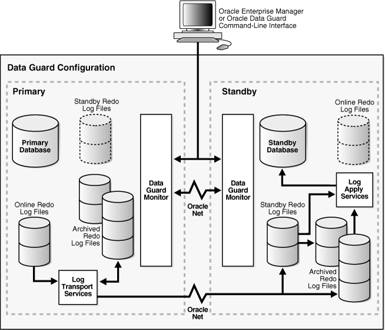
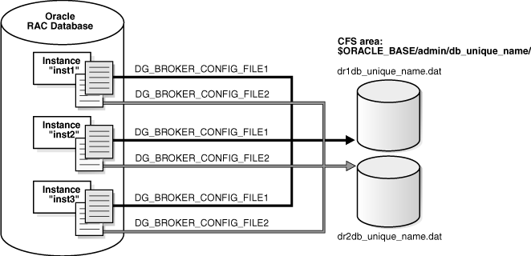
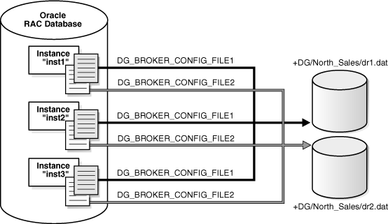
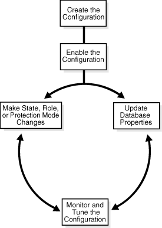

Use Oracle Data Guard broker to manage and monitor the configuration. The broker uses Oracle Enterprise Manager to report health and other operational characteristics.

### 3.1 Configuration Support

Oracle Data Guard broker enables you to create a broker configuration consisting of up to 253 members, including one primary database and a combination of standby databases, far sync instances, and Zero Data Loss Recovery Appliances.

The broker controls the members of the configuration, monitors the health of the configuration, and reports health and other operational characteristics through the Oracle Enterprise Management notification mechanisms if you are using Oracle Enterprise Manager Cloud Control, or through `SHOW` commands if you are using DGMGRL.

A supported Oracle Data Guard configuration contains the following components:

- A primary database (Oracle RAC or non-Oracle RAC)
- A combination of standby databases and far sync instances that receive redo directly from the primary database.
- Oracle Net Services network configuration that defines a connection between the databases
- Standby (archived redo log files) destination parameters and configuration properties
- Redo transport services that transmit the redo data from the primary database to the standbys and far sync instances
- Log apply services that apply redo data to the standby databases from the archived redo log files or standby redo log files

The Oracle Data Guard log apply services update standby databases with redo data that is transmitted automatically from the primary database by redo transport services. The archived redo log files and standby redo log files contain all of the database changes except for unrecoverable or unlogged changes.

- On physical standby databases, Redo Apply applies the redo data to keep the standby consistent with the primary database.
- On logical standby databases, SQL Apply applies the redo data to keep the standby consistent with the primary database.
- On snapshot standby databases, the redo data is received but not applied until the snapshot standby database is converted back to a physical standby database.
- On far sync instances, the redo data is received and then forwarded to a physical standby database. A far sync instance does not have data files and does not apply any of the redo data it has received.

The broker's Oracle Data Guard monitor (DMON) process configures and maintains the broker configuration as a group of objects that you can manage and monitor as a single unit. Thus, when you enter a command that affects multiple databases, the DMON process:

- Carries out your request on the primary database
- Coordinates with the DMON process for each of the other databases, as required for your request
- Updates the configuration file on the local system
- Communicates with the DMON process for each of the other databases to update their copies of the configuration file

Through the DMON process, you can configure, monitor, and control the databases and the configuration together as a unit. If you disable the configuration, broker management of all of the databases in the configuration is also disabled. If you later enable the configuration, broker management is enabled for each database in the configuration.

Figure 3-1 shows a broker configuration with a primary database and physical standby database.

On the primary database, the figure shows the redo transport services in addition to the following main components: the primary database, DMON, the online redo log files, and the archived redo log files. The figure also shows standby redo log files in outline form on the primary side; the standby redo logs are outlined to indicate they are currently inactive but have been configured in preparation for a switchover or failover to the standby role. The physical standby database includes the following components: a standby database, log apply services, DMON, archived redo log files, and standby redo log files. The online redo log files on the physical standby database are outlined to indicate they are currently inactive but have been configured in preparation for a switchover or failover to the primary role.

See Also:

[Oracle Data Guard Concepts and Administration](https://www.oracle.com/pls/topic/lookup?ctx=en/database/oracle/oracle-database/12.2/dgbkr&id=SBYDB4703) for more information about standby databases

Figure 3-1 Oracle Data Guard Broker Configuration



> This figure shows a broker configuration consisting of a primary database and a standby database. At the top of the figure, there is a terminal displayed to represent the user interfaces for managing the Data Guard environment: the Data Guard command-line interface (DGMGRL) and Oracle Enterprise Manager.
>
> On the primary database, this figure shows the redo transport services in addition to the following main components: the primary database, Oracle Data Guard monitor (DMON), the online redo log files, and the archived redo log files. The figure also shows standby redo log files in outlined form on the primary side; the standby redo logs are outlined to indicate they are currently inacative but have been configured in preparation for a switchover to the standby role.
>
> The standby database includes the following components: a standby database, log apply services, the Data Guard monitor, archived redo log files, and standby redo log files. The figure also shows the online redo log files in outlined form. Online redo logs are only used if this is a logical standby database. Finally, the figure shows DMON processes on the primary and standby databases communicating with each other over Oracle Net.


Configuration-Wide Service Names

The broker publishes a service, using the same name, on each configuration member. The default name of this configuration-wide service is `primarydbname_CFG`, where a suffix of `_CFG` is appended to the value of the `DB_UNIQUE_NAME` initialization parameter of the primary database at the time the configuration is created. To change the name of the configuration-wide service, use the `ConfigurationWideServiceName` property. See [ConfigurationWideServiceName](oracle-data-guard-broker-properties.md).

### 3.2 Configuration Properties

Configuration properties control the behavior of a broker configuration.

You can view and dynamically update the values of these properties using either DGMGRL or Cloud Control. However, some properties can only be updated through DGMGRL.

A configuration property has configuration-wide scope; meaning that the value you set for the property applies uniformly to each database in the configuration.

See Also:

[Oracle Data Guard Broker Properties](oracle-data-guard-broker-properties.md) for complete descriptions of all broker configuration properties

### 3.3 Setting Up the Broker Configuration Files

When the broker is started for the first time, configuration files are automatically created and named using a default path name and filename that is operating-system specific.

Two copies of the configuration file are maintained for each database so as to always have a record of the last known valid state of the configuration. You can override the default path name and filename by setting the following initialization parameters for that database:

```
DG_BROKER_CONFIG_FILE1
DG_BROKER_CONFIG_FILE2
```

Note the following restrictions when setting the `DG_BROKER_CONFIG_FILE1` and `DG_BROKER_CONFIG_FILE2` initialization parameters:

- These parameters can only be set or changed when the Oracle Data Guard broker is not running (`DG_BROKER_START=FALSE`).
- These parameters must specify an Oracle ASM, Oracle OCFS, or NFS that is shared for all Oracle RAC instances.

The Oracle Data Guard broker works with databases that use either Oracle managed or user managed datafiles. These datafiles can reside on a file system or an Oracle ASM disk group. The following section contains these topics:

- Renaming the Broker Configuration Files
- Managing Broker Configuration Files in an Oracle RAC Environment

#### 3.3.1 Renaming the Broker Configuration Files

You can change the names of the broker configuration files by issuing the `ALTER SYSTEM` SQL statement.

However, you cannot alter these parameters when the broker's DMON process is running. To change the names of configuration files for a given database, perform the following steps:

1. Disable the broker configuration using the DGMGRL `DISABLE` command. See Enable and Disable Operations.
2. Stop the Oracle Data Guard broker DMON process using the following SQL statement:
	```
	SQL> ALTER SYSTEM SET DG_BROKER_START=FALSE;
	```
3. Change the configuration filenames for the database:
	```
	SQL> ALTER SYSTEM SET DG_BROKER_CONFIG_FILE1=filespec1;
	SQL> ALTER SYSTEM SET DG_BROKER_CONFIG_FILE2=filespec2;
	```
	Note:
	If the broker is managing an Oracle RAC database, the value of `DG_BROKER_CONFIG_FILE1` and the value of `DG_BROKER_CONFIG_FILE2` for each of the instances must point to the same set of physical files.
4. The method of moving the files depends upon where they currently reside and where you want to move them to:
	- If the files reside on an operating system file system, use operating system commands to move the files to their new location.
	- If the old or new location is an Oracle ASM disk group, use the `DBMS_FILE_TRANSFER.COPY_FILE` function to transfer the files to their new location.
5. Restart the Oracle Data Guard broker DMON process, as follows:
	```
	SQL> ALTER SYSTEM SET DG_BROKER_START=TRUE;
	```
6. Enable the broker configuration using the DGMGRL `ENABLE` command or the Enable operation in the Oracle Data Guard management pages of Cloud Control.

Note:

As of Release 11.2, the files can reside on disks having any supported sector size (physical block size) up to and including 4KB sectors. Configuration files that were generated by a release prior to 11.2 are restricted to reside only on disks having the same sector size as was used at the time the files were first created. These files must first be upgraded to Release 11.2 before they can be moved to a location having a different sector size, or are otherwise expected to reside across a mixture of sector sizes in a given broker configuration. See [Upgrading from Oracle Database 10g and Oracle Database 11g to Oracle Database 12c](upgrading-downgrading-in-data-guard-broker-configuration.md) for more information.

#### 3.3.2 Managing Broker Configuration Files in an Oracle RAC Environment

In an Oracle RAC environment, all instances of a database must reference the same set of configuration files.

This means that if the broker is managing an Oracle RAC database, then the value of `DG_BROKER_CONFIG_FILE1` and the value of `DG_BROKER_CONFIG_FILE2` for each of the instances must point to the same set of physical files. The configuration files can be deployed using one of the following methods:

- Using Cluster File System (CFS) for Configuration Files
- Using Oracle ASM Disk Groups for Configuration Files

##### 3.3.2.1 Using Cluster File System (CFS) for Configuration Files

The broker configuration files can reside on a cluster file system (CFS).

If they do, then , the `DG_BROKER_CONFIG_FILE` n parameters on all of the instances must be set to these files including the path to the CFS area. Figure 3-2 shows the set up for the broker configuration files on CFS. In this scenario, the parameters and value for all instances would be:

```
DG_BROKER_CONFIG_FILE1=$ORACLE_BASE/admin/db_unique_name/dr1db_unique_name.dat
DG_BROKER_CONFIG_FILE2=$ORACLE_BASE/admin/db_unique_name/dr2db_unique_name.dat
```

Figure 3-2 Broker Configuration Setup in a CFS Area



> This figure shows an Oracle RAC database with three instances. Each instance defines the DG\_BROKER\_CONFIG\_FILE1 and DG\_BROKER\_CONFIG\_FILE2 initialization parameters that point to the CFS area. Each initialization parameter in the figure is pointing to its appropriate.dat file in the CFS area.


##### 3.3.2.2 Using Oracle ASM Disk Groups for Configuration Files

The broker's configuration files can also reside on an Oracle ASM disk group.

Figure 3-3 shows the setup for the broker configuration files on Oracle ASM devices. In this scenario, the parameters and values would be specified, as follows:

```
ALTER SYSTEM SET DG_BROKER_CONFIG_FILE1 = '+DG/DIRECTORY/DR1.DAT' SCOPE=BOTH;
ALTER SYSTEM SET DG_BROKER_CONFIG_FILE2 = '+DG/DIRECTORY/DR2.DAT' SCOPE=BOTH;
```

Figure 3-3 Broker Configuration Setup with Oracle ASM



> This figure shows an Oracle RAC database with three instances. Each instance defines the DG\_BROKER\_CONFIG\_FILE1 and DG\_BROKER\_CONFIG\_FILE2 initialization parameters that point to the ASM disk group. Each initialization parameter in the figure is pointing to its appropriate.dat file in the ASM disk group.


Because the configuration files must be explicitly named by the user, these configuration files are not Oracle Managed Files (OMF).To create the broker's configuration files on an Oracle ASM disk group, set the `DG_BROKER_CONFIG_FILE1` and `DG_BROKER_CONFIG_FILE2` initialization parameters to a string value that includes the name of an existing Oracle ASM disk group, an existing directory in that disk group, and the name of the configuration file itself.

### 3.4 Starting the Data Guard Broker

After setting up the configuration files, the `DG_BROKER_START` initialization parameter must be set to `TRUE` for each database to start the DMON processes.

By default, the `DG_BROKER_START` initialization parameter is set to `FALSE`. However, you can set the value in the following ways:

- If you are using Cloud Control, it automatically sets the `DG_BROKER_START` initialization parameter to `TRUE` for new standby databases that it creates.
- If you are using DGMGRL, you must explicitly set the `DG_BROKER_START ` initialization parameter to `TRUE`; otherwise, the broker will not start. You can set the `DG_BROKER_START` initialization parameter with the following SQL statement:
	```
	SQL> ALTER SYSTEM SET DG_BROKER_START=TRUE;
	System altered.
	SQL> SHOW PARAMETER DG_BROKER_START
	NAME               TYPE      VALUE
	------------------------------------  
	dg_broker_start    boolean   TRUE
	```

Whether you use Cloud Control or DGMGRL, set the value of the `DG_BROKER_START` initialization parameter to TRUE in the server parameter file on each primary and standby database. Doing so ensures that Oracle Data Guard broker will start automatically the next time you start any instance of the database.

### 3.5 Management Cycle of a Broker Configuration

This figure shows the life cycle of a broker configuration and the accompanying text explains each phase of the cycle.

Figure 3-4 Life Cycle of a Broker Configuration and Its Databases



> The broker configuration life cycle shown in this figure starts with the tasks of creating and then enabling the broker configuration. After these tasks, the figure shows a continuous circle within which the following tasks typically occur on an ongoing basis in the broker configuration: updating database properties, monitoring and tuning the configuration, making state, role, or protection mode changes. All of the tasks shown in the figure are described in detail in the following text.


Create the Broker Configuration

When using Cloud Control, the Add Standby Database wizard can either add an existing (Oracle RAC or non-Oracle RAC) standby database into the configuration or create a new (Oracle RAC or non-Oracle RAC) standby database and add it to the configuration. The standby database can be a physical, logical, or snapshot database.

When using DGMGRL, the primary database and a standby database must already exist. You construct the standby database from backups of the primary database control files and datafiles, and then prepare it for recovery.

Enable the Broker Configuration

An Oracle Data Guard configuration must be enabled to be managed or monitored by the broker. Conversely, you disable a configuration if you no longer want to manage it with the broker. When you disable a configuration, broker management of all of its databases is also disabled.

Note:

You can enable or disable the configuration using DGMGRL. You cannot disable the configuration using Cloud Control. You can enable the configuration using Cloud Control in the event that it was previously disabled using DGMGRL.

A broker configuration, when first created using Cloud Control, is automatically enabled as soon as the Add Standby Database wizard completes.

A broker configuration, when first created using DGMGRL, is in a disabled condition. This means its constituent databases are not yet under active control of the broker. When you finish configuring the databases into a broker configuration with DGMGRL, you must enable the configuration to allow the broker to manage the configuration.

You can enable:

- The entire configuration, including all of its databases
- An individual standby database

You can easily disable a database if a problem occurs such that it cannot function properly in a broker configuration. Note that you cannot disable the primary database. You must disable the entire configuration to disable the primary database.

You may also want to disable a configuration temporarily, and then change some properties in the broker configuration without affecting the actual database properties. The changed properties will take effect when the configuration is enabled again for management by the broker.

Make Role Changes Within the Broker Configuration, As Needed

At any time, you can issue a single command to change the roles of the databases in the configuration. If some event renders the primary database unusable, you can fail over one of the standby databases to become the new primary database.

If Flashback Database was enabled on the former primary database, then after failover has completed, you can reinstate the former primary database as a standby database for the new primary database.

In addition, planned downtime for maintenance can be reduced because you can quickly switch over production processing from the current primary database to a standby database, and then switch back again after the planned maintenance.

See Also:

[Switchover and Failover Operations](using-data-guard-broker-to-manage-switchovers-failovers.md) for more information about role changes

Convert to Snapshot Standby Database

At any time, you can issue a single command to convert a physical standby database to a snapshot standby database. The snapshot standby database is a fully updatable database that receives redo data generated from the primary database, but does not apply it.

Once you are done using the snapshot standby database, you can again issue a single command to convert it to a physical standby database. After the conversion to a physical standby has completed, Redo Apply services will start (assuming the state is `APPLY-ON`) and apply all of the accumulated redo data.

Make State Changes to the Databases, As Needed

When you enable a configuration for the first time, the broker, by default, starts redo transport services on the primary and starts log apply services on the standby (except for a snapshot standby).

At any time, you can issue a single command through Cloud Control or DGMGRL to change the state of the database. For example, you could bring the primary database into the `TRANSPORT-OFF` state to temporarily stop sending redo data to the standby databases. Then, to resume sending redo data to the standbys, you could bring the primary database into the `TRANSPORT-ON` state.

See Also:

[Managing the Members of a Broker Configuration](managing-oracle-data-guard-broker-configuration-members.md) for more information about database state changes

Update Database Properties, As Needed

The broker enables you to set database properties, some of which correspond to database initialization parameters. You can change these properties to dynamically control such things as redo transport, standby file management, log apply, and to support the overall configuration protection mode. The broker records the changes in the broker configuration file for each database in the Oracle Data Guard configuration and propagates the changes to the related initialization parameters in the server parameter files, if needed.

See Also:

[Managing the Members of a Broker Configuration](managing-oracle-data-guard-broker-configuration-members.md) and [Oracle Data Guard Broker Properties](oracle-data-guard-broker-properties.md) for complete information about database properties

Set Data Protection Modes, As Needed

The broker enables you to set the data protection mode for the configuration. You can configure the protection mode to maximize data protection, maximize availability, or maximize performance.

See Also:

[Managing Data Protection Modes](managing-oracle-data-guard-broker-configuration-members.md) for information about managing data protection modes

Monitor the Configuration

You can check the health of the configuration, display and update the properties of the databases, and set Cloud Control events.

Cloud Control also provides a dynamic performance page that automatically and dynamically refreshes chart data and status at specified intervals. The performance chart shows a graphical summary of how far behind and how much redo data is being generated and applied.

### 3.6 Enable and Disable Operations

When you enable or disable a database in the broker configuration, you are effectively enabling or disabling the ability of the broker to manage and monitor the specified database.

The enable and disable operations are defined only for databases that are in a broker configuration; you cannot perform these broker operations on databases that are not part of the broker configuration.

However, disabling a broker configuration does not affect current services and operations in the actual Oracle Data Guard configuration. For example, when you disable a broker configuration, redo transport services and log apply services in the Oracle Data Guard configuration continue to function unchanged, but you can no longer manage them through the broker interfaces.

In addition, disabling a database does not remove or delete it from the broker configuration file. You can still change the properties of a disabled database and later reenable your ability to manage with the broker using the DGMGRL `ENABLE CONFIGURATION` or `ENABLE DATABASE` commands, or the Enable option in the Oracle Data Guard management pages of Cloud Control.

Note:

If you disable broker management of a standby database in the broker configuration, that standby database cannot be used by the broker as a failover target in the event of loss of the primary database.

Disabling broker management of the configuration may be useful to do even though you are removing the broker's ability to monitor and control the databases. For example, it may be advantageous to disable a configuration temporarily in order to change one or more properties in the broker configuration all at the same time. When you change properties in a disabled configuration, it does not affect the actual database properties underneath because the changes are not applied to the running database until you reenable the configuration. For example, you might want to change the overall configuration protection mode and the redo transport services properties on a disabled configuration so that all changes are applied to the configuration at the same time upon the next enable operation.

See Also:

[How the Protection Modes Influence Broker Operations](managing-oracle-data-guard-broker-configuration-members.md)

### 3.7 Configuration Status

A configuration status reveals the overall health of the configuration.

Status of the configuration is acquired from the status of all of its databases.

The following list describes the possible status modes for a configuration:

- Success
	The configuration, including all of the databases configured in it, is operating as specified by the user without any warnings or errors.
- Warning
	One or more of the databases in the configuration are not operating as specified by the user. To obtain more information, use the DGMGRL `SHOW DATABASE <db-unique-name>` command or the Cloud Control display to locate each database and examine its status to reveal the source of the problem.
- Error
	One or more of the databases in the configuration failed or may no longer be operating as specified by the user. To obtain more information, use the DGMGRL `SHOW DATABASE <db-unique-name>` command or the Cloud Control display to locate each database and examine its status to reveal the source of the problem.
- Unknown/Disabled
	Broker management of the configuration is disabled and the broker is not monitoring the status of the databases in the configuration.
- ROLLING DATABASE MAINTENANCE IN PROGRESS
	An operation performed using the PL/SQL `DBMS_ROLLING` package is in progress.