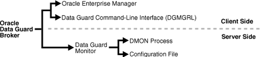
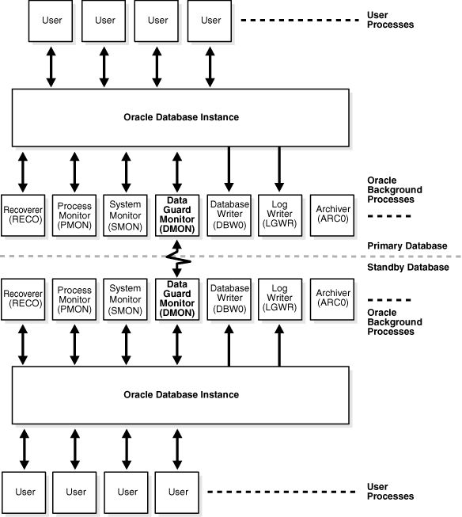

Learn about Oracle Data Guard broker, its architecture and components, and how it automates the creation, control, and monitoring of an Oracle Data Guard configuration.

See [Oracle Data Guard Concepts and Administration](https://www.oracle.com/pls/topic/lookup?ctx=en/database/oracle/oracle-database/12.2/dgbkr&id=SBYDB00100) for the definition of an Oracle Data Guard configuration and for complete information about Oracle Data Guard concepts and terminology.

### 1.1 Overview of Oracle Data Guard and the Broker

Oracle Data Guard ensures high availability, data protection, and disaster recovery for enterprise data. Oracle Data Guard provides a comprehensive set of services that create, maintain, manage, and monitor one or more standby databases to enable production Oracle databases to survive disasters and data corruptions.Oracle Data Guard maintains these standby databases as transactionally consistent copies of the primary database. If the primary database becomes unavailable because of a planned or an unplanned outage, Oracle Data Guard enables you to switch any standby database to the production role, thus minimizing the downtime associated with the outage. Oracle Data Guard can be used with traditional backup, recovery, and cluster techniques, as well as with the Flashback Database feature to provide a high level of data protection and data availability.

Oracle Data Guard and Oracle RAC One Node

As of Oracle Database 11g Release 2 (11.2.0.2), Oracle Data Guard and Oracle Data Guard broker are fully integrated with Oracle Real Application Clusters One Node (Oracle RAC One Node).

#### 1.1.1 Oracle Data Guard Configurations and Broker Configurations

An Oracle Data Guard configuration consists of one primary database and a combination of standby databases, far sync instances, and Zero Data Loss Recovery Appliances that receive redo directly from the primary database. The members of an Oracle Data Guard configuration are connected by Oracle Net and may be dispersed geographically. There are no restrictions on where the members are located as long as they can communicate with each other.

The Oracle Data Guard broker logically groups these members into a broker configuration that allows the broker to manage and monitor them together as an integrated unit. You can manage a broker configuration using either Oracle Enterprise Manager Cloud Control (Cloud Control) or the Oracle Data Guard command-line interface.

#### 1.1.2 Oracle Data Guard Broker

The Oracle Data Guard broker is a distributed management framework that automates and centralizes the creation, maintenance, and monitoring of Oracle Data Guard configurations.

The following list describes some of the operations the broker automates and simplifies:

- Creating Oracle Data Guard configurations that include one primary database, standbys (physical, logical, snapshot, and far sync), Zero Data Loss Recovery Appliances, and redo transport services and log apply services. The databases can be Oracle Real Application Clusters (Oracle RAC) databases.
- Adding standbys (physical, logical, snapshot, far sync, Oracle RAC or non-Oracle RAC) and Zero Data Loss Recovery Appliances to an existing Data Guard configuration.
- Managing the protection mode for the broker configuration.
- Invoking switchover or failover with a single command to initiate and control complex role changes across all databases in the configuration.
- Configuring failover to occur automatically upon loss of the primary database, increasing availability without manual intervention.
- Monitoring the status of the entire configuration, capturing diagnostic information, reporting statistics such as the Redo Apply rate and the redo generation rate, and detecting problems quickly with centralized monitoring, testing, and performance tools.
- Assessing whether a database is ready to become a primary. (See " [VALIDATE DATABASE](oracle-data-guard-broker-commands.md) ").

You can perform all management operations locally or remotely through the broker's easy-to-use interfaces: the Oracle Data Guard management pages in Cloud Control, and the Oracle Data Guard command-line interface called DGMGRL.

These interfaces simplify the configuration and management of an Oracle Data Guard configuration. The following table provides a comparison of configuration management using the broker's interfaces and using SQL\*Plus.

Table 1-1 Configuration Management With and Without the Broker

| Tasks | With the Broker | Without the Broker |
| --- | --- | --- |
| General | Provides primary database, standby database, and far sync instance management as one unified configuration. | You must manage the primary database, standby databases, and far sync instances separately. |
| Standby Database Creation | Provides Cloud Control wizards that automate and simplify the steps required to create a configuration with an Oracle database on each site, including creating the standby control file, online redo log files, datafiles, and server parameter files. | You must manually (using RMAN or other tools, such as DBCA):  - Create the standby. - Copy the database files to the standby database system. - Create a control file on the standby database system. - Create server parameter or initialization parameter files on the standby database system. |
| Configuration and Management | Enables you to configure and manage multiple databases from a single location and automatically unifies all of the databases in the broker configuration. | You must manually connect to multiple locations in order to:  - Set up redo transport services and log apply services on each database in the configuration. - Manage the primary database and standby databases individually. |
| Control | - Automatically sets up redo transport services and log apply services. Simplifies management of these services, especially in an Oracle RAC environment. - Simplifies switchovers, failovers, reinstatements, and conversions to and from a snapshot standby database, allowing you to invoke them through a single command. - Automates failover by allowing the broker to determine if failover is necessary and to initiate failover to a specified target standby database, with no need for DBA intervention and with either no loss of data or with a configurable amount of data loss. - Integrates role changes with Oracle Clusterware. - Manageable and monitorable through Cloud Control - Integrates with Oracle Global Data Services, providing support for role-specific global services. | You must manually:  - Use multiple SQL statements to manage the database. - Coordinate sequences of multiple commands across multiple database sites to execute switchover and failover operations. - Coordinate sequences of multiple commands to manage services and instances during role transitions. |
| Monitoring | - Provides continuous monitoring of the configuration health, database health, and other runtime parameters. - Provides a unified updated status and detailed reports. - Provides integration with Cloud Control events. | You must manually:  - Monitor the status and runtime parameters using fixed views on each database—there is no unified view of status for all of the databases in the configuration. - Provide a custom method for monitoring Cloud Control events. |

#### 1.1.3 Oracle Data Guard Broker and CDBs

Oracle Data Guard broker supports multitenant container databases (CDBs) within a broker configuration.

Keep the following in mind:

- When the primary database is a CDB, all standby databases in the broker configuration must also be CDBs.
- When a broker configuration is made up of CDBs, all broker actions execute at the root level and not at the individual pluggable database (PDB) level.
- To administer a multitenant environment you must have the `CDB_DBA` role.
- After a role change, the broker opens all active instances of the new primary. The broker also opens all active instances of a snapshot standby, a logical standby and the first instance of a physical standby (if the former physical standby was open for read).
- The broker also opens all PDBs on all instances it opens.

See Also:

- [Oracle Database Concepts](https://www.oracle.com/pls/topic/lookup?ctx=en/database/oracle/oracle-database/12.2/dgbkr&id=CNCPT89249) for more information about CDBs

#### 1.1.4 Oracle Data Guard Broker and Oracle Global Data Services

To manage broker configurations that support Oracle Global Data Services (GDS), you use both the broker command-line interface, DGMGRL, and the GDS command line interface,GDSCTL. Broker configurations are added to GDS pools (logical groupings of GDS databases which span across GDS regions).

Managing Broker Configurations in a GDS Pool

To add a broker configuration to a GDS pool, use the GDS command-line interface, GDSCTL. A broker configuration can only be added to an empty pool. A broker configuration cannot span multiple pools.

To delete a broker configuration that is in a pool, you must first remove it from the pool by using the GDSCTL `REMOVE BROKERCONFIG ...` command. Otherwise an error is returned.

Only entire broker configurations are added and removed using GDSCTL; to add and remove individual databases to/from a broker configuration, use the broker command-line interface, DGMGRL.

Managing Individual Configuration Databases When They Are Part of a GDS Pool

If a GDS pool already contains a broker configuration, then only databases that belong to that configuration can be added to the pool. The only way to add or remove individual databases to or from a broker configuration in a pool is to use the broker command-line interface, DGMGRL.

When a database is added to a broker configuration, that database is automatically also added to the GDS pool to which the configuration belongs.

When a database is removed from a broker configuration, it is automatically removed from the GDS pool to which the configuration belongs.

The broker interacts with GDS and notifies it of any role or configuration changes to ensure that the appropriate database services are active and that the appropriate FAN events are published after a role change.

See Also:

- [Oracle Database Global Data Services Concepts and Administration Guide](https://www.oracle.com/pls/topic/lookup?ctx=en/database/oracle/oracle-database/12.2/dgbkr&id=GSMUG107) for more information about GDS.

### 1.2 Benefits of Oracle Data Guard Broker

The broker's interfaces improve usability and centralize management and monitoring of an Oracle Data Guard configuration.

Available as a feature of the Enterprise Edition and Personal Edition of the Oracle database, the broker is also integrated with the Oracle database and Cloud Control. These broker attributes result in the following benefits:

Disaster protection:

By automating many of the manual tasks required to configure and monitor an Oracle Data Guard configuration, the broker enhances the high availability, data protection, and disaster protection capabilities that are inherent in Oracle Data Guard. Access is possible through a client to any system in the Oracle Data Guard configuration, eliminating any single point of failure. If the primary database fails, the broker automates the process for any one of the standby databases to replace the primary database and take over production processing. The database availability that Oracle Data Guard provides makes it easier to protect your data.

Higher availability and scalability with Oracle Real Application Clusters (Oracle RAC) Databases:

While Oracle Data Guard broker enhances disaster protection by maintaining transactionally consistent copies of the primary database, Oracle Data Guard, configured with Oracle high availability solutions such as Oracle Real Application Clusters (Oracle RAC) databases, further enhances the availability and scalability of any given copy of that database. The intrasite high availability of an Oracle RAC database complements the intersite protection that is provided by Oracle Data Guard broker.

Consider that you have a cluster system hosting a primary Oracle RAC database comprised of multiple instances sharing access to that database. Further consider that an unplanned failure has occurred. From an Oracle Data Guard broker perspective, the primary database remains available as long as at least one instance of the clustered database continues to be available for transporting redo data to the standby databases. Oracle Clusterware manages the availability of instances of an Oracle RAC database. It works to rapidly recover failed instances to keep the primary database available. If Oracle Clusterware is unable to recover a failed instance, the broker continues to run automatically with one less instance. If the last instance of the primary database fails, the broker provides a way to fail over to a specified standby database. If the last instance of the primary database fails, and fast-start failover is enabled, the broker can continue to provide high availability by automatically failing over to a pre-determined standby database.

The broker is integrated with Oracle Clusterware so that database role changes occur smoothly and seamlessly. This is especially apparent in the case of a planned role switchover (for example, when a physical standby database is directed to take over the primary role while the former primary database assumes the role of standby). The broker and Oracle Clusterware work together to temporarily suspend service availability on the primary database, accomplish the actual role change for both databases during which Oracle Clusterware works with the broker to properly restart the instances as necessary on the old primary database, and then start services defined on the new primary database. The broker manages the underlying Oracle Data Guard configuration and its database roles while Oracle Clusterware manages service availability that depends upon those roles. Applications that rely on Oracle Clusterware for managing service availability will see only a temporary suspension of service as the role change occurs in the Oracle Data Guard configuration.

Note that while Oracle Clusterware helps to maintain the availability of the individual instances of an Oracle RAC database, the broker coordinates actions that maintain one or more physical or logical copies of the database across multiple geographically dispersed locations to provide disaster protection. Together, the broker and Oracle Clusterware provide a strong foundation for Oracle's high-availability architecture.

See Also:

[Oracle Real Application Clusters Administration and Deployment Guide](https://www.oracle.com/pls/topic/lookup?ctx=en/database/oracle/oracle-database/12.2/dgbkr&id=RACAD1111) for information about Oracle Clusterware

Support for Oracle RAC One Node:

As of Oracle Database 11g Release 2 (11.2.0.2), Oracle Data Guard and Oracle Data Guard broker are fully integrated with Oracle Real Application Clusters One Node (Oracle RAC One Node). This support provides a higher level of availability at the local site by leveraging many of the Oracle Clusterware benefits just noted for Oracle RAC configurations.

Automated creation of an Oracle Data Guard configuration:

The broker helps you to logically define and create an Oracle Data Guard configuration. The broker automatically communicates between the members of an Oracle Data Guard configuration using Oracle Net Services. The members can be local or remote, connected by a LAN or geographically dispersed over a WAN.

Cloud Control provides a wizard that automates the complex tasks involved in creating a broker configuration, including:

- Adding an existing standby database, or a new standby database created from existing backups taken through Cloud Control
- Configuring the standby control file, server parameter file, and datafiles
- Initializing communication with the standbys
- Creating standby redo log files
- Enabling Flashback Database if you plan to use fast-start failover

Although DGMGRL cannot automatically create a new standby, you can use DGMGRL commands to configure and monitor an existing standby, including those created using Cloud Control.

Easy configuration of additional standbys:

After you create an Oracle Data Guard configuration, you can add new or existing standbys to each Oracle Data Guard configuration. Cloud Control provides an Add Standby Database wizard to guide you through the process of adding more databases.

Simplified, centralized, and extended management:

You can issue commands to manage many aspects of the broker configuration. These include:

- Simplify the management of all components of the configuration, including the primary database, standbys, Zero Data Loss Recovery Appliances, redo transport services, and log apply services.
- Coordinate database state transitions and update database properties dynamically, with the broker recording the changes in a broker configuration file that includes information about all the databases in the configuration. The broker propagates the changes to all databases in the configuration and their server parameter files.
- Simplify the control of the configuration protection modes (to maximize protection, to maximize availability, or to maximize performance).
- Invoke the Cloud Control verify operation to ensure that redo transport services and log apply services are configured and functioning properly.

Simplified switchover and failover operations:

The broker simplifies switchovers and failovers by allowing you to invoke them using a single key click in Cloud Control or a single command at the DGMGRL command-line interface (referred to in this documentation as manual failover). For lights-out administration, you can enable fast-start failover to allow the broker to determine if a failover is necessary and to initiate the failover to a pre-specified target standby automatically, with no need for DBA intervention. Fast-start failover can be configured to occur with no data loss or with a configurable amount of data loss.

Fast-start failover allows you to increase availability with less need for manual intervention, thereby reducing management costs. Manual failover gives you control over exactly when a failover occurs and to which target standby. Regardless of the method you choose, the broker coordinates the role transition on all databases in the configuration. Once failover is complete, the broker publishes a Fast Application Notification (FAN) event to notify applications that the new primary is available.

Note that you can use the `DBMS_DG` PL/SQL package to enable an application to initiate a fast-start failover when it encounters specific conditions. See [Application Initiated Fast-Start Failover](managing-oracle-data-guard-broker-configuration-members.md) for more information.

Only one command is required to initiate complex role changes for switchover or failover operations across all databases in the configuration. The broker automates switchover and failover to a specified standby database in the broker configuration. Cloud Control enables you to select a new primary database from a set of viable standby databases (enabled and running, with normal status). The DGMGRL `SWITCHOVER` and `FAILOVER` commands only require you to specify the target standby database before automatically initiating and completing the many steps in switchover or failover operations across the multiple databases in the configuration.

Built-in monitoring and alert and control mechanisms:

The broker provides built-in validation that monitors the health of all of the databases in the configuration. While connected to any database in the configuration, you can capture diagnostic information and detect obvious and subtle problems quickly with centralized monitoring, testing, and performance tools. Both Cloud Control and DGMGRL retrieve a complete configuration view of the progress of redo transport services on the primary database and the progress of Redo Apply or SQL Apply on the standby database.

The ability to monitor local and remote databases and respond to events is significantly enhanced by the broker's health check mechanism and tight integration with the Cloud Control event management system.

Transparent to application:

Use of the broker is possible for any database because the broker works transparently with applications; no application code changes are required to accommodate a configuration that you manage with the broker.

### 1.3 Oracle Data Guard Broker Components

These are the components that make up Oracle Data Guard broker.

- Oracle Enterprise Manager Cloud Control
- Oracle Data Guard Command-Line Interface (DGMGRL)
- Oracle Data Guard Monitor

Cloud Control and the Oracle Data Guard command-line interface (DGMGRL) are the broker client interfaces that help you define and manage a configuration consisting of a collection of primary and standby databases. DGMGRL also includes commands to create **observer** processes, which facilitate fast-start failover.

The Oracle Data Guard monitor is the broker server-side component that is integrated with the Oracle database. The Oracle Data Guard monitor is composed of several processes, including the DMON process, and broker configuration files that allow you to control the databases of that configuration, modify their behavior at runtime, monitor the overall health of the configuration, and provide notification of other operational characteristics.

Figure 1-1 shows these components of the broker.

Figure 1-1 Oracle Data Guard Broker

> This figure shows the components of the broker architecture. On the client side, the broker architecture features two user interfaces: the Oracle Enterprise Manager GUI and the Data Guard command-line interface (DGMGRL). On the server side, the figure shows the Data Guard monitor which is implemented through the Data Guard monitor (DMON) process and the Data Guard configuration file. These components are described in more detail in the following sections.

### 1.4 Oracle Data Guard Broker User Interfaces

You can use either of the broker's user interfaces to create a broker configuration and to control and monitor the configuration.

The following sections describe the broker's user interfaces:

- Oracle Enterprise Manager Cloud Control
- Oracle Data Guard Command-Line Interface (DGMGRL)

#### 1.4.1 Oracle Enterprise Manager Cloud Control

Oracle Enterprise Manager Cloud Control (Cloud Control) works with the Oracle Data Guard monitor to automate and simplify the management of an Oracle Data Guard configuration.

With Cloud Control, the complex operations of creating and managing standby databases are simplified through Oracle Data Guard management pages and wizards, including:

- An Add Standby Database wizard that helps you to create a broker configuration, if one does not already exist, having a primary database and a local or remote standby database. The wizard can create a physical, snapshot, or logical standby database or import an existing physical, snapshot, or logical (Oracle RAC or non-Oracle RAC) standby database. If the wizard creates a physical, snapshot, or logical standby database, the wizard also automates the creation of the standby control file, server parameter file, online and standby redo log files, and the standby datafiles.
- A switchover operation that helps you switch roles between the primary database and a standby database.
- A failover operation that changes one of the standby databases to the role of a primary database.
- Performance tools and graphs that help you monitor and tune redo transport services and log apply services.
- Property pages that allow you to set database properties on any database and, if applicable, the settings are immediately propagated to all other databases and server parameter files in the configuration.
- Event reporting through e-mail.

In addition, it makes all Oracle Net Services configuration changes necessary to support redo transport services and log apply services.

See Also:

My Oracle Support note 787461.1 at [`http://support.oracle.com`](http://support.oracle.com/) for information about which versions of Cloud Control are required to manage the full set of Oracle Data Guard features in various Oracle Database releases

#### 1.4.2 Oracle Data Guard Command-Line Interface (DGMGRL)

The Oracle Data Guard command-line interface (DGMGRL) enables you to control and monitor an Oracle Data Guard configuration from the DGMGRL prompt or within scripts.

You can perform most of the activities required to manage and monitor the databases in the configuration using DGMGRL commands.

DGMGRL also includes commands to create observer processes that continuously monitor the primary and target standby databases and evaluate whether failover is necessary, and then initiate a fast-start failover when conditions warrant.

See Also:

[Oracle Data Guard Command-Line Interface Reference](oracle-data-guard-broker-commands.md) for complete reference information for the Oracle Data Guard command-line interface.

### 1.5 Oracle Data Guard Monitor

The configuration, control, and monitoring functions of the broker are implemented by server-side software and configuration files that are maintained for each database that the broker manages.

The software is called the Oracle Data Guard monitor. The following topics describe how the Oracle Data Guard monitor interacts with the Oracle database and with remote Oracle Data Guard monitors to manage the broker configuration.

#### 1.5.1 Oracle Data Guard Monitor (DMON) Process

The Oracle Data Guard monitor process (DMON) is an Oracle background process that runs on every database instance that is managed by the broker.

When you start the Oracle Data Guard broker, a DMON process is created.

See Also:

[Starting the Data Guard Broker](managing-oracle-data-guard-broker-configurations.md) for information on starting the broker

Whether you use Cloud Control or DGMGRL to manage a database, the DMON process is the server-side component that interacts with the local database and the DMON processes of the other databases to perform the requested function. The DMON process is also responsible for monitoring the health of the broker configuration and for ensuring that every database has a consistent description of the configuration.

Figure 1-2 shows the broker's DMON process as one of several background processes that constitute an instance of the Oracle database. Each database instance shown in the figure has its own DMON process.

Figure 1-2 Databases With Broker (DMON) Processes

> This figure emphasizes the discussion in the surrounding text that describes the DMON process as one of many Oracle background processes. The top half of the figure shows a primary database on which the Oracle database is interacting with the DMON process and many other background processes such as the Recoverer (RECO), Process Monitor (PMON), System Monitor (SMON), Database Writer (DBW0), Log Writer (LGWR), and the Archiver (ARC0). An elliptical series of dots indicates that the number of processes continues beyond the ones shown in this figure.
>
> The bottom half of the figure represents the standby database as a mirror image of the primary database, showing that there is a DMON process on the standby database along with a series of Oracle database processes as shown on the primary database.
>
> The figure also shows that two-way communication occurs between the DMON processes on the primary and standby databases over the Oracle Net communication channel.

The zigzag arrow in the center of Figure 1-2 represents the two-way Oracle Net Services communication channel that exists between the DMON processes of two databases in the same broker configuration.

This two-way communication channel is used to pass requests between databases and to monitor the health of all of the databases in the broker configuration.

#### 1.5.2 Configuration Management

The broker's DMON process persistently maintains information about all members of the broker configuration in a binary configuration file.

A copy of the configuration file is maintained by the DMON process for each of the databases that belong to the broker configuration. If it is an Oracle RAC database, each database's copy of the file is shared by all instances of the database.

This configuration file contains information that describes the states and properties of the databases in the configuration. For example, the file records the databases that are part of the configuration, the roles and properties of each of the databases, and the state of each database in the configuration.

The configuration data is managed transparently by the DMON process to ensure that the configuration information is kept consistent across all of the databases. The broker uses the data in the configuration file to configure and start the databases, control each database's behavior, and provide information to DGMGRL and Cloud Control.

See Also:

[Managing Database Properties](managing-oracle-data-guard-broker-configuration-members.md) for more information

Whenever you add databases to a broker configuration, or make a change to an existing database's properties, each DMON process records the new information in its copy of the configuration file.

#### 1.5.3 Database Property Management

The DMON process uses various properties associated with each database to control the database's behavior.

The properties are recorded in the configuration file. Many database properties are used to control database initialization parameters related to the Oracle Data Guard environment.

To ensure that the broker can update the values of parameters in both the database itself and in the configuration file, you must use a server parameter file to control static and dynamic initialization parameters. The use of a server parameter file gives the broker a mechanism that allows it to reconcile property values selected by the database administrator (DBA) when using the broker with any related initialization parameter values recorded in the server parameter file.

When you set values for database properties in the broker configuration, the broker records the change in the configuration file and propagates the change to all of the databases in the Oracle Data Guard configuration.

Note:

The broker supports both the default and nondefault server parameter file filenames. If you use a nondefault server parameter filename, the initialization parameter file must include the complete filename and location of the server parameter file. If this is an Oracle RAC database, there must be one nondefault server parameter file for all instances.

See Also:

[Configurable (Changeable) Properties](managing-oracle-data-guard-broker-configuration-members.md) for more information