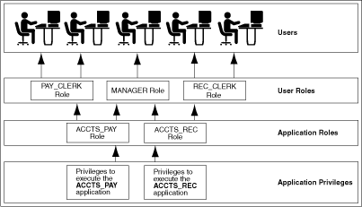

- About Privileges and Roles  
	Authorization permits only certain users to access, process, or alter data; it also creates limitations on user access or actions.
- Who Should Be Granted Privileges?  
	You grant privileges to users so they can accomplish tasks required for their jobs.
- How the Oracle Multitenant Option Affects Privileges  
	In a multitenant environment, all users, including common users, can exercise their privileges only within the current container.
- Managing Administrative Privileges  
	Administrative privileges can be used for both general and specific database operations.
- Managing System Privileges  
	To perform actions on schema objects, you must be granted the appropriate system privileges.
- Managing Commonly and Locally Granted Privileges  
	In a multitenant environment, privileges can be granted commonly for an entire CDB or application container, or granted locally to a specific PDB.
- Managing Common Roles and Local Roles  
	A common role is a role that is created in the root; a local role is created in a PDB.
- Managing User Roles  
	A user role is a named collection of privileges that you can create and assign to other users.
- Using PDB Lockdown Profiles to Restrict Operations on PDBs  
	You can use PDB lockdown profiles in a multitenant environment to restrict sets of user operations in pluggable databases (PDBs).
- Managing Object Privileges  
	Object privileges enable you to perform actions on schema objects, such as tables or indexes.
- Table Privileges  
	Object privileges for tables enable table security at the DML or DDL level of operation.
- View Privileges  
	You can apply DML object privileges to views, similar to tables.
- Procedure Privileges  
	The `EXECUTE` privilege enables users to run procedures and functions, either standalone or in packages.
- Type Privileges  
	You can control system and object privileges for types, methods, and objects.
- Grants of User Privileges and Roles  
	The `GRANT` statement provides privileges for a user to perform specific actions, such as executing a procedure.
- Revokes of Privileges and Roles from a User  
	When you revoke system or object privileges, be aware of the cascading effects of revoking a privilege.
- Grants and Revokes of Privileges to and from the PUBLIC Role  
	You can grant and revoke privileges and roles from the role `PUBLIC`.
- Grants of Roles Using the Operating System or Network  
	Using the operating system or network to manage roles can help centralize the role management in a large enterprise.
- How Grants and Revokes Work with SET ROLE and Default Role Settings  
	Privilege grants and the `SET ROLE` statement affect when and how grants and revokes take place.
- User Privilege and Role Data Dictionary Views  
	You can use special queries to find information about various types of privilege and role grants.

**Parent topic:** [Managing User Authentication and Authorization](part_1.md)

### 4.1 About Privileges and Roles

Authorization permits only certain users to access, process, or alter data; it also creates limitations on user access or actions.

The limitations placed on (or removed from) users can apply to objects such as schemas, entire tables, or table rows.

A user privilege is the right to run a particular type of SQL statement, or the right to access an object that belongs to another user, run a PL/SQL package, and so on. The types of privileges are defined by Oracle Database.

Roles are created by users (usually administrators) to group together privileges or other roles. They are a way to facilitate the granting of multiple privileges or roles to users.

Privileges can fall into the following general categories:

- System privileges. These privileges allow the grantee to perform standard administrator tasks in the database. Restrict them only to trusted users. See the following sections describe privileges:
- Roles. A role groups several privileges and roles, so that they can be granted to and revoked from users simultaneously. You must enable the role for a user before the user can use it. See the following sections for more information:
	- Managing Common Roles and Local Roles
		- Managing User Roles
- Object privileges. Each type of object has privileges associated with it. Managing Object Privileges describes how to manage privileges for different types of objects.
- Table privileges. These privileges enable security at the DML (data manipulation language) or DDL (data definition language) level.Table Privileges describes how to manage table privileges.
- View privileges. You can apply DML object privileges to views, similar to tables. See View Privileges for more information.
- Procedure privileges. Procedures, including standalone procedures and functions, can be granted the `EXECUTE` privilege. See Procedure Privileges for more information.
- Type privileges. You can grant system privileges to named types (object types, `VARRAY` s, and nested tables). See Type Privileges for more information.

See Also:

[Oracle Database Vault Administrator's Guide](https://docs.oracle.com/pls/topic/lookup?ctx=en/database/oracle/oracle-database/12.2/dbseg&id=DVADM591) for information about how you can create policies that analyze privilege use

**Parent topic:** Configuring Privilege and Role Authorization

### 4.2 Who Should Be Granted Privileges?

You grant privileges to users so they can accomplish tasks required for their jobs.

You should grant a privilege only to a user who requires that privilege to accomplish the necessary work. Excessive granting of unnecessary privileges can compromise security. For example, you never should grant `SYSDBA` or `SYSOPER` administrative privilege to users who do not perform administrative tasks.

You can grant privileges to a user in two ways:

- You can grant privileges to users explicitly. For example, you can explicitly grant to user `psmith` the privilege to insert records into the `employees` table.
- You can grant privileges to a role (a named group of privileges), and then grant the role to one or more users. For example, you can grant the privileges to select, insert, update, and delete records from the `employees` table to the role named `clerk`, which in turn you can grant to users `psmith` and `robert`.

Because roles allow for easier and better management of privileges, you should usually grant privileges to roles and not to specific users.

See Also:

- [Guidelines for Securing User Accounts and Privileges](keeping-your-oracle-database-secure.md) for best practices to follow when granting privileges
- [Oracle Database Vault Administrator’s Guide](https://docs.oracle.com/pls/topic/lookup?ctx=en/database/oracle/oracle-database/12.2/dbseg&id=DVADM591) if you are concerned about excessive privilege grants
- [Oracle Database SQL Language Reference](https://docs.oracle.com/pls/topic/lookup?ctx=en/database/oracle/oracle-database/12.2/dbseg&id=SQLRF55037) for the complete list of system privileges and their descriptions

**Parent topic:** Configuring Privilege and Role Authorization

### 4.3 How the Oracle Multitenant Option Affects Privileges

In a multitenant environment, all users, including common users, can exercise their privileges only within the current container.

However, a user connected to the root can perform certain operations that affect other pluggable databases (PDBs). These operations include `ALTER PLUGGABLE DATABASE`, `CREATE USER`, `CREATE ROLE`, and `ALTER USER`. The common user must possess the commonly granted privileges that enable these operations. A common user connected to the root can see metadata pertaining to PDBs by way of the [container data object](glossary.md) s (for example, multitenant container database (CDB) views and `V$` views) in the root, provided that the common user has been granted privileges required to access these views and his `CONTAINER_DATA` attribute has been set to allow seeing data about various PDBs. The common user cannot query tables or views in a PDB.

Common users cannot exercise their privileges across other PDBs. They must first switch to the PDB that they want, and then exercise their privileges from there. To switch to a different container, the common user must have the `SET CONTAINER` privilege. The `SET CONTAINER` privilege must be granted either commonly or in the container to which the user is attempting to switch. Alternatively, the common user can start a new database session whose initial current container is the container this user wants, relying on the `CREATE SESSION` privilege in that PDB.

Be aware that commonly granted privileges may interfere with the security configured for individual PDBs. For example, suppose an application PDB database administrator wants to prevent any user in the PDB from modifying a particular application common object. A privilege (such as `UPDATE`) granted commonly to `PUBLIC` or to a common user or common role on the object would circumvent the PDB database administrator’s intent.

### 4.4 Managing Administrative Privileges

Administrative privileges can be used for both general and specific database operations.

- About Administrative Privileges  
	For better separation of duty, Oracle Database provides administrative privileges that are tailored for commonly performed specific administrative tasks.
- Grants of Administrative Privileges to Users  
	As with all powerful privileges, only grant administrative privileges to trusted users.
- SYSDBA and SYSOPER Privileges for Standard Database Operations  
	The `SYSDBA` and `SYSOPER` administrative privileges enable you to perform standard database operations.
- SYSBACKUP Administrative Privilege for Backup and Recovery Operations  
	The `SYSBACKUP` administrative privilege is used to perform backup and recovery operations from either Oracle Recovery Manager (RMAN) and or through SQL\*Plus.
- SYSDG Administrative Privilege for Oracle Data Guard Operations  
	You can log in as user `SYSDG` with the `SYSDG` administrative privilege to perform Data Guard operations.
- SYSKM Administrative Privilege for Transparent Data Encryption  
	The `SYSKM` administrative privilege enables the `SYSKM` user to manage Transparent Data Encryption (TDE) wallet operations.
- SYSRAC Administrative Privilege for Oracle Real Application Clusters  
	The `SYSRAC` administrative privilege is used by the Oracle Real Application Clusters (Oracle RAC) Clusterware agent.

**Parent topic:** Configuring Privilege and Role Authorization

#### 4.4.1 About Administrative Privileges

For better separation of duty, Oracle Database provides administrative privileges that are tailored for commonly performed specific administrative tasks.

These tasks include operations for backup and recovery, Oracle Data Guard, and encryption key management for Transparent Data Encryption (TDE).

You can find the administrative privileges that a user has by querying the `V$PWFILE_USERS` dynamic view, which lists users in the password file.

In previous releases, you needed to have the `SYSDBA` administrative privilege to perform these tasks. To support backward compatibility, you still can use the `SYSDBA` privilege for these tasks, but Oracle recommends that you use the administrative privileges described in this section.

The use of administrative privileges is mandatorily audited.

#### 4.4.2 Grants of Administrative Privileges to Users

As with all powerful privileges, only grant administrative privileges to trusted users.

However, be aware that there is a restriction for users whose names have non-ASCII characters (for example, the umlaut in the name `HÜBER`). You can grant administrative privileges to these users, but if the Oracle database instance is down, the authentication using the granted privilege is not supported if the user name has non-ASCII characters. If the database instance is up, then the authentication is supported.

**Parent topic:** Managing Administrative Privileges

#### 4.4.3 SYSDBA and SYSOPER Privileges for Standard Database Operations

The `SYSDBA` and `SYSOPER` administrative privileges enable you to perform standard database operations.

These database operations can include tasks such as database startups and shutdowns, creating the server parameter file (`SPFILE`), or altering the database archive log. In a multitenant environment, you can grant the `SYSDBA` and `SYSOPER` administrative privileges to application common users (but not to CDB common users).

You can find if a user has been granted an administrative privilege on a local (PDB) level, for a CDB root, or for an application root by querying the `SCOPE` column of the `V$PWFILE_USERS` dynamic view.

See Also:

[Oracle Database Administrator’s Guide](https://docs.oracle.com/pls/topic/lookup?ctx=en/database/oracle/oracle-database/12.2/dbseg&id=ADMIN11048) for detailed information about the `SYSDBA` and `SYSOPER` administrative privileges

**Parent topic:** Managing Administrative Privileges

#### 4.4.4 SYSBACKUP Administrative Privilege for Backup and Recovery Operations

The `SYSBACKUP` administrative privilege is used to perform backup and recovery operations from either Oracle Recovery Manager (RMAN) and or through SQL\*Plus.

To connect to the database as `SYSBACKUP` using a password, you must create a password file for it. See [Oracle Database Administrator’s Guide](https://docs.oracle.com/pls/topic/lookup?ctx=en/database/oracle/oracle-database/12.2/dbseg&id=ADMIN11056) for more information about creating password files.

This privilege enables you to perform the following operations:

- `STARTUP`
- `SHUTDOWN`
- `ALTER DATABASE`
- `ALTER SYSTEM`
- `ALTER SESSION`
- `ALTER TABLESPACE`
- `CREATE CONTROLFILE`
- `CREATE ANY DIRECTORY`
- `CREATE ANY TABLE`
- `CREATE ANY CLUSTER`
- `CREATE PFILE`
- `CREATE RESTORE POINT` (including `GUARANTEED` restore points)
- `CREATE SESSION`
- `CREATE SPFILE`
- `DROP DATABASE`
- `DROP TABLESPACE`
- `DROP RESTORE POINT` (including `GUARANTEED` restore points)
- `FLASHBACK DATABASE`
- `RESUMABLE`
- `UNLIMITED TABLESPACE`
- `SELECT ANY DICTIONARY`
- `SELECT ANY TRANSACTION`
- `SELECT`
	- `X$` tables (that is, the fixed tables)
		- `V$` and `GV$` views (that is, the dynamic performance views)
		- `APPQOSSYS.WLM_CLASSIFIER_PLAN`
		- `SYSTEM.LOGSTDBY$PARAMETERS`
- `DELETE` / `INSERT`
	- `SYS.APPLY$_SOURCE_SCHEMA`
		- `SYSTEM.LOGSTDBY$PARAMETERS`
- `EXECUTE`
	- `SYS.DBMS_BACKUP_RESTORE`
		- `SYS.DBMS_RCVMAN`
		- `SYS.DBMS_DATAPUMP`
		- `SYS.DBMS_IR`
		- `SYS.DBMS_PIPE`
		- `SYS.SYS_ERROR`
		- `SYS.DBMS_TTS`
		- `SYS.DBMS_TDB`
		- `SYS.DBMS_PLUGTS`
		- `SYS.DBMS_PLUGTSP`
- `SELECT_CATALOG_ROLE`

In addition, the `SYSBACKUP` privilege enables you to connect to the database even if the database is not open.

See Also:

[Oracle Database Backup and Recovery User’s Guide](https://docs.oracle.com/pls/topic/lookup?ctx=en/database/oracle/oracle-database/12.2/dbseg&id=BRADV8001) for more information about backup and recovery operations

**Parent topic:** Managing Administrative Privileges

#### 4.4.5 SYSDG Administrative Privilege for Oracle Data Guard Operations

You can log in as user `SYSDG` with the `SYSDG` administrative privilege to perform Data Guard operations.

You can use this privilege with either Data Guard Broker or the `DGMGRL` command-line interface. In order to connect to the database as `SYSDG` using a password, you must create a password file for it.

The `SYSDG` privilege enables the following operations:

- `STARTUP`
- `SHUTDOWN`
- `ALTER DATABASE`
- `ALTER SESSION`
- `ALTER SYSTEM`
- `CREATE RESTORE POINT` (including `GUARANTEED` restore points)
- `CREATE SESSION`
- `DROP RESTORE POINT` (including `GUARANTEED` restore points)
- `FLASHBACK DATABASE`
- `SELECT ANY DICTIONARY`
- `SELECT`
	- `X$` tables (that is, the fixed tables)
		- `V$` and `GV$` views (that is, the dynamic performance views)
		- `APPQOSSYS.WLM_CLASSIFIER_PLAN`
- `DELETE`
	- `APPQOSSYS.WLM_CLASSIFIER_PLAN`
- `EXECUTE`
	- `SYS.DBMS_DRS`

In addition, the `SYSDG` privilege enables you to connect to the database even if it is not open.

See Also:

- [Oracle Database Administrator’s Guide](https://docs.oracle.com/pls/topic/lookup?ctx=en/database/oracle/oracle-database/12.2/dbseg&id=ADMIN11056) for more information about creating password files
- [Oracle Data Guard Concepts and Administration](https://docs.oracle.com/pls/topic/lookup?ctx=en/database/oracle/oracle-database/12.2/dbseg&id=SBYDB00010) for more information about Oracle Data Guard

**Parent topic:** Managing Administrative Privileges

#### 4.4.6 SYSKM Administrative Privilege for Transparent Data Encryption

The `SYSKM` administrative privilege enables the `SYSKM` user to manage Transparent Data Encryption (TDE) wallet operations.

In order to connect to the database as `SYSKM` using a password, you must create a password file for it.

The `SYSKM` administrative privilege enables the following operations:

- `ADMINISTER KEY MANAGEMENT`
- `CREATE SESSION`
- `SELECT` (only when database is open)
	- `SYS.V$ENCRYPTED_TABLESPACES`
		- `SYS.V$ENCRYPTION_WALLET`
		- `SYS.V$WALLET`
		- `SYS.V$ENCRYPTION_KEYS`
		- `SYS.V$CLIENT_SECRETS`
		- `SYS.DBA_ENCRYPTION_KEY_USAGE`

In addition, the `SYSKM` privilege enables you to connect to the database even if it is not open.

See Also:

- [Oracle Database Administrator’s Guide](https://docs.oracle.com/pls/topic/lookup?ctx=en/database/oracle/oracle-database/12.2/dbseg&id=ADMIN11056) for more information about creating password files
- [Oracle Database Advanced Security Guide](https://docs.oracle.com/pls/topic/lookup?ctx=en/database/oracle/oracle-database/12.2/dbseg&id=ASOAG10135) for more information about Transparent Data Encryption

**Parent topic:** Managing Administrative Privileges

#### 4.4.7 SYSRAC Administrative Privilege for Oracle Real Application Clusters

The `SYSRAC` administrative privilege is used by the Oracle Real Application Clusters (Oracle RAC) Clusterware agent.

The `SYSRAC` administrative privilege provides only the minimal privileges necessary for performing day-to-day Oracle RAC operations. For example, this privilege is used for Oracle RAC utilities such as `SRVCTL`.

The `SYSRAC` administrative privilege enables the following operations:

- `STARTUP`
- `SHUTDOWN`
- `ALTER DATABASE MOUNT`
- `ALTER DATABASE OPEN`
- `ALTER DATABASE OPEN READ ONLY`
- `ALTER DATABASE CLOSE NORMAL`
- `ALTER DATABASE DISMOUNT`
- `ALTER SESSION SET EVENTS`
- `ALTER SESSION SET _NOTIFY_CRS`
- `ALTER SESSION SET CONTAINER`
- `ALTER SYSTEM REGISTER`
- `ALTER SYSTEM SET local_listener|remote_listener|listener_networks`

In addition to these privileges, the `SYSRAC` user will have access to the following views:

- `V$PARAMETER`
- `V$DATABASE`
- `V$PDBS`
- `CDB_SERVICE$`
- `DBA_SERVICES`
- `V$ACTIVE_SERVICES`
- `V$SERVICES`

The `SYSRAC` user is also granted the `EXECUTE` privilege for the following PL/SQL packages:

- `DBMS_DRS`
- `DBMS_SERVICE`
- `DBMS_SERVICE_PRVT`
- `DBMS_SESSION`
- `DBMS_HA_ALERTS_PRVT`
- Dequeue messaging `SYS.SYS$SERVICE_METRICS`

See Also:

[Oracle Real Application Clusters Administration and Deployment Guide](https://docs.oracle.com/pls/topic/lookup?ctx=en/database/oracle/oracle-database/12.2/dbseg&id=RACAD1111) for more information about Oracle RAC

**Parent topic:** Managing Administrative Privileges

### 4.5 Managing System Privileges

To perform actions on schema objects, you must be granted the appropriate system privileges.

- About System Privileges  
	A system privilege is the right to perform an action or to perform actions on schema objects.
- Why Is It Important to Restrict System Privileges?  
	System privileges are very powerful, so only grant them to trusted users. You should also secure the data dictionary and `SYS` schema objects.
- Grants and Revokes of System Privileges  
	You can grant or revoke system privileges to users and roles.
- Who Can Grant or Revoke System Privileges?  
	Only two types of users can grant system privileges to other users or revoke those privileges from them.
- About ANY Privileges and the PUBLIC Role  
	System privileges that use the `ANY` keyword enable you to set privileges for an entire category of objects in the database.

**Parent topic:** Configuring Privilege and Role Authorization

#### 4.5.1 About System Privileges

A system privilege is the right to perform an action or to perform actions on schema objects.

For example, the privileges to create tablespaces and to delete the rows of any table in a database are system privileges.

There are over 100 distinct system privileges. Each system privilege allows a user to perform a particular database operation or class of database operations. Remember that system privileges are very powerful. Only grant them when necessary to roles and trusted users of the database. To find the system privileges that have been granted to a user, you can query the `DBA_SYS_PRIVS` data dictionary view.

System privileges such as `SELECT ANY TABLE` do not work on `SYS` objects or other objects that are protected by the `SELECT ANY DICTIONARY` privilege.

#### 4.5.2 Why Is It Important to Restrict System Privileges?

System privileges are very powerful, so only grant them to trusted users. You should also secure the data dictionary and `SYS` schema objects.

- About the Importance of Restricting System Privileges  
	System privileges are very powerful, so by default the database is configured to prevent typical (non-administrative) users from exercising the `ANY` system privileges.
- Restricting System Privileges by Securing the Data Dictionary  
	The `O7_DICTIONARY_ACCESSIBILITY` initialization parameter controls restrictions on system privileges when you upgrade from Oracle Database release 7 to Oracle8i and later releases.
- User Access to Objects in the SYS Schema  
	Users with explicit object privileges or those who connect with administrative privileges (`SYSDBA`) can access objects in the `SYS` schema.

**Parent topic:** Managing System Privileges

##### 4.5.2.1 About the Importance of Restricting System Privileges

System privileges are very powerful, so by default the database is configured to prevent typical (non-administrative) users from exercising the `ANY` system privileges.

For example, users are prevented from exercising `ANY` system privileges such as `UPDATE ANY TABLE` on the data dictionary.

##### 4.5.2.2 Restricting System Privileges by Securing the Data Dictionary

The `O7_DICTIONARY_ACCESSIBILITY` initialization parameter controls restrictions on system privileges when you upgrade from Oracle Database release 7 to Oracle8i and later releases.

If the parameter is set to `TRUE`, then access to objects in the `SYS` schema is allowed (Oracle Database release 7 behavior). Because the `ANY` privilege applies to the data dictionary, a malicious user with `ANY` privilege could access or alter data dictionary tables.

- To secure the data dictionary, set the `O7_DICTIONARY_ACCESSIBILITY` initialization parameter to `FALSE`, which is the default value. This feature is called the dictionary protection mechanism.
	To set the `O7_DICTIONARY_ACCESSIBILTY` initialization parameter, you can modify it in the `init` `SID``.ora` file. Alternatively, you can log on to SQL\*Plus as user `SYS` with the `SYSDBA` administrative privilege and then enter an `ALTER SYSTEM` statement, assuming you have started the database using a server parameter file (SPFILE).

Example 4-1 shows how to set the `O7_DICTIONARY_ACCESSIBILTY` initialization parameter to `FALSE` by issuing an `ALTER SYSTEM` statement in SQL\*Plus.

Example 4-1 Setting O7\_DICTIONARY\_ACCESSIBILITY to FALSE

```
ALTER SYSTEM SET O7_DICTIONARY_ACCESSIBILITY=FALSE SCOPE=SPFILE;
```

When you set `O7_DICTIONARY_ACCESSIBILITY` to `FALSE`, system privileges that enable access to objects in any schema (for example, users who have `ANY` privileges, such as `CREATE ANY PROCEDURE`) do not allow access to objects in the `SYS` schema. This means that access to the objects in the `SYS` schema (data dictionary objects) is restricted to users who connect using the `SYSDBA` administrative privilege. Remember that the `SYS` user must log in with either the `SYSDBA` or `SYSOPER` privilege; otherwise, an `ORA-28009: connection as SYS should be as SYSDBA or SYSOPER` error is raised. If you set `O7_DICTIONARY_ACCESSIBILITY` to `TRUE`, then you would be able to log in to the database as user `SYS` without having to specify the `SYSDBA` or `SYSOPER` privilege.

System privileges that provide access to objects in other schemas do not give other users access to objects in the `SYS` schema. For example, the `SELECT ANY TABLE` privilege allows users to access views and tables in other schemas, but does not enable them to select dictionary objects (base tables of dynamic performance views, regular views, packages, and synonyms). You can, however, grant these users explicit object privileges to access objects in the `SYS` schema.

See Also:

[Oracle Database Reference](https://docs.oracle.com/pls/topic/lookup?ctx=en/database/oracle/oracle-database/12.2/dbseg&id=REFRN10133) for more information about the `O7_DICTIONARY_ACCESSIBILITY` initialization parameter

**Parent topic:** Why Is It Important to Restrict System Privileges?

##### 4.5.2.3 User Access to Objects in the SYS Schema

Users with explicit object privileges or those who connect with administrative privileges (`SYSDBA`) can access objects in the `SYS` schema.

The following table lists roles that you can grant to users who need access to objects in the `SYS` schema.

Table 4-1 Roles to Allow Access to SYS Schema Objects

| Role | Description |
| --- | --- |
| `SELECT_CATALOG_ROLE` | Grant this role to allow users `SELECT` privileges on data dictionary views. |
| `EXECUTE_CATALOG_ROLE` | Grant this role to allow users `EXECUTE` privileges for packages and procedures in the data dictionary. |

Additionally, you can grant the `SELECT ANY DICTIONARY` system privilege to users who require access to tables created in the `SYS` schema. This system privilege allows query access to any object in the `SYS` schema, including tables created in that schema. It must be granted individually to each user requiring the privilege. It is not included in `GRANT ALL PRIVILEGES`, but it can be granted through a role.

Note:

You should grant these roles and the `SELECT ANY DICTIONARY` system privilege with extreme care, because the integrity of your system can be compromised by their misuse.

**Parent topic:** Why Is It Important to Restrict System Privileges?

#### 4.5.3 Grants and Revokes of System Privileges

You can grant or revoke system privileges to users and roles.

If you grant system privileges to roles, then you can use the roles to exercise system privileges. For example, roles permit privileges to be made selectively available. Ensure that you follow the separation of duty guidelines described in [Guidelines for Securing Roles](keeping-your-oracle-database-secure.md).

Use either of the following methods to grant or revoke system privileges to or from users and roles:

- `GRANT` and `REVOKE` SQL statements
- Oracle Enterprise Manager Cloud Control

#### 4.5.4 Who Can Grant or Revoke System Privileges?

Only two types of users can grant system privileges to other users or revoke those privileges from them.

These users are as follows:

- Users who were granted a specific system privilege with the `ADMIN` `OPTION`
- Users with the system privilege `GRANT` `ANY` `PRIVILEGE`

For this reason, only grant these privileges to trusted users.

**Parent topic:** Managing System Privileges

#### 4.5.5 About ANY Privileges and the PUBLIC Role

System privileges that use the `ANY` keyword enable you to set privileges for an entire category of objects in the database.

For example, the `CREATE ANY PROCEDURE` system privilege permits a user to create a procedure anywhere in the database. The behavior of an object created by users with the `ANY` privilege is not restricted to the schema in which it was created. For example, if user `JSMITH` has the `CREATE ANY PROCEDURE` privilege and creates a procedure in the schema `JONES`, then the procedure will run as `JONES`. However, `JONES` may not be aware that the procedure `JSMITH` created is running as him (`JONES`). If `JONES` has `DBA` privileges, letting `JSMITH` run a procedure as `JONES` could pose a security violation.

The `PUBLIC` role is a special role that every database user account automatically has when the account is created. By default, it has no privileges granted to it, but it does have numerous grants, mostly to Java objects. You cannot drop the `PUBLIC` role, and a manual grant or revoke of this role has no meaning, because the user account will always assume this role. Because all database user accounts assume the `PUBLIC` role, it does not appear in the `DBA_ROLES` and `SESSION_ROLES` data dictionary views.

You can grant privileges to the `PUBLIC` role, but remember that this makes the privileges available to every user in the Oracle database. For this reason, be careful about granting privileges to the `PUBLIC` role, particularly powerful privileges such as the `ANY` privileges and system privileges. For example, if `JSMITH` has the `CREATE PUBLIC SYNONYM` system privilege, he could redefine an interface that he knows everyone else uses, and then point to it with the `PUBLIC SYNONYM` that he created. Instead of accessing the correct interface, users would access the interface of `JSMITH`, which could possibly perform illegal activities such as stealing the login credentials of users.

These types of privileges are very powerful and could pose a security risk if given to the wrong person. Be careful about granting privileges using `ANY` or `PUBLIC`. As with all privileges, you should follow the principles of "least privilege" when granting these privileges to users.

To protect the data dictionary (the contents of the `SYS` schema) against users who have one or more of the powerful `ANY` system privileges, set the `O7_DICTIONARY_ACCESSIBILITY` initialization parameter to `FALSE`. You can set this parameter by using an `ALTER SYSTEM` statement or by modifying the `init` `SID``.ora` file.

### 4.6 Managing Commonly and Locally Granted Privileges

In a multitenant environment, privileges can be granted commonly for an entire CDB or application container, or granted locally to a specific PDB.

- About Commonly and Locally Granted Privileges  
	In a multitenant environment, both common users and local users can grant privileges to one another.
- How Commonly Granted System Privileges Work  
	Users can exercise system privileges only within the PDB in which they were granted.
- How Commonly Granted Object Privileges Work  
	Object privileges on common objects applies to the object as well as all associated links on this common object.
- Granting or Revoking Privileges to Access a PDB  
	You can grant and revoke privileges for PDB access in a multitenant environment.
- Example: Granting a Privilege in a Multitenant Environment  
	You can use the GRANT statement to grant privileges in a multitenant environment.
- Enabling Common Users to View CONTAINER\_DATA Object Information  
	Common users can view information about `CONTAINER_DATA` objects in the root or for data in specific PDBs.

**Parent topic:** Configuring Privilege and Role Authorization

#### 4.6.1 About Commonly and Locally Granted Privileges

In a multitenant environment, both common users and local users can grant privileges to one another.

Privileges by themselves are neither common nor local. How the privileges are applied depends on whether the privilege is granted commonly or granted locally.

For commonly granted privileges:

- A privilege that is granted commonly can be used in every existing and future container.
- Only common users can grant privileges commonly, and only if the grantee is common.
- A common user can grant privileges to another common user or to a [common role](glossary.md).
- The grantor must be connected to the root and must specify `CONTAINER=ALL` in the `GRANT` statement.
- Both system and object privileges can be commonly granted. (Object privileges become actual only with regard to the specified object.)
- When a common user connects to or switches to a given container, this user's ability to perform various activities (such as creating a table) is controlled by privileges granted commonly as well as privileges granted locally in the given container.
- Do not grant privileges to `PUBLIC` commonly.

For locally granted privileges:

- A privilege granted locally can be used only in the container in which it was granted. When the privilege is granted in the root, it applies only to the root.
- Both common users and local users can grant privileges locally.
- A common user and a local user can grant privileges to other common or local roles.
- The grantor must be connected to the container and must specify `CONTAINER=CURRENT` in the `GRANT` statement.
- Any user can grant a privilege locally to any other user or role (both common and local) or to the `PUBLIC` role.

See Also:

- [Oracle Database Concepts](https://docs.oracle.com/pls/topic/lookup?ctx=en/database/oracle/oracle-database/12.2/dbseg&id=CNCPT89261) for an overview of privileges and role grants in a CDB
- How the PUBLIC Role Works in a Multitenant Environment
- [Oracle Database Concepts](https://docs.oracle.com/pls/topic/lookup?ctx=en/database/oracle/oracle-database/12.2/dbseg&id=CNCPT89261) for a conceptual overview of common and local privilege grants

**Parent topic:** Managing Commonly and Locally Granted Privileges

#### 4.6.2 How Commonly Granted System Privileges Work

Users can exercise system privileges only within the PDB in which they were granted.

For example, if a system privilege is locally granted to a common user `A` in a PDB `B`, user `A` can exercise that privilege only while connected to PDB `B`.

System privileges can apply in the root and in all existing and future PDBs if the following requirements are met:

- The system privilege grantor is a common user and the grantee is a common user, a common role, or the `PUBLIC` role. Do not commonly grant system privileges to the `PUBLIC` role, because this in effect makes the system privilege available to all users.
- The system privilege grantor possesses the `ADMIN OPTION` for the commonly granted privilege
- The `GRANT` statement must contain the `CONTAINER=ALL` clause.

The following example shows how to commonly grant a privilege to the common user `c##hr_admin`.

```
CONNECT SYSTEM 
Enter password: password
Connected.

GRANT CREATE ANY TABLE TO c##hr_admin CONTAINER=ALL;
```

**Parent topic:** Managing Commonly and Locally Granted Privileges

#### 4.6.3 How Commonly Granted Object Privileges Work

Object privileges on common objects applies to the object as well as all associated links on this common object.

These links include all metadata links, data links (previously called object links), or extended data links that are associated with it in the root and in all PDBs belonging to the container (including future PDBs) if certain requirements are met.

These requirements are as follows:

- The object privilege grantor is a common user and the grantee is a common user, a common role, or the `PUBLIC` role.
- The object privilege grantor possesses the commonly granted `GRANT OPTION` for the privilege
- The `GRANT` statement contains the `CONTAINER=ALL` clause.

The following example shows how to grant an object privilege to the common user `c##hr_admin` so that he can select from the `DBA_PDBS` view in the CDB root or in any of the associated PDBs that he can access.

```
CONNECT SYSTEM
Enter password: password
Connected.

GRANT SELECT ON DBA_OBJECTS TO c##hr_admin 
CONTAINER=ALL;
```

See Also:

- [Oracle Database Concepts](https://docs.oracle.com/pls/topic/lookup?ctx=en/database/oracle/oracle-database/12.2/dbseg&id=CNCPT89255) for more information about metadata links, data links, and extended data links
- [Oracle Database Concepts](https://docs.oracle.com/pls/topic/lookup?ctx=en/database/oracle/oracle-database/12.2/dbseg&id=CNCPT89396) for information about the scope of object privileges in a multitenant environment
- How the PUBLIC Role Works in a Multitenant Environment

**Parent topic:** Managing Commonly and Locally Granted Privileges

#### 4.6.4 Granting or Revoking Privileges to Access a PDB

You can grant and revoke privileges for PDB access in a multitenant environment.

- To grant a privilege in a multitenant environment, you should include the `CONTAINER` clause in the `GRANT` or `REVOKE` statement.

Setting `CONTAINER` to `ALL` applies the privilege to all existing and future containers; setting it to `CURRENT` applies the privilege to the local container only. Omitting the `CONTAINER` clause applies the privilege to the local container. If you issue the `GRANT` statement from the root and omit the `CONTAINER` clause, then the privilege is applied locally.

See Also:

[Oracle Database SQL Language Reference](https://docs.oracle.com/pls/topic/lookup?ctx=en/database/oracle/oracle-database/12.2/dbseg&id=SQLRF01603) for detailed information about the `GRANT` statement

**Parent topic:** Managing Commonly and Locally Granted Privileges

#### 4.6.5 Example: Granting a Privilege in a Multitenant Environment

You can use the GRANT statement to grant privileges in a multitenant environment.

Example 4-2 shows how to commonly grant the `CREATE TABLE` privilege to common user `c##hr_admin` so that this user can use this privilege in all existing and future containers.

Example 4-2 Granting a Privilege in a Multitenant Environment

```
CONNECT SYSTEM
Enter password: password
Connected.

GRANT CREATE TABLE TO c##hr_admin CONTAINER=ALL;
```

**Parent topic:** Managing Commonly and Locally Granted Privileges

#### 4.6.6 Enabling Common Users to View CONTAINER\_DATA Object Information

Common users can view information about `CONTAINER_DATA` objects in the root or for data in specific PDBs.

- Viewing Data About the Root, CDB, and PDBs While Connected to the Root  
	You can restrict view information for the `X$` table and the `V$`, `GV$` and `CDB_*` views when common users perform queries.
- Enabling Common Users to Query Data in Specific PDBs  
	You can enable common users to access data pertaining to specific PDBs by adjusting the users’ `CONTAINER_DATA` attribute.

**Parent topic:** Managing Commonly and Locally Granted Privileges

##### 4.6.6.1 Viewing Data About the Root, CDB, and PDBs While Connected to the Root

You can restrict view information for the `X$` table and the `V$`, `GV$` and `CDB_*` views when common users perform queries.

The `X$` table and these views contain information about the application root and its associated application PDBs or, if you are connected to the CDB root, the entire CDB.

Restricting this information is useful when you do not want to expose sensitive information about other PDBs. To enable this functionality, Oracle Database provides these tables and views as [container data object](glossary.md) s. You can find if a specific table or view is a container data object by querying the `TABLE_NAME`, `VIEW_NAME`, and `CONTAINER_DATA` columns of the `USER_` | `DBA_` | `ALL_VIEWS` | `TABLES` dictionary views.

- To find information about the default (user-level) and object-specific `CONTAINER_DATA` attributes, query the `CDB_CONTAINER_DATA` data dictionary view.

For example:

```
COLUMN USERNAME FORMAT A15
COLUMN DEFAULT_ATTR FORMAT A7
COLUMN OWNER FORMAT A15
COLUMN OBJECT_NAME FORMAT A15
COLUMN ALL_CONTAINERS FORMAT A3
COLUMN CONTAINER_NAME FORMAT A10
COLUMN CON_ID FORMAT A6

SELECT USERNAME, DEFAULT_ATTR, OWNER, OBJECT_NAME, ALL_CONTAINERS, CONTAINER_NAME, CON_ID FROM CDB_CONTAINER_DATA ORDER BY OBJECT_NAME;

USERNAME        DEFAULT OWNER           OBJECT_NAME     ALL CONTAINERS CON_ID
--------------- ------- --------------- --------------- --- ---------- ------
C##HR_ADMIN     N       SYS             V$SESSION       N   CDB$ROOT        1
C##HR_ADMIN     N       SYS             V$SESSION       N   SALESPDB        1
C##HR_ADMIN     Y                                       N   HRPDB           1
C##HR_ADMIN     Y                                       N   CDB$ROOT        1
DBSNMP          Y                                       Y                   1
SYSTEM          Y                                       Y                   1
```

See Also:

- [Oracle Database Concepts](https://docs.oracle.com/pls/topic/lookup?ctx=en/database/oracle/oracle-database/12.2/dbseg&id=CNCPT89349) for conceptual information about container data objects
- [Oracle Database Reference](https://docs.oracle.com/pls/topic/lookup?ctx=en/database/oracle/oracle-database/12.2/dbseg&id=REFRN23866) for more information about the `DBA_CONTAINER_DATA` data dictionary view

**Parent topic:** Enabling Common Users to View CONTAINER\_DATA Object Information

##### 4.6.6.2 Enabling Common Users to Query Data in Specific PDBs

You can enable common users to access data pertaining to specific PDBs by adjusting the users’ `CONTAINER_DATA` attribute.

- To enable common users to access data about specific PDBs, issue the `ALTER USER` statement in the root.

The following example shows how to issue the `ALTER USER` statement to enable the common user `c##hr_admin` to view information pertaining to the `CDB$ROOT`, `SALES_PDB`, and `HRPDB` containers in the `V$SESSION` view (assuming this user can query that view).

```
CONNECT SYSTEM
Enter password: password
Connected.

ALTER USER c##hr_admin
SET CONTAINER_DATA = (CDB$ROOT, SALESPDB, HRPDB) 
FOR V$SESSION CONTAINER=CURRENT;
```

In this specification:

- `SET CONTAINER_DATA` lists containers, data pertaining to which can be accessed by the user.
- `FOR V$SESSION ` specifies the `CONTAINER_DATA` dynamic view, which common user `c##hr_admin` will query.
- `CONTAINER = CURRENT` must be specified because when you are connected to the root, `CONTAINER=ALL` is the default for the `ALTER USER` statement, but modification of the `CONTAINER_DATA` attribute must be restricted to the root.

If you want to enable user `c##hr_admin` to view information that pertains to the `CDB$ROOT`, `SALES_PDB`, `HRPDB` containers in all `CONTAINER_DATA` objects that this user can access, then omit `FOR V$SESSION`. For example:

```
ALTER USER c##hr_admin
SET CONTAINER_DATA = (CDB$ROOT, SALESPDB, HRPDB) 
CONTAINER=CURRENT;
```

**Parent topic:** Enabling Common Users to View CONTAINER\_DATA Object Information

### 4.7 Managing Common Roles and Local Roles

A common role is a role that is created in the root; a local role is created in a PDB.

- About Common Roles and Local Roles  
	In a multitenant environment, database roles can be specific to a PDB or used throughout the entire system container or application container.
- How Common Roles Work  
	Common roles are visible in the root and in every PDB of a container within which they are defined in a multitenant environment.
- How the PUBLIC Role Works in a Multitenant Environment  
	All privileges that Oracle grants to the `PUBLIC` role are granted locally.
- Privileges Required to Create, Modify, or Drop a Common Role  
	Only common users who have the commonly granted `CREATE ROLE`, `ALTER ROLE`, and `DROP ROLE` privileges can create, alter, or drop common roles.
- Rules for Creating Common Roles  
	When you create a common role, you must follow special rules.
- Creating a Common Role  
	You can use the `CREATE USER` statement to create a common role.
- Rules for Creating Local Roles  
	To create a local role, you must follow special rules.
- Creating a Local Role  
	You can use the `CREATE ROLE` statement to create a role.
- Role Grants and Revokes for Common Users and Local Users  
	Role grants and revokes apply only to the scope of access of the common user or the local user.

**Parent topic:** Configuring Privilege and Role Authorization

#### 4.7.1 About Common Roles and Local Roles

In a multitenant environment, database roles can be specific to a PDB or used throughout the entire system container or application container.

A [common role](glossary.md) is a role whose identity and (optional) password are created in the root of a container and will be known in the root and in all existing and future PDBs belonging to that container.

A [local role](glossary.md) exists in only one PDB and can only be used within this PDB. It does not have any commonly granted privileges.

Note the following:

- Common users can both create and grant common roles to other common and local users.
- You can grant a role (local or common) to a local user or role only locally.
- If you grant a common role locally, then the privileges of that common role apply only in the container where the role is granted.
- Local users cannot create common roles, but they can grant them to common and other local users.
- The `CONTAINER = ALL` clause is the default when you create a common role in the CDB root or an application root.

#### 4.7.2 How Common Roles Work

Common roles are visible in the root and in every PDB of a container within which they are defined in a multitenant environment.

A privilege can be granted commonly to a common role if:

- The grantor is a common user.
- The grantor possesses the commonly granted `ADMIN OPTION` for the privilege that is being granted.
- The `GRANT` statement contains the `CONTAINER=ALL` clause.

If the common role contains locally granted privileges, then these privileges apply only within the PDB in which they were granted to the common role. A local role cannot be granted commonly.

For example, suppose the CDB common user `c##hr_mgr` has been commonly granted the `DBA` role. This means that user `c##hr_mgr` can use the privileges associated with the `DBA` role in the root and in every PDB in the multitenant environment. However, if the CDB common user `c##hr_mgr` has only been locally granted the `DBA` role for the `hr_pdb` PDB, then this user can only use the `DBA` role's privileges in the `hr_pdb` PDB.

**Parent topic:** Managing Common Roles and Local Roles

#### 4.7.3 How the PUBLIC Role Works in a Multitenant Environment

All privileges that Oracle grants to the `PUBLIC` role are granted locally.

This feature enables you to revoke privileges or roles that have been granted to the `PUBLIC` role individually in each PDB as needed. If you must grant any privileges to the `PUBLIC` role, then grant them locally. Never grant privileges to `PUBLIC` commonly.

#### 4.7.4 Privileges Required to Create, Modify, or Drop a Common Role

Only common users who have the commonly granted `CREATE ROLE`, `ALTER ROLE`, and `DROP ROLE` privileges can create, alter, or drop common roles.

Common users can also create local roles, but these roles are available only in the PDB in which they were created.

**Parent topic:** Managing Common Roles and Local Roles

#### 4.7.5 Rules for Creating Common Roles

When you create a common role, you must follow special rules.

The rules are as follows:

- Ensure that you are in the correct root. For the creation of common roles, you must be in the correct root, either the CDB root or the application root. You cannot create common roles from a PDB. To check if you are in the correct root, run one of the following:
	- To confirm that you are in the CDB root, you can issue the `show_con_name` command. The output should be `CDB$ROOT`.
		- To confirm that you are in an application root, verify that the following query returns `YES`:
		```
		SELECT APPLICATION_ROOT FROM V$PDBS WHERE CON_ID=SYS_CONTEXT('USERENV', 'CON_ID');
		```
- Ensure that the name that you give the common role start with the value of the COMMON\_USER\_PREFIX parameter (which defaults to C##). Note that this requirement does not apply to the names of existing Oracle-supplied roles, such as `DBA` or `RESOURCE`.
- Optionally, set the CONTAINER clause to ALL. As long as you are in the root, if you omit the `CONTAINER = ALL` clause, then by default the role is created as a common role for the CDB root or the application root.

**Parent topic:** Managing Common Roles and Local Roles

#### 4.7.6 Creating a Common Role

You can use the `CREATE USER` statement to create a common role.

1. Connect to the root of the CDB or the application container in which you want to create the common role.
	For example:
	```
	CONNECT SYSTEM
	Enter password: password
	Connected.
	```
2. Run the `CREATE ROLE` statement with the `CONTAINER` clause set to `ALL`.
	For example:
	```
	CREATE ROLE c##sec_admin IDENTIFIED BY password CONTAINER=ALL;
	```

#### 4.7.7 Rules for Creating Local Roles

To create a local role, you must follow special rules.

These rules are as follows:

- You must be connected to the PDB in which you want to create the role, and have the `CREATE ROLE` privilege.
- The name that you give the local role must not start with the value of the `COMMON_USER_PREFIX` parameter (which defaults to `C##`).
- You can include `CONTAINER=CURRENT` in the `CREATE ROLE` statement to specify the role as a local role. If you are connected to a PDB and omit this clause, then the `CONTAINER=CURRENT` clause is implied.
- You cannot have common roles and local roles with the same name. However, you can use the same name for local roles in different PDBs. To find the names of existing roles, query the `CDB_ROLES` and `DBA_ROLES` data dictionary views.

**Parent topic:** Managing Common Roles and Local Roles

#### 4.7.8 Creating a Local Role

You can use the `CREATE ROLE` statement to create a role.

1. Connect to the PDB in which you want to create the local role.
	For example:
	```
	CONNECT SYSTEM@hrpdb
	Enter password: password
	Connected.
	```
2. Run the `CREATE ROLE` statement with the `CONTAINER` clause set to `CURRENT`.
	For example:
	```
	CREATE ROLE sec_admin CONTAINER=CURRENT;
	```

**Parent topic:** Managing Common Roles and Local Roles

#### 4.7.9 Role Grants and Revokes for Common Users and Local Users

Role grants and revokes apply only to the scope of access of the common user or the local user.

Common users can grant and revoke common roles to and from other common users. A local user can grant a common role to any user in a PDB, including common users, but this grant applies only within the PDB.

The following example shows how to grant the common user `c##sec_admin` the `AUDIT_ADMIN` common role for use in all containers.

```
CONNECT SYSTEM
Enter password: password
Connected.

GRANT AUDIT_ADMIN TO c##sec_admin CONTAINER=ALL;
```

Similarly, the next example shows how local user `aud_admin` can grant the common user `c##sec_admin` the `AUDIT_ADMIN` common role for use within the `hrpdb` PDB.

```
CONNECT aud_admin@hrpdb
Enter password: password
Connected.

GRANT AUDIT_ADMIN TO c##sec_admin CONTAINER=CURRENT;
```

This example shows how a local user `aud_admin` can revoke a role from another user in a PDB. If you omit the `CONTAINER` clause, then `CURRENT` is implied.

```
CONNECT aud_admin@hrpdb
Enter password: password
Connected.

REVOKE sec_admin FROM psmith CONTAINER=CURRENT;
```

### 4.8 Managing User Roles

A user role is a named collection of privileges that you can create and assign to other users.

- About User Roles  
	User roles are useful in a variety of situations, such as restricting DDL usage.
- Predefined Roles in an Oracle Database Installation  
	Oracle Database provides a set of predefined roles to help in database administration.
- Creating a Role  
	You can create a role that is authenticated with or without a password. You also can create external or global roles.
- Specifying the Type of Role Authorization  
	You can configure a role to be authorized through different sources, such the database or an external source.
- Granting and Revoking Roles  
	You can grant or revoke privileges to and from roles, and then grant these roles to users or to other roles.
- Dropping Roles  
	Dropping a role affects the security domains of users or roles who had been granted the role.
- Restricting SQL\*Plus Users from Using Database Roles  
	You should restrict SQL\*Plus users from using database roles, which helps to safeguard the database from intruder attacks.
- Role Privileges and Secure Application Roles  
	A secure application role can be enabled only by an authorized PL/SQL package or procedure.

**Parent topic:** Configuring Privilege and Role Authorization

#### 4.8.1 About User Roles

User roles are useful in a variety of situations, such as restricting DDL usage.

- What Are User Roles?  
	A user role is a named group of related privileges that you can grant as a group to users or other roles.
- The Functionality of Roles  
	Roles are useful for quickly and easily granting permissions to users.
- Properties of Roles and Why They Are Advantageous  
	Roles have special properties that make their management very easy, such reduced privilege administration.
- Typical Uses of Roles  
	In general, you create a role to manage privileges.
- Common Uses of Application Roles  
	You can use application roles to control privileges to use applications.
- Common Uses of User Roles  
	You can create a user role for a group of database users with common privilege grant requirements.
- How Roles Affect the Scope of a User's Privileges  
	Each role and user has its own unique security domain.
- How Roles Work in PL/SQL Blocks  
	Role behavior in a PL/SQL block is determined by the type of block and by definer's rights or invoker's rights.
- How Roles Aid or Restrict DDL Usage  
	A user requires one or more privileges to successfully execute a DDL statement, depending on the statement.
- How Operating Systems Can Aid Roles  
	In some environments, you can administer database security using the operating system.
- How Roles Work in a Distributed Environment  
	In a distributed database environment, all necessary roles must be set as the default role for a distributed (remote) session.

**Parent topic:** Managing User Roles

##### 4.8.1.1 What Are User Roles?

A user role is a named group of related privileges that you can grant as a group to users or other roles.

Managing and controlling privileges is easier when you use roles.

Within a database, each role name must be unique, different from all user names and all other role names. Unlike schema objects, roles are not contained in any schema. Therefore, a user who creates a role can be dropped with no effect on the role.

##### 4.8.1.2 The Functionality of Roles

Roles are useful for quickly and easily granting permissions to users.

Although you can use Oracle Database-defined roles, you have more control and continuity if you create your own roles that contain only the privileges pertaining to your requirements. Oracle may change or remove the privileges in an Oracle Database-defined role.

Roles have the following functionality:

- A role can be granted system or object privileges.
- Any role can be granted to any database user.
- Each role granted to a user is, at a given time, either enabled or disabled. A user's security domain includes the privileges of all roles currently enabled for the user and excludes the privileges of any roles currently disabled for the user. Oracle Database allows database applications and users to enable and disable roles to provide selective availability of privileges.
- A role can be granted to other roles. However, a role cannot be granted to itself and cannot be granted circularly. For example, role `role1` cannot be granted to role `role2` if role `role2` has previously been granted to role `role1`.
- If a role is not password authenticated or a secure application role, then you can grant the role indirectly to the user. An indirectly granted role is a role granted to the user through another role that has already been granted to this user. For example, suppose you grant user `psmith` the `role1` role. Then you grant the `role2` and `role3` roles to the `role1` role. Roles `role2` and `role3` are now under `role1`. This means `psmith` has been indirectly granted the roles `role2` and `role3`, in addition to the direct grant of `role1`. Enabling the direct `role1` for `psmith` enables the indirect roles `role2` and `role3` for this user as well.
- Optionally, you can make a directly granted role a default role. You enable or disable the default role status of a directly granted role by using the `DEFAULT ROLE` clause of the `ALTER USER` statement. Ensure that the `DEFAULT ROLE` clause refers only to roles that have been directly granted to the user. To find the directly granted roles for a user, query the `DBA_ROLE_PRIVS` data dictionary view. This view does not include the user's indirectly granted roles. To find roles that are granted to other roles, query the `ROLE_ROLE_PRIVS` view.
- If the role is password authenticated or a secure application role, then you cannot grant it indirectly to the user, nor can you make it a default role. You only can grant this type of role directly to the user. Typically, you enable password authenticated or secure application roles by using the `SET ROLE` statement.

**Parent topic:** About User Roles

##### 4.8.1.3 Properties of Roles and Why They Are Advantageous

Roles have special properties that make their management very easy, such reduced privilege administration.

Table 4-2 describes the properties of roles that enable easier privilege management within a database.

Table 4-2 Properties of Roles and Their Description

| Property | Description |
| --- | --- |
| Reduced privilege administration | Rather than granting the same set of privileges explicitly to several users, you can grant the privileges for a group of related users to a role, and then only the role must be granted to each member of the group. |
| Dynamic privilege management | If the privileges of a group must change, then only the privileges of the role need to be modified. The security domains of all users granted the group's role automatically reflect the changes made to the role. |
| Selective availability of privileges | You can selectively enable or disable the roles granted to a user. This allows specific control of a user's privileges in any given situation. |
| Application awareness | The data dictionary records which roles exist, so you can design applications to query the dictionary and automatically enable (or disable) selective roles when a user attempts to execute the application by way of a given user name. |
| Application-specific security | You can protect role use with a password. Applications can be created specifically to enable a role when supplied the correct password. Users cannot enable the role if they do not know the password. |

Database administrators often create roles for a database application. You should grant a secure application role all privileges necessary to run the application. You then can grant the secure application role to other roles or users. An application can have several different roles, each granted a different set of privileges that allow for more or less data access while using the application.

The DBA can create a role with a password to prevent unauthorized use of the privileges granted to the role. Typically, an application is designed so that when it starts, it enables the proper role. As a result, an application user does not need to know the password for an application role.

##### 4.8.1.4 Typical Uses of Roles

In general, you create a role to manage privileges.

Reasons are as follows:

- To manage the privileges for a database application
- To manage the privileges for a user group

Figure 4-1 describes the two uses of roles.

Figure 4-1 Common Uses for Roles



> This graphic illustrates the use of roles. From left to right, top to bottom, there are four categoroies, which are as follows:
>
> - The top row shows groups of users.
> - Following the groups of users, are user roles, which are assigned to each group.
> - Following the user roles, there are application roles, which point to the appropriate user roles.
> - Following the application roles are application privileges, which point to each corresponding application role.


##### 4.8.1.5 Common Uses of Application Roles

You can use application roles to control privileges to use applications.

You should grant an application role all privileges necessary to run a given database application. Then, grant the secure application role to other roles or to specific users.

An application can have several different roles, with each role assigned a different set of privileges that allow for more or less data access while using the application.

**Parent topic:** About User Roles

##### 4.8.1.6 Common Uses of User Roles

You can create a user role for a group of database users with common privilege grant requirements.

You can manage user privileges by granting secure application roles and privileges to the user role and then granting the user role to appropriate users.

**Parent topic:** About User Roles

##### 4.8.1.7 How Roles Affect the Scope of a User's Privileges

Each role and user has its own unique security domain.

The security domain of a role includes the privileges granted to the role plus those privileges granted to any roles that are granted to the role.

The security domain of a user includes privileges on all schema objects in the corresponding schema, the privileges granted to the user, and the privileges of roles granted to the user that are currently enabled. (A role can be simultaneously enabled for one user and disabled for another.) This domain also includes the privileges and roles granted to the role `PUBLIC`. The `PUBLIC` role represents all users in the database.

**Parent topic:** About User Roles

##### 4.8.1.8 How Roles Work in PL/SQL Blocks

Role behavior in a PL/SQL block is determined by the type of block and by definer's rights or invoker's rights.

- Roles Used in Named Blocks with Definer's Rights  
	All roles are disabled in any named PL/SQL block that executes with definer's rights.
- Roles Used in Named Blocks with Invoker's Rights and Anonymous PL/SQL Blocks  
	Named PL/SQL blocks that execute with invoker's rights and anonymous PL/SQL blocks are executed based on privileges granted through enabled roles.

**Parent topic:** About User Roles

###### 4.8.1.8.1 Roles Used in Named Blocks with Definer's Rights

All roles are disabled in any named PL/SQL block that executes with definer's rights.

Examples of named PL/SQL blocks are stored procedures, functions, and triggers.

Roles are not used for privilege checking and you cannot set roles within a definer's rights procedure.

The `SESSION_ROLES` data dictionary view shows all roles that are currently enabled and if a PL/SQL block executes with definer’s rights. If a named PL/SQL block that executes with definer's rights queries `SESSION_ROLES`, then the query does not return any rows.

See Also:

[Oracle Database Reference](https://docs.oracle.com/pls/topic/lookup?ctx=en/database/oracle/oracle-database/12.2/dbseg&id=REFRN29028) for more information about the `SESSION_ROLES` data dictionary view

**Parent topic:** How Roles Work in PL/SQL Blocks

###### 4.8.1.8.2 Roles Used in Named Blocks with Invoker's Rights and Anonymous PL/SQL Blocks

Named PL/SQL blocks that execute with invoker's rights and anonymous PL/SQL blocks are executed based on privileges granted through enabled roles.

Current roles are used for privilege checking within an invoker's rights PL/SQL block. You can use dynamic SQL to set a role in the session.

See Also:

- [Oracle Database PL/SQL Packages and Types Reference](https://docs.oracle.com/pls/topic/lookup?ctx=en/database/oracle/oracle-database/12.2/dbseg&id=LNPLS00809) for an explanation of how invoker's and definer's rights can be used for name resolution and privilege checking
- [Oracle Database PL/SQL Packages and Types Reference](https://docs.oracle.com/pls/topic/lookup?ctx=en/database/oracle/oracle-database/12.2/dbseg&id=LNPLS011) for information about dynamic SQL in PL/SQL

**Parent topic:** How Roles Work in PL/SQL Blocks

##### 4.8.1.9 How Roles Aid or Restrict DDL Usage

A user requires one or more privileges to successfully execute a DDL statement, depending on the statement.

For example, to create a table, the user must have the `CREATE` `TABLE` or `CREATE` `ANY` `TABLE` system privilege.

To create a view of a table that belongs to another user, the creator must have the `CREATE VIEW` or `CREATE` `ANY` `VIEW` system privilege and either the `SELECT` `object` privilege for the table or the `SELECT` `ANY` `TABLE` system privilege.

Oracle Database avoids the dependencies on privileges received by way of roles by restricting the use of specific privileges in certain DDL statements. The following rules describe these privilege restrictions concerning DDL statements:

- All system privileges and object privileges that permit a user to perform a DDL operation are usable when received through a role. For example:
	- System privileges: `CREATE` `TABLE`, `CREATE` `VIEW,` and `CREATE` `PROCEDURE` privileges
		- Object privileges: `ALTER` and `INDEX` privileges for a table
		You cannot use the `REFERENCES` object privilege for a table to define the foreign key of a table if the privilege is received through a role.
- All system privileges and object privileges that allow a user to perform a DML operation that is required to issue a DDL statement are not usable when received through a role. The security domain does not contain roles when a `CREATE VIEW` statement is used. For example, a user who is granted the `SELECT` `ANY` `TABLE` system privilege or the `SELECT` `object` privilege for a table through a role cannot use either of these privileges to create a view on a table that belongs to another user. This is because views are definer's rights objects, so when creating them you cannot use any privileges (neither system privileges or object privileges) granted to you through a role. If the privilege is granted directly to you, then you can use the privilege. However, if the privilege is revoked at a later time, then the view definition becomes invalid ("contains errors") and must recompiled before it can be used again.

The following example further clarifies the permitted and restricted uses of privileges received through roles.

Assume that a user is:

- Granted a role that has the `CREATE` `VIEW` system privilege
- Directly granted a role that has the `SELECT` `object` privilege for the `employees` table
- Directly granted the `SELECT` `object` privilege for the `departments` table

Given these directly and indirectly granted privileges:

- The user can issue `SELECT` statements on both the `employees` and `departments` tables.
- Although the user has both the `CREATE` `VIEW` and `SELECT` privilege for the ` employees` table through a role, the user cannot create a view on the `employees` table, because the `SELECT` `object` privilege for the `employees` table was granted through a role.
- The user can create a view on the `departments` table, because the user has the ` CREATE` `VIEW ` privilege through a role and the `SELECT` privilege for the `departments` table directly.

**Parent topic:** About User Roles

##### 4.8.1.10 How Operating Systems Can Aid Roles

In some environments, you can administer database security using the operating system.

The operating system can be used to grant and revoke database roles and to manage their password authentication. This capability is not available on all operating systems.

See Also:

Your operating system-specific Oracle Database documentation for details about managing roles through the operating system

**Parent topic:** About User Roles

##### 4.8.1.11 How Roles Work in a Distributed Environment

In a distributed database environment, all necessary roles must be set as the default role for a distributed (remote) session.

These roles cannot be enabled when the user connects to a remote database from within a local database session. For example, the user cannot execute a remote procedure that attempts to enable a role at the remote site.

See Also:

[Oracle Database Heterogeneous Connectivity User's Guide](https://docs.oracle.com/pls/topic/lookup?ctx=en/database/oracle/oracle-database/12.2/dbseg&id=HETER4071)

**Parent topic:** About User Roles

#### 4.8.2 Predefined Roles in an Oracle Database Installation

Oracle Database provides a set of predefined roles to help in database administration.

These predefined roles, listed in Table 4-3, are automatically defined for Oracle databases when you run the standard scripts (such as `catalog.sql` and `catproc.sql`) that are part of database creation, and they are considered common roles. If you install other options or products, then other predefined roles may be created. You can find roles that are created and maintained by Oracle by querying the `ROLE` and `ORACLE_MAINTAINED` columns of the `DBA_ROLES` data dictionary view. If the output for `ORACLE_MAINTAINED` is `Y`, then you must not modify the role except by running the script that was used to create it.

Table 4-3 Oracle Database Predefined Roles

| Predefined Role | Description |
| --- | --- |
| `ADM_PARALLEL_EXECUTE_TASK` | Provides privileges to update table data in parallel by using the `DBMS_PARALLEL_EXECUTE` PL/SQL package.  See Also: [Oracle Database PL/SQL Packages and Types Reference](https://docs.oracle.com/pls/topic/lookup?ctx=en/database/oracle/oracle-database/12.2/dbseg&id=ARPLS233) for more information about the `DBMS_PARALLEL_EXECUTE` PL/SQL package. |
| `AQ_ADMINISTRATOR_ROLE` | Provides privileges to administer Advanced Queuing. Includes `ENQUEUE ANY QUEUE`, `DEQUEUE ANY QUEUE`, and `MANAGE ANY QUEUE`, `SELECT` privileges on Advanced Queuing tables and `EXECUTE` privileges on Advanced Queuing packages. |
| `AQ_USER_ROLE` | De-supported, but kept mainly for release 8.0 compatibility. Provides `EXECUTE` privileges on the `DBMS_AQ` and `DBMS_AQIN` packages. |
| `AUDIT_ADMIN` | Provides privileges to create unified and fine-grained audit policies, use the `AUDIT` and `NOAUDIT` SQL statements, view audit data, and manage the audit trail administration  See Also: [Who Can Perform Auditing?](introduction-to-auditing.md) |
| `AUDIT_VIEWER` | Provides privileges to view and analyze audit data  See Also: [Who Can Perform Auditing?](introduction-to-auditing.md) |
| `AUTHENTICATEDUSER` | Used by the XDB protocols to define any user who has logged in to the system.  See Also: [Oracle XML DB Developer’s Guide](https://docs.oracle.com/pls/topic/lookup?ctx=en/database/oracle/oracle-database/12.2/dbseg&id=ADXDB5280) for more information about how this role is used for `DBUriServlet` security |
| `CAPTURE_ADMIN` | Provides the privileges necessary to create and manage privilege analysis policies.  See Also: [Oracle Database Vault Administrator’s Guide](https://docs.oracle.com/pls/topic/lookup?ctx=en/database/oracle/oracle-database/12.2/dbseg&id=DVADM591) for more information |
| `CDB_DBA` | Provides the privileges required for administering a CDB, such as `SET CONTAINER`, `SELECT ON PDB_PLUG_IN_VIOLATIONS`, and `SELECT ON CDB_LOCAL_ADMIN_PRIVS`. If your site requires additional privileges, then you can create a role (either common or local) to cover these privileges, and then grant this role to the `CDB_DBA` role.  See Also: [Oracle Database Administrator’s Guide](https://docs.oracle.com/pls/topic/lookup?ctx=en/database/oracle/oracle-database/12.2/dbseg&id=ADMIN13506) for information about administrating CDBs |
| `CONNECT` | Provides the `CREATE SESSION` system privilege.  This role is provided for compatibility with previous releases of Oracle Database. You can determine the privileges encompassed by this role by querying the `DBA_SYS_PRIVS` data dictionary view.  Note: Oracle recommends that you design your own roles for database security rather than relying on this role. This role may not be created automatically by future releases of Oracle Database.  See Also: [Oracle Database Reference](https://docs.oracle.com/pls/topic/lookup?ctx=en/database/oracle/oracle-database/12.2/dbseg&id=REFRN23274) for a description of the `DBA_SYS_PRIVS` view |
| `CSW_USR_ROLE` | Provides user privileges to manage the Catalog Services for the Web (CSW) component of Oracle Spatial.  See Also: [Oracle Spatial and Graph Developer's Guide](https://docs.oracle.com/pls/topic/lookup?ctx=en/database/oracle/oracle-database/12.2/dbseg&id=SPATL425) for more information |
| `CTXAPP` | Provides privileges to create Oracle Text indexes and index preferences, and to use PL/SQL packages. This role should be granted to Oracle Text users.  See Also: [Oracle Text Application Developer's Guide](https://docs.oracle.com/pls/topic/lookup?ctx=en/database/oracle/oracle-database/12.2/dbseg&id=CCAPP0100) for more information |
| `CWM_USER` | Provides privileges to manage Common Warehouse Metadata (CWM), which is a repository standard used by Oracle data warehousing and decision support.  See Also: [Oracle Database Data Warehousing Guide](https://docs.oracle.com/pls/topic/lookup?ctx=en/database/oracle/oracle-database/12.2/dbseg&id=DWHSG001) for more information |
| `DATAPUMP_EXP_FULL_DATABASE` | Provides privileges to export data from an Oracle database using Oracle Data Pump.  Caution: This is a very powerful role because it provides a user access to any data in any schema in the database. Use caution when granting this role to users.  See Also: [Oracle Database Utilities](https://docs.oracle.com/pls/topic/lookup?ctx=en/database/oracle/oracle-database/12.2/dbseg&id=SUTIL200) for more information |
| `DATAPUMP_IMP_FULL_DATABASE` | Provides privileges to import data into an Oracle database using Oracle Data Pump.  Caution: This is a very powerful role because it provides a user access to any data in any schema in the database. Use caution when granting this role to users.  See Also: [Oracle Database Utilities](https://docs.oracle.com/pls/topic/lookup?ctx=en/database/oracle/oracle-database/12.2/dbseg&id=SUTIL300) for more information |
| `DBA` | Provides a large number of system privileges, including the `ANY` privileges (such as `DELETE ANY TABLE`) and the `GRANT ANY PRIVILEGE` privilege.  This role is provided for compatibility with previous releases of Oracle Database. You can find the privileges that are encompassed by this role by querying the `DBA_SYS_PRIVS` data dictionary view.  Note: Oracle recommends that you design your own roles for database security rather than relying on this role. This role may not be created automatically by future releases of Oracle Database.  See Also: [Oracle Database Reference](https://docs.oracle.com/pls/topic/lookup?ctx=en/database/oracle/oracle-database/12.2/dbseg&id=REFRN23274) for a description of the `DBA_SYS_PRIVS` view |
| `DBFS_ROLE` | Provides access to the DBFS (the Database Filesystem) packages and objects.  See Also: [Oracle Database SecureFiles and Large Objects Developer's Guide](https://docs.oracle.com/pls/topic/lookup?ctx=en/database/oracle/oracle-database/12.2/dbseg&id=ADLOB46020) |
| `EJBCLIENT` | Provides privileges to connect to EJBs from a Java stored procedure. |
| `EM_EXPRESS_ALL` | Enables users to connect to Oracle Enterprise Manager (EM) Express and use all the functionality provided by EM Express (read and write access to all EM Express features). The `EM_EXPRESS_ALL` role includes the `EM_EXPRESS_BASIC` role.  See Also: [Oracle Database 2 Day DBA](https://docs.oracle.com/pls/topic/lookup?ctx=en/database/oracle/oracle-database/12.2/dbseg&id=ADMQS12090) for more information |
| `EM_EXRESS_BASIC` | Enables users to connect to EM Express and to view the pages in read-only mode. The `EM_EXPRESS_BASIC` role includes the `SELECT_CATALOG_ROLE` role.  See Also: [Oracle Database 2 Day DBA](https://docs.oracle.com/pls/topic/lookup?ctx=en/database/oracle/oracle-database/12.2/dbseg&id=ADMQS12090) for more information |
| `EXECUTE_CATALOG_ROLE` | Provides `EXECUTE` privileges on objects in the data dictionary. |
| `EXP_FULL_DATABASE` | Provides the privileges required to perform full and incremental database exports using the Export utility (later replaced with Oracle Data Pump). It includes these privileges: `SELECT ANY TABLE`, `BACKUP ANY TABLE`, `EXECUTE ANY PROCEDURE`, `EXECUTE ANY TYPE`, `ADMINISTER RESOURCE MANAGER`, and `INSERT`, `DELETE`, and `UPDATE` on the tables `SYS.INCVID`, `SYS.INCFIL`, and `SYS.INCEXP`. Also includes the following roles: `EXECUTE_CATALOG_ROLE` and `SELECT_CATALOG_ROLE`.  This role is provided for convenience in using the export and import utilities.  Caution: This is a very powerful role because it provides a user access to any data in any schema in the database. Use caution when granting this role to users.  See Also: [Oracle Database Utilities](https://docs.oracle.com/pls/topic/lookup?ctx=en/database/oracle/oracle-database/12.2/dbseg&id=SUTIL200) for more information |
| `GATHER_SYSTEM_STATISTICS` | Provides privileges to update system statistics, which are collected using the `DBMS_STATS.GATHER_SYSTEM_STATISTICS` procedure  See Also: [Oracle Database SQL Tuning Guide](https://docs.oracle.com/pls/topic/lookup?ctx=en/database/oracle/oracle-database/12.2/dbseg&id=TGSQL365) for more information about managing optimizer statistics |
| `GLOBAL_AQ_USER_ROLE` | Provides privileges to establish a connection to an LDAP server, for use with Oracle Streams AQ.  See Also: [Oracle Database Advanced Queuing User's Guide](https://docs.oracle.com/pls/topic/lookup?ctx=en/database/oracle/oracle-database/12.2/dbseg&id=ADQUE0100) for more information |
| `HS_ADMIN_EXECUTE_ROLE` | Provides the `EXECUTE` privilege for users who want to use the Heterogeneous Services (HS) PL/SQL packages.  See Also: [Oracle Database Heterogeneous Connectivity User's Guide](https://docs.oracle.com/pls/topic/lookup?ctx=en/database/oracle/oracle-database/12.2/dbseg&id=HETER003) for more information |
| `HS_ADMIN_ROLE` | Provides privileges to both use the Heterogeneous Services (HS) PL/SQL packages and query the HS-related data dictionary views.  See Also: [Oracle Database Heterogeneous Connectivity User's Guide](https://docs.oracle.com/pls/topic/lookup?ctx=en/database/oracle/oracle-database/12.2/dbseg&id=HETER003) for more information |
| `HS_ADMIN_SELECT_ROLE` | Provides privileges to query the Heterogeneous Services data dictionary views.  See Also: [Oracle Database Heterogeneous Connectivity User's Guide](https://docs.oracle.com/pls/topic/lookup?ctx=en/database/oracle/oracle-database/12.2/dbseg&id=HETER003) for more information |
| `IMP_FULL_DATABASE` | Provides the privileges required to perform full database imports using the Import utility (later replaced with Oracle Data Pump). Includes an extensive list of system privileges (use view `DBA_SYS_PRIVS` to view privileges) and the following roles: `EXECUTE_CATALOG_ROLE` and `SELECT_CATALOG_ROLE`.  This role is provided for convenience in using the export and import utilities.  Caution: This is a very powerful role because it provides a user access to any data in any schema in the database. Use caution when granting this role to users.s.  See Also: [Oracle Database Utilities](https://docs.oracle.com/pls/topic/lookup?ctx=en/database/oracle/oracle-database/12.2/dbseg&id=SUTIL300) for more information |
| `JAVADEBUGPRIV` | Provides privileges to run the Oracle Database Java applications debugger.  See Also: [Oracle Database Java Developer’s Guide](https://docs.oracle.com/pls/topic/lookup?ctx=en/database/oracle/oracle-database/12.2/dbseg&id=JJDEV13247) for more information about managing security for Oracle Java applications |
| `JAVAIDPRIV` | Deprecated for this release. |
| `JAVASYSPRIV` | Provides major permissions to use Java2, including updating Oracle JVM-protected packages.  See Also: [Oracle Database Java Developer’s Guide](https://docs.oracle.com/pls/topic/lookup?ctx=en/database/oracle/oracle-database/12.2/dbseg&id=JJDEV10000) for more information about managing security for Oracle Java applications |
| `JAVAUSERPRIV` | Provides limited permissions to use Java2.  See Also: [Oracle Database Java Developer's Guide](https://docs.oracle.com/pls/topic/lookup?ctx=en/database/oracle/oracle-database/12.2/dbseg&id=JJDEV10000) for more information about managing security for Oracle Java applications |
| `JAVA_ADMIN` | Provides administrative permissions to update policy tables for Oracle Database Java applications.  See Also: [Oracle Database Java Developer’s Guide](https://docs.oracle.com/pls/topic/lookup?ctx=en/database/oracle/oracle-database/12.2/dbseg&id=JJDEV10000) for more information about managing security for Oracle Java applications |
| `JAVA_DEPLOY` | Provides privileges to deploy `ncomp` DLLs into the `javavm/admin` directory using the `ncomp` and `deployns` utilities. With this role, the `javavm/deploy` and `javavm/admin` directories can be accessible.  See Also: [Oracle Database Development Guide](https://docs.oracle.com/pls/topic/lookup?ctx=en/database/oracle/oracle-database/12.2/dbseg&id=ADFNS654) for more information |
| `JMXSERVER` | Provides privileges to start and maintain a JMX agent in a database session.  See Also: [Oracle Database Java Developer’s Guide](https://docs.oracle.com/pls/topic/lookup?ctx=en/database/oracle/oracle-database/12.2/dbseg&id=ADFNS654) for more information about managing Oracle Java applications |
| `LBAC_DBA` | Provides permissions to use the `SA_SYSDBA` PL/SQL package.  See Also: [Oracle Label Security Administrator’s Guide](https://docs.oracle.com/pls/topic/lookup?ctx=en/database/oracle/oracle-database/12.2/dbseg&id=OLSAG044) for more information |
| `LOGSTDBY_ADMINISTRATOR` | Provides administrative privileges to manage the SQL Apply (logical standby database) environment.  See Also: [Oracle Data Guard Concepts and Administration](https://docs.oracle.com/pls/topic/lookup?ctx=en/database/oracle/oracle-database/12.2/dbseg&id=SBYDB00800) for more information |
| `OEM_ADVISOR` | Provides privileges to create, drop, select (read), load (write), and delete a SQL tuning set through the `DBMS_SQLTUNE` PL/SQL package, and to access to the Advisor framework using the `ADVISOR` PL/SQL package.  See Also: [Oracle Database SQL Tuning Guide](https://docs.oracle.com/pls/topic/lookup?ctx=en/database/oracle/oracle-database/12.2/dbseg&id=TGSQL536) for more information |
| `OEM_MONITOR` | Provides privileges needed by the Management Agent component of Oracle Enterprise Manager to monitor and manage the database.  See Also: [Oracle Database SQL Tuning Guide](https://docs.oracle.com/pls/topic/lookup?ctx=en/database/oracle/oracle-database/12.2/dbseg&id=TGSQL789) for more information |
| `OLAP_DBA` | Provides administrative privileges to create dimensional objects in different schemas for Oracle OLAP.  See Also: [Oracle OLAP User’s Guide](https://docs.oracle.com/pls/topic/lookup?ctx=en/database/oracle/oracle-database/12.2/dbseg&id=OLAUG300) for more information |
| `OLAP_USER` | Provides application developers privileges to create dimensional objects in their own schemas for Oracle OLAP.  See Also: [Oracle OLAP User’s Guide](https://docs.oracle.com/pls/topic/lookup?ctx=en/database/oracle/oracle-database/12.2/dbseg&id=OLAUG300) for more information |
| `OLAP_XS_ADMIN` | Provides privileges to administer security for Oracle OLAP.  See Also: [Oracle OLAP User’s Guide](https://docs.oracle.com/pls/topic/lookup?ctx=en/database/oracle/oracle-database/12.2/dbseg&id=OLAUG600) for more information |
| `OPTIMIZER_PROCESSING_RATE` | Provides privileges to execute the `GATHER_PROCESSING_RATE`, `SET_PROCESSING_RATE`, and `DELETE_PROCESSING_RATE` procedures in the `DBMS_STATS` package. These procedures manage the processing rate of a system for automatic degree of parallelism (Auto DOP). Auto DOP uses these processing rates to determine the optimal degree of parallelism for a SQL statement.  See Also: [Oracle Database SQL Tuning Guide](https://docs.oracle.com/pls/topic/lookup?ctx=en/database/oracle/oracle-database/12.2/dbseg&id=TGSQL389) for more information |
| `ORDADMIN` | Provides privileges to administer Oracle Multimedia DICOM.  See Also: [Oracle Multimedia DICOM Developer's Guide](https://docs.oracle.com/pls/topic/lookup?ctx=en/database/oracle/oracle-database/12.2/dbseg&id=IMDCM13436) |
| `PDB_DBA` | Granted automatically to the local user that is created when you create a new PDB from the seed PDB. No privileges are provided with this role.  See Also: [Oracle Database Administrator’s Guide](https://docs.oracle.com/pls/topic/lookup?ctx=en/database/oracle/oracle-database/12.2/dbseg&id=ADMIN13566) for more information about creating PDBs using the seed |
| `PROVISIONER` | Provides privileges to register and update global callbacks for Oracle Database Real Application sessions and to provision principals.  See Also: [Oracle Database Real Application Security Administrator's and Developer's Guide](https://docs.oracle.com/pls/topic/lookup?ctx=en/database/oracle/oracle-database/12.2/dbseg&id=DBFSG99106) for more information. |
| `RECOVERY_CATALOG_OWNER` | Provides privileges for owner of the recovery catalog. Includes: `CREATE SESSION`, `ALTER SESSION`, `CREATE SYNONYM`, `CREATE ANY SYNONYM`, `DROP ANY SYNONYM`, `CREATE VIEW`, `CREATE DATABASE LINK`, `CREATE TABLE`, `CREATE CLUSTER`, `CREATE SEQUENCE`, `CREATE TRIGGER`, `CREATE ANY TRIGGER`, `QUERY REWRITE`, `CREATE ANY CONTEXT`, `EXECUTE ON DBMS_RLS`, `ADMINISTER DATABASE`, and `CREATE PROCEDURE`  See Also: [Oracle Database Backup and Recovery User’s Guide](https://docs.oracle.com/pls/topic/lookup?ctx=en/database/oracle/oracle-database/12.2/dbseg&id=BRADV89599) for more information. |
| `RESOURCE` | Provides the following system privileges: `CREATE CLUSTER`, `CREATE INDEXTYPE`, `CREATE OPERATOR`, `CREATE PROCEDURE`, `CREATE SEQUENCE`, `CREATE TABLE`, `CREATE TRIGGER`, `CREATE TYPE`.  Be aware that `RESOURCE` no longer provides the `UNLIMITED TABLESPACE` system privilege.  This role is provided for compatibility with previous releases of Oracle Database. You can determine the privileges encompassed by this role by querying the `DBA_SYS_PRIVS` data dictionary view.  Note: Oracle recommends that you design your own roles for database security rather than relying on this role. This role may not be created automatically by future releases of Oracle Database.  See Also: [Oracle Database Reference](https://docs.oracle.com/pls/topic/lookup?ctx=en/database/oracle/oracle-database/12.2/dbseg&id=REFRN23274) for a description of the `DBA_SYS_PRIVS` view |
| `SCHEDULER_ADMIN` | Allows the grantee to execute the procedures of the `DBMS_SCHEDULER` package. It includes all of the job scheduler system privileges and is included in the `DBA` role.  See Also: [Oracle Database Administrator’s Guide](https://docs.oracle.com/pls/topic/lookup?ctx=en/database/oracle/oracle-database/12.2/dbseg&id=ADMIN033) for more information about the `DBMS_SCHEDULER` package |
| `SELECT_CATALOG_ROLE` | Provides `SELECT` privilege on objects in the data dictionary. |
| `SPATIAL_CSW_ADMIN` | Provides administrative privileges to manage the Catalog Services for the Web (CSW) component of Oracle Spatial.  See Also: [Oracle Spatial and Graph Developer's Guide](https://docs.oracle.com/pls/topic/lookup?ctx=en/database/oracle/oracle-database/12.2/dbseg&id=SPATL425) for more information |
| `SPATIAL_WFS_ADMIN` | Provides administrative privileges to manage the Web Feature Service (WFS) component of Oracle Spatial.  See Also: [Oracle Spatial and Graph Developer's Guide](https://docs.oracle.com/pls/topic/lookup?ctx=en/database/oracle/oracle-database/12.2/dbseg&id=SPATL420) for more information |
| `WFS_USR_ROLE` | Provides user privileges for the Web Feature Service (WFS) component of Oracle Spatial.  See Also: [Oracle Spatial and Graph Developer's Guide](https://docs.oracle.com/pls/topic/lookup?ctx=en/database/oracle/oracle-database/12.2/dbseg&id=SPATL420) for more information |
| `WM_ADMIN_ROLE` | Provides administrative privileges for Oracle Workspace Manager. This enables users to run any `DBMS_WM` procedures on all version enabled tables, workspaces, and savepoints regardless of their owner. It also enables the user to modify the system parameters specific to Workspace Manager.  See Also: [Oracle Database Workspace Manager Developer's Guide](https://docs.oracle.com/pls/topic/lookup?ctx=en/database/oracle/oracle-database/12.2/dbseg&id=ADWSM010) for more information |
| `XDBADMIN` | Allows the grantee to register an XML schema globally, as opposed to registering it for use or access only by its owner. It also lets the grantee bypass access control list (ACL) checks when accessing Oracle XML DB Repository.  See Also: [Oracle XML DB Developer’s Guide](https://docs.oracle.com/pls/topic/lookup?ctx=en/database/oracle/oracle-database/12.2/dbseg&id=ADXDB2400) for information about XML schemas and the XML DB Repository |
| `XDB_SET_INVOKER` | Allows the grantee to define invoker's rights handlers and to create or update the resource configuration for XML repository triggers. By default, Oracle Database grants this role to the `DBA` role but not to the `XDBADMIN` role.  See Also: [Oracle XML DB Developer’s Guide](https://docs.oracle.com/pls/topic/lookup?ctx=en/database/oracle/oracle-database/12.2/dbseg&id=ADXDB2400) for information about Oracle Database XML repository triggers |
| `XDB_WEBSERVICES` | Allows the grantee to access Oracle Database Web services over HTTPS. However, it does not provide the user access to objects in the database that are public. To allow public access, you need to grant the user the `XDB_WEBSERVICES_WITH_PUBLIC` role. For a user to use these Web services, `SYS` must enable the Web service servlets.  See Also: [Oracle XML DB Developer’s Guide](https://docs.oracle.com/pls/topic/lookup?ctx=en/database/oracle/oracle-database/12.2/dbseg&id=ADXDB2400) for information about Oracle Database Web services |
| `XDB_WEBSERVICES_OVER_HTTP` | Allows the grantee to access Oracle Database Web services over HTTP. However, it does not provide the user access to objects in the database that are public. To allow public access, you need to grant the user the `XDB_WEBSERVICES_WITH_PUBLIC` role.  See Also: [Oracle XML DB Developer’s Guide](https://docs.oracle.com/pls/topic/lookup?ctx=en/database/oracle/oracle-database/12.2/dbseg&id=ADXDB2400) for information about Oracle Database Web services |
| `XDB_WEBSERVICES_WITH_PUBLIC` | Allows the grantee access to public objects through Oracle Database Web services.  See Also: [Oracle XML DB Developer’s Guide](https://docs.oracle.com/pls/topic/lookup?ctx=en/database/oracle/oracle-database/12.2/dbseg&id=ADXDB2400) for information about Oracle Database Web services |
| `XS_CACHE_ADMIN` | In Oracle Database Real Application Security, enables the grantee to manage the mid-tier cache. It is required for caching the security policy at the mid-tier level for the `checkAcl` (authorization) method of the `XSAccessController` class. Grant this role to the application connection user or the Real Application Security dispatcher.  See Also: [Oracle Database Real Application Security Administrator's and Developer's Guide](https://docs.oracle.com/pls/topic/lookup?ctx=en/database/oracle/oracle-database/12.2/dbseg&id=DBFSG99934) for more information |
| `XS_NSATTR_ADMIN` | In Oracle Database Real Application Security, enables the grantee to manage and manipulate the namespace and attribute for a session. Grant this role to the Real Application Security session user.  See Also: [Oracle Database Real Application Security Administrator's and Developer's Guide](https://docs.oracle.com/pls/topic/lookup?ctx=en/database/oracle/oracle-database/12.2/dbseg&id=DBFSG30000) for information about managing Real Application Security sessions |
| `XS_RESOURCE` | In Oracle Database Real Application Security, enables the grantee to manage objects in the attached schema, through the `XS_ACL` PL/SQL package. This package creates procedures to create and manage access control lists (ACLs). It contains the `ADMIN SEC POLICY` privilege. It is similar to the Oracle Database `RESOURCE` role.  See Also: [Oracle Database Real Application Security Administrator's and Developer's Guide](https://docs.oracle.com/pls/topic/lookup?ctx=en/database/oracle/oracle-database/12.2/dbseg&id=DBFSG99328) for more information |
| `XS_SESSION_ADMIN` | In Oracle Database Real Application Security, enables the grantee to manage the life cycle of a session, including the ability to create, attach, detach, and destroy the session. Grant this role to the application connection user or Real Application Security dispatcher.  See Also: [Oracle Database Real Application Security Administrator's and Developer's Guide](https://docs.oracle.com/pls/topic/lookup?ctx=en/database/oracle/oracle-database/12.2/dbseg&id=DBFSG30000) for information about managing Real Application Security sessions |

Note:

Each installation should create its own roles and assign only those privileges that are needed, thus retaining detailed control of the privileges in use. This process also removes any need to adjust existing roles, privileges, or procedures whenever Oracle Database changes or removes roles that Oracle Database defines. For example, the `CONNECT` role now has only one privilege: `CREATE SESSION`.

**Parent topic:** Managing User Roles

#### 4.8.3 Creating a Role

You can create a role that is authenticated with or without a password. You also can create external or global roles.

- About the Creation of Roles  
	You can create a role by using the `CREATE ROLE` statement.
- Creating a Role That Is Authenticated With a Password  
	You can create a password authenticated role by using the `IDENTIFIED BY` clause.
- Creating a Role That Has No Password Authentication  
	You can create a role that does not require a password by omitting the `IDENTIFIED BY` clause.
- Creating a Role That Is External or Global  
	An external user must be authorized by an external service, such as an operating system or third-party service, before enabling the role.
- Altering a Role  
	The `ALTER ROLE` statement can modify the authorization method for a role.

**Parent topic:** Managing User Roles

##### 4.8.3.1 About the Creation of Roles

You can create a role by using the `CREATE ROLE` statement.

To create the role, you must have the `CREATE ROLE` system privilege. Typically, only security administrators have this system privilege. After you create a role, the role has no privileges associated with it. Your next step is to grant either privileges or other roles to the new role.

You must give each role that you create a unique name among existing user names and role names of the database. Roles are not contained in the schema of any user. In a database that uses a multi-byte character set, Oracle recommends that each role name contain at least one single-byte character. If a role name contains only multi-byte characters, then the encrypted role name and password combination is considerably less secure. See Guideline [1](keeping-your-oracle-database-secure.md) in [Guidelines for Securing Passwords](keeping-your-oracle-database-secure.md) for password guidelines.

You can use the `IDENTIFIED BY` clause to authorize the role with a password. This clause specifies how the user must be authorized before the role can be enabled for use by a specific user to which it has been granted. If you do not specify this clause, or if you specify `NOT IDENTIFIED`, then no authorization is required when the role is enabled. Roles can be specified to be authorized by the following:

- The database using a password
- An application using a specified package
- Externally by the operating system, network, or other external source
- Globally by an enterprise directory service

As an alternative to creating password-protected roles, Oracle recommends that you use secure application roles instead.

Note the following restrictions about the creation of roles:

- A role and a user cannot have the same name.
- The role name cannot start with the value of the `COMMON_USER_PREFIX` parameter (which defaults to `C##`) unless this role is a CDB common role.

##### 4.8.3.2 Creating a Role That Is Authenticated With a Password

You can create a password authenticated role by using the `IDENTIFIED BY` clause.

However, instead of using password-protected roles, consider using secure application roles instead.

- To create a password-authenticated role, use the `CREATE ROLE` statement with the `IDENTIFIED BY` clause.

For example:

```
CREATE ROLE clerk IDENTIFIED BY password;
```

Note:

If you set the `SQLNET.ALLOWED_LOGON_VERSION_SERVER` parameter is set to `11` or higher, then you must recreate roles that have been created with the `IDENTIFIED BY` clause.

##### 4.8.3.3 Creating a Role That Has No Password Authentication

You can create a role that does not require a password by omitting the `IDENTIFIED BY` clause.

- Use the `CREATE ROLE` statement with no clauses to create a role that has no password authentication.

For example:

```
CREATE ROLE salesclerk;
```

**Parent topic:** Creating a Role

##### 4.8.3.4 Creating a Role That Is External or Global

An external user must be authorized by an external service, such as an operating system or third-party service, before enabling the role.

A global user must be authorized to use the role by the enterprise directory service before the role is enabled at login.

- To create a role to be authorized globally, use the `CREATE ROLE` statement with the `IDENTIFIED GLOBALLY` clause.

For example:

```
CREATE ROLE clerk IDENTIFIED GLOBALLY;
```

**Parent topic:** Creating a Role

##### 4.8.3.5 Altering a Role

The `ALTER ROLE` statement can modify the authorization method for a role.

To alter the authorization method for a role, you must have the `ALTER ANY ROLE` system privilege or have been granted the role with `ADMIN` option.

Remember that you can only directly grant secure application roles or password-authenticated roles to a user. Be aware that if you create a common role in the root, you cannot change it to a local role.

- To alter a role, use the `ALTER ROLE` statement.
	For example, to alter the `clerk` role to specify that the user must be authorized by an external source before enabling the role:
	```
	ALTER ROLE clerk IDENTIFIED EXTERNALLY;
	```

**Parent topic:** Creating a Role

#### 4.8.4 Specifying the Type of Role Authorization

You can configure a role to be authorized through different sources, such the database or an external source.

- Authorizing a Role by Using the Database  
	You can protect a role authorized by the database by assigning the role a password.
- Authorizing a Role by Using an Application  
	An application role can be enabled only by applications that use an authorized PL/SQL package.
- Authorizing a Role by Using an External Source  
	Oracle Database supports the use of external roles but with certain limitations.
- Authorizing a Role by Using the Operating System  
	Oracle Database supports role authentication through the operating system but with certain limitations.
- Authorizing a Role by Using a Network Client  
	Oracle Database supports role authentication by a network client but you must be aware of security risks.
- Authorizing a Global Role by an Enterprise Directory Service  
	A global role enables a global user to be authorized only by an enterprise directory service.

**Parent topic:** Managing User Roles

##### 4.8.4.1 Authorizing a Role by Using the Database

You can protect a role authorized by the database by assigning the role a password.

If you are granted a role protected by a password, then you can enable or disable the role by supplying the proper password for the role in the `SET ROLE` statement. You cannot authenticate a password-authenticated role on logon, even if the role is a member of your list of default roles. You must explicitly enable it with the `SET ROLE` statement using the required password.

1. Use the `CREATE ROLE` statement with the `IDENTIFIED BY` clause to create the password-authenticated role.
	Creating a Role That Is Authenticated With a Password shows a `CREATE ROLE` statement that creates a role called `clerk`. When the role is enabled, the password must be supplied.
2. Use the `SET ROLE` statement to set the password-authenticated role.
	The following example shows how to set a password-authenticated role by using the `SET ROLE` statement.
	```
	SET ROLE clerk IDENTIFIED BY password;
	```
	See [Guidelines for Securing Passwords](keeping-your-oracle-database-secure.md).

**Parent topic:** Specifying the Type of Role Authorization

##### 4.8.4.2 Authorizing a Role by Using an Application

An application role can be enabled only by applications that use an authorized PL/SQL package.

Application developers do not need to secure a role by embedding passwords inside applications. Instead, they can create an application role (secure application role) and specify which PL/SQL package is authorized to enable the role.

- To create a role enabled by an authorized PL/SQL package, use the `IDENTIFIED USING` `package_name` clause in the `CREATE ROLE` SQL statement.

For example, to indicate that the role `admin_role` is an application role and the role can only be enabled by any module defined inside the PL/SQL package `hr.admin`:

```
CREATE ROLE admin_role IDENTIFIED USING hr.admin;
```

See Also:

- Role Privileges and Secure Application Roles
- [Creating Secure Application Roles to Control Access to Applications](managing-security-for-application-developers.md)
- [Oracle Database 2 Day + Security Guide](https://docs.oracle.com/pls/topic/lookup?ctx=en/database/oracle/oracle-database/12.2/dbseg&id=TDPSG30032)

**Parent topic:** Specifying the Type of Role Authorization

##### 4.8.4.3 Authorizing a Role by Using an External Source

Oracle Database supports the use of external roles but with certain limitations.

You can define an external role locally in the database, but you cannot grant the external role to global users, to global roles, or to any other roles in the database. You can create roles that are authorized by the operating system or network clients.

- To authorize a role by using an external source, use the `CREATE ROLE` statement with the `IDENTIFIED EXTERNALLY` clause.

For example:

```
CREATE ROLE accts_rec IDENTIFIED EXTERNALLY;
```

**Parent topic:** Specifying the Type of Role Authorization

##### 4.8.4.4 Authorizing a Role by Using the Operating System

Oracle Database supports role authentication through the operating system but with certain limitations.

Role authentication through the operating system is useful only when the operating system is able to dynamically link operating system privileges with applications.

When a user starts an application, the operating system grants an operating system privilege to the user. The granted operating system privilege corresponds to the role associated with the application. At this point, the application can enable the application role. When the application is terminated, the previously granted operating system privilege is revoked from the operating system account of the user.

- If a role is authorized by the operating system, then configure information for each user at the operating system level. This operation is operating system dependent.

If roles are granted by the operating system, then you do not need to have the operating system authorize them also.

##### 4.8.4.5 Authorizing a Role by Using a Network Client

Oracle Database supports role authentication by a network client but you must be aware of security risks.

If users connect to the database over Oracle Net, then by default, the operating system cannot authenticate their roles. This includes connections through a shared server configuration, as this connection requires Oracle Net. This restriction is the default because a remote user could impersonate another operating system user over a network connection. Oracle recommends that you set `REMOTE_OS_ROLES` to `FALSE`, which is the default.

- If you are not concerned with this security risk and want to use operating system role authentication for network clients, then set the initialization parameter `REMOTE_OS_ROLES` in the database initialization parameter file to `TRUE`.

The change takes effect the next time you start the instance and mount the database.

**Parent topic:** Specifying the Type of Role Authorization

##### 4.8.4.6 Authorizing a Global Role by an Enterprise Directory Service

A global role enables a global user to be authorized only by an enterprise directory service.

You define the global role locally in the database by granting privileges and roles to it, but you cannot grant the global role itself to any user or other role in the database. When a global user attempts to connect to the database, the enterprise directory is queried to obtain any global roles associated with the user. Global roles are one component of enterprise user security. A global role only applies to one database, but you can grant it to an enterprise role defined in the enterprise directory. An enterprise role is a directory structure that contains global roles on multiple databases and can be granted to enterprise users.

- To create a global role to be authorized by an enterprise directory service, use the `CREATE ROLE` statement with the `IDENTIFIED GLOBALLY` clause.

For example:

```
CREATE ROLE supervisor IDENTIFIED GLOBALLY;
```

See Also:

- [Global User Authentication and Authorization](configuring-authentication.md) for a general discussion of global authentication and authorization of users, and its role in enterprise user management
- [Oracle Database Enterprise User Security Administrator's Guide](https://docs.oracle.com/pls/topic/lookup?ctx=en/database/oracle/oracle-database/12.2/dbseg&id=DBIMI152) for information about implementing enterprise user management

**Parent topic:** Specifying the Type of Role Authorization

#### 4.8.5 Granting and Revoking Roles

You can grant or revoke privileges to and from roles, and then grant these roles to users or to other roles.

- About Granting and Revoking Roles  
	You can grant system or object privileges to a role, and grant any role to any database user or to another role.
- Who Can Grant or Revoke Roles?  
	The `GRANT ANY ROLE` system privilege enables users to grant or revoke any role except global roles to or from other users or roles.
- Granting and Revoking Roles to and from Program Units  
	You can grant roles to function, procedure, and PL/SQL package program units.

**Parent topic:** Managing User Roles

##### 4.8.5.1 About Granting and Revoking Roles

You can grant system or object privileges to a role, and grant any role to any database user or to another role.

However, a role cannot be granted to itself, nor can the role be granted circularly, that is, role `X` cannot be granted to role `Y` if role `Y` has previously been granted to role `X`.

To provide selective availability of privileges, Oracle Database permits applications and users to enable and disable roles. Each role granted to a user is, at any given time, either enabled or disabled. The security domain of a user includes the privileges of all roles currently enabled for the user and excludes the privileges of any roles currently disabled for the user.

A role granted to a role is called an indirectly granted role. You can explicitly enable or disable it for a user. However, whenever you enable a role that contains other roles, you implicitly enable all indirectly granted roles of the directly granted role.

You grant roles by using the `GRANT` statement, and revoke them by using the `REVOKE` statement. Privileges are granted to and revoked from roles using the same statements.

You cannot grant a secure role (that is, an `IDENTIFIED BY` role, `IDENTIFIED USING` role, or `IDENTIFIED EXTERNALLY` role) to either another secure role or to a non-secure role. You can use the `SET ROLE` statement to enable the secure role for the session.

**Parent topic:** Granting and Revoking Roles

##### 4.8.5.2 Who Can Grant or Revoke Roles?

The `GRANT ANY ROLE` system privilege enables users to grant or revoke any role except global roles to or from other users or roles.

A global role is managed in a directory, such as Oracle Internet Directory, but its privileges are contained within a single database. By default, the `SYS` or `SYSTEM` user has the `GRANT ANY ROLE` privilege. You should grant this system privilege conservatively because it is very powerful.

Any user granted a role with the `ADMIN` `OPTION` can grant or revoke that role to or from other users or roles of the database. This option allows administrative powers for roles to be granted on a selective basis.

See Also:

[Oracle Database Enterprise User Security Administrator's Guide](https://docs.oracle.com/pls/topic/lookup?ctx=en/database/oracle/oracle-database/12.2/dbseg&id=DBIMI267) for information about global roles

**Parent topic:** Granting and Revoking Roles

##### 4.8.5.3 Granting and Revoking Roles to and from Program Units

You can grant roles to function, procedure, and PL/SQL package program units.

The role then becomes enabled during the execution of the program unit, but not during the compilation of the program unit. This enables you to temporarily escalate privileges in the PL/SQL code without granting the role directly to the user. It also increases security for applications and helps to enforce the principle of least privilege.

- Use the `GRANT` or `REVOKE` statement to grant or revoke a role to a program unit.

The following example shows how to grant the same role to the PL/SQL package `checkstats_pkg`:

```
GRANT clerk_admin TO package psmith.checkstats_pkg;
```

This example shows how to revoke the `clerk_admin` role from the PL/SQL package `checkstats_pkg`:

```
REVOKE clerk_admin FROM package psmith.checkstats_pkg;
```

The following example shows how to grant the role `clerk_admin` to the procedure `psmith.check_stats_proc`.

```
GRANT clerk_admin TO PROCEDURE psmith.checkstats_proc;
```

#### 4.8.6 Dropping Roles

Dropping a role affects the security domains of users or roles who had been granted the role.

That is, the security domains of all users and roles that were granted to the dropped role are changed to reflect the absence of the dropped role privileges.

All indirectly granted roles of the dropped role are also removed from affected security domains. Dropping a role automatically removes the role from all user default role lists.

Because the existence of objects is not dependent on the privileges received through a role, tables and other objects are not dropped when a role is dropped.

To drop a role, you must have the `DROP ANY ROLE` system privilege or have been granted the role with the `ADMIN` option.

- To drop a role, use the `DROP ROLE` statement.

For example, to drop the role `CLERK`:

```
DROP ROLE clerk;
```

**Parent topic:** Managing User Roles

#### 4.8.7 Restricting SQL\*Plus Users from Using Database Roles

You should restrict SQL\*Plus users from using database roles, which helps to safeguard the database from intruder attacks.

- Potential Security Problems of Using Ad Hoc Tools  
	Ad hoc tools can pose problems if malicious users have access to such tools.
- How the PRODUCT\_USER\_PROFILE System Table Can Limit Roles  
	The `SYSTEM` schema `PRODUCT_USER_PROFILE` table can disable SQL and SQL\*Plus commands in the SQL\*Plus environment for each user.
- How Stored Procedures Can Encapsulate Business Logic  
	Stored procedures encapsulate privileges use with business logic so that privileges are only exercised in the context of a well-formed business transaction.

**Parent topic:** Managing User Roles

##### 4.8.7.1 Potential Security Problems of Using Ad Hoc Tools

Ad hoc tools can pose problems if malicious users have access to such tools.

Prebuilt database applications explicitly control the potential actions of a user, including the enabling and disabling of user roles while using the application. By contrast, ad hoc query tools such as SQL\*Plus, permit a user to submit any SQL statement (which may or may not succeed), including enabling and disabling a granted role.

Potentially, an application user can exercise the privileges attached to that application to issue destructive SQL statements against database tables by using an ad hoc tool.

For example, consider the following scenario:

- The Vacation application has a corresponding `vacation` role.
- The `vacation` role includes the privileges to issue `SELECT`, `INSERT`, `UPDATE`, and `DELETE` statements against the `emp_tab` table.
- The Vacation application controls the use of privileges obtained through the `vacation` role.

Now, consider a user who has been granted the `vacation` role. Suppose that, instead of using the Vacation application, the user executes SQL\*Plus. At this point, the user is restricted only by the privileges granted to him explicitly or through roles, including the `vacation` role. Because SQL\*Plus is an ad hoc query tool, the user is not restricted to a set of predefined actions, as with designed database applications. The user can query or modify data in the `emp_tab` table as he or she chooses.

**Parent topic:** Restricting SQL\*Plus Users from Using Database Roles

##### 4.8.7.2 How the PRODUCT\_USER\_PROFILE System Table Can Limit Roles

The `SYSTEM` schema `PRODUCT_USER_PROFILE` table can disable SQL and SQL\*Plus commands in the SQL\*Plus environment for each user.

SQL\*Plus, not the Oracle Database, enforces this security. You can even restrict access to the `GRANT`, `REVOKE`, and `SET ROLE` commands to control user ability to change their database privileges.

The `PRODUCT_USER_PROFILE` table enables you to list roles that you do not want users to activate with an application. You can also explicitly disable the use of various commands, such as `SET ROLE`.

For example, you could create an entry in the `PRODUCT_USER_PROFILE` table to:

- Disallow the use of the `clerk` and `manager` roles with SQL\*Plus
- Disallow the use of `SET ROLE` with SQL\*Plus

Suppose user Marla connects to the database using SQL\*Plus. Marla has the `clerk`, `manager`, and `analyst` roles. As a result of the preceding entry in `PRODUCT_USER_PROFILE`, Marla is only able to exercise her `analyst` role with SQL\*Plus. Also, when Ginny attempts to issue a `SET ROLE` statement, she is explicitly prevented from doing so because of the entry in the `PRODUCT_USER_PROFILE` table prohibiting use of `SET ROLE`.

Be aware that the `PRODUCT_USER_PROFILE` table does not completely guarantee security, for multiple reasons. In the preceding example, while `SET ROLE` is disallowed with SQL\*Plus, if Marla had other privileges granted to her directly, then she could exercise these using SQL\*Plus.

See Also:

[SQL\*Plus User's Guide and Reference](https://docs.oracle.com/pls/topic/lookup?ctx=en/database/oracle/oracle-database/12.2/dbseg&id=SQPUG019) for more information about the `PRODUCT_USER_PROFILE` table

**Parent topic:** Restricting SQL\*Plus Users from Using Database Roles

##### 4.8.7.3 How Stored Procedures Can Encapsulate Business Logic

Stored procedures encapsulate privileges use with business logic so that privileges are only exercised in the context of a well-formed business transaction.

For example, an application developer can create a procedure to update the employee name and address in the `employees` table, which enforces that the data can only be updated in normal business hours.

In addition, rather than grant a human resources clerk the `UPDATE` privilege on the `employees` table, a security administrator may grant the privilege on the procedure only. Then, the human resources clerk can exercise the privilege only in the context of the procedures, and cannot update the `employees` table directly.

**Parent topic:** Restricting SQL\*Plus Users from Using Database Roles

#### 4.8.8 Role Privileges and Secure Application Roles

A secure application role can be enabled only by an authorized PL/SQL package or procedure.

The PL/SQL package itself reflects the security policies that are necessary to control access to the application.

This method of role creation restricts the enabling of this type of role to the invoking application. For example, the application can perform authentication and customized authorization, such as checking whether the user has connected through a proxy.

This type of role strengthens security because passwords are not embedded in application source code or stored in a table. This way, the actions the database performs are based on the implementation of your security policies, and these definitions are stored in one place, the database, rather than in your applications. If you need to modify the policy, you do so in one place without having to modify your applications. No matter how users connect to the database, the result is always the same, because the policy is bound to the role.

To enable the secure application role, you must execute its underlying package by invoking it directly from the application when the user logs in, before the user exercises the privileges granted by the secure application role. You cannot use a logon trigger to enable a secure application role, nor can you have this type of role be a default role.

When you enable the secure application role, Oracle Database verifies that the authorized PL/SQL package is on the calling stack, that is, it verifies that the authorized PL/SQL package is issuing the command to enable the role.

You can use secure application roles to ensure the existence of a database connection. Because a secure application role is a role implemented by a package, the package can validate that users can connect to the database through a middle tier or from a specific IP address. In this way, the secure application role prevents users from accessing data outside an application. They are forced to work within the framework of the application privileges that they have been granted.

See Also:

- [Creating Secure Application Roles to Control Access to Applications](managing-security-for-application-developers.md)
- [Oracle Database 2 Day + Security Guide](https://docs.oracle.com/pls/topic/lookup?ctx=en/database/oracle/oracle-database/12.2/dbseg&id=TDPSG30032)

**Parent topic:** Managing User Roles

### 4.9 Using PDB Lockdown Profiles to Restrict Operations on PDBs

You can use PDB lockdown profiles in a multitenant environment to restrict sets of user operations in pluggable databases (PDBs).

- About PDB Lockdown Profiles  
	A PDB lockdown profile is a named set of features that you can use to control a group of operations.
- Creating a PDB Lockdown Profile  
	To create a PDB lockdown profile, you must have the `CREATE LOCKDOWN PROFILE` system privilege and be logged into the root.
- Enabling a PDB Lockdown Profile  
	You must set the `PDB_LOCKDOWN` initialization parameter to enable the a PDB lockdown profile.
- Dropping a PDB Lockdown Profile  
	To drop a PDB lockdown profile, you must have the `DROP LOCKDOWN PROFILE` system privilege and be logged into the root.

**Parent topic:** Configuring Privilege and Role Authorization

#### 4.9.1 About PDB Lockdown Profiles

A PDB lockdown profile is a named set of features that you can use to control a group of operations.

In some cases, the operations can be individually enabled or disabled

For example, a PDB lockdown profile can contain settings to disable specific clauses that come with the `ALTER SYSTEM` statement.

PDB lockdown profiles restrict user access to the functionality the features provide, similar to resource limits that are defined for users. As the name suggests, you use PDB lockdown profiles in a multitenant environment, for a given PDB. You can create custom profiles to accommodate the requirements of your site. PDB profiles enable you to define custom security policies for an application. They are designed for both Cloud and non-Cloud environments.

When identities are shared between PDBs, elevated privileges may exist. You can use lockdown profiles to prevent this elevation of privileges. Identities can be shared in the following situations:

- At the operating system level, when the database interacts with operating system resources such as files or processes
- At the network level, when the database communicates with other systems, and network identity is important
- Inside the database, as PDBs access or create common objects or they communicate across container boundaries using features such as database links

The features that use shared identifies and that benefit from PDB lockdown profiles are in the following categories:

- Network access features. These are operations that use the network to communicate outside the PDB. For example, the PL/SQL packages `UTL_TCP`, `UTL_HTTP`, `UTL_MAIL`, `UTL_SNMP`, `UTL_INADDR`, and `DBMS_DEBUG_JDWP` perform these kinds of operations. Currently, ACLs are used to control this kind of access to share network identity.
- Common user or object access. These are operations in which a local user in the PDB can proxy through common user accounts or access objects in a common schema. These kinds of operations include adding or replacing objects in a common schema, granting privileges to common objects, accessing common directory objects, granting the `INHERIT PRIVILEGES` role to a common user, and manipulating a user proxy to a common user.
- Operating System access. For example, you can restrict access to the `UTL_FILE` or `DBMS_FILE_TRANSFER` PL/SQL packages.
- Connections. For example, you can restrict common users from connecting to the PDB or you can restrict a local user who has the `SYSOPER` administrative privilege from connecting to a PDB that is open in restricted mode.

The general procedure for creating a PDB lockdown profile is to first create it, using the `CREATE LOCKDOWN PROFILE` statement, and the use the `ALTER LOCKDOWN PROFILE` statement to add the restrictions.

To enable a PDB lockdown profile, you can set the `PDB_LOCKDOWN` initialization parameter for the PDB for which the profile applies. You can find information about existing PDB lockdown profiles by connecting to root and querying the `DBA_LOCKDOWN_PROFILES` data dictionary view.

See Also:

[Oracle Database SQL Language Reference](https://docs.oracle.com/pls/topic/lookup?ctx=en/database/oracle/oracle-database/12.2/dbseg&id=SQLRF) for more information about the `CREATE LOCKDOWN PROFILE` and `ALTER LOCKDOWN PROFILE` SQL statements

**Parent topic:** Using PDB Lockdown Profiles to Restrict Operations on PDBs

#### 4.9.2 Creating a PDB Lockdown Profile

To create a PDB lockdown profile, you must have the `CREATE LOCKDOWN PROFILE` system privilege and be logged into the root.

After you create the lockdown profile, you can add restrictions to it.

To create a PDB lockdown profile called `hr_prof` that restricts the user to only being allowed to clear data from the shared pool, you must first restrict all the privileges associated with `ALTER SYSTEM`, and then enable the privileges that you do want to include for the profile.

1. Connect to the root as a user who has the `CREATE LOCKDOWN PROFILE` system privilege.
	For example, to connect to the CDB root:
	```
	CONNECT c##sec_admin
	Enter password: password
	```
2. Run the `CREATE LOCKDOWN PROFILE` statement to create the profile.
	For example:
	```
	CREATE LOCKDOWN PROFILE hr_prof;
	```
3. Run the `ALTER LOCKDOWN PROFILE` statement to provide restrictions for the profile.
	For example:
	```
	ALTER LOCKDOWN PROFILE hr_prof DISABLE STATEMENT  = ('ALTER SYSTEM');
	ALTER LOCKDOWN PROFILE hr_prof ENABLE STATEMENT = ('ALTER SYSTEM') clause = ('flush shared_pool');
	ALTER LOCKDOWN PROFILE hr_prof DISABLE FEATURE = ('XDB_PROTOCOLS');
	```
	In this example:
	- `DISABLE STATEMENT  = ('ALTER SYSTEM')` disables the use of all `ALTER SYSTEM` statements for the PDB.
	- `ENABLE STATEMENT = ('ALTER SYSTEM') clause = ('flush shared_pool')` enables only the use of the `FLUSH_SHARED_POOL` clause for `ALTER SYSTEM`.
	- `DISABLE FEATURE = ('XDB_PROTOCOLS')` prohibits the use of the XDB protocols (FTP, HTTP, HTTPS) by this PDB
	After you create a PDB lockdown profile, you must enable it by using the `ALTER SYSTEM SET PDB_LOCKDOWN` SQL statement.
	If you are modifying a PDB lockdown profile and if the profile has already been enabled, then the modifications take place immediately.
	See Also:
	Oracle Database SQL Language Reference for more information about the [`CREATE LOCKDOWN PROFILE`](https://docs.oracle.com/pls/topic/lookup?ctx=en/database/oracle/oracle-database/12.2/dbseg&id=SQLRF-GUID-1CDEC3A3-F3F1-4279-9370-36AACF416E0A) and [`ALTER LOCKDOWN PROFILE`](https://docs.oracle.com/pls/topic/lookup?ctx=en/database/oracle/oracle-database/12.2/dbseg&id=SQLRF-GUID-B4029154-54A8-4B78-97C3-9CED416F1C34) SQL statements

**Parent topic:** Using PDB Lockdown Profiles to Restrict Operations on PDBs

#### 4.9.3 Enabling a PDB Lockdown Profile

You must set the `PDB_LOCKDOWN` initialization parameter to enable the a PDB lockdown profile.

1. Connect to the root as a user who has common `ALTER SYSTEM` or common `SYSDBA` privilege.
	For example, to connect to the CDB root:
	```
	CONNECT c##sec_admin
	Enter password: password
	```
2. Run the `ALTER SYSTEM SET PDB_LOCKDOWN` statement.
	For example:
	```
	ALTER SYSTEM SET PDB_LOCKDOWN = hr_prof;
	```
	You can find the names of PDB lockdown profiles by querying the `DBA_LOCKDOWN_PROFILES` data dictionary view.
	Note that you can set also the `PDB_LOCKDOWN` parameter in an individual PDB provided that you have access to the PDB.

**Parent topic:** Using PDB Lockdown Profiles to Restrict Operations on PDBs

#### 4.9.4 Dropping a PDB Lockdown Profile

To drop a PDB lockdown profile, you must have the `DROP LOCKDOWN PROFILE` system privilege and be logged into the root.

You can find the names of existing PDB lockdown profiles by querying the `DBA_LOCKDOWN_PROFILES` data dictionary view.

1. Connect to the root as a user who has the `DROP LOCKDOWN PROFILE` system privilege.
	For example, to connect to the CDB root:
	```
	CONNECT c##sec_admin
	Enter password: password
	```
2. Run the `DROP LOCKDOWN_PROFILE` statement.
	For example:
	```
	DROP LOCKDOWN_PROFILE hr_prof;
	```

**Parent topic:** Using PDB Lockdown Profiles to Restrict Operations on PDBs

### 4.10 Managing Object Privileges

Object privileges enable you to perform actions on schema objects, such as tables or indexes.

- About Object Privileges  
	An object privilege grants permission to perform a particular action on a specific schema object.
- Who Can Grant Object Privileges?  
	A user automatically has all object privileges for schema objects contained in his or her schema.
- Grants and Revokes of Object Privileges  
	You can grant privileges to or revoke privileges from objects either directly to a user or through roles.
- READ and SELECT Object Privileges  
	The `READ` and `SELECT` privileges provide different layers of query privileges.
- Object Privilege Use with Synonyms  
	The `CREATE SYNONYM` statement create synonyms for database objects.
- Sharing Application Common Objects  
	Database objects can be configured so that their metadata links, data links, and extended data links can be shared in the application root.

**Parent topic:** Configuring Privilege and Role Authorization

#### 4.10.1 About Object Privileges

An object privilege grants permission to perform a particular action on a specific schema object.

Different object privileges are available for different types of schema objects. The privilege to delete rows from the `departments` table is an example of an object privilege.

Some schema objects, such as clusters, indexes, triggers, and database links, do not have associated object privileges. Their use is controlled with system privileges. For example, to alter a cluster, a user must own the cluster or have the `ALTER` `ANY` `CLUSTER` system privilege.

Some examples of object privileges include the right to:

- Use an edition
- Update a table
- Select rows from another user's table
- Execute a stored procedure of another user

See Also:

- How Commonly Granted Object Privileges Work
- [Oracle Database SQL Language Reference](https://docs.oracle.com/pls/topic/lookup?ctx=en/database/oracle/oracle-database/12.2/dbseg&id=SQLRF55038) for a list of object privileges and the operations they authorize

**Parent topic:** Managing Object Privileges

#### 4.10.2 Who Can Grant Object Privileges?

A user automatically has all object privileges for schema objects contained in his or her schema.

A user with the `GRANT ANY OBJECT PRIVILEGE` system privilege can grant any specified object privilege to another user with or without the `WITH GRANT OPTION` clause of the `GRANT` statement. A user with the `GRANT ANY OBJECT PRIVILEGE` privilege can also use that privilege to revoke any object privilege that was granted either by the object owner or by some other user with the `GRANT ANY OBJECT PRIVILEGE` privilege.

If the grantee does not have the `GRANT ANY OBJECT PRIVILEGE` privilege or had been granted the privilege without the `WITH GRANT OPTION` clause of the `GRANT` statement, then this user cannot grant the privilege to other users.

The `WITH GRANT OPTION` can be used only with object privilege grants to users. It cannot be used for object privilege grants to roles.

See Also:

[Oracle Database SQL Language Reference](https://docs.oracle.com/pls/topic/lookup?ctx=en/database/oracle/oracle-database/12.2/dbseg&id=SQLRF01603) for information about `GRANT` and `GRANT ANY OBJECT PRIVILEGE`

**Parent topic:** Managing Object Privileges

#### 4.10.3 Grants and Revokes of Object Privileges

You can grant privileges to or revoke privileges from objects either directly to a user or through roles.

- About Granting and Revoking Object Privileges  
	Object privileges can be granted to and revoked from users and roles.
- How the ALL Clause Grants or Revokes All Available Object Privileges  
	Each type of object has different privileges associated with it, which can be controlled by the `ALL` clause.

**Parent topic:** Managing Object Privileges

##### 4.10.3.1 About Granting and Revoking Object Privileges

Object privileges can be granted to and revoked from users and roles.

If you grant object privileges to roles, then you can make the privileges selectively available To grant object privileges, you can use the `GRANT` statement; to revoke object privileges, you can use the `REVOKE` statement.

**Parent topic:** Grants and Revokes of Object Privileges

##### 4.10.3.2 How the ALL Clause Grants or Revokes All Available Object Privileges

Each type of object has different privileges associated with it, which can be controlled by the `ALL` clause.

You can specify `ALL` \[`PRIVILEGES`\] to grant or revoke all available object privileges for an object. `ALL` is not a privilege. Rather, it is a shortcut, or a way of granting or revoking all object privileges with one `GRANT` and `REVOKE` statement. If all object privileges are granted using the `ALL` shortcut, then individual privileges can still be revoked.

Similarly, you can revoke all individually granted privileges by specifying `ALL`. However, if you `REVOKE ALL`, and revoking causes integrity constraints to be deleted (because they depend on a `REFERENCES` privilege that you are revoking), then you must include the `CASCADE CONSTRAINTS` option in the `REVOKE` statement.

Example 4-3 revokes all privileges on the orders table in the `HR` schema using `CASCADE CONSTRAINTS`.

Example 4-3 Revoking All Object Privileges Using CASCADE CONSTRAINTS

```
REVOKE ALL 
 ON ORDERS FROM HR
 CASCADE CONSTRAINTS;
```

**Parent topic:** Grants and Revokes of Object Privileges

#### 4.10.4 READ and SELECT Object Privileges

The `READ` and `SELECT` privileges provide different layers of query privileges.

- About Managing READ and SELECT Object Privileges  
	You can grant users either the `READ` or the `SELECT` object privilege.
- Enabling Users to Use the READ Object Privilege to Query Any Table in the Database  
	The `READ ANY TABLE` system privilege provides the `READ` object privilege for querying any table in the database.
- Restrictions on the READ and READ ANY TABLE Privileges  
	There are special restrictions on the `READ` and `READ ANY TABLE` privileges.

**Parent topic:** Managing Object Privileges

##### 4.10.4.1 About Managing READ and SELECT Object Privileges

You can grant users either the `READ` or the `SELECT` object privilege.

The grant of these privileges depend on the level of access that you want to allow the user.

Follow these guidelines:

- If you want the user only to be able to query tables, views, materialized views, or synonyms, then you should grant the `READ` object privilege. For example:
	```
	GRANT READ ON HR.EMPLOYEES TO psmith;
	```
- If you want the user to be able to perform the following actions in addition to performing the query, then you should grant the user the `SELECT` object privilege:
	- `LOCK TABLE ` `table_name` `IN EXCLUSIVE MODE;`
		- `SELECT ... FROM ` `table_name` `FOR UPDATE;`
	For example:
	```
	GRANT SELECT ON HR.EMPLOYEES TO psmith;
	```

In either case, user `psmith` would use a `SELECT` statement to perform query.

##### 4.10.4.2 Enabling Users to Use the READ Object Privilege to Query Any Table in the Database

The `READ ANY TABLE` system privilege provides the `READ` object privilege for querying any table in the database.

- To enable a user to have the `READ` object privilege for any table in the database, grant the user the `READ ANY TABLE` system privilege.

For example:

```
GRANT READ ANY TABLE TO psmith;
```

As with the `READ` object privilege, the `READ ANY TABLE` system privilege does not enable users to lock tables in exclusive mode nor select tables for update operations. Conversely, the `SELECT ANY TABLE` system privilege enables users to lock the rows of a table, or lock the entire table, through a `SELECT ... FOR UPDATE` statement, in addition to querying any table.

**Parent topic:** READ and SELECT Object Privileges

##### 4.10.4.3 Restrictions on the READ and READ ANY TABLE Privileges

There are special restrictions on the `READ` and `READ ANY TABLE` privileges.

These privileges are as follows:

- The `READ` object privilege has no effect on the requirements of the `SQL92_SECURITY` standard. If the `SQL92_SECURITY` initialization parameter has been set to `TRUE`, then its requirement that users must be granted the `SELECT` object privilege in addition to `UPDATE` or `DELETE` in order to execute the `UPDATE` or `DELETE` statements is not relaxed to require that `READ` is sufficient instead of `SELECT`.
- If Oracle Database Vault is enabled, remember that the `SQL92_SECURITY` initialization parameter is automatically set to `TRUE`. Hence, `UPDATE` and `DELETE` statements will fail if the user has only been granted the `READ` object privilege or the `READ ANY TABLE` system privilege. In this case, you must grant the user the `SELECT` object privilege or, if the user is a trusted user, the `SELECT ANY TABLE` system privilege.

**Parent topic:** READ and SELECT Object Privileges

#### 4.10.5 Object Privilege Use with Synonyms

The `CREATE SYNONYM` statement create synonyms for database objects.

You can create synonyms for the following objects: tables, views, sequences, operators, procedures, stored functions, packages, materialized views, Java class schema objects, user-defined object types, or other synonyms.

If you grant users the privilege to use the synonym, then the object privileges granted on the underlying objects apply whether the user references the base object by name or by using the synonym.

For example, suppose user `OE` creates the following synonym for the `CUSTOMERS` table:

```
CREATE SYNONYM customer_syn FOR CUSTOMERS;
```

Then `OE` grants the `READ` privilege on the `customer_syn` synonym to user `HR`.

```
GRANT READ ON customer_syn TO HR;
```

User `HR` then tries either of the following queries:

```
SELECT COUNT(*) FROM OE.customer_syn;

SELECT COUNT(*) FROM OE.CUSTOMERS;
```

Both queries will yield the same result:

```
COUNT(*)
----------
       319
```

Be aware that when you grant the synonym to another user, the grant applies to the underlying object that the synonym represents, not to the synonym itself. For example, if user `HR` queries the `ALL_TAB_PRIVS` data dictionary view for his privileges, he will learn the following:

```
SELECT TABLE_SCHEMA, TABLE_NAME, PRIVILEGE 
FROM ALL_TAB_PRIVS 
WHERE TABLE_SCHEMA = 'OE';

TABLE_SCHEMA  TABLE_NAME  PRIVILEGE
------------  ----------  ------------------
OE            CUSTOMER    READ
OE            OE          INHERIT PRIVILEGES
```

The results show that in addition to other privileges, he has the `READ` privilege for the underlying object of the `customer_syn` synonym, which is the `OE.CUSTOMER` table.

At this point, if user `OE` then revokes the `READ` privilege on the `customer_syn` synonym from `HR`, here are the results if `HR` checks his privileges again:

```
TABLE_SCHEMA  TABLE_NAME  PRIVILEGE
------------  ----------  ------------------
OE            OE          INHERIT PRIVILEGES
```

User `HR` no longer has the `READ` privilege for the `OE.CUSTOMER` table. If he tries to query the `OE.CUSTOMERS` table, then the following error appears:

```
SELECT COUNT(*) FROM OE.CUSTOMERS;

ERROR at line 1:
ORA-00942: table or view does not exist
```

**Parent topic:** Managing Object Privileges

#### 4.10.6 Sharing Application Common Objects

Database objects can be configured so that their metadata links, data links, and extended data links can be shared in the application root.

- Metadata-Linked Application Common Objects  
	A metadata link enables database objects in an application pluggable database (PDB) to share metadata with objects in the application root.
- Data-Linked Application Common Objects  
	Data links manage references and privileges for objects in a multitenant environment.
- Extended Data-Linked Application Common Objects  
	Extended data links can combine data from an application pluggable database (PDB) with an application root.

See Also:

[Oracle Database Administrator’s Guide](https://docs.oracle.com/pls/topic/lookup?ctx=en/database/oracle/oracle-database/12.2/dbseg&id=ADMIN-GUID-DC57BCFA-8DC5-46B6-809F-E3570F44D801) for information about creating application common objects: metadata-linked objects, data-linked objects, and extended data-linked objects

**Parent topic:** Managing Object Privileges

##### 4.10.6.1 Metadata-Linked Application Common Objects

A metadata link enables database objects in an application pluggable database (PDB) to share metadata with objects in the application root.

Metadata links are useful for reducing disk and memory requirements because they store only one copy of an object’s metadata (such as the source code for a PL/SQL package) for identically defined objects (such as Oracle-suppled PL/SQL packages). This improves the performance of upgrade operations because changes to this metadata will be made in one place, the application root.

You must configure the metadata link from the application root. You can use the `DBMS_PDB.SET_MEDATADATA_LINKED` PL/SQL procedure to change the database object to a metadata link.

The following example shows how to use the `DBMS_PDB.SET_METADATA_LINKED` procedure to change the `update_emp_rating` procedure in the `hr_mgr` schema to a metadata-linked application common object.

Example 4-4 Changing an Object to a Metadata-Linked Application Common Object

```
BEGIN
  DBMS_PDB.SET_METADATA_LINKED (
   SCHEMA_NAME => 'hr_mgr',
   OBJECT_NAME => 'update_emp_rating',
   NAMESPACE   => 1);
END;
/
```

Any common user can own metadata links. Metadata links can only be used to share the metadata of application common objects that their creator in the application root owns.

To find if an object has a metadata link, query the `SHARING` column of the `DBA_OBJECTS` data dictionary view.

See Also:

[Oracle Database PL/SQL Packages and Types Reference](https://docs.oracle.com/pls/topic/lookup?ctx=en/database/oracle/oracle-database/12.2/dbseg&id=ARPLS-GUID-138E3F75-1598-4DF6-98DA-A63457C69D52) for more information about the `DBMS_PDB.SET_METADATA_LINKED` procedure

**Parent topic:** Sharing Application Common Objects

##### 4.10.6.2 Data-Linked Application Common Objects

Data links manage references and privileges for objects in a multitenant environment.

A data link (previously called an object link) enables references to, and privilege grants on, objects in an application root from an application pluggable database (PDB) that belong to the same application container.

If an application common user who owns an application common object wants to grant access to that object to a user in a PDB, then the application common user can accomplish this by granting the privilege on a data link that points to the common object. For example, you can create data links for objects such as tables, views, clusters, sequences, or PL/SQL packages if you want to ensure that an operation on the object (such as a query, a DML, an `EXECUTE` statement, and so on) that refers to this operation affects the same object regardless of the container in which the operation is performed.

You must configure the data link from an application root. You can use the `DBMS_PDB.SET_DATA_LINKED` PL/SQL procedure to change the data link. You should use this procedure only when you want to convert an existing object to become data linked.

The following example shows how to use the `DBMS_PDB.SET_DATA_LINKED` procedure to change the `emp_ratings` table in the `hr_mgr` schema to a data-linked application common object.

Example 4-5 Changing an Object to a Data-Linked Application Common Object

```
BEGIN
  DBMS_PDB.SET_DATA_LINKED (
   SCHEMA_NAME => 'hr_mgr',
   OBJECT_NAME => 'emp_ratings',
   NAMESPACE   => 1);
END;
/
```

Any common user can own data links.

To find if an object has an data link, query the `SHARING` column of the `DBA_OBJECTS` data dictionary view. The `NAMESPACE` column of this view provides the namespace number.

See Also:

[Oracle Database PL/SQL Packages and Types Reference](https://docs.oracle.com/pls/topic/lookup?ctx=en/database/oracle/oracle-database/12.2/dbseg&id=ARPLS-GUID-3CBF9467-9430-44F1-8D22-91CC796B3A3E) for more information about the `DBMS_PDB.SET_DATA_LINKED` procedure

**Parent topic:** Sharing Application Common Objects

##### 4.10.6.3 Extended Data-Linked Application Common Objects

Extended data links can combine data from an application pluggable database (PDB) with an application root.

An extended data link enables a data link to combine data found in a table in the PDB with data from a corresponding table in the application root.

You can think of an extended data link as a hybrid of a metadata link and a data link. An extended data-link object in an application PDB inherits metadata from the extended data link object in the application root. The data for the object is stored in the application root and, optionally, in each application PDB. You can create extended data links for tables and views only. When you query the `DBA_OBJECTS` data dictionary view for an extended data link object, this view returns extended data link-related rows from both the application PDB and the application root.

You must configure the extended data link from an application root. You can use the `DBMS_PDB.SET_EXT_DATA_LINKED` PL/SQL procedure to change the database object to an extended data link.

The following example shows how to use the `DBMS_PDB.SET_EXT_DATA_LINKED` procedure to change the `emp_salaries` data dictionary view in the `hr_mgr` schema to an extended data-linked application common object.

Example 4-6 Changing an Object to an Extended Data-Linked Application Common Object

```
BEGIN
  DBMS_PDB.SET_EXT_DATA_LINKED (
   SCHEMA_NAME => 'hr_mgr',
   OBJECT_NAME => 'emp_salaries',
   NAMESPACE   => 1);
END;
/
```

Any common user can own extended data links.

To find if an object has an extended data link, query the `SHARING` column of the `DBA_OBJECTS` data dictionary view.

See Also:

[Oracle Database PL/SQL Packages and Types Reference](https://docs.oracle.com/pls/topic/lookup?ctx=en/database/oracle/oracle-database/12.2/dbseg&id=ARPLS-GUID-DD57D8FE-F82C-4263-90F2-7E6CA948BE22) for more information about the `DBMS_PDB.SET_EXT_DATA_LINKED` procedure

**Parent topic:** Sharing Application Common Objects

### 4.11 Table Privileges

Object privileges for tables enable table security at the DML or DDL level of operation.

- How Table Privileges Affect Data Manipulation Language Operations  
	You can grant privileges to use the `DELETE`, `INSERT`, `SELECT`, and `UPDATE` DML operations on tables and views.
- How Table Privileges Affect Data Definition Language Operations  
	The `ALTER`, `INDEX`, and `REFERENCES` privileges allow DDL operations to be performed on a table.

**Parent topic:** Configuring Privilege and Role Authorization

#### 4.11.1 How Table Privileges Affect Data Manipulation Language Operations

You can grant privileges to use the `DELETE`, `INSERT`, `SELECT`, and `UPDATE` DML operations on tables and views.

Grant these privileges only to users and roles that need to query or manipulate data in a table.

You can restrict `INSERT` and `UPDATE` privileges for a table to specific columns of the table. With a selective `INSERT` privilege, a privileged user can insert a row with values for the selected columns. All other columns receive `NULL` or the default value of the column. With a selective `UPDATE` privilege, a user can update only specific column values of a row. You can use selective `INSERT` and `UPDATE` privileges to restrict user access to sensitive data.

For example, if you do not want data entry users to alter the `salary` column of the `employees` table, then selective `INSERT` or `UPDATE` privileges can be granted that exclude the `salary` column. Alternatively, a view that excludes the `salary` column could satisfy this need for additional security.

See Also:

[Oracle Database SQL Language Reference](https://docs.oracle.com/pls/topic/lookup?ctx=en/database/oracle/oracle-database/12.2/dbseg&id=SQLRF30042) for more information about DML operations

**Parent topic:** Table Privileges

#### 4.11.2 How Table Privileges Affect Data Definition Language Operations

The `ALTER`, `INDEX`, and `REFERENCES` privileges allow DDL operations to be performed on a table.

Because these privileges allow other users to alter or create dependencies on a table, you should grant these privileges conservatively. A user attempting to perform a DDL operation on a table may need additional system or object privileges. For example, to create a trigger on a table, the user requires both the `ALTER` `TABLE` object privilege for the table and the `CREATE` `TRIGGER` system privilege.

As with the `INSERT` and `UPDATE` privileges, you can grant the `REFERENCES` privilege on specific columns of a table. The `REFERENCES` privilege enables the grantee to use the table on which the grant is made as a parent key to any foreign keys that the grantee wishes to create in his or her own tables. This action is controlled with a special privilege because the presence of foreign keys restricts the data manipulation and table alterations that can be done to the parent key. A column-specific `REFERENCES` privilege restricts the grantee to using the named columns (which, of course, must include at least one primary or unique key of the parent table).

See Also:

[Oracle Database Concepts](https://docs.oracle.com/pls/topic/lookup?ctx=en/database/oracle/oracle-database/12.2/dbseg&id=CNCPT021) for more information about how data integrity works with primary keys, unique keys, and integrity constraints

**Parent topic:** Table Privileges

### 4.12 View Privileges

You can apply DML object privileges to views, similar to tables.

- Privileges Required to Create Views  
	To create a view, you must have specific privileges.
- The Use of Views to Increase Table Security  
	Database views can increase table security by restricting the data that users can see.

**Parent topic:** Configuring Privilege and Role Authorization

#### 4.12.1 Privileges Required to Create Views

To create a view, you must have specific privileges.

Object privileges for a view allow various DML operations, which affect the base tables from which the view is derived.

These privileges to create a view are as follows:

- You must be granted one of the following system privileges, either explicitly or through a role:
	- The `CREATE` `VIEW` system privilege (to create a view in your schema)
		- The `CREATE` `ANY` `VIEW` system privilege (to create a view in the schema of another user)
- You must be explicitly granted one of the following privileges:
	- The `SELECT`, `INSERT`, `UPDATE`, or `DELETE` object privileges on all base objects underlying the view
		- The `SELECT` `ANY` `TABLE`, `INSERT` `ANY` `TABLE`, `UPDATE` `ANY` `TABLE`, or ` DELETE` `ANY` `TABLE` system privileges
- In addition, before you can grant other users access to you view, you must have object privileges to the base objects with the `GRANT` `OPTION` clause or appropriate system privileges with the `ADMIN` `OPTION` clause. If you do not have these privileges, then you cannot to grant other users access to your view. If you try, an `ORA-01720: grant option does not exist for ` `object_name` error is raised, with `object_name` referring to the view's underlying object for which you do not have the sufficient privilege.
	See Also:
	[Oracle Database SQL Language Reference](https://docs.oracle.com/pls/topic/lookup?ctx=en/database/oracle/oracle-database/12.2/dbseg&id=SQLRF01603)

**Parent topic:** View Privileges

#### 4.12.2 The Use of Views to Increase Table Security

Database views can increase table security by restricting the data that users can see.

To use a view, the user must have the appropriate privileges but only for the view itself, not its underlying objects. However, if access privileges for the underlying objects of the view are removed, then the user no longer has access.

This behavior occurs because the security domain that is used when a user queries the view is that of the definer of the view. If the privileges on the underlying objects are revoked from the view's definer, then the view becomes invalid, and no one can use the view. Therefore, even if a user has been granted access to the view, the user may not be able to use the view if the definer's rights have been revoked from the view's underlying objects.

For example, suppose User A creates a view. User A has definer's rights on the underlying objects of the view. User A then grants the `SELECT` privilege on that view to User B so that User B can query the view. But if User A no longer has access to the underlying objects of that view, then User B no longer has access either.

Views add two more levels of security for tables, column-level security and value-based security, as follows:

- A view can provide access to selected columns of base tables. For example, you can define a view on the `employees` table to show only the `employee_id`, `last_name`, and `manager_id` columns:
	```
	CREATE VIEW employees_manager AS 
	    SELECT last_name, employee_id, manager_id FROM employees;
	```
- A view can provide value-based security for the information in a table. A `WHERE` clause in the definition of a view displays only selected rows of base tables. Consider the following two examples:
	```
	CREATE VIEW lowsal AS 
	    SELECT * FROM employees 
	    WHERE salary < 10000;
	```
	The `lowsal` view allows access to all rows of the `employees` table that have a salary value less than 10000. Notice that all columns of the `employees` table are accessible in the `lowsal` view.
	```
	CREATE VIEW own_salary AS 
	    SELECT last_name, salary 
	    FROM employees 
	    WHERE last_name = USER;
	```
	In the `own_salary` view, only the rows with an `last_name` that matches the current user of the view are accessible. The `own_salary` view uses the `user ` pseudo column, whose values always refer to the current user. This view combines both column-level security and value-based security.

**Parent topic:** View Privileges

### 4.13 Procedure Privileges

The `EXECUTE` privilege enables users to run procedures and functions, either standalone or in packages.

- The Use of the EXECUTE Privilege for Procedure Privileges  
	The EXECUTE privilege is a very powerful privilege that should be handled with caution.
- Procedure Execution and Security Domains  
	The `EXECUTE` object privilege for a procedure can be used to execute a procedure or compile a program unit that references the procedure.
- System Privileges Required to Create or Replace a Procedure  
	You must have specific privileges to create or replace a procedure in your own schema or in another user’s schema.
- System Privileges Required to Compile a Procedure  
	You must have specific privileges to compile both standalone procedures and procedures that are part of a package.
- How Procedure Privileges Affect Packages and Package Objects  
	The powerful `EXECUTE` privilege enables users to run any public procedures or functions within a package.

**Parent topic:** Configuring Privilege and Role Authorization

#### 4.13.1 The Use of the EXECUTE Privilege for Procedure Privileges

The EXECUTE privilege is a very powerful privilege that should be handled with caution.

The `EXECUTE` privilege is the only object privilege for procedures, including standalone procedures and functions, and for those within packages.

You should grant this privilege only to users who must run a procedure or compile another procedure that calls a desired procedure. You can find the privileges that a user has been granted by querying the DBA\_SYS\_PRIVS data dictionary view.

**Parent topic:** Procedure Privileges

#### 4.13.2 Procedure Execution and Security Domains

The `EXECUTE` object privilege for a procedure can be used to execute a procedure or compile a program unit that references the procedure.

Oracle Database performs a run-time privilege check when any PL/SQL unit is called. A user with the `EXECUTE` `ANY` `PROCEDURE` system privilege can execute any procedure in the database. Privileges to run procedures can be granted to a user through roles.

See Also:

- [About Definer's Rights and Invoker's Rights](managing-security-for-definers-rights-and-invokers-rights.md)
- [Oracle Database PL/SQL Packages and Types Reference](https://docs.oracle.com/pls/topic/lookup?ctx=en/database/oracle/oracle-database/12.2/dbseg&id=LNPLS00809) for more information about how Oracle Database checks privileges at run-time

**Parent topic:** Procedure Privileges

#### 4.13.3 System Privileges Required to Create or Replace a Procedure

You must have specific privileges to create or replace a procedure in your own schema or in another user’s schema.

To create or replace a procedure in your own schema, you must have the `CREATE PROCEDURE` system privilege. To create or replace a procedure in another user's schema, you must have the `CREATE ANY PROCEDURE` system privilege.

The user who owns the procedure also must have privileges for schema objects referenced in the procedure body. To create a procedure, you need to have been explicitly granted the necessary privileges (system or object) on all objects referenced by the procedure. You cannot obtain the required privileges through roles. This includes the `EXECUTE` privilege for any procedures that are called inside the procedure being created.

Note:

Triggers require that privileges on referenced objects be granted directly to the owner of the trigger. Anonymous PL/SQL blocks can use any privilege, whether the privilege is granted explicitly or through a role.

**Parent topic:** Procedure Privileges

#### 4.13.4 System Privileges Required to Compile a Procedure

You must have specific privileges to compile both standalone procedures and procedures that are part of a package.

To compile a standalone procedure, you should run the `ALTER PROCEDURE` statement with the `COMPILE` clause. To compile a procedure that is part of a package, you should run the `ALTER PACKAGE` statement.

The following example shows how to compile a standalone procedure.

```
ALTER PROCEDURE psmith.remove_emp COMPILE;
```

If the standalone or packaged procedure is in another user's schema, you must have the `ALTER ANY PROCEDURE` privilege to recompile it. You can recompile procedures in your own schema without any privileges.

**Parent topic:** Procedure Privileges

#### 4.13.5 How Procedure Privileges Affect Packages and Package Objects

The powerful `EXECUTE` privilege enables users to run any public procedures or functions within a package.

- About the Effect of Procedure Privileges on Packages and Package Objects  
	The `EXECUTE` object privilege for a package applies to any procedure or function within this package.
- Example: Procedure Privileges Used in One Package  
	The CREATE PACKAGE BODY statement can create a package body that contains procedures to manage procedure privileges used in one package.
- Example: Procedure Privileges and Package Objects  
	The CREATE PACKAGE BODY statement can create a package body containing procedure definitions to manage procedure privileges and package objects.

**Parent topic:** Procedure Privileges

##### 4.13.5.1 About the Effect of Procedure Privileges on Packages and Package Objects

The `EXECUTE` object privilege for a package applies to any procedure or function within this package.

A user with the `EXECUTE` object privilege for a package can execute any public procedure or function in the package, and can access or modify the value of any public package variable.

You cannot grant specific `EXECUTE` privileges for individual constructs in a package. Therefore, you may find it useful to consider two alternatives for establishing security when developing procedures, functions, and packages for a database application. The following examples describe these alternatives.

**Parent topic:** How Procedure Privileges Affect Packages and Package Objects

##### 4.13.5.2 Example: Procedure Privileges Used in One Package

The CREATE PACKAGE BODY statement can create a package body that contains procedures to manage procedure privileges used in one package.

Example 4-7 shows four procedures created in the bodies of two packages.

Example 4-7 Procedure Privileges Used in One Packagee

```
CREATE PACKAGE BODY hire_fire AS 
  PROCEDURE hire(...) IS 
    BEGIN 
      INSERT INTO employees . . . 
    END hire; 
  PROCEDURE fire(...) IS 
    BEGIN 
      DELETE FROM employees . . . 
    END fire; 
END hire_fire; 

CREATE PACKAGE BODY raise_bonus AS 
  PROCEDURE give_raise(...) IS 
    BEGIN 
      UPDATE employees SET salary = . . . 
    END give_raise; 
  PROCEDURE give_bonus(...) IS 
    BEGIN 
      UPDATE employees SET bonus = . . . 
    END give_bonus; 
END raise_bonus;
```

The following `GRANT EXECUTE` statements enable the `big_bosses` and `little_bosses` roles to run the appropriate procedures:

```
GRANT EXECUTE ON hire_fire TO big_bosses; 
GRANT EXECUTE ON raise_bonus TO little_bosses;
```

**Parent topic:** How Procedure Privileges Affect Packages and Package Objects

##### 4.13.5.3 Example: Procedure Privileges and Package Objects

The CREATE PACKAGE BODY statement can create a package body containing procedure definitions to manage procedure privileges and package objects.

Example 4-8 shows four procedure definitions within the body of a single package. Two additional standalone procedures and a package are created specifically to provide access to the procedures defined in the main package.

Example 4-8 Procedure Privileges and Package Objects

```
CREATE PACKAGE BODY employee_changes AS 
  PROCEDURE change_salary(...) IS BEGIN ... END; 
  PROCEDURE change_bonus(...) IS BEGIN ... END; 
  PROCEDURE insert_employee(...) IS BEGIN ... END; 
  PROCEDURE delete_employee(...) IS BEGIN ... END; 
END employee_changes; 
 
CREATE PROCEDURE hire 
  BEGIN 
    employee_changes.insert_employee(...) 
  END hire; 
 
CREATE PROCEDURE fire 
  BEGIN 
    employee_changes.delete_employee(...) 
  END fire; 
 
PACKAGE raise_bonus IS 
  PROCEDURE give_raise(...) AS 
    BEGIN 
      employee_changes.change_salary(...) 
    END give_raise; 
 
  PROCEDURE give_bonus(...) 
    BEGIN 
      employee_changes.change_bonus(...) 
    END give_bonus;
```

Using this method, the procedures that actually do the work (the procedures in the `employee_changes` package) are defined in a single package and can share declared global variables, cursors, on so on. By declaring top-level procedures,` hire` and `fire`, and an additional package, `raise_bonus`, you can grant selective `EXECUTE` privileges on procedures in the main package:

```
GRANT EXECUTE ON hire, fire TO big_bosses; 
GRANT EXECUTE ON raise_bonus TO little_bosses;
```

Be aware that granting `EXECUTE` privilege for a package provides uniform access to all package objects.

**Parent topic:** How Procedure Privileges Affect Packages and Package Objects

### 4.14 Type Privileges

You can control system and object privileges for types, methods, and objects.

- System Privileges for Named Types  
	System privileges for named types can enable users to perform actions such as creating named types in their own schemas.
- Object Privileges for Named Types  
	The only object privilege that applies to named types is `EXECUTE`.
- Method Execution Model for Named Types  
	The method execution for named types is the same as any other stored PL/SQL procedure.
- Privileges Required to Create Types and Tables Using Types  
	To create a type, you must have the appropriate privileges.
- Example: Privileges for Creating Types and Tables Using Types  
	The `EXECUTE` privilege with the `GRANT OPTION` is required for users to grant the `EXECUTE` privilege on a type to other users.
- Privileges on Type Access and Object Access  
	Existing column-level and table-level privileges for DML statements apply to both column objects and row objects.
- Type Dependencies  
	As with stored objects, such as procedures and tables, types that are referenced by other objects are called dependencies.

**Parent topic:** Configuring Privilege and Role Authorization

#### 4.14.1 System Privileges for Named Types

System privileges for named types can enable users to perform actions such as creating named types in their own schemas.

Table 4-4 lists system privileges for named types (object types, `VARRAY` s, and nested tables).

Table 4-4 System Privileges for Named Types

| Privilege | Enables you to... |
| --- | --- |
| `CREATE TYPE` | Create named types in your own schemas |
| `CREATE ANY TYPE` | Create a named type in any schema |
| `ALTER ANY TYPE` | Alter a named type in any schema |
| `DROP ANY TYPE` | Drop a named type in any schema |
| `EXECUTE ANY TYPE` | Use and reference a named type in any schema |

The `RESOURCE` role includes the `CREATE` `TYPE` system privilege. The `DBA` role includes all of these privileges.

**Parent topic:** Type Privileges

#### 4.14.2 Object Privileges for Named Types

The only object privilege that applies to named types is `EXECUTE`.

If the `EXECUTE` privilege exists on a named type, then a user can use the named type to:

- Define a table
- Define a column in a relational table
- Declare a variable or parameter of the named type

The `EXECUTE` privilege permits a user to invoke the methods in the type, including the type constructor. This is similar to the `EXECUTE` privilege on a stored PL/SQL procedure.

**Parent topic:** Type Privileges

#### 4.14.3 Method Execution Model for Named Types

The method execution for named types is the same as any other stored PL/SQL procedure.

Users must be granted the appropriate privileges for using the named types, such as the `EXECUTE` privilege. As with all privilege grants, only grant these privileges to trusted users. You can find the privileges that a user has been granted by querying the `DBA_SYS_PRIVS` data dictionary view.

#### 4.14.4 Privileges Required to Create Types and Tables Using Types

To create a type, you must have the appropriate privileges.

These privileges are as follows:

- You must have the `CREATE` `TYPE` system privilege to create a type in your schema or the `CREATE` `ANY` `TYPE` system privilege to create a type in the schema of another user. These privileges can be acquired explicitly or through a role.
- The owner of the type must be explicitly granted the `EXECUTE` object privileges to access all other types referenced within the definition of the type, or have been granted the `EXECUTE` `ANY` `TYPE` system privilege. The owner cannot obtain the required privileges through roles.
- If the type owner intends to grant access to the type to other users, then the owner must receive the `EXECUTE` privileges to the referenced types with the ` GRANT` `OPTION` or the `EXECUTE` `ANY` `TYPE` system privilege with the `ADMIN` `OPTION`. If not, then the type owner has insufficient privileges to grant access on the type to other users.

To create a table using types, you must meet the requirements for creating a table and the following additional requirements:

- The owner of the table must have been directly granted the `EXECUTE` object privilege to access all types referenced by the table, or has been granted the `EXECUTE` `ANY` `TYPE` system privilege. The owner cannot exercise the required privileges if these privileges were granted through roles.
- If the table owner intends to grant access to the table to other users, then the owner must have the `EXECUTE` privilege to the referenced types with the `GRANT` `OPTION` or the `EXECUTE` `ANY` `TYPE` system privilege with the `ADMIN` `OPTION`. If not, then the table owner has insufficient privileges to grant access on the table.

#### 4.14.5 Example: Privileges for Creating Types and Tables Using Types

The `EXECUTE` privilege with the `GRANT OPTION` is required for users to grant the `EXECUTE` privilege on a type to other users.

Assume that three users exist with the `CONNECT` and `RESOURCE` roles:

- `user1`
- `user2`
- `user3`

The following DDL is run in the schema of `user1`:

```
CREATE TYPE type1 AS OBJECT (
  attr1 NUMBER);

CREATE TYPE type2 AS OBJECT (
  attr2 NUMBER);

GRANT EXECUTE ON type1 TO user2;
GRANT EXECUTE ON type2 TO user2 WITH GRANT OPTION;
```

The following DDL is performed in the schema of `user2`:

```
CREATE TABLE tab1 OF user1.type1;
CREATE TYPE type3 AS OBJECT (
  attr3 user1.type2);
CREATE TABLE tab2 (
  col1 user1.type2);
```

The following statements succeed because `user2` has `EXECUTE` privilege on `user1.type2` with the `GRANT` `OPTION:`

```
GRANT EXECUTE ON type3 TO user3;
GRANT SELECT ON tab2 TO user3;
```

However, the following grant fails because `user2` does not have `EXECUTE` privilege on `user1.type1` with the `GRANT` `OPTION:`

```
GRANT SELECT ON tab1 TO user3;
```

The following statements can be successfully run by `user3`:

```
CREATE TYPE type4 AS OBJECT (
  attr4 user2.type3);
CREATE TABLE tab3 OF type4;
```

Note:

The `CONNECT` role presently retains only the `CREATE SESSION` and `SET CONTAINER` privileges.

**Parent topic:** Type Privileges

#### 4.14.6 Privileges on Type Access and Object Access

Existing column-level and table-level privileges for DML statements apply to both column objects and row objects.

Table 4-5 lists the privileges for object tables.

Table 4-5 Privileges for Object Tables

| Privilege | Enables you to... |
| --- | --- |
| `SELECT` | Access an object and its attributes from the table |
| `UPDATE` | Modify the attributes of the objects that make up the rows in the table |
| `INSERT` | Create new objects in the table |
| `DELETE` | Delete rows |

Similar table privileges and column privileges apply to column objects. Retrieving instances does not in itself reveal type information. However, clients must access named type information to interpret the type instance images. When a client requests type information, Oracle Database checks for the `EXECUTE` privilege on the type.

Consider the following schema:

```
CREATE TYPE emp_type (
    eno NUMBER, ename CHAR(31), eaddr addr_t);
CREATE TABLE emp OF emp_t;
```

In addition, consider the following two queries:

```
SELECT VALUE(emp) FROM emp;
SELECT eno, ename FROM emp;
```

For either query, Oracle Database checks the `SELECT` privilege of the user for the `emp` table. For the first query, the user must obtain the `emp_type` type information to interpret the data. When the query accesses the `emp_type` type, Oracle Database checks the `EXECUTE` privilege of the user.

The second query, however, does not involve named types, so Oracle Database does not check type privileges.

In addition, by using the schema from the previous section, `user3` can perform the following queries:

```
SELECT tab1.col1.attr2 FROM user2.tab1 tab1;
SELECT attr4.attr3.attr2 FROM tab3;
```

Note that in both `SELECT` statements, `user3` does not have explicit privileges on the underlying types, but the statement succeeds because the type and table owners have the necessary privileges with the `GRANT` `OPTION.`

Oracle Database checks privileges on the following events, and returns an error if the client does not have the privilege for the action:

- Pinning an object in the object cache using its `REF` value causes Oracle Database to check for the `SELECT` privilege on the containing object table.
- Modifying an existing object or flushing an object from the object cache causes Oracle Database to check for the `UPDATE` privilege on the destination object table.
- Flushing a new object causes Oracle Database to check for the `INSERT` privilege on the destination object table.
- Deleting an object causes Oracle Database to check for the `DELETE` privilege on the destination table.
- Pinning an object of a named type causes Oracle Database to check `EXECUTE` privilege on the object.

Modifying the attributes of an object in a client third-generation language application causes Oracle Database to update the entire object. Therefore, the user needs the `UPDATE` privilege on the object table. Having the `UPDATE` privilege on only certain columns of the object table is not sufficient, even if the application only modifies attributes corresponding to those columns. Therefore, Oracle Database does not support column-level privileges for object tables.

**Parent topic:** Type Privileges

#### 4.14.7 Type Dependencies

As with stored objects, such as procedures and tables, types that are referenced by other objects are called dependencies.

There are some special issues for types on which tables depend. Because a table contains data that relies on the type definition for access, any change to the type causes all stored data to become inaccessible. Changes that can cause this are when necessary privileges required to use the type are revoked, or the type or dependent types are dropped. If these actions occur, then the table becomes invalid and cannot be accessed.

A table that is invalid because of missing privileges can automatically become valid and accessible if the required privileges are granted again. A table that is invalid because a dependent type was dropped can never be accessed again, and the only permissible action is to drop the table.

Because of the severe effects that revoking a privilege on a type or dropping a type can cause, the SQL statements `REVOKE` and `DROP TYPE`, by default, implement restricted semantics. This means that if the named type in either statement has table or type dependents, then an error is received and the statement cancels. However, if the `FORCE` clause for either statement is used, then the statement always succeeds. If there are depended-upon tables, then they are invalidated.

See Also:

Oracle Database SQL Language Reference for details about using the [`REVOKE`](https://docs.oracle.com/pls/topic/lookup?ctx=en/database/oracle/oracle-database/12.2/dbseg&id=SQLRF01609) and [`DROP TYPE`](https://docs.oracle.com/pls/topic/lookup?ctx=en/database/oracle/oracle-database/12.2/dbseg&id=SQLRF01809) SQL statements

**Parent topic:** Type Privileges

### 4.15 Grants of User Privileges and Roles

The `GRANT` statement provides privileges for a user to perform specific actions, such as executing a procedure.

- Granting System Privileges and Roles to Users and Roles  
	Before you grant system privileges and roles to users and roles, be aware of how privileges for these types of grants work.
- Granting Object Privileges to Users and Roles  
	You can grant object privileges to users and roles, and enable the grantee to grant the privilege to other users.

**Parent topic:** Configuring Privilege and Role Authorization

#### 4.15.1 Granting System Privileges and Roles to Users and Roles

Before you grant system privileges and roles to users and roles, be aware of how privileges for these types of grants work.

- Privileges for Grants of System Privileges and Roles to Users and Roles  
	You can use the `GRANT` SQL statement to grant system privileges and roles to users and roles.
- Example: Granting a System Privilege and a Role to a User  
	You can use the GRANT statement to grant system privileges and roles to users.
- Example: Granting the EXECUTE Privilege on a Directory Object  
	You can use the GRANT statement to grant the EXECUTE privilege on a directory object.
- Use of the ADMIN Option to Enable Grantee Users to Grant the Privilege  
	The `WITH ADMIN OPTION` clause can be used to expand the capabilities of a privilege grant.
- Creating a New User with the GRANT Statement  
	You can create a new user and grant this user a privilege in one `GRANT` SQL statement.

**Parent topic:** Grants of User Privileges and Roles

##### 4.15.1.1 Privileges for Grants of System Privileges and Roles to Users and Roles

You can use the `GRANT` SQL statement to grant system privileges and roles to users and roles.

The following privileges are required:

- To grant a system privilege, a user must be granted the system privilege with the `ADMIN` option or must be granted the ` GRANT ANY PRIVILEGE` system privilege.
- To grant a role, a user must be granted the role with the `ADMIN` option or was granted the `GRANT ANY ROLE` system privilege.

Note:

Object privileges cannot be granted along with system privileges and roles in the same `GRANT` statement.

**Parent topic:** Granting System Privileges and Roles to Users and Roles

##### 4.15.1.2 Example: Granting a System Privilege and a Role to a User

You can use the GRANT statement to grant system privileges and roles to users.

Example 4-9 grants the system privilege `CREATE SESSION` and the `accts_pay` role to the user `jward`.

Example 4-9 Granting a System Privilege and a Role to a User

```
GRANT CREATE SESSION, accts_pay TO jward;
```

**Parent topic:** Granting System Privileges and Roles to Users and Roles

##### 4.15.1.3 Example: Granting the EXECUTE Privilege on a Directory Object

You can use the GRANT statement to grant the EXECUTE privilege on a directory object.

Example 4-9 grants the `EXECUTE` privilege on the `exec_dir` directory object to the user `jward`.

Example 4-10 Granting the EXECUTE Privilege on a Directory Object

```
GRANT EXECUTE ON DIRECTORY exec_dir TO jward;
```

**Parent topic:** Granting System Privileges and Roles to Users and Roles

##### 4.15.1.4 Use of the ADMIN Option to Enable Grantee Users to Grant the Privilege

The `WITH ADMIN OPTION` clause can be used to expand the capabilities of a privilege grant.

These capabilities are as follows:

- The grantee can grant or revoke the system privilege or role to or from any other user or role in the database. Users cannot revoke a role from themselves.
- The grantee can grant the system privilege or role with the `ADMIN` option.
- The grantee of a role can alter or drop the role.

Example 4-11 grants the `new_dba` role with the `WITH ADMIN OPTION` clause to user `michael`.

Example 4-11 Granting the ADMIN Option

```
GRANT new_dba TO michael WITH ADMIN OPTION;
```

User `michael` is able to not only use all of the privileges implicit in the `new_dba` role, but he can also grant, revoke, and drop the `new_dba` role as deemed necessary. Because of these powerful capabilities, use caution when granting system privileges or roles with the `ADMIN` option. These privileges are usually reserved for a security administrator, and are rarely granted to other administrators or users of the system. Be aware that when a user creates a role, the role is automatically granted to the creator with the `ADMIN` option.

**Parent topic:** Granting System Privileges and Roles to Users and Roles

##### 4.15.1.5 Creating a New User with the GRANT Statement

You can create a new user and grant this user a privilege in one `GRANT` SQL statement.

In most cases, you will want to grant the user the `CREATE SESSION` privilege.

- To create a new user with the `GRANT` statement, include the privilege and the `IDENTIFIED BY` clause.

For example, to create user `psmith` as a new user while granting `psmith` the `CREATE SESSION` system privilege:

```
GRANT CREATE SESSION TO psmith IDENTIFIED BY password;
```

If you specify a password using the `IDENTIFIED BY` clause, and the user name does not exist in the database, then a new user with that user name and password is created.

#### 4.15.2 Granting Object Privileges to Users and Roles

You can grant object privileges to users and roles, and enable the grantee to grant the privilege to other users.

- About Granting Object Privileges to Users and Roles  
	You can use the `GRANT` statement to grant object privileges to roles and users.
- How the WITH GRANT OPTION Clause Works  
	The `WITH GRANT OPTION` clause with the `GRANT` statement can enable a grantee to grant object privileges to other users.
- Grants of Object Privileges on Behalf of the Object Owner  
	The `GRANT ANY OBJECT PRIVILEGE` system privilege enables users to grant and revoke any object privilege on behalf of the object owner.
- Grants of Privileges on Columns  
	You can grant `INSERT`, `UPDATE`, or `REFERENCES` privileges on individual columns in a table.
- Row-Level Access Control  
	You can provide access control at the row level, that is, within objects, but not with the `GRANT` statement.

**Parent topic:** Grants of User Privileges and Roles

##### 4.15.2.1 About Granting Object Privileges to Users and Roles

You can use the `GRANT` statement to grant object privileges to roles and users.

To grant an object privilege, you must fulfill one of the following conditions:

- You own the object specified.
- You have been granted the `GRANT ANY OBJECT PRIVILEGE` system privilege. This privilege enables you to grant and revoke privileges on behalf of the object owner.
- The `WITH GRANT OPTION` clause was specified when you were granted the object privilege.
	Note:
	System privileges and roles cannot be granted along with object privileges in the same `GRANT` statement.

The following example grants the `READ`, `INSERT`, and `DELETE` object privileges for all columns of the `emp` table to the users `jfee` and `tsmith`.

```
GRANT READ, INSERT, DELETE ON emp TO jfee, tsmith;
```

To grant all object privileges on the `salary` view to user `jfee`, use the `ALL` keyword as shown in the following example:

```
GRANT ALL ON salary TO jfee;
```

Note:

A grantee cannot regrant access to objects unless the original grant included the `GRANT OPTION`. Thus in the example just given, `jfee` cannot use the `GRANT` statement to grant object privileges to anyone else.

**Parent topic:** Granting Object Privileges to Users and Roles

##### 4.15.2.2 How the WITH GRANT OPTION Clause Works

The `WITH GRANT OPTION` clause with the `GRANT` statement can enable a grantee to grant object privileges to other users.

The user whose schema contains an object is automatically granted all associated object privileges with the `WITH GRANT OPTION` clause. This special privilege allows the grantee several expanded privileges:

- The grantee can grant the object privilege to any user in the database, with or without the `GRANT OPTION`, and to any role in the database.
- If both of the following conditions are true, then the grantee can create views on the table, and grant the corresponding privileges on the views to any user or role in the database:
	- The grantee receives object privileges for the table with the `GRANT OPTION`.
		- The grantee has the `CREATE VIEW` or `CREATE ANY VIEW` system privilege.

Note:

The `WITH GRANT OPTION` clause is not valid if you try to grant an object privilege to a role. Oracle Database prevents the propagation of object privileges through roles so that grantees of a role cannot propagate object privileges received by means of roles.

**Parent topic:** Granting Object Privileges to Users and Roles

##### 4.15.2.3 Grants of Object Privileges on Behalf of the Object Owner

The `GRANT ANY OBJECT PRIVILEGE` system privilege enables users to grant and revoke any object privilege on behalf of the object owner.

This privilege provides a convenient means for database and application administrators to grant access to objects in any schema without requiring that they connect to the schema. Login credentials do not need to be maintained for schema owners who have this privilege, which reduces the number of connections required during configuration.

This system privilege is part of the Oracle Database supplied `DBA` role and is thus granted (with the `ADMIN option`) to any user connecting `AS SYSDBA` (user `SYS`). As with other system privileges, the `GRANT ANY OBJECT PRIVILEGE` system privilege can only be granted by a user who possesses the `ADMIN option`.

The recorded grantor of access rights to an object is either the object owner or the person exercising the `GRANT ANY OBJECT PRIVILEGE` system privilege. If the grantor with `GRANT ANY OBJECT PRIVILEGE ` does not have the object privilege with the `GRANT OPTION`, then the object owner is shown as the grantor. Otherwise, when that grantor has the object privilege with the `GRANT OPTION`, then that grantor is recorded as the grantor of the grant.

Note:

The audit record generated by the `GRANT` statement always shows the actual user who performed the grant.

For example, consider the following scenario. User `adams` possesses the `GRANT ANY OBJECT PRIVILEGE` system privilege. He does not possess any other grant privileges. He issues the following statement:

```
GRANT SELECT ON HR.EMPLOYEES TO blake WITH GRANT OPTION;
```

If you examine the `DBA_TAB_PRIVS` view, then you will see that `hr` is shown as the grantor of the privilege:

```
SELECT GRANTEE, GRANTOR, PRIVILEGE, GRANTABLE
  FROM DBA_TAB_PRIVS 
  WHERE TABLE_NAME = 'EMPLOYEES' and OWNER = 'HR';

GRANTEE  GRANTOR PRIVILEGE    GRANTABLE
-------- ------- -----------  ----------
BLAKE    HR       SELECT      YES
```

Now assume that user `blake` also has the `GRANT ANY OBJECT PRIVILEGE` system. He issues the following statement:

```
GRANT SELECT ON HR.EMPLOYEES TO clark;
```

In this case, when you query the `DBA_TAB_PRIVS` view again, you see that `blake` is shown as being the grantor of the privilege:

```
GRANTEE  GRANTOR  PRIVILEGE  GRANTABLE
-------- -------- ---------  ----------
BLAKE    HR       SELECT     YES       
CLARK    BLAKE    SELECT     NO
```

This occurs because `blake` already possesses the `SELECT` privilege on `HR.EMPLOYEES` with the `GRANT OPTION`.

##### 4.15.2.4 Grants of Privileges on Columns

You can grant `INSERT`, `UPDATE`, or `REFERENCES` privileges on individual columns in a table.

Note:

Before granting a column-specific `INSERT` privilege, determine if the table contains any columns on which `NOT NULL` constraints are defined. Granting selective insert capability without including the `NOT NULL` columns prevents the user from inserting any rows into the table. To avoid this situation, ensure that each `NOT NULL` column can either be inserted into or has a non- `NULL` default value. Otherwise, the grantee will not be able to insert rows into the table and will receive an error.

The following statement grants the `INSERT` privilege on the `acct_no` column of the `accounts` table to user `psmith`:

```
GRANT INSERT (acct_no) ON accounts TO psmith;
```

In the following example, object privilege for the `ename` and `job` columns of the `emp` table are granted to the users `jfee` and `tsmith`:

```
GRANT INSERT(ename, job) ON emp TO jfee, tsmith;
```

**Parent topic:** Granting Object Privileges to Users and Roles

##### 4.15.2.5 Row-Level Access Control

You can provide access control at the row level, that is, within objects, but not with the `GRANT` statement.

To perform this kind of access control, you must use either Oracle Virtual Private Database (VPD) or Oracle Label Security (OLS).

### 4.16 Revokes of Privileges and Roles from a User

When you revoke system or object privileges, be aware of the cascading effects of revoking a privilege.

- Revokes of System Privileges and Roles  
	The `REVOKE` SQL statement revokes system privileges and roles.
- Revokes of Object Privileges  
	You can revoke multiple object privileges, object privileges on behalf of an object owner, column-selective object privileges, and the `REFERENCES` object privilege.
- Cascading Effects of Revoking Privileges  
	There are no cascading effects for revoked object privileges related to DDL operations, but there are cascading effects for object privilege revocations.

**Parent topic:** Configuring Privilege and Role Authorization

#### 4.16.1 Revokes of System Privileges and Roles

The `REVOKE` SQL statement revokes system privileges and roles.

Any user with the `ADMIN` option for a system privilege or role can revoke the privilege or role from any other database user or role. The revoker does not have to be the user that originally granted the privilege or role. Users with `GRANT ANY ROLE` can revoke any role.

Example 4-12 revokes the `CREATE TABLE` system privilege and the `accts_rec` role from user `psmith`:

Example 4-12 Revoking a System Privilege and a Role from a User

```
REVOKE CREATE TABLE, accts_rec FROM psmith;
```

Be aware that the `ADMIN` option for a system privilege or role cannot be selectively revoked. Instead, revoke the privilege or role, and then grant the privilege or role again but without the `ADMIN` option.

**Parent topic:** Revokes of Privileges and Roles from a User

#### 4.16.2 Revokes of Object Privileges

You can revoke multiple object privileges, object privileges on behalf of an object owner, column-selective object privileges, and the `REFERENCES` object privilege.

- About Revokes of Object Privileges  
	To revoke an object privilege, you must meet the appropriate requirements.
- Revokes of Multiple Object Privileges  
	The `REVOKE` statement can revoke multiple privileges on one object.
- Revokes of Object Privileges on Behalf of the Object Owner  
	The `GRANT ANY OBJECT PRIVILEGE` system privilege can be used to revoke any object privilege where the object owner is the grantor.
- Revokes of Column-Selective Object Privileges  
	`GRANT` and `REVOKE` operations for column-specific operations have different privileges and restrictions.
- Revokes of the REFERENCES Object Privilege  
	When you revoke the `REFERENCES` object privilege, it affects foreign key constraints.

**Parent topic:** Revokes of Privileges and Roles from a User

##### 4.16.2.1 About Revokes of Object Privileges

To revoke an object privilege, you must meet the appropriate requirements.

The requirements are either of the following conditions:

- You previously granted the object privilege to the user or role.
- You possess the `GRANT ANY OBJECT PRIVILEGE` system privilege that enables you to grant and revoke privileges on behalf of the object owner.

You can only revoke the privileges that you, the person who granted the privilege, directly authorized. You cannot revoke grants that were made by other users to whom you granted the `GRANT OPTION`. However, there is a cascading effect. If the object privileges of the user who granted the privilege are revoked, then the object privilege grants that were propagated using the `GRANT OPTION` are revoked as well.

**Parent topic:** Revokes of Object Privileges

##### 4.16.2.2 Revokes of Multiple Object Privileges

The `REVOKE` statement can revoke multiple privileges on one object.

Assuming you are the original grantor of the privilege, the following statement revokes the `SELECT` and `INSERT` privileges on the `emp` table from users `jfee` and `psmith`:

```
REVOKE SELECT, INSERT ON emp FROM jfee, psmith;
```

The following statement revokes all object privileges for the `dept` table that you originally granted to the `human_resource` role:

```
REVOKE ALL ON dept FROM human_resources;
```

Note:

The `GRANT OPTION` for an object privilege cannot be selectively revoked. Instead, revoke the object privilege and then grant it again but without the `GRANT OPTION`. Users cannot revoke object privileges from themselves.

**Parent topic:** Revokes of Object Privileges

##### 4.16.2.3 Revokes of Object Privileges on Behalf of the Object Owner

The `GRANT ANY OBJECT PRIVILEGE` system privilege can be used to revoke any object privilege where the object owner is the grantor.

This occurs when the object privilege is granted by the object owner, or on behalf of the owner by any user holding the `GRANT ANY OBJECT PRIVILEGE` system privilege.

In a situation where the object privilege was granted by both the owner of the object and the user executing the `REVOKE` statement (who has both the specific object privilege and the `GRANT ANY OBJECT PRIVILEGE` system privilege), Oracle Database only revokes the object privilege granted by the user issuing the `REVOKE` statement. This can be illustrated by continuing the example started in Grants of Object Privileges on Behalf of the Object Owner.

At this point, user `blake` granted the `SELECT` privilege on `HR.EMPLOYEES` to `clark`. Even though `blake` possesses the `GRANT ANY OBJECT PRIVILEGE` system privilege, he also holds the specific object privilege, thus this grant is attributed to him. Assume that user `HR` also grants the `SELECT` privilege on `HR.EMPLOYEES` to user `clark`. A query of the `DBA_TAB_PRIVS` view shows that the following grants are in effect for the `HR.EMPLOYEES` table:

```
GRANTEE  GRANTOR PRIVILEGE    GRANTABLE
-------- ------- -----------  ----------
BLAKE    HR       SELECT       YES       
CLARK    BLAKE    SELECT       NO        
CLARK    HR       SELECT       NO
```

User `blake` now issues the following `REVOKE` statement:

```
REVOKE  SELECT ON HR.EMPLOYEES FROM clark;
```

Only the object privilege for user `clark` granted by user `blake` is removed. The grant by the object owner, `HR`, remains.

```
GRANTEE  GRANTOR PRIVILEGE    GRANTABLE
-------- ------- -----------  ----------
BLAKE    HR       SELECT      YES       
CLARK    HR       SELECT      NO
```

If `blake` issues the `REVOKE` statement again, then this time the effect is to remove the object privilege granted by `adams` (on behalf of `HR`), using the `GRANT ANY OBEJCT PRIVILEGE` system privilege.

##### 4.16.2.4 Revokes of Column-Selective Object Privileges

`GRANT` and `REVOKE` operations for column-specific operations have different privileges and restrictions.

Although users can grant column-specific `INSERT`, `UPDATE`, and `REFERENCES` privileges for tables and views, they cannot selectively revoke column-specific privileges with a similar `REVOKE` statement. Instead, the grantor must first revoke the object privilege for all columns of a table or view, and then selectively repeat the grant of the column-specific privileges that the grantor intends to keep in effect.

For example, assume that role `human_resources` was granted the `UPDATE` privilege on the `deptno` and `dname` columns of the table `dept`. To revoke the `UPDATE` privilege on just the `deptno` column, issue the following two statements:

```
REVOKE UPDATE ON dept FROM human_resources;
GRANT UPDATE (dname) ON dept TO human_resources;
```

The `REVOKE` statement revokes the `UPDATE` privilege on all columns of the `dept` table from the role `human_resources`. The `GRANT` statement then repeats, restores, or reissues the grant of the `UPDATE` privilege on the `dname` column to the role `human_resources`.

**Parent topic:** Revokes of Object Privileges

##### 4.16.2.5 Revokes of the REFERENCES Object Privilege

When you revoke the `REFERENCES` object privilege, it affects foreign key constraints.

If the grantee of the `REFERENCES` object privilege has used the privilege to create a foreign key constraint (that currently exists), then the grantor can revoke the privilege only by specifying the `CASCADE CONSTRAINTS` option in the `REVOKE` statement.

For example:

```
REVOKE REFERENCES ON dept FROM jward CASCADE CONSTRAINTS;
```

Any foreign key constraints currently defined that use the revoked `REFERENCES` privilege are dropped when the `CASCADE CONSTRAINTS` clause is specified.

**Parent topic:** Revokes of Object Privileges

#### 4.16.3 Cascading Effects of Revoking Privileges

There are no cascading effects for revoked object privileges related to DDL operations, but there are cascading effects for object privilege revocations.

- Cascading Effects When Revoking System Privileges  
	There are no cascading effects when you revoke a system privilege that is related to DDL operations.
- Cascading Effects When Revoking Object Privileges  
	Revoking an object privilege can have cascading effects.

**Parent topic:** Revokes of Privileges and Roles from a User

##### 4.16.3.1 Cascading Effects When Revoking System Privileges

There are no cascading effects when you revoke a system privilege that is related to DDL operations.

This applies regardless of whether the privilege was granted with or without the `ADMIN` option.

For example, assume the following:

1. The security administrator grants the `CREATE TABLE` system privilege to user `jfee` with the `ADMIN option`.
2. User `jfee` creates a table.
3. User `jfee` grants the `CREATE TABLE` system privilege to user `tsmith`.
4. User `tsmith` creates a table.
5. The security administrator revokes the `CREATE TABLE` system privilege from user `jfee`.
6. The table created by user `jfee` continues to exist. User `tsmith` still has the table and the `CREATE TABLE` system privilege.

You can observe cascading effects when you revoke a system privilege related to a DML operation. If the `SELECT ANY TABLE` privilege is revoked from a user, then all procedures contained in the user's schema relying on this privilege can no longer be executed successfully until the privilege is reauthorized.

**Parent topic:** Cascading Effects of Revoking Privileges

##### 4.16.3.2 Cascading Effects When Revoking Object Privileges

Revoking an object privilege can have cascading effects.

Note the following:

- Object definitions that depend on a DML object privilege can be affected if the DML object privilege is revoked. For example, assume that the body of the `test` procedure includes a SQL statement that queries data from the `emp` table. If the `SELECT` privilege on the `emp` table is revoked from the owner of the `test` procedure, then the procedure can no longer be executed successfully.
- When a REFERENCES privilege for a table is revoked from a user, any foreign key integrity constraints that are defined by the user and require the dropped REFERENCES privilege are automatically dropped. For example, assume that user `jward` is granted the `REFERENCES` privilege for the `deptno` column of the `dept` table. This user now creates a foreign key on the `deptno` column in the `emp` table that references the `deptno` column of the `dept` table. If the `REFERENCES` privilege on the `deptno` column of the `dept` table is revoked, then the foreign key constraint on the `deptno` column of the `emp` table is dropped in the same operation.
- The object privilege grants propagated using the GRANT OPTION are revoked if the object privilege of a grantor is revoked. For example, assume that `user1` is granted the `SELECT` object privilege on the `emp` table with the `GRANT OPTION`, and grants the `SELECT` privilege on `emp` to `user2`. Subsequently, the `SELECT` privilege is revoked from `user1`. This `REVOKE` statement is also cascaded to `user2`. Any objects that depend on the revoked `SELECT` privilege of `user1` and `user2` can also be affected, as described earlier.

Object definitions that require the `ALTER` and `INDEX DDL` object privileges are not affected if the `ALTER` or `INDEX` object privilege is revoked. For example, if the `INDEX` privilege is revoked from a user that created an index on a table that belongs to another user, then the index continues to exist after the privilege is revoked.

**Parent topic:** Cascading Effects of Revoking Privileges

### 4.17 Grants and Revokes of Privileges to and from the PUBLIC Role

You can grant and revoke privileges and roles from the role `PUBLIC`.

Because `PUBLIC` is accessible to every database user, all privileges and roles granted to `PUBLIC` are accessible to every database user. By default, `PUBLIC` does not have privileges granted to it.

Security administrators and database users should grant a privilege or role to `PUBLIC` only if every database user requires the privilege or role. This recommendation reinforces the general rule that, at any given time, each database user should have only the privileges required to accomplish the current group tasks successfully.

Revoking a privilege from the `PUBLIC` role can cause significant cascading effects. If any privilege related to a DML operation is revoked from `PUBLIC` (for example, `SELECT` `ANY TABLE` or `UPDATE ON` `emp`), then all procedures in the database, including functions and packages, must be reauthorized before they can be used again. Therefore, be careful when you grant and revoke DML-related privileges to or from `PUBLIC`.

See Also:

- [Oracle Database Administrator’s Guide](https://docs.oracle.com/pls/topic/lookup?ctx=en/database/oracle/oracle-database/12.2/dbseg&id=ADMIN11557) for more information about managing object dependencies
- [Guidelines for Securing Data](keeping-your-oracle-database-secure.md)

**Parent topic:** Configuring Privilege and Role Authorization

### 4.18 Grants of Roles Using the Operating System or Network

Using the operating system or network to manage roles can help centralize the role management in a large enterprise.

- About Granting Roles Using the Operating System or Network  
	The operating system on which Oracle Database runs can be used to grant roles to users at connect time.
- Operating System Role Identification  
	The `OS_ROLES` initialization parameter can be used to control how the operating system identifies roles.
- Operating System Role Management  
	When you use operating system-managed roles, remember that database roles are being granted to an operating system user.
- Role Grants and Revokes When OS\_ROLES Is Set to TRUE  
	Setting the `OS_ROLES` initialization parameter to `TRUE` enables the operating system to manage role grants and revokes to users.
- Role Enablements and Disablements When OS\_ROLES Is Set to TRUE  
	Setting the `OS_ROLES` initialization parameter to `TRUE` enables the `SET ROLE` statement to dynamically enable roles granted by the operating system.
- Network Connections with Operating System Role Management  
	By default, users cannot connect to the database through a shared server if the operating system manages roles.

**Parent topic:** Configuring Privilege and Role Authorization

#### 4.18.1 About Granting Roles Using the Operating System or Network

The operating system on which Oracle Database runs can be used to grant roles to users at connect time.

This feature is an alternative to a security administrator explicitly having to granting and revoking database roles to and from users using `GRANT` and `REVOKE` statements.

Roles can be administered using the operating system and passed to Oracle Database when a user creates a session. As part of this mechanism, the default roles of a user and the roles granted to a user with the `ADMIN` option can be identified. If the operating system is used to authorize users for roles, then all roles must be created in the database and privileges assigned to the role with `GRANT` statements.

Roles can also be granted through a network service.

The advantage of using the operating system to identify the database roles of a user is that privilege management for an Oracle database can be externalized. The security facilities offered by the operating system control user privileges. This option may offer advantages of centralizing security for several system activities, such as the following situation:

- MVS Oracle administrators want RACF groups to identify database user roles.
- UNIX Oracle administrators want UNIX groups to identify database user roles.
- VMS Oracle administrators want to use rights identifiers to identify database user roles.

The main disadvantage of using the operating system to identify the database roles of a user is that privilege management can only be performed at the role level. Individual privileges cannot be granted using the operating system, but they can still be granted inside the database using `GRANT` statements.

A second disadvantage of using this feature is that, by default, users cannot connect to the database through the shared server or any other network connection if the operating system is managing roles. However, you can change this default as described in Network Connections with Operating System Role Management.

In a multitenant environment, you can use operating system authentication for a database administrator only for the CDB root. You cannot use it for PDBs, the application root, or application PDBs.

Note:

The features described in this section are available only on some operating systems. See your operating system-specific Oracle Database documentation to determine if you can use these features.

**Parent topic:** Grants of Roles Using the Operating System or Network

#### 4.18.2 Operating System Role Identification

The `OS_ROLES` initialization parameter can be used to control how the operating system identifies roles.

To have the database use the operating system to identify the database roles of each user when a session is created, you can set the initialization parameter `OS_ROLES` to `TRUE`.

If the instance is current running, you must restart the instance. When a user tries to create a session with the database, Oracle Database initializes the user security domain using the database roles identified by the operating system.

To identify database roles for a user, the operating system account for each Oracle Database user must have operating system identifiers (these may be called groups, rights identifiers, or other similar names) that indicate which database roles are to be available for the user. Role specification can also indicate which roles are the default roles of a user and which roles are available with the `ADMIN` option. No matter which operating system is used, the role specification at the operating system level follows the format:

```
ora_ID_ROLE[[_d][_a][_da]]
```

In this specification:

- `ID ` has a definition that varies on different operating systems. For example, on VMS, `ID` is the instance identifier of the database; on VMS, it is the computer type; and on UNIX, it is the system `ID`.
	`ID` is case-sensitive to match your `ORACLE_SID`. `ROLE` is not case-sensitive.
- `ROLE` is the name of the database role.
- `d ` is an optional character that indicates this role is to be a default role of the database user.
- `a ` is an optional character that indicates this role is to be granted to the user with the `ADMIN` option. This allows the user to grant the role to other roles only. Roles cannot be granted to users if the operating system is used to manage roles.
	If either the `d` or `a` character is specified, then precede that character by an underscore (\_).

For example, suppose an operating system account has the following roles identified in its profile:

```
ora_PAYROLL_ROLE1
ora_PAYROLL_ROLE2_a
ora_PAYROLL_ROLE3_d
ora_PAYROLL_ROLE4_da
```

When the corresponding user connects to the `payroll` instance of Oracle Database, `role3` and `role4` are defaults, while `role2` and `role4` are available with the `ADMIN` option.

**Parent topic:** Grants of Roles Using the Operating System or Network

#### 4.18.3 Operating System Role Management

When you use operating system-managed roles, remember that database roles are being granted to an operating system user.

Any database user to which the operating system user is able to connect will have the authorized database roles enabled. For this reason, you should consider defining all Oracle Database users as `IDENTIFIED EXTERNALLY` if you are using `OS_ROLES = TRUE`, so that the database accounts are tied to the operating system account that was granted privileges.

**Parent topic:** Grants of Roles Using the Operating System or Network

#### 4.18.4 Role Grants and Revokes When OS\_ROLES Is Set to TRUE

Setting the `OS_ROLES` initialization parameter to `TRUE` enables the operating system to manage role grants and revokes to users.

Any previous granting of roles to users using `GRANT` statements do not apply. However, they are still listed in the data dictionary. Only the role grants to users made at the operating system level apply. Users can still grant privileges to roles and users.

Note:

If the operating system grants a role to a user with the `ADMIN` option, then the user can grant the role only to other roles.

**Parent topic:** Grants of Roles Using the Operating System or Network

#### 4.18.5 Role Enablements and Disablements When OS\_ROLES Is Set to TRUE

Setting the `OS_ROLES` initialization parameter to `TRUE` enables the `SET ROLE` statement to dynamically enable roles granted by the operating system.

This still applies, even if the role was defined to require a password or operating system authorization. However, any role not identified in the operating system account of a user cannot be specified in a `SET ROLE` statement, even if a role was granted using a `GRANT` statement when `OS_ROLES = FALSE`. (If you specify such a role, then Oracle Database ignores it.)

When `OS_ROLES` is set to `TRUE`, then the user can enable up to 148 roles. Remember that this number includes other roles that may have been granted to the role.

**Parent topic:** Grants of Roles Using the Operating System or Network

#### 4.18.6 Network Connections with Operating System Role Management

By default, users cannot connect to the database through a shared server if the operating system manages roles.

This restriction is the default because a remote user could impersonate another operating system user over an unsecure connection.

If you are not concerned with this security risk and want to use operating system role management with the shared server, or any other network connection, then set the initialization parameter `REMOTE_OS_ROLES` to `TRUE`. The change takes effect the next time you start the instance and mount the database. The default setting of this parameter is `FALSE`.

**Parent topic:** Grants of Roles Using the Operating System or Network

### 4.19 How Grants and Revokes Work with SET ROLE and Default Role Settings

Privilege grants and the `SET ROLE` statement affect when and how grants and revokes take place.

- When Grants and Revokes Take Effect  
	Depending on the privilege that is granted or revoked, a grant or revoke takes effect at different times.
- How the SET ROLE Statement Affects Grants and Revokes  
	During a user session, a user or an application can use the `SET ROLE` statement multiple times to change the roles enabled for the session.
- Specifying the Default Role for a User  
	When a user logs on, Oracle Database enables all privileges granted explicitly to the user and all privileges in the user’s default roles.
- The Maximum Number of Roles That a User Can Have Enabled  
	You can grant a user as many roles as you want, but no more than 148 roles can be enabled for a logged-in user at any given time.

**Parent topic:** Configuring Privilege and Role Authorization

#### 4.19.1 When Grants and Revokes Take Effect

Depending on the privilege that is granted or revoked, a grant or revoke takes effect at different times.

The grants and revokes take effect as follows:

- All grants and revokes of system and object privileges to anything (users, roles, and `PUBLIC`) take immediate effect.
- All grants and revokes of roles to anything (users, other roles, `PUBLIC`) take effect only when a current user session issues a `SET ROLE` statement to reenable the role after the grant and revoke, or when a new user session is created after the grant or revoke.

You can see which roles are currently enabled by examining the `SESSION_ROLES ` data dictionary view.

**Parent topic:** How Grants and Revokes Work with SET ROLE and Default Role Settings

#### 4.19.2 How the SET ROLE Statement Affects Grants and Revokes

During a user session, a user or an application can use the `SET ROLE` statement multiple times to change the roles enabled for the session.

The user must already be granted the roles that are named in the `SET ROLE` statement.

The following example enables the role `clerk`, which you have already been granted, and specifies the password.

```
SET ROLE clerk IDENTIFIED BY password;
```

Follow the guidelines in [Minimum Requirements for Passwords](configuring-authentication.md) to replace `password` with a password that is secure.

The following example shows how to use `SET ROLE` to disable all roles.

```
SET ROLE NONE;
```

**Parent topic:** How Grants and Revokes Work with SET ROLE and Default Role Settings

#### 4.19.3 Specifying the Default Role for a User

When a user logs on, Oracle Database enables all privileges granted explicitly to the user and all privileges in the user’s default roles.

1. Ensure that the user who you want to set the default role for has been directly granted the role with a `GRANT` statement, or that the role was created by the user with the `CREATE ROLE` privilege.
2. Use the `ALTER USER` statement with the `DEFAULT ROLE` clause to specify the default role for the user.

For example, to set the default roles `payclerk` and `pettycash` for user `jane`:

```
ALTER USER jane DEFAULT ROLE payclerk, pettycash;
```

For information about the restrictions of the `DEFAULT ROLE` clause of the `ALTER USER` statement, see [Oracle Database SQL Language Reference](https://docs.oracle.com/pls/topic/lookup?ctx=en/database/oracle/oracle-database/12.2/dbseg&id=SQLRF30055).

You cannot set default roles for a user in the `CREATE USER` statement. When you first create a user, the default user role setting is `ALL`, which causes all roles subsequently granted to the user to be default roles. Use the `ALTER USER` statement to limit the default user roles.

Note:

When you create a role (other than a global role or an application role), it is granted implicitly to you, and your set of default roles is updated to include the new role. Be aware that only 148 roles can be enabled for a user session. When aggregate roles, such as the `DBA` role, are granted to a user, the roles granted to the role are included in the number of roles the user has. For example, if a role has 20 roles granted to it and you grant that role to the user, then the user now has 21 additional roles. Therefore, when you grant new roles to a user, use the `DEFAULT ROLE` clause of the `ALTER USER` statement to ensure that not too many roles are specified as that user's default roles.

**Parent topic:** How Grants and Revokes Work with SET ROLE and Default Role Settings

#### 4.19.4 The Maximum Number of Roles That a User Can Have Enabled

You can grant a user as many roles as you want, but no more than 148 roles can be enabled for a logged-in user at any given time.

Therefore, not all privileges will be available to this user during the user session. As a best practice, restrict the number of roles granted to a user to the minimum roles the user needs.

### 4.20 User Privilege and Role Data Dictionary Views

You can use special queries to find information about various types of privilege and role grants.

- Data Dictionary Views to Find Information about Privilege and Role Grants  
	Oracle Database provides data dictionary views that describe privilege and role grants.
- Query to List All System Privilege Grants  
	The `DBA_SYS_PRIVS` data dictionary view returns all system privilege grants made to roles and users.
- Query to List All Role Grants  
	The `DBA_ROLE_PRIVS` query returns all the roles granted to users and other roles.
- Query to List Object Privileges Granted to a User  
	The `DBA_TAB_PRIVS` and `DBA_COL_PRIVS` data dictionary views list object privileges that have bee granted to users.
- Query to List the Current Privilege Domain of Your Session  
	The `SESSION_ROLES` and `SESSION_PRIVS` data dictionary views list the current privilege domain of a database session.
- Query to List Roles of the Database  
	The `DBA_ROLES` data dictionary view lists all roles of a database and the authentication used for each role.
- Query to List Information About the Privilege Domains of Roles  
	The `ROLE_ROLE_PRIVS`, `ROLE_SYS_PRIVS`, and `ROLE_TAB_PRIVS` data dictionary views list information about the privilege domains of roles.

**Parent topic:** Configuring Privilege and Role Authorization

#### 4.20.1 Data Dictionary Views to Find Information about Privilege and Role Grants

Oracle Database provides data dictionary views that describe privilege and role grants.

Table 4-6 lists views that you can query to access information about grants of privileges and roles.

Table 4-6 Data Dictionary Views That Display Privilege and Role Information

| View | Description |
| --- | --- |
| `ALL_COL_PRIVS` | Describes all column object grants for which the current user or `PUBLIC` is the object owner, grantor, or grantee |
| `ALL_COL_PRIVS_MADE` | Lists column object grants for which the current user is object owner or grantor |
| `ALL_COL_PRIVS_RECD` | Describes column object grants for which the current user or `PUBLIC` is the grantee |
| `ALL_TAB_PRIVS` | Lists the grants on objects where the user or `PUBLIC` is the grantee |
| `ALL_TAB_PRIVS_MADE` | Lists the all object grants made by the current user or made on the objects owned by the current user |
| `ALL_TAB_PRIVS_RECD` | Lists object grants for which the user or `PUBLIC` is the grantee |
| `DBA_COL_PRIVS` | Describes all column object grants in the database |
| `DBA_CONTAINER_DATA` | In a multitenant environment, displays default (user-level) and object-specific `CONTAINER_DATA` attributes. Objects that are created with the `CONTAINER_DATA` clause include `CONTAINER_DATA` attributes. |
| `DBA_EPG_DAD_AUTHORIZATION` | Describes the database access descriptors (DAD) that are authorized to use a different user's privileges |
| `DBA_LOCKDOWN_PROFILES` | Describes information that pertains to PDB lockdown profiles |
| `DBA_OBJECTS` | Lists objects that have object links or metadata links. To find these objects, query the `OBJECT_NAME` and `SHARING` columns. |
| `DBA_TAB_PRIVS` | Lists all grants on all objects in the database |
| `DBA_ROLES` | Lists all roles that exist in the database, including secure application roles. Note that it does not list the `PUBLIC` role |
| `DBA_ROLE_PRIVS` | Lists roles directly granted to users and roles |
| `DBA_SYS_PRIVS` | Lists system privileges granted to users and roles |
| `ROLE_ROLE_PRIVS` | Lists roles granted to other roles. Information is provided only about roles to which the user has access |
| `ROLE_SYS_PRIVS` | Lists system privileges granted to roles. Information is provided only about roles to which the user has access |
| `ROLE_TAB_PRIVS` | Lists object privileges granted to roles. Information is provided only about roles to which the user has access |
| `SESSION_PRIVS` | Lists the privileges that are currently enabled for the user |
| `SESSION_ROLES` | Lists all roles that are enabled for the current user. Note that it does not list the `PUBLIC` role |
| `USER_COL_PRIVS` | Describes column object grants for which the current user is the object owner, grantor, or grantee |
| `USER_COL_PRIVS_MADE` | Describes column object grants for which the current user is the object owner |
| `USER_COL_PRIVS_RECD` | Describes column object grants for which the current user is the grantee |
| `USER_EPG_DAD_AUTHORIZATION` | Describes the database access descriptors (DAD) that are authorized to use a different user's privileges |
| `USER_ROLE_PRIVS` | Lists roles directly granted to the current user |
| `USER_TAB_PRIVS` | Lists grants on all objects where the current user is the grantee |
| `USER_SYS_PRIVS` | Lists system privileges granted to the current user |
| `USER_TAB_PRIVS_MADE` | Lists grants on all objects owned by the current user |
| `USER_TAB_PRIVS_RECD` | Lists object grants for which the current user is the grantee |
| `V$PWFILE_USERS` | Lists all users in the current PDB who have been granted administrative privileges |

The following table lists views that you can query to access information about grants of privileges and roles.

This section provides some examples of using these views. For these examples, assume the following statements were issued:

```
CREATE ROLE security_admin IDENTIFIED BY password;

GRANT CREATE PROFILE, ALTER PROFILE, DROP PROFILE,
    CREATE ROLE, DROP ANY ROLE, GRANT ANY ROLE, AUDIT ANY,
    AUDIT SYSTEM, CREATE USER, BECOME USER, ALTER USER, DROP USER
    TO security_admin WITH ADMIN OPTION;

GRANT READ, DELETE ON SYS.AUD$ TO security_admin;

GRANT security_admin, CREATE SESSION TO swilliams;

GRANT security_admin TO system_administrator;

GRANT CREATE SESSION TO jward;

GRANT READ, DELETE ON emp TO jward;

GRANT INSERT (ename, job) ON emp TO swilliams, jward;
```

See Also:

[Oracle Database Reference](https://docs.oracle.com/pls/topic/lookup?ctx=en/database/oracle/oracle-database/12.2/dbseg&id=REFRN) for a detailed description of these data dictionary views

**Parent topic:** User Privilege and Role Data Dictionary Views

#### 4.20.2 Query to List All System Privilege Grants

The `DBA_SYS_PRIVS` data dictionary view returns all system privilege grants made to roles and users.

For example:

```
SELECT GRANTEE, PRIVILEGE, ADM FROM DBA_SYS_PRIVS;

GRANTEE            PRIVILEGE                         ADM
--------------     --------------------------------- ---
SECURITY_ADMIN     ALTER PROFILE                     YES
SECURITY_ADMIN     ALTER USER                        YES
SECURITY_ADMIN     AUDIT ANY                         YES
SECURITY_ADMIN     AUDIT SYSTEM                      YES
SECURITY_ADMIN     BECOME USER                       YES
SECURITY_ADMIN     CREATE PROFILE                    YES
SECURITY_ADMIN     CREATE ROLE                       YES
SECURITY_ADMIN     CREATE USER                       YES
SECURITY_ADMIN     DROP ANY ROLE                     YES
SECURITY_ADMIN     DROP PROFILE                      YES
SECURITY_ADMIN     DROP USER                         YES
SECURITY_ADMIN     GRANT ANY ROLE                    YES
SWILLIAMS          CREATE SESSION                    NO
JWARD              CREATE SESSION                    NO
```

See Also:

[Oracle Database Reference](https://docs.oracle.com/pls/topic/lookup?ctx=en/database/oracle/oracle-database/12.2/dbseg&id=REFRN23274) for detailed information about the `DBA_SYS_PRIVS` view

**Parent topic:** User Privilege and Role Data Dictionary Views

#### 4.20.3 Query to List All Role Grants

The `DBA_ROLE_PRIVS` query returns all the roles granted to users and other roles.

For example:

```
SELECT * FROM DBA_ROLE_PRIVS;

GRANTEE            GRANTED_ROLE                         ADM
------------------ ------------------------------------ ---
SWILLIAMS          SECURITY_ADMIN                       NO
```

See Also:

[Oracle Database Reference](https://docs.oracle.com/pls/topic/lookup?ctx=en/database/oracle/oracle-database/12.2/dbseg&id=REFRN23230) for detailed information about the `DBA_ROLE_PRIVS` view

**Parent topic:** User Privilege and Role Data Dictionary Views

#### 4.20.4 Query to List Object Privileges Granted to a User

The `DBA_TAB_PRIVS` and `DBA_COL_PRIVS` data dictionary views list object privileges that have bee granted to users.

The `DBA_TAB_PRIVS` data dictionary view returns all object privileges (not including column-specific privileges) granted to the specified user.

For example:

```
SELECT TABLE_NAME, PRIVILEGE, GRANTABLE FROM DBA_TAB_PRIVS
    WHERE GRANTEE = 'jward';

TABLE_NAME   PRIVILEGE    GRANTABLE
-----------  ------------ ----------
EMP          SELECT       NO
EMP          DELETE       NO
```

To list all the column-specific privileges that have been granted, you can use the following query:

```
SELECT GRANTEE, TABLE_NAME, COLUMN_NAME, PRIVILEGE
    FROM DBA_COL_PRIVS;

GRANTEE      TABLE_NAME     COLUMN_NAME      PRIVILEGE
-----------  ------------   -------------    --------------
SWILLIAMS    EMP            ENAME            INSERT
SWILLIAMS    EMP            JOB              INSERT
JWARD        EMP            NAME             INSERT
JWARD        EMP            JOB              INSERT
```

See Also:

[Oracle Database Reference](https://docs.oracle.com/pls/topic/lookup?ctx=en/database/oracle/oracle-database/12.2/dbseg&id=REFRN23282) for detailed information about the `DBA_TAB_PRIVS` view

**Parent topic:** User Privilege and Role Data Dictionary Views

#### 4.20.5 Query to List the Current Privilege Domain of Your Session

The `SESSION_ROLES` and `SESSION_PRIVS` data dictionary views list the current privilege domain of a database session.

The `SESSION_ROLES` view lists all roles currently enabled for the issuer.

For example:

```
SELECT * FROM SESSION_ROLES;
```

If user `swilliams` has the `security_admin` role enabled and issues the previous query, then Oracle Database returns the following information:

```
ROLE
------------------------------
SECURITY_ADMIN
```

The following query lists all system privileges currently available in the security domain of the issuer, both from explicit privilege grants and from enabled roles:

```
SELECT * FROM SESSION_PRIVS;
```

If user `swilliams` has the `security_admin` role enabled and issues the previous query, then Oracle Database returns the following results:

```
PRIVILEGE
----------------------------------------
AUDIT SYSTEM
CREATE SESSION
CREATE USER
BECOME USER
ALTER USER
DROP USER
CREATE ROLE
DROP ANY ROLE
GRANT ANY ROLE
AUDIT ANY
CREATE PROFILE
ALTER PROFILE
DROP PROFILE
```

If the `security_admin` role is disabled for user `swilliams`, then the first query would return no rows, while the second query would only return a row for the `CREATE SESSION` privilege grant.

See Also:

[Oracle Database Reference](https://docs.oracle.com/pls/topic/lookup?ctx=en/database/oracle/oracle-database/12.2/dbseg&id=REFRN29028) for detailed information about the `SESSION_ROLES` view

**Parent topic:** User Privilege and Role Data Dictionary Views

#### 4.20.6 Query to List Roles of the Database

The `DBA_ROLES` data dictionary view lists all roles of a database and the authentication used for each role.

For example:

```
SELECT * FROM DBA_ROLES;

ROLE                  PASSWORD
----------------      --------
CONNECT               NO
RESOURCE              NO
DBA                   NO
SECURITY_ADMIN        YES
```

See Also:

[Oracle Database Reference](https://docs.oracle.com/pls/topic/lookup?ctx=en/database/oracle/oracle-database/12.2/dbseg&id=REFRN23231) for detailed information about the `DBA_ROLES` view

**Parent topic:** User Privilege and Role Data Dictionary Views

#### 4.20.7 Query to List Information About the Privilege Domains of Roles

The `ROLE_ROLE_PRIVS`, `ROLE_SYS_PRIVS`, and `ROLE_TAB_PRIVS` data dictionary views list information about the privilege domains of roles.

For example:

```
SELECT GRANTED_ROLE, ADMIN_OPTION
   FROM ROLE_ROLE_PRIVS
   WHERE ROLE = 'SYSTEM_ADMIN';

GRANTED_ROLE              ADM
----------------          ----
SECURITY_ADMIN            NO
```

The following query lists all the system privileges granted to the `security_admin` role:

```
SELECT * FROM ROLE_SYS_PRIVS WHERE ROLE = 'SECURITY_ADMIN';

ROLE                    PRIVILEGE                      ADM
----------------------- -----------------------------  ---
SECURITY_ADMIN           ALTER PROFILE                 YES
SECURITY_ADMIN           ALTER USER                    YES
SECURITY_ADMIN           AUDIT ANY                     YES
SECURITY_ADMIN           AUDIT SYSTEM                  YES
SECURITY_ADMIN           BECOME USER                   YES
SECURITY_ADMIN           CREATE PROFILE                YES
SECURITY_ADMIN           CREATE ROLE                   YES
SECURITY_ADMIN           CREATE USER                   YES
SECURITY_ADMIN           DROP ANY ROLE                 YES
SECURITY_ADMIN           DROP PROFILE                  YES
SECURITY_ADMIN           DROP USER                     YES
SECURITY_ADMIN           GRANT ANY ROLE                YES
```

The following query lists all the object privileges granted to the `security_admin` role:

```
SELECT TABLE_NAME, PRIVILEGE FROM ROLE_TAB_PRIVS
    WHERE ROLE = 'SECURITY_ADMIN';

TABLE_NAME                     PRIVILEGE
---------------------------    ----------------
AUD$                           DELETE
AUD$                           SELECT
```

See Also:

[Oracle Database Reference](https://docs.oracle.com/pls/topic/lookup?ctx=en/database/oracle/oracle-database/12.2/dbseg&id=REFRN) Oracle Database Reference for detailed information about the [`ROLE_ROLE_PRIVS`](https://docs.oracle.com/pls/topic/lookup?ctx=en/database/oracle/oracle-database/12.2/dbseg&id=REFRN29059), [`ROLE_SYS_PRIVS`](https://docs.oracle.com/pls/topic/lookup?ctx=en/database/oracle/oracle-database/12.2/dbseg&id=REFRN29060), and [`ROLE_TAB_PRIVS`](https://docs.oracle.com/pls/topic/lookup?ctx=en/database/oracle/oracle-database/12.2/dbseg&id=REFRN29061) views

**Parent topic:** User Privilege and Role Data Dictionary Views