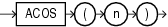

Syntax



> ```
> ACOS(n)
> ```


Purpose

`ACOS` returns the arc cosine of `n`. The argument `n` must be in the range of -1 to 1, and the function returns a value in the range of 0 to pi, expressed in radians.

This function takes as an argument any numeric data type or any nonnumeric data type that can be implicitly converted to a numeric data type. If the argument is `BINARY_FLOAT`, then the function returns `BINARY_DOUBLE`. Otherwise the function returns the same numeric data type as the argument.

See Also:

[Table 2-8](Data-Type-Comparison-Rules.md) for more information on implicit conversion

Examples

The following example returns the arc cosine of.3:

```
SELECT ACOS(.3)"Arc_Cosine"
  FROM DUAL;

Arc_Cosine
----------
1.26610367
```