Purpose

The `ADMINISTER` `KEY` `MANAGEMENT` statement provides a unified key management interface for Transparent Data Encryption. Use this statement to:

- Manage software and hardware keystores
- Manage encryption keys
- Manage secrets

Prerequisites

You must have the `ADMINISTER` `KEY` `MANAGEMENT` or `SYSKM` system privilege.

To specify the `CONTAINER` clause, you must be connected to a multitenant container database (CDB). To specify `CONTAINER` `=` `ALL`, the current container must be the root and you must have the commonly granted `ADMINISTER` `KEY` `MANAGEMENT` or `SYSKM` privilege.

Syntax

administer\_key\_management::=

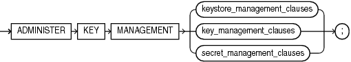

> ```
> ADMINISTER KEY MANAGEMENT
>   { keystore_management_clauses
>   | key_management_clauses
>   | secret_management_clauses
>   } ;
> ```


(keystore\_management\_clauses::=, key\_management\_clauses::=, secret\_management\_clauses::=)

create\_keystore::=

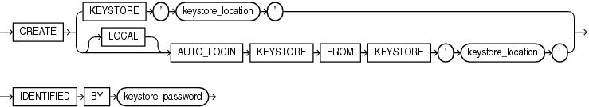

> ```
> CREATE
>   { KEYSTORE 'keystore_location'
>   | [ LOCAL ] AUTO_LOGIN KEYSTORE FROM KEYSTORE 'keystore_location'
>   }
>   IDENTIFIED BY keystore_password
> ```


open\_keystore::=

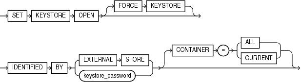

> ```
> SET KEYSTORE OPEN
>   [ FORCE KEYSTORE ]
>   IDENTIFIED BY { EXTERNAL STORE | keystore_password }
>   [ CONTAINER = { ALL | CURRENT } ]
> ```


close\_keystore::=

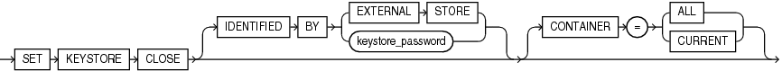

> ```
> SET KEYSTORE CLOSE
>   [ IDENTIFIED BY { EXTERNAL STORE | keystore_password } ]
>   [ CONTAINER = { ALL | CURRENT } ]
> ```


backup\_keystore::=

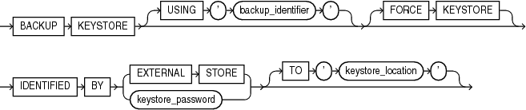

> ```
> BACKUP KEYSTORE [ USING 'backup_identifier' ]
>   [ FORCE KEYSTORE ]
>   IDENTIFIED BY { EXTERNAL STORE | keystore_password }
>   [ TO 'keystore_location' ]
> ```


alter\_keystore\_password::=

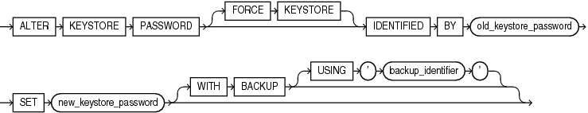

> ```
> ALTER KEYSTORE PASSWORD
>   [ FORCE KEYSTORE ]
>   IDENTIFIED BY old_keystore_password
>   SET new_keystore_password
>   [ WITH BACKUP [ USING 'backup_identifier' ] ]
> ```


merge\_into\_new\_keystore::=

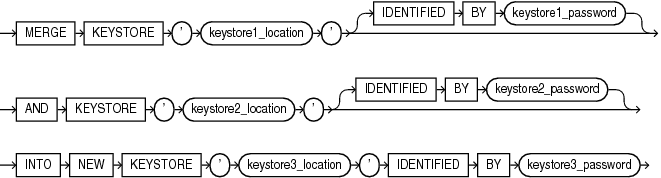

> ```
> MERGE KEYSTORE 'keystore1_location' [ IDENTIFIED BY keystore1_password ]
>   AND KEYSTORE 'keystore2_location' [ IDENTIFIED BY keystore2_password ]
>   INTO NEW KEYSTORE 'keystore3_location' IDENTIFIED BY keystore3_password
> ```


merge\_into\_existing\_keystore::=

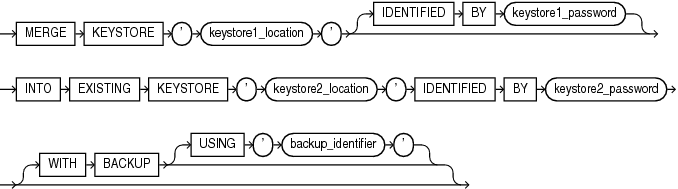

> ```
> MERGE KEYSTORE 'keystore1_location' [ IDENTIFIED BY keystore1_password ]
>   INTO EXISTING KEYSTORE 'keystore2_location' IDENTIFIED BY keystore2_password
>   [ WITH BACKUP [ USING 'backup_identifier' ] ]
> ```


set\_key::=

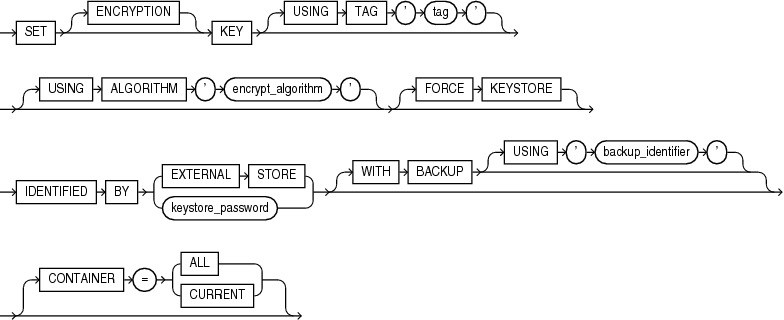

> ```
> SET [ ENCRYPTION ] KEY
>   [ USING TAG 'tag' ]
>   [ USING ALGORITHM 'encrypt_algorithm' ]
>   [ FORCE KEYSTORE ]
>   IDENTIFIED BY { EXTERNAL STORE | keystore_password }
>   [ WITH BACKUP [ USING 'backup_identifier' ] ]
>   [ CONTAINER = { ALL | CURRENT } ]
> ```


create\_key::=

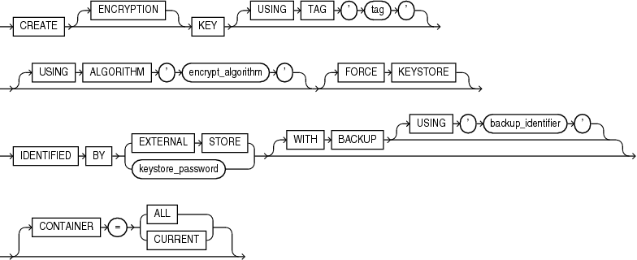

> ```
> CREATE [ ENCRYPTION ] KEY
>   [ USING TAG 'tag' ]
>   [ USING ALGORITHM 'encrypt_algorithm' ]
>   [ FORCE KEYSTORE ]
>   IDENTIFIED BY { EXTERNAL STORE | keystore_password }
>   [ WITH BACKUP [ USING 'backup_identifier' ] ]
>   [ CONTAINER = { ALL | CURRENT } ]
> ```


use\_key::=

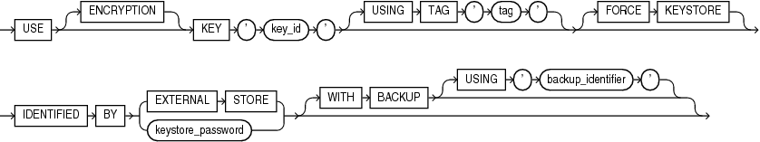

> ```
> USE [ ENCRYPTION ] KEY 'key_id'
>   [ USING TAG 'tag' ]
>   [ FORCE KEYSTORE ]
>   IDENTIFIED BY { EXTERNAL STORE | keystore_password }
>   [ WITH BACKUP [ USING 'backup_identifier' ] ]
> ```


set\_key\_tag::=

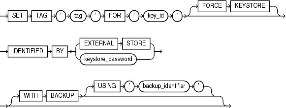

> ```
> SET TAG 'tag' FOR 'key_id'
>   [ FORCE KEYSTORE ]
>   IDENTIFIED BY { EXTERNAL STORE | keystore_password }
>   [ WITH BACKUP [ USING 'backup_identifier' ] ]
> ```


export\_keys::=

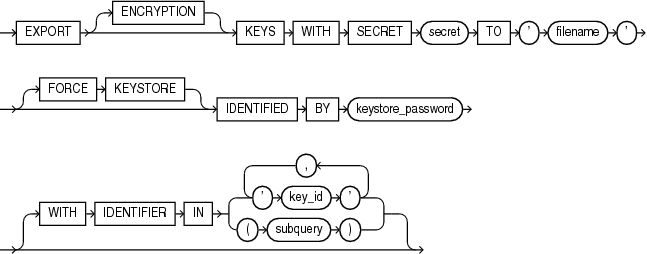

> ```
> EXPORT [ ENCRYPTION ] KEYS WITH SECRET secret
>   TO 'filename'
>   [ FORCE KEYSTORE ]
>   IDENTIFIED BY keystore_password
>   [ WITH IDENTIFIER IN { 'key_id' [, 'key_id' ]... | ( subquery ) } ]
> ```


import\_keys::=

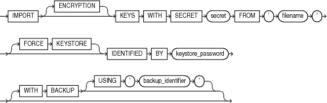

> ```
> IMPORT [ ENCRYPTION ] KEYS WITH SECRET secret
>   FROM 'filename'
>   [ FORCE KEYSTORE ]
>   IDENTIFIED BY keystore_password
>   [ WITH BACKUP [ USING 'backup_identifier' ] ]
> ```


migrate\_key::=

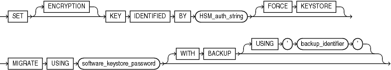

> ```
> SET [ ENCRYPTION ] KEY
>   IDENTIFIED BY HSM_auth_string
>   [ FORCE KEYSTORE ]
>   MIGRATE USING software_keystore_password
>   [ WITH BACKUP [ USING 'backup_identifier' ] ]
> ```


reverse\_migrate\_key::=

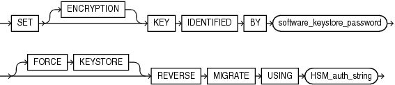

> ```
> SET [ ENCRYPTION ] KEY
>   IDENTIFIED BY software_keystore_password
>   [ FORCE KEYSTORE ]
>   REVERSE MIGRATE USING HSM_auth_string
> ```


secret\_management\_clauses::=

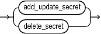

> ```
> { add_update_secret
> | delete_secret
> }
> ```


(add\_update\_secret::=, delete\_secret::=)

add\_update\_secret::=

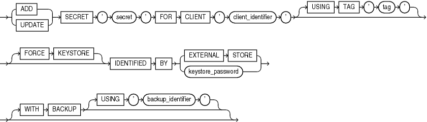

> ```
> { ADD | UPDATE } SECRET 'secret' FOR CLIENT 'client_identifier'
>   [ USING TAG 'tag' ]
>   [ FORCE KEYSTORE ]
>   IDENTIFIED BY { EXTERNAL STORE | keystore_password }
>   [ WITH BACKUP [ USING 'backup_identifier' ] ]
> ```


delete\_secret::=

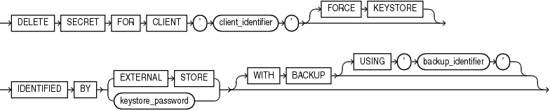

> ```
> DELETE SECRET FOR CLIENT 'client_identifier'
>   [ FORCE KEYSTORE ]
>   IDENTIFIED BY { EXTERNAL STORE | keystore_password }
>   [ WITH BACKUP [ USING 'backup_identifier' ] ]
> ```


Semantics

keystore\_management\_clauses

Use these clauses to perform the following keystore management operations:

- Create a software keystore
- Open and close a software keystore or a hardware keystore
- Back up a password-based software keystore
- Change the password of a password-based software keystore
- Merge two existing software keystores into a new password-based software keystore
- Merge one existing software keystore into an existing password-based software keystore

create\_keystore

This clause lets you create the following types of software keystores: password-based software keystores and auto-login software keystores. To issue this clause in a multitenant environment, you must be connected to the root.

CREATE KEYSTORE

Specify this clause to create a password-based software keystore.

- For `keystore_location`, specify the full path name of the software keystore directory. The keystore will be created in this directory in a file named `ewallet.p12`. Refer to [Oracle Database Advanced Security Guide](https://docs.oracle.com/pls/topic/lookup?ctx=en/database/oracle/oracle-database/12.2/sqlrf&id=ASOAG10276) to learn how to determine the software keystore directory for your system.
- Use the `IDENTIFIED` `BY` clause to set the password for the keystore. Refer to " Notes on Specifying Keystore Passwords " for more information.

CREATE \[ LOCAL \] AUTO\_LOGIN KEYSTORE

Specify this clause to create an auto-login software keystore. An auto-login software keystore is created from an existing password-based software keystore. The auto-login keystore has a system-generated password. It is stored in a PKCS#12-based file named `cwallet.sso` in the same directory as the password-based software keystore.

- By default, Oracle creates an auto-login keystore, which can be opened from computers other than the computer on which the keystore resides. If you specify the `LOCAL` keyword, then Oracle Database creates a local auto-login keystore, which can be opened only from the computer on which the keystore resides.
- For `keystore_location`, specify the full path name of the directory in which the existing password-based software keystore resides. The password-based software keystore can be open or closed.
- Use the `IDENTIFIED` `BY` clause to specify the password for the existing password-based software keystore. Refer to " Notes on Specifying Keystore Passwords " for more information.

Restriction on Creating Keystores

You can create at most one password-based software keystore and one auto-login software keystore, either local or not, in any single directory.

See Also:

[Oracle Database Advanced Security Guide](https://docs.oracle.com/pls/topic/lookup?ctx=en/database/oracle/oracle-database/12.2/sqlrf&id=ASOAG10282) for more information on creating software keystores

open\_keystore

This clause lets you open a password-based software keystore or a hardware keystore.

Note:

You do not need to use this clause to open auto-login and local auto-login software keystores because they are opened automatically when they are required—that is, when the master encryption key is accessed.

- The `FORCE` `KEYSTORE` clause is useful when opening a keystore in a PDB. It ensures that the CDB root keystore is open before opening the PDB keystore. Refer to " Notes on the FORCE KEYSTORE Clause " for more information.
- Use the `IDENTIFIED` `BY` clause to specify the password for the keystore. Refer to " Notes on Specifying Keystore Passwords " for more information.
- The `CONTAINER` clause applies when you are connected to a CDB.
	If the current container is a pluggable database (PDB), then specify `CONTAINER` `=` `CURRENT` to open the keystore in the PDB. The keystore must be open in the root before you open it in the PDB.
	If the current container is the root, then specify `CONTAINER` `=` `CURRENT` to open the keystore in the root, or specify `CONTAINER` `=` `ALL` to open the keystore in the root and in all PDBs.
	If you omit this clause, then `CONTAINER` `=` `CURRENT` is the default.

See Also:

Oracle Database Advanced Security Guide for more information on opening [password-based software keystores](https://docs.oracle.com/pls/topic/lookup?ctx=en/database/oracle/oracle-database/12.2/sqlrf&id=ASOAG10285) and [hardware keystores](https://docs.oracle.com/pls/topic/lookup?ctx=en/database/oracle/oracle-database/12.2/sqlrf&id=ASOAG10296)

close\_keystore

This clause lets you close a password-based software keystore, an auto-login software keystore, or a hardware keystore. Closing a keystore disables all encryption and decryption operations. Any attempt to encrypt or decrypt data or access encrypted data results in an error.

- To close a password-based software keystore or a hardware keystore, specify the `IDENTIFIED` `BY` clause. Refer to " Notes on Specifying Keystore Passwords " for more information.
- To close an auto-login keystore, do not specify the `IDENTIFIED` `BY` clause. Before you close an auto-login keystore, check the `WALLET_TYPE` column of the `V$ENCRYPTION_WALLET` view. If it returns `AUTOLOGIN`, then you can close the keystore. Otherwise, if you attempt to close the keystore, then an error occurs.
- The `CONTAINER` clause applies when you are connected to a CDB.
	If the current container is a PDB, then specify `CONTAINER` `=` `CURRENT` to close the keystore in the PDB.
	If the current container is the root, then the `CONTAINER` `=` `CURRENT` and `CONTAINER` `=` `ALL` clauses have the same effect; both clauses close the keystore in the root and in all PDBs.
	If you omit this clause, then `CONTAINER` `=` `CURRENT` is the default.

See Also:

[Oracle Database Advanced Security Guide](https://docs.oracle.com/pls/topic/lookup?ctx=en/database/oracle/oracle-database/12.2/sqlrf&id=ASOAG10321) for more information on closing keystores

backup\_keystore

This clause lets you back up a password-based software keystore. The keystore must be open.

- By default, Oracle Database creates a backup file with a name of the form `ewallet_` `timestamp``.p12`, where `timestamp` is the file creation timestamp in UTC format. The optional `USING` `'` `backup_identifier` `'` clause lets you specify a backup identifier which is added to the backup file name. For example, if you specify a backup identifier of `'Backup1'`, then Oracle Database creates a backup file with a name of the form `ewallet_` `timestamp` `_Backup1.p12`.
- The `FORCE` `KEYSTORE` clause enables this operation even if the keystore is closed. Refer to " Notes on the FORCE KEYSTORE Clause " for more information.
- Use the `IDENTIFIED` `BY` clause to specify the password for the keystore. Refer to " Notes on Specifying Keystore Passwords " for more information.
- The optional `TO` ' `keystore_location` ' clause lets you specify the directory in which the backup file is created. If you omit this clause, then the backup is created in the same directory as the keystore that you are backing up.

See Also:

[Oracle Database Advanced Security Guide](https://docs.oracle.com/pls/topic/lookup?ctx=en/database/oracle/oracle-database/12.2/sqlrf&id=ASOAG10313) for more information on backing up password-based software keystores

alter\_keystore\_password

This clause lets you change the password for a password-based software keystore. The keystore must be open.

- The `FORCE` `KEYSTORE` clause enables this operation even if the keystore is closed. Refer to " Notes on the FORCE KEYSTORE Clause " for more information.
- For `old_keystore_password`, specify the old password for the keystore. For `new_keystore_password`, specify the new password for the keystore. Refer to " Notes on Specifying Keystore Passwords " for more information.
- The optional `WITH` `BACKUP` clause instructs the database to create a backup of the keystore before changing the password. Refer to " Notes on the WITH BACKUP Clause " for more information.

See Also:

[Oracle Database Advanced Security Guide](https://docs.oracle.com/pls/topic/lookup?ctx=en/database/oracle/oracle-database/12.2/sqlrf&id=ASOAG10312) for more information on changing a password-based software keystore password

merge\_into\_new\_keystore

This clause lets you merge two software keystores into a new keystore. The keys and attributes in the two constituent keystores are added to the new keystore. The constituent keystores can be password-based or auto-login (including local auto-login) software keystores; they can be open or closed. The new keystore is a password-based software keystore. It is in a closed state when the merge completes. Any or none of the keystores specified in this clause can be the keystore configured for use by the database.

- For `keystore1_location`, specify the full path name of the directory in which the first keystore resides.
- Specify `IDENTIFIED` `BY` `keystore1_password` only if the first keystore is a password-based software keystore. Refer to " Notes on Specifying Keystore Passwords " for more information.
- For `keystore2_location`, specify the full path name of the directory in which the second keystore resides.
- Specify `IDENTIFIED` `BY` `keystore2_password` only if the second keystore is a password-based software keystore.
- For `keystore3_location`, specify the full path name of the directory in which the new keystore is created.
- For `keystore3_password`, specify the password for the new keystore.

See Also:

[Oracle Database Advanced Security Guide](https://docs.oracle.com/pls/topic/lookup?ctx=en/database/oracle/oracle-database/12.2/sqlrf&id=ASOAG10314) for more information on merging software keystores

merge\_into\_existing\_keystore

This clause lets you merge a software keystore into another existing software keystore. The keys and attributes in the keystore from which you merge are added to the keystore into which you merge. The keystore from which you merge can be a password-based or auto-login (including local auto-login) software keystore; it can be open or closed. The keystore into which you merge must be a password-based software keystore. It can be open or closed when the merge begins. However, it will be in a closed state when the merge completes. Either or neither of the keystores specified in this clause can be the keystore configured for use by the database.

- For `keystore1_location`, specify the full path name of the directory in which the keystore from which you merge resides.
- Specify `IDENTIFIED` `BY` `keystore1_password` only if the keystore from which you merge is a password-based software keystore.
- For `keystore2_location`, specify the full path name of the directory in which the keystore into which you merge resides.
- For `keystore2_password`, specify the password for the keystore into which you merge.
- The optional `WITH` `BACKUP` clause instructs the database to create a backup of the keystore into which you merge before performing the merge. Refer to " Notes on the WITH BACKUP Clause " for more information.

See Also:

[Oracle Database Advanced Security Guide](https://docs.oracle.com/pls/topic/lookup?ctx=en/database/oracle/oracle-database/12.2/sqlrf&id=ASOAG10314) for more information on merging software keystores

key\_management\_clauses

Use these clauses to perform the following key management operations:

- Create and activate a master encryption key
- Set the tag for an encryption key
- Export encryption keys from a keystore into a file
- Import encryption keys from a file into a keystore
- Migrate from a password-based software keystore to a hardware keystore
- Migrate from a hardware keystore to a password-based software keystore

set\_key

This clause creates a new master encryption key and activates it. You can use this clause to create the first master encryption key in a keystore or to rotate (change) the master encryption key. If a master encryption key is active when you use this clause, then it is deactivated before the new master encryption key is activated. The keystore that contains the key can be a password-based software keystore or a hardware keystore. The keystore must be open.

- The `ENCRYPTION` keyword is optional and is provided for semantic clarity.
- Specify the optional `USING` `TAG` clause to associate a tag to the new master encryption key. Refer to " Notes on the USING TAG Clause " for more information.
- If you specify the `USING` `ALGORITHM` clause, then the database creates a master encryption key that conforms to the specified encryption algorithm. For `encrypt_algorithm`, you can specify `AES256`, `ARIA256`, `GOST256`, or `SEED128`. To specify this clause, the `COMPATIBLE` initialization parameter must be set to `12`.`2` or higher. If you omit this clause, then the default is `AES256`.
	The ARIA, SEED, and GOST algorithms are country-specific national and government standards for encryption and hashing. See [Oracle Database Security Guide](https://docs.oracle.com/pls/topic/lookup?ctx=en/database/oracle/oracle-database/12.2/sqlrf&id=DBSEG1047) for more information.
- The `FORCE` `KEYSTORE` clause enables this operation even if the keystore is closed. Refer to " Notes on the FORCE KEYSTORE Clause " for more information.
- Use the `IDENTIFIED` `BY` clause to specify the password for the keystore. Refer to " Notes on Specifying Keystore Passwords " for more information.
- Specify the `WITH` `BACKUP` clause, and optionally the `USING` `'` `backup_identifier` `'` clause, to create a backup of the keystore before the new master encryption key is created. Refer to " Notes on the WITH BACKUP Clause " for more information.
- The `CONTAINER` clause applies when you are connected to a CDB.
	If the current container is a PDB, then specify `CONTAINER` `=` `CURRENT` to create and activate a new master encryption key in the PDB. A master encryption key must exist in the root before you create a master encryption key in the PDB.
	If the current container is the root, then specify `CONTAINER` `=` `CURRENT` to create and activate a new master encryption key in the root, or specify `CONTAINER` `=` `ALL` to create and activate new master encryption keys in the root and in all PDBs.
	If you omit this clause, then `CONTAINER` `=` `CURRENT` is the default.

See Also:

[Oracle Database Advanced Security Guide](https://docs.oracle.com/pls/topic/lookup?ctx=en/database/oracle/oracle-database/12.2/sqlrf&id=ASOAG9527) for more information on creating and activating a master encryption key

create\_key

This clause lets you create a master encryption key for later use. You can subsequently activate the key by using the use\_key clause. The keystore that contains the key can be a password-based software keystore or a hardware keystore. The keystore must be open.

- The `ENCRYPTION` keyword is optional and is provided for semantic clarity.
- Specify the optional `USING` `TAG` clause to associate a tag to the encryption key. Refer to " Notes on the USING TAG Clause " for more information.
- If you specify the `USING` `ALGORITHM` clause, then the database creates a master encryption key that conforms to the specified encryption algorithm. For `encrypt_algorithm`, you can specify `AES256`, `ARIA256`, `GOST256`, or `SEED128`. To specify this clause, the `COMPATIBLE` initialization parameter must be set to `12`.`2` or higher. If you omit this clause, then the default is `AES256`.
	The ARIA, SEED, and GOST algorithms are country-specific national and government standards for encryption and hashing. See [Oracle Database Security Guide](https://docs.oracle.com/pls/topic/lookup?ctx=en/database/oracle/oracle-database/12.2/sqlrf&id=DBSEG1047) for more information.
- The `FORCE` `KEYSTORE` clause enables this operation even if the keystore is closed. Refer to " Notes on the FORCE KEYSTORE Clause " for more information.
- Use the `IDENTIFIED` `BY` clause to specify the password for the keystore in which the key will be created. Refer to " Notes on Specifying Keystore Passwords " for more information.
- Specify the `WITH` `BACKUP` clause, and optionally the `USING` `'` `backup_identifier` `'` clause, to create a backup of the keystore before the key is created. Refer to " Notes on the WITH BACKUP Clause " for more information.
- The `CONTAINER` clause applies when you are connected to a CDB.
	If the current container is a PDB, then specify `CONTAINER` `=` `CURRENT` to create a master encryption key in the PDB. A master encryption key must exist in the root before you create a master encryption key in the PDB
	If the current container is the root, then specify `CONTAINER` `=` `CURRENT` to create a master encryption key in the root, or specify `CONTAINER` `=` `ALL` to create master encryption keys in the root and in all PDBs.
	If you omit this clause, then `CONTAINER` `=` `CURRENT` is the default.

See Also:

[Oracle Database Advanced Security Guide](https://docs.oracle.com/pls/topic/lookup?ctx=en/database/oracle/oracle-database/12.2/sqlrf&id=ASOAG10414) for more information on creating a master encryption key for later use

use\_key

This clause lets you activate a master encryption key that has already been created. If a master encryption key is active when you use this clause, then it is deactivated before the new master encryption key is activated. The keystore that contains the key can be a password-based software keystore or a hardware keystore. The keystore must be open

- The `ENCRYPTION` keyword is optional and is provided for semantic clarity.
- For `key_id`, specify the identifier of the key that you want to activate. You can find the key identifier by querying the `KEY_ID` column of the `V$ENCRYPTION_KEYS` view.
- Specify the optional `USING` `TAG` clause to associate a tag to the encryption key. Refer to " Notes on the USING TAG Clause " for more information.
- The `FORCE` `KEYSTORE` clause enables this operation even if the keystore is closed. Refer to " Notes on the FORCE KEYSTORE Clause " for more information.
- Use the `IDENTIFIED` `BY` clause to specify the password for the keystore that contains the key. Refer to " Notes on Specifying Keystore Passwords " for more information.
- Specify the `WITH` `BACKUP` clause, and optionally the `USING` `'` `backup_identifier` `'` clause, to create a backup of the keystore before the key is activated. Refer to " Notes on the WITH BACKUP Clause " for more information.

See Also:

[Oracle Database Advanced Security Guide](https://docs.oracle.com/pls/topic/lookup?ctx=en/database/oracle/oracle-database/12.2/sqlrf&id=ASOAG10419) for more information on activating a master encryption key

set\_key\_tag

This clause lets you set the tag for the specified encryption key. The tag is an optional, user-defined descriptor for the key. If the key has no tag, then use this clause to create a tag. If the key already has a tag, then use this clause to replace the tag. You can view encryption key tags by querying the `TAG` column of the `V$ENCRYPTION_KEYS` view. The keystore must be open.

- For `tag`, specify an alphanumeric string. Enclose `tag` in single quotation marks.
- For `key_id`, specify the identifier of the encryption key. You can find the key identifier by querying the `KEY_ID` column of the `V$ENCRYPTION_KEYS` view.
- The `FORCE` `KEYSTORE` clause enables this operation even if the keystore is closed. Refer to " Notes on the FORCE KEYSTORE Clause " for more information.
- Use the `IDENTIFIED` `BY` clause to specify the password for the keystore that contains the key. Refer to " Notes on Specifying Keystore Passwords " for more information.
- Specify the `WITH` `BACKUP` clause, and optionally the `USING` `'` `backup_identifier` `'` clause, to create a backup of the keystore before you set the key tag. Refer to " Notes on the WITH BACKUP Clause " for more information.

See Also:

[Oracle Database Advanced Security Guide](https://docs.oracle.com/pls/topic/lookup?ctx=en/database/oracle/oracle-database/12.2/sqlrf&id=ASOAG10335) for more information on setting a key tag

export\_keys

Use this clause to export one or more encryption keys from a password-based software keystore into a file. The keystore must be open. Each encryption key is exported together with its key identifier and key attributes. The exported keys are protected in the file with a password (secret). You can subsequently import one or more of the keys into a password-based software keystore by using the import\_keys clause.

- The `ENCRYPTION` keyword is optional and is provided for semantic clarity.
- Specify `secret` to set the password (secret) that protects the keys in the file. The secret is an alphanumeric string. You can optionally enclose the secret in double quotation marks. Quoted and nonquoted secrets are case sensitive.
- For `filename`, specify the full path name of the file to which the keys are to be exported. Enclose `filename` in single quotation marks.
- The `FORCE` `KEYSTORE` clause enables this operation even if the keystore is closed. Refer to " Notes on the FORCE KEYSTORE Clause " for more information.
- Use the `IDENTIFIED` `BY` clause to specify the password for the keystore that contains the keys you want to export. Refer to " Notes on the WITH BACKUP Clause " for more information.
- Use the `WITH` `IDENTIFIER` `IN` clause to specify one or more encryption keys that you would like to export using one of the following methods:
	- Use `key_id` to specify the identifier of the encryption key you would like to export. You can specify more than one `key_id` in a comma-separated list. You can find key identifiers by querying the `KEY_ID` column of the `V$ENCRYPTION_KEYS` view.
		- Use `subquery` to specify a query that returns a list of key identifiers for the encryption keys you would like to export. For example, the following `subquery` returns the key identifiers for all encryption keys in the database whose tags begin with the string `mytag`:
		```
		SELECT KEY_ID FROM V$ENCRYPTION_KEYS WHERE TAG LIKE 'mytag%'
		```
		Be aware that Oracle Database executes `subquery` within the current user's rights and not with definer's rights.
		- If you omit the `WITH` `IDENTIFIER` `IN` clause, then all encryption keys in the database are exported.

Restriction on the WITH IDENTIFIER IN Clause

In a multitenant environment, you cannot specify `WITH` `IDENTIFIER` `IN` when exporting keys from a PDB. This ensures that all of the keys in the PDB are exported, along with metadata about the active encryption key. If you subsequently clone the PDB, or unplug and plug in the PDB, then you can use the export file to import the keys into the cloned or newly plugged-in PDB and preserve information about the active encryption key.

See Also:

[Oracle Database Advanced Security Guide](https://docs.oracle.com/pls/topic/lookup?ctx=en/database/oracle/oracle-database/12.2/sqlrf&id=ASOAG10424) for more information on exporting encryption keys

import\_keys

Use this clause to import one or more encryption keys from a file into a password-based software keystore. The keystore must be open. Each encryption key is imported together with its key identifier and key attributes. The keys must have been previously exported to the file by using the export\_keys clause. You cannot re-import keys that have already been imported into the keystore.

- The `ENCRYPTION` keyword is optional and is provided for semantic clarity.
- For `secret`, specify the password (secret) that protects the keys in the file. The secret is an alphanumeric string. You can optionally enclose the secret in double quotation marks. Quoted and nonquoted secrets are case sensitive.
- For `filename`, specify the full path name of the file from which the keys are to be imported. Enclose `filename` in single quotation marks.
- The `FORCE` `KEYSTORE` clause enables this operation even if the keystore is closed. Refer to " Notes on the FORCE KEYSTORE Clause " for more information.
- Use the `IDENTIFIED` `BY` clause to specify the password for the keystore into which you want to import the keys. Refer to " Notes on the WITH BACKUP Clause " for more information.
- Specify the `WITH` `BACKUP` clause, and optionally the `USING` `'` `backup_identifier` `'` clause, to create a backup of the keystore before the keys are imported. Refer to " Notes on the WITH BACKUP Clause " for more information.

See Also:

[Oracle Database Advanced Security Guide](https://docs.oracle.com/pls/topic/lookup?ctx=en/database/oracle/oracle-database/12.2/sqlrf&id=ASOAG10427) for more information on importing encryption keys

migrate\_key

Use this clause to migrate from a password-based software keystore to a hardware keystore. This clause decrypts existing table encryption keys and tablespace encryption keys with the master encryption key in the software keystore and then re-encrypts them with the newly created master encryption key in the hardware keystore.

Note:

The use of this clause is only one step in a series of steps for migrating from a password-based software keystore to a hardware keystore. Refer to [Oracle Database Advanced Security Guide](https://docs.oracle.com/pls/topic/lookup?ctx=en/database/oracle/oracle-database/12.2/sqlrf&id=ASOAG10377) for the complete set of steps before you use this clause.

- The `ENCRYPTION` keyword is optional and is provided for semantic clarity.
- For `HSM_auth_string`, specify the hardware keystore password. Refer to " Notes on Specifying Keystore Passwords " for more information.
- The `FORCE` `KEYSTORE` clause enables this operation even if the keystores are closed. Refer to " Notes on the FORCE KEYSTORE Clause " for more information.
- For `software_keystore_password`., specify the password-based software keystore password. Refer to " Notes on Specifying Keystore Passwords " for more information.
- Specify the `WITH` `BACKUP` clause, and optionally the `USING` `'` `backup_identifier` `'` clause, to create a backup of the keystore before the migration occurs. Refer to " Notes on the WITH BACKUP Clause " for more information.

reverse\_migrate\_key

Use this clause to migrate from a hardware keystore to a password-based software keystore. This clause decrypts existing table encryption keys and tablespace encryption keys with the master encryption key in the hardware keystore and then re-encrypts them with the newly created master encryption key in the password-based software keystore.

Note:

The use of this clause is only one step in a series of steps for migrating from a hardware keystore to a password-based software keystore. Refer to [Oracle Database Advanced Security Guide](https://docs.oracle.com/pls/topic/lookup?ctx=en/database/oracle/oracle-database/12.2/sqlrf&id=ASOAG10327) for the complete set of steps before you use this clause.

- The `ENCRYPTION` keyword is optional and is provided for semantic clarity.
- For `software_keystore_password`., specify the password-based software keystore password. Refer to " Notes on Specifying Keystore Passwords " for more information.
- The `FORCE` `KEYSTORE` clause enables this operation even if the keystores are closed. Refer to " Notes on the FORCE KEYSTORE Clause " for more information.
- For `HSM_auth_string`, specify the hardware keystore password. Refer to " Notes on Specifying Keystore Passwords " for more information.

secret\_management\_clauses

Use these clauses to add, update, and delete secrets in a password-based software keystores or a hardware keystore.

See Also:

[Oracle Database Advanced Security Guide](https://docs.oracle.com/pls/topic/lookup?ctx=en/database/oracle/oracle-database/12.2/sqlrf&id=ASOAG10398) for more information on adding, updating, and deleting secrets

add\_update\_secret

This clause lets you add a secret to a keystore or update an existing secret in a keystore. The keystore must be open.

- Specify `ADD` to add a secret to a keystore.
- Specify `UPDATE` to update an existing secret in a keystore.
- For `secret`, specify the secret to be added or updated. The secret is an alphanumeric string. Enclose the secret in single quotation marks.
- For `client_identifier`, specify an alphanumeric string used to identify the secret. Enclose `client_identifier` in single quotation marks. This value is case-sensitive. You can enter any of the following fixed values:
	- `TDE_WALLET` if the keystore was configured as `FILE`
		- `OKV_WALLET` if the keystore is for an Oracle Key Vault HSM
		- `HSM_WALLET` if the keystore is for a third-party HSM
- Specify the optional `USING` `TAG` clause to associate a tag to `secret`. The `tag` is an optional, user-defined descriptor for the secret. Enclose the tag in single quotation marks. You can view secret tags by querying the `SECRET_TAG` column of the `V$CLIENT_SECRETS` view.
- The `FORCE` `KEYSTORE` clause enables this operation even if the keystore is closed. Refer to " Notes on the FORCE KEYSTORE Clause " for more information.
- Use the `IDENTIFIED` `BY` clause to specify the password for the keystore. Refer to " Notes on Specifying Keystore Passwords " for more information.
- Specify the `WITH` `BACKUP` clause, and optionally the `USING` `'` `backup_identifier` `'` clause, to create a backup of the keystore before adding or updating the secret in a password-based software keystore. Refer to " Notes on the WITH BACKUP Clause " for more information.

delete\_secret

This clause lets you delete a secret from a keystore. The keystore must be open.

- For `client_identifier`, specify an alphanumeric string used to identify the secret. Enclose `client_identifier` in single quotation marks. You can view client identifiers by querying the `CLIENT` column of the `V$CLIENT_SECRETS` view.
- The `FORCE` `KEYSTORE` clause enables this operation even if the keystore is closed. Refer to " Notes on the FORCE KEYSTORE Clause " for more information.
- Use the `IDENTIFIED` `BY` clause to specify the password for the keystore. Refer to " Notes on Specifying Keystore Passwords " for more information.
- Specify the `WITH` `BACKUP` clause, and optionally the `USING` `'` `backup_identifier` `'` clause, to create a backup of the keystore before deleting the secret from a password-based software keystore. Refer to " Notes on the WITH BACKUP Clause " for more information.

Notes on the USING TAG Clause

Many `ADMINISTER` `KEY` `MANAGEMENT` operations include the `USING` `TAG` clause, which lets you associate a tag to an encryption key. The `tag` is an optional, user-defined descriptor for the key. It is a character string enclosed in single quotation marks.

You can view encryption key tags by querying the `TAG` column of the `V$ENCRYPTION_KEYS` view.

Notes on the FORCE KEYSTORE Clause

The `FORCE` `KEYSTORE` clause enables a keystore operation even if the keystore is closed. The behavior of this clause depends on whether you are connected to a non-CDB, a CDB root, or a PDB:

- When you are connected to a non-CDB:
	- If the password-based software or hardware keystore is closed, then the database opens the password-based software or hardware keystore while the operation is performed and leaves it open, and then updates the auto-login keystore, if one exists, with the new information.
		- If the auto-login keystore is open, then the database opens the password-based software or hardware keystore temporarily while the operation is performed and updates the auto-login keystore with the new information, without switching out the auto-login keystore.
		- If the password-based software or hardware keystore is open, then the `FORCE` `KEYSTORE` clause is not necessary and has no effect.
- When you are connected to the CDB root:
	- To perform an operation on the CDB root keystore (`CONTAINER=CURRENT`), the CDB root keystore must be open. Therefore, the behavior described for a non-CDB applies to the CDB root.
		- To perform an operation on the CDB root keystore and all PDB keystores (`CONTAINER=ALL`), the CDB root keystore and all PDB keystores must be open. Therefore, the behavior described for a non-CDB applies to the CDB root and each PDB.
- When you are connected to a PDB:
	- To perform an operation on a PDB keystore, the CDB root keystore and the keystore for that PDB must be open. Therefore, the behavior described for a non-CDB applies to the CDB root and that PDB.

Notes on Specifying Keystore Passwords

Specify keystore passwords as follows:

- For a password-based software keystore, specify the password as a character string. You can optionally enclose the password in double quotation marks. Quoted and nonquoted passwords are case sensitive. Keystore passwords adhere to the same rules as database user passwords. Refer to the [BY password](CREATE-USER.md) clause of `CREATE` `USER` for the complete details.
- For a hardware keystore, specify the password as a string of the form `"` `user_id``:``password` `"` where:
	- `user_id` is the user ID created for the database using the HSM management interface
		- `password` is the password created for the user ID using the HSM management interface
	Enclose the `user_id``:``password` string in double quotation marks (`"` `"`) and separate `user_id` and `password` with a colon (`:`).
- If you specify `EXTERNAL` `STORE`, then the database uses the keystore password stored in the external store to perform the operation. This feature enables you to store the password in a separate location where it can be centrally managed and accessed. To use this functionality, you must first set the `EXTERNAL_KEYSTORE_CREDENTIAL_LOCATION` initialization parameter to a location where the keystore password will be stored. Refer to [Oracle Database Advanced Security Guide](https://docs.oracle.com/pls/topic/lookup?ctx=en/database/oracle/oracle-database/12.2/sqlrf&id=ASOAG-GUID-4F6206B6-A33F-4FB1-9223-DD61FFAD3F12) for more information on configuring an external store for a keystore password.

Notes on the WITH BACKUP Clause

Many `ADMINISTER` `KEY` `MANAGEMENT` operations include the `WITH` `BACKUP` clause. This clause applies only to password-based software keystores. It indicates that the keystore must be backed up before the operation is performed. Therefore, you must either specify the `WITH` `BACKUP` clause when performing the operation, or issue the `ADMINISTER` `KEY` `MANAGEMENT` `backup_clause` statement immediately before performing the operation.

When you specify the `WITH` `BACKUP` clause, Oracle Database creates a backup file with a name of the form `ewallet_` `timestamp``.p12`, where `timestamp` is the file creation timestamp in UTC format. The backup file is created in the same directory as the keystore you are backing up.

The optional `USING` `'` `backup_identifier` `'` clause lets you specify a backup identifier, which is added to the backup file name. For example, if you specify a backup identifier of `'Backup1'`, then Oracle Database creates a backup file with a name of the form `ewallet_` `timestamp` `_Backup1.p12`.

Examples

Creating a Keystore: Examples

The following statement creates a password-based software keystore in directory `/etc/ORACLE/WALLETS/orcl`:

```
ADMINISTER KEY MANAGEMENT
  CREATE KEYSTORE '/etc/ORACLE/WALLETS/orcl'
  IDENTIFIED BY password;
```

The following statement creates an auto-login software keystore from the keystore created in the previous statement:

```
ADMINISTER KEY MANAGEMENT
  CREATE AUTO_LOGIN KEYSTORE FROM KEYSTORE '/etc/ORACLE/WALLETS/orcl'
  IDENTIFIED BY password;
```

Opening a Keystore: Examples

The following statement opens a password-based software keystore:

```
ADMINISTER KEY MANAGEMENT
  SET KEYSTORE OPEN
  IDENTIFIED BY password;
```

If you are connected to a CDB, then the following statement opens a password-based software keystore in the current container:

```
ADMINISTER KEY MANAGEMENT
  SET KEYSTORE OPEN
  IDENTIFIED BY password
  CONTAINER = CURRENT;
```

The following statement opens a hardware keystore:

```
ADMINISTER KEY MANAGEMENT
  SET KEYSTORE OPEN
  IDENTIFIED BY "user_id:password";
```

The following statement opens a keystore whose password is stored in the external store:

```
ADMINISTER KEY MANAGEMENT
  SET KEYSTORE OPEN
  IDENTIFIED BY EXTERNAL STORE;
```

Closing a Keystore: Examples

The following statement closes a password-based software keystore:

```
ADMINISTER KEY MANAGEMENT
  SET KEYSTORE CLOSE
  IDENTIFIED BY password;
```

The following statement closes an auto-login software keystore:

```
ADMINISTER KEY MANAGEMENT
  SET KEYSTORE CLOSE;
```

The following statement closes a hardware keystore:

```
ADMINISTER KEY MANAGEMENT
  SET KEYSTORE CLOSE
  IDENTIFIED BY "user_id:password";
```

The following statement closes a keystore whose password is stored in the external store:

```
ADMINISTER KEY MANAGEMENT
  SET KEYSTORE CLOSE
  IDENTIFIED BY EXTERNAL STORE;
```

Backing Up a Keystore: Example

The following statement creates a backup of a password-based software keystore. The backup is stored in directory `/etc/ORACLE/KEYSTORE/DB1` and the backup file name contains the tag `hr.emp_keystore`.

```
ADMINISTER KEY MANAGEMENT
  BACKUP KEYSTORE USING 'hr.emp_keystore'
  IDENTIFIED BY password
  TO '/etc/ORACLE/KEYSTORE/DB1/';
```

Changing a Keystore Password: Example

The following statement changes the password for a password-based software keystore. It also creates a backup of the keystore, with the tag `pwd_change`, before changing the password.

```
ADMINISTER KEY MANAGEMENT
  ALTER KEYSTORE PASSWORD IDENTIFIED BY old_password
  SET new_password WITH BACKUP USING 'pwd_change';
```

Merging Two Keystores Into a New Keystore: Example

The following statement merges an auto-login software keystore with a password-based software keystore to create a new password-based software keystore at a new location:

```
ADMINISTER KEY MANAGEMENT
  MERGE KEYSTORE '/etc/ORACLE/KEYSTORE/DB1'
  AND KEYSTORE '/etc/ORACLE/KEYSTORE/DB2'
    IDENTIFIED BY existing_keystore_password
  INTO NEW KEYSTORE '/etc/ORACLE/KEYSTORE/DB3'
    IDENTIFIED BY new_keystore_password;
```

Merging a Keystore Into an Existing Keystore: Example

The following statement merges an auto-login software keystore into a password-based software keystore. It also creates a backup of the password-based software keystore before performing the merge.

```
ADMINISTER KEY MANAGEMENT
  MERGE KEYSTORE '/etc/ORACLE/KEYSTORE/DB1'
  INTO EXISTING KEYSTORE '/etc/ORACLE/KEYSTORE/DB2'
    IDENTIFIED BY existing_keystore_password
  WITH BACKUP;
```

Creating and Activating a Master Encryption Key: Examples

The following statement creates and activates a master encryption key in a password-based software keystore. It encrypts the key using the `SEED128` algorithm. It also creates a backup of the keystore before creating the new master encryption key.

```
ADMINISTER KEY MANAGEMENT
  SET KEY USING ALGORITHM 'SEED128'
  IDENTIFIED BY password
  WITH BACKUP;
```

The following statement creates a master encryption key in a password-based software keystore, but does not activate the key. It also creates a backup of the keystore before creating the new master encryption key.

```
ADMINISTER KEY MANAGEMENT
  CREATE KEY USING TAG 'mykey1'
  IDENTIFIED BY password
  WITH BACKUP;
```

The following query displays the key identifier for the master encryption key that was created in the previous statement:

```
SELECT TAG, KEY_ID
  FROM V$ENCRYPTION_KEYS
  WHERE TAG = 'mykey1';

TAG     KEY_ID
---     ----------------------------------------------------
mykey1  ARgEtzPxpE/Nv8WdPu8LJJUAAAAAAAAAAAAAAAAAAAAAAAAAAAAA
```

The following statement activates the master encryption key that was queried in the previous statement. It also creates a backup of the keystore before activating the new master encryption key.

```
ADMINISTER KEY MANAGEMENT
  USE KEY 'ARgEtzPxpE/Nv8WdPu8LJJUAAAAAAAAAAAAAAAAAAAAAAAAAAAAA'
  IDENTIFIED BY password
  WITH BACKUP;
```

Setting a Key Tag: Example

This example assumes that the keystore is closed. The following statement temporarily opens the keystore and changes the tag to `mykey2` for the master encryption key that was activated in the previous example. It also creates a backup of the keystore before changing the tag.

```
ADMINISTER KEY MANAGEMENT
  SET TAG 'mykey2' FOR 'ARgEtzPxpE/Nv8WdPu8LJJUAAAAAAAAAAAAAAAAAAAAAAAAAAAAA'
  FORCE KEYSTORE
  IDENTIFIED BY password
  WITH BACKUP;
```

Exporting Keys: Examples

The following statement exports two master encryption keys from a password-based software keystore to file `/etc/TDE/export.exp`. The statement encrypts the master encryption keys in the file using the secret `my_secret`. The identifiers of the master encryption keys to be exported are provided as a comma-separated list.

```
ADMINISTER KEY MANAGEMENT
  EXPORT KEYS WITH SECRET "my_secret"
  TO '/etc/TDE/export.exp'
  IDENTIFIED BY password
  WITH IDENTIFIER IN 'AdoxnJ0uH08cv7xkz83ovwsAAAAAAAAAAAAAAAAAAAAAAAAAAAAA',
                     'AW5z3CoyKE/yv3cNT5CWCXUAAAAAAAAAAAAAAAAAAAAAAAAAAAAA';
```

The following statement exports master encryption keys from a password-based software keystore to file `/etc/TDE/export.exp`. Only the keys whose tags are `mytag1` or `mytag2` are exported. The master encryption keys in the file are encrypted using the secret `my_secret`. The key identifiers are found by querying the `V$ENCRYPTION_KEYS` view.

```
ADMINISTER KEY MANAGEMENT
  EXPORT KEYS WITH SECRET "my_secret"
  TO '/etc/TDE/export.exp'
  IDENTIFIED BY password
  WITH IDENTIFIER IN
    (SELECT KEY_ID FROM V$ENCRYPTION_KEYS WHERE TAG IN ('mytag1', 'mytag2'));
```

The following statement exports all master encryption keys of the database to file `/etc/TDE/export.exp`. The master encryption keys in the file are encrypted using the secret `my_secret`.

```
ADMINISTER KEY MANAGEMENT
  EXPORT KEYS WITH SECRET "my_secret"
  TO '/etc/TDE/export.exp'
  IDENTIFIED BY password;
```

In a multitenant environment, the following statements exports all master encryption keys of the PDB `salespdb`, along with metadata, to file `/etc/TDE/salespdb.exp`. The master encryption keys in the file are encrypted using the secret `my_secret`. If the PDB is subsequently cloned, or unplugged and plugged back in, then the export file created by this statement can be used to import the keys into the cloned or newly plugged-in PDB.

```
ALTER SESSION SET CONTAINER = salespdb;
ADMINISTER KEY MANAGEMENT
  EXPORT KEYS WITH SECRET "my_secret"
  TO '/etc/TDE/salespdb.exp'
  IDENTIFIED BY password;
```

Importing Keys: Example

The following statement imports the master encryption keys, encrypted with secret `my_secret`, from file `/etc/TDE/export.exp` to a password-based software keystore. It also creates a backup of the password-based software keystore before importing the keys.

```
ADMINISTER KEY MANAGEMENT
  IMPORT KEYS WITH SECRET "my_secret"
  FROM '/etc/TDE/export.exp'
  IDENTIFIED BY password
  WITH BACKUP;
```

Migrating a Keystore: Example

The following statement migrates from a password-based software keystore to a hardware keystore. It also creates a backup of the password-based software keystore before performing the migration.

```
ADMINISTER KEY MANAGEMENT
  SET ENCRYPTION KEY IDENTIFIED BY "user_id:password"
  MIGRATE USING software_keystore_password
  WITH BACKUP;
```

Reverse Migrating a Keystore: Example

The following statement reverse migrates from a hardware keystore to a password-based software keystore:

```
ADMINISTER KEY MANAGEMENT
  SET ENCRYPTION KEY IDENTIFIED BY software_keystore_password
  REVERSE MIGRATE USING "user_id:password";
```

Adding a Secret to a Keystore: Examples

The following statement adds secret `secret1`, with the tag `My first secret`, for client `client1` to a password-based software keystore. It also creates a backup of the password-based software keystore before adding the secret.

```
ADMINISTER KEY MANAGEMENT
  ADD SECRET 'secret1' FOR CLIENT 'client1'
  USING TAG 'My first secret'
  IDENTIFIED BY password
  WITH BACKUP;
```

The following statement adds a similar secret to a hardware keystore:

```
ADMINISTER KEY MANAGEMENT
  ADD SECRET 'secret2' FOR CLIENT 'client2'
  USING TAG 'My second secret'
  IDENTIFIED BY "user_id:password";
```

Updating a Secret in a Keystore: Examples

The following statement updates the secret that was created in the previous example in a password-based software keystore. It also creates a backup of the password-based software keystore before updating the secret.

```
ADMINISTER KEY MANAGEMENT
  UPDATE SECRET 'secret1' FOR CLIENT 'client1'
  USING TAG 'New Tag 1'
  IDENTIFIED BY password
  WITH BACKUP;
```

The following statement updates the secret that was created in the previous example in a hardware keystore:

```
ADMINISTER KEY MANAGEMENT
  UPDATE SECRET 'secret2' FOR CLIENT 'client2'
  USING TAG 'New Tag 2'
  IDENTIFIED BY "user_id:password";
```

Deleting a Secret from a Keystore: Examples

The following statement deletes the secret that was updated in the previous example from a password-based software keystore. It also creates a backup of the password-based software keystore before deleting the secret.

```
ADMINISTER KEY MANAGEMENT
  DELETE SECRET FOR CLIENT 'client1'
  IDENTIFIED BY password
  WITH BACKUP;
```

The following statement deletes the secret that was updated in the previous example from a hardware keystore:

```
ADMINISTER KEY MANAGEMENT
  DELETE SECRET FOR CLIENT 'client2'
  IDENTIFIED BY "user_id:password";
```