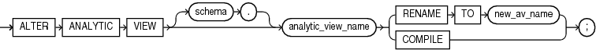

Purpose

Use the `ALTER` `ANALYTIC` `VIEW` statement to rename or compile an analytic view. For other alterations, use `CREATE` `OR` `REPLACE` `ANALYTIC` `VIEW`.

Prerequisites

To alter an analytic view in your own schema, you must have the `ALTER` `ANALYTIC` `VIEW` system privilege. To alter an analytic view in another user's schema, you must have the `ALTER` `ANY` `ANALYTIC` `VIEW` system privilege or `ALTER` `ANY` `TABLE` granted on the analytic view.

Syntax

alter\_analytic\_view::=



> ```
> ALTER ANALYTIC VIEW [ schema. ] analytic_view_name 
>   { RENAME TO new_av_name | COMPILE };
> ```


Semantics

schema

Specify the schema in which the analytic view exists. If you do not specify a schema, then Oracle Database looks for the analytic view in your own schema.

analytic\_view\_name

Specify the name of the analytic view.

RENAME TO

Specify `RENAME` `TO` to change the name of the analytic view. For `new_av_name`, specify a new name for the analytic view.

COMPILE

Specify `COMPILE` to compile the analytic view.

Example

The following statement changes the name of an analytic view:

```
ALTER ANALYTIC VIEW sales_av RENAME TO mysales_av;
```