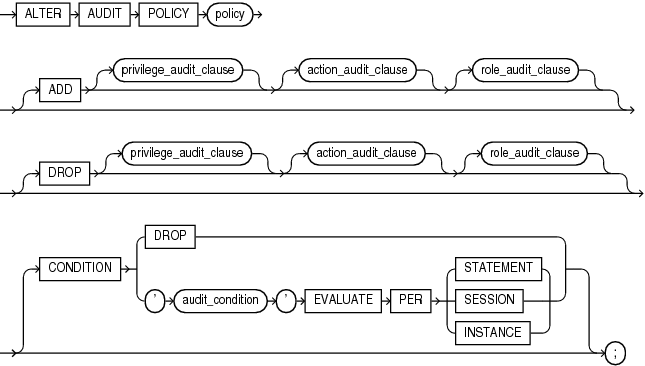
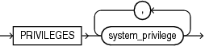
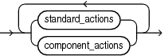
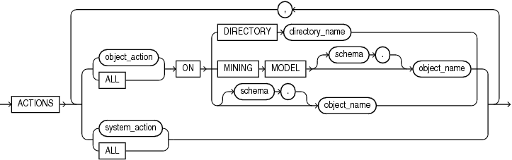
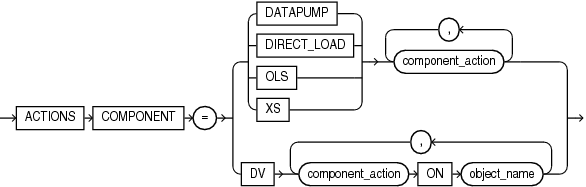
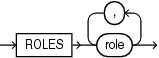

This section describes the `ALTER` `AUDIT` `POLICY` statement for unified auditing. This type of auditing is new beginning with Oracle Database 12c and provides a full set of enhanced auditing features. Refer to [Oracle Database Security Guide](https://docs.oracle.com/pls/topic/lookup?ctx=en/database/oracle/oracle-database/12.2/sqlrf&id=DBSEG630) for more information on unified auditing.

Purpose

Use the `ALTER` `AUDIT` `POLICY` statement to modify a unified audit policy.

Prerequisites

You must have the `AUDIT` `SYSTEM` system privilege or the `AUDIT_ADMIN` role.

If you are connected to a multitenant container database (CDB), then to modify a common unified audit policy, the current container must be the root and you must have the commonly granted `AUDIT` `SYSTEM` privilege or the `AUDIT_ADMIN` common role. To modify a local unified audit policy, the current container must be the container in which the audit policy was created and you must have the commonly granted `AUDIT` `SYSTEM` privilege or the `AUDIT_ADMIN` common role, or you must have the locally granted `AUDIT` `SYSTEM` privilege or the `AUDIT_ADMIN` local role in the container.

Syntax

alter\_audit\_policy::=



> ```
> ALTER AUDIT POLICY policy
>   [ ADD [ privilege_audit_clause ] [ action_audit_clause ] [ role_audit_clause ] ]
>   [ DROP [ privilege_audit_clause ] [ action_audit_clause ] [ role_audit_clause ] ]
>   [ CONDITION { DROP | 'audit_condition' EVALUATE PER { STATEMENT | SESSION | INSTANCE } } ]
> ;
> ```


Note:

If you specify the `ADD` or `DROP` clause, then you must specify at least one of the clauses `privilege_audit_clause`, `action_audit_clause`, or `role_audit_clause`.

(privilege\_audit\_clause::=, action\_audit\_clause::=, role\_audit\_clause::=)

privilege\_audit\_clause::=



> ```
> PRIVILEGES system_privilege [, system_privilege ]...
> ```


action\_audit\_clause::=



> ```
> { standard_actions | component_actions }...
> ```


standard\_actions::=



> ```
> ACTIONS
>   { { object_action | ALL }
>     ON { DIRECTORY directory_name
>        | MINING MODEL [ schema. ] object_name
>        | [ schema. ] object_name }
>   | { system_action | ALL }
>   }
>     [ { object_action | ALL }
>       ON { DIRECTORY directory_name
>          | MINING MODEL [ schema. ] object_name
>          | [ schema. ] object_name }
>     | { system_action | ALL } ]...
> ```


component\_actions::=



> ```
> ACTIONS COMPONENT =
>   { DATAPUMP | DIRECT_LOAD | OLS | XS } component_action [, component_action ]...
>   |
>   DV component_action ON object_name [, component_action ON object_name ]...
> ```


role\_audit\_clause::=



> ```
> ROLES role [, role ]...
> ```


Semantics

policy

Specify the name of the unified audit policy to be modified. The policy must have been created using the `CREATE` `AUDIT` `POLICY` statement. You can find descriptions of all unified audit policies by querying the `AUDIT_UNIFIED_POLICIES` view.

See Also:

- [CREATE AUDIT POLICY (Unified Auditing)](CREATE-AUDIT-POLICY-Unified-Auditing.md)
- [Oracle Database Reference](https://docs.oracle.com/pls/topic/lookup?ctx=en/database/oracle/oracle-database/12.2/sqlrf&id=REFRN29157) for more information on the `AUDIT_UNIFIED_POLICIES` view

ADD | DROP

Use the `ADD` clause to add privileges to be audited to `policy`.

Use the `DROP` clause to remove privileges to be audited from `policy`.

Refer to [privilege\_audit\_clause](CREATE-AUDIT-POLICY-Unified-Auditing.md), [action\_audit\_clause](CREATE-AUDIT-POLICY-Unified-Auditing.md), and [role\_audit\_clause](CREATE-AUDIT-POLICY-Unified-Auditing.md) of `CREATE` `AUDIT` `POLICY` for the full semantics of these clauses.

CONDITION

Use this clause to drop, add, or replace the audit condition for `policy`.

Specify `DROP` to drop the audit condition from `policy`.

Specify `'` `audit_condition` `'`... to add or replace the audit condition for `policy`.

Refer to [audit\_condition](CREATE-AUDIT-POLICY-Unified-Auditing.md), [EVALUATE PER STATEMENT](CREATE-AUDIT-POLICY-Unified-Auditing.md), [EVALUATE PER SESSION](CREATE-AUDIT-POLICY-Unified-Auditing.md), and [EVALUATE PER INSTANCE](CREATE-AUDIT-POLICY-Unified-Auditing.md) of `CREATE` `AUDIT` `POLICY` for the full semantics of these clauses.

Examples

The following examples modify unified audit policies that were created in the `CREATE` `AUDIT` `POLICY` " [Examples](CREATE-AUDIT-POLICY-Unified-Auditing.md) ".

Adding Privileges, Actions, and Roles to a Unified Audit Policy: Examples

The following statement adds the system privileges `CREATE` `ANY` `TABLE` and `DROP` `ANY` `TABLE` to unified audit policy `dml_pol`:

```
ALTER AUDIT POLICY dml_pol
  ADD PRIVILEGES CREATE ANY TABLE, DROP ANY TABLE;
```

The following statement adds the system actions `CREATE` `JAVA`, `ALTER` `JAVA`, and `DROP` `JAVA` to unified audit policy `java_pol`:

```
ALTER AUDIT POLICY java_pol
  ADD ACTIONS CREATE JAVA, ALTER JAVA, DROP JAVA;
```

The following statement adds the role `dba` to unified audit policy `table_pol`:

```
ALTER AUDIT POLICY table_pol
  ADD ROLES dba;
```

The following statement adds multiple system privileges, actions, and roles to unified audit policy `security_pol`:

```
ALTER AUDIT POLICY security_pol
  ADD PRIVILEGES CREATE ANY LIBRARY, DROP ANY LIBRARY
      ACTIONS DELETE on hr.employees,
              INSERT on hr.employees,
              UPDATE on hr.employees,
              ALL on hr.departments
      ROLES dba, connect;
```

Dropping Privileges, Actions, and Roles from a Unified Audit Policy: Examples

The following statement drops the system privilege `CREATE` `ANY` `TABLE` from unified audit policy `table_pol`:

```
ALTER AUDIT POLICY table_pol
  DROP PRIVILEGES CREATE ANY TABLE;
```

The following statement drops the `INSERT` and `UPDATE` actions on `hr`.`employees` from unified audit policy `dml_pol`:

```
ALTER AUDIT POLICY dml_pol
  DROP ACTIONS INSERT on hr.employees,
               UPDATE on hr.employees;
```

The following statement drops the role `java_deploy` from unified audit policy `java_pol`:

```
ALTER AUDIT POLICY java_pol
  DROP ROLES java_deploy;
```

The following statement drops a system privilege, an action, and a role from unified audit policy `hr_admin_pol`:

```
ALTER AUDIT POLICY hr_admin_pol
  DROP PRIVILEGES CREATE ANY TABLE
       ACTIONS LOCK TABLE
       ROLES audit_viewer;
```

Adding and Dropping Actions for a Unified Audit Policy: Example

The following statement adds `EXPORT` actions for Oracle Data Pump to unified audit policy `dp_actions_pol` and drops `IMPORT` actions for Oracle Data Pump:

```
ALTER AUDIT POLICY dp_actions_pol
  ADD ACTIONS COMPONENT = datapump EXPORT
  DROP ACTIONS COMPONENT = datapump IMPORT;
```

Dropping the Audit Condition from a Unified Audit Policy: Example

The following statement drops the audit condition from unified audit policy `order_updates_pol`:

```
ALTER AUDIT POLICY order_updates_pol
  CONDITION DROP;
```

Modifying the Audit Condition for a Unified Audit Policy: Example

The following statement modifies the audit condition for unified audit policy `emp_updates_pol` so that the policy is enforced only when the auditable statement is issued by a user whose UID is 102:

```
ALTER AUDIT POLICY emp_updates_pol
  CONDITION 'UID = 102'
  EVALUATE PER STATEMENT;
```