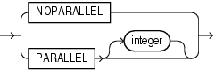

Purpose

Use the `ALTER` `CLUSTER` statement to redefine storage and parallelism characteristics of a cluster.

Note:

You cannot use this statement to change the number or the name of columns in the cluster key, and you cannot change the tablespace in which the cluster is stored.

See Also:

[CREATE CLUSTER](CREATE-CLUSTER.md) for information on creating a cluster, [DROP CLUSTER](DROP-CLUSTER.md) and [DROP TABLE](DROP-TABLE.md) for information on removing tables from a cluster, and [CREATE TABLE](CREATE-TABLE.md)... [physical\_properties](CREATE-TABLE.md) for information on adding a table to a cluster

Prerequisites

The cluster must be in your own schema or you must have the `ALTER` `ANY` `CLUSTER` system privilege.

Syntax

parallel\_clause::=



> ```
> { NOPARALLEL | PARALLEL [ integer ] }
> ```


Semantics

schema

Specify the schema containing the cluster. If you omit `schema`, then Oracle Database assumes the cluster is in your own schema.

cluster

Specify the name of the cluster to be altered.

physical\_attributes\_clause

Use this clause to change the values of the `PCTUSED`, `PCTFREE`, and `INITRANS` parameters of the cluster.

Use the `STORAGE` clause to change the storage characteristics of the cluster.

See Also:

- [physical\_attributes\_clause](physical_attributes_clause.md) for information on the parameters
- [storage\_clause](physical_attributes_clause.md) for a full description of that clause

Restriction on Physical Attributes

You cannot change the values of the storage parameters `INITIAL` and `MINEXTENTS` for a cluster.

SIZE

integer

Use the `SIZE` clause to specify the number of cluster keys that will be stored in data blocks allocated to the cluster.

Restriction on SIZE

You can change the `SIZE` parameter only for an indexed cluster, not for a hash cluster.

See Also:

[CREATE CLUSTER](CREATE-CLUSTER.md) for a description of the `SIZE` parameter and " Modifying a Cluster: Example "

MODIFY PARTITION

Specify `MODIFY` `PARTITION` `partition` `allocate_extent_clause` to explicitly allocate a new extent for a cluster partition. This operation is valid only for range-partitioned hash clusters. For `partition`, specify the cluster partition name.

allocate\_extent\_clause

Specify `allocate_extent_clause` to explicitly allocate a new extent for a cluster. This operation is valid only for indexed clusters and nonpartitioned hash clusters.

When you explicitly allocate an extent with the `allocate_extent_clause`, Oracle Database does not evaluate the storage parameters of the cluster and determine a new size for the next extent to be allocated (as it does when you create a table). Therefore, specify `SIZE` if you do not want Oracle Database to use a default value.

See Also:

[allocate\_extent\_clause](allocate_extent_clause.md) for a full description of this clause

deallocate\_unused\_clause

Use the `deallocate_unused_clause` to explicitly deallocate unused space at the end of the cluster and make the freed space available for other segments.

See Also:

[deallocate\_unused\_clause](deallocate_unused_clause.md) for a full description of this clause and " Deallocating Unused Space: Example "

parallel\_clause

Specify the `parallel_clause` to change the default degree of parallelism for queries on the cluster.

See Also:

[parallel\_clause](CREATE-TABLE.md) in the documentation on `CREATE` `TABLE` for complete information on this clause

Examples

The following examples modify the clusters that were created in the `CREATE` `CLUSTER` " [Examples](CREATE-CLUSTER.md) ".

Modifying a Cluster: Example

The next statement alters the `personnel` cluster:

```
ALTER CLUSTER personnel
   SIZE 1024 CACHE;
```

Oracle Database allocates 1024 bytes for each cluster key value and enables the cache attribute. Assuming a data block size of 2 kilobytes, future data blocks within this cluster contain 2 cluster keys in each data block, or 2 kilobytes divided by 1024 bytes.

Deallocating Unused Space: Example

The following statement deallocates unused space from the `language` cluster, keeping 30 kilobytes of unused space for future use:

```
ALTER CLUSTER language 
   DEALLOCATE UNUSED KEEP 30 K;
```