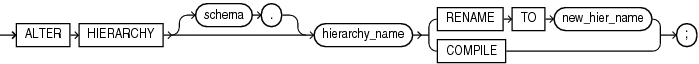

Purpose

Use the `ALTER` `HIERARCHY` statement to rename or compile a hierarchy. For other alterations, use `CREATE` `OR` `REPLACE` `HIERARCHY`.

Prerequisites

To alter a hierarchy in your own schema, you must have the `ALTER` `HIERARCHY` system privilege. To alter a hierarchy in another user's schema, you must have the `ALTER` `ANY` `HIERARCHY` system privilege or have been granted `ALTER` directly on the hierarchy.

Syntax

alter\_hierarchy::=



> ```
> ALTER HIERARCHY [ schema. ] hierarchy_name 
>   { RENAME TO new_hier_name | COMPILE };
> ```


Semantics

schema

Specify the schema in which the hierarchy exists. If you do not specify a schema, then Oracle Database looks for the hierarchy in your own schema.

hierarchy\_name

Specify the name of the hierarchy.

RENAME TO

Specify `RENAME` `TO` to change the name of the hierarchy.

COMPILE

Specify `COMPILE` to compile the hierarchy.

new\_hier\_name

Specify a new name for the hierarchy.

Example

The following statement changes the name of a hierarchy:

```
ALTER HIERARCHY product_hier RENAME TO myproduct_hier;
```