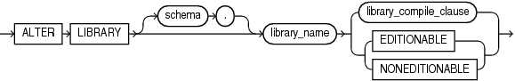

Purpose

The `ALTER` `LIBRARY` statement explicitly recompiles a library. Explicit recompilation eliminates the need for implicit run-time recompilation and prevents associated run-time compilation errors and performance overhead.

Note:

This statement does not change the declaration or definition of an existing library. To redeclare or redefine a library, use the " [CREATE LIBRARY](CREATE-LIBRARY.md) " with the `OR` `REPLACE` clause.

Prerequisites

If the library is in the `SYS` schema, you must be connected as `SYSDBA`. Otherwise, the library must be in your own schema or you must have the `ALTER` `ANY` `LIBRARY` system privilege.

Syntax

alter\_library::=



> ```
> ALTER LIBRARY [ schema. ] library_name
> { library_compile_clause | { EDITIONABLE | NONEDITIONABLE } }
> ```


(`library_compile_clause`: See [Oracle Database PL/SQL Language Reference](https://docs.oracle.com/pls/topic/lookup?ctx=en/database/oracle/oracle-database/12.2/sqlrf&id=LNPLS1877) for the syntax of this clause.)

Semantics

schema

Specify the schema containing the library. If you omit `schema`, then Oracle Database assumes the procedure is in your own schema.

library\_name

Specify the name of the library to be recompiled.

library\_compile\_clause

See [Oracle Database PL/SQL Language Reference](https://docs.oracle.com/pls/topic/lookup?ctx=en/database/oracle/oracle-database/12.2/sqlrf&id=LNPLS1877) for the syntax and semantics of this clause and for complete information on creating and compiling libraries.

EDITIONABLE | NONEDITIONABLE

Use these clauses to specify whether the library becomes an editioned or noneditioned object if editioning is later enabled for the schema object type `LIBRARY` in `schema`. The default is `EDITIONABLE`. For information about altering editioned and noneditioned objects, see [Oracle Database Development Guide](https://docs.oracle.com/pls/topic/lookup?ctx=en/database/oracle/oracle-database/12.2/sqlrf&id=ADFNS1287).