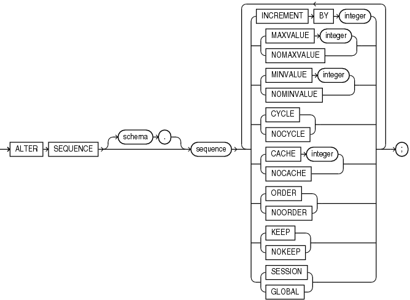

Purpose

Use the `ALTER` `SEQUENCE` statement to change the increment, minimum and maximum values, cached numbers, and behavior of an existing sequence. This statement affects only future sequence numbers.

See Also:

[CREATE SEQUENCE](CREATE-SEQUENCE.md) for additional information on sequences

Prerequisites

The sequence must be in your own schema, or you must have the `ALTER` object privilege on the sequence, or you must have the `ALTER` `ANY` `SEQUENCE` system privilege.

Syntax

alter\_sequence::=



> ```
> ALTER SEQUENCE [ schema. ] sequence
>   { INCREMENT BY integer
>   | { MAXVALUE integer | NOMAXVALUE }
>   | { MINVALUE integer | NOMINVALUE }
>   | { CYCLE | NOCYCLE }
>   | { CACHE integer | NOCACHE }
>   | { ORDER | NOORDER }
>   | { KEEP | NOKEEP }
>   | { SESSION | GLOBAL }
>   } ...
> ;
> ```


Semantics

The keywords and parameters in this statement serve the same purposes they serve when you create a sequence.

- To restart the sequence at a different number, you must drop and re-create it.
- If you change the `INCREMENT` `BY` value before the first invocation of `NEXTVAL`, then some sequence numbers will be skipped. Therefore, if you want to retain the original `START` `WITH` value, you must drop the sequence and re-create it with the original `START` `WITH` value and the new `INCREMENT` `BY` value.
- If you alter the sequence by specifying the `KEEP` or `NOKEEP` clause between runtime and failover of a request, then the original value of `NEXTVAL` is not retained during replay for Application Continuity for that request.
- Oracle Database performs some validations. For example, a new `MAXVALUE` cannot be imposed that is less than the current sequence number.
	See Also:
	[CREATE SEQUENCE](CREATE-SEQUENCE.md) for information on creating a sequence and [DROP SEQUENCE](DROP-SEQUENCE.md) for information on dropping and re-creating a sequence

Examples

Modifying a Sequence: Examples

This statement sets a new maximum value for the `customers_seq` sequence, which was created in " [Creating a Sequence: Example](CREATE-SEQUENCE.md) ":

```
ALTER SEQUENCE customers_seq 
   MAXVALUE 1500;
```

This statement turns on `CYCLE` and `CACHE` for the `customers_seq` sequence:

```
ALTER SEQUENCE customers_seq 
   CYCLE
   CACHE 5;
```