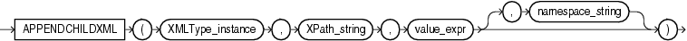

Note:

The `APPENDCHILDXML` function is deprecated. It is still supported for backward compatibility. However, Oracle recommends that you use XQuery Update instead. See [Oracle XML DB Developer’s Guide](https://docs.oracle.com/pls/topic/lookup?ctx=en/database/oracle/oracle-database/12.2/sqlrf&id=ADXDB1700) for more information.

Syntax



> ```
> APPENDCHILDXML
>   ( XMLType_instance, XPath_string, value_expr [, namespace_string ])
> ```


Purpose

`APPENDCHILDXML` appends a user-supplied value onto the target XML as the child of the node indicated by an XPath expression.

- `XMLType_instance` is an instance of `XMLType`.
- `XPath_string` is an Xpath expression indicating one or more nodes onto which one or more child nodes are to be appended. You can specify an absolute `XPath_string` with an initial slash or a relative `XPath_string` by omitting the initial slash. If you omit the initial slash, then the context of the relative path defaults to the root node.
- `value_expr` specifies one or more nodes of `XMLType`. It must resolve to a string.
- The optional `namespace_string` provides namespace information for the `XPath_string`. This parameter must be of type `VARCHAR2`.

See Also:

[Oracle XML DB Developer’s Guide](https://docs.oracle.com/pls/topic/lookup?ctx=en/database/oracle/oracle-database/12.2/sqlrf&id=ADXDB0440) for more information about this function

Examples

The following example adds an `/Owner` node to the `/Warehouse/Building` node of `warehouse_spec` in the `oe.warehouses` table if the value of the `/Building` node is "Rented":

```
UPDATE warehouses
  SET warehouse_spec = APPENDCHILDXML(warehouse_spec, 'Warehouse/Building',
    XMLType('<Owner>Grandco</Owner>'))
  WHERE EXTRACTVALUE(warehouse_spec, '/Warehouse/Building') = 'Rented';

SELECT warehouse_id,
       warehouse_name,
       EXTRACTVALUE(warehouse_spec, '/Warehouse/Building/Owner') "Prop.Owner"
  FROM warehouses
  WHERE EXISTSNODE(warehouse_spec, '/Warehouse/Building/Owner') = 1;

WAREHOUSE_ID WAREHOUSE_NAME  Prop.Owner
------------ --------------- ----------
           2 San Francisco   Grandco
           3 New Jersey      Grandco
```