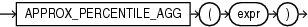

Syntax



> ```
> APPROX_PERCENTILE_AGG(expr)
> ```


Purpose

`APPROX_PERCENTILE_AGG` takes as its input a column of details containing approximate percentile information, and enables you to perform aggregations of that information.

For `detail`, specify a column of details created by the `APPROX_PERCENT_DETAIL` function or the `APPROX_PERCENTILE_AGG` function. This column is of data type `BLOB`.

You can specify this function in a `SELECT` statement with a `GROUP` `BY` clause to aggregate the information contained in the details within each group of rows and return a single detail for each group.

This function returns a `BLOB` value, called a detail, which contains approximate percentile information in a special format. You can store details returned by this function in a table or materialized view, and then again use the `APPROX_PERCENTILE_AGG` function to further aggregate those details, or use the `TO_APPROX_PERCENTILE` function to convert the details to specified percentile values.

See Also:

- [APPROX\_PERCENTILE\_DETAIL](APPROX_PERCENTILE_DETAIL.md)
- [TO\_APPROX\_PERCENTILE](TO_APPROX_PERCENTILE.md)

Examples

Refer to [APPROX\_PERCENTILE\_AGG: Examples](APPROX_PERCENTILE_DETAIL.md) for examples of using the `APPROX_PERCENTILE_AGG` function in conjunction with the `APPROX_PERCENTILE_DETAIL` and `TO_APPROX_PERCENTILE` functions.