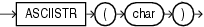

Syntax



> ```
> ASCIISTR(char)
> ```


Purpose

`ASCIISTR` takes as its argument a string, or an expression that resolves to a string, in any character set and returns an ASCII version of the string in the database character set. Non-ASCII characters are converted to the form `\xxxx`, where `xxxx` represents a UTF-16 code unit.

See Also:

- [Oracle Database Globalization Support Guide](https://docs.oracle.com/pls/topic/lookup?ctx=en/database/oracle/oracle-database/12.2/sqlrf&id=NLSPG006) for information on Unicode character sets and character semantics
- Appendix C in [Oracle Database Globalization Support Guide](https://docs.oracle.com/pls/topic/lookup?ctx=en/database/oracle/oracle-database/12.2/sqlrf&id=NLSPG-GUID-AFCE41ED-775B-4A00-AF38-C436776AE0C5) for the collation derivation rules, which define the collation assigned to the character return value of `ASCIISTR`

Examples

The following example returns the ASCII string equivalent of the text string " `ABÄCDE` ":

```
SELECT ASCIISTR('ABÄCDE')
  FROM DUAL;

ASCIISTR('
----------
AB\00C4CDE
```