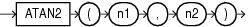

Syntax



> ```
> ATAN2(n1 , n2)
> ```


Purpose

`ATAN2` returns the arc tangent of `n1` and `n2`. The argument `n1` can be in an unbounded range and returns a value in the range of -pi to pi, depending on the signs of `n1` and `n2`, expressed in radians.

This function takes as arguments any numeric data type or any nonnumeric data type that can be implicitly converted to a numeric data type. If any argument is `BINARY_FLOAT` or `BINARY_DOUBLE`, then the function returns `BINARY_DOUBLE`. Otherwise the function returns `NUMBER`.

See Also:

[ATAN](ATAN.md) for information on the `ATAN` function and [Table 2-8](Data-Type-Comparison-Rules.md) for more information on implicit conversion

Examples

The following example returns the arc tangent of.3 and.2:

```
SELECT ATAN2(.3, .2) "Arc_Tangent2"
  FROM DUAL;
 
Arc_Tangent2
------------
  .982793723
```