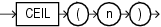

Syntax



> ```
> CEIL(n)
> ```


Purpose

`CEIL` returns the smallest integer that is greater than or equal to `n`. The number `n` can always be written as the difference of an integer `k` and a positive fraction `f` such that 0 <= `f` < 1 and `n` = `k` - `f`. The value of `CEIL` is the integer `k`. Thus, the value of `CEIL` is `n` itself if and only if `n` is precisely an integer.

This function takes as an argument any numeric data type or any nonnumeric data type that can be implicitly converted to a numeric data type. The function returns the same data type as the numeric data type of the argument.

See Also:

[Table 2-8](Data-Type-Comparison-Rules.md) for more information on implicit conversion and [FLOOR](FLOOR.md)

Examples

The following example returns the smallest integer greater than or equal to the order total of a specified order:

```
SELECT order_total, CEIL(order_total)
  FROM orders
  WHERE order_id = 2434;

ORDER_TOTAL CEIL(ORDER_TOTAL)
----------- -----------------
   268651.8            268652
```