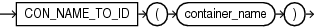

Syntax



> ```
> CON_NAME_TO_ID(container_name)
> ```


Purpose

`CON_NAME_TO_ID` takes as its argument a container name and returns the container ID. For `container_name`, specify a string, or an expression that resolves to a string, in any data type. The function returns a `NUMBER` value.

This function is useful in a multitenant container database (CDB). If you use this function in a non-CDB, then it returns 0.

Example

The following query displays the ID and name for all containers in a CDB. The sample output shown is for the purpose of this example.

```
SELECT CON_ID, NAME
  FROM V$CONTAINERS;

    CON_ID NAME
---------- ----------
         1 CDB$ROOT
         2 PDB$SEED
         4 SALESPDB
```

The following statement returns the ID for the container named `SALESPDB`:

```
SELECT CON_NAME_TO_ID('SALESPDB') "Container ID"
  FROM DUAL;

Container ID
------------
           4
```