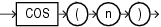

Syntax



> ```
> COS(n)
> ```


Purpose

`COS` returns the cosine of `n` (an angle expressed in radians).

This function takes as an argument any numeric data type or any nonnumeric data type that can be implicitly converted to a numeric data type. If the argument is `BINARY_FLOAT`, then the function returns `BINARY_DOUBLE`. Otherwise the function returns the same numeric data type as the argument.

See Also:

[Table 2-8](Data-Type-Comparison-Rules.md) for more information on implicit conversion

Examples

The following example returns the cosine of 180 degrees:

```
SELECT COS(180 * 3.14159265359/180) "Cosine of 180 degrees"
  FROM DUAL;

Cosine of 180 degrees
---------------------
                   -1
```