Purpose

Use the `CREATE` `ANALYTIC` `VIEW` statement to create an analytic view. An analytic view specifies the source of its fact data and defines measures that describe calculations or other analytic operations to perform on the data. An analytic view also specifies the attribute dimensions and hierarchies that define the rows of the analytic view.

Tip:

You can view and run SQL scripts that create analytic views at the Oracle Live SQL website at [https://livesql.oracle.com/apex/livesql/file/index.html](https://livesql.oracle.com/apex/livesql/file/index.html). The website has scripts and tutorials that demonstrate the creation and use of analytic views.

Prerequisites

To create an analytic view in your own schema, you must have the `CREATE` `ANALYTIC` `VIEW` system privilege. To create an analytic view in another user's schema, you must have the `CREATE` `ANY` `ANALYTIC` `VIEW` system privilege.

Syntax

create\_analytic\_view::=

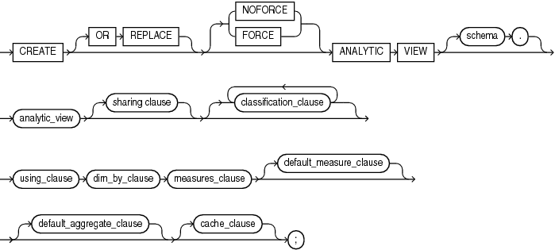

> ```
> CREATE [ OR REPLACE ] [ { FORCE | NOFORCE } ] 
>    ANALYTIC VIEW [ schema. ] analytic_view 
>     [ sharing clause ] 
>     [ classification_clause ]...
>     using_clause 
>     dim_by_clause 
>     measures_clause 
>     [ default_measure_clause ] 
>     [ default_aggregate_clause ]
>     [ cache_clause ]
> ;
> ```


sharing\_clause::=

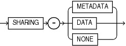

> ```
> SHARING = { METADATA | DATA | NONE }
> ```


classification\_clause::=


> ```
> [ CAPTION caption ]
> [ DESCRIPTION description ]
> [ CLASSIFICATION classification_name
>   [ VALUE classification_value ] 
>   [ LANGUAGE language ]
> ]...
> ```


using\_clause::=

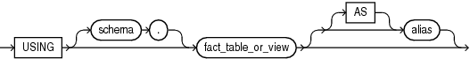

> ```
> USING [ schema. ] fact_table_or_view  [ [ AS ] alias ]
> ```


dim\_by\_clause::=

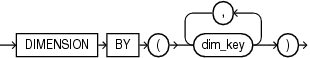

> ```
> DIMENSION BY ( dim_key [, dim_key ]... )
> ```


dim\_key::=

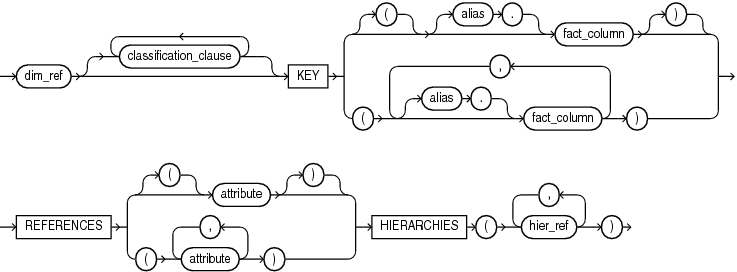

> ```
> dim_ref 
>   [classification_clause]...
>   KEY  
>     {[(] [alias.] fact_column  [)] 
>      |
>      (  [alias.] fact_column [, [alias.] fact_column]... )
>     }
>   REFERENCES 
>      {[(]  attribute  [)] 
>       | 
>       ( attribute [, attribute]... )
>      }   
>   HIERARCHIES ( hier_ref [, hier_ref]... )
> ```


dim\_ref::=

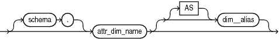

> ```
> [ schema. ] attr_dim_name [ [AS] dim__alias ]
> ```


hier\_ref::=

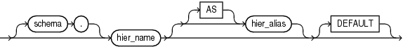

> ```
> [ schema. ] hier_name [ [ AS ] hier_alias ] [ DEFAULT ]
> ```


measures\_clause::=

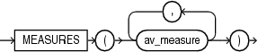

> ```
> MEASURES  ( av_measure [, av_measure]... )
> ```


av\_measure::=

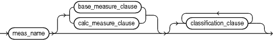

> ```
> meas_name  [{ base_measure_clause | calc_measure_clause }]
>   [ classification_clause ]...
> ```


base\_measure\_clause::=

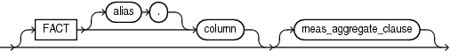

> ```
> [ FACT [alias.] ] column [ meas_aggregate_clause ]
> ```


calc\_measure\_clause::=

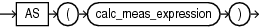

> ```
> AS ( calc_meas_expression )
> ```


meas\_aggregate\_clause::=

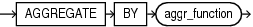

> ```
> AGGREGATE BY aggr_function
> ```


default\_measure\_clause::=

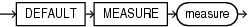

> ```
> DEFAULT MEASURE measure
> ```


default\_aggregate\_clause::=

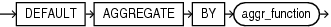

> ```
> DEFAULT AGGREGATE BY aggr_function
> ```


cache\_clause::=

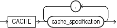

> ```
> CACHE cache_specification [, cache_specification]...
> ```


cache\_specification::=

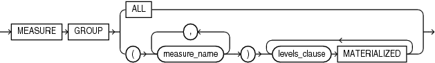

> ```
> MEASURE GROUP
>  {    ALL 
>    | ( measure_name [, measure_name ]... ) [ levels_clause  MATERIALIZED ]...
>  }
> ```


levels\_clause::=

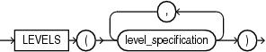

> ```
> LEVELS ( level_specification [, level_specification ]... )
> ```


level\_specification::=

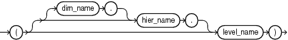

> ```
> ( [ [ dim_name. ] hier_name. ] level_name )
> ```


Semantics

OR REPLACE

Specify `OR` `REPLACE` to replace an existing definition of an analytic view with a different definition.

FORCE and NOFORCE

Specify `FORCE` to force the creation of the analytic view even if it does not successfully compile. If you specify `NOFORCE`, then the analytic view must compile successfully, otherwise an error occurs. The default is `NOFORCE`.

schema

Specify the schema in which to create the analytic view. If you do not specify a schema, then Oracle Database creates the analytic view in your own schema.

analytic\_view

Specify a name for the analytic view.

classification\_clause

Use the classification clause to specify values for the `CAPTION` or `DESCRIPTION` classifications and to specify user-defined classifications. Classifications provide descriptive metadata that applications may use to provide information about analytic views and their components.

You may specify any number of classifications for the same object. A classification can have a maximum length of 4000 bytes.

For the `CAPTION` and `DESCRIPTION` classifications, you may use the DDL shortcuts `CAPTION` `'` `caption` `'` and `DESCRIPTION` `'` `description` `'` or the full classification syntax.

You may vary the classification values by language. To specify a language for the `CAPTION` or `DESCRIPTION` classification, you must use the full syntax. If you do not specify a language, then the language value for the classification is `NULL`. The language value must either be `NULL` or a valid `NLS_LANGUAGE` value.

using\_clause

Specify a fact table or view. External and remote tables are permitted. You may specify a table or view in another schema. You can specify an alias for the table or view.

dim\_by\_clause

Specify the attribute dimensions of the analytic view.

dim\_key

Specify an attribute dimension, columns of the fact table, columns of the attribute dimension, and hierarchies that are related in the analytic view.

With the `KEY` keyword, specify one or more columns in the fact table.

With the `REFERENCES` keyword, specify attributes of the attribute dimensions that the analytic view is dimensioned by. The attributes must be a level key.

With the `HIERARCHIES` keyword, specify the hierarchies in the analytic view that use the attribute dimension.

dim\_ref

Specify an attribute dimension. You can specify an alias for an attribute dimension, which is required if you use the same dimension more than once or if you use multiple dimensions with the same name from different schemas.

hier\_ref

Specify a hierarchy. You can specify an alias for a hierarchy. You can specify one of the hierarchies in the list as the default. If you do not specify a default, the first hierarchy in the list is the default.

measures\_clause

Specify the measures for the analytic view.

av\_measure

Define a measure using either a single fact column or an expression over measures in this analytic view. A measure can be either a base measure or a calculated measure.

base\_measure\_clause

Define a base measure by optionally specifying a fact column or a `meas_aggregate_clause`, or both. If you do not specify a fact column, then the analytic view uses the column of the fact table that has the same name as the measure. If a column by the same name does not exist, an error is raised.

calc\_measure\_clause

Define a calculated measure by specifying a calculated measure expression. The expression may reference other measures in the analytic view, but may not reference fact columns. Calculated measures do not have an aggregate clause because they're computed over the aggregated base measures.

For the syntax and descriptions of calculated measure expressions, see [Calculated Measure Expressions](Calculated-Measure-Expressions.md).

default\_measure\_clause

Specify a measure to use as the default measure for the analytic view. If you do not specify a measure, the first measure defined is the default.

meas\_aggregate\_clausè

Specify a default aggregation operator for a base measure. If you do not specify an aggregation operator, then the operator specified by the `default_aggregate_clause` is used.

default\_aggregate\_clause

Specify a default aggregation for all base measures in the analytic view. If you do not specify a default aggregation, then the default value is `SUM`.

cache\_clause

Specify a cache clause to improve query response time when an appropriate materialized view is available. You can specify one or more cache specifications.

cache\_specification

Specify one or more measure groups for a cache clause. To include all measure groups, specify `ALL`. Each measure group can contain one or more measures and one or more level groupings. A level grouping can contain one or more level specifications.

level\_specification

Specify one or more levels for a level grouping of a measure group for a cache specification. Specify only one level per hierarchy. A materialized view must exist that contains the aggregated values for the hierarchy level.

Examples

The following is a description of the `SALES_FACT` table:

```
desc SALES_FACT
Name              Null? Type          
----------------- ----- ------------- 
MONTH_ID                VARCHAR2(10)  
CATEGORY_ID             NUMBER(6)     
STATE_PROVINCE_ID       VARCHAR2(120) 
UNITS                   NUMBER(6)     
SALES                   NUMBER(12,2)
```

The following example creates the `SALES_AV` analytic view using the `SALES_FACT` table:

```
CREATE OR REPLACE ANALYTIC VIEW sales_av
USING sales_fact
DIMENSION BY
  (time_attr_dim                         -- An attribute dimension of time data
    KEY month_id REFERENCES month_id
    HIERARCHIES (
      time_hier DEFAULT),
   product_attr_dim                      -- An attribute dimension of product data
    KEY category_id REFERENCES category_id
    HIERARCHIES (
      product_hier DEFAULT),
   geography_attr_dim                    -- An attribute dimension of store data
    KEY state_province_id 
    REFERENCES state_province_id HIERARCHIES (
      geography_hier DEFAULT)
   )
MEASURES
 (sales FACT sales,                      -- A base measure
  units FACT units,                      -- A base measure
  sales_prior_period AS                  -- Calculated measures
    (LAG(sales) OVER (HIERARCHY time_hier OFFSET 1)),
  sales_year_ago AS
    (LAG(sales) OVER (HIERARCHY time_hier OFFSET 1
     ACROSS ANCESTOR AT LEVEL year)),
  chg_sales_year_ago AS
    (LAG_DIFF(sales) OVER (HIERARCHY time_hier OFFSET 1
     ACROSS ANCESTOR AT LEVEL year)),
  pct_chg_sales_year_ago AS
    (LAG_DIFF_PERCENT(sales) OVER (HIERARCHY time_hier OFFSET 1
     ACROSS ANCESTOR AT LEVEL year)),
  sales_qtr_ago AS
    (LAG(sales) OVER (HIERARCHY time_hier OFFSET 1
     ACROSS ANCESTOR AT LEVEL quarter)),
  chg_sales_qtr_ago AS
    (LAG_DIFF(sales) OVER (HIERARCHY time_hier OFFSET 1
     ACROSS ANCESTOR AT LEVEL quarter)),
  pct_chg_sales_qtr_ago AS
    (LAG_DIFF_PERCENT(sales) OVER (HIERARCHY time_hier OFFSET 1
     ACROSS ANCESTOR AT LEVEL quarter))
  )
DEFAULT MEASURE SALES;
```