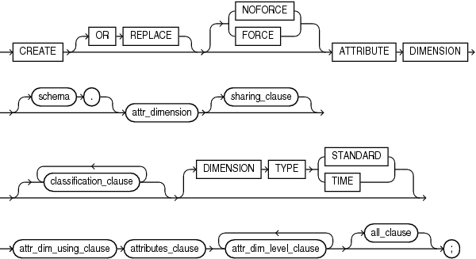
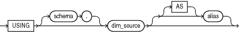
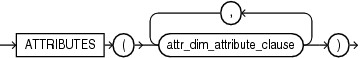
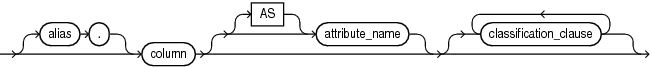
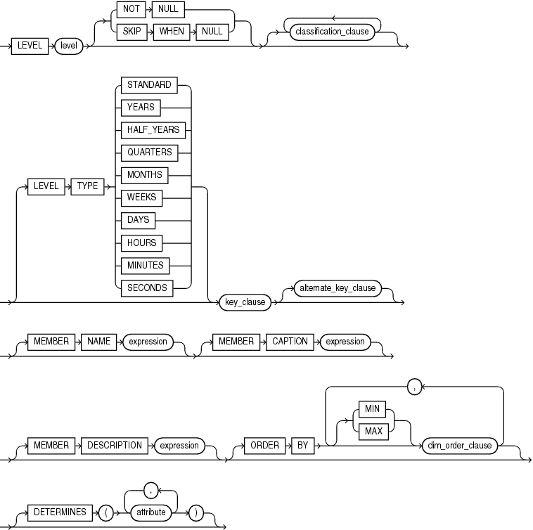
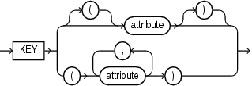
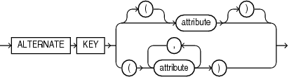
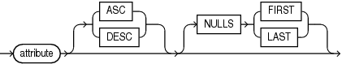
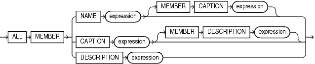

Purpose

Use the `CREATE` `ATTRIBUTE` `DIMENSION` statement to create an attribute dimension. An attribute dimension specifies dimension members for one or more analytic view hierarchies. It specifies the data source it is using and the members it includes. It specifies levels for its members and determines attribute relationships between levels.

Tip:

You can view and run SQL scripts that create attribute dimensions at the Oracle Live SQL website at [https://livesql.oracle.com/apex/livesql/file/index.html](https://livesql.oracle.com/apex/livesql/file/index.html). The website has scripts and tutorials that demonstrate the creation and use of analytic views.

Prerequisites

To create an attribute dimension in your own schema, you must have the `CREATE` `ATTRIBUTE` `DIMENSION` system privilege. To create an attribute dimension in another user's schema, you must have the `CREATE` `ANY` `ATTRIBUTE` `DIMENSION` system privilege.

Syntax

create\_attribute\_dimension::=



> ```
> CREATE [ OR REPLACE ] [ FORCE | NOFORCE ] ATTRIBUTE DIMENSION
>   [ schema. ] attr_dimension [ sharing_clause ] [ classification_clause ]... ]
>   [ DIMENSION TYPE { STANDARD | TIME } ]
>   attr_dim_using_clause
>   attributes_clause
>   [ attr_dim_level_clause ]...
>   [ all_clause ]
> ;
> ```


sharing\_clause::=


> ```
> SHARING = { METADATA | DATA | NONE }
> ```


classification\_clause::=


> ```
> [ CAPTION caption ]
> [ DESCRIPTION description ]
> [ CLASSIFICATION classification_name
>   [ VALUE classification_value ] 
>   [ LANGUAGE language ]
> ]...
> ```


attr\_dim\_using\_clause::=



> ```
> USING [ schema. ] dim_source [ [ AS ] alias]
> ```


attributes\_clause::=



> ```
> ATTRIBUTES ( attr_dim_attribute_clause [, attr_dim_attribute_clause ]... )
> ```


attr\_dim\_attributes\_clause::=



> ```
> [ alias. ] column [ [ AS ] attribute_name ] [ classification_clause ]...
> ```


attr\_dim\_level\_clause::=



> ```
> LEVEL level [ { NOT NULL  |  SKIP WHEN NULL } ]
>   [ classification_clause [ classification_clause ]...
>   [ LEVEL TYPE 
>       {   STANDARD 
>         | YEARS 
>         | HALF_YEARS
>         | QUARTERS
>         | MONTHS
>         | WEEKS
>         | DAYS
>         | HOURS
>         | MINUTES
>         | SECONDS
>       }
>   ]
>   key_clause [ alternate_key_clause ]
>   [ MEMBER NAME expression ]
>   [ MEMBER CAPTION expression ] 
>   [ MEMBER DESCRIPTION expression ]
>   [ ORDER BY  [ MIN | MAX ] dim_order_clause 
>                     [, [ MIN | MAX ] dim_order_clause ]... ]
>   ]
>   [ DETERMINES ( attribute [, attribute]... ) ]
> ```


key\_clause::=



> ```
> KEY { [(] attribute [)] | ( attribute [, attribute]... ) }
> ```


alternate\_key\_clause::=



> ```
> ALTERNATE KEY { [ ( ] attribute [ ) ]
>                 |  
>                 ( attribute [, attribute ]... )
>               }
> ```


dim\_order\_clause::=



> ```
> attribute [ ASC | DESC ] [ NULLS { FIRST | LAST } ]
> ```


all\_clause::=



> ```
> ALL  MEMBER { NAME expression [ MEMBER CAPTION expression ]
>             | CAPTION expression [ MEMBER DESCRIPTION expression ]
>             | DESCRIPTION expression 
>             }
> ```


Semantics

OR REPLACE

Specify `OR` `REPLACE` to replace an existing definition of an attribute dimension with a different definition.

FORCE and NOFORCE

Specify `FORCE` to force the creation of the attribute dimension even if it does not successfully compile. If you specify `NOFORCE`, then the attribute dimension must compile successfully, otherwise an error occurs. The default is `NOFORCE`.

schema

Specify the schema in which to create the attribute dimension. If you do not specify a schema, then Oracle Database creates the attribute dimension in your own schema.

attr\_dimension

Specify a name for the attribute dimension.

classification\_clause

Use the classification clause to specify values for the `CAPTION` or `DESCRIPTION` classifications and to specify user-defined classifications. Classifications provide descriptive metadata that applications may use to provide information about analytic views and their components.

You may specify any number of classifications for the same object. A classification can have a maximum length of 4000 bytes.

For the `CAPTION` and `DESCRIPTION` classifications, you may use the DDL shortcuts `CAPTION` `'` `caption` `'` and `DESCRIPTION` `'` `description` `'` or the full classification syntax.

You may vary the classification values by language. To specify a language for the `CAPTION` or `DESCRIPTION` classification, you must use the full syntax. If you do not specify a language, then the language value for the classification is `NULL`. The language value must either be `NULL` or a valid `NLS_LANGUAGE` value.

DIMENSION TYPE

An attribute dimension may be either a `STANDARD` or a `TIME` type. A `STANDARD` type attribute dimension has `STANDARD` type levels. Each level of a `TIME` type attribute dimension is one of the time types. The default `DIMENSION TYPE` is `STANDARD`.

attr\_dim\_using\_clause

Specify a table or view. You may specify an alias for the table or view by using the `AS` keyword.

attributes\_clause

Specify one or more `attr_dim_attribute_clause` clauses.

attr\_dim\_attribute\_clause

Specify a column from the `attr_dim_using_clause` source. The attribute has the name of the column unless you specify an alias using the `AS` keyword. You may specify classifications for each attribute.

attr\_dim\_level\_clause

Specify a level in the attribute dimension. A level specifies key and optional alternate key attributes that provide the members of the level.

If the key attribute has no `NULL` values, then you may specify `NOT` `NULL`, which is the default. If it does have one or more `NULL` values, then specify `SKIP` `WHEN` `NULL`.

LEVEL TYPE

A `STANDARD` type attribute dimension has `STANDARD` type levels. You do not need to specify a `LEVEL TYPE` for a `STANDARD` type attribute dimension.

In a `TIME` type attribute dimension, you must specify a level type. The type of the level may be one of the time types. You must specify a time type even if the values of the level members are not of that type. For example, you may have a SEASON level with values that are the names of seasons. In defining the level, you must specify any one of the time level types, such as `QUARTERS`. An application may use the level type designations for whatever purpose it chooses.

DETERMINES

With the `DETERMINES` keyword, you may specify other attributes of the attribute dimension that this level determines. If an attribute has only one value for each value of another attribute, then the value of the first attribute determines the value of the other attribute. For example, the QUARTER\_ID attribute has only one value for each value of the MONTH\_ID attribute, so you can include the the QUARTER\_ID attribute in the `DETERMINES` phrase of the MONTHS level.

key\_clause

Specify one or more attributes as the key for the level.

alternate\_key\_clause

Specify one or more attributes as the alternate key for the level.

dim\_order\_clause

Specify the ordering of the members of the level.

all\_clause

Optionally specify `MEMBER` `NAME`, `MEMBER` `CAPTION`, and `MEMBER` `DESCRIPTION` values for the implicit ALL level. By default, the `MEMBER` `NAME` value is ALL.

Examples

The following example describes the TIME\_DIM table:

```
desc TIME_DIM

Name              Null?   Type          
----------------- -----   ------------- 
MONTH_ID                  VARCHAR2(10)  
CATEGORY_ID               NUMBER(6)     
STATE_PROVINCE_ID         VARCHAR2(120) 
UNITS                     NUMBER(6)     
SALES                     NUMBER(12,2)  
YEAR_ID          NOT NULL VARCHAR2(30) 
YEAR_NAME        NOT NULL VARCHAR2(40) 
YEAR_END_DATE             DATE         
QUARTER_ID       NOT NULL VARCHAR2(30) 
QUARTER_NAME     NOT NULL VARCHAR2(40) 
QUARTER_END_DATE          DATE         
QUARTER_OF_YEAR           NUMBER       
MONTH_ID         NOT NULL VARCHAR2(30) 
MONTH_NAME       NOT NULL VARCHAR2(40) 
MONTH_END_DATE            DATE         
MONTH_OF_YEAR             NUMBER       
MONTH_LONG_NAME           VARCHAR2(30) 
SEASON                    VARCHAR2(10) 
SEASON_ORDER              NUMBER(38)   
MONTH_OF_QUARTER          NUMBER(38)
```

The following example creates a `TIME` type attribute dimension, using columns from the TIME\_DIM table:

```
CREATE OR REPLACE ATTRIBUTE DIMENSION time_attr_dim
DIMENSION TYPE TIME
USING time_dim
ATTRIBUTES
 (year_id
   CLASSIFICATION caption VALUE 'YEAR_ID'
   CLASSIFICATION description VALUE 'YEAR ID',
  year_name
    CLASSIFICATION caption VALUE 'YEAR_NAME'
    CLASSIFICATION description VALUE 'Year',
  year_end_date
    CLASSIFICATION caption VALUE 'YEAR_END_DATE'
    CLASSIFICATION description VALUE 'Year End Date',
  quarter_id
    CLASSIFICATION caption VALUE 'QUARTER_ID'
    CLASSIFICATION description VALUE 'QUARTER ID',
  quarter_name
    CLASSIFICATION caption VALUE 'QUARTER_NAME'
    CLASSIFICATION description VALUE 'Quarter',
  quarter_end_date
    CLASSIFICATION caption VALUE 'QUARTER_END_DATE'
    CLASSIFICATION description VALUE 'Quarter End Date',
  quarter_of_year
    CLASSIFICATION caption VALUE 'QUARTER_OF_YEAR'
    CLASSIFICATION description VALUE 'Quarter of Year',    
  month_id
    CLASSIFICATION caption VALUE 'MONTH_ID'
    CLASSIFICATION description VALUE 'MONTH ID',
  month_name
    CLASSIFICATION caption VALUE 'MONTH_NAME'
    CLASSIFICATION description VALUE 'Month',
  month_long_name
    CLASSIFICATION caption VALUE 'MONTH_LONG_NAME'
    CLASSIFICATION description VALUE 'Month Long Name',
  month_end_date
    CLASSIFICATION caption VALUE 'MONTH_END_DATE'
    CLASSIFICATION description VALUE 'Month End Date',
  month_of_quarter
    CLASSIFICATION caption VALUE 'MONTH_OF_QUARTER'
    CLASSIFICATION description VALUE 'Month of Quarter',
  month_of_year
    CLASSIFICATION caption VALUE 'MONTH_OF_YEAR'
    CLASSIFICATION description VALUE 'Month of Year',
  season
    CLASSIFICATION caption VALUE 'SEASON'
    CLASSIFICATION description VALUE 'Season',
  season_order
    CLASSIFICATION caption VALUE 'SEASON_ORDER'
    CLASSIFICATION description VALUE 'Season Order')
LEVEL month
  LEVEL TYPE MONTHS
  CLASSIFICATION caption VALUE 'MONTH'
  CLASSIFICATION description VALUE 'Month'
  KEY month_id
  MEMBER NAME month_name
  MEMBER CAPTION month_name
  MEMBER DESCRIPTION month_long_name
  ORDER BY month_end_date
  DETERMINES (month_end_date,
    quarter_id,
    season,
    season_order,
    month_of_year,
    month_of_quarter)
LEVEL quarter
  LEVEL TYPE QUARTERS
  CLASSIFICATION caption VALUE 'QUARTER'
  CLASSIFICATION description VALUE 'Quarter'
  KEY quarter_id
  MEMBER NAME quarter_name
  MEMBER CAPTION quarter_name
  MEMBER DESCRIPTION quarter_name
  ORDER BY quarter_end_date
  DETERMINES (quarter_end_date,
    quarter_of_year,
    year_id)
LEVEL year
  LEVEL TYPE YEARS
  CLASSIFICATION caption VALUE 'YEAR'
  CLASSIFICATION description VALUE 'Year'
  KEY year_id
  MEMBER NAME year_name
  MEMBER CAPTION year_name
  MEMBER DESCRIPTION year_name
  ORDER BY year_end_date
  DETERMINES (year_end_date)
LEVEL season
  LEVEL TYPE QUARTERS
  CLASSIFICATION caption VALUE 'SEASON'
  CLASSIFICATION description VALUE 'Season'
  KEY season
  MEMBER NAME season
  MEMBER CAPTION season
  MEMBER DESCRIPTION season
LEVEL month_of_quarter
  LEVEL TYPE MONTHS
  CLASSIFICATION caption VALUE 'MONTH_OF_QUARTER'
  CLASSIFICATION description VALUE 'Month of Quarter'
  KEY month_of_quarter;
```

The following example describes the PRODUCT\_DIM table:

```
desc PRODUCT_DIM

Name            Null?    Type          
--------------- -------- ------------- 
DEPARTMENT_ID   NOT NULL NUMBER        
DEPARTMENT_NAME NOT NULL VARCHAR2(100) 
CATEGORY_ID     NOT NULL NUMBER        
CATEGORY_NAME   NOT NULL VARCHAR2(100)
```

The following example creates a `STANDARD` type attribute dimension, using columns from the PRODUCT\_DIM table:

```
CREATE OR REPLACE ATTRIBUTE DIMENSION product_attr_dim
USING product_dim 
ATTRIBUTES
 (department_id,
  department_name,
  category_id,
  category_name)
LEVEL DEPARTMENT
  KEY department_id
  ALTERNATE KEY department_name
  MEMBER NAME department_name
  MEMBER CAPTION department_name
  ORDER BY department_name
LEVEL CATEGORY
  KEY category_id
  ALTERNATE KEY category_name
  MEMBER NAME category_name
  MEMBER CAPTION category_name
  ORDER BY category_name
  DETERMINES(department_id)
ALL MEMBER NAME 'ALL PRODUCTS';
```

The following example describes the GEOGRAPHY\_DIM table:

```
desc GEOGRAPHY_DIM

Name                Null?    Type          
---------------     -------- ------------- 
DEPARTMENT_ID       NOT NULL NUMBER        
DEPARTMENT_NAME     NOT NULL VARCHAR2(100) 
CATEGORY_ID         NOT NULL NUMBER        
CATEGORY_NAME       NOT NULL VARCHAR2(100) 
REGION_ID           NOT NULL VARCHAR2(120) 
REGION_NAME         NOT NULL VARCHAR2(100) 
COUNTRY_ID          NOT NULL VARCHAR2(2)   
COUNTRY_NAME        NOT NULL VARCHAR2(120) 
STATE_PROVINCE_ID   NOT NULL VARCHAR2(120) 
STATE_PROVINCE_NAME NOT NULL VARCHAR2(400)
```

The following example creates an `STANDARD` type attribute dimension, using columns from the GEOGRAPHY\_DIM table:

```
CREATE OR REPLACE ATTRIBUTE DIMENSION geography_attr_dim
USING geography_dim
ATTRIBUTES
 (region_id,
  region_name,
  country_id,
  country_name,
  state_province_id,
  state_province_name)
LEVEL REGION
  KEY region_id
  ALTERNATE KEY region_name
  MEMBER NAME region_name
  MEMBER CAPTION region_name
  ORDER BY region_name
LEVEL COUNTRY
  KEY country_id
  ALTERNATE KEY country_name
  MEMBER NAME country_name
  MEMBER CAPTION country_name
  ORDER BY country_name
  DETERMINES(region_id)
LEVEL STATE_PROVINCE
  KEY state_province_id
  ALTERNATE KEY state_province_name
  MEMBER NAME state_province_name
  MEMBER CAPTION state_province_name
  ORDER BY state_province_name
  DETERMINES(country_id)
ALL MEMBER NAME 'ALL CUSTOMERS';
```