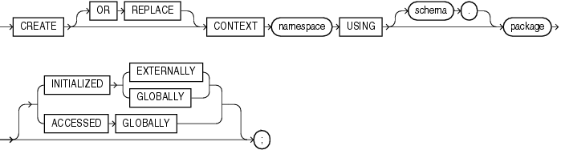

Purpose

Use the `CREATE` `CONTEXT` statement to:

- Create a namespace for a context (a set of application-defined attributes that validates and secures an application)
- Associate the namespace with the externally created package that sets the context

You can use the `DBMS_SESSION`.`SET_CONTEXT` procedure in your designated package to set or reset the attributes of the context.

See Also:

- [Oracle Database Security Guide](https://docs.oracle.com/pls/topic/lookup?ctx=en/database/oracle/oracle-database/12.2/sqlrf&id=DBSEG70071) for a discussion of contexts
- [Oracle Database PL/SQL Packages and Types Reference](https://docs.oracle.com/pls/topic/lookup?ctx=en/database/oracle/oracle-database/12.2/sqlrf&id=ARPLS054) for information on the `DBMS_SESSION`.`SET_CONTEXT` procedure

Prerequisites

To create a context namespace, you must have `CREATE` `ANY` `CONTEXT` system privilege.

Syntax

create\_context::=



> ```
> CREATE [ OR REPLACE ] CONTEXT namespace
>   USING [ schema. ] package
>   [ INITIALIZED { EXTERNALLY | GLOBALLY }
>   | ACCESSED GLOBALLY
>   ] ;
> ```


Semantics

OR REPLACE

Specify `OR` `REPLACE` to redefine an existing context namespace using a different package.

namespace

Specify the name of the context namespace to create or modify. The name must satisfy the requirements listed in " [Database Object Naming Rules](Database-Object-Names-and-Qualifiers.md) ". Context namespaces are always stored in the schema `SYS`.

See Also:

" [Database Object Naming Rules](Database-Object-Names-and-Qualifiers.md) " for guidelines on naming a context namespace

schema

Specify the schema owning `package`. If you omit `schema`, then Oracle Database uses the current schema.

package

Specify the PL/SQL package that sets or resets the context attributes under the namespace for a user session.

To provide some design flexibility, Oracle Database does not verify the existence of the schema or the validity of the package at the time you create the context.

INITIALIZED Clause

The `INITIALIZED` clause lets you specify an entity other than Oracle Database that can initialize the context namespace.

EXTERNALLY

`EXTERNALLY` indicates that the namespace can be initialized using an OCI interface when establishing a session.

See Also:

[Oracle Call Interface Programmer's Guide](https://docs.oracle.com/pls/topic/lookup?ctx=en/database/oracle/oracle-database/12.2/sqlrf&id=LNOCI080) for information on using OCI to establish a session

GLOBALLY

`GLOBALLY` indicates that the namespace can be initialized by the LDAP directory when a global user connects to the database.

After the session is established, only the designated PL/SQL package can issue commands to write to any attributes inside the namespace.

See Also:

[Oracle Database Security Guide](https://docs.oracle.com/pls/topic/lookup?ctx=en/database/oracle/oracle-database/12.2/sqlrf&id=DBSEG70745) for information on establishing globally initialized contexts

ACCESSED GLOBALLY

This clause indicates that any application context set in `namespace` is accessible throughout the entire instance. This setting lets multiple sessions share application attributes.

Examples

Creating an Application Context: Example

This example uses a PL/SQL package `emp_mgmt`, which validates and secures a human resources application. See [Oracle Database PL/SQL Language Reference](https://docs.oracle.com/pls/topic/lookup?ctx=en/database/oracle/oracle-database/12.2/sqlrf&id=LNPLS01371) for the example that creates that package. The following statement creates the context namespace `hr_context` and associates it with the package `emp_mgmt`:

```
CREATE CONTEXT hr_context USING emp_mgmt;
```

You can control data access based on this context using the `SYS_CONTEXT` function. For example, the `emp_mgmt` package has defined an attribute `department_id` as a particular department identifier. You can secure the base table `employees` by creating a view that restricts access based on the value of `department_id`, as follows:

```
CREATE VIEW hr_org_secure_view AS
   SELECT * FROM employees
   WHERE department_id = SYS_CONTEXT('hr_context', 'department_id');
```

See Also:

[SYS\_CONTEXT](SYS_CONTEXT.md) and [Oracle Database Security Guide](https://docs.oracle.com/pls/topic/lookup?ctx=en/database/oracle/oracle-database/12.2/sqlrf&id=DBSEG66353) for more information on using application contexts to retrieve user information