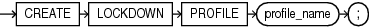

Purpose

Use the `CREATE` `LOCKDOWN` `PROFILE` statement to create a PDB lockdown profile. You can use PDB lockdown profiles in a multitenant container database (CDB) to restrict user operations in PDBs.

After you create a PDB lockdown profile, you can add restrictions to the profile with the `ALTER` `LOCKDOWN` `PROFILE` statement. You can restrict user operations associated with certain database features, options, and SQL statements.

When a lockdown profile is assigned to a PDB, users in that PDB cannot perform the operations that are the disabled for the profile. To assign a lockdown profile, set its name for the value of the `PDB_LOCKDOWN` initialization parameter. You can assign a lockdown profile to individual PDBs, or to all PDBs in a CDB or application container, as follows:

- If you set `PDB_LOCKDOWN` while connected to a CDB root, then the lockdown profile applies to all PDBs in the CDB. It does not apply to the CDB root.
- If you set `PDB_LOCKDOWN` while connected to an application root, then the lockdown profile applies to the application root and all PDBs in the application container.
- If you set `PDB_LOCKDOWN` while connected to a particular PDB, then the lockdown profile applies to that PDB and overrides the lockdown profile for the CDB or application container, if one exists.

See Also:

- [ALTER LOCKDOWN PROFILE](ALTER-LOCKDOWN-PROFILE.md) and [DROP LOCKDOWN PROFILE](DROP-LOCKDOWN-PROFILE.md)
- [Oracle Database Security Guide](https://docs.oracle.com/pls/topic/lookup?ctx=en/database/oracle/oracle-database/12.2/sqlrf&id=DBSEG-GUID-AB5E62DB-7E2A-4B5A-BA96-A2BD2DF15275) for more information on PDB lockdown profiles

Prerequisites

The `CREATE` `LOCKDOWN` `PROFILE` statement is valid only in a CDB. The current container must be the CDB root and you must have the `CREATE` `LOCKDOWN` `PROFILE` system privilege, either granted commonly or granted locally in the CDB root.

Syntax

create\_lockdown\_profile::=



> ```
> CREATE LOCKDOWN PROFILE profile_name ;
> ```


Semantics

profile\_name

Specify the name of the PDB lockdown profile to be created. The name must satisfy the requirements listed in “ [Database Object Naming Rules](Database-Object-Names-and-Qualifiers.md) ”. The `profile_name` must be unique across the entire CDB.

Example

The following statement creates PDB lockdown profile `hr_prof`:

```
CREATE LOCKDOWN PROFILE hr_prof;
```