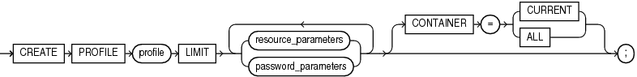
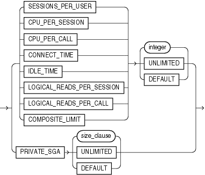
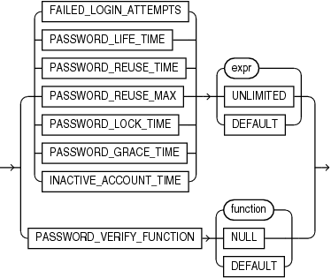

Note:

Oracle recommends that you use the Database Resource Manager rather than this SQL statement to establish resource limits. The Database Resource Manager offers a more flexible means of managing and tracking resource use. For more information on the Database Resource Manager, refer to [Oracle Database Administrator's Guide.](https://docs.oracle.com/pls/topic/lookup?ctx=en/database/oracle/oracle-database/12.2/sqlrf&id=ADMIN027)

Purpose

Use the `CREATE` `PROFILE` statement to create a profile, which is a set of limits on database resources. If you assign the profile to a user, then that user cannot exceed these limits.

To specify resource limits for a user, you must:

- Enable resource limits dynamically with the `ALTER` `SYSTEM` statement or with the initialization parameter `RESOURCE_LIMIT`. This parameter does not apply to password resources. Password resources are always enabled.
- Create a profile that defines the limits using the `CREATE` `PROFILE` statement
- Assign the profile to the user using the `CREATE` `USER` or `ALTER` `USER` statement

In a multitenant environment, different profiles can be assigned to a common user in the root and in a PDB. When the common user logs in to the PDB, a profile whose setting applies to the session depends on whether the settings are password-related or resource-related.

- Password-related profile settings are fetched from the profile that is assigned to the common user in the root. For example, suppose you assign a common profile `c##prof` (in which `FAILED_LOGIN_ATTEMPTS` is set to 1) to common user `c##admin` in the root. In a PDB that user is assigned a local profile `local_prof` (in which `FAILED_LOGIN_ATTEMPTS` is set to 6.) Common user `c##admin` is allowed only one failed login attempt when he or she tries to log in to the PDB where `loc_prof` is assigned to him.
- Resource-related profile settings specified in the profile assigned to a user in a PDB get used without consulting resource-related settings in a profile assigned to the common user in the root. For example, if the profile `local_prof` that is assigned to user `c##admin` in a PDB has `SESSIONS_PER_USER` set to 2, then ` c##admin` is only allowed only 2 concurrent sessions when he or she logs in to the PDB `loc_prof` is assigned to him, regardless of value of this setting in a profile assigned to him in the root.

See Also:

[Oracle Database Security Guide](https://docs.oracle.com/pls/topic/lookup?ctx=en/database/oracle/oracle-database/12.2/sqlrf&id=DBSEG002) for a detailed description and explanation of how to use password management and protection

Prerequisites

To create a profile, you must have the `CREATE` `PROFILE` system privilege.

To specify the `CONTAINER` clause, you must be connected to a multitenant container database (CDB). To specify `CONTAINER` `=` `ALL`, the current container must be the root. To specify `CONTAINER` `=` `CURRENT`, the current container must be a pluggable database (PDB).

Syntax

create\_profile::=



> ```
> CREATE PROFILE profile
>   LIMIT { resource_parameters
>         | password_parameters
>         }...
>   [ CONTAINER = { CURRENT | ALL } ] ;
> ```


resource\_parameters::=



> ```
> { { SESSIONS_PER_USER
>   | CPU_PER_SESSION
>   | CPU_PER_CALL
>   | CONNECT_TIME
>   | IDLE_TIME
>   | LOGICAL_READS_PER_SESSION
>   | LOGICAL_READS_PER_CALL
>   | COMPOSITE_LIMIT
>   }
>   { integer | UNLIMITED | DEFAULT }
> | PRIVATE_SGA
>   { size_clause | UNLIMITED | DEFAULT }
> }
> ```


([size\_clause::=](size_clause.md)

password\_parameters::=



> ```
> { { FAILED_LOGIN_ATTEMPTS
>   | PASSWORD_LIFE_TIME
>   | PASSWORD_REUSE_TIME
>   | PASSWORD_REUSE_MAX
>   | PASSWORD_LOCK_TIME
>   | PASSWORD_GRACE_TIME
>   | INACTIVE_ACCOUNT_TIME
>   }
>   { expr | UNLIMITED | DEFAULT }
> | PASSWORD_VERIFY_FUNCTION
>   { function | NULL | DEFAULT }
> }
> ```


Semantics

profile

Specify the name of the profile to be created. The name must satisfy the requirements listed in " [Database Object Naming Rules](Database-Object-Names-and-Qualifiers.md) ". Use profiles to limit the database resources available to a user for a single call or a single session.

In a non-CDB, a profile name cannot begin with `C##` or `c##`.

In a CDB, the requirements for a profile name are as follows:

- The name of a common profile must begin with characters that are a case-insensitive match to the prefix specified by the `COMMON_USER_PREFIX` initialization parameter. By default, the prefix is `C##`.
- The name of a local profile must not begin with characters that are a case-insensitive match to the prefix specified by the `COMMON_USER_PREFIX` initialization parameter. Regardless of the value of `COMMON_USER_PREFIX`, the name of a local profile can never begin with `C##` or `c##`.

Note:

If the value of `COMMON_USER_PREFIX` is an empty string, then there are no requirements for common or local profile names with one exception: the name of a local profile can never begin with `C##` or `c##`. Oracle recommends against using an empty string value because it might result in conflicts between the names of local and common profiles when a PDB is plugged into a different CDB, or when opening a PDB that was closed when a common user was created.

Oracle Database enforces resource limits in the following ways:

- If a user exceeds the `CONNECT_TIME` or `IDLE_TIME` session resource limit, then the database rolls back the current transaction and ends the session. When the user process next issues a call, the database returns an error.
- If a user attempts to perform an operation that exceeds the limit for other session resources, then the database aborts the operation, rolls back the current statement, and immediately returns an error. The user can then commit or roll back the current transaction, and must then end the session.
- If a user attempts to perform an operation that exceeds the limit for a single call, then the database aborts the operation, rolls back the current statement, and returns an error, leaving the current transaction intact.

Note:

- You can use fractions of days for all parameters that limit time, with days as units. For example, 1 hour is 1/24 and 1 minute is 1/1440.
- You can specify resource limits for users regardless of whether the resource limits are enabled. However, Oracle Database does not enforce the limits until you enable them.

See Also:

" Creating a Profile: Example "

UNLIMITED

When specified with a resource parameter, `UNLIMITED` indicates that a user assigned this profile can use an unlimited amount of this resource. When specified with a password parameter, `UNLIMITED` indicates that no limit has been set for the parameter.

DEFAULT

Specify `DEFAULT` if you want to omit a limit for this resource in this profile. A user assigned this profile is subject to the limit for this resource specified in the `DEFAULT` profile. The `DEFAULT` profile initially defines unlimited resources. You can change those limits with the `ALTER` `PROFILE` statement.

Any user who is not explicitly assigned a profile is subject to the limits defined in the `DEFAULT` profile. Also, if the profile that is explicitly assigned to a user omits limits for some resources or specifies `DEFAULT` for some limits, then the user is subject to the limits on those resources defined by the `DEFAULT` profile.

resource\_parameters

SESSIONS\_PER\_USER

Specify the number of concurrent sessions to which you want to limit the user.

CPU\_PER\_SESSION

Specify the CPU time limit for a session, expressed in hundredth of seconds.

CPU\_PER\_CALL

Specify the CPU time limit for a call (a parse, execute, or fetch), expressed in hundredths of seconds.

CONNECT\_TIME

Specify the total elapsed time limit for a session, expressed in minutes.

IDLE\_TIME

Specify the permitted periods of continuous inactive time during a session, expressed in minutes. Long-running queries and other operations are not subject to this limit.

When you set an idle timeout of X minutes, note that the session will take a couple of additional minutes to be terminated.

On the client application side, the error message shows up only the next time, when the idle client attempts to issue a new command.

LOGICAL\_READS\_PER\_SESSION

Specify the permitted number of data blocks read in a session, including blocks read from memory and disk.

LOGICAL\_READS\_PER\_CALL

Specify the permitted number of data blocks read for a call to process a SQL statement (a parse, execute, or fetch).

PRIVATE\_SGA

Specify the amount of private space a session can allocate in the shared pool of the system global area (SGA). Refer to [size\_clause](size_clause.md) for information on that clause.

Note:

This limit applies only if you are using shared server architecture. The private space for a session in the SGA includes private SQL and PL/SQL areas, but not shared SQL and PL/SQL areas.

COMPOSITE\_LIMIT

Specify the total resource cost for a session, expressed in service units. Oracle Database calculates the total service units as a weighted sum of `CPU_PER_SESSION`, `CONNECT_TIME`, `LOGICAL_READS_PER_SESSION`, and `PRIVATE_SGA`.

See Also:

- [ALTER RESOURCE COST](ALTER-RESOURCE-COST.md) for information on how to specify the weight for each session resource
- " Setting Profile Resource Limits: Example "

password\_parameters

Use the following clauses to set password parameters. Parameters that set lengths of time—that is, all the password parameters except `FAILED_LOGIN_ATTEMPTS` and `PASSWORD_REUSE_MAX` —are interpreted in number of days. For testing purposes you can specify minutes (n/1440) or even seconds (n/86400) for these parameters. You can also use a decimal value for this purpose (for example.0833 for approximately one hour). The minimum value is 1 second. The maximum value is 24855 days. For `FAILED_LOGIN_ATTEMPTS` and `PASSWORD_REUSE_MAX`, you must specify an integer.

FAILED\_LOGIN\_ATTEMPTS

Specify the number of consecutive failed attempts to log in to the user account before the account is locked. If you omit this clause, then the default is 10 times.

PASSWORD\_LIFE\_TIME

Specify the number of days the same password can be used for authentication. If you also set a value for `PASSWORD_GRACE_TIME`, then the password expires if it is not changed within the grace period, and further connections are rejected. If you omit this clause, then the default is 180 days.

See Also:

[Oracle Database Security Guide](https://docs.oracle.com/pls/topic/lookup?ctx=en/database/oracle/oracle-database/12.2/sqlrf&id=DBSEG567) for information on setting `PASSWORD_LIFE_TIME` to a low value

PASSWORD\_REUSE\_TIME and PASSWORD\_REUSE\_MAX

These two parameters must be set in conjunction with each other. `PASSWORD_REUSE_TIME` specifies the number of days before which a password cannot be reused. `PASSWORD_REUSE_MAX` specifies the number of password changes required before the current password can be reused. For these parameter to have any effect, you must specify a value for both of them.

- If you specify a value for both of these parameters, then the user cannot reuse a password until the password has been changed the number of times specified for `PASSWORD_REUSE_MAX` during the number of days specified for `PASSWORD_REUSE_TIME`.
	For example, if you specify `PASSWORD_REUSE_TIME` to 30 and `PASSWORD_REUSE_MAX` to 10, then the user can reuse the password after 30 days if the password has already been changed 10 times.
- If you specify a value for either of these parameters and specify `UNLIMITED` for the other, then the user can never reuse a password.
- If you specify `DEFAULT` for either parameter, then Oracle Database uses the value defined in the `DEFAULT` profile. By default, all parameters are set to `UNLIMITED` in the `DEFAULT` profile. If you have not changed the default setting of `UNLIMITED` in the `DEFAULT` profile, then the database treats the value for that parameter as `UNLIMITED`.
- If you set both of these parameters to `UNLIMITED`, then the database ignores both of them. This is the default if you omit both parameters.

PASSWORD\_LOCK\_TIME

Specify the number of days an account will be locked after the specified number of consecutive failed login attempts. If you omit this clause, then the default is 1 day.

PASSWORD\_GRACE\_TIME

Specify the number of days after the grace period begins during which a warning is issued and login is allowed. If you omit this clause, then the default is 7 days.

INACTIVE\_ACCOUNT\_TIME

Specify the permitted number of consecutive days of no logins to the user account, after which the account will be locked. The minimum value is 15 days. The maximum value is 24855. If you omit this clause, then the default is `UNLIMITED`.

PASSWORD\_VERIFY\_FUNCTION

The `PASSWORD_VERIFY_FUNCTION` clause lets a PL/SQL password complexity verification script be passed as an argument to the `CREATE` `PROFILE` statement. Oracle Database provides a default script, but you can create your own routine or use third-party software instead.

- For `function`, specify the name of the password complexity verification routine. The function must exist in the `SYS` schema and you must have `EXECUTE` privilege on the function.
- Specify `NULL` to indicate that no password verification is performed.

If you specify `expr` for any of the password parameters, then the expression can be of any form except scalar subquery expression.

Restriction on Password Parameters

When you assign a profile to an external user or a global user, the password parameters do not take effect for that user.

See Also:

" Setting Profile Password Limits: Example "

CONTAINER Clause

The `CONTAINER` clause applies when you are connected to a CDB. However, it is not necessary to specify the `CONTAINER` clause because its default values are the only allowed values.

- To create a common profile, you must be connected to the root. You can optionally specify `CONTAINER` `=` `ALL`, which is the default when you are connected to the root.
- To create a local profile, you must be connected to a PDB. You can optionally specify `CONTAINER` `=` `CURRENT`, which is the default when you are connected to a PDB.

Examples

Creating a Profile: Example

The following statement creates the profile `new_profile`:

```
CREATE PROFILE new_profile
  LIMIT PASSWORD_REUSE_MAX 10
        PASSWORD_REUSE_TIME 30;
```

Setting Profile Resource Limits: Example

The following statement creates the profile `app_user`:

```
CREATE PROFILE app_user LIMIT 
   SESSIONS_PER_USER          UNLIMITED 
   CPU_PER_SESSION            UNLIMITED 
   CPU_PER_CALL               3000 
   CONNECT_TIME               45 
   LOGICAL_READS_PER_SESSION  DEFAULT 
   LOGICAL_READS_PER_CALL     1000 
   PRIVATE_SGA                15K
   COMPOSITE_LIMIT            5000000;
```

If you assign the `app_user` profile to a user, then the user is subject to the following limits in subsequent sessions:

- The user can have any number of concurrent sessions.
- In a single session, the user can consume an unlimited amount of CPU time.
- A single call made by the user cannot consume more than 30 seconds of CPU time.
- A single session cannot last for more than 45 minutes.
- In a single session, the number of data blocks read from memory and disk is subject to the limit specified in the `DEFAULT` profile.
- A single call made by the user cannot read more than 1000 data blocks from memory and disk.
- A single session cannot allocate more than 15 kilobytes of memory in the SGA.
- In a single session, the total resource cost cannot exceed 5 million service units. The formula for calculating the total resource cost is specified by the `ALTER` `RESOURCE` `COST` statement.
- Since the `app_user` profile omits a limit for `IDLE_TIME` and for password limits, the user is subject to the limits on these resources specified in the `DEFAULT` profile.

Setting Profile Password Limits: Example

The following statement creates the `app_user2` profile with password limits values set:

```
CREATE PROFILE app_user2 LIMIT
   FAILED_LOGIN_ATTEMPTS 5
   PASSWORD_LIFE_TIME 60
   PASSWORD_REUSE_TIME 60
   PASSWORD_REUSE_MAX 5
   PASSWORD_VERIFY_FUNCTION ora12c_verify_function
   PASSWORD_LOCK_TIME 1/24
   PASSWORD_GRACE_TIME 10
   INACTIVE_ACCOUNT_TIME 30;
```

This example uses the default Oracle Database password verification function, `ora12c_verify_function`. Refer to [Oracle Database Security Guide](https://docs.oracle.com/pls/topic/lookup?ctx=en/database/oracle/oracle-database/12.2/sqlrf&id=DBSEG002) for information on using this verification function provided or designing your own verification function.