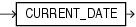

Syntax



> ```
> CURRENT_DATE
> ```


Purpose

`CURRENT_DATE` returns the current date in the session time zone, in a value in the Gregorian calendar of data type `DATE`.

Examples

The following example illustrates that `CURRENT_DATE` is sensitive to the session time zone:

```
ALTER SESSION SET TIME_ZONE = '-5:0';
ALTER SESSION SET NLS_DATE_FORMAT = 'DD-MON-YYYY HH24:MI:SS';
SELECT SESSIONTIMEZONE, CURRENT_DATE FROM DUAL;

SESSIONTIMEZONE CURRENT_DATE
--------------- --------------------
-05:00          29-MAY-2000 13:14:03

ALTER SESSION SET TIME_ZONE = '-8:0';
SELECT SESSIONTIMEZONE, CURRENT_DATE FROM DUAL;

SESSIONTIMEZONE CURRENT_DATE
--------------- --------------------
-08:00          29-MAY-2000 10:14:33
```